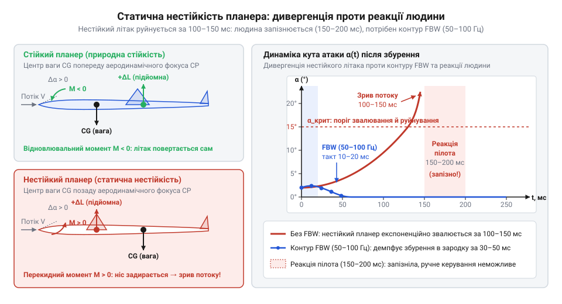
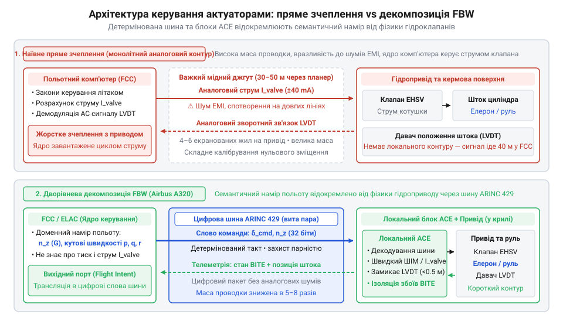

# Еволюція електродистанційного керування: від механічних тяг до цифрових шин актуаторів

## Тупик механічних тяг та аеродинамічна нестійкість

Десятиліттями надійність польоту спиралася на прямий механічний зв'язок: зусилля рук пілота передавалися до кермових поверхонь через сталеві троси, жорсткі тяги та гідравлічні бустери. Та зі зростанням швидкостей і розмірів літаків механіка зайшла в глухий кут. Деформація гнучкого фюзеляжу й теплове розширення спричиняли люфти та заїдання. Багатокілометрові траси кабелів і гідроліній додавали десятки тонн мертвої маси, підвищуючи ризик заклинювання.

Справжню кризу спричинила аеродинаміка. Задля надманевреності та економії пального центр ваги змістили назад, за аеродинамічний фокус тиску. Класичний літак відновлює рівновагу сам, немов флюгер. Натомість планер із послабленою статичною стійкістю (@@en|relaxed static stability@@, від англ. *relax* — послаблювати та лат. *stabilis* — стійкий) миттєво підхоплює збурення: порив вітру підіймає ніс, підіймальна сила зростає, і машина експоненційно завалюється.

Кут атаки наростає до катастрофічного звалювання за 100–150 мілісекунд. Фізіологічна затримка реакції людини становить щонайменше 150–200 мілісекунд: пілот запізнюється за фізикою збурення, а спроба втрутитися штурвалом лише розгойдує планер. Пряме ручне керування нестійким апаратом стало фізично неможливим.

*Зміщення центру ваги за фокус тиску робить планер нестійким: збурення наростає за 100–150 мс, тому втримати машину здатний лише цифровий контур із частотою 50–100 Гц, а не людина з затримкою реакції 150–200 мс.*

Єдиним виходом став розрив прямого зв'язку між кабіною і приводами: стабілізацію передали автоматичному комп'ютерному контуру з частотою 50–100 Гц, здатному демпфувати збурення ще до усвідомлення їх людиною.

## Дослідний політ: NASA F-8 DFBW

Перехід від теорії до практики вимагав радикального кроку: повністю довірити літак обчислювачу. У 1972 році Дослідницький центр NASA імені Драйдена підняв у повітря модифікований винищувач F-8C Crusader. З літака вперше в історії авіації повністю демонтували механічні тяги та троси: кермовими поверхнями керувала суто цифрова система (@@en|Digital Fly-by-Wire@@, DFBW, від англ. *fly* — літати та *wire* — дріт).

Головною перепоною була недовіра до надійності тодішньої електроніки. Щоб довести життєздатність концепції, інженери використали бортовий комп'ютер @@en|Apollo Guidance Computer@@ (AGC), що вже довів безвідмовність у польотах на Місяць. Його прошивна пам'ять на магнітних осердях (@@en|core rope memory@@) не боялася вібрацій і знеструмлення, забезпечивши замкнений контур стабілізації в реальному часі.

Проте перший політ оголив фундаментальну архітектурну ваду системи — пряме зчеплення польотного комп'ютера з аналоговими сервоклапанами. Центральний процесор із мізерною швидкодією витрачав дорогі такти на генерацію струмів котушок і опитування індукційних давачів положення штока (@@en|LVDT@@, від англ. *Linear Variable Differential Transformer* — лінійний диференціальний трансформатор). Водночас товсті пучки аналогових кабелів тяглися через весь планер до гідравліки, залишаючись вразливими до електромагнітних завад та ударів блискавок.

## Винищувач F-16 і суперечка про резервування

Досвід експериментального F-8 проклав шлях у серійну авіацію, але зустрів опір військових конструкторів. Створюючи винищувач General Dynamics F-16 Fighting Falcon (1974–1978), інженери свідомо заклали аеродинамічну нестійкість задля надманевреності. Консервативне крило вимагало зберегти резервні сталеві троси на випадок відмови електроніки чи знеструмлення.

Архітектори @@en|Fly-by-Wire@@ математично довели: на нестійкому планері аварійний механічний контур є смертельною ілюзією. Якщо обчислювальний контур відмовляє, планер експоненційно завалюється за частки секунди. Людина фізично не здатна розпізнати збій і перемкнутися на ручний режим до того, як літак зруйнують закритичні перевантаження.

Безпеку польоту переклали з металу на надлишковість обчислень. У F-16 застосували чотирикратне резервування (@@en|quadruple redundancy@@, від лат. *quadruplus* — чотирикратний та *redundantia* — надмірність): чотири незалежні аналогові канали (на пізніших версіях C/D — цифрові) паралельно обробляли покази датчиків і команди бічної ручки керування. Апаратний арбітр за принципом мажоритарного голосування (@@en|majority voting@@, від лат. *major* — більший) зіставляв виходи всіх ліній. Через технологічний розкид компонентів, температурний дрейф і шуми напруга в аналогових лініях ніколи не збігається абсолютно, а просте середнє арифметичне непридатне: одиничний пробій транзистора викликає стрибок напруги до упору, що спотворило б спільний сигнал і різко смикнуло рулі. Тому арбітр поєднував селекцію середнього значення (@@en|mid-value selection@@) та міжканальні порогові компаратори (@@en|threshold comparator@@, від лат. *comparare* — порівнювати). На виконавчі приводи подавався лише медіанний сигнал, що відсікав крайні викиди, а компаратори неперервно вимірювали різницю напруг між усіма парами ліній. Якщо сигнал одного каналу відхилявся від сусідніх понад допустимий поріг довше за час перехідного процесу, схема фіксувала відмову, знеструмлювала аварійне реле й троє інших каналів миттєво ізолювали збійну гілку без переривання керування. Механізм вимагав точного розрахунку порогу: надто чутливий компаратор хибно відсікав справні лінії через випадкові вібрації, а завищений поріг пропускав повільний дрейф нульової точки, причому кожна ізоляція незворотно деградувала систему до трійки каналів, де наступна відмова позбавляла арбітра більшості.

Така структура звела катастрофічну ймовірність відмови до рівня, меншого за 10⁻⁷ на годину польоту. Софтверна й апаратна надлишковість довела, що узгоджені обчислювальні контури надійніші за сталеві тяги.

## Airbus A320 та ізоляція контуру актуаторів

Масштабування цифрового керування на пасажирську авіацію натрапило на фізичні межі планера. Створений наприкінці 1980-х років @@en|Airbus A320@@ став першим цивільним лайнером із цифровою системою @@en|Fly-by-Wire@@ та бічними ручками (@@en|side-stick@@, від англ. *side* — бік і *stick* — важіль). Пасажирське крило несе десятки поверхонь: елерони, спойлери, закрилки й рулі. Якщо на винищувачі комп'ютер ще міг напряму тягнути дроти до кількох приводів, то в лайнері пряме зчеплення вимагало б кілометрів важких кабельних джгутів, вразливих до завад і блискавок.

Виходом став поділ керування на два ізольовані рівні через послідовні цифрові шини (@@en|ARINC 429@@ та @@en|MIL-STD-1553@@). Центральні польотні обчислювачі (@@en|ELAC@@ — керма висоти й елеронів, @@en|SEC@@ — спойлерів і керма висоти) перестали керувати клапанами. Вони формулювали суто семантичний польотний намір: цільові кутові швидкості, кути крену й коефіцієнт нормального перевантаження (@@en|G-load@@, від англ. *gravity* — тяжіння та *load* — навантаження). Ядро не знало ні про міліметри ходу поршнів, ні про міліампери на котушках гідравліки. Доставку наміру підпорядкували принципу суворого детермінізму (від лат. *determino* — визначаю) шини @@en|ARINC 429@@. Вона працює в режимі односпрямованого циклічного мовлення, де єдиний передавач безупинно транслює 32-бітні слова за фіксованим розкладом. Оскільки лінія має лише одне джерело, колізії неможливі фізично, що гарантує доставку польотного наміру в жорсткі часові межі без черг і непередбачуваних затримок. Такий детермінізм вимагає надлишковості: шина спалює смугу пропускання на циклічне надсилання навіть незмінних величин, а зворотний зв'язок вимагає окремої фізичної пари дротів. При цьому протокол не підтримує повторних спроб чи підтверджень: актуатор виявляє збій лише за бітом парності та таймаутом чергового слова, а спроба передати більше параметрів ламає фіксований розклад польотного циклу.

*Дворівнева архітектура Fly-by-Wire: центральний обчислювач передає семантичний намір цифровою шиною ARINC 429, а локальні блоки ACE керують гідроклапанами безпосередньо біля поверхонь планера.*

Усі низькорівневі деталі заліза делегували блокам електроніки керування приводами (@@en|Actuator Control Electronics@@, ACE, від лат. *actuator* — той, що рухає). Встановлені поруч із гідроциліндрами, вони приймали цифрові пакети шиною, дозували струми на сервоклапани та самостійно замикали контур зворотного зв'язку за положенням штока через сенсори @@en|LVDT@@. Авіоніка винайшла класичний вихідний адаптер: доменне ядро транслює чистий намір, а периферія бере на себе фізику конкретних приводів.

## Протистояння філософій: захист конверта проти авторитету

Поділ керування на польотний намір і роботу приводів породив дилему влади: хто має вирішальне слово в кризі? Коли обчислювач стоїть між людиною та кермовими поверхнями, виникає питання меж: чи має алгоритм право відкинути наказ пілота, якщо той тягне ручку за критичний кут, рятуючи літак від зіткнення з землею?

Європейська школа в проєкті @@en|Airbus A320@@ запровадила жорсткий захист польотного конверта (@@en|hard envelope protection@@, від англ. *hard* — жорсткий та *envelope* — конверт). За цією філософією комп'ютер має абсолютний авторитет: софт блокує будь-яку спробу вийти за критичний кут атаки чи допустиме перевантаження планера, хоч як пілот відхилятиме бічну ручку @@en|side-stick@@. Ручки пілотів пасивні й механічно не зв'язані між собою: капітан не відчуває дій другого пілота, а вхідні команди алгебраїчно сумуються або вимагають кнопки пріоритету. Архітектура вважає людину в стресі головним джерелом ризику й захищає планер навіть усупереч екіпажу.

Американська школа в лайнері @@en|Boeing 777@@ (1994) на шині @@en|ARINC 629@@ обрала м'який захист (@@en|soft envelope protection@@, від англ. *soft* — м'який). Тут найвищий авторитет зберігає людина. На межі конверта сервомотори створюють відчутний тактильний опір на штурвалах, а самі штурвали моторизовано синхронізуються між пілотами. Проте подолавши штучний бар'єр підвищеним зусиллям рук, льотчик може переступити розрахунковий ліміт і виконати закритичний маневр, якщо цього вимагає порятунок літака.

Цей розкол розкриває природу валідації наміру в архітектурі. Жорсткий інваріант захищає від помилки оператора в стресі, але робить систему заручницею сенсорів: хибні покази датчиків здатні заблокувати порятунок. М'який захист трактує бізнес-правила не як глухий мур, а як пружний бар'єр із можливістю усвідомленого аварійного перевизначення оператором.

## Розвінчання міфів та уроки для архітектури

Навколо переходу до @@en|Fly-by-Wire@@ виникли дві стійкі омани. Перший міф стверджує, ніби цифрові шини впровадили суто заради полегшення конструкції: мовляв, тонкі дроти легші за важкі троси й тяги. Насправді виграш у масі був лише приємним бонусом. Справжньою причиною стала аеродинамічна нестійкість: людина біологічно не здатна втримати такий планер без невпинного комп'ютерного контуру. Другий міф приписує цифровізації намір повністю усунути пілота з кабіни. Насправді система створювалася як підсилювач наміру людини: алгоритм узяв на себе виснажливу рутину щосекундної стабілізації заліза, звільнивши увагу екіпажу для стратегічних рішень.

Ця сорокарічна еволюція авіоніки дає фундаментальний урок для проєктування програмних систем. У [гексагональній архітектурі Digital Homes](root:progarch/dh-v2-hexagon) доменне ядро не повинно знати про фізику заліза. Вихідний порт (@@en|driven port@@) формулює виключно чистий семантичний намір: бажану швидкість вентилятора, цільову температуру кімнати чи часовий дедлайн. Жоден вендорний регістр, таймінг чи байтовий кадр шини не має права просочуватися крізь цю межу в бізнес-правила.

Усю низькорівневу взаємодію з протоколами беруть на себе вихідні адаптери (@@en|egress adapters@@, від лат. *egressus* — вихід) — програмні аналоги блоків @@en|ACE@@. Такий адаптер переводить абстрактну команду в кадри шин @@en|Modbus@@ чи @@en|CAN@@ або повідомлення @@en|MQTT@@, масштабує інженерні величини та витримує жорсткі таймаути. Якщо сервопривід заклинило чи шина відкинула пакет, адаптер локалізує апаратний збій. Доменне ядро отримує типізовану помилку й продовжує роботу, не ризикуючи падінням усього застосунку через відмову одного пристрою.
