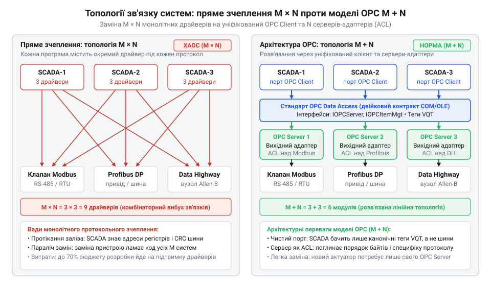
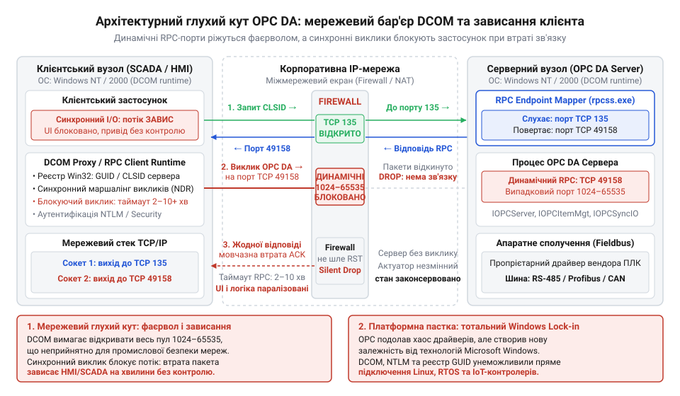

# Витоки ізоляції польових шин: від «війн польових протоколів» 1980-х до стандарту OPC

## Пастка пропрієтарного коду та вибух драйверів

До 1980-х років заводи керувалися уніфікованими електричними ланцюгами: польові датчики й виконавчі приводи підключали до щита диспетчера аналоговою струмовою петлею 4–20 мА (англ. @@en|current loop@@). Стрілочні покажчики та самописці сприймали рівень постійного струму безпосередньо й не потребували програмних перекладачів.

Цифрова революція зруйнувала цю простоту. Впровадження програмованих логічних контролерів і перших [диспетчерських систем керування](root:sf-apps/scada-systems-architecture) — @@en|SCADA@@ (від англ. @@en|supervisory control and data acquisition@@ — диспетчерський нагляд і збирання даних) — замінило окремі дроти на послідовні цифрові шини. Проте єдиного цифрового стандарту не виникло: виробники прагнули прив'язати клієнтів до власного заліза. Американська компанія Modicon запровадила протокол @@en|Modbus@@, її конкурент Allen-Bradley розробив @@en|Data Highway@@, а німецький концерн Siemens випустив @@de|Sinaut@@.

Через несумісність форматів зв'язку інженери мусили зашивати протокольну специфікацію конкретного обладнання безпосередньо в бізнес-код керування. Для кожного пристрою всередині програми власноруч писали опитування шини, формування бітових пакетів і підрахунок контрольних сум. Цей апаратний шар зв'язку формував окремий драйвер (від англ. @@en|driver@@, дієслово @@en|drive@@ — вести, керувати).

Різниця починалася вже з порядку байтів (англ. @@en|endianness@@, від @@en|end@@ — кінець, край): протокол @@en|Modbus@@ вимагав передавати старший байт шістнадцятибітного числа першим (англ. @@en|big-endian@@), тоді як інші шини надсилали спершу молодший байт (англ. @@en|little-endian@@). Без ручного переставляння байтів у бізнес-коді значення температури чи кута повороту `256` перетворювалося на `1`, через що привід спрацьовував хибно. Не менш глибоким було розходження в узгодженні лінії та таймінгах відповіді: у специфікації @@en|Modbus RTU@@ межі кадру визначалися суворим інтервалом тиші щонайменше в три з половиною символи, через що випадкова затримка диспетчерської операційної системи розривала повідомлення. Натомість шина @@en|Data Highway@@ спиралася на явні квитанції підтвердження з фіксованим часом очікування відповіді від пристрою. Навіть захист від спотворень вимагав окремої реалізації під кожне залізо: опитування контролерів Modicon змушувало рахувати контрольну суму @@en|CRC-16@@ (від англ. @@en|cyclic redundancy check@@ — циклічна перевірка надлишковості) за поліномом `0xA001` зі зворотним порядком байтів самої суми, тоді як протоколи конкурентів послуговувалися іншими математичними поліномами або простим контролем парності.

Коли кількість керуючих програм на підприємстві досягала `M`, а типів контролерів і периферійного заліза — `N`, пряме зшивання спричиняло комбінаторний глухий кут: вимагалося розробити й супроводжувати `M × N` унікальних драйверів. Заміна навіть одного застарілого електропривода на модель іншої марки зупиняла завод: програмісти були змушені переписувати бізнес-логіку диспетчерської системи. Це протокольне зчеплення паралізувало модернізацію виробництва й довело, що шинний зв'язок потребує суворої ізоляції від прикладного софту.

## Крах кабельного універсалізму у війнах шин

Найпростішим виходом із комбінаторного глухого кута здавалася уніфікація самої міді: прокласти один спільний кабель через увесь завод і зобов'язати всіх виробників передавати команди за єдиним протоколом. Наприкінці 1980-х років Міжнародна електротехнічна комісія (@@en|IEC@@) спробувала втілити цю ідею в [стандарті польових шин](root:com-protocol/fieldbus-wars-iec-61158) @@en|IEC 61158@@. Проте інженерний задум розбився об комерційні інтереси виробників устаткування.

Розпочалися корпоративні конфлікти, відомі як «війни польових шин» (англ. @@en|Fieldbus Wars@@, від @@en|field@@ — виробничий майданчик і @@en|bus@@ — спільна шина зв'язку). Провідні промислові гіганти утворили ворогуючі альянси. Німецький блок під проводом Siemens захищав шину @@de|Profibus@@ (від англ. @@en|Process Field Bus@@ — шина виробничих процесів), прагнучи зберегти ринки Європи. Американська коаліція на чолі з Fisher-Rosemount та Foxboro лобіювала @@en|Foundation Fieldbus@@. Водночас власні позиції відстоювали французький @@en|WorldFIP@@ та американська компанія Echelon з технологією @@en|LonWorks@@.

Пошук спільного знаменника саботували свідомо. Власна шина була головним інструментом утримання клієнта у вендорній пастці (англ. @@en|vendor lock-in@@): замовник, який придбав контролер певної фірми, мусив десятиліттями купувати лише її виконавчі приводи та датчики. Виробники конструювали несумісність на фізичному (L1) та канальному (L2) рівнях моделі @@en|OSI@@: використовували різні напруги в лінії, несумісні модуляції сигналу, специфічні таймінги та пропрієтарні алгоритми арбітражу шини.

Після десятиліття безплідних дебатів і взаємних вето комітет @@en|IEC@@ у 1999 році здався. Замість єдиного регламенту ухвалили формальний компроміс: стандарт @@en|IEC 61158@@ увібрав у себе вісім взаємно несумісних протоколів. Фізична кабельна стандартизація провалилася. Стало зрозуміло, що подолати розкол на апаратному рівні не вдасться — ізоляцію протоколів належало перенести з мідного кабелю в операційну систему.

## Консорціум 1996 року та пакт OLE

На початку 1990-х років загроза паралічу нависла вже над самими виробниками софту автоматизації. Масовий перехід робочих станцій диспетчерів на 32-розрядну операційну систему @@en|Windows NT@@ вимагав тотального переписування коду. Витрати на підтримку сотень окремих драйверів поглинали до 70% бюджетів розробки: замість розвитку аналітики чи інтерфейсів інженери нескінченно латали низькорівневі опитування шин.

У 1995 році лідери конкуруючих корпорацій — Fisher-Rosemount, Rockwell Software, Opto 22, Intellution та Intuitive Technology — усвідомили, що написання драйверів перестало давати ринкову перевагу і веде галузь до колапсу. Вони створили робочу групу @@en|OPC Task Force@@, уклавши технологічний мир. Якщо домовитися про спільний дріт у цеху неможливо, межу уніфікації слід підняти на рівень системного софту.

Фундаментом для угоди обрали компонентну модель Microsoft @@en|COM@@ (від англ. @@en|Component Object Model@@ — компонентна модель об'єктів) та технологію зв'язування об'єктів @@en|OLE@@ (від англ. @@en|Object Linking and Embedding@@ — зв'язування та впровадження об'єктів). Модель надавала суворий [двійковий інтерфейс компонентів](root:sf-lang/com-binary-interface) (англ. @@en|binary interface@@): клієнт і сервер могли взаємодіяти через таблиці віртуальних методів прямо в пам'яті Windows NT, навіть якщо були скомпільовані різними мовами програмування.

У серпні 1996 року консорціум оприлюднив специфікацію @@en|OLE for Process Control@@ 1.0 (згодом @@en|OPC Data Access@@, або @@en|OPC DA@@). Документ закріпив фундаментальний розподіл обов'язків: виробник обладнання розробляв один спеціалізований сервіс — @@en|OPC Server@@, що приховував специфіку заліза, а автори систем диспетчеризації реалізовували уніфікований клієнтський порт — @@en|OPC Client@@. Двійковий контракт розірвав пряме зчеплення програми з польовими шинами.

## Архітектурний прорив моделі M плюс N

Пряме з'єднання `M` керуючих програм із `N` типами контролерів змушувало індустрію писати й підтримувати `M × N` монолітних драйверів. Поява специфікації @@en|OPC Data Access@@ розділила систему на постачальника даних і споживача. Виробник польового пристрою створює один @@en|OPC Server@@, а розробник @@en|SCADA@@ реалізує уніфікований @@en|OPC Client@@. Загальна кількість точок інтеграції скоротилася до формули `M + N`.

*Зв'язування M × N вимагає окремого драйвера під кожну пару компонентів, тоді як схема M + N зводить взаємодію до єдиного серверного контракту.*

За своєю архітектурною суттю @@en|OPC Server@@ став класичним вихідним адаптером і прикладом [антикорупційного шару](root:sf-apps/anti-corruption-layer). Він поглинає низькорівневу специфіку шини: таймінги порту RS-485, зміщення регістрів Modbus та підрахунок контрольних сум. Натомість сервер виставляє стандартні інтерфейси @@en|COM@@ — зокрема `IOPCServer` для керування сесією та `IOPCItemMgt` для групування точок опитування, — перетворюючи сирі байти на ієрархічне дерево @@en|тегів@@ (англ. @@en|tag@@ — ярлик).

Керуюче ядро перестало залежати від апаратного транспорту, перейшовши на канонічну структуру даних — тріаду @@en|VQT@@ (від англ. @@en|Value@@ — значення, @@en|Quality@@ — якість, @@en|Timestamp@@ — часова мітка). Кожен вимір містить саму величину, бітову ознаку достовірності сигналу та точний час опитування. Завдяки цьому логіка вищих рівнів підпорядковується принципам [гексагональної форми застосунку](root:progarch/dh-v2-hexagon): бізнес-правила керують технологічним процесом, нічого не знаючи про фізичну шину за межами адаптера.

## Розвінчання альтруїзму вендорів і пастка DCOM

Успіх стандарту @@en|OPC@@ легко сприйняти як тріумф альтруїзму та відкритості промислових гігантів. Насправді виробники автоматики рятували власні прибутки. Утримання штату інженерів для розробки й супроводу сотень драйверів під кожну сторонню систему @@en|SCADA@@ стало фінансовим глухим кутом. Створивши спільний програмний інтерфейс, вендори переклали ці витрати на розробників софту, проте надійно зберегли пропрієтарні польові шини та монополію на контролери й актуатори: стандартизовано було лише фасад, а не самі пристрої.

Другий міф полягав у вірі в універсальну сумісність і технологічну нейтральність. Класичний @@en|OPC@@ позбавив індустрію хаосу шинних протоколів, але натомість прирік на жорстку залежність від платформи @@en|Microsoft Windows@@. Щойно виникала потреба винести клієнт і сервер на різні комп'ютери крізь мережу, у дію вступала технологія @@en|DCOM@@ (англ. @@en|Distributed Component Object Model@@, від лат. @@la|distribuere@@ — розподіляти) — і перетворювала супровід на системне жахіття.

*Мережева архітектура DCOM: динамічні порти блокуються міжмережевими екранами, а синхронні виклики заморожують клієнтський застосунок у разі втрати пакетів.*

Диспетчер кінцевих точок протоколу @@en|RPC@@ (англ. @@en|Remote Procedure Call@@) на порту 135 призначав для передачі даних випадкові порти з діапазону 1024–65535. Заводські міжмережеві екрани відкидали такі пакети, змушуючи адмінів або вимикати мережевий захист, або будувати складні тунелі. Гірше того: синхронні блокуючі виклики DCOM «вішали» інтерфейс клієнта за найменшої затримки чи втрати зв'язку. Несумісність із @@en|Linux@@ та мікроконтролерами законсервувала промисловість на роки, доки ці вади не подолав платформонезалежний стандарт [OPC UA](root:com-protocol/opc-ua-industrial-information-model).

## Уроки OPC для сучасних систем IoT

Сучасний ринок @@en|IoT@@ наступає на ті самі граблі сорокарічної давнини. У розподілених системах на зразок @@en|Digital Homes@@ панує зоопарк протоколів: @@en|Zigbee@@, @@en|Z-Wave@@, @@en|Modbus@@, @@en|BACnet@@, @@en|BLE@@ (англ. @@en|Bluetooth Low Energy@@), @@en|Thread@@ та @@en|Matter@@. Якщо доменні мікросервіси напряму взаємодіють із вендорними шлюзами й оперують номерами регістрів чи кадрами повідомлень, архітектура неминуче скочується в комбінаторну пастку `M × N`. Заміна бездротового привода опалення на дротовий аналог паралізує випуски й вимагає переписування бізнес-логіки системи.

Архітектурний урок @@en|OPC@@ полягає не в технологіях @@en|Microsoft@@, а в розв'язанні залежностей через модель `M + N`. У гексагональній архітектурі цей принцип утілює вихідний порт (англ. @@en|egress port@@, від лат. @@la|egressus@@ — вихід). Доменне ядро транслює виключно чистий семантичний намір: наприклад, змінити положення клапана чи встановити уставку температури. Будь-яка спроба протягнути в сигнатуру порту таймінги шини чи байти пакетів створює [порт зі специфікою апаратури](root:progarch/port-smelling-of-storage), інфікуючи бізнес-правила деталями заліза.

Специфіку фізичних ліній бере на себе виділений вихідний адаптер. Він інкапсулює арбітраж шини, контрольні суми й повторні спроби передачі, діючи як антикорупційний шар над периферією. Адаптер транслює сирі коди помилок у типізовані доменні події. Завдяки такій ізоляції заміна протоколу зв'язку чи моделі @@la|актуатора@@ обмежується новим адаптером, залишаючи бізнес-ядро непорушним.
