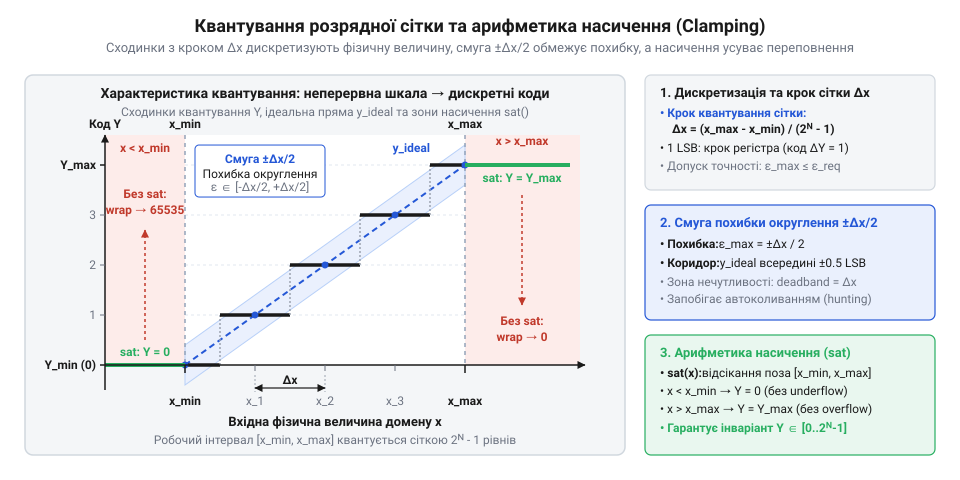
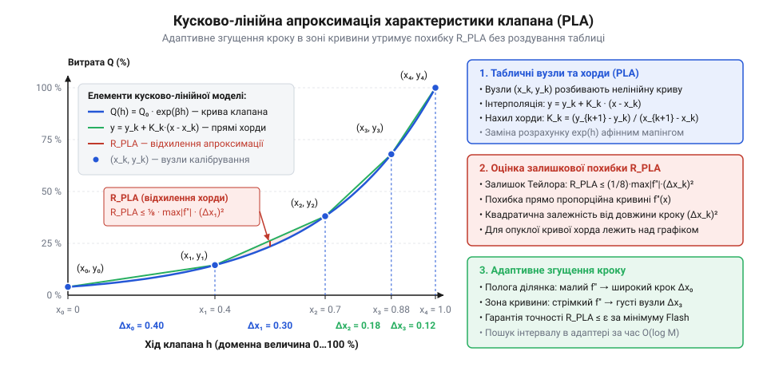

# Математичний апарат масштабування, квантування та калібрування величин актуаторів

## Пастка наївного масштабування величин актуаторів

Контур опалення отримує команду перекрити подачу теплоносія: кімната нагрілася, і цифровий регулятор обчислює нове положення клапана. У доменній моделі положення штока виражене неперервною величиною від `0.0` до `100.0%`. Проте під час перехідного процесу через звичайне @@en|перерегулювання@@ (англ. @@en|overshoot@@) обчислене значення на мить стає від'ємним — наприклад, `-0.2%`. Розібрати принципи роботи цифрового регулятора та причини виникнення перерегулювання в контурах опалення допоможе [ПІД-регулювання в контурах мікроклімату](root:math-analysis/pid-calculus).

Коли вихідний адаптер передає цю команду в контролер, [архітектура застосунку](root:progarch/dh-v2-hexagon) стикається з межею між чистим доменом і залізом. За наївного підходу інженер зводить перетворення величини до простого множення на коефіцієнт та прямого приведення типів: дійсне число без перевірок перетворюють на беззнаковий 16-бітний регістр Modbus `uint16_t`.

У двійковій арифметиці мікроконтролера таке перетворення спрацьовує фатально: від'ємне число викликає @@en|циклічне переповнення@@ (англ. @@en|wrap-around overflow@@) розрядної сітки. Значення `-0.2%` стає не нулем, а перетворюється на максимальне число `65535`. Замість повного перекриття клапана @@en|актуатор@@ (від лат. *actus* — дія) миттєво відкриває прохід гарячої води на повну потужність. Наслідок — тепловий удар, закипання теплоносія й аварійний розрив трубопроводу.

Зворотна ілюзія безпеки виникає під час спроби керувати прецизійним дозатором або заслінкою вентиляції. Неперервна зміна доменної величини не перетворюється на плавний рух приводу: обмежена кількість бітів неминуче вносить похибку, якою супроводжується будь-яке @@en|квантування@@ (від лат. *quantum* — скільки). Крок апаратної сітки створює ділянку, яку називають @@en|зоною нечутливості@@ (англ. @@en|deadband@@): привід ігнорує малі зміни сигналу, а після накопичення різниці різко стрибає вперед. Через нелінійну гідравліку шток потрапляє у стійкі автоколивання, розбиваючи посадкову поверхню арматури.

Пряме приведення типів руйнує обладнання. Неперервні дійсні числа домену принципово несумісні з дискретною пам'яттю контролерів. Надійний адаптер потребує суворого математичного апарату: лінійного масштабування шкал, примусового насичення крайових значень для захисту від переповнення, аналітичного розрахунку похибки квантування та лінеаризації кривих відгуку.

## Пряме та зворотне афінне масштабування

Доменна модель керування описує фізичні процеси неперервними величинами: відсотком відкриття заслінки, кутом повороту чи витратою теплоносія. Натомість апаратний рівень приймає цілі числа фіксованого діапазону — 10-бітний ШІМ від 0 до 1023, 12-бітний ЦАП від 0 до 4095 або 16-бітний регістр контролера від 0 до 10000. Щоб узгодити ці два світи, адаптер будує @@la|афінне масштабування@@ (від лат. *affinis* — суміжний, споріднений) — лінійне відображення неперервного доменного відрізка `[x_min, x_max]` у дискретний апаратний інтервал `[Y_min, Y_max]`.

Загальне рівняння прямої лінії визначають через кутовий коефіцієнт `K` та зміщення `B`:
`y = K · x + B`
де `x` — вхідна фізична величина, а `y` — розрахунковий код регістра.

Значення коефіцієнтів знаходять із крайових умов: крайнім точкам фізичного інтервалу `x_min` та `x_max` мають відповідати крайні коди регістра `Y_min` та `Y_max`. Віднімаючи перше крайове рівняння від другого, виводимо різницю кодів регістра:

```
Y_max - Y_min
= (K · x_max + B) - (K · x_min + B)    [підстановка крайових умов]
= K · (x_max - x_min)                  [групування різниці]
```

Згрупована різниця дозволяє виразити коефіцієнт масштабу через співвідношення діапазонів:

```
K = (Y_max - Y_min) / (x_max - x_min)
```

Коефіцієнт `K` задає ціну поділки — скільки дискретних одиниць регістра припадає на одиницю фізичної величини. Підставляючи знайдений коефіцієнт `K` у рівняння для точки мінімуму `x_min`, знаходимо зміщення нуля `B`:

```
B = Y_min - K · x_min
```

Зміщення `B` гарантує точний збіг початків обох шкал у нульовій точці відліку.

Для прямої шкали зростання фізичної величини збільшує вихідний код, тому `K > 0`. Проте в інженерних системах поширені інверсні шкали: наприклад, нормально відкритий клапан перекриває потік при подачі максимального сигналу. Тоді нульовій витраті `x_min` відповідає повний код `Y_max`, а максимальній витраті `x_max` — нульовий код `Y_min`. У цьому разі різниця `Y_min - Y_max` від'ємна, тому `K < 0`. Формула залишається незмінною, але від'ємний нахил природно розвертає полярність керування.

Підставляючи крайову умову нульової витрати `x_min`, за якої вихідний код регістра сягає максимуму `Y_max`, знаходимо зміщення нуля `B` для інверсної шкали:

```
B
= y - K · x                            [вираження зміщення з рівняння прямої]
= Y_max - K · x_min                    [підстановка крайової точки x_min та Y_max]
```

Оскільки нахил `K < 0`, за невід'ємного `x_min` віднімання від'ємного добутку робить зміщення `B` більшим за максимальний апаратний код `Y_max`. Через це беззнаковий регістр ризикує переповнитися, а константа зміщення вимагає ширшого цілочисельного типу для проміжних обчислень.

Щоб не обчислювати й не зберігати в адаптері окреме зміщення `B`, підставимо його вираз `B = Y_min - K · x_min` безпосередньо в загальне рівняння прямої:

```
y
= K · x + B
= K · x + (Y_min - K · x_min)          [підстановка зміщення B]
= Y_min + K · (x - x_min)              [винесення K за дужки]
```

Отримана компактна форма точки-нахилу (@@en|point-slope form@@) `y = Y_min + K · (x - x_min)` спирається на вже відомі паспортні межі шкал і не потребує зберігання окремого зміщення `B`: адаптер бере відхилення фізичної величини від початку діапазону `x - x_min`, масштабує його коефіцієнтом `K` та додає нижню апаратну межу `Y_min` (а для інверсної шкали відштовхується від точки `(x_min, Y_max)` у вигляді `y = Y_max + K · (x - x_min)`).

Коли адаптер опитує привод, він читає цілочисельний регістр стану (@@en|status word@@) і має відновити реальне фізичне положення штока. Щоб доменне ядро не залежало від апаратних розрядностей, як вимагає [архітектура застосунку](root:progarch/dh-v2-hexagon), адаптер виражає фізичну величину `x` через прочитаний код `y`:

```
x = (y - B) / K
```

Оскільки фізичний інтервал актуатора не стискається в одну точку (`x_max ≠ x_min`), ділення на `K` завжди коректне, а відновлене значення `x` має точність розрядної сітки приладу.

## Арифметика насичення та захист розрядності

Лінійна модель передбачає, що вхідні значення не виходять за робочий відрізок `[x_min, x_max]`. У замкненому контурі керування це припущення регулярно порушується: шум сенсорів, стрибки завдання чи сплески регуляторів, що потребують [захисту від інтегрального насичення](root:math-analysis/anti-windup), викидають величину за паспортні межі. Якщо передати позадіапазонне число в афінну формулу без перевірки, обчислений код вийде за діапазон `[Y_min, Y_max]`. У беззнаковому 16-бітному регістрі код `-1` перетвориться на `65535`: клапан, замість плавного закриття, раптово відкриється на повну потужність через @@en|циклічне переповнення@@ розрядної сітки.

Щоб запобігти аварії, на вході та виході обчислень застосовують @@en|арифметику насичення@@ (від лат. *saturatio* — повне наповнення), яку реалізує оператор обмеження діапазону (@@en|clamping@@, від англ. *clamp* — затискач). Оператор обмеження приймає поточне значення `v`, нижню межу `v_min` та верхню межу `v_max`:

```
sat(v, v_min, v_max) = min(max(v, v_min), v_max)
```

Цей вираз примусово повертає величину в рамки: будь-яке значення, менше за нижню межу, зрізається до `v_min`, а більше за верхню — до `v_max`.

Завдяки монотонності лінійної функції масштабування, застосування оператора насичення дає строгий інваріант вихідного коду `y_safe`:

```
y_safe = sat(K · sat(x, x_min, x_max) + B, Y_min, Y_max)
```

Обмеження вхідного аргументу запобігає переповненню на етапі множення, а фінальне насичення гарантує належність результату компактному відрізку `[Y_min, Y_max]` за будь-яких сплесків. Геометрично це відсікає лінійну характеристику горизонтальними ділянками насичення.


*Відображення фізичної шкали у коди регістра: лінійна характеристика квантується сходинками сітки і переходить у горизонтальні полиці насичення за межами робочого діапазону.*

У мікроконтролерах без апаратного блоку дробових чисел перетворення реалізують у цілочисельній арифметиці з @@en|фіксованою комою@@: коефіцієнт `K` представляють як дріб `K_num / K_den`. Тут критичний порядок дій. Якщо спочатку виконати цілочисельне ділення `(x / K_den) · K_num`, відкидання дробової частини знищить точність обчислень.

Для збереження дробових часток цілочисельний код `y` обчислюють із попереднім масштабуванням добутку на чисельник `K_num` та наступним діленням на знаменник `K_den`. Проте пряме цілочисельне ділення реалізує операцію відкидання дробової частини (@@en|truncation@@, від лат. *truncatio* — підтинання, обтинання): остача від ділення відкидається в бік нуля, тому результат завжди занижується. Через це вихідний код дістає систематичний однобічний зсув — у середньому на пів кванта розрядної сітки (`-0.5`). У замкненому контурі керування актуатор через такий зсув постійно недоотримує розрахункову команду, що спричиняє стійку статичну похибку положення клапана.

Щоб усунути систематичний однобічний зсув і досягти симетричного округлення до найближчого цілого без переходу до повільної арифметики з рухомою комою, застосовують цілочисельну корекцію: до чисельника перед діленням додають половину дільника `K_den / 2`. Цей доданок зміщує ділене рівно на половину ціни поділки. Якщо остача від ділення дорівнює або перевищує половину дільника (`≥ K_den / 2`, що відповідає дробовій частці `≥ 0.5`), додана величина переносить одиницю в цілу частину частки. Якщо ж остача менша за половину дільника, добавка не досягає наступного цілого кратного й поглинається операцією цілочисельного ділення без зміни результату. Із цією поправкою обчислення набуває форми `y = ((x - x_min) · K_num + K_den / 2) / K_den + Y_min`, тоді як базову цілочисельну формулу з простим відкиданням дробової частини записують як:

```
y = ((x - x_min) · K_num) / K_den + Y_min
```

Такий порядок дій мінімізує похибку відкидання дробової частини, але потребує контролю розрядності проміжного результату. Множення двох 16-бітних чисел здатне переповнити 16-бітний регістр до моменту ділення. Щоб усунути внутрішнє переповнення, проміжний @@en|акумулятор@@ (від лат. *accumulator* — нагромаджувач) обов'язково розширюють до 32 або 64 бітів. Лише після ділення результат перевіряють оператором насичення й безпечно приводять до вихідної розрядності регістра.

## Розрядна сітка та похибка квантування

Навіть після масштабування та захисту від переповнення вихідний адаптер стикається з межею заліза: апаратний регістр дискретний. Фізична величина в домені неперервна, але `N`-бітний регістр контролера, [ЦАП чи ШІМ](root:hw-analog/dac-pwm-hardware-resolution) ділить робочий відрізок `[x_min, x_max]` на `2ᴺ - 1` рівних квантів. Усі проміжні значення спотворює @@la|дискретизація@@ (від лат. *discretus* — розділений, відокремлений).

Ціну однієї поділки апаратної сітки — крок квантування `Δx` — знаходять діленням фізичного діапазону на кількість доступних інтервалів:

```
Δx = (x_max - x_min) / (2ᴺ - 1)
```

Знаменник `2ᴺ - 1` виражає число проміжків між нульовим і максимальним цілочисельними кодами.

Відхилення між неперервним значенням і дискретним кодом визначає максимальну абсолютна похибку `ε_max`. Просте відкидання дробової частини дає похибку `ε_max = Δx`. Натомість симетричне округлення до найближчого цілого ділить інтервал сітки навпіл:

```
ε_max = Δx / 2
```

Таке округлення розподіляє похибку симетрично в межах `[-Δx / 2, +Δx / 2]`. Відносна похибка квантування `δ = ε_max / (x_max - x_min)` становить `1 / (2 · (2ᴺ - 1))`.

Щоб регулятор гарантував технологічний допуск, похибка має задовольняти доменний критерій допустимої точності: `ε_max ≤ ε_req`. Підставляючи крок сітки, виводимо мінімально необхідну розрядність регістра `N`:

```
ε_max ≤ ε_req
= Δx / 2 ≤ ε_req                             [симетричне округлення]
= (x_max - x_min) / (2 · (2ᴺ - 1)) ≤ ε_req   [підстановка кроку квантування]
= 2ᴺ - 1 ≥ (x_max - x_min) / (2 · ε_req)     [відокремлення розрядності]
= N ≥ ⌈log₂((x_max - x_min) / (2 · ε_req) + 1)⌉ [логарифмування та взяття стелі]
```

Операція взяття стелі `⌈...⌉` знаходить найближче більше ціле число бітів, достатнє для виконання вимоги.

Якщо обрати розрядність, меншу за `N`, крок сітки перевищить допуск, і в системі виникне @@en|зона нечутливості@@. Доки відхилення фізичного параметра від уставки менше за крок квантування `Δx`, цілочисельний код регістра не змінюється, і шток актуатора лишається нерухомим. Проте стала ненульова похибка змушує інтегральну складову регулятора безперервно накопичувати суму відхилень у часі. Не маючи відгуку від приводу, інтегратор нарощує розрахункове зусилля всередині зони нечутливості, доки сигнал нарешті не перетне поріг округлення до наступного коду. У цей момент актуатор отримує надлишковий імпульс: шток різко стрибає на цілий квант і перелітає уставку, спричиняючи значне @@en|перерегулювання@@. Знак похибки змінюється на протилежний, але привід знову завмирає в зоні нечутливості нового кванта, доки інтегратор не розрядиться й не накопичить зусилля для зворотного ривка. У замкненому контурі виникають незгасні @@en|автоколивання@@ (англ. @@en|hunting@@ — хитання штока навколо цілі), що виснажують приводний механізм і швидко руйнують механіку клапана.

## Нелінійні калібрувальні криві та лінеаризація

У гідравлічних контурах Digital Homes фізичний відгук актуаторів далекий від лінійного: тепловіддача [радіатора або калорифера](root:ph-thermodynamics/heat-exchanger-thermal-saturation) насичується вже при невеликих витратах теплоносія. За наївного лінійного керування технологічний контур демонструє надмірне підсилення на початку шкали. Найменше зміщення штока викликає різкий сплеск тепловіддачі, через що регулятор втрачає стійкість і зривається в незгасні @@en|автоколивання@@. Натомість при великих витратах потік зростає, але температура майже не змінюється, створюючи повну нечутливість актуатора до команд.

Щоб компенсувати нелінійність теплообмінника, застосовують @@la|еквіпроцентний клапан@@ (від лат. *aequus* — рівний та *pro centum* — на сотню). Його пропускну здатність описує експоненційна залежність поточної витрати `Q` від відносного ходу штока `h`:

```
Q(h) = Q_0 · R^(h - 1)
```

де `Q_0` — номінальна максимальна витрата, а `R` — @@en|діапазон регулювання@@ (англ. @@en|rangeability@@, відношення максимальної витрати до мінімальної, зазвичай від 25 до 50). При закритому штоку (`h = 0`) початковий потік становить `Q_0 / R`, а при повному відкритті (`h = 1`) досягає максимуму `Q_0`.

Коли доменній моделі [архітектури застосунку](root:progarch/dh-v2-hexagon) потрібна точна витрата `Q`, вихідний адаптер має обчислити необхідне положення штока `h`. Для цього відношення витрат `Q / Q_0 = R^(h - 1)` логарифмують:

```
ln(Q / Q_0)
= ln(R^(h - 1))                          [підстановка еквіпроцентної залежності]
= (h - 1) · ln(R)                        [винесення показника степеня]
```

Ділення на `ln(R)` та додавання одиниці визначає шукану компенсуючу характеристику:

```
h(Q) = 1 + ln(Q / Q_0) / ln(R)
```

Така зворотна функція здійснює @@la|лінеаризацію@@ (від лат. *linearis* — лінійний): підстановка `h(Q)` в експоненту дає тотожність `Q(h(Q)) = Q`. Калібрувальна крива адаптера скасовує кривину клапана й стабілізує контур у всьому діапазоні регулювання.

## Кусково-лінійна апроксимація калібрувальних таблиць

Обчислення трансцендентних функцій для компенсуючої характеристики клапана неприпустимо уповільнює цикл керування на мікроконтролерах без апаратного блоку дійсної арифметики. До того ж реальні калібрувальні криві виробники часто задають дискретними таблицями паспортних вимірів.

Щоб замінити розрахунок логарифмів та експонент швидкими цілочисельними операціями, нелінійну криву розбивають на `M` опорних вузлів `(x_k, y_k)` методом @@en|кусково-лінійної апроксимації@@ (від лат. *approximare* — наближатися; @@en|piecewise linear approximation@@, скорочено PLA). Для довільного значення `x` всередині сегмента `[x_k, x_{k+1}]` із кроком `Δx_k = x_{k+1} - x_k` вихідну величину положення `y` знаходять через @@en|лінійну інтерполяцію@@ (від лат. *inter* — між, та *polire* — згладжувати; @@en|linear interpolation@@):

```
y = y_k + K_k · (x - x_k)                                    [афінна форма на інтервалі]
  = y_k + (y_{k+1} - y_k) · (x - x_k) / (x_{k+1} - x_k)      [підстановка нахилу хорди]
```

Отримане рівняння зводить нелінійну залежність до афінного зсуву та пропорційного приросту вздовж прямої хорди. Максимальне аналітичне відхилення хорди від гладкої функції відгуку `f(x)` обмежується залишковим членом формули Тейлора `R_PLA`:

```
R_PLA ≤ (1/8) · max|f''(x)| · (Δx_k)²      [максимальна похибка інтерполяції]
```

Ця нерівність показує, що похибка прямо пропорційна другій похідній `f''(x)`, яка виражає кривину характеристики, та квадрату кроку `(Δx_k)²`. Замість рівномірного розбиття застосовують нерівномірну сітку: вузли адаптивно згущують у зонах високої кривини й розріджують на пологих ділянках, зберігаючи мінімальний розмір таблиці в оперативній пам'яті контролера.


*Апроксимація нелінійної кривої клапана хордами: адаптивне розміщення опорних вузлів гарантує дотримання похибки R_PLA без роздування таблиці.*

Обчислювальний конвеєр [адаптера вихідного порту](root:sf-apps/actuator-protocol-mapping) транслює команду домену в цілочисельний регістр за чотири послідовні кроки:
1. Захист від позадіапазонних значень через оператор @@en|насичення@@ `x_sat = sat(x, x_min, x_max)`.
2. Локалізація робочого інтервалу `[x_k, x_{k+1}]` бінарним пошуком у впорядкованій таблиці вузлів за час `O(log M)`.
3. Кусково-лінійний перерахунок точки всередині інтервалу в @@en|арифметиці з фіксованою комою@@.
4. Симетричне округлення результату до розрядної сітки апаратного регістра @@en|актуатора@@.
