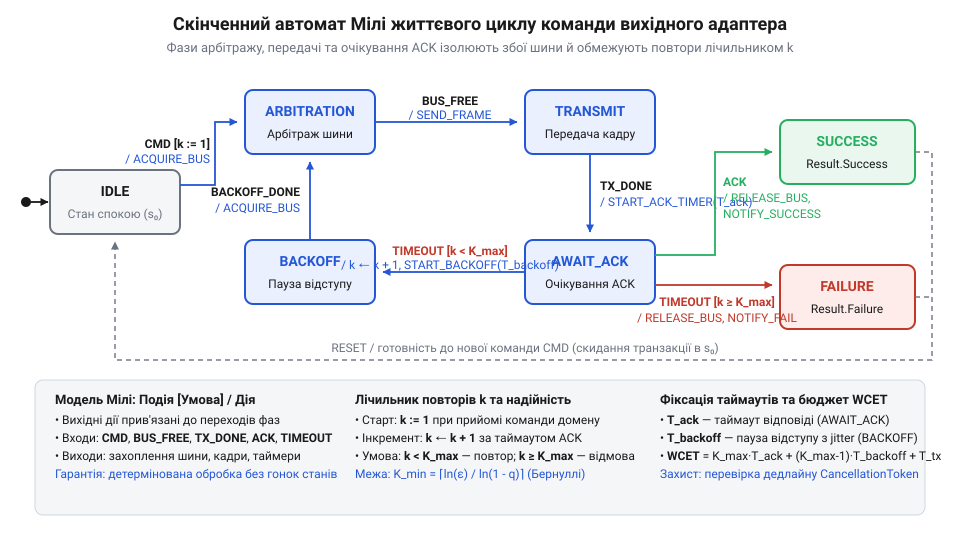
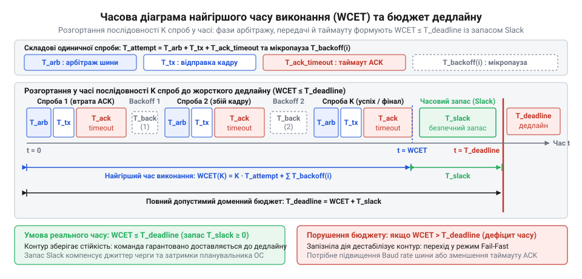

# Автоматна модель трансляції команд та ймовірнісний аналіз таймаутів шини

## Пастка наївного надсилання та ненадійна шина

Коли [вихідний адаптер ядра](root:progarch/dh-v2-hexagon) керує мікрокліматом у @@en|Digital Homes@@, взаємодія з фізичним пристроєм здається звичайним викликом функції: домен віддає наказ відкрити регулювальний клапан опалення, а драйвер записує байти в послідовний порт. На реальній лінії @@en|RS-485@@ під протоколом @@en|Modbus RTU@@ ця наївність руйнує систему двома різними шляхами.

Перша пастка — блокувальне очікування. Спільна шина зазнає електромагнітних завад і колізій. Якщо кадр спотворено або пристрій зайнятий, адаптер, що синхронно чекає на відповідь, заморожує робочий потік. Черговий цикл регулювання пропускає свій квант часу, детермінізм керування втрачається, а черга доменних подій безконтрольно зростає.

Друга пастка — некеровані повтори відносних дій. Якщо додати примітивний цикл перевідправлення, адаптер стикається з асиметрією втрат: команда доходить до актуатора (@@en|actuator@@; від англ. *actuator* — привід, з лат. *actuare* — приводити в дію), клапан зміщується на крок уперед, проте зворотний кадр підтвердження (@@en|ACK@@; від англ. *acknowledgement* — підтвердження отримання) нищиться шумом у лінії. Не отримавши сигналу успіху, адаптер «наосліп» надсилає наказ удруге й утретє. Клапан тричі відкриває протік теплоносія замість одного разу, контур аварійно перегрівається, а надлишковий тиск зриває запобіжний клапан котла.

Фізичне середовище ніколи не гарантує безвідмовного зв’язку. Спроба сховати ненадійність шини за простим викликом функції створює оманливу ілюзію безпеки. Щоб гарантувати доставку й зберегти часові обмеження системи, адаптеру потрібна автоматна модель життєвого циклу команди з математичним розрахунком таймаутів, контролем кількості повторів і переходом до операцій, для яких доведено ідемпотентність (@@en|idempotency@@; від лат. *idem* — той самий і *potens* — здатний).

## Автоматна модель життєвого циклу команди

Щоб [вихідний адаптер ядра](root:progarch/dh-v2-hexagon) не заморожував робочий потік очікуванням відповіді та не втрачав лік повторним надсиланням, виконання кожної команди моделюють як скінченний автомат Мілі (@@en|Mealy machine@@; на честь математика Джорджа Мілі). Його поведінку строго задає математичний кортеж `M = (S, s₀, Σ, Λ, δ, λ)`, де вихідні дії прив'язані безпосередньо до переходів між станами.

Множина станів `S` декомпозує операцію на чіткі фізичні фази:
- `IDLE` — стан спокою `s₀`, готовність прийняти нову команду від домену;
- `ARBITRATION` — очікування звільнення та захоплення спільної шини (лат. *arbiter* — третейський суддя, @@en|arbitration@@);
- `TRANSMIT` — побайтове надсилання кадру в фізичну лінію;
- `AWAIT_ACK` — очікування підтвердження від пристрою за таймером таймауту (від англ. *time out* — час вичерпано, @@en|timeout@@) `T_ack`;
- `BACKOFF` — витримка паузи відступу (від англ. *back off* — відступати, @@en|backoff@@) перед повторною спробою;
- `SUCCESS` і `FAILURE` — термінальні стани завершення транзакції.

Алфавіт входів `Σ = {CMD, BUS_FREE, TX_DONE, ACK, TIMEOUT, BACKOFF_DONE}` охоплює асинхронні сигнали шини, таймерів і черги домену. Алфавіт виходів `Λ = {ACQUIRE_BUS, SEND_FRAME, START_ACK_TIMER, START_BACKOFF_TIMER, NOTIFY_SUCCESS, NOTIFY_FAILURE, DROP_FRAME, REJECT_BUSY, IGNORE}` визначає апаратні та системні реакції адаптера. Функція переходів `δ: S × Σ → S` і функція виходів `λ: S × Σ → Λ` усувають гонки станів: наприклад, у стані `AWAIT_ACK` за подією `TIMEOUT` автомат аналізує внутрішній лічильник спроб `k`. Якщо `k < K_max`, здійснюється перехід у `BACKOFF` із запуском таймера затримки та оновленням `k ← k + 1`; якщо ліміт вичерпано (`k ≥ K_max`) — відбувається перехід у `FAILURE` зі сповіщенням ядра про недосяжність актуатора.

У фізичній польовій шині сигнали не надходять у стерильному порядку. Повільний актуатор може надіслати підтвердження вже після спливу таймауту `T_ack`, коли адаптер перейшов у `BACKOFF` або повернувся в `IDLE`. Програмний таймер через нерівномірність планувальника операційної системи може спрацювати пізніше, коли відповідь уже прийнято й зафіксовано успіх. Паралельний потік ядра може викликати нову команду `CMD`, коли адаптер саме транслює байти попереднього кадру.

Якщо функція переходів є частковою і покриває лише очікувану послідовність, непередбачена подія викидає виняток і зупиняє потік. Запізніле підтвердження `ACK` у стані спокою `IDLE` чи арбітражу `ARBITRATION` помилково зараховується як відповідь на наступну команду, яка ще навіть не пішла в лінію. Надходження нової команди `CMD` під час передачі `TRANSMIT` розриває кадр посеред байтового потоку та спотворює дані на шині. Щоб усунути недетермінізм, функцію переходів і виходів формалізують як повновизначену матрицю переходів (лат. *matrix* — матка, першоджерело, @@en|transition matrix@@) розмірністю `|S| × |Σ|`:

| Стан `s` | `CMD` | `BUS_FREE` | `TX_DONE` | `ACK` | `TIMEOUT` | `BACKOFF_DONE` |
| :--- | :--- | :--- | :--- | :--- | :--- | :--- |
| `IDLE` | `ARBITRATION` / `ACQUIRE_BUS` | `IDLE` / `IGNORE` | `IDLE` / `IGNORE` | `IDLE` / `DROP_FRAME` | `IDLE` / `IGNORE` | `IDLE` / `IGNORE` |
| `ARBITRATION` | `ARBITRATION` / `REJECT_BUSY` | `TRANSMIT` / `SEND_FRAME` | `ARBITRATION` / `IGNORE` | `ARBITRATION` / `DROP_FRAME` | `ARBITRATION` / `IGNORE` | `ARBITRATION` / `IGNORE` |
| `TRANSMIT` | `TRANSMIT` / `REJECT_BUSY` | `TRANSMIT` / `IGNORE` | `AWAIT_ACK` / `START_ACK_TIMER` | `TRANSMIT` / `DROP_FRAME` | `TRANSMIT` / `IGNORE` | `TRANSMIT` / `IGNORE` |
| `AWAIT_ACK` | `AWAIT_ACK` / `REJECT_BUSY` | `AWAIT_ACK` / `IGNORE` | `AWAIT_ACK` / `IGNORE` | `SUCCESS` / `NOTIFY_SUCCESS` | `BACKOFF` / `START_BACKOFF_TIMER` (`k < K_max`)<br>`FAILURE` / `NOTIFY_FAILURE` (`k ≥ K_max`) | `AWAIT_ACK` / `IGNORE` |
| `BACKOFF` | `BACKOFF` / `REJECT_BUSY` | `BACKOFF` / `IGNORE` | `BACKOFF` / `IGNORE` | `BACKOFF` / `DROP_FRAME` | `BACKOFF` / `IGNORE` | `ARBITRATION` / `ACQUIRE_BUS` |
| `SUCCESS` | `ARBITRATION` / `ACQUIRE_BUS` | `SUCCESS` / `IGNORE` | `SUCCESS` / `IGNORE` | `SUCCESS` / `DROP_FRAME` | `SUCCESS` / `IGNORE` | `SUCCESS` / `IGNORE` |
| `FAILURE` | `ARBITRATION` / `ACQUIRE_BUS` | `FAILURE` / `IGNORE` | `FAILURE` / `IGNORE` | `FAILURE` / `DROP_FRAME` | `FAILURE` / `IGNORE` | `FAILURE` / `IGNORE` |

Неочікувані події шини у неробочих станах розв'язуються за двома детермінованими правилами. Будь-які запізнілі або фантомні сигнали шини й таймерів (`ACK`, `TIMEOUT`, `BUS_FREE`, `TX_DONE`) у станах, де вони не очікуються, замикаються у нейтральну самопетлю `δ(s, σ) = s`. Запізнілий пакет `ACK`, що надійшов у станах `IDLE`, `ARBITRATION`, `TRANSMIT` чи `BACKOFF` від повільного пристрою після спливу попереднього таймауту, скидається дією `DROP_FRAME` без зміни стану й лічильника спроб, тому він не підтверджує нову команду. Хибні переривання передавача або запізнілі спрацьовування таймера в цих же станах гасяться дією `IGNORE`, тому активні паузи та фази передачі не зриваються. Надходження нової доменної команди `CMD` у будь-якому зайнятому стані (`s ≠ IDLE`) зберігає поточний стан `δ(s, CMD) = s` і повертає дію `REJECT_BUSY`. Доменне ядро отримує негайний сигнал зайнятості або ставить команду в чергу, тому потік передачі активного кадру на фізичній лінії не переривається. Після термінальних станів `SUCCESS` або `FAILURE` та видачі сповіщення ядру автомат скидає лічильник `k ← 0` і повертається в стан готовності `IDLE` для прийому наступної команди.


*Граф переходів автомата Мілі: явне рознесення арбітражу, передачі та очікування підтвердження усуває гонки станів при асинхронній роботі з шиною.*

## Ймовірнісний розрахунок спроб доставки команди

Автомат усуває неоднозначність переходів, але потребує точного числа граничних спроб `K_max`. Якщо обрати це значення навмання, вихідний адаптер або передчасно здаватиметься під час коротких сплесків електромагнітних завад, або безпорадно блокуватиме шину нескінченними повторами в разі обриву дроту.

Фізична лінія передачі неминуче спотворює пакети. Нехай `p_c` позначає ймовірність втрати або спотворення кадру команди в прямому напрямку, а `p_a` — ймовірність втрати кадру підтвердження у зворотному напрямку внаслідок похибок кадру (@@en|frame error rate@@). Одинична спроба завершується успіхом лише за умови, що кадр команди неушкодженим прийнято актуатором, а зворотний кадр підтвердження без помилок повернувся до адаптера. Ймовірність успіху одиничної спроби `q` становить:

```
q = (1 - p_c) · (1 - p_a)
```

Оскільки спотворення в прямому та зворотному напрямках є незалежними подіями, добуток імовірностей їхнього успішного проходження задає частку транзакцій, що завершуються з першого разу.

За умови некорельованості завад між повторами кожна наступна спроба розгортається за схемою випробувань Бернуллі (@@en|Bernoulli trials@@; на честь математика Якоба Бернуллі). Проте в реальному фізичному середовищі це припущення легко руйнується: пуск двигунів чи комутація реле спричиняють тривалі пакетні сплески завад (@@en|burst errors@@; від англ. burst — раптовий сплеск). Такий сплеск шуму триває десятки мілісекунд і перекриває одразу кілька спроб передачі поспіль. Якщо адаптер повторює кадр негайно, усі спроби потрапляють у той самий інтервал збурення: похибки стають взаємозалежними, а весь бюджет повторів вичерпується намарно. Щоб розірвати часову кореляцію завад і повернути спробам статистичну незалежність, автомат витримує затримку відступу @@en|backoff@@ перед наступною спробою. Лише завдяки часовому рознесенню повторів схема Бернуллі залишається коректною: транзакція зазнає повної відмови тільки тоді, коли всі `K` спроб завершилися крахом. Залишкову ймовірність повної відмови `P_fail(K)` описує степеневий закон:

```
P_fail(K) = (1 - q)ᴷ
```

Зі зростанням кількості спроб `K` залишковий ризик спадає показниково, а підсумкова надійність доставки `P_succ(K) = 1 - (1 - q)ᴷ` наближається до одиниці.

Доменна специфікація вимагає, щоб імовірність збою не перевищувала гранично допустимий поріг похибки `ε`. Мінімальну кількість спроб `K_min`, необхідну для гарантування нерівності `P_fail(K) ≤ ε`, знаходимо аналітичним розв'язанням:

```
(1 - q)ᴷ              ≤ ε
K · ln(1 - q)         ≤ ln(ε)               [логарифмування обох частин за основою e]
K                     ≥ ln(ε) / ln(1 - q)   [ділення на від'ємний ln(1 - q) зі зміною знака]
K_min                 = ⌈ln(ε) / ln(1 - q)⌉ [округлення вгору до цілої кількості спроб]
```

Оскільки `0 < 1 - q < 1`, значення `ln(1 - q)` є строго від'ємним, тому ділення змінює знак нерівності на протилежний, а округлення вгору `⌈·⌉` гарантує досягнення цільової надійності.

**Розрахунок мінімальної кількості спроб для контуру опалення з порогом ε = 10⁻⁴:**
```
q     = (1 - 0.03) · (1 - 0.02) = 0.9506   [ймовірність успіху спроби при p_c = 0.03, p_a = 0.02]
1 - q = 1 - 0.9506 = 0.0494                [ймовірність невдачі спроби]
K_min = ⌈ln(10⁻⁴) / ln(0.0494)⌉            [підстановка значень цільової похибки та невдачі]
      = ⌈-9.2103 / -3.0078⌉                [обчислення натуральних логарифмів]
      = ⌈3.062⌉                            [ділення від'ємних величин]
      = 4                                  [округлення до найближчого більшого цілого]
```

Чотирьох спроб математично достатньо: залишкова ймовірність відмови становить `(0.0494)⁴ ≈ 5.95 · 10⁻⁶`, що суттєво нижче за норматив `10⁻⁴`. Скорочення бюджету до трьох спроб дало б ризик збою `(0.0494)³ ≈ 1.2 · 10⁻⁴`, що неприпустимо порушило б гарантії надійності доменної операції.

## Аналітична оцінка найгіршого часу виконання

Знання мінімальної кількості спроб `K_min` гарантує ймовірність доставки команди, проте не дає відповіді, скільки часу забере цей ланцюжок повторів. У фізичному контурі запізніла дія не менш руйнівна за втрачену: доки адаптер вичерпує спроби, тепловий об'єкт перегрівається та виходить з ладу.

Тривалість одиничної невдалої спроби `T_attempt` визначають три послідовні фази: максимальний час арбітражу шини `T_arb_max`, тривалість фізичної передачі кадру `T_tx` на заданій швидкості лінії та таймаут очікування підтвердження `T_ack_timeout` з урахуванням часу внутрішньої обробки в актуаторі. Якщо арбітраж залежить від завантаженості шини іншими вузлами, а таймаут — від швидкості реакції актуатора, то тривалість передачі `T_tx` визначається суто фізикою лінії та розміром повідомлення.

У послідовному каналі передавач виставляє дані в лінію біт за бітом. Кожен байт даних апаратний інтерфейс огортає службовими бітами синхронізації: обов'язковим старт-бітом на початку, додатковим бітом парності та одним або двома стоп-бітами наприкінці. Через це один переданий байт займає на лінії фізичний символ розміром `b_byte` бітів: 10 бітів у режимі без парності з одним стоп-бітом або 11 бітів у режимах із контролем парності чи двома стоп-бітами. Загальний обсяг кадру розміром `N_bytes` байтів на фізичному рівні становить `N_bytes · b_byte` бітів. Швидкість передачі лінії задають у бодах (від прізвища інженера Еміля Бодо та англ. *rate* — темп; @@en|baud rate@@) `R_baud`. За двійкового кодування один бод дорівнює одному біту за секунду. Фізичний час передачі кадру `T_tx` обчислюється як відношення сумарної кількості бітів кадру до швидкості лінії:

```
T_tx
= (N_bytes · b_byte) / R_baud      [добуток бітів кадру, поділений на швидкість лінії]
```

Ця формула викриває типову інженерну помилку: якщо обчислити час передачі лише за вісьмома бітами даних на байт без урахування службових бітів, оцінка `T_tx` виявиться заниженою на 20–27%. За типових для промислових шин швидкостей 9600 або 19200 біт/с передача навіть короткого кадру на 8 байтів триває від 4.2 до 9.2 мс. Коли адаптер занижує `T_tx`, таймер очікування підтвердження `T_ack_timeout` запускається завчасно — доки передавач іще виводить останні біти кадру в лінію. Таймер спливає раніше, ніж актуатор устигне прийняти кадр і відповісти, що спричиняє хибний таймаут на фізично справній лінії. Повна тривалість одиничної спроби об'єднує всі три складові:

```
T_attempt = T_arb_max + T_tx + T_ack_timeout
```

Оскільки кожна безуспішна спроба закінчується вичерпанням таймауту, цей інтервал задає верхню межу часових витрат одного кроку.

Між невдалими спробами автомат витримує паузи відступу `T_backoff(i)`. Повний найгірший час виконання (англ. @@en|worst-case execution time@@, `WCET`) послідовності з `K` спроб дорівнює:

```
WCET(K)
= K · T_attempt + ∑ T_backoff(i)      [сума спроб і пауз відступу для i від 1 до K - 1]
```

Вираз підсумовує затримки за найнесприятливішого сценарію, коли зв'язок підтверджується лише на останній спробі або транзакція завершується повною відмовою.

Фізичний процес накладає жорсткий доменний дедлайн (від англ. *deadline*, dead + line — крайня межа; @@en|deadline@@) `T_deadline`. Аби контур зберіг стійкість, виконання операції мусить задовольняти нерівність реального часу:

```
WCET(K_min) ≤ T_deadline
```

Різниця `T_slack = T_deadline - WCET(K_min)` утворює гарантований часовий запас (англ. @@en|slack time@@).


*Часова діаграма послідовності спроб: сума тривалостей фаз утворює найгірший час виконання, залишаючи безпечний часовий запас до дедлайну.*

Коли `WCET(K_min) > T_deadline`, виникає неминучий компроміс між надійністю та швидкістю: необхідна для похибки `ε` кількість повторів фізично не вкладається у відведений строк. У такому разі в [архітектурі Digital Homes v2](root:progarch/dh-v2-hexagon) адаптер не може повторювати надсилання «наосліп». Системі слід або підвищити швидкість передачі шини, або зменшити таймаут завдяки прискоренню відповіді актуатора, або задіяти аварійне відсікання (англ. @@en|fail-fast@@) і негайно сповістити домен про відмову.

## Втрата підтверджень та формальна ідемпотентність

Вичерпання таймауту очікування підтвердження `T_ack_timeout` в автоматі Мілі не означає, що @@en|актуатор@@ не виконав команду. Прямий кадр міг дійти без перешкод, а спотворився лише зворотний кадр @@en|ACK@@ з імовірністю `p_a > 0`. Адаптер не здатний розрізнити втрату запиту від втрати відповіді — це класична [дилема двох генералів](root:sf-distributed/two-generals-problem) (англ. @@en|two generals' problem@@) у фізичній лінії зв'язку. Фіксуючи таймаут, автомат повторно транслює команду в шину. Якщо операція відносна — наприклад, імпульсне перемикання бістабільного реле або зміщення штока клапана «додати 5%», — повторна доставка спричиняє аварійне подвійне спрацьовування.

Щоб повтори були безпечними, функція переходу стану актуатора має бути стійкою до дублювання викликів. Операція `f: S_actuator → S_actuator` над множиною станів пристрою `S_actuator` має властивість @@en|ідемпотентності@@ (від лат. *idem* — той самий та *potens* — здатний; @@en|idempotency@@), якщо для будь-якого стану `s ∈ S_actuator` повторне застосування залишає стан незмінним:

```
f(f(s)) = f(s)
```

Ця рівність гарантує: скільки б разів через втрачені підтвердження автомат не повторював команду, кінцевий стан виконавчого механізму не спотвориться.

Для захисту від накопичення помилок застосовують прямий запис абсолютного значення в регістр стану (англ. @@en|absolute register write@@). Нехай вектор `s` описує значення всіх регістрів актуатора, а операція запису `w` присвоює регістру за адресою `addr` значення `val`, тобто `w(s)[addr] = val`, зберігаючи решту регістрів без змін. Обчислимо результат повторного застосування запису для довільного стану `s`:

```
w(w(s))
= w(s')      [позначення проміжного стану s' = w(s), де s'[addr] = val]
= s''        [присвоєння s''[addr] = val та s''[k] = s'[k] для всіх k ≠ addr]
= s'         [бо цільовий регістр s'[addr] вже містить значення val]
= w(s)       [повернення до результату першого застосування]
```

Оскільки `w(w(s)) = w(s)`, абсолютний запис у регістри є строго ідемпотентним: повторна доставка того самого значення не змінює фізичного стану.

Звідси випливає архітектурне правило: [вихідний адаптер](root:progarch/dh-v2-hexagon) ніколи не транслює в шину відносних модифікацій. Будь-який доменний намір він перетворює виключно в абсолютні координати регістрів актуатора або супроводжує запит монотонним ідентифікатором транзакції.

## Інженерний синтез стійкого вихідного адаптера

Керування змішувальним клапаном теплої підлоги в [архітектурі Digital Homes v2](root:progarch/dh-v2-hexagon) потребує точного узгодження фізичних параметрів лінії @@en|RS-485@@ під протоколом @@en|Modbus RTU@@ (19200 біт/с), імовірності збоїв та часових меж контуру. Помилка у виборі таймауту чи кількості повторів призводить або до зриву дедлайну регулювання, або до аварійного перегріву теплоносія. Надійну роботу забезпечує послідовний інженерний розрахунок.

Синтез розпочинається з узгодження фізичного шуму лінії та вимог безпеки. За вимірюваннями завад імовірність втрати кадру команди становить `p_c = 0.03`, а кадру підтвердження — `p_a = 0.02`. Ймовірність успіху одиничної спроби дорівнює `q = (1 - 0.03) · (1 - 0.02) = 0.9506`. Технологічний регламент контуру опалення обмежує допустиму похибку порогом `ε = 10⁻⁴`. Розрахуємо мінімально необхідну кількість спроб `K_min`:

```
K_min
= ⌈ln(10⁻⁴) / ln(1 - 0.9506)⌉       [підстановка ε та q]
= ⌈-9.2103 / -3.0078⌉               [обчислення натуральних логарифмів]
= 4                                 [округлення вгору до цілого]
```

Чотири спроби забезпечують залишкову ймовірність збою `P_fail(4) = (1 - 0.9506)⁴ ≈ 6 · 10⁻⁶`, що гарантує надійність доставки 99.9994%.

На другому кроці розраховуємо часові межі спроби. Стандартний кадр функції запису одного регістру передає 8 байтових символів по 11 біт (старт-біт, вісім бітів даних, стоп-біт і біт парності), що на швидкості 19200 біт/с триває `T_tx = 8 · 11 / 19200 ≈ 4.6` мс. Додавши максимальний час арбітражу лінії `T_arb = 10` мс та таймаут очікування відповіді клапана `T_ack_timeout = 45` мс, дістаємо повну тривалість спроби `T_attempt`:

```
T_attempt
= 10 + 4.6 + 45                     [сума фаз арбітражу, передачі й таймауту]
= 59.6 мс                           [верхня межа тривалості однієї спроби]
```

Мікропаузу відступу між спробами фіксуємо як `T_backoff = 15` мс для згасання коливань напруги та колізій у лінії.

На третьому кроці зіставляємо часові витрати з фізичними обмеженнями нагріву підлоги. Терморегулятор вимагає оновлення положення штока клапана не пізніше за доменний дедлайн `T_deadline = 300` мс. Найгірший час виконання транзакції `WCET(4)` включає чотири повні спроби та три проміжні паузи відступу:

```
WCET(4)
= 4 · 59.6 + 3 · 15                 [чотири спроби та три паузи відступу]
= 238.4 + 45
= 283.4 мс                          [найгірший час виконання операції]
```

Оскільки `WCET(4) = 283.4 мс ≤ T_deadline = 300 мс`, часовий бюджет витримується із захисним запасом `T_slack = 300 - 283.4 = 16.6` мс.

Завершує розрахунок конфігурація автомата Мілі та правил трансляції дій. Лічильник повторів автомата обмежується значенням `K_min = 4`, а фази очікування керуються таймерами `T_ack_timeout` і `T_backoff`. Адаптер транслює будь-яку доменну зміну положення виключно в ідемпотентний абсолютний запис `WriteSingleRegister(0x0001, TargetValue)`. Навіть коли завади нищать підтвердження і змушують автомат відпрацювати всі спроби, повторна доставка кадру не зміщує клапан повторно й утримує систему в розрахунковому тепловому балансі.
