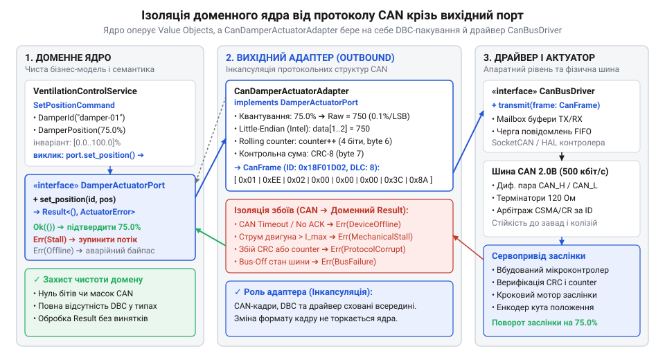
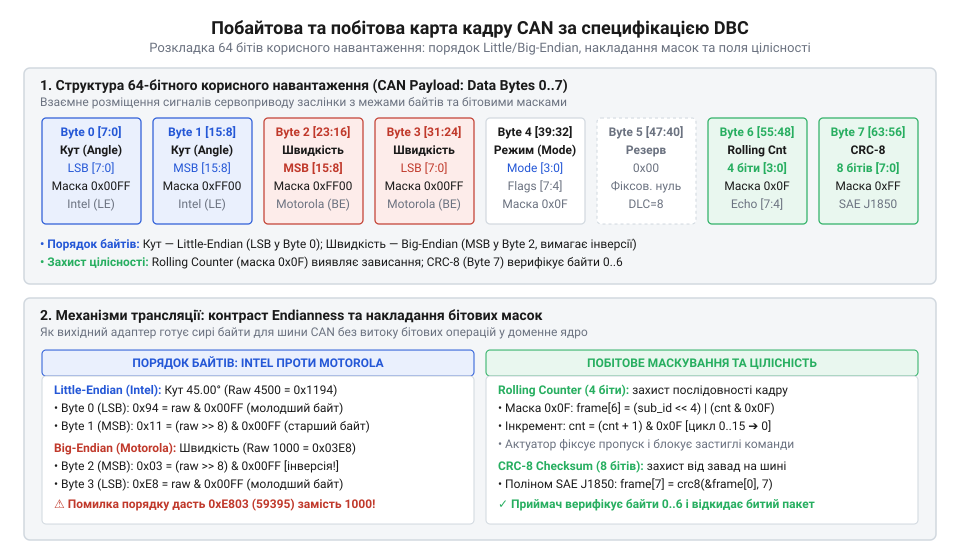

# Вихідний протокольний адаптер сервоприводу на шині CAN з побітовим пакуванням

## Пастка витоку шини CAN у ядро

В аварійній ситуації вентиляції @@en|Digital Homes@@ модуль клімат-контролю вирішив повернути заслінку припливного повітря на кут 45°. Замість звернення до абстрактного контракту доменний сервіс напряму викликав функцію драйвера мережі контролерів (@@en|CAN@@; англійською @@en|Controller Area Network@@). Сервіс власноруч складав байти восьмибайтного кадру з магічними числовими зміщеннями та ідентифікатором `0x120`.

Коли сервопривід заслінки — актуатор (латинською @@la|actuare@@ — приводити в дію) — замінили на промислову модель, апаратний інтерфейс змінився. Новий виробник заклав іншу розкладку сигналів у кадрі та зворотний порядок байтів (@@en|Motorola@@, або @@en|Big-Endian@@ замість @@en|Intel@@, або @@en|Little-Endian@@). Оскільки низькорівнева серіалізація була вмонтована безпосередньо в бізнес-сервіс, розробникам довелося переписувати правила позиціонування ядра. Помилка в бітовому зсуві спотворила значення цільового кута: двигун спробував подолати механічний упор, що призвело до перегріву обмоток і заклинювання редуктора.

До того ж виник небезпечний [витік деталей реалізації](root:progarch/port-smelling-of-storage): доменні модульні тести втратили ізольованість. Вони більше не могли виконатися без фізичного мережевого приймача-передавача — трансивера (англійською @@en|transceiver@@, від *transmitter* — передавач та *receiver* — приймач) або важкого апаратного стенду. Будь-яка зміна мережевого протоколу ламала бізнес-тести. Транспортний рівень і двійкове пакування не повинні проникати крізь межу ядра.

## Проєктування чистого вихідного порту сервоприводу

Щоб відсікти специфіку шини @@en|CAN@@, доменне ядро визначає вихідний керований порт (латинською @@la|porta@@ — брама; @@en|Driven Port@@). У гексагональній архітектурі [застосунок набуває форми](root:progarch/dh-v2-hexagon), де ядро володіє інтерфейсом взаємодії з виконавчим механізмом, а зовнішній адаптер (латинською @@la|adaptare@@ — пристосовувати) бере на себе деталі мережевого протоколу.


*Архітектурна межа сервоприводу: доменне ядро цілком ізольоване від мережевих структур CAN завдяки строго типізованому вихідному порту.*

Контракт порту формулюється суто мовою предметної області. Він оперує типізованими об'єктами-значеннями (@@en|Value Object@@) та командами, унеможливлюючи невалідний стан ще на етапі створення:

1. **Цільовий кут заслінки (`DamperAngle`)**: контролює фізичний інваріант діапазону `[0.0°, 90.0°]`. Значення `NaN` або вихід за межі відкидаються фабричним методом або конструктором.
2. **Команда керування (`DamperCommand` / `SetDamperCommand`)**: поєднує валідований кут, швидкість руху вихідного вала та прапорець запуску процедури калібрування упорів.

В інтерфейсі вихідного порту немає жодного поняття з мережі @@en|CAN@@: ані ідентифікатора пакета (@@en|CAN ID@@), ані довжини кадру (@@en|DLC@@), ані бітових масок чи порядкових номерів байтів. Метод відправки повертає типізований результат `Result` (або `std::expected`), транслюючи лише бізнес-помилки: недосяжність пристрою, неприпустимий параметр чи механічне заклинювання приводу. Контракт залишається незмінним незалежно від того, чи керується заслінка через @@en|CAN@@, @@en|Modbus@@ чи бездротовий канал зв'язку.

:::tabs
:::code proj-can-actuator-frame-packer/rust/src/domain.rs 212-219
:::code proj-can-actuator-frame-packer/cpp/damper_domain.hpp 144-156
:::code proj-can-actuator-frame-packer/c/include/damper_actuator_port.h 59-76
:::

## Побітове пакування сигналів за DBC

Коли вихідний керований порт передає команду позиціонування, адаптер перетворює її у стандартизований 8-байтний корисний вантаж (@@en|payload@@) кадру @@en|CAN@@ згідно зі специфікацією бази сигналів (@@en|DBC@@; англійською @@en|CAN Database@@). Мережева шина не приймає дробові числа: кожна фізична величина транслюється в цілочисельний сирий двійковий код (@@en|raw value@@). Розібратися у синтаксисі файлів опису сигналів, коефіцієнтах масштабування та форматі визначення повідомлень допоможе [специфікація бази даних сигналів CAN (DBC)](root:com-protocol/can-dbc-file-format).

Таке перетворення реалізує квантування (від латинського @@la|quantum@@ — «скільки», дискретна частка). Нехай `raw` — шуканий двійковий код сигналу, `phys` — фізичне значення команди, `offset` — адитивне зміщення шкали (англійською @@en|offset@@, зсув від нуля), `scale` — ціна одиниці наймолодшого розряду (англійською @@en|scale@@; @@en|LSB@@, або @@en|Least Significant Bit@@), а `round` — математичне округлення до найближчого цілого:

```
raw
= round((phys - offset) ÷ scale)    [квантування фізичної величини за DBC]
```

Віднімання `offset` суміщає нуль шкали, а ділення на `scale` знаходить кількість дискретів сенсора. Перед квантуванням адаптер обов'язково застосовує насичення (англійською @@en|clamping@@, від *clamp* — затискати в лещата): якщо `phys` виходить за паспортні межі актуатора, значення примусово обмежують краями діапазону. Без насичення виникає циклічне переповнення розрядності (@@en|wrap-around@@), коли надвеликий кут після відкидання бітів перетворюється на мінімальний і ламає механізм.

Специфікація @@en|DBC@@ жорстко фіксує координати сигналів у 64-бітному буфері. При прямому порядку байтів (@@en|Little-Endian@@) молодші біти записуються в байт із меншим номером, а при зворотному (@@en|Big-Endian@@) — старший байт передує молодшому. DBC@@ жорстко фіксує координати сигналів у 64-бітному буфері | Відмінності між порядками Intel і Motorola при передачі багатобайтових сигналів через послідовні шини детально розглядає [порядок байтів у промислових протоколах: Little-Endian проти Big-Endian](root:com-protocol/wire-format-packing).


*Карта 8 байтів кадру CAN за специфікацією DBC показує накладання бітових масок, перетин байтових меж та чергування полів Little-Endian і Big-Endian без взаємного спотворення.*

Головна пастка побітового пакування — спільний байт для полів різної розрядності. Наприклад, 12-бітний кут займає весь нульовий байт і молодші 4 біти першого байта, а старші 4 біти першого байта віддано під код режиму. Для узгодження цих полів адаптер розділяє перший байт двома бітовими масками (@@en|bitmask@@): маскою молодшого нібла `0x0F` для кута та маскою старшого нібла `0xF0` для режиму. Код режиму переноситься у свою позицію порозрядним зсувом `(mode & 0x0F) << 4`. Помилка у величині зсуву або пропуск маски руйнує сусідній сигнал. Нехай код режиму дорівнює `0x02` (двійкове `0000 0010`). Після коректного зсуву на 4 біти вліво число набуває вигляду `0x20` (двійкове `0010 0000`), що відповідає десятковому значенню 32 у п'ятому біті кадру. Якщо розробник помилиться зі зсувом або не відсіче старший нібл маскою `0x0F`, біт із вагою 32 накладеться на значення цільового кута. Актуатор прочитає спотворений двійковий код і змістить заслінку рівно на 32 градуси повз задану позицію. Адаптер бере цю бітову арифметику та захисні маски на себе, зберігаючи [форму застосунку та чистоту](root:progarch/dh-v2-hexagon) ядра.

:::tabs
:::code proj-can-actuator-frame-packer/rust/src/adapter.rs 84-115
:::code proj-can-actuator-frame-packer/cpp/can_damper_actuator_adapter.cpp 31-65
:::code proj-can-actuator-frame-packer/c/src/can_frame_packer.c 90-173
:::

## Циклічний лічильник повідомлень і контрольна сума

Навіть бездоганно запакований за специфікацією @@en|DBC@@ кадр у реальних умовах стикається з фізичними загрозами. Електромагнітні завади від силових ліній здатні спотворити окремі біти в шині @@en|CAN@@, а переповнення черги чи тимчасове зависання мікроконтролера — спричинити втрату пакета або повторне виконання застарілої команди. Апаратних перевірок трансивера замало для безпеки приводу: прошивка актуатора вимагає наскрізного підтвердження свіжості та цілісності кожного кадру. DBC@@ кадр | Архітектуру профілів захисту критичних потоків даних в автомобільних та промислових шинах від втрат і спотворень розглядає [наскрізний захист даних у шині CAN за стандартами AUTOSAR E2E](root:com-protocol/can-e2e-data-protection).

Щоб контролювати послідовність повідомлень і виявляти пропуски, адаптер додає в кадр 4-бітний лічильник послідовності (англійською @@en|rolling counter@@, від *to roll* — обертатися циклічно). Значення лічильника монотонно зростає з кожною передачею в діапазоні `[0..15]`. Нехай `seq` — поточний стан лічильника, а `seq_next` — його наступне значення для чергового кадру:

```
seq_next
= (seq + 1) mod 16    [циклічний крок лічильника за модулем 16]
```

Отримавши пакет, актуатор звіряє черговість: пропуск номера свідчить про втрату кадрів у мережі, повтор викриває застарілу команду, а зупинка лічильника сигналізує про зависання вузла керування. У двійковій структурі кадру переповнення фіксується порозрядним маскуванням `(seq + 1) & 0x0F`. Алгоритми виявлення випадіння, дублювання та затримки пакетів за допомогою лічильників послідовності висвітлюють [циклічні лічильники послідовності в критичних шинах](root:com-protocol/rolling-counter-frame-integrity).

Для захисту даних від спотворення останній байт кадру відведено під циклічний надлишковий код (@@en|CRC-8@@; англійською @@en|Cyclic Redundancy Check@@, від латинського @@la|cyclus@@ — коло та @@la|redundantia@@ — надлишковість). Адаптер обчислює контрольну суму над корисними байтами `0..6` за стандартизованим твірним поліномом специфікацій @@en|AUTOSAR@@ або @@en|SAE J1850@@. У двійковій арифметиці наскрізний контроль цілісності будується як ділення многочленів за модулем 2. Додавання й віднімання бітів у ньому тотожні операції порозрядного виключного «або» (@@en|XOR@@; англійською @@en|exclusive OR@@, від латинського @@la|excludere@@ — виключати та англійського @@en|OR@@ — або), де `1 ^ 1 = 0` та `0 ^ 1 = 1` без міжрозрядного перенесення чи позичання. Промисловий стандарт @@en|SAE J1850@@ спирається на незвідний дільник восьмого степеня `x⁸ + x⁴ + x³ + x² + 1`, двійковий запис якого містить дев'ять бітів `0b100011101` (`0x11D`). Оскільки старший коефіцієнт `x⁸` для восьмого степеня завжди дорівнює одиниці, у 8-бітному регістрі його опускають, записуючи скорочену маску як `0x1D` (`0b00011101`). Математичну теорію ділення многочленів у полі Галуа GF(2), вибір твірних дільників та табличні оптимізації розкривають [математичні основи поліноміальних контрольних сум CRC](root:com-modulation/crc-algorithm).

Алгоритм обчислює залишок ділення, обробляючи байти розряд за розрядом від старшого біта до молодшого. Для кожного біта регістр виконує дві операції. Зсув уліво `<< 1` відповідає множенню многочлена на `x` і просуває черговий біт у старшу позицію. Якщо висунутий старший біт дорівнює одиниці, дільник вміщується в поточне вікно: старша одиниця дільника скорочується з висунутим бітом регістра, а решта вісьмох розрядів віднімається накладанням маски `0x1D` через операцію @@en|XOR@@. Якщо висунутий біт дорівнює нулю, дільник не вміщується, тому регістр лише зсувається вліво без віднімання.

**Покрокове порозрядне ділення байта `0x82` (`0b10000010`) на поліном `0x1D`:**
```
rem
= 0b10000010                                      [початковий байт даних 0x82]
= 0b00000100 ^ 0b00011101 = 0b00011001            [крок 1: старший біт 1 — зсув уліво та XOR із 0x1D]
= 0b00011001 << 1         = 0b00110010            [крок 2: старший біт 0 — зсув уліво]
= 0b00110010 << 1         = 0b01100100            [крок 3: старший біт 0 — зсув уліво]
= 0b01100100 << 1         = 0b11001000            [крок 4: старший біт 0 — зсув уліво]
= 0b10010000 ^ 0b00011101 = 0b10001101            [крок 5: старший біт 1 — зсув уліво та XOR із 0x1D]
= 0b00011010 ^ 0b00011101 = 0b00000111            [крок 6: старший біт 1 — зсув уліво та XOR із 0x1D]
= 0b00000111 << 1         = 0b00001110            [крок 7: старший біт 0 — зсув уліво]
= 0b00001110 << 1         = 0b00011100            [крок 8: старший біт 0 — зсув уліво, остача 0x1C]
```

Після восьми ітерацій регістр містить точну остачу від ділення `0x1C`. У повному протоколі перед початком обчислення регістр ініціалізують значенням `0xFF`, що унеможливлює пропуск нульових байтів на початку кадру, кожен наступний байт перед обробкою підмішують у регістр через @@en|XOR@@, а фінальну суму інвертують тим самим значенням `0xFF`. Якщо завада спотворить хоча б один біт кута чи режиму, розрахункова сума не збіжиться з восьмим байтом, і сервопривід негайно відкине пошкоджену команду. Стандартизовані вимоги AUTOSAR і SAE J1850 до розрахунку 8-бітної контрольної суми над корисним навантаженням кадру висвітлює [захист цілісності кадрів контрольними сумами CRC-8](root:com-protocol/checksums-crc).

Інкапсулюючи стан лічильника та розрахунок перевірочного коду всередині адаптера, [застосунок набуває форми](root:progarch/dh-v2-hexagon), де доменне ядро залишається чистим від транспортних алгоритмів надійності.

:::tabs
:::code proj-can-actuator-frame-packer/rust/src/can.rs 129-142
:::code proj-can-actuator-frame-packer/cpp/can_bus.hpp 91-114
:::code proj-can-actuator-frame-packer/c/src/can_frame_packer.c 56-85
:::

## Збирання вихідного протокольного адаптера CAN

Окремих функцій пакування та контролю цілісності замало, доки вони не об'єднані в цілісний контур. Вихідний протокольний адаптер зв'язує доменний порт із драйвером шини @@en|CAN@@. Він зберігає внутрішній стан 4-бітного лічильника @@en|rolling counter@@ та інкапсулює мережеву конфігурацію: ідентифікатор кадру `0x120` (@@en|CAN ID@@) і фіксовану довжину корисного вантажу у 8 байтів (@@en|DLC@@).

Отримавши доменну команду, адаптер виконує послідовний конвеєр перетворень. Спочатку він перевіряє вхідні інваріанти, квантує кут і швидкість у сирі цілочисельні коди та пакує біти за специфікацією @@en|DBC@@. Далі записує поточне значення @@en|rolling counter@@ у службове поле, розраховує @@en|CRC-8@@ над першими сімома байтами та передає сформований кадр у чергу драйвера. Лише після успішної відправки лічильник циклічно інкрементується за модулем 16. Якщо передача зірвалася, лічильник зберігає значення, усуваючи хибні пропуски в діагностиці актуатора.

Головний обов'язок адаптера на виході — ізоляція ядра від збоїв транспорту. Фізичні відмови лінії не повинні пробивати межу у вигляді апаратних винятків або системних кодів помилок. Якщо буфер передавача переповнений чи контролер перейшов у стан @@en|Bus-Off@@ (англійською @@en|Bus-Off@@, від *bus* — шина та *off* — вимкнено; апаратне відключення через накопичення помилок), адаптер перехоплює збій і транслює його в доменний тип `Result` або `std::expected`. Так [чиста форма застосунку](root:progarch/dh-v2-hexagon) гарантує, що апаратна аварія шини сприймається ядром як штатна бізнес-подія без витоку протокольних деталей. Роботу апаратного лічильника помилок TEC/REC та алгоритми виведення вузла зі стану аварійного відключення описують [стратегії відновлення контролера CAN після стану Bus-Off](root:com-devices/can-frame-errors).

:::tabs
:::code proj-can-actuator-frame-packer/rust/src/adapter.rs 120-163
:::code proj-can-actuator-frame-packer/cpp/can_damper_actuator_adapter.cpp 67-96
:::code proj-can-actuator-frame-packer/c/src/can_damper_adapter.c 10-68
:::

## Верифікація адаптера на емуляторі шини

Перевіряти протокольний адаптер на реальному приводі небезпечно: помилка в бітовому зсуві чи порядку байтів здатна виламати редуктор заслінки або спалити обмотку двигуна. До того ж фізичні стенди дорогі, повільні й роблять модульні тести крихкими через випадкові затримки в проводах. Оскільки адаптер взаємодіє з мережею через абстрактний інтерфейс драйвера, апаратний трансивер у тестах замінюють програмним емулятором (@@en|Mock CAN Bus@@, від старофранцузького *mocquer* — глузувати, насміхатися) або тестовим шпигуном (англійською @@en|test spy@@, від *spy* — стежити: об'єкт, що перехоплює надіслані кадри в оперативній пам'яті).

Шпигун фіксує виклики передачі, надаючи тестам прямий доступ до сирого масиву байтів. Тестові сценарії порівнюють сформований кадр з еталонними шістнадцятковими дампами (англійською @@en|hex dump@@, від *hexadecimal* — шістнадцятковий та *dump* — скидання; побайтове відображення пакета) для граничних кутів повороту: `0°`, `45°` і `90°`. Це підтверджує точність квантування, узгодженість полів @@en|Little-Endian@@ і @@en|Big-Endian@@ та гарантує відсутність колізій, коли сусідній сигнал не затирає суміжні біти в спільному байті. Окрема серія перевірок відстежує послідовність пакетів: монотонний інкремент @@en|rolling counter@@ від 0 до 15, його циклічний скид `15 → 0` і коректність перерахунку @@en|CRC-8@@ для кожного кроку.

Емулятор також перевіряє поведінку системи у відмовах. Впроваджуючи симульоване переповнення черги `TX` або апаратний стан @@en|Bus-Off@@, тести верифікують захисну реакцію: адаптер фіксує помилку драйвера та повертає доменний `Result`, не допускаючи паніки ядра. Саме тут видно, [коли гексагон — зайвий](root:progarch/hexagon-when-overkill), а коли абстрактний вихідний порт дає вирішальну перевагу: уся бітова специфіка шини @@en|CAN@@ тестується за частки мілісекунди без жодного фізичного контролера.

:::tabs
:::code proj-can-actuator-frame-packer/rust/src/main.rs 248-278
:::code proj-can-actuator-frame-packer/cpp/main.cpp 61-107
:::code proj-can-actuator-frame-packer/c/src/main.c 80-141
:::
