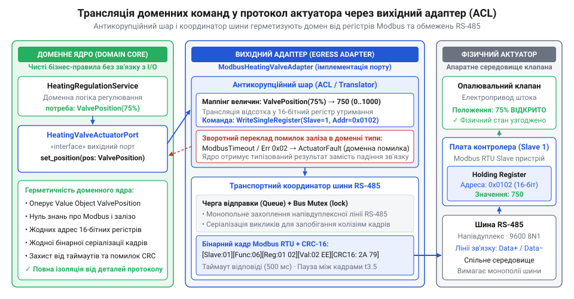
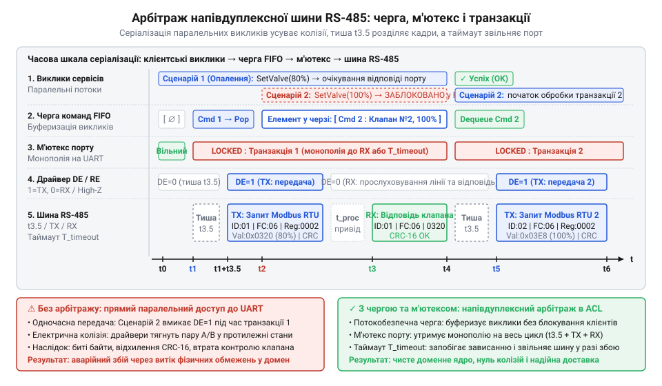

# Вихідний адаптер та антикорупційний шар для керування клапаном через Modbus RTU/TCP

## Пастка прямого керування промисловою шиною

Коли сервіс мікроклімату [керує контуром опалення](root:progarch/dh-v2-hexagon) у системі @@en|Digital Homes@@, він регулює подачу теплоносія через опалювальний клапан. Здавалося б, найпростіший спосіб передати команду — відкрити послідовний порт і записати число безпосередньо в апаратний регістр пристрою. Проте перша ж заміна клапана на об'єкті призводить до аварії всієї підсистеми.

Попередній сервопривід приймав уставку в регістр `0x0001` у діапазоні від 0 до 10000, а новий виробник розмістив керування за адресою `0x0020` і вимагає діапазон від 0 до 255. Якщо бізнес-правила безпосередньо містять апаратні адреси, зміна моделі заліза змушує переписувати доменний код. Коли сервіс намагається записати старе число в невідому новому приводу комірку, пристрій повертає протокольний виняток @@en|Modbus@@ `0x02` (@@en|Illegal Data Address@@). Неперехоплений низькорівневий виняток пробиває межі шарів і обвалює фоновий цикл кімнатного хаба.

Друга відмова виникає на фізичній лінії зв'язку. Кілька клапанів підключено до спільної напівдуплексної (англ. @@en|half-duplex@@) шини @@en|RS-485@@. Коли паралельні корутини одночасно надсилають команди різним актуаторам (від лат. *actuare* — приводити в дію), сигнали в лінії накладаються. Виникає колізія (від лат. *collisio* — зіткнення): кадри спотворюються, контрольні суми перестають збігатися, а виклики зависають на нескінченних таймаутах введення-виведення.

Шина @@en|RS-485@@ передає двійковий потік через диференціальну пару (від лат. *differentia* — різниця) провідників `A` та `B`, де логічний стан визначається різницею потенціалів між ними. У штатному режимі передавач формує чіткі перепади напруги: логічному нулю відповідає стан, коли потенціал на лінії `A` перевищує потенціал на `B` щонайменше на `200 мВ`, а логічній одиниці — протилежна полярність. Коли ж два вузли одночасно намагаються виставити власні біти в спільну лінію, їхні вихідні трансивери (англ. @@en|transceiver@@, від *transmitter* — передавач та *receiver* — приймач) опиняються в прямому електричному протиборстві. Якщо один трансивер відкриває верхній ключ і тягне провідник `A` до напруги живлення, а інший у цей самий момент відкриває нижній ключ і замикає `A` на спільний дріт, виникає взаємне коротке замикання між вихідними каскадами. На осцилограмі (від лат. *oscillo* — гойдаюся та грец. *gramma* — запис) ця колізія відображається катастрофічним спотворенням сигналу: замість чітких прямокутних імпульсів різниця напруг між лініями `A` та `B` просідає у зону невизначеності між `-200 мВ` та `+200 мВ` із високочастотним брязкотом. Апаратні приймачі актуаторів не можуть розпізнати межі бітових інтервалів у спотвореній хвилі, фіксують помилку кадрування (англ. @@en|framing error@@) або зчитують хаотичний шум, через що кадри цілковито руйнуються.

Пряме зчеплення бізнес-логіки з фізичною шиною робить систему крихкою. Щоб доменне ядро лишалося герметичним, потрібен вихідний адаптер (від лат. *adaptare* — пристосовувати) з антикорупційним шаром (англ. @@en|anti-corruption layer@@, скорочено @@en|ACL@@, від лат. *corruptio* — псування). Адаптер ізолює адреси заліза, контролює монопольний доступ до шини та перетворює збої зв'язку на типізовані бізнес-помилки.

## Проєктування чистого порту та трансляція

Щоб захистити доменне ядро від специфіки протоколів, взаємодія з актуатором виноситься за керований вихідний порт (англ. @@en|Driven Port@@). На відміну від сховищ даних, де [порт часто пахне сховищем](root:progarch/port-smelling-of-storage) через протікання реляційних структур, інтерфейс актуатора має виражати суто фізичний намір домену.

Замість примітивного числа з плаваючою крапкою позиція клапана описується незмінним об'єктом-значенням (англ. @@en|Value Object@@) `ValvePosition`. Пряме використання чисел із плаваючою крапкою (`float`) у регуляторах мікроклімату спричиняє дві типові помилки: накопичення похибки округлення та випадкове генерування значень поза допустимим фізичним діапазоном. В ітеративних алгоритмах розрахунку двійкові дроби стандарту IEEE 754 не здатні точно представити десяткові частки. Через це на кожному кроці накопичується похибка округлення й поступово зсуває розраховану уставку відносно реального теплового балансу. Водночас динамічне перерегулювання (англ. @@en|overshoot@@) контуру або завади вимірювальних датчиків провокують вихід за межі фізичного діапазону — з'являється від'ємний відсоток на зразок `-0.05%`, значення понад норму на зразок `100.02%` або нечислове `NaN` при діленні на нуль у разі збою сенсора. Якщо передати такий некоректний дріб безпосередньо до апаратного шару, інтерпретація від'ємного значення як 16-бітного беззнакового цілого спричинить переповнення розрядної сітки до `0xFFFF` (`65535`), і замість захисного закриття привід розкриє клапан на повну потужність. Об'єкт-значення `ValvePosition` усуває ці ризики та гарантує доменний інваріант (від лат. *invarians* — незмінний): відсоток відкриття завжди лежить у фізичних межах від `0.0%` до `100.0%`, виключаючи появу від'ємних чисел, переповнень і значень на зразок `NaN`. Контракт порту `HeatingValveActuatorPort` приймає цей об'єкт і повертає функційний контейнер `Result[None, ActuatorError]`, що запобігає витоку системних винятків.


*Архітектурна ізоляція: домен оперує виключно безпечним Value Object і типізованим результатом, тоді як антикорупційний шар перетворює відсоток у координати регістрів Modbus.*

:::code proj-dh-modbus-actuator-adapter/py/domain.py 133-183

Всередині адаптера антикорупційний шар транслює доменний відсоток у 16-бітний регістр утримання (англ. @@en|Holding Register@@) пристрою з адресою @@en|Slave ID@@ на шині @@en|RS-485@@. Значення регістра `R` обчислюють із доменного відсотка відкриття `P` за допомогою коефіцієнта масштабування `k = 100`:

```
R
= round(P · k)                     [масштабування відсотка в розрядність регістра]
= max(0, min(10000, round(P · k))) [обрізання розрядної сітки clamp]
```

Операція обрізання меж (англ. @@en|clamping@@, від англ. *clamp* — затискач) гарантує, що через похибки округлення дійсних чисел або перерегулювання обчислене значення ніколи не вийде за межі діапазону від `0` до `10000`.

**Розрахунок уставки регістра для відкриття 73.5%:**
```
R
= round(73.5 · 100)                [підстановка відсотка відкриття та коефіцієнта]
= round(7350.0)                    [множення]
= 7350                             [цілочисельне значення регістра]
```

Значення `7350` записується в апаратний регістр без небезпеки переповнення розрядної сітки мікроконтролера приводу через команду @@en|Modbus@@.

:::code proj-dh-modbus-actuator-adapter/py/valve_adapter.py 103-113

## Бінарне кадрування Modbus та контрольна сума

Антикорупційний шар перетворив відсоток у 16-бітне число, але фізична лінія @@en|RS-485@@ передає лише послідовність байтів. Без суворого узгодження формату залізо сприйме числові розряди хибно, виставивши небезпечну температуру теплоносія. Драйвер приводу вимагає пакування команди в бінарний кадр протоколу @@en|Modbus RTU@@ фіксованої структури. RS-485@@ передає лише послідовність байтів | Якщо привод підключено через локальну мережу замість послідовної лінії, той самий антикорупційний шар використовує [вихідний адаптер Modbus TCP для актуаторів](root:sf-apps/modbus-tcp-transport-adapter) із формуванням MBAP-заголовка над сокетами.

Для запису одиничного регістра утримання (@@en|Holding Register@@) протокол визначає функцію `0x06` (@@en|Write Single Register@@). Запит має довжину рівно вісім байтів. Першим іде однобайтний ідентифікатор пристрою на шині — @@en|Slave ID@@. За ним стоїть однобайтний код функції `0x06`. Наступні два байти несуть адресу цільового регістра, а ще два — обчислене значення уставки. Ці чотири байти корисного навантаження передаються в мережевому порядку байтів @@en|Big-Endian@@: старший байт випереджає молодший:

:::code proj-dh-modbus-actuator-adapter/py/modbus_rtu.py 166-173

Промислове середовище спотворює біти напівдуплексної лінії електромагнітними завадами. Для виявлення пошкоджень кінець кадру замикають два байти контрольної суми @@en|CRC-16@@ (англ. *cyclic redundancy check* — циклічний надлишковий контроль). Алгоритм використовує генераторний поліном `0xA001` з початковим станом регістру `0xFFFF`. Замість повільного побітового зсуву адаптер обчислює залишок табличним методом за один прохід:

:::code proj-dh-modbus-actuator-adapter/py/modbus_rtu.py 76-88

На відміну від корисного навантаження, сума @@en|CRC-16@@ упаковується у форматі @@en|Little-Endian@@: молодший байт передує старшому. Порушення цього чергування призведе до мовчазного відкидання кадру актуатором.

Після застосування команди клапан повертає у відповідь точну копію запиту — кадр відлуння (@@en|Echo@@). Адаптер верифікує отриману контрольну суму та зіставляє підтверджені байти:

:::code proj-dh-modbus-actuator-adapter/py/modbus_rtu.py 217-231

Збіг адреси й підтвердженого значення гарантує, що привід коректно зафіксував уставку у внутрішній пам'яті. Якщо ж старший біт коду функції встановлено в одиницю (`0x86`), кадр містить протокольний виняток, який адаптер передає нагору без зависання шини.

## Арбітраж шини та черга з блокуванням

Двійковий кадр сформовано, але фізична лінія @@en|RS-485@@ — це спільне напівдуплексне середовище з топологією єдиного ведучого (англ. @@en|Master@@). Коли сервіс одночасно оновлює уставки кількох клапанів або фоновий процес опитує датчики, паралельні корутини намагаються одночасно писати в послідовний порт. Сигнали в диференціальній парі накладаються, спотворюючи рівні напруги. Замість валідного кадру актуатори бачать електричне сміття й відкидають команду через незбіг контрольної суми. RS-485@@ — це спільне напівдуплексне середовище з топологією єдиного ведучого (англ. @@en | Master@@) | Фізичну природу таких конфліктів у диференціальній парі та ширший спектр протоколів координації лінії детально описує [арбітраж і колізії на напівдуплексній шині RS-485](root:com-devices/rs485-half-duplex-bus-arbitration).

Щоб усунути апаратні колізії, вихідний адаптер реалізує арбітраж (від лат. *arbitratus* — посередництво) доступу до лінії. Канал зв'язку захищають м'ютексом (англ. @@en|mutex@@, від *mutual exclusion* — взаємне виключення) `asyncio.Lock()`. Конкурентні запити впорядковуються за правилом @@en|FIFO@@ (англ. *first in, first out* — першим прийшов, першим пішов): кожна операція монопольно захоплює шину на час повного циклу «запит — відповідь»:

:::code proj-dh-modbus-actuator-adapter/py/valve_adapter.py 141-143

Проте одного блокування корутин замало. Протокол @@en|Modbus RTU@@ не має стартових і стопових маркерів: апаратура актуатора демаркує межі пакетів виключно за часовим інтервалом тиші на шині. Стандарт вимагає витримувати між транзакціями захисну міжфреймову паузу тривалістю щонайменше `3.5` символи — інтервал `t3.5` (близько `4.01 мс` за швидкості `9600 бод`). Якщо передати новий кадр миттєво після отримання відповіді, привід «склеїть» його з попереднім і зафіксує помилку формату. Адаптер примусово витримує інтервал тиші перед початком кожної передачі:

:::code proj-dh-modbus-actuator-adapter/py/valve_adapter.py 157-166


*Арбітраж спільної лінії: м'ютекс серіалізує паралельні виклики для уникнення колізій, а нормативна тиша t3.5 гарантує коректне розпізнавання пакетів апаратурою приводу.*

## Ізоляція таймаутів та трансляція помилок

На фізичній лінії вихідний адаптер неминуче стикається з обривом кабелю, завадами чи знеструмленням клапана. Зависання в очікуванні відповіді заблокувало б спільну шину @@en|RS-485@@ і паралізувало б решту контурів. Тому операцію транзакції обмежують детермінованим @@en|таймаутом@@ (англ. *timeout* — вичерпання відведеного часу). Якщо пристрій не відповідає або лінію розірвано, адаптер перериває очікування, звільняє лінію й повертає типізовану помилку.

Короткочасні електромагнітні наведення спотворюють байти в лінії, спричиняючи збій перевірки @@en|CRC-16@@. Запис абсолютної уставки позиції є @@la|ідемпотентним@@ (лат. *idem* — той самий, *potens* — здатний), тому повторне надсилання того самого кадру є фізично безпечним. Адаптер реалізує обмежену кількість @@en|повторних спроб@@ (англ. *retry* — повторна спроба), але суворо для збоїв контрольної суми. Повторювати запит при таймауті чи апаратній аварії заборонено: це спричинило б каскадні затримки в черзі шини.

:::code proj-dh-modbus-actuator-adapter/py/valve_adapter.py 145-209

Коли ведений пристрій повертає протокольний виняток @@en|Modbus RTU@@, адаптер транслює його байтовий код у закриту ієрархію доменних типів. Код `0x04` сигналізує про заклинювання чи перегрів і стає помилкою `ActuatorHardwareFault`. Коди `0x01` та `0x02`, як і вичерпання ліміту повторів @@en|CRC-16@@, переходять у `ActuatorProtocolError`. Якщо ж актуатор не надіслав відповіді за встановлений час, адаптер повертає `ActuatorUnresponsive`. Щоб доменне ядро залишалося ізольованим від деталей заліза, як вимагає цілісна [форма застосунку](root:progarch/dh-v2-hexagon), жоден низькорівневий виняток введення-виведення не протікає назовні — адаптер інкапсулює збої в типізованому контейнері @@en|Result@@. Modbus RTU@@, адаптер транслює його байтовий код у закриту ієрархію доменних типів | Детальніше структуру відповідей для всіх кодів помилок та архітектурні патерни їхнього мапінгу розбирають [протокольні винятки та коди помилок Modbus](root:com-protocol/modbus).

:::code proj-dh-modbus-actuator-adapter/py/valve_adapter.py 234-268

## Наскрізна збірка та тестування адаптера

Тестування промислового адаптера на реальному залізі паралізує розробку: фізичного клапана немає в конвеєрі неперервної інтеграції, а помилка у двійкових байтах уставки здатна пошкодити шток сервоприводу. Для перевірки системи без фізичної периферії послідовну лінію замінюють програмним тестовим дублером (@@en|test double@@) шини @@en|RS-485@@. Емулятор перехоплює байти транзакцій, моделює затримки лінії, відтворює спотворення @@en|CRC-16@@ і фіксує стан монопольного доступу. Принципи побудови таких віртуальних стендів із симуляцією завад і детекцією колізій детально розглядають [програмні емулятори апаратних шин зв'язку](root:sf-release/test-double-hardware-bus).

:::code proj-dh-modbus-actuator-adapter/py/test_valve_adapter.py 35-76

Набір тестів перевіряє поведінку адаптера на трьох фундаментальних інваріантах. Спершу тест підтверджує точність антикорупційного шару: доменна уставка позиції клапана масштабується в ціле число регістра утримання, тому актуатор отримує математично вивірене значення без ризику переповнення розрядної сітки. Далі перевіряється захист від колізій: одночасний виклик методу кількома корутинами потрапляє під внутрішній м'ютекс, через що запити проходять крізь шину суворо по черзі, а емулятор реєструє нуль зіткнень сигналів. Насамкінець емулятор симулює апаратний обрив лінії та спотворення контрольної суми; адаптер вичерпує повторні спроби й повертає домену типізований контейнер помилки `Result.err`, завдяки чому жоден системний виняток введення-виведення не порушує межі ядра.

:::code proj-dh-modbus-actuator-adapter/py/test_valve_adapter.py 240-266

У точці збірки (@@en|Composition Root@@, від лат. *componere* — складати докупи), де [застосунок набуває форми](root:progarch/dh-v2-hexagon), сконструйований `ModbusHeatingValveAdapter` підставляється в службу автоматизації платформи @@en|Digital Homes@@ як конкретна реалізація порту `HeatingValveActuatorPort`. Доменне ядро оперує чистими відсотками відкриття й опрацьовує детермінований результат, тому бінарні кадри протоколу @@en|Modbus RTU@@, адреси регістрів та фізичні блокування шини лишаються цілковито прихованими за межею адаптера.
