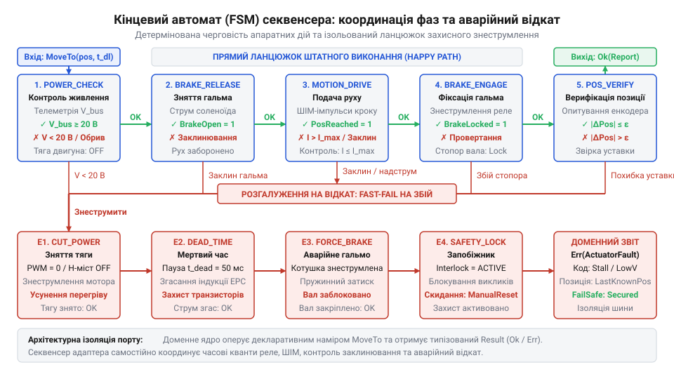
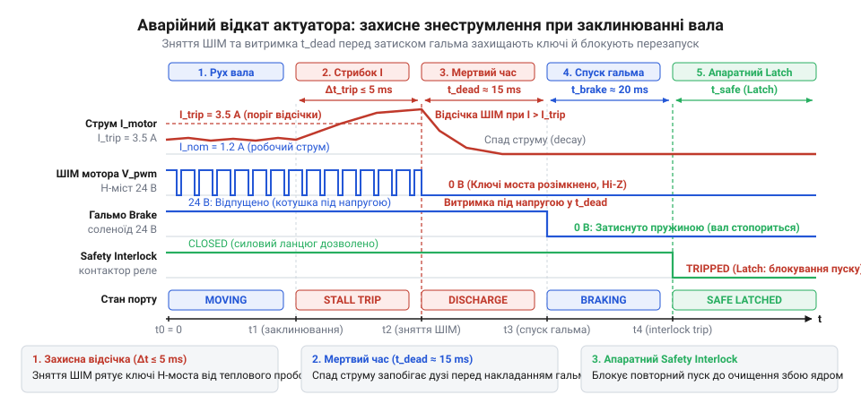

# Шлюзовий адаптер багатоетапної послідовності команд актуатора з безпечним відкатом

## Пастка наївного виклику фізичного актуатора

У хабі @@en|Digital Homes@@ доменна служба аварійного перекриття надсилає наказ закрити магістральний кран. Вихідний @@en|адаптер@@ (лат. *adaptare* — пристосовувати) реалізовано за звичною аналогією з вебклієнтами: він пакує нову координату в байти й виштовхує пакет у мережевий @@en|сокет@@ (англ. *socket* — заглибина, гніздо). На протилежному кінці лінії працює промисловий @@en|актуатор@@ (лат. *actuare* — приводити в дію), вал якого заблоковано механічним стопорним гальмом задля утримання тиску в трубі.

Отримавши наказ обертання, привід живить обмотки двигуна, проте гальмо лишається затиснутим. Нерухомий ротор не створює проти-ЕРС, тому споживаний струм стрибком сягає аварійного максимуму. Двигун зазнає критичного перегріву, а шестерні @@en|редуктора@@ (лат. *reducere* — відводити назад, зменшувати) зрізає під дією заклиненого крутного моменту. Водночас асинхронний виклик у ядрі зависає на мережевому @@en|таймауті@@ (англ. *time out* — вичерпання часу): служба обриває з'єднання, залишаючи обмотки під руйнівною напругою в напіввідкритому стані крана.

Ця аварія викриває прірву між простою серіалізацією структури даних та вихідною трансляцією наміру. Мережевий сервіс приймає готовий пакет миттєво, тоді як фізична дія триває у часі й вимагає суворої черговості кроків. Щоб безпечно повернути заслінку, системі потрібно спочатку перевірити напругу живлення, зняти стопорне гальмо імпульсом на електромагніт, плавно подати тягу і безперервно зчитувати кут з енкодера під час руху.

Якщо звичайний вихідний порт лише транслює дані у байтовий потік, як це працює там, де [застосунок набуває форми](root:progarch/dh-v2-hexagon) для збереження сутностей, то фізичне залізо вимагає вихідного шлюзового @@en|секвенсера@@ (лат. *sequentia* — послідовність). Він інкапсулює часову координацію апаратних фаз, контролює динаміку струму і зупиняє рух раніше, ніж механіка зазнає незворотних ушкоджень.

## Декларативний порт і багатофазний контракт

Коли ядро системи керує фізичним приводом, виникає спокуса викликати низькорівневі операції безпосередньо з бізнес-сервісу: подати напругу, перевірити датчик чи замкнути реле. Але така взаємодія перетворює доменну логіку на процедурний драйвер. Якщо протокол шини зміниться або замість крокового двигуна встановлять сервопривід з електромагнітним гальмом, ламатиметься все ядро. Коли домен починає диктувати послідовність апаратних кроків, утворюється [порт, що пахне сховищем](root:progarch/port-smelling-of-storage) регістрів замість вираження наміру системи.

Архітектура захищає бізнес-правила через @@en|вихідний порт@@ (англ. *port*, від лат. *porta* — брама): доменне ядро формулює лише декларативний намір і нічого не знає про мілісекунди спрацьовування котушок чи байтові фрейми. Команда `SetPositionCommand` передає цільову координату у формі валідованого об'єкта значення `Percentage` та контекст із граничним часом виконання:

:::code proj-stateful-actuator-sequencer-gateway/ts/src/types.ts 114-118

Фізичний світ недетермінований, тому контракт вихідного порту не може повертати примітивний тип `void` чи `boolean`. Апаратна дія розгортається у часі: привід може заклинити посеред шляху, перегрітися або не вкластися у часовий @@en|дедлайн@@ (англ. *deadline* — крайній термін, від *dead* — мертвий та *line* — лінія). Контракт порту проєктується як транзакція з багатим звітом `ActuatorExecutionReport`:

:::code proj-stateful-actuator-sequencer-gateway/ts/src/types.ts 164-192

@@en|Шлюзовий адаптер@@ бере на себе всю процедурну складність: він гарантує, що технічні винятки шини ніколи не просочаться в домен. Навіть у разі критичного збою ядро отримує структурований звіт із фактично досягнутою позицією, тривалістю операції та знімком @@el|телеметрії@@ (грец. *tele* — далеко та *metreo* — вимірюю). Так [застосунок набуває форми](root:progarch/dh-v2-hexagon), де домен лишається повністю ізольованим від механіки та інтерфейсів підключення.

## Секвенсер фаз та кінцевий автомат

Отримавши декларативну команду позиціонування, @@en|адаптер@@ не може виконати її одним викликом. Апаратний @@en|актуатор@@ вимагає суворої черговості дій: подача живлення на обмотки двигуна до повного розмикання гальмівних колодок миттєво зріже зуби @@la|редуктора@@ або спалить обмотку від пускового струму. Проста лінійна функція із затримками не здатна безпечно перервати рух у разі відмови.

Щоб гарантувати детерміновану ізоляцію кожного кроку, ядром адаптера стає асинхронний @@en|скінченний автомат@@ (англ. *finite state machine*, *FSM*, від лат. *finitus* — визначений та грец. *automatos* — саморушний). Він розгортає команду в поетапний ланцюжок фаз: перевірка живлення силової шини, зняття стопорного гальма з витримкою часу на спрацьовування котушки, подача напруги потрібної полярності, активний рух, верифікація координати та повторне затискання гальма:

*Граф станів секвенсера: перехід до наступної фази відбувається лише після підтвердження попередньої, що виключає пуск двигуна під навантаженням затиснутого гальма.*

Скінченний автомат відокремлює логіку переходів між станами від протокольних команд обладнання. Кожен метод секвенсера ізолює конкретну апаратну дію:

Фізична механіка має інерцію, тому команди приводу не спрацьовують миттєво. Електромагнітна котушка гальма потребує часу на нарощування магнітного поля для розведення колодок, а зворотна пружина — на їхнє механічне притискання після зняття напруги. Тривалість цих процесів різниться для кожної моделі @@en|актуатора@@: легка вентиляційна заслінка розблоковується за 20–25 мілісекунд, тоді як важкий промисловий клапан вимагає сотень мілісекунд. Якщо зашити числові затримки в тіло автомата, заміна механічної частини змусить переписувати код секвенсера. Параметризація часових інтервалів через зовнішню конфігурацію або аргументи методів усуває це жорстке зчеплення. Граф станів та інваріанти переходів залишаються незмінними, а адаптація до іншого фізичного пристрою зводиться до передачі скоригованих витримок часу без втручання в логіку @@en|скінченного автомата@@.

:::code proj-stateful-actuator-sequencer-gateway/ts/src/actuator-sequencer-fsm.ts 37-65

У фазі руху автомат передає керування циклу опитування датчиків. Щойно актуатор наближається до цільової точки, секвенсер переходить до фази верифікації та надійної фіксації:

:::code proj-stateful-actuator-sequencer-gateway/ts/src/actuator-sequencer-fsm.ts 74-100

Така структура гарантує: якщо на етапі `CHECKING_POWER` шина знеструмлена або під час `RELEASING_BRAKE` соленоїд не відпустив диск, подальші фази блокуються. Автомат фіксує перехід у захисний стан `FAIL_SAFE`, унеможливлюючи подачу живлення на заблоковану механіку.

## Контроль квантів часу та телеметрії

Під час переходу у фазу руху привід стикається з недетермінізмом фізичного світу: заслінку може заклинити через іржу чи сторонній предмет у магістралі. Якщо для простих реле [гексагональний шар зайвий](root:progarch/hexagon-when-overkill), то механічний рух вимагає безперервного зворотного зв'язку. Спроба зачекати завершення переміщення наосліп веде до аварії: струм заблокованого ротора спалить двигун за лічені секунди. @@en|Адаптер@@ мусить постійно контролювати механізм, не блокуючи потік виконання застосунку.

Для цього переміщення розбивають на дискретні @@la|кванти часу@@ (лат. *quantum* — скільки). На кожній ітерації адаптер перевіряє два часові обмеження: локальний інтервал опитування та загальний @@en|дедлайн@@ із контексту виклику. Контроль дедлайну рятує від зависання у разі обриву шини, а квантований цикл забезпечує неблокуюче зчитування @@el|телеметрії@@:

Величину @@la|кванта опитування@@ обирають як компроміс між навантаженням на шину зв'язку та швидкістю виявлення аварії. Якщо опитувати датчики надто часто, наприклад щомілісекунди, шина захлинеться потоком запитів: передача кожного кадру вимагає фізичного часу, на лінії зростають затримки, а процесор марнує такти в нескінченному очікуванні. Якщо ж розтягнути інтервал до сотень мілісекунд, система відреагує запізно: при раптовому заклинюванні струм заблокованого ротора миттєво зростає в рази, тому затримка знеструмлення зріже зуби @@la|редуктора@@ або спалить обмотки двигуна ще до надходження наступного виміру. Квант у двадцять мілісекунд утримує цей баланс — він не забиває шину передачею даних і дає змогу @@en|адаптеру@@ своєчасно зупинити небезпечний рух:

:::code proj-stateful-actuator-sequencer-gateway/ts/src/actuator-gateway-adapter.ts 130-160

У кожному @@la|кванті часу@@ монітор зіставляє показники струму та @@en|енкодера@@ (англ. *encoder*, від *encode* — кодувати). Запобігти руйнуванню дозволяє алгоритмічна @@en|детекція заклинювання@@ (англ. *stall detection*, від *stall* — застрягання, зупинка). Вона фіксує аварію за двома ознаками: різким стрибком споживаного струму або браком приросту координат при увімкненому двигуні. Щоб уникнути хибних спрацьовувань через пускові перехідні процеси, стан підтверджується вікном із кількох послідовних вимірів:

:::code proj-stateful-actuator-sequencer-gateway/ts/src/telemetry-monitor.ts 49-94

Виявлене @@en|заклинювання@@ негайно перериває рух і генерує типізовану помилку за мілісекунди до спрацьовування теплового захисту чи пошкодження @@la|редуктора@@. Завдяки багаторівневому контролю часу адаптер зберігає чутливість до апаратних збоїв на кожному мікрокроці переміщення.

## Захисний відкат та аварійне знеструмлення

Коли монітор фіксує аварійний сплеск струму чи обрив зв'язку, спроба сліпо повернути заслінку назад призведе до зрізання шестерень. Якщо механічна перешкода заклинила вал, реверсивний хід під напругою подвоює навантаження на затиснуті зуби передачі. Фізичний світ вимагає не зворотного руху, а детермінованого @@en|захисного відкату@@ (англ. *safe rollback*, від *roll back* — котити назад) за принципом @@en|fail-safe@@ (англ. *fail-safe*, від *fail* — збій та *safe* — безпечний) — безумовного переходу у пасивний стан спокою.

*Послідовність аварійного знеструмлення: розрив живлення мотора перед затисканням стопора та активація блокування safety interlock унеможливлюють механічний удар і повторний запуск пошкодженого приводу.*

Аварійний ланцюжок відкидає процедурну лінійність на користь суворої послідовності захисних мікрофаз:

:::code proj-stateful-actuator-sequencer-gateway/ts/src/fail-safe-controller.ts 41-81

Спершу контролер негайно знеструмлює двигун, запобігаючи тепловому пробою обмоток. Проте затискати стопорне гальмо тієї ж мілісекунди не можна: вал обертається за інерцією, а в котушках циркулює ЕРС самоіндукції. @@en|Адаптер@@ витримує апаратний @@en|мертвий час@@ (англ. *dead time* — період бездіяльності) тривалістю 30 мс, дозволяючи струмам згаснути. Лише після цього пружинне гальмо блокує диск без ризику ударного руйнування фрикційних накладок, а контролер зчитує залишкове положення вала для діагностичного звіту.

Коли контролер розриває коло живлення, @@en|напівпровідниковий комутатор@@ (англ. *solid-state commutator*, від *commute* — перемикати) миттєво закриває силові транзистори. Проте обмотки двигуна мають високу індуктивність і опираються стрибкоподібному зникненню струму. Різке розмикання кола породжує @@en|індуктивний викид@@ (англ. *inductive kick*, від *inductive* — індуктивний та *kick* — удар) — сплеск зворотної напруги, що в рази перевищує номінал живлення і загрожує електричним пробоєм закритих ключів. Захист силової частини забезпечують @@en|діоди вільного ходу@@ (англ. *freewheeling diodes*, від *freewheel* — котитися за інерцією), підключені паралельно ключам у зворотному напрямку. Напруга самоіндукції миттєво відкриває діод і замикає струм у контур крізь опір самої обмотки. Саме під час витримки @@en|мертвого часу@@ ця накопичена магнітна енергія безпечно розсіюється у вигляді тепла, а контурний струм спадає до повного нуля. Без паузи на згасання залишкового струму механічне гальмо затискало б вал під дією електромагнітного моменту, а @@en|напівпровідниковий комутатор@@ ризикував би отримати наскрізний пробій силового каскаду.

Завершальним кроком контролер активує @@en|захисне блокування@@ (англ. *safety interlock*, від *interlock* — взаємно зчіплювати). Привід переходить у фінальний стан `INTERLOCKED`:

:::code proj-stateful-actuator-sequencer-gateway/ts/src/actuator-gateway-adapter.ts 51-67

Навіть коли [одне ядро живить фронти](root:progarch/one-core-many-fronts) застосунку паралельними командами, @@en|адаптер@@ миттєво відхиляє нові запити на рух без звернення до шини, допоки несправність не усуне та не підтвердить інженер.

## Трансляція збоїв у доменний звіт

Коли на шині стається аварія, наївна реалізація просто викидає мережевий виняток на кшталт `TimeoutError` чи `SerialIOError` у прикладний шар. Це грубий антипатерн: якщо виняток інфраструктури прориває межу, [порт пахне сховищем](root:progarch/port-smelling-of-storage) або протоколом зв'язку, примушуючи доменне ядро розбиратися в регістрах і таймінгах заліза. До того ж «голий» збій шини нічого не каже бізнес-логіці про фізичну реальність: де саме застрягла заслінка, чи знеструмлено мотор і чи затиснуто вал стопорним гальмом.

Щоб запобігти витоку технічного шуму, @@en|адаптер@@ застосовує @@en|трансляцію винятків@@ (англ. *exception translation*, від лат. *translatio* — перенесення через межу). Будь-яка апаратна чи протокольна відмова перехоплюється всередині @@en|адаптера@@, запускає гарантований ланцюжок @@en|fail-safe@@ і перетворюється на типізований результат:

:::code proj-stateful-actuator-sequencer-gateway/ts/src/actuator-gateway-adapter.ts 185-234

Метод `handleExecutionFailure` транслює технічні помилки у структуровані доменні коди `ActuatorErrorCode`: механічне блокування стає `MECHANICAL_STALL`, втрата зв'язку — `DEVICE_OFFLINE`, а вичерпання ліміту часу — `TIMEOUT_EXPIRED`. Доменне ядро отримує вичерпний звіт `ActuatorExecutionReport` із прапорцем `isSafetyInterlocked: true`, фіксацією фактично досягнутої координати вала та діагностичним знімком останніх показників телеметрії. Маючи ці факти, бізнес-логіка впевнено ухвалює рішення — перемикає лінію на резервну магістраль чи викликає аварійну бригаду — без жодного витоку подробиць про мікросхеми та кадри шини.
