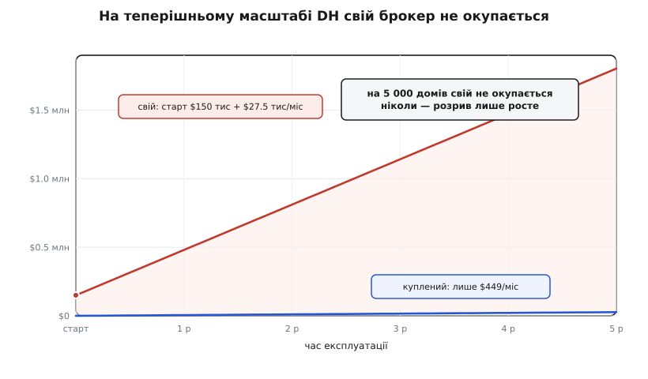

# ⚙️ Скільки коштує свій брокер: рахуємо «своє проти купленого» через масштаб

Усередині фрази «на масштабі наше вийде дешевше» ховається число, якого ніхто не назвав. Фраза не бреше — керований брокер справді береться за трафік, і при *якомусь* розмірі його рахунок переросте вартість власного вузла. Але «якийсь розмір» — це і є та річ, яку треба порахувати, а не відчути. Бо якщо цей розмір — десять тисяч домів, тоді будувати треба вже зараз; а якщо десять мільйонів — уся суперечка не про нас і не про це десятиліття. Модель перетворює відчуття на точку перетину на осі, яку можна прочитати очима.

Зробімо цю модель маленькою й чесною. Дано одне: скільки домів обслуговує Digital Homes. З цього виводимо потік повідомлень, з потоку — рахунок за [брокер повідомлень](root:com-protocol/mqtt) (окремий серверний вузол, який тримає живі з'єднання пристроїв і розвозить опубліковані повідомлення підписникам; його ціна росте з кількістю з'єднань і обсягом трафіку). Паралельно рахуємо, у що обходиться той самий вузол, зроблений і доглянутий самотужки. Дві криві, одна вісь — і питання «де вони перетнуться» перестає бути справою чийогось авторитету.

## Дві форми вартості

Уся модель тримається на тому, що куплене й своє коштують **по-різному влаштовано**, а не просто «більше/менше». Придивімося до кожної форми окремо — бо саме різниця форм, а не рівень цін, вирішує, хто виграє на якому масштабі.

**Куплене — лінійне з трафіком.** Керований брокер бере плату за те, що ти реально пропустив: за повідомлення й за хвилини живого з'єднання. Візьмімо реальний тариф — AWS IoT Core, регіон US-East, — щоб числа були не зі стелі: $1.00 за мільйон повідомлень (при обсязі знижується десь до $0.70) і $0.08 за мільйон хвилин з'єднання, тобто близько $0.042 за рік безперервного зв'язку одного пристрою. Дім у нас озивається раз на 30 секунд:

```
одне повідомлення / 30 с  →  2 / хв  →  2 880 / добу  →  86 400 / місяць з дому
куплене на дім/міс = 86 400/10⁶ · $1.00   (повідомлення)
                   + 43 200/10⁶ · $0.08   (хвилини з'єднання за 30 діб)
                   = $0.0864 + $0.0035 ≈ $0.09 на дім за місяць
```

Дев'ять центів на дім за місяць. Помнож на 5 000 домів — вийде близько $449, з яких $432 — самі повідомлення, а решта — копійчані хвилини з'єднання. Ключове у формі: рахунок **проходить через ноль**. Нема домів — нема рахунку; удвічі більше домів — рівно вдвічі більший рахунок. Це пряма лінія з початку координат.

**Своє — великий фікс плюс пологий ріст, і без кінця.** Тут форма інша з першого дня. Спершу разова побудова — те, що на серветці засновники прикинули як два інженери на півроку:

```
разова побудова = 2 інж. × 6 міс × $12 500 = $150 000   (лише до першої версії)
хвіст щомісяця  = люди(масштаб) · $12 500  +  $0.01 · домів  +  $2 500
                    ↑ чергування, патчі, масштаб   ↑ сервери   ↑ безпека, аудити
```

$12 500 — це повна вартість інженер-місяця з накладними; для старшого інженера в багатьох ринках вона й вища, тобто число радше занижене. Але головне не в разовій сумі, а в хвості. І хвіст цей — **переважно люди, а не повідомлення**. Щоб критичний вузол, крізь який тече весь дім, жив цілодобово, потрібне чергування: хтось має прокидатися о третій ночі, коли після блекауту цілий район ломиться на реконект. І це не одна людина. Гайд Google з надійності (SRE) прямо каже: щоб стале чергування 24/7 на одному майданчику не випалювало команду, треба щонайменше близько **восьми інженерів** — інакше кожен вартує занадто часто й вигорає. Ми в моделі великодушно беремо підлогу з **двох** — тобто свідомо занижуємо ціну свого. Навіть із такою поблажкою побачимо, що це не рятує.

Різниця форм і є вся суть. Куплене — діагональ крізь ноль: скупо на малому, дорого на великому. Своє — висока людська підлога, яку платиш і на п'яти тисячах домів, і на п'ятдесяти тисячах, плюс пологий приросток на сервери. Одна крива стартує майже з нуля й круто лізе; друга стартує високо й майже лежить. Дві такі криві перетинаються рівно раз — і питання лише, де саме.

> 🔧 **Навіщо це.** У реальній роботі ця модель — не трактат, а скрипт на пів екрана, який ти проганяєш перед нарадою про план. Суперечку «повір, на масштабі наше дешевше» не виграти старшинством чи гучністю: обидва боки просто відчувають. А ось графік із підписаною точкою перетину відмахнути рукою вже не можна — він переводить розмову з «мені здається» на «ось на скількох домах, покажи, де я помилився». Модель коштує годину, а економить рік, укладений не туди.


*Місячна вартість брокера через масштаб. Ліворуч від перетину куплене дешевше, праворуч — своє; перетин лежить коло мільйона домів, а DH сьогодні — за 5 000, тобто далеко в зоні «купувати».*

## Робочий код

Складімо це в модель, яку можна запустити. Функції прості: з кількості домів — рахунок купленого; з кількості домів — місячний хвіст свого; повна вартість володіння за N місяців (разова побудова плюс хвіст); і двійковий пошук точки перетину по логарифмічній осі. Наприкінці — таблиця сценаріїв і два перетини: сталий місячний і за три роки володіння.

Модель цілком загальна — жодного заліза, самі гроші й масштаб, — тож природно лягає і мовою скриптів для швидкої прикидки, і типізованою мовою, якою таку модель уклали б у продуктовий репозиторій. Ось той самий розрахунок двома:

:::tabs
:::code proj-broker-cost-model/py/main.py
:::code proj-broker-cost-model/ts/index.ts
:::

Обидва варіанти друкують те саме. Ось вивід — читати його цікавіше, ніж запускати:

```
      домів  повід./с   куплене/міс    своє/міс  дешевше
      5 000       167          449$     27 550$  куплене
     50 000     1 667        4 493$     45 474$  куплене
    500 000    16 667       44 928$     74 974$  куплене
  1 000 000    33 333       89 856$     87 500$  СВОЄ
  5 000 000   166 667      449 280$    144 974$  СВОЄ
 10 000 000   333 333      898 560$    202 500$  СВОЄ

перетин, сталий місяць:      965 760 домів
перетин, володіння 36 міс:   1 026 189 домів
DH сьогодні 5 000 → до перетину ще ~193×
```

## Що каже таблиця

Прочитаймо її повільно, бо в ній уся відповідь на «на масштабі наше дешевше».

На **5 000 домів** — там, де DH стоїть зараз, — куплене коштує $449 на місяць і працює вже цього тижня, а своє обходилось би у ~$27 550 щомісяця (з яких $25 000 — дві людські зарплати), та ще й $150 000 разом на побудову згори. Це не «трохи дорожче»: своє тут дорожче в **шістдесят разів** щомісяця, і майже вся ця різниця — не сервери й не трафік, а люди, яких ти тримаєш незалежно від того, п'ять тисяч у тебе домів чи п'ятсот.

Куплене лишається дешевшим і на 50 000, і на 500 000 домів. Криві сходяться лише під **мільйон**: сталий місячний перетин — коло 966 000 домів, а якщо чесно докласти й разову побудову й дивитися на повну вартість за три роки, точка відсувається за 1 000 000. І тільки далі, на мільйонах, своє починає впевнено вигравати — бо там людська підлога вже розмазана по такій кількості домів, що на кожен дім її доводиться копійки, а куплений рахунок за ці копійки давно переріс.

Тепер прикладімо це до себе. DH — за 5 000 домів. До перетину — **майже двісті разів** масштабу. Це не «підрости трохи»; це інша компанія, іншого десятиліття, з іншими даними про світ. Будувати свій брокер сьогодні під цей перетин — означає ставити скупу готівку стартапу на здогад, що ми туди дійдемо, і дійдемо саме так, як намалювали. Це те саме [ризик-мислення](root:sf-apps/risk-thinking) навпаки: замість зважати ймовірність і наслідок, ми закладаємось на найкращий випадок майбутнього масштабу.



*Накопичена вартість за п'ять років на теперішньому масштабі DH. Своє стартує з боргу в $150 тис і росте вчетверо-вп'ятеро швидше; на 5 000 домів воно не окупається ніколи — розрив тільки ширшає.*

Друга картина каже те, чого не видно з першої. На нашому масштабі питання «а може, з часом своє відіб'ється» має тверду відповідь: ні. Куплене повзе по самому дну — за п'ять років воно накопичить якісь $27 тисяч. Своє стартує з боргу в $150 тисяч і росте так круто, що розрив не звужується ніколи, а лише ширшає. На 5 000 домів «своє окупиться згодом» — не оптимізм, а арифметична неправда.

## Складність і пастки

Модель проста навмисне, і саме тому легко втекти в один з двох самообманів — «то все брехливі припущення» або «то точне пророцтво». Ні те, ні те. Розберімо, де вона хитка, де залізна і що з нею робити.

**Модель щедра до «свого» — і все одно програє.** Це найважливіше. Ми свідомо занижували ціну свого на кожному кроці: підлога у 2 інженери замість SRE-шних ~8; інженер-місяць у $12 500, хоч старший коштує більше; ми взагалі **не рахували** найдорожче — вартість втраченого, тобто ті самі руки, що, тримаючи брокер, не будують продукту, за який DH і люблять. Не рахували, що чужий спеціалізований брокер надійніший за наш перший, а кожна година простою критичного вузла коштує грошей і довіри. Не рахували, що v1 завжди зісковзує в часі. Не закладали піка: керований брокер сам ковтає шторм реконектів, а свій треба провіянтити під пік, не під середнє. Кожна з цих поправок штовхає перетин **далі вправо**. Тобто справжній перетин ще дальший за мільйон, ніж каже наша й так сувора до купленого таблиця.

**Ціна за повідомлення — не константа.** Ми взяли $1 за мільйон, але при обсязі керовані брокери падають до ~$0.70 і нижче за перемовами — тобто куплене на великому масштабі ще дешевшає, і перетин знову відсувається. У протилежний бік працює єдине: на десятках мільйонів домів своє залізо справді починає бити чужий наспід, і це та сама права частина графіка, де «будувати» нарешті слушно. Модель це чесно показує — вона не проти власного брокера взагалі, вона проти власного брокера **зараз**.

**Крива своя — не гладка лінія.** У коді хвіст росте плавно, бо `ops_fte` — логарифм. Насправді люди наймаються стрибками, регіони й шардинг додаються ривками, а не по краплині. Пологий підйом на графіку ховає ці сходинки; реальний хвіст лумпуватіший і частіше вищий за модельний. Це ще один аргумент не на користь свого.

**Хвіст не має кінця — і це головна пастка бюджету.** Око бачить $150 000 і думає «ну, заплатимо раз». Але $150 000 — це лише внесок; далі йде іпотека на десятиліття: чергування, патчі безпеки, міграції, масштаб. Саме про це [вартість як атрибут](root:sf-apps/cost-as-attribute): справжня ціна «свого» — не тиждень прототипа, а роки супроводу, і в моделі вона сидить у щомісячному хвості, а не в разовій сумі. Хто рахує лише побудову, той порівнює перший внесок із повною орендою — і щоразу обманюється.

**Прив'язку до постачальника модель не карає — і правильно.** Може здатися, що куплене варто було б обтяжити ціною замка на чужу компанію. Але цей замок знімається дешево, якщо сховати брокер за власним портом: код DH говорить із абстракцією «надіслати команду / отримати подію», а вже за нею — адаптер до конкретного брокера. Тоді заміна постачальника — це переписаний адаптер, а не переписана платформа, і куплене лишається [зворотним рішенням](root:sf-apps/reversible-irreversible-decisions) — двобічними дверима. Саме тому в моделі нема рядка «ціна lock-in»: адаптер тримає її малою навмисне. Це і є практичний бік [рамки «купити чи будувати»](root:sf-apps/build-vs-buy) — купуй контекст за чистим інтерфейсом, лишай собі право передумати.

**Модель — не пророцтво, а порядок величини.** Точне число перетину гуляє: посунь infra з $0.01 на $0.02 — і сталий перетин переповзе з ~970 тисяч на ~1.1 мільйона. Але жодне розумне ворушіння параметрів не стягує перетин з мільйонів до наших п'яти тисяч — розрив надто великий. У цьому й уся цінність: модель не обіцяє «рівно 965 760», вона доводить «десь коло мільйона, а ми за п'ять тисяч». Саме таку тверду відповідь не дає жодне відчуття — і саме її можна винести на дошку й ухвалити на ній рішення без сорому й без здогадів.

Ось що модель заробила за свою годину: вона забрала непорахований аргумент «на масштабі наше дешевше» й повернула порахований — «наше дешевшає біля мільйона домів; у нас п'ять тисяч». Перше не спростувати й не підтвердити, тож ним можна нескінченно махати на нараді. Друге — число на осі, яке або витримує перевірку, або показує, де саме ти помилився. Різниця між цими двома реченнями і є вся інженерна користь від маленької моделі.
