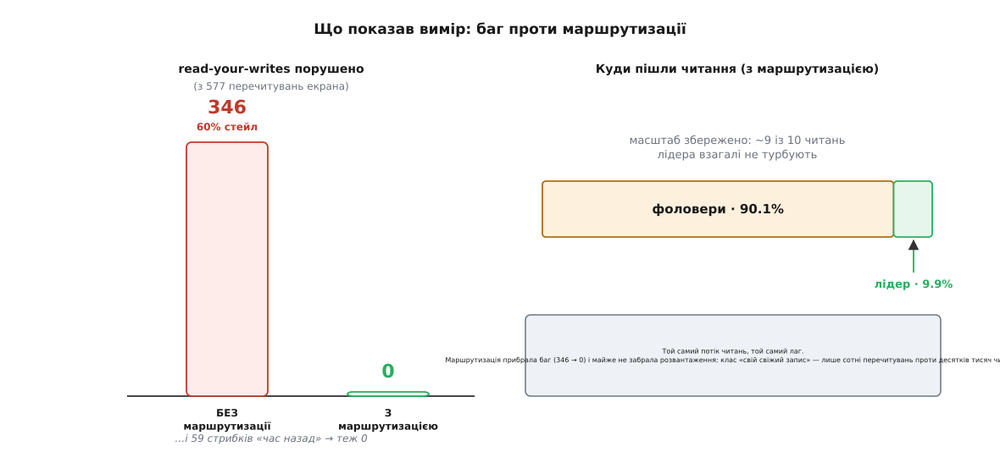
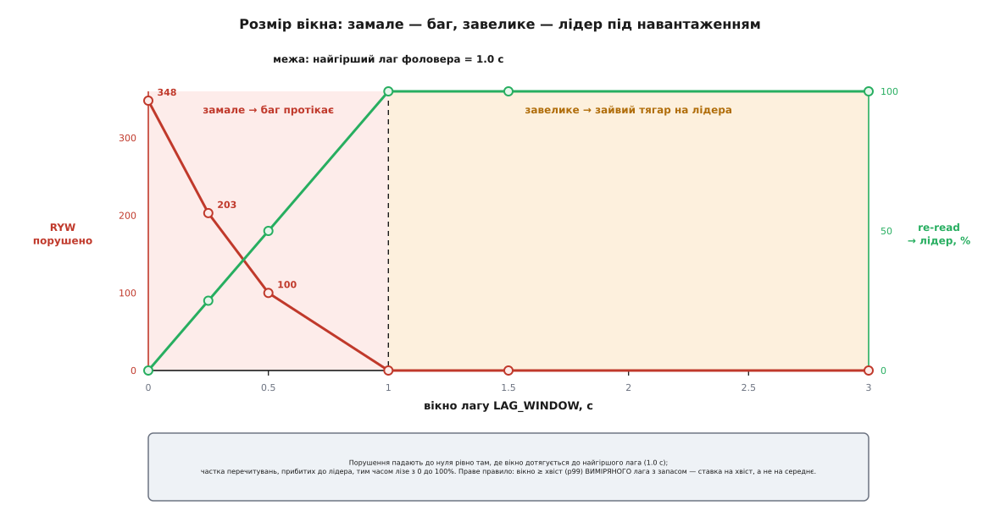

# ⚙️ Маршрутизатор читань: зібрати баг, тоді прибрати його числом

У кроці ми лишили кістяк маршрутизатора і обіцянку: показати його цілком — з живим лідером і кількома фоловерами, зі штучним лагом, із відтвореним багом «вимкнув світло — показує ввімкнене» і, головне, **з виміром**. Бо доки баг лишається розповіддю, його легко полагодити на словах: «ну ми ж додали липке-після-запису». Число не дає так відбутися. Число каже прямо: **на цьому навантаженні 60% перечитувань екрана показували стан, старший за дію користувача, — а після маршрутизації рівно нуль, і при цьому 9 із 10 читань так і лишилися на фоловерах**. Оце «60% → 0, і масштаб на місці» — і є весь сенс кроку, стиснутий у дві цифри.

Тож зберемо систему, яка **сама породжує** цей баг (не вкидає його штучно, а робить неминучим через фізику копій), проженемо крізь неї синтетичне навантаження, порахуємо порушення — і ввімкнемо маршрутизатор, щоб побачити, як число падає в нуль. Увесь код нижче реальний і запускний двома мовами: Python і TypeScript дають **той самий результат** з тим самим зерном. Складається він у один файл — три блоки підряд.

## Ідея: віртуальний час і лог записів

Перш ніж писати класи, треба вибрати, як моделювати лаг — бо саме тут легко змахлювати. Спокуса — «додати `sleep` у фоловер» або кинути реплікацію в окремий потік із випадковою затримкою. Це дало б **невідтворюваний** баг: сьогодні 55%, завтра 47%, і жодного способу сказати, чи то маршрутизатор допоміг, чи то планувальник по-іншому ліг. Для виміру нам потрібна протилежність — щоб один і той самий прогін завжди давав одне й те саме число.

Тому час у нас буде **віртуальний**: проста змінна, яку ми посуваємо руками на `dt` щокроку. Жодних потоків, жодних таймерів, повна відтворюваність. А лаг виникне не з випадковості, а з простого й чесного правила видимості.

Лідер веде **лог записів** — доданий-у-кінець потік подій, і кожна подія позначена віртуальним часом, коли її записали. Кожен фоловер має свій **лаг Δ** і застосовує запис із логу лише тоді, коли віртуальний годинник дотягнувся до `час_запису + Δ`. Тобто стан, який фоловер віддає в момент `t`, — це рівно «всі записи, старші за `t − Δ`»:

```
запис видно фоловером у момент t   ⟺   час_запису ≤ t − Δ
```

Це і є [реплікаційний лаг](root:sf-distributed/replication-lag), змодельований точно, без жодного жереба: фоловер відстає від лідера на проміжок Δ, і сесійні гарантії read-your-writes та монотонних читань саме через це й опиняються на кону. Δ малий — фоловер майже наздогнав; Δ великий — фоловер живе в глибокому минулому. Баг «показує ввімкнене» тепер не треба вкидати: він **сам** випаде щоразу, коли перечитування трапиться раніше, ніж `час_запису + Δ` цільового фоловера.

Лишається дрібниця, яка стане нашим мікроскопом. Кожному записові лідер дає **монотонний номер** `seq` — просто зростаючий лічильник. Тоді два різні збої видно як прості нерівності над цим номером: якщо читання повертає `seq`, менший за той, що я **щойно записав**, — це порушення read-your-writes; якщо менший за той, що я **вже бачив** у цій сесії, — це час, який пішов назад. Одне ціле число ловить обидві біди.

## Крок 1. Кластер зі штучним лагом

Ось увесь субстрат: детермінований генератор чисел (щоб числа збігалися між мовами), годинник, лідер із логом, фоловер, що доганяє лідера курсором по логу, і кластер, який на кожному `tick` посуває час і дає всім фоловерам наздогнати.

:::tabs
:::code proj-dh-replica-reads/py/krok-1-klaster-zi.py
:::code proj-dh-replica-reads/ts/krok-1-klaster-zi.ts
:::

Серце тут — `replicate`. Фоловер не «отримує» повідомлення; він **сам** доходить курсором по логу лідера рівно до тих записів, чий час уже проминув межу `now − lag`. Усе, що новіше, для нього ще не існує. Саме цей один рядок `log[self.cursor][1] <= now - self.lag` перетворює абстрактний «лаг» на конкретну, порахунковувану відсталість — і робить баг неминучим, а не випадковим.

> 🔧 **Навіщо це.** Змоделювати лаг чесно — не педантизм, а умова того, щоб виміру взагалі можна було вірити. Якби фоловер відставав на випадкову величину з таймера, ми б ніколи не відрізнили «маршрутизатор прибрав баг» від «сьогодні планувальник ліг вдало». Детермінований лаг робить експеримент **контрольованим**: змінюємо одну ручку (розмір вікна), тримаючи все інше нерухомим, — і бачимо чистий ефект саме цієї ручки. Без цього подальша розгортка вікна лагу була б не графіком, а шумом.

## Крок 2. Маршрутизатор

Тепер той самий маршрутизатор, що й у кроці, але з трьома вимикачами, щоб на одному й тому самому навантаженні порівняти «наївно» проти «з класами». `classify=False` — наївний режим: усе валиться на фоловери (те, що зробив би звичайний балансувальник, який не розрізняє читань). `sticky` вмикає липке-після-запису, `pin` — прив'язку сесії до однієї копії. Увімкнені всі три — це повне рішення.

:::tabs
:::code proj-dh-replica-reads/py/krok-2-marshrutyzator.py
:::code proj-dh-replica-reads/ts/krok-2-marshrutyzator.ts
:::

Три галузки — три різні відповіді на три різні запитання. `lock` не питає нічого: замок завжди з лідера, бо застарілий стан замка — це вже не дрібниця, а питання безпеки. `device_state` питає «а чи писала ця сесія в цей дім щойно?» і, лише якщо так і лише коротко, тягне з лідера. Усе решта — на фоловери. Названі гарантії, які ми тут тримаємо руками, — **read-your-writes** і **монотонні читання** — не наш винахід: це дві з чотирьох «сесійних гарантій», які [сформулювали Террі, Демерс і колеги в проєкті Bayou (Xerox PARC, 1994)](https://dl.acm.org/doi/10.5555/645792.668302) саме для слабко узгоджених реплік, де застосунок читає з різних, можливо, розсинхронених серверів, але мусить бачити картину, узгоджену з власними діями.

## Крок 3. Навантаження, що б'є в те саме місце

Тепер драйвер, який відтворює баг. На кожному кроці з імовірністю ~3% хтось у якомусь домі клацає пристрій — це запис на лідера плюс `note_write`. І одразу застосунок робить те, що робить завжди після дії: **перечитує екран**, і не раз, а кілька разів поспіль (застосунок оновлює картинку на 0.15, 0.35, 0.6 і 0.9 с після натискання). Оці перечитування — і є місце, де живе read-your-writes: кожне з них мусить показати свіжий стан. Поряд тече фоновий потік — телеметрія, реєстр, замки, стан чужих домів — той об'єм, що має розвантажувати лідера.

Порушення ловимо просто. Для кожного перечитування знаємо `seq` запису, який його спричинив: якщо читання повернуло менший `seq` — воно не побачило власного запису (застаріле читання). Якщо `seq` менший за максимум, уже побачений у цій серії перечитувань, — час пішов назад (порушення монотонності).

:::tabs
:::code proj-dh-replica-reads/py/krok-3-navantazhennia.py
:::code proj-dh-replica-reads/ts/krok-3-navantazhennia.ts
:::

## Що показали числа

Обидві мови на зерні `42` дають байт-у-байт те саме:

```
БЕЗ  маршрутизації: 346/577 перечитувань застарілих (60%), 59 стрибків часу назад; лідер 0%
З    маршрутизацією: 0 застарілих, 0 стрибків; лідер 9.9%, фоловери 90.1% (усього 30577 читань)
```

Прочитаймо це повільно, бо тут кожне число щось важить. **Наївний рядок** — це саме той «подарунок», яким репліки видавалися спершу: 100% читань на фоловерах, лідер відпочиває, масштаб ідеальний. І ціна цього подарунка — **346 із 577** перечитувань екрана (60%) показали стан, старший за дію користувача, плюс 59 разів стан на очах стрибнув **назад у часі**. Тобто в наївному варіанті кожне друге «я щойно вимкнув — покажи» бреше. Система масштабується блискуче й бреше стабільно.

**Рядок із маршрутизацією** — та сама фізика копій, той самий лаг, той самий потік — дає **нуль** порушень read-your-writes і **нуль** стрибків назад. А розвантаження нікуди не поділося: **90.1%** читань і далі йдуть на фоловери, на лідері лише **9.9%**. Ми прибрали баг **майже задарма** — і ось чому задарма: клас «свій свіжий запис» — це 577 перечитувань проти понад тридцяти тисяч читань. Прибити цю жменю до лідера на пару секунд коштує копійки, а решта океану читань як лилася на фоловери, так і ллється.


*Той самий потік читань, той самий лаг — і два різні світи. Маршрутизація перекинула баг 346 → 0 і майже не забрала розвантаження: клас «власний свіжий запис» такий вузький, що липке-після-запису його тримає, ледве торкаючись лідера. Оце «нуль порушень при 90% розвантаженні» — і є те, що крок обіцяв, тепер у цифрах.*

Помітьте, звідки взялися ті 9.9% лідера. Це майже не перечитування (їх крапля) — це **замки**. У нашому потоці замок читається у ~8% випадків, і кожне таке читання беззастережно йде на лідера. Тобто read-your-writes виходить майже безкоштовним, а основний рахунок лідерові виставляє клас безпеки. Це не хиба виміру — це чесна структура ціни, і ми до неї ще повернемось у пастках.

## Складність і пастки

Маршрутизатор — сорок рядків, і на вигляд він простий до тривіальності. Але кожне з тих сорока рядків тримається на припущенні, яке легко проґавити. Ось чотири місця, де воно ламається, — і кожне видно тим самим драйвером, дописаним на кілька рядків.

### Порожній `last_write` після рестарту

Уся дешевизна read-your-writes тримається на `last_write` — словнику «коли ця сесія востаннє писала». А він живе **в пам'яті процесу**. Що станеться, коли процес перезапустять — викотили нову версію, впав інстанс, балансувальник підняв свіжий? `last_write` порожній. І перечитування, яким **найбільше** потрібен лідер, дружно поїдуть на фоловери — бо про недавній запис ніхто вже не пам'ятає. Баг повертається саме тоді, коли систему щойно чіпали руками, тобто в найгірший момент.

:::code proj-dh-replica-reads/py/porozhnii-last-write.py

Без відновлення перечитування падає на фоловера, який ще тримає старе `on`, — користувач вимкнув, а бачить ввімкнене. З простим грейсом — «після старту пару секунд вважай усі доми щойно-писаними» — те саме читання йде на лідера й повертає чесне `off`. Грейс коштує короткого сплеску навантаження на лідера одразу після рестарту; це мізерна ціна проти повернення бага. Той самий висновок стосується й **горизонтального** масштабу: якщо маршрутизаторів кілька, `last_write`, зроблений на інстансі A, невідомий інстансу B, — тож або цей стан носить сам клієнт (маркер «мій останній запис був о такій-то версії»), або кожен інстанс мусить бути консервативним. Пам'ять про свіжий запис — це стан, і ставитися до неї треба як до стану, а не як до випадкової локальної змінної.

### Розмір вікна лагу

`LAG_WINDOW` — єдине число, яке треба вгадати, і воно двобічно небезпечне. Замале — і воно не накриває реального лага: перечитування вислизає на фоловер, який ще не догнав, і баг протікає. Завелике — і кожне перечитування висить на лідері довше, ніж треба, з'їдаючи те саме розвантаження, заради якого все затівалось. Проженемо `run` по діапазону вікон і подивимось на обидва боки заразом:

```py
for w in (0.0, 0.25, 0.5, 1.0, 1.5, 3.0):
    res = run(lag_window=w)
    print(w, res["viol"], round(100 * res["reread_leader"] / res["ryw"]))
# 0.0 348 0  |  0.25 203 25  |  0.5 100 50  |  1.0 0 100  |  1.5 0 100  |  3.0 0 100
```


*Геометрія компромісу. Ліворуч від межі найгіршого лага (1.0 с) — зона бага: вікно замале, порушення течуть (при вікні 0 їх аж 348). Праворуч — зона надміру: порушень уже нуль, але частка перечитувань на лідері вперлась у стелю 100%. Порушення зникають рівно там, де вікно дотягується до **найгіршого** фоловера, — не до середнього.*

Крива каже те, чого прозою не скажеш так чітко. Ліва частина — **обрив**: між вікном 0 і 0.5 с порушення обвалюються сотнями, і кожен зайвий недобраний десяток мілісекунд коштує живого бага. Права частина — **пологий пагорб**: розвантаження тане поступово, зайве вікно — це просто трохи більше навантаження, не катастрофа. Асиметрія й підказує правило: вікно треба ставити **за хвостом** розподілу лага (p99 з виміру, ще й із запасом), а не за середнім, і мірятися на найповільнішого фоловера, а не на типового. Вікно — це ставка на хвіст; хто ставить на середнє, той регулярно програє тим користувачам, чий фоловер сьогодні відстав найдужче.

### Відсутність монотонності

Липке-після-запису лагодить **твій власний** свіжий запис. Але є підступніший збій, який воно не чіпає: два послідовні читання не сміють іти назад у часі, навіть коли ти сам нічого не писав. Уяви, що ти дивишся на живий стан пристрою в домі, де його смикає **хтось інший** (спільний доступ, інший мешканець). Твої опитування — це читання на фоловери. Якщо балансувальник щоразу кидає їх на випадкову копію, перше опитування може влучити в догнанішого фоловера (бачить `off`), друге — у відсталішого (бачить `on`), — і екран блимає `off → on → off`, хоча стан насправді рухався лише в один бік.

:::code proj-dh-replica-reads/py/vidsutnist-monotonnosti.py

Без прив'язки — **379** стрибків назад за 600 кроків; із прив'язкою — рівно **нуль**. Прив'язати сесію до однієї копії коштує буквально нічого (`home % n` замість випадкового вибору), а натомість фізично забороняє читанню задкувати: одна копія свій `seq` лише нарощує, тож і побачений `seq` уже не впаде. Одна засторога до цього трюку тягне назад до попередньої пастки: прив'язувати треба за **стабільним** ключем. Убудований `hash()` у деяких середовищах підсолюється на кожен процес (у Python — типово), тож після рестарту той самий дім лягав би на **іншого** фоловера, і монотонність знову б порвалася. Прив'язуй за самим ідентифікатором дому чи сесії або за фіксованою хеш-функцією — не за тим `hash`, що змінюється між запусками.

### Стан замка — завжди з лідера, без винятків

Помітьте, що `lock` у маршрутизаторі стоїть **до** будь-якого вікна: він іде на лідера, навіть коли читач нічого не писав і жодного «свіжого власного запису» немає. Це навмисне. Липке-після-запису лагодить незручність — «не бачу своєї дії»; а застарілий стан замка — це не незручність, а **брехня про безпеку**: застосунок каже «замкнено», поки двері насправді відчинені. Таку брехню не можна пускати навіть на секунду лага, тож замок не отримує знижки «давнє читання терпить».

Ціну цього ми вже бачили в числах: майже вся десятивідсоткова частка лідера — це замки, а не перечитування. Клас безпеки — єдиний, хто платить лідерові беззастережно й постійно. У домі це не проблема: замок читають незрівнянно рідше за телеметрію, тож повний рахунок за нього дрібний. Але межу варто назвати вголос: якби в іншій системі саме читання-«чи-безпечно» стали основним потоком, цей клас переріс би лідера, і йому знадобилась би вже своя відповідь — синхронна реплікація на самий рядок замка чи читання з кворуму копій. Правило «замок завжди з лідера» дешеве рівно доти, доки замків мало; це припущення теж варто тримати на оці.

## Межа: усе тримається на одному писареві

Зберімо, що дав цей розбір. Не «маршрутизація має допомогти», а **60% → 0** порушень read-your-writes і **379 → 0** стрибків назад, і все це при **збережених 90%** розвантаження — на реальному, запускному коді, який дає те саме двома мовами. Дисципліна, яку ми відпрацювали, — не «зробити консистентно», а інженерний цикл: **збудувати механізм, що робить лаг неминучим**, **відтворити баг як число**, **прибрати його** й **не спускати очей із ціни** (розвантаження, навантаження на лідера, розмір вікна). Усе рішення локальне й дешеве: позначка часу на дім та статична табличка класів — жодних розподілених замків, жодного консенсусу.

І все ж під цими сорока рядками лежить одна тиха опора, якої вони не забезпечують самі: **писар мусить бути рівно один**. `last_write`, вікно, монотонність — усе це чесне, лише поки є єдиний лідер, чий `seq` завжди найсвіжіший. Тримати цю одність, коли лідер падає й когось підвищують на його місце, — окрема, не менша робота, і вона вже за межею маршрутизатора читань. Маршрутизатор чесно розкладає читання по копіях; але він мовчки припускає, що копії доганяють **одного** писаря, — і саме на це припущення варто дивитися пильніше за все інше.
