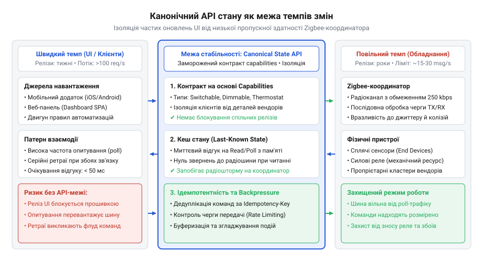
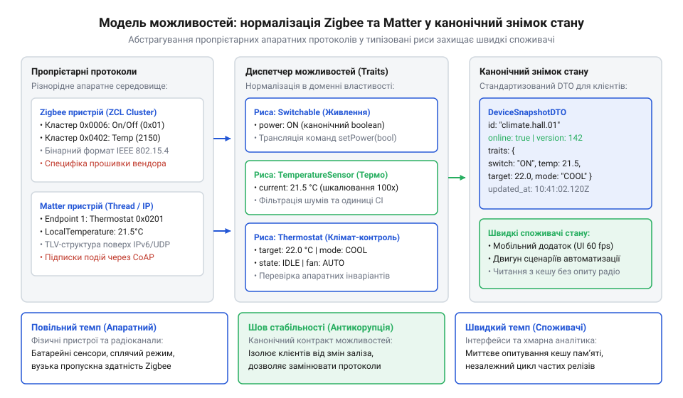
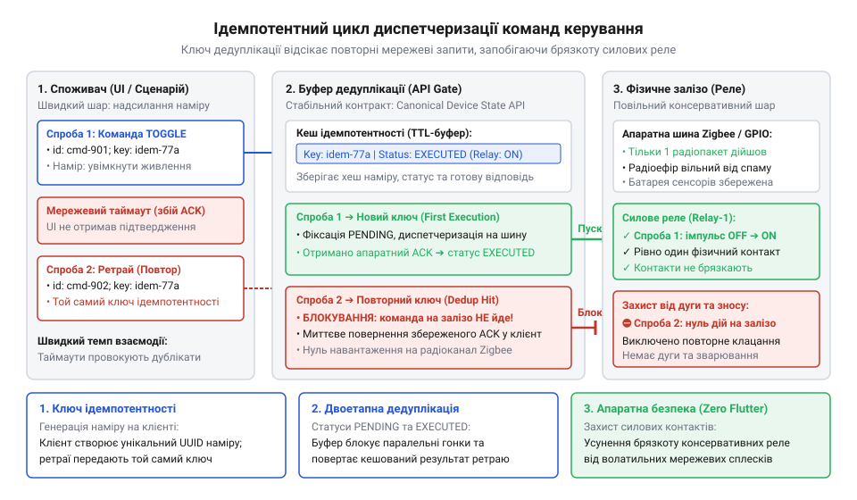
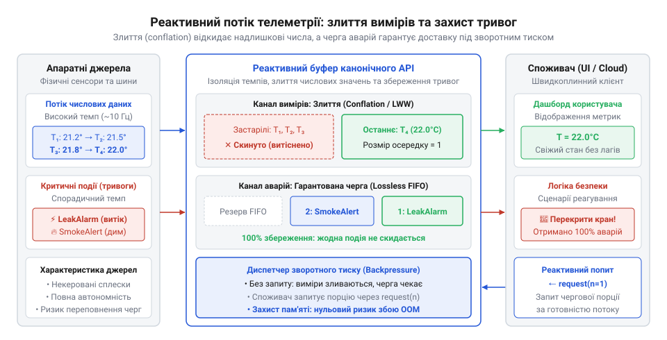
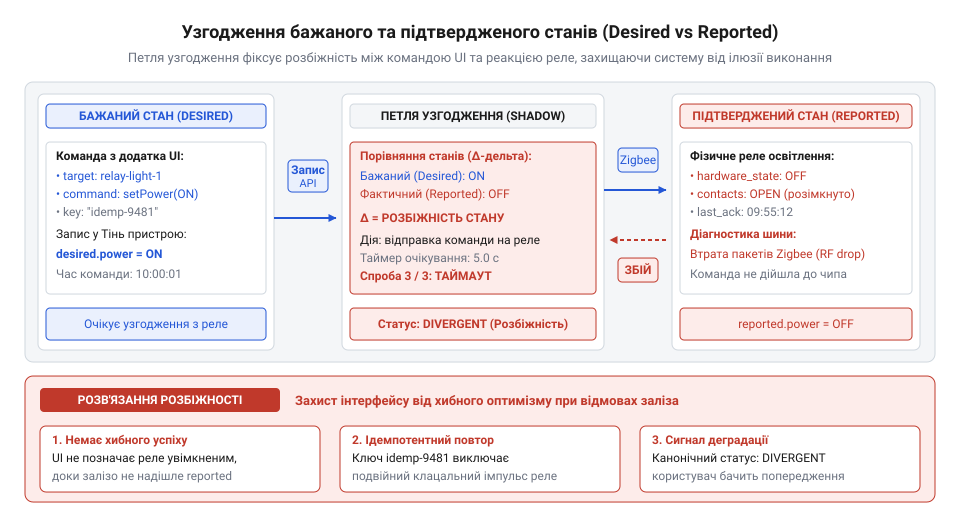

# Карта темпів Digital Homes

<preknowlist>
- [Різні частини — різні годинники](root:progarch/different-clocks) — розуміння концепції різної внутрішньої частоти змін і вартості дефектів у підсистемах та необхідності роздільних релізних циклів.
</preknowlist>

## Архітектурний розрив темпів: чому пряме зв'язування клієнтів із фізичним обладнанням руйнує систему

Користувацький інтерфейс прагне миттєвого відгуку. Коли інженер мобільного застосунку Digital Homes проектує екран керування вітальнею, природне бажання — показати плавні анімації зміни температури, миттєве положення жалюзі та точний стан вимикачів. Якщо клієнтський застосунок напряму викликає драйвер координатора бездротової мережі або шле періодичні запити опитування кожні пів секунди, у розподіленій системі виникає катастрофічний збій. Причина криється у фундаментальному конфлікті фізичних швидкостей компонентів.

Мережа бездротових датчиків стандарту 802.15.4 (Zigbee) володіє теоретичною пропускною здатністю 250 кілобітів на секунду, а в реальних умовах радіозавад корисна швидкість передавання корисного навантаження рідко перевищує 20–30 кілобітів на секунду. Більшість датчиків — відчинення дверей, протікання води, температури — живляться від дискових літієвих батарейок типу CR2032. Щоб пропрацювати два роки на єдиному елементі живлення, такий пристрій функціонує як сплячий кінцевий вузол (@@en|sleepy end device@@, з англ. *sleepy* — сонний, *end device* — кінцевий пристрій). Він вимикає радіотрансивер на 99.8% часу і виходить в ефір лише за пороговою подією або за власним таймером раз на кілька хвилин, аби перевірити поштову скриньку на батьківському маршрутизаторі.

Якщо мобільний застосунок намагається прямо опитати такий датчик, запит або завершується аварійним тайм-аутом, або змушує шлюз тримати пакет у черзі очікування. Коли ж десяток віджетів інтерфейсу водночас надсилають запити стану, на координаторі мережі стається переповнення кільцевих апаратних буферів. Мікроконтролер шлюзу має обмежений обсяг оперативної пам'яті (зазвичай десятки чи сотні кілобайтів). Сплеск кадрів переповнює пам'ять черги пакетів, спричиняє масову втрату квитанцій підтвердження (ACK) і провокує шторм маршрутизації: координатор вирішує, що зв'язок із сусідами втрачено, і починає заново сканувати всю сітку. У результаті звичайна дія — увімкнути світло настінним вимикачем — зависає на 10–15 секунд або губиться взагалі.

До фізичного колапсу мережі додається організаційне блокування розробки. Мобільний інтерфейс живе у швидкому годиннику: нові екрани, експерименти з компонуванням та оновлення виходять щотижня або навіть щодня. Прошивка апаратного шлюзу та радіомодуля функціонує в консервативному циклі: зміна низькорівневого коду драйвера вимагає тритижневого регресійного тестування на стендах, перевірки стійкості до радіозавад і сертифікації надійності. Якщо мобільний код зав'язаний на специфічні байти регістрів координатора чи адреси кластерів конкретного чипа, кожен випуск мобільного застосунку блокується графіком релізів прошивки. Виникає жорстке логічне зчеплення між шарами з непорівнянними швидкостями змін.

У теорії архітектури це явище описують як темпові шари (@@en|pacing layers@@, з англ. *pace* — темп, крок, *layer* — шар), детально розглянуті в матеріалі [Різні частини — різні годинники](root:progarch/different-clocks). Швидкий шар не має права керувати темпом повільного, інакше він або зруйнує його ресурси, або сам уповільниться до швидкості найповільнішої ланки.

*Розрив темпів між швидким UI та повільним обладнанням: канонічний API стану як точка стабільності, що запобігає прямому навантаженню на Zigbee-координатор і блокуванню релізів.*

Щоб ліквідувати цей конфлікт, на межі між споживачами та апаратним рівнем зводять точку довготривалої стабільності — канонічний контракт стану пристроїв (@@en|Canonical Device State API@@, канонічний інтерфейс стану пристроїв). Шлюз веде у власній оперативній пам'яті локальний кеш останнього відомого стану кожної фізичної одиниці. Коли клієнтському коду потрібні дані для віджетів, він запитує цей моментальний знімок із пам'яті сервісу. Відповідь повертається за мікросекунди, не породжуючи жодного байта радіотрафіку в ефірі й не будячи сплячі датчики. Фізична радіомережа передає інформацію виключно за подіями або з безпечною для батарейок частотою фонового збору, а команди керування потрапляють у чергу диспетчеризації із суворим контролем частоти.

> 🔧 **Навіщо це.**
> Пряме опитування заліза з боку інтерфейсів спалює батарейки датчиків за лічені дні, глушить радіоканал і змушує мобільну команду тижнями чекати тестування прошивки. Канонічний API стану виступає амортизатором темпів: UI миттєво читає кешований знімок із пам'яті, а апаратний координатор працює у своєму розміреному фізичному ритмі.

Така межа повністю розв'язує цикли випуску. Команда мобільного застосунку може щодня переписувати інтерфейси, додавати аналітику й змінювати дизайн карток, спираючись на стабільний контракт канонічного стану. Водночас системні інженери оновлюють мікрокод радіомодулів, змінюють версії стека Zigbee або замінюють координатори без ризику зламати роботу вищих шарів.

## Модель можливостей (Capabilities): контракт канонічного пристрою та уніфікація різнорідного обладнання

Після ізоляції фізичної шини від клієнтських запитів постає наступна інженерна проблема: зоопарк апаратних стандартів. У реальному помешканні одночасно працюють стельові світильники Zigbee, розетки стандарту Matter через протокол Thread, настінні реле Z-Wave, кондиціонери з Wi-Fi та бездротові мітки Bluetooth Low Energy. Кожен протокол описує світ по-своєму:

1. Лампа Zigbee використовує бібліотеку кластерів ZCL (@@en|Zigbee Cluster Library@@): увімкнення кодується кластером `0x0006`, а яскравість задається в кластері `0x0008` цілим числом від 0 до 254.
2. Розумна лампа Matter передає атрибути через модель даних (@@en|Data Model@@), де яскравість регулюється діапазоном від 1 до 254, а колір передається координатами колірного простору CIE 1931.
3. Сторонній Wi-Fi димер очікує значення яскравості у відсотках від 0 до 100, а дешевий радіореле-модуль — у 16-бітному значенні ШІМ від 0 до 65535.
4. Датчики температури поводяться ще різноманітніше: один вендор надсилає ціле число у сотих частках градуса Цельсія (значення 2150 означає 21.5 °C), інший передає градуси Фаренгейта, а промисловий контролер повертає температуру в Кельвінах.

Якщо дозволити пропрієтарним структурам вендорів просочитися у вищі шари платформи, код мобільного застосунку, бази даних та рушія правил автоматизацій перетвориться на суцільне розгалуження умовних операторів. Додавання нового датчика вимагатиме змін у кожному клієнті, що знову паралізує розвиток системи.

Розв'язанням є модель можливостей (@@en|capabilities model@@, від пізньолат. *capabilitas* — здатність, спроможність). Замість опису фізичного пристрою через його торгову марку чи мережевий протокол система розглядає кожен апарат як композицію незалежних стандартизованих рис (@@en|traits@@ або @@en|capabilities@@). Розумна лампа з димером — це не «ZigbeeBulbModelX», а пристрій, що володіє двома можливостями: `on_off` та `brightness`. Розумна розетка з вимірюванням споживання поєднує можливості `on_off`, `power_meter` та `energy_meter`. Клієнтському коду байдуже, яка мікросхема комутує струм: він взаємодіє виключно зі стандартизованою рисою.

*Модель можливостей: перетворення різнорідних пропрієтарних протоколів Zigbee та Matter у канонічні риси та стандартизований DTO знімка стану.*

Центральним артефактом контракту є моментальний знімок стану (@@en|snapshot@@, з англ. *snapshot* — миттєвий відбиток) — об'єкт передавання даних `DeviceStateSnapshot`. Він фіксує узгоджений зріз параметрів пристрою в єдиній системі координат.

У канонічному контракті діють непорушні архітектурні інваріанти:

1. **Єдині системні одиниці (SI).** Усі числові величини зводяться до Міжнародної системи одиниць (@@en|SI@@, з фр. *Système international d'unités*). Температура вимірюється виключно в градусах Цельсія (°C) у вигляді числа з рухомою комою. Потужність передається у ватах (W), енергія — у кіловат-годинах (kWh), тиск — у гектопаскалях (hPa).
2. **Нормалізація відносних величин.** Будь-які регулятори (яскравість світла, швидкість обертання вентилятора, відсоток відкриття штор) нормалізуються до безрозмірного діапазону від `0.0` (мінімум, повністю закрито/вимкнено) до `1.0` (максимум, повне відкриття). Клієнтський UI ніколи не обчислює співвідношення 254 чи 65535: нуль завжди нуль, а одиниця завжди максимум.
3. **Строга дискретність станів.** Двійкові датчики транслюються в однозначні семантичні константи: наприклад, стан герконового датчика дверей кодується строго як `'open'` або `'closed'`, виключаючи апаратні біти `0x00` чи `0xFF`.
4. **Агностичність до транспорту.** У канонічному DTO немає полів з назвами мережевих стеків, ідентифікаторів кластерів чи апаратних MAC-адрес. Ідентифікатором є глобальний UUID пристрою в домені платформи.

Для забезпечення довготривалої стабільності схема підпорядковується правилам сумісності:
- **Адитивність змін:** додавання нових можливостей до пристрою є зворотно сумісним. Клієнти, які підписані лише на `on_off`, безпечно ігнорують появу нової риси `power_meter`.
- **Незмінність семантики:** одиниці вимірювання та діапазони існуючих полів зафіксовані назавжди. Неприпустимо змінювати діапазон `0.0..1.0` на відсотки `0..100` у межах однієї версії схеми: така зміна руйнує клієнтські розрахунки яскравості.

Специфікація канонічного контракту та адаптерів перетворення на мові TypeScript виглядає так:

:::code api-canonical-device-state/ts/capabilitytype.ts

> 🔧 **Навіщо це.**
> Заміна специфічних для протоколу полів моделлю можливостей дозволяє UI та хмарним правилам працювати з єдиним DTO. Якщо завтра виробник лампи змінить прошивку чи замінить протокол Zigbee на Matter, змінюється лише шлюзовий адаптер нормалізації — жоден мобільний екран чи сценарій автоматизації не потребує переписування.

Завдяки уніфікації доменних рис клієнтський рівень позбавляється будь-яких знань про апаратні протоколи. Інтерфейси оперують передбачуваними сутностями з фіксованими одиницями вимірювання, що гарантує надійність системи незалежно від різноманітності підключених вендорів.

## Специфікація інтерфейсу читання стану: моментальні знімки без доступу до радіоефіру

Клієнтські застосунки взаємодіють із розумним будинком переважно через операції читання. Коли користувач розблоковує смартфон або відкриває екран кімнати, інтерфейс має миттєво відобразити статус десятків пристроїв: яскравість стельової люстри, положення штор, поточну температуру та стан віконних датчиків. Якщо операція читання ініціює прямий радіообмін із кожним окремим датчиком, система миттєво зазнає колапсу: десятки одночасних широкомовних та адресних запитів паралізують координатор, а час завантаження екрана розтягується на секунди.

Тому фундаментальним правилом канонічного API є повне відщеплення читання від радіоефіру. Інтерфейс читання звертається виключно до оперативного кешу шлюзу. Шлюз постійно актуалізує цей кеш у фоновому режимі: за рахунок періодичного надсилання повідомлень самими сенсорами та асинхронних звітів про зміну атрибутів (@@en|attribute reporting@@). Час відповіді на запит читання становить частки мілісекунди, що повністю задовольняє вимоги мобільного інтерфейсу з частотою 60 кадрів на секунду.

Контракт визначає дві базові операції читання: одиночну та пакетну:
- `GetDeviceState`: повертає деталізований моментальний знімок стану одного пристрою за його ідентифікатором.
- `BatchGetDeviceStates`: повертає знімки для масиву пристроїв за один мережевий виклик, усуваючи проблему численних кругових затримок (@@en|round-trip time@@, з англ. *round-trip* — туди й назад) при ініціалізації екранів кімнат чи всього поверху.

Оскільки клієнт отримує кешовані дані, виникає потреба в об'єктивній оцінці їхньої достовірності. На відміну від звичайних баз даних, де запис у пам'яті вважається істиною, у фізичному світі пристрій міг втратити живлення, вийти з ладу або опинитися в радіотіні. Моментальний знімок стану супроводжується метаданими свіжості:

1. **Мітка часу оновлення (`lastUpdatedTimestamp`).** Час у форматі ISO 8601 UTC, коли шлюз востаннє успішно отримав достовірний радіопакет від фізичного вузла.
2. **Атрибут доступності (`isReachable`).** Булевий прапорець зв'язку. Якщо вузол мережі, що живиться від електромережі, не відповів на регулярний сторожовий опит (heartbeat), координатор маркує його як недосяжний.
3. **Статус достовірності даних (`dataReliability`).** Дискретний маркер якості:
   - `FRESH`: телеметрія надійшла в межах очікуваного фізичного вікна (наприклад, датчик температури звітує щогодини, і від останнього пакету минуло менше 65 хвилин).
   - `STALE`: пристрій пропустив очікуване вікно звітування, але радіолінк ще не вважається остаточно розірваним (дані застаріли, UI відображає їх сірим кольором або з попереджувальним індикатором).
   - `UNREACHABLE`: фізичний пристрій визнано відсутнім на радіошині; кешовані значення не можуть використовуватися для прийняття рішень автоматизаціями.

Специфікація інтерфейсу читання та структури метаданих свіжості на мові TypeScript:

:::code api-canonical-device-state/ts/datareliability.ts

> 🔧 **Навіщо це.**
> Читання стану виключно з кешу оперативної пам'яті захищає радіоефір від виснаження, а батарейки датчиків — від передчасної загибелі. Клієнт миттєво отримує знімок усього будинку, а метадані свіжості (lastUpdatedTimestamp та isReachable) дають інтерфейсу прозору інформацію: чи показує віджет дійсний стан кімнати, чи пристрій уже годину як вимкнено з розетки.

Така структура гарантує стабільний час відповіді O(1) незалежно від того, скільки мобільних пристроїв чи автоматизацій зчитують стан кімнат одночасно. Фізична радіошина залишається повністю вільною для передавання критичних подій та команд.

## Протокол мутації стану та гарантії ідемпотентності команд керування

На відміну від невинного читання з кешу, операція зміни стану безпосередньо впливає на фізичний світ. Коли користувач на мобільному телефоні натискає кнопку ввімкнення теплої підлоги або відкриття гаражних воріт, система керує високовольтними силовими контакторами та електродвигунами. У бездротових розподілених мережах будь-який запит мутації зазнає впливу нестабільного зв'язку: зникнення мобільного сигналу 4G/5G, повторне підключення до домашньої точки Wi-Fi або втрата TCP-пакета з квитанцією підтвердження.

Якщо застосунок спроєктовано без урахування ненадійності мережі, клієнтська бібліотека після тайм-ауту автоматично повторить запит. Або ж користувач, не побачивши миттєвої реакції екрана, натисне кнопку тричі поспіль. Якщо інтерфейс надсилає наївну команду перемикання або мутацію без контролю унікальності, виникає катастрофічне явище — брязкіт контактів реле (@@en|contact chatter@@, з англ. *contact* — контакт, *chatter* — брязкіт, вібрація). Потужне силове реле котла чи насоса починає розмикатися й замикатися кілька разів за секунду, що спричиняє електричну дугу, вигоряння контактних груп і навіть пожежну небезпеку.

Щоб унеможливити подібні апаратні збої, протокол мутації стану вимагає суворої ідемпотентності (від лат. *idem* — той самий, *potens* — здатний, той, що дає однаковий результат при повторенні). Кожна операція зміни стану виконується через метод `ExecuteCommand` і обов'язково містить типізовану директиву наміру `CommandIntent`.

Структура директиви наміру містить такі обов'язкові параметри:
1. **Ідентифікатор наміру (`commandId`).** Унікальний UUID версії 4 для ідентифікації конкретного мережевого повідомлення.
2. **Ключ ідемпотентності (`idempotencyKey`).** Детермінований ідентифікатор бізнес-дії клієнта (наприклад, комбінація ідентифікатора сесії користувача та монотонного номера дії або UUID кнопки). Повторне надсилання того самого запиту зобов'язане нести той самий ключ ідемпотентності.
3. **Кореляційний ідентифікатор (`correlationId`).** Наскрізний маркер трасування, що передається через усі шари: від мобільного віджета через HTTP-шлюз, внутрішню чергу подій до логів мікроконтролера.
4. **Цільова можливість та дія.** Конкретна канонічна риса та бажане значення (наприклад, можливість `on_off` зі значенням `true`). Жодних абстрактних команд на зразок «toggle»: намір завжди формулюється абсолютно.
5. **Час життя наміру (`expiresAt`).** Часова мітка протухання команди. Якщо через затори в радіомережі пакет пролежав у буфері довше встановленого терміну (наприклад, 10 секунд), шлюз відхиляє його виконання, щоб не увімкнути прилад у несподіваний для людини момент.

Кожна команда в системі проходить чітко визначений життєвий цикл станів:
- `PENDING`: команду прийнято шлюзом, перевірено на відповідність схемі та поставлено в чергу на відправку в радіоефір.
- `APPLIED`: координатор передав команду на фізичний пристрій і отримав апаратну квитанцію підтвердження на рівні протоколу (наприклад, Zigbee APS ACK); канонічний стан оновлено.
- `REJECTED`: команда відхилена шлюзом через порушення інваріантів, вичерпання часу життя `expiresAt`, недосяжність пристрою або конфлікт пріоритетів безпеки.

*Життєвий цикл команди керування з ключем ідемпотентності: відправка наміру, дедуплікація в буфері та захист силових реле від повторного спрацьовування.*

Ядро шлюзу підтримує кільцеве вікно дедуплікації (@@en|deduplication sliding window@@) для ключів ідемпотентності. Коли надходить команда з ключем, який уже перебуває в стані `PENDING` або `APPLIED`:
1. Шлюз **не формує новий радіопакет** і не надсилає його в ефір.
2. Фізичне реле залишається непорушним: жодного повторного спрацьовування котушки чи механічного контакту не відбувається.
3. Шлюз повертає клієнту поточний статус уже виконуваної або виконаної команди.

Специфікація операції мутації та логіка дедуплікації на мові TypeScript:

:::code api-canonical-device-state/ts/commandstatus.ts

> 🔧 **Навіщо це.**
> Управління фізичними актуаторами через бездротовий зв'язок без ключів ідемпотентності перетворює мережеві повторні спроби на руйнівний брязкіт силових контактів і спалені реле. Ключ ідемпотентності та дедуплікація гарантують: навіть якщо користувач чи нестабільна мережа повторить запит п'ять разів, фізичний контактор спрацює рівно один раз.

Ідемпотентний протокол робить мутації безпечними та передбачуваними. Навіть у періоди глибоких мережевих розривів або нестабільності Wi-Fi клієнтський рівень може надійно висловлювати свої наміри, не ризикуючи пошкодити апаратне обладнання будинку.

## Реактивна підписка на телеметрію та контроль зворотного тиску (Backpressure)

Періодичне опитування кешу шлюзу розв'язує задачу читання, але не забезпечує динамічного реагування на події. Користувач очікує, що екран смартфона оновиться в ту саму мить, коли хтось відчинить вхідні двері або коли датчик освітленості зафіксує захід сонця. Для цього канонічний контракт надає інтерфейс реактивної підписки `SubscribeToStateChanges`. Проте в середовищі інтернету речей прямий потік подій приховує серйозну загрозу: переповнення черг споживачів високочастотною телеметрією.

Сучасні пристрої генерують неоднорідні потоки даних. Розумна розетка з вимірюванням споживання під час пуску потужного електродвигуна або пральної машини може надсилати оновлення поточної потужності десятки разів на секунду. Якщо шлюз транслює кожне таке повідомлення через WebSocket чи gRPC мобільному клієнту, який працює через повільне з'єднання, виникає дисбаланс швидкостей: джерело породжує дані швидше, ніж споживач здатний їх обробити й відрендерити. Без контролю зворотного тиску (@@en|backpressure@@, з англ. *back* — назад, *pressure* — тиск) буфери пам'яті клієнтського процесу неконтрольовано зростають. Це призводить до аварійного вичерпання оперативної пам'яті (Out of Memory) або багатометрових затримок, коли віджет відображає графік енергоспоживання трихвилинної давнини.

Для збереження стабільності швидких споживачів канонічний потік подій розділяє дані за семантикою обробки на два принципово різні класи:

1. **Неперервна числова телеметрія (поточні виміри).** До цієї категорії належать показники миттєвої потужності, поточної температури, освітленості чи положення димера. Для таких даних проміжні значення не несуть самостійної цінності: клієнту важливий лише найсвіжіший показник. Для неперервних потоків застосовується механізм злиття (@@en|conflation@@, злиття значень, від лат. *conflare* — здувати докупи, зливати). Якщо споживач не встигає вичитувати чергу, буфер фіксованого розміру не накопичує застарілі пакети, а перезаписує попереднє значення новішим для комбінації `deviceId + capability`.
2. **Дискретні аварійні та захисні події.** Сповіщення про витік газу, спрацювання датчика диму, затоплення водою або аварійне відключення силового контактора захисту не підлягають злиттю за жодних умов. Кожна така подія мусить бути збережена в черзі з гарантованою доставкою та пріоритетною обробкою, оскільки втрата навіть одного повідомлення створює пряму загрозу безпеці мешканців.

*Реактивний потік телеметрії: злиття надлишкових числових вимірів (conflation) та гарантована доставка аварійних подій під захистом зворотного тиску.*

Подія зміни стану описується типізованою структурою `DeviceStateChangedEvent`, яка фіксує не лише нове значення, а й категорію пріоритету:

:::code api-canonical-device-state/ts/eventpriority.ts

> 🔧 **Навіщо це.**
> Без механізму злиття (conflation) сплеск вимірів від силової розетки чи інвертора сонячних панелей затоплює мобільний інтерфейс сотнями повідомлень на секунду, викликаючи зависання UI та витік пам'яті. Розділення черг дозволяє безперешкодно оновлювати екран зі стабільною частотою, одночасно гарантуючи негайну доставку сигналів тривоги від датчиків газу чи диму.

Завдяки розділенню черг і семантиці conflation система досягає гармонії темпів: датчики з високою частотою семплування не перевантажують віджети на смартфонах, а критичні інциденти безпеки доставляються користувачеві без найменших затримок.

## Каталог типізованих помилок, апаратні інваріанти та узгодження станів (Reconciliation)

Розподілені системи автоматизації будівель взаємодіють із фізичним світом, у якому збої є не винятком, а штатним режимом роботи. Бездротові датчики можуть опинятися в зоні електромагнітних завад, акумулятори раптово розряджаються, контакти реле зазнають механічного зносу, а користувачі можуть надсилати взаємосуперечливі команди. Надійний канонічний контракт зобов'язаний надати вичерпний каталог типізованих помилок і визначити модель узгодження розбіжностей.

Використання нетипізованих відмов чи загальних статусів на зразок «помилка сервера» паралізує роботу вищих шарів: клієнтський застосунок не розуміє, чи варто повторити запит пізніше, чи показати попередження про поломку обладнання, чи заблокувати регулятор. Канонічний контракт визначає стандартний набір кодів помилок:

1. `DEVICE_UNREACHABLE`: радіомодуль не зміг встановити зв'язок із фізичним вузлом після встановленої кількості спроб. Пристрій позначається прапорцем відсутності зв'язку в метаданих свіжості.
2. `HARDWARE_INVARIANT_VIOLATION`: спроба надіслати команду, яка суперечить фізичним або апаратним обмеженням пристрою. Наприклад, спроба задати цільову температуру термостата вище безпечного порогу (наприклад, +45 °C для теплої підлоги) або одночасна активація реле відкриття та закриття електродвигуна жалюзі, що спричинить коротке замикання обмоток.
3. `COMMAND_TIMEOUT`: команда успішно пройшла первинну валідацію, але не була доставлена до виконавчого механізму до закінчення часу `expiresAt` через затори в радіоефірі.
4. `RATE_LIMIT_EXCEEDED`: клієнтський вузол перевищив дозволений ліміт мутацій для даного пристрою (захист силових приводів від перегріву та зносу).

Ще однією критичною концепцією є розведення бажаного стану (@@en|desired state@@) та фактично підтвердженого апаратурою стану (@@en|reported state@@).

Коли користувач пересуває повзунок термостата чи вмикає світло, мобільний інтерфейс не має права оптимістично вважати фізичну дію завершеною до отримання апаратного підтвердження. Наприклад, якщо електромагнітне реле залипло через зварювання контактів або пристрій втратив живлення, оптимістичний UI відобразить кімнату теплою та затишною, тоді як опалення фактично не ввімкнулося.

Процес зведення бажаного стану до підтвердженого називається циклом узгодження (@@en|reconciliation loop@@, з англ. *reconciliation* — примирення, узгодження, від лат. *reconciliatio* — відновлення зв'язку).

*Узгодження бажаного та підтвердженого станів: виявлення розбіжностей між командою UI та реакцією фізичного реле при відмовах зв'язку.*

У моделі узгодження діють такі правила:
- Якщо команда прийнята, шлюз фіксує нове значення в полі `desiredState`, залишаючи `reportedState` незмінним. Клієнтський інтерфейс відображає стан переходу (наприклад, плавний індикатор завантаження чи напівпрозору іконку).
- Після отримання апаратного звіту з радіомережі шлюз оновлює `reportedState`. Щойно `desiredState` збігається з `reportedState`, перехід вважається завершеним.
- Якщо за час таймауту підтвердження не надійшло або реле повернуло апаратну помилку, шлюз генерує подію відхилення `RECONCILIATION_FAILED`, скидає `desiredState` назад до чинного `reportedState` і повертає типізовану помилку.

Специфікація каталогу помилок та моделі узгодження на мові TypeScript:

:::code api-canonical-device-state/ts/deviceerrorcode.ts

> 🔧 **Навіщо це.**
> Розведення бажаного та підтвердженого станів усуває ілюзію успіху в ненадійному фізичному світі. Користувач смартфона ніколи не побачить фальшивого статусу «Вимкнено», якщо нагрівальний кабель котла насправді залишився під напругою через залипання контактів реле: інтерфейс чесно сигналізує про розбіжність і повідомляє про апаратну несправність.

Така завершена модель контрактної взаємодії перетворює канонічний API стану пристроїв на надійний фундамент усієї екосистеми Digital Homes. Вона дозволяє розробникам інтерфейсів та бізнес-правил зосередитися на логіці продукту, гарантуючи безпеку, передбачуваність та довготривалу стабільність роботи апаратного обладнання.
