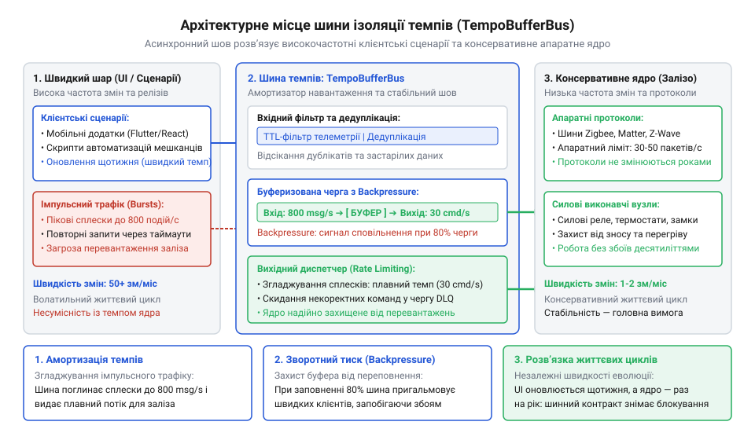
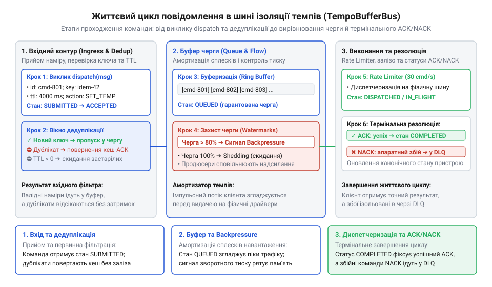
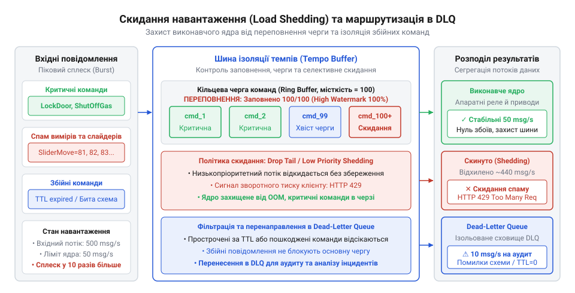

# Карта темпів Digital Homes

## Архітектурне призначення шини буферизації темпів

У типовій системі розумного будинку компоненти розвиваються та функціонують із кардинально різною швидкістю. Користувацькі правила автоматизації, хмарні інтеграції та мобільні інтерфейси змінюються щотижня: розробники додають нові тригери, експериментують зі складними ланцюжками умов або налаштовують сторонні сценарії. Цей шар живе у режимі частих змін та генерує сплески подій високої інтенсивності — наприклад, десятки сигналів зміни координат, оновлень датчиків руху чи перемикань освітлення за секунду. На протилежному боці розташоване апаратне виконавче ядро платформи Digital Homes: мікроконтролери керування живленням, польові радіомодулі (Zigbee, Z-Wave, BLE), контролери двигунів жалюзі та силові реле. Цей рівень є фізично обмеженим: передача пакета в зашумленому бездротовому ефірі триває від 50 до 300 мілісекунд, а механічні приводи вимагають суворого дотримання робочих циклів і теплових пауз.

Коли ці два світи зв'язують прямими синхронними викликами (наприклад, прямим зверненням через HTTP або gRPC від рушія правил до драйвера пристрою), система потрапляє в архітектурну пастку. Якщо користувацький скрипт починає імпульсно вимикати й вмикати світло кілька десятків разів поспіль або опитувати статус жалюзі у щільному циклі, кожен виклик блокує потік виконання на час очікування фізичного радіопідтвердження від мікроконтролера. Затримка всього в сотню мілісекунд під час лавинного напливу подій миттєво вичерпує пул потоків (@@en|thread starvation@@, з англійської: голодування пулу потоків) сервісу автоматизацій. У результаті зависає вся платформа: перестають оброблятися навіть критичні аварійні сценарії. З іншого боку, прямий потік невгамовних команд спалює ресурс фізичного обладнання — часте клацання контактів силового реле зварює контакти або виводить з ладу редуктор моторного привода.

Проблема полягає в порушенні принципу шарування за темпом змін (@@en|pace layering@@, з англійської: шарування за темпами): компоненти з різними природними частотами не можуть мати однаковий ритм функціонування. Докладніше концепцію часового розшарування розглянуто в статті [Різні частини — різні годинники](root:progarch/different-clocks).

Для усунення цієї невідповідності між шарами запроваджується шина буферизації темпів — `TempoBufferBus`. Вона діє як асинхронний амортизатор (@@en|shock absorber@@), що перехоплює вхідний трафік, негайно підтверджує його прийняття клієнту та розміщує команди в керованих чергах із захисними бар'єрами.


*Архітектурне місце шини TempoBufferBus: асинхронний шов ізолює швидкі й часті зміни користувацьких сценаріїв від консервативного та обмеженого за ресурсами апаратного ядра хабу.*

Шина виконує три ключові архітектурні задачі:
1. **Розв'язання життєвих циклів виконання.** Виклик диспетчеризації перетворюється на неблокувальну операцію: продюсер передає команду або подію в шину й одразу отримує квитанцію про фіксацію, звільняючи робочий потік сервісу для наступних завдань.
2. **Ізоляція життєвих циклів розгортання.** Сценарії автоматизації та користувацькі плагіни можна перезапускати, оновлювати чи деплоїти десятки разів на день без ризику перервати виконання поточних апаратних транзакцій або викликати перезавантаження демона керування радіомодулями.
3. **Захист апаратного ядра.** Завдяки буферизації ядро платформи вичитує команди зі своєю безпечною швидкістю (@@en|rate-limiting@@), згладжуючи пікові сплески навантаження та виключаючи ризик механічних пошкоджень виконавчих пристроїв.

> 🔧 **Навіщо це.**
> Прямий зв'язок між компонентами з різними темпами створює приховану часову залежність: швидкість і надійність швидкого шару деградують до рівня найповільнішого апаратного вузла. Асинхронна шина-амортизатор робить цю межу явною, запобігаючи каскадним відмовам і захищаючи дороге обладнання від програмних помилок у користувацьких сценаріях.

## Моделі даних: повідомлення, метадані та політики черг

Для надійної взаємодії через шину контракт вимагає суворої типізації. Обмін даними будується навколо двох ключових конструкцій: універсального конверта повідомлення `BusMessage<T>`, що транспортує корисне навантаження разом із системними метаданими, та об'єкта конфігурації `QueuePolicy`, який визначає правила поведінки конкретної черги пристрою або топіка.

### Конверт повідомлення BusMessage<T>

Кожне повідомлення, що надсилається в шину, загортається в незмінний конверт `BusMessage<T>`. Він містить як самі доменні дані, так і заголовки, необхідні шині для маршрутизації, пріоритезації, відстеження життєвого циклу та дедуплікації.

Нижче наведено специфікацію контракту повідомлення мовою C#:

```csharp
namespace DigitalHomes.TempoBus.Contracts;

/// <summary>
/// Рівень пріоритету повідомлення в черзі шини.
/// </summary>
public enum MessagePriority : byte
{
    Low = 0,
    Normal = 1,
    High = 2,
    Critical = 3
}

/// <summary>
/// Універсальний типізований конверт повідомлення шини темпів.
/// </summary>
/// <typeparam name="T">Тип корисного навантаження події або команди.</typeparam>
public sealed record BusMessage<T>
{
    /// <summary>
    /// Унікальний ідентифікатор повідомлення для трасування й аудиту.
    /// </summary>
    public required Guid MessageId { get; init; }

    /// <summary>
    /// Ідентифікатор джерела-відправника (наприклад, "automation:living-room-motion").
    /// </summary>
    public required string Source { get; init; }

    /// <summary>
    /// Мітка часу створення повідомлення у форматі UTC.
    /// </summary>
    public required DateTimeOffset TimestampUtc { get; init; }

    /// <summary>
    /// Ключ дедуплікації. Якщо вказано, шина схлопує повторні повідомлення з цим ключем
    /// у межах ковзного вікна дедуплікації.
    /// </summary>
    public string? DeduplicationKey { get; init; }

    /// <summary>
    /// Пріоритет черговості обробки повідомлення споживачем.
    /// </summary>
    public MessagePriority Priority { get; init; } = MessagePriority.Normal;

    /// <summary>
    /// Час життя повідомлення в мілісекундах (TTL). Після закінчення цього інтервалу
    /// не вичитане повідомлення вважається неактуальним і відкидається або скидається.
    /// </summary>
    public int? TtlMs { get; init; }

    /// <summary>
    /// Типізоване корисне навантаження події чи команди.
    /// </summary>
    public required T Payload { get; init; }
}
```

Усі метадані в `BusMessage<T>` є незмінними (@@en|immutable@@) після створення. Метадані виконують чіткі інженерні функції:

| Поле | Тип | Обов'язковість | Призначення та семантика |
| :--- | :--- | :--- | :--- |
| `MessageId` | `Guid` | Так | Глобально унікальний ідентифікатор події. Використовується для розподіленого трасування (Distributed Tracing), журналювання та кореляції викликів. |
| `Source` | `string` | Так | Символьний ідентифікатор компонента-ініціатора. Дозволяє виявляти проблемні джерела, які надмірно навантажують шину. |
| `TimestampUtc` | `DateTimeOffset` | Так | Точний час створення повідомлення за шкалою UTC. Дозволяє споживачам оцінювати часовий розрив (latency) між генерацією події та її фізичним виконанням. |
| `DeduplicationKey` | `string?` | Ні | Ключ ідемпотентності. Наприклад, для команди перемикання жалюзі ключ виглядатиме як `actuator:curtain-east:target-pos`. За наявності черги зі схлопуванням шина залишає лише останній цільовий стан. |
| `Priority` | `MessagePriority` | Так | Визначає порядок вичитування під час заторів. Повідомлення з рівнем `Critical` (наприклад, сигнал про протікання води чи пожежу) завжди оминають чергу фонових сенсорних вимірів. |
| `TtlMs` | `int?` | Ні | Інтервал придатності події (@@en|time-to-live@@). Якщо черга перевантажена, і команда увімкнення світла пролежала в ній довше допустимого порогу (наприклад, 3000 мс), її виконання втрачає сенс і скасовується шиною. |
| `Payload` | `T` | Так | Серіалізований об'єкт доменної операції або телеметрії. |

### Конфігурація політик черги QueuePolicy

Шина не може застосовувати однакові правила до всіх каналів зв'язку. Періодичні покази датчика вологості генеруються кожні 5 секунд і не потребують збереження на диск, тоді як сигнал розблокування дверного замка має бути гарантовано збережений навіть у випадку раптового знеструмлення хабу.

Для налаштування каналів передачі контракт шини надає структуру `QueuePolicy`, яка конфігурує параметри буферизації для кожної черги:

```csharp
namespace DigitalHomes.TempoBus.Contracts;

/// <summary>
/// Стратегія розміщення буфера черги в пам'яті або постійному сховищі.
/// </summary>
public enum StorageStrategy
{
    /// <summary>
    /// Буфер уперше виділяється виключно в оперативній пам'яті (RAM).
    /// Забезпечує максимальну швидкість обробки, але втрачається при перезапуску процесу.
    /// </summary>
    InMemory,

    /// <summary>
    /// Повідомлення скидаються на диск у журнал випереджального запису (WAL).
    /// Гарантує стійкість до збоїв живлення за рахунок додаткових витрат на I/O.
    /// </summary>
    Persistent
}

/// <summary>
/// Дія шини при вичерпанні місткості черги або завершенні TTL повідомлення.
/// </summary>
public enum RetentionPolicy
{
    /// <summary>
    /// Видаляти найстаріші повідомлення в черзі, звільняючи місце для нових (FIFO-витіснення).
    /// </summary>
    DropOldest,

    /// <summary>
    /// Відхиляти нові повідомлення, зберігаючи раніше накопичені дані в черзі.
    /// </summary>
    DropNewest,

    /// <summary>
    /// Миттєво повертати помилку продюсеру при спробі запису в переповнену чергу.
    /// </summary>
    RejectIncoming,

    /// <summary>
    /// Перенаправляти витіснені повідомлення в чергу невідповідностей (Dead-Letter Queue).
    /// </summary>
    RouteToDeadLetter
}

/// <summary>
/// Конфігурація поведінки та обмежень черги шини темпів.
/// </summary>
public sealed record QueuePolicy
{
    /// <summary>
    /// Стратегія розміщення буфера: у пам'яті або з фіксацією на диску.
    /// </summary>
    public StorageStrategy Storage { get; init; } = StorageStrategy.InMemory;

    /// <summary>
    /// Гранична кількість повідомлень, яку черга може утримувати одночасно.
    /// При досягненні ліміту вмикаються правила RetentionPolicy.
    /// </summary>
    public int MaxCapacity { get; init; } = 1000;

    /// <summary>
    /// Стандартний час життя повідомлення в мілісекундах, якщо в BusMessage не вказано TtlMs.
    /// Значення null означає необмежений час життя.
    /// </summary>
    public int? DefaultTtlMs { get; init; }

    /// <summary>
    /// Політика обробки переповнення черги та прострочених повідомлень.
    /// </summary>
    public RetentionPolicy Retention { get; init; } = RetentionPolicy.DropOldest;

    /// <summary>
    /// Тривалість ковзного вікна дедуплікації в мілісекундах.
    /// Повідомлення з однаковим DeduplicationKey схлопуються всередині цього інтервалу.
    /// </summary>
    public int DeduplicationWindowMs { get; init; } = 500;
}
```

Параметри `QueuePolicy` дозволяють архітектору точно налаштувати компроміс між надійністю, продуктивністю та захистом ресурсів:

| Параметр | Тип | Замовчування | Архітектурний вплив |
| :--- | :--- | :--- | :--- |
| `Storage` | `StorageStrategy` | `InMemory` | Визначає ціну збереження. Використання `InMemory` усуває навантаження на обмежену флеш-пам'ять вбудованого хабу, але загрожує втратою буфера при збої. `Persistent` забезпечує надійність для транзакцій безпеки ціною затримок запису. |
| `MaxCapacity` | `int` | `1000` | Встановлює верхню межу використання оперативної пам'яті. Запобігає збоям процесу через нестачу пам'яті (OOM) під час масових сплесків подій. |
| `DefaultTtlMs` | `int?` | `null` | Автоматично очищає застарілі сенсорні дані. Наприклад, якщо датчик температури надсилає показники раз на 10 секунд, встановлення `DefaultTtlMs = 15000` гарантує, що черга не накопичуватиме неактуальну телеметрію. |
| `Retention` | `RetentionPolicy` | `DropOldest` | Регламентує поведінку під час перевантаження: витіснення застарілих даних, блокування нових чи передача в чергу невідправлених повідомлень (@@en|dead-letter queue@@) для аналізу інцидентів. |
| `DeduplicationWindowMs` | `int` | `500` | Розмір ковзного вікна для поглинання брязкоту контактів або частих викликів з користувацьких скриптів без зайвого смикання апаратних приводів. |

> 🔧 **Навіщо це.**
> Конфігурація `QueuePolicy` — це формальний контракт між шиною та апаратним драйвером. Розділення політик зберігання (`StorageStrategy`) на рівні окремих черг рятує вбудовану eMMC-пам'ять хабу від деградації через безперервні циклічні записи телеметрії сенсорів, водночас гарантуючи збереження критично важливих команд керування замками та тривогами.

## Інтерфейс відправки та підписки: контракти dispatch та subscribe

Для організації асинхронної взаємодії між швидкими сценаріями та виконавчим ядром шина надає центральний програмний інтерфейс `ITempoBufferBus`. Його призначення — розділити публікацію повідомлень і їхнє безпосереднє виконання на фізичних пристроях.

У класичних синхронних архітектурах клієнт викликає метод драйвера й блокується до завершення операції. У шині темпів взаємодія розділена на два ортогональні канали:
1. **Канал диспетчеризації команд (Dispatch).** Призначений для спрямованих точкових дій (@@en|point-to-point@@), адресованих конкретній черзі пристрою (наприклад, перемиканню силового контактора чи зміні положення привода клапана). Команда завжди призначена рівно одному виконавцю.
2. **Канал публікації подій (Publish).** Призначений для віялового сповіщення (@@en|fan-out@@) багатьох підписників про зміну стану або вимірювання датчика (наприклад, фіксацію руху в коридорі чи оновлення температури).

### Квитанція диспетчеризації DispatchReceipt

Оскільки відправка повідомлення в шину є неблокувальною операцією, виклик не повертає результат фізичної дії мікроконтролера. Замість цього продюсер отримує типізовану квитанцію `DispatchReceipt`. Вона гарантує, що повідомлення успішно пройшло первинну валідацію, фільтр дедуплікації та було розміщено в черзі відповідного пристрою.

```csharp
namespace DigitalHomes.TempoBus.Contracts;

/// <summary>
/// Статус прийняття повідомлення буферною чергою шини.
/// </summary>
public enum ReceiptStatus
{
    /// <summary>
    /// Повідомлення успішно прийнято та поставлено в чергу на обробку.
    /// </summary>
    Accepted,

    /// <summary>
    /// Повідомлення визнано дублікатом у межах активного вікна дедуплікації.
    /// Новий запис у чергу не створювався.
    /// </summary>
    Deduplicated,

    /// <summary>
    /// Черга переповнена, і згідно з політикою RetentionPolicy нове повідомлення відхилено.
    /// </summary>
    RejectedQueueFull,

    /// <summary>
    /// Перевищено ліміт частоти викликів для цього каналу (Rate Limit Exceeded).
    /// </summary>
    RejectedRateLimit
}

/// <summary>
/// Квитанція про результат постановки повідомлення в чергу шини темпів.
/// </summary>
public sealed record DispatchReceipt
{
    /// <summary>
    /// Ідентифікатор зареєстрованого повідомлення.
    /// </summary>
    public required Guid MessageId { get; init; }

    /// <summary>
    /// Підсумковий статус обробки запиту на рівні шини.
    /// </summary>
    public required ReceiptStatus Status { get; init; }

    /// <summary>
    /// Точний час фіксації квитанції у форматі UTC.
    /// </summary>
    public required DateTimeOffset EnqueuedAtUtc { get; init; }

    /// <summary>
    /// Оціночна затримка в мілісекундах до моменту вичитування повідомлення виконавцем.
    /// Розраховується на основі поточної глибини черги та середнього часу обробки.
    /// </summary>
    public int? EstimatedProcessingDelayMs { get; init; }
}
```

### Специфікація інтерфейсу ITempoBufferBus

Контракт шини визначає методи для відправки команд, публікації подій та підписки споживачів:

```csharp
namespace DigitalHomes.TempoBus.Contracts;

/// <summary>
/// Причина відхилення або збою обробки повідомлення споживачем.
/// </summary>
public enum NackReason
{
    /// <summary>
    /// Тимчасовий збій каналу зв'язку чи радіоефіру (повідомлення доцільно повторити).
    /// </summary>
    TransientError,

    /// <summary>
    /// Некоректні параметри команди або непідтримуваний формат (повтор не має сенсу).
    /// </summary>
    PoisonMessage,

    /// <summary>
    /// Перевищення допустимого часу очікування відповіді від обладнання (Timeout).
    /// </summary>
    ExecutionTimeout
}

/// <summary>
/// Контекст виконання повідомлення, що надається обробнику для підтвердження обробки.
/// </summary>
public interface IMessageContext
{
    /// <summary>
    /// Підтвердити успішну обробку повідомлення (ACK). Повідомлення видаляється з черги.
    /// </summary>
    Task AckAsync(CancellationToken ct = default);

    /// <summary>
    /// Повідомити про неможливість обробки (NACK) із зазначенням причини.
    /// </summary>
    /// <param name="reason">Причина помилки.</param>
    /// <param name="requeue">Якщо true, повідомлення повертається в чергу; якщо false — скеровується в DLQ.</param>
    /// <param name="ct">Токен скасування операції.</param>
    Task NackAsync(NackReason reason, bool requeue = false, CancellationToken ct = default);
}

/// <summary>
/// Параметри реєстрації підписника на події або чергу команд.
/// </summary>
public sealed record SubscriptionOptions
{
    /// <summary>
    /// Максимальна кількість одночасно виконуваних обробників для цього споживача.
    /// Для апаратних приводів зазвичай встановлюється значення 1 для суворої серіалізації дій.
    /// </summary>
    public int MaxConcurrentHandlers { get; init; } = 1;

    /// <summary>
    /// Автоматично надсилати ACK при успішному поверненні з делегата обробника.
    /// Якщо false, обробник зобов'язаний явно викликати AckAsync або NackAsync через IMessageContext.
    /// </summary>
    public bool AutoAck { get; init; } = true;
}

/// <summary>
/// Основний контракт шини буферизації темпів.
/// </summary>
public interface ITempoBufferBus
{
    /// <summary>
    /// Відправити команду в чергу конкретного пристрою або виконавчого вузла.
    /// </summary>
    Task<DispatchReceipt> DispatchCommandAsync<T>(
        string queueName,
        BusMessage<T> message,
        CancellationToken ct = default);

    /// <summary>
    /// Опублікувати подію в топік для віялового сповіщення всіх підписаних компонентів.
    /// </summary>
    Task<DispatchReceipt> PublishEventAsync<T>(
        string topicName,
        BusMessage<T> message,
        CancellationToken ct = default);

    /// <summary>
    /// Зареєструвати обробник повідомлень для топіка або іменованої черги.
    /// </summary>
    Task<IAsyncDisposable> SubscribeAsync<T>(
        string topicOrQueue,
        Func<BusMessage<T>, IMessageContext, Task> handler,
        SubscriptionOptions options,
        CancellationToken ct = default);
}
```

Життєвий цикл кожного повідомлення підпорядкований суворому конвеєру:


*Життєвий цикл повідомлення в шині: від виклику dispatch через дедуплікатор і чергу до підтвердження виконання ACK/NACK.*

Опис основних операцій контракту наведено нижче:

| Метод / Тип | Параметри | Повертає | Опис та інваріанти |
| :--- | :--- | :--- | :--- |
| `DispatchCommandAsync<T>` | `queueName`, `message`, `ct` | `Task<DispatchReceipt>` | Додає команду до черги конкретного драйвера. Не блокує викликача на час фізичного руху сервопривода. Повертає статус `Accepted` або `Deduplicated`. |
| `PublishEventAsync<T>` | `topicName`, `message`, `ct` | `Task<DispatchReceipt>` | Клонує посилання на повідомлення в черги всіх підписників топіка. При переповненні черги конкретного підписника спрацьовує ізольована політика скидання. |
| `SubscribeAsync<T>` | `topicOrQueue`, `handler`, `options`, `ct` | `Task<IAsyncDisposable>` | Створює фонового слухача черги. Повернений `IAsyncDisposable` дозволяє коректно припинити підписку (Graceful Unsubscribe) без втрати активних повідомлень. |

> 🔧 **Навіщо це.**
> Параметр `MaxConcurrentHandlers` у підписці — це бар'єр, який гарантує серіалізацію команд до фізичного пристрою. Якщо встановити його значення рівним 1 для драйвера мотора жалюзі, шина фізично не дозволить надіслати команду «відкрити», доки попередня команда «закрити» не завершиться або не завершиться за таймаутом, запобігаючи одночасному вмиканню протилежних обмоток двигуна.

## Контракти керування темпом: обмеження частоти та дедуплікація

Фізичне обладнання вимагає суворого дотримання темпових обмежень. Мікроконтролери керування живленням мають обмежений буфер прийому UART-пакетів, а контакти силових електромагнітних реле зазнають термічної деградації при частих перемиканнях. Якщо користувацький інтерфейс чи зовнішній вебхук надсилає команду зміни стану з частотою 10 разів на секунду, безпосередня передача цих команд на реле призведе до його заклинювання або зварювання контактів електричною дугою.

Для захисту виконавчого ядра шина надає вбудовані механізми керування темпом: обмеження частоти запитів (@@en|rate-limiting@@) та ковзне вікно дедуплікації.

### Політика обмеження частоти RateLimitPolicy

Обмеження темпу реалізується за алгоритмом «відра маркерів» (@@en|token bucket@@, з англійської: кошик жетонів). Кожен логічний або фізичний виконавець (актор) має власний кошик. Маркери додаються в кошик із фіксованою швидкістю, що відповідає безпечній довготривалій частоті роботи пристрою. Кожна команда споживає один маркер. Якщо кошик спорожнів, нові команди відхиляються зі статусом `ReceiptStatus.RejectedRateLimit` або затримуються в буфері.

Крім того, для механічних пристроїв критичним є параметр обов'язкової паузи між операціями — період охолодження (@@en|cooldown@@).

Нижче наведено специфікацію структури `RateLimitPolicy`:

```csharp
namespace DigitalHomes.TempoBus.Contracts;

/// <summary>
/// Стратегія обмеження частоти повідомлень для конкретного пристрою чи каналу.
/// </summary>
public sealed record RateLimitPolicy
{
    /// <summary>
    /// Максимальна кількість повідомлень (розмір кошика маркерів), яка може бути
    /// виконана під час короткочасного сплеску (Burst).
    /// </summary>
    public int BurstCapacity { get; init; } = 5;

    /// <summary>
    /// Швидкість поповнення кошика: кількість маркерів (дозволених команд) за одну секунду.
    /// </summary>
    public double ReplenishRatePerSecond { get; init; } = 1.0;

    /// <summary>
    /// Мінімальний гарантований інтервал між двома послідовними командами перемикання (cooldown).
    /// Навіть за наявності вільних маркерів наступна команда не буде відправлена драйверу
    /// раніше, ніж завершиться цей інтервал після виконання попередньої.
    /// </summary>
    public TimeSpan CooldownPeriod { get; init; } = TimeSpan.FromMilliseconds(500);
}
```

Параметри `RateLimitPolicy` діють комплексно:
- `BurstCapacity` визначає максимальний запас маневру: наприклад, користувач може швидко двічі клацнути настінний вимикач для вмикання люстри й підсвічування, і обидві команди пройдуть, якщо в кошику є маркери.
- `ReplenishRatePerSecond` стабілізує середнє споживання пропускної здатності радіомережі.
- `CooldownPeriod` гарантує фізичну безпеку контактів: навіть якщо в кошику накопичилося 5 маркерів, шина рознесе подачу цих 5 команд у часі щонайменше на інтервал `CooldownPeriod`.

### Ковзне вікно дедуплікації

Другий критичний елемент захисту темпу — відсікання надлишкових команд за допомогою ковзного вікна дедуплікації (Sliding Window Deduplication).

Коли користувач нервово натискає кнопку в додатку кілька разів поспіль або зовнішня хмарна служба повторно надсилає той самий вебхук через мережевий збій, система генерує ідентичні команди. Якщо повідомлення містить заповнене поле `DeduplicationKey` (наприклад, `curtain:living-room:set-open`), шина застосовує наступний алгоритм:

1. Під час виклику `DispatchCommandAsync` шина обчислює хеш ключа `DeduplicationKey`.
2. Шина перевіряє стан локального індексу дедуплікації за вказаний у `QueuePolicy` період `DeduplicationWindowMs`.
3. Якщо повідомлення з таким ключем уже перебуває в черзі на обробку або було виконане всередині часового вікна:
   - Нове повідомлення не додається до черги пристрою.
   - Метод повертає квитанцію `DispatchReceipt` зі статусом `ReceiptStatus.Deduplicated` та ідентифікатором `MessageId` первинного повідомлення.
4. Якщо ключ у вікні відсутній, повідомлення записується в чергу, а ключ із поточною міткою часу фіксується в ковзному індексі.

Параметри захисту темпів узагальнено в таблиці:

| Механізм | Параметр | Роль у керуванні темпом | Захисний ефект |
| :--- | :--- | :--- | :--- |
| **Token Bucket** | `ReplenishRatePerSecond` | Контролює середній темп команд до апаратного хабу. | Запобігає переповненню черг на рівні мікроконтролерів і перенасиченню бездротового ефіру. |
| **Token Bucket** | `BurstCapacity` | Обмежує допустимий сплеск навантаження за одиницю часу. | Поглинає короткочасні легітимні залпи подій без відхилення запитів. |
| **Апаратний Cooldown** | `CooldownPeriod` | Задає мінімальну паузу між спрацьовуваннями реле або моторів. | Виключає електричне іскріння контактів і перегрів редукторів приводів. |
| **Дедуплікатор** | `DeduplicationWindowMs` | Задає ширину ковзного вікна ідентифікації однакових операцій. | Відсікає випадкові повторні натискання кнопок та брязкіт контактів без навантаження на драйвер. |

> 🔧 **Навіщо це.**
> Поєднання `CooldownPeriod` та дедуплікації на рівні шини перетворює небезпечні хаотичні виклики користувацького шару на передбачуваний, розмірений потік сигналів. Драйвер пристрою отримує лише ті команди, які фізично здатне відпрацювати обладнання, що подовжує термін служби механічних вузлів розумного будинку на роки.

## Граничні режими: скидання навантаження та зворотний тиск

Будь-який асинхронний буфер має скінченну місткість. Якщо користувацькі сценарії або зовнішні сервіси генерують події швидше, ніж апаратне ядро здатне їх виконувати, черга неминуче заповнюється до встановленого ліміту `MaxCapacity`. Необмежене накопичення повідомлень у пам'яті неприпустиме: воно призводить до вичерпання ресурсів оперативної пам'яті (Out of Memory) і аварійної зупинки всього хабу.

Коли черга сягає критичної місткості, шина переходить у режим скидання надлишкового навантаження (@@en|load shedding@@, з англійської: скидання навантаження). Поведінка системи в цій фазі визначається конфігурацією `SheddingPolicy`.

### Політики скидання навантаження SheddingPolicy

Контракт шини підтримує три стратегії обробки переповнення:

```csharp
namespace DigitalHomes.TempoBus.Contracts;

/// <summary>
/// Стратегія аварійного скидання навантаження при досягненні ліміту черги.
/// </summary>
public enum SheddingPolicy
{
    /// <summary>
    /// Скидати найстаріше повідомлення з черги (FIFO-витіснення).
    /// Оптимально для неперервних потоків телеметрії та показників датчиків.
    /// </summary>
    DropOldest,

    /// <summary>
    /// Скидати повідомлення з найнижчим пріоритетом (Low -> Normal),
    /// зберігаючи критичні команди керування та тривожні сповіщення.
    /// </summary>
    DropLowestPriority,

    /// <summary>
    /// Відхиляти нові вхідні повідомлення та сигналізувати про зворотний тиск продюсеру.
    /// </summary>
    RejectWithBackpressure
}

/// <summary>
/// Рівень критичності зворотного тиску в каналі зв'язку.
/// </summary>
public enum BackpressureLevel
{
    /// <summary>
    /// Заповненість черги в межах норми (менше 80%).
    /// </summary>
    Normal = 0,

    /// <summary>
    /// Заповненість перевищує 80%. Продюсерам рекомендується знизити темп.
    /// </summary>
    Warning = 1,

    /// <summary>
    /// Черга переповнена (100%). Вхідні повідомлення блокуються або відхиляються.
    /// </summary>
    Critical = 2
}

/// <summary>
/// Сигнал зворотного тиску для сповіщення джерел про необхідність уповільнення.
/// </summary>
public sealed record BackpressureSignal
{
    /// <summary>
    /// Ім'я черги, яка зазнає перевантаження.
    /// </summary>
    public required string QueueName { get; init; }

    /// <summary>
    /// Рівень загрози переповнення.
    /// </summary>
    public required BackpressureLevel Level { get; init; }

    /// <summary>
    /// Поточний відсоток заповнення черги (від 0.0 до 100.0).
    /// </summary>
    public required double UtilizationPercentage { get; init; }

    /// <summary>
    /// Рекомендований інтервал паузи перед наступною спробою відправки.
    /// </summary>
    public required TimeSpan SuggestedBackoff { get; init; }
}

/// <summary>
/// Виняток, що викидається при відмові запису в чергу через її переповнення.
/// </summary>
public sealed class QueueFullException : InvalidOperationException
{
    public string QueueName { get; }
    public int MaxCapacity { get; }
    public int CurrentDepth { get; }

    public QueueFullException(string queueName, int maxCapacity, int currentDepth)
        : base($"Черга '{queueName}' переповнена (місткість: {maxCapacity}, поточна глибина: {currentDepth}).")
    {
        QueueName = queueName;
        MaxCapacity = maxCapacity;
        CurrentDepth = currentDepth;
    }
}
```

Вибір стратегії скидання навантаження залежить від семантики даних:

| Стратегія | Умова спрацьовування | Дія над повідомленнями | Типовий сценарій |
| :--- | :--- | :--- | :--- |
| `DropOldest` | Глибина черги сягнула `MaxCapacity`. | Найстаріше повідомлення в голові черги видаляється без виклику обробника. | Потоки показників сенсорів температури, вологості та освітленості. |
| `DropLowestPriority` | Глибина черги сягнула `MaxCapacity`. | Шина сканує чергу й видаляє найстаріше повідомлення з рівнем `Low` або `Normal`. Якщо в черзі лише `High`/`Critical`, нове повідомлення відхиляється. | Змішані черги, де періодичні оновлення стану сусідують із командами аварійного вимкнення. |
| `RejectWithBackpressure` | Глибина черги сягнула `MaxCapacity`. | Вхідне повідомлення відхиляється, виклик `DispatchCommandAsync` повертає `ReceiptStatus.RejectedQueueFull` або генерує `QueueFullException`. | Фінансові транзакції, команди замків дверей або запис конфігурацій пристрою. |

### Зворотний тиск та черга невідповідностей (Dead-Letter Queue)

Коли черга наближається до вичерпання місткості (за замовчуванням — 80%), шина активує механізм зворотного тиску (@@en|backpressure@@, з англійської: зворотний тиск). Замість того, щоб мовчки накопичувати повідомлення, шина транслює подію `BackpressureSignal`. Швидкі сценарії автоматизації, отримавши такий сигнал, зобов'язані сповільнити частоту генерації або тимчасово призупинити фонові опитування.

Якщо повідомлення все ж скидається через переповнення, завершення строку життя (TTL) або багаторазові помилки обробки драйвером (`NackReason.PoisonMessage`), воно не зникає безслідно. Шина скеровує його у спеціалізовану чергу невідповідностей — Dead-Letter Queue (DLQ).


*Механізм скидання навантаження (load shedding) та маршрутизація в Dead-Letter Queue при переповненні черги.*

Маршрутизація в DLQ гарантує:
1. **Збереження контексту відмови.** До повідомлення додаються діагностичні заголовки: первинна черга, причина витіснення (`TTL_EXPIRED`, `SHED_LOW_PRIORITY`, `CONSUMER_POISON`), кількість спроб доставки та повний стек винятку.
2. **Можливість ручного або автоматичного розбору.** Інженери підтримки можуть переглянути скинуті команди, виправити помилку в драйвері та повторно надіслати (@@en|replay@@) транзакції в основну чергу.

> 🔧 **Навіщо це.**
> Скидання навантаження захищає виконавче ядро від катастрофічного краху під час пікових хвиль навантаження. Замість повної відмови системи шина цілеспрямовано жертвує менш важливими даними (наприклад, проміжними вимірами яскравості світла), гарантуючи стабільну й своєчасну доставку команд безпеки та сигналів тривоги.

## Інтерфейс діагностики, метрик та аудиту

Для контролю за станом темпового шва та виявлення прихованих затримок шина надає інтерфейс спостережуваності `IBusDiagnostics`. Він дозволяє відстежувати ефективність роботи буферів у реальному часі, фіксувати випадки відхилення команд і проводити аудит дотримання часових контрактів.

### Інтерфейс IBusDiagnostics та метрики черг

Інтерфейс діагностики надає методи опитування стану черг і потокових метрик:

```csharp
namespace DigitalHomes.TempoBus.Diagnostics;

/// <summary>
/// Зріз поточних експлуатаційних метрик черги шини темпів.
/// </summary>
public sealed record QueueMetrics
{
    /// <summary>
    /// Назва черги або топіка.
    /// </summary>
    public required string QueueName { get; init; }

    /// <summary>
    /// Поточна кількість повідомлень, що очікують на обробку в буфері.
    /// </summary>
    public required int CurrentDepth { get; init; }

    /// <summary>
    /// Гранична місткість черги згідно з конфігурацією QueuePolicy.
    /// </summary>
    public required int MaxCapacity { get; init; }

    /// <summary>
    /// Рівень утилізації черги у відсотках (від 0.0 до 100.0).
    /// </summary>
    public required double UtilizationPercentage { get; init; }

    /// <summary>
    /// Час затримки (Lag) у мілісекундах: вік найстарішого невичитаного
    /// повідомлення в черзі. Головний індикатор відставання споживача.
    /// </summary>
    public required long LagMs { get; init; }

    /// <summary>
    /// Кількість скинутих або відхилених повідомлень за останню хвилину.
    /// </summary>
    public required double DropRatePerMinute { get; init; }

    /// <summary>
    /// Ознака активного стану зворотного тиску (Backpressure).
    /// </summary>
    public required bool BackpressureActive { get; init; }
}

/// <summary>
/// Тип системної дії над повідомленням у журналі аудиту.
/// </summary>
public enum AuditAction
{
    Dispatched,
    Deduplicated,
    ProcessedAck,
    ProcessedNack,
    DroppedTtlExpired,
    DroppedQueueFull,
    RoutedToDeadLetter
}

/// <summary>
/// Запис журналу аудиту для розслідування інцидентів та верифікації темпових контрактів.
/// </summary>
public sealed record AuditLogEntry
{
    /// <summary>
    /// Унікальний ідентифікатор запису аудиту.
    /// </summary>
    public required Guid EventId { get; init; }

    /// <summary>
    /// Мітка часу події за шкалою UTC.
    /// </summary>
    public required DateTimeOffset TimestampUtc { get; init; }

    /// <summary>
    /// Черга, в якій відбулася дія.
    /// </summary>
    public required string QueueName { get; init; }

    /// <summary>
    /// Ідентифікатор пов'язаного повідомлення BusMessage.MessageId.
    /// </summary>
    public required Guid MessageId { get; init; }

    /// <summary>
    /// Джерело, що ініціювало повідомлення.
    /// </summary>
    public required string Source { get; init; }

    /// <summary>
    /// Зафіксована дія над повідомленням.
    /// </summary>
    public required AuditAction Action { get; init; }

    /// <summary>
    /// Загальний час перебування повідомлення в черзі шини в мілісекундах.
    /// </summary>
    public required long ResidenceDurationMs { get; init; }

    /// <summary>
    /// Додаткові діагностичні деталі (код помилки, причина NACK або скидання).
    /// </summary>
    public string? Details { get; init; }
}

/// <summary>
/// Інтерфейс діагностики, метрик та аудиту шини темпів.
/// </summary>
public interface IBusDiagnostics
{
    /// <summary>
    /// Отримати зріз поточних метрик для конкретної черги.
    /// </summary>
    Task<QueueMetrics> GetQueueMetricsAsync(string queueName, CancellationToken ct = default);

    /// <summary>
    /// Отримати метрики всіх активних черг шини.
    /// </summary>
    Task<IReadOnlyDictionary<string, QueueMetrics>> GetAllMetricsAsync(CancellationToken ct = default);

    /// <summary>
    /// Виконати запит до журналу аудиту для розслідування інцидентів.
    /// </summary>
    IAsyncEnumerable<AuditLogEntry> QueryAuditLogsAsync(
        string? queueName,
        DateTimeOffset fromUtc,
        DateTimeOffset toUtc,
        CancellationToken ct = default);
}
```

### Практичне значення ключових метрик

Діагностичні показники дозволяють системним інженерам вчасно виявляти темпові розриви та деградацію апаратного обладнання:

| Метрика | Тип | Опис | Сигнал тривоги / Інтерпретація |
| :--- | :--- | :--- | :--- |
| `CurrentDepth` | `int` | Кількість повідомлень у черзі. | Швидке невпинне зростання свідчить про те, що споживач завис або темп надходження суттєво перевищує пропускну здатність каналу зв'язку. |
| `UtilizationPercentage` | `double` | Ступінь заповненості буфера (0–100%). | Перевищення порогу в 80% активує `BackpressureSignal.Warning`. Значення 100% означає скидання трафіку. |
| `LagMs` | `long` | Час перебування найстарішого елемента в черзі. | Зростання `LagMs` понад допустимий ліміт (наприклад, понад 1000 мс для освітлення) свідчить про фізичну деградацію радіоканалу або блокування споживача. |
| `DropRatePerMinute` | `double` | Частота витіснення повідомлень за хвилину. | Будь-яке значення, відмінне від нуля в чергах із політикою `DropLowestPriority`, вказує на дефіцит ресурсів або помилки в логіці швидких скриптів. |
| `BackpressureActive` | `bool` | Прапорець активації зворотного тиску. | Означає, що шина змушена штучно стримувати відправників для запобігання відмові апаратного ядра. |

Записи `AuditLogEntry` формують незмінний слід (@@en|audit trail@@), який є основним інструментом під час аналізу аварій (@@en|post-mortem@@). Співставлення полів `Source`, `Action` та `ResidenceDurationMs` дозволяє точно встановити, який саме сценарій автоматизації спричинив лавинне навантаження і які пристрої зазнали затримки виконання.

> 🔧 **Навіщо це.**
> Метрика `LagMs` є головним показником здоров'я системи темпової ізоляції. Якщо глибина черги невелика, але `LagMs` стрімко зростає, це вказує не на перевантаження вхідним потоком, а на «зависання» апаратного виконавця (наприклад, циклічні тайм-аути в радіомодулі Zigbee). Моніторинг `LagMs` дозволяє виявити апаратну несправність задовго до того, як користувач поскаржиться на повільну реакцію розумного будинку.
