# Карта темпів Digital Homes

<preknowlist>
- [Різні частини — різні годинники](root:progarch/different-clocks) — нерівномірність природної частоти змін у підсистемах, концепція внутрішнього годинника компонентів та зв'язок темпу з ціною помилки розгортання
</preknowlist>

## Падіння хабу через правку віджета: анатомія монолітного релізу

У п'ятницю вранці розробник мобільного застосунку платформи Digital Homes виправив віджет (англ. @@en|widget@@, ймовірно від @@en|gadget@@; версія про @@en|window gadget@@ — міф) кімнатного термостата. Завдання виглядало невинним: замість цілого числа міліградусів інтерфейс мав показувати температуру з точністю до десятих часток градуса Цельсія. Розробник змінив поле у спільній схемі даних, перетворивши цілочисельний тип на дробовий із супутнім рядком одиниць вимірювання. Зміна пройшла локальні тести інтерфейсу, злилася з основною гілкою репозиторію та автоматично запустила конвеєр складання.

За дві години служба підтримки зафіксувала шквал дзвінків. У тисячах квартир центральні пристрої керування — [шлюзи периферійних обчислень](root:progarch/dh-tempo-map/comp-iot-edge-gateway.md) (англ. @@en|gateway@@ — шлюз, пропускні ворота; англ. @@en|hub@@ — маточина колеса, центральний вузол) — втратили зв'язок із хмарою, вимкнули мережеві інтерфейси та почали циклічно перезавантажуватися.

Причина ховалася в апаратному забезпеченні хабу. Шлюз працює під керуванням мікроконтролера (від грец. μικρός — малий + англ. @@en|controller@@ — наглядач, розпорядник) та вбудованої операційної системи з обмеженою оперативною пам'яттю. У цій системі демон обробки повідомлень використовував спільну з мобільним клієнтом бібліотеку серіалізації. Отримавши з локальної шини повідомлення з новим дробовим форматом замість очікуваного цілого числа, бінарний десеріалізатор хабу зустрів неочікуване зміщення байтів, виділив пам'ять під невідомий тип і зазнав аварійного завершення через вичерпання буфера.

На хабі спрацював апаратний сторожовий таймер (англ. @@en|watchdog timer@@, від @@en|watchdog@@ — вартовий собака; англ. @@en|time@@ — час). Це незалежна електронна схема, яка скидає живлення процесора, якщо головний потік програми не надсилає регулярний сигнал працездатності. Процесор перезавантажився, підняв операційну систему, прочитав із енергонезалежної пам'яті останній збережений стан із нерозібраним пакетом — і знову аварійно завершив роботу. Хаб потрапив у нескінченне циклічне перезавантаження (англ. @@en|bootloop@@).

Наслідки виявилися катастрофічними не на екрані смартфона, а у фізичному світі:

1. Фізичні реле (фр. @@en|relais@@ — проміжна станція заміни коней) опалення застрягли в увімкненому стані. Керувальний мікроконтролер перестав оновлювати стан цифрових виходів. Гарячий теплоносій безперервно надходив у контури теплої підлоги, створивши загрозу деформації труб і перегріву житла.
2. Сервоприводи кульових кранів (від нід. @@nl|kraan@@ — журавель) захисту від затоплення втратили зв'язок із бездротовими датчиками протікання води. У разі прориву труби клапан не міг отримати аварійний сигнал, оскільки центральний диспетчер хабу перебував у постійному перезавантаженні.

Першим очевидним рішенням інженерів було негайно відкотити зміни у віджеті мобільного застосунку. Тут команда зіткнулася з другою, глибшою проблемою: структурою репозиторію та релізного конвеєра.

Система Digital Homes розроблялася як єдиний моноліт (грец. μονόλιθος, від μόνος — єдиний + λίθος — камінь). Код призначеного для користувача інтерфейсу, хмарного бекенда та прошивки (англ. @@en|firmware@@, від @@en|firm@@ — стійкий, незмінний) апаратного шлюзу жив у спільній кодовій базі та мав спільний життєвий цикл випуску. Щоб випустити виправлення одного рядка у візуальному віджеті, інженери мусили зібрати повний монолітний пакет оновлення.

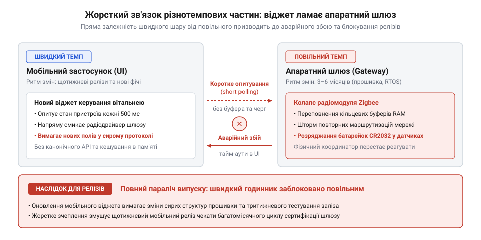
*Каскад монолітного збою: зміна формату даних у мобільному віджеті ламає парсер апаратного шлюзу, викликає циклічне перезавантаження заліза та паралізує захисні клапани й реле опалення.*

Але випуск прошивки для апаратного шлюзу — це не оновлення сторінки в браузері. Прошивка керує високовольтними реле та радіомодулями. Помилка в коді шлюзу здатна безповоротно вивести обладнання з ладу через передчасне зношування флеш-пам'яті або викликати пожежу. Тому регламент випуску вимагав обов'язкового тритижневого циклу регресійного тестування (лат. @@en|regressio@@ — зворотний рух, повернення) на фізичних випробувальних стендах. Інженери мусили вручну й автоматично перевіряти десятки апаратних ревізій хабів, стабільність роботи радіостеків і поводження контактів при аварійному вимкненні живлення.

Термінове виправлення однієї кнопки заблокувало роботу всієї інженерної команди. Розробка нових функцій зупинилася, тому що будь-який комміт запускав обов'язкову тритижневу процедуру перевірки заліза. Швидкий за своєю природою інтерфейс виявився жорстко прикутим до повільного ритму фізичного обладнання.

> 🔧 **Навіщо це.**
> Розуміння взаємозв'язку між збоєм коду та фізичною небезпекою обладнання дозволяє вчасно розпізнати критичну помилку архітектури: склеювання компонентів із різною ціною дефекту в єдиний монолітний релізний потяг. Коли ціна помилки віджета дорівнює ціні спаленого контролера, система втрачає здатність розвиватися.

## Інвентаризація годинників: від радіостека до пікселів

Аварія хабу виявила фундаментальний дефект: частини системи намагалися крокувати з однією швидкістю, хоча їхні внутрішні механізми вимагають принципово різного часу. Щоб усунути цей дефект, архітектор має провести інвентаризацію (лат. @@en|inventarium@@, від @@en|invenire@@ — знаходити, виявляти) кодової бази та визначити природні темпи (лат. @@en|tempus@@ — час) кожного компонента.

У системі Digital Homes чітко простежуються чотири структурні пласти, кожен зі своєю швидкістю змін і допустимою вартістю дефекту.

### 1. Фізичні драйвери та радіопротоколи

На найглибшому рівні розташовані драйвери фізичних пристроїв, шар апаратних абстракцій і стеки бездротових радіопротоколів (Matter, Zigbee, Z-Wave). 

Цей шар змінюється вкрай повільно — один раз на два або три роки. Причини такої консервативності диктуються зовнішнім світом: специфікації радіоальянсів оновлюються роками, а будь-яка зміна у прошивці радіочипа вимагає повторної лабораторної сертифікації обладнання на електромагнітну сумісність.

Ціна помилки тут катастрофічна. Дефект у драйвері контролера живлення може призвести до теплового пробою транзистора або нескінченного циклу запису в комірки флеш-пам'яті, що фізично спалює мікросхему. Відновити пристрій віддалено неможливо: потрібен виїзд монтажника (англ. @@en|truck roll@@) для демонтажу підрозетника або стінного щитка.

### 2. Канонічна модель стану та правила безпеки

Вище розташоване серце логіки будинку: канонічна модель стану пристроїв, механізми синхронізації та базові політики безпеки. Тут зосереджені непорушні інваріанти: захист від одночасного ввімкнення нагріву та охолодження, пріоритет сигналів тривоги, правила аварійного знеструмлення ліній при перевантаженні мережі.

Цей шар змінюється один раз на кілька місяців. Його ритм визначається стабільністю фізичних законів будинку та потребою в глибокому верифікаційному тестуванні бізнес-правил.

Ціна помилки висока. Збій у правилах безпеки не знищує кремній, але загрожує майну й мешканцям: затоплення водою, розморожування опалювального контуру взимку або помилкове відкриття замків вхідних дверей за відсутності господарів.

### 3. Сценарії автоматизації та правила комфорту

Третій шар утворюють користувацькі сценарії: автоматичне ввімкнення світла при русі, кліматичні розклади для робочих і вихідних днів, сценарії «Кіно» або «Добрий ранок».

Цей шар змінюється щотижня. Користувачі експериментують із параметрами, додають нові правила, адаптують поведінку кімнат під зміну пір року або власних звичок.

Ціна помилки тут помірна. Якщо через логічну помилку в сценарії торшер у вітальні ввімкнеться на пів години пізніше або виставить яскравість 50% замість 80%, це спричинить тимчасову побутову незручність, але не створить аварійної загрози. Будь-яку дію автоматизації мешканець може миттєво скоригувати натисканням звичайного настінного вимикача.

### 4. Інтерфейси користувача та зовнішні інтеграції

На поверхні розташовані мобільні застосунки, вебпанелі керування, віджети та адаптери зовнішніх хмарних служб: прогноз погоди, розпізнавання голосу голосовими асистентами або вебхуки динамічних тарифів на електроенергію.

Цей шар живе в темпі щоденних змін або навіть кількох релізів на день. Інтерфейси потребують постійного оновлення дизайну, виправлення верстки під нові моделі смартфонів, додавання локалізацій та підтримки свіжих версій мобільних операційних систем. Хмарні постачальники регулярно змінюють формати своїх веб-API, що вимагає миттєвих правок у коді інтеграцій.

Ціна помилки мінімальна. Помилка у віджеті призводить лише до того, що на екрані не відобразиться поточна іконка хмарності або кнопка зміститься на три пікселі ліворуч. Залізо будинку продовжує працювати в штатному режимі, а дефект інтерфейсу усувається випуском швидкого оновлення за лічені хвилини.

### Спектр годинників і теорія зсувних шарів

Зіставивши частоту змін, ми отримуємо різницю між шарами в тисячі разів: від циклу тривалістю в сотні днів до циклу в кілька годин. Одночасно вартість дефекту змінюється у зворотному напрямку: від фізичного знищення хабу до непомітного косметичного дефекту на екрані.

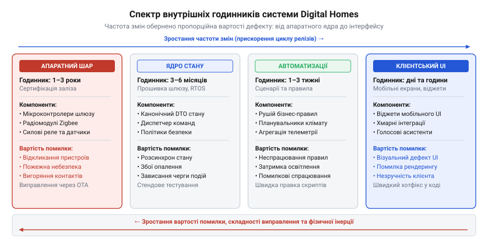
*Спектр внутрішніх годинників Digital Homes: розміщення підсистем вздовж осей частоти змін і вартості помилки показує розрив у темпах у тисячі разів.*

Ця нерівномірність — не випадкова вада конкретної програми, а фундаментальна властивість складних систем. Як показує [історія концепції зсувних шарів](root:progarch/dh-tempo-map/hist-shearing-layers.md), вперше це явище сформулював архітектор Френк Даффі, досліджуючи життєвий цикл будівель, а письменник Стюарт Бренд розвинув його до загальносистемного принципу темпових шарів. У будь-якій життєздатній системі повільні шари забезпечують каркас і стабільність, стримуючи хаос, тоді як швидкі шари забезпечують гнучкість, інновації та пристосування до мінливого середовища. Платформа розумного будинку поєднує в собі обидва світи: довговічні бетонні стіни й повільні радіопротоколи надійно підтримують швидкі інтерфейси та щотижневі автоматизації.

Спроба об'єднати різнотемпові компоненти в спільний релізний потяг призводить до неминучої дилеми:
- Якщо підпорядкувати весь проєкт темпу найшвидшого шару (інтерфейсу), система неминуче зазнає фізичної катастрофи в продакшені, бо низькорівневий код не встигає пройти необхідну верифікацію.
- Якщо ж підпорядкувати систему темпу найповільнішого шару (драйверів заліза), розвиток продукту повністю паралізується: найменша візуальна правка чекатиме місяцями разом із релізом прошивки мікроконтролерів.

Вихід полягає в тому, що [різні частини системи мусять мати різні годинники](root:progarch/different-clocks). Кожен шар зобов'язаний отримати власний релізний цикл, власні механізми тестування та власні архітектурні межі, які не дозволяють змінам швидкої периферії руйнувати повільне й стабільне ядро.

> 🔧 **Навіщо це.**
> Класифікація підсистем за частотою змін і ціною дефекту дає інженеру об'єктивний критерій для встановлення архітектурних меж. Компоненти з різницею в темпах більше ніж на порядок не мають права перебувати в одному модулі, ділити спільні змінювані структури пам'яті або розгортатися в єдиному релізному пакеті.

## Координатна сітка системи: карта темпів і градієнт стабільності

Коли розробники будують платформу розумного будинку на зразок Digital Homes, кожен компонент у кодовій базі спочатку виглядає просто черговим модулем. Контролер триходового клапана опалення, драйвер радіомодуля Zigbee, мобільний екран вибору колірної гами освітлення та клієнт біржових цін на електроенергію лежать поруч у структурі каталогів проєкту. Якщо інженеру кліматичного блоку потрібні дані про погодинну вартість кіловата, найкоротший шлях — імпортувати клієнт хмарного сервісу безпосередньо в контролер. Якщо інтерфейсу на планшеті потрібно показати стан датчика протікання, розробник пов'язує екранний віджет напряму з низькорівневим драйвером. Система починає працювати, але стрімко перетворюється на некерований клубок: оновлення логотипа на екрані змушує перекомпілювати модулі моніторингу датчиків, а тимчасовий збій віддаленого вебсервера заморожує циркуляційні помпи в котельні. Зведення всіх частин системи в єдиний монолітний простір ігнорує головну фізичну реальність: різні підсистеми змінюються з кардинально різною швидкістю.

Щоб зупинити хаос, підсистеми Digital Homes розташовують на двовимірній координатній площині — карті темпів (від англ. @@en|tempo map@@; лат. *tempus* — час). Вертикальна вісь цієї карти відповідає внутрішній частоті змін: унизу розміщують найбільш повільні, консервативні та дорогі у виправленні підсистеми, а вгорі — надшвидкі, мінливі та легкі для експериментів надбудови. Вертикальна просторова орієнтація спирається на фізичну інтуїцію реальних споруд, де масивний фундамент лежить нерухомо роками, несучи на собі легкі перегородки та меблі, які можна переставляти хоч щодня.

Підсистеми Digital Homes розподіляються за вертикальними шарами карти темпів відповідно до природного ритму їхнього життя:
1. **Шар апаратного фундаменту та драйверів** (темп: роки).
   Драйвери фізичних шин (Zigbee, Z-Wave, Modbus, I2C, SPI), модулі керування лініями GPIO та низькорівневі протоколи комунікації з датчиками й виконавчими механізмами. Ці компоненти працюють безпосередньо на апаратному шлюзі будинку [comp-iot-edge-gateway](root:progarch/dh-tempo-map/comp-iot-edge-gateway.md). Їхній код змінюється лише під час зміни ревізії обладнання або оновлення низькорівневих стандартів зв'язку. Помилка тут загрожує апаратним пошкодженням реле або вичерпанням ресурсу перезапису енергонезалежної флеш-пам'яті eMMC.
2. **Шар канонічного стану та апаратних інваріантів** (темп: місяці — роки).
   Ядро системи, що зберігає канонічну модель стану пристроїв [api-canonical-device-state](root:progarch/dh-tempo-map/api-canonical-device-state.md) та правила апаратного захисту. Тут діють обмеження безпеки: заборона одночасної подачі напруги на відкриття й закриття електроприводу жалюзі або примусове вимкнення нагріву котла при досягненні 85 °C. Це незмінний словник понять, яким оперує вся платформа.
3. **Шар локальної координації та бізнес-логіки** (темп: тижні — місяці).
   Служби зонального клімат-контролю, планувальник розкладів, агрегатори телеметрії та перевірка прав доступу. Ця логіка оновлюється разом із плановими релізами платформи, адаптуючись до сезонних змін або оптимізації алгоритмів комфорту.
4. **Шар надшвидкої периферії та користувацьких надбудов** (темп: дні — години).
   Графічні інтерфейси користувача (мобільні застосунки iOS та Android, настінні сенсорні панелі), призначені для користувача сценарії автоматизації («якщо датчик руху у вітальні зафіксував рух після опівночі — увімкнути нічник на 15%») та зовнішні хмарні сервіси (біржові котирування цін на електроенергію, прогнози погоди, голосові асистенти). Ці елементи постійно еволюціонують і можуть змінюватися мешканцями або сторонніми провайдерами кілька разів на добу.

Цей просторовий принцип повторює фундаментальні закономірності розвитку матеріальних систем. У 1970-х роках британський архітектор Френк Даффі запропонував концепцію розшарування будівель, показавши, що споруда складається з кількох вкладених шарів із різною швидкістю старіння. У 1994 році Стюарт Бренд розвинув цю ідею у своїй праці «How Buildings Learn», а згодом увів модель темпових шарів (від англ. @@en|pace layering@@). Головний висновок Бренда полягає в розподілі системних ролей: повільні шари забезпечують стабільність, міцність і пам'ять системи, тоді як швидкі шари відповідають за експерименти, навчання та пристосування до мінливого оточення [hist-shearing-layers](root:progarch/dh-tempo-map/hist-shearing-layers.md). Якщо швидкий шар намертво зчепити з повільним — наприклад, залити силові високовольтні кабелі безпосередньо в капітальний бетон без гофрованих каналів, — будь-яка заміна розетки перетворюється на руйнування несних стін будинку.

Коли шари системи чітко розмежовані за природними темпами, постає питання вектору зв'язків: хто кому дозволяє себе викликати, і хто від кого має право залежати?

Відповідь визначає **закон градієнта стабільності** (від лат. *gradus* — крок, ступінь, та *stabilis* — стійкий):
*На карті темпів архітектурні залежності мають бути строго спадними: швидкі, мінливі та нестабільні верхні шари спираються на повільні, консервативні та надійні нижні шари, але нижні шари ніколи не знають про існування верхніх.*

Логічна необхідність цього закону випливає з природи зв'язку: якщо компонент A залежить від компонента B, будь-яка зміна або відмова в B автоматично породжує ризик модифікації або збою в A.
Коли мобільний інтерфейс (рівень 4) запитує стан температури з канонічної моделі (рівень 2), він адаптується до суворого, замороженого контракту ядра. Якщо розробник інтерфейсу змінює дизайн віджетів, переписує екранні форми або тестує нову версію UI-фреймворку, канонічна модель стану про це навіть не знає: жоден рядок ядра не змінюється, жодне фізичне реле не перемикається. Швидка периферія змінюється зі своїм природним ритмом, не торкаючись фундаменту.

Якщо ж дозволити повільному ядру залежати від верхнього шару, виникає зворотна хвиля: повільний шар починає змушено оновлюватися з частотою верхнього шару і стає заручником його ненадійності. Повільний фундамент втрачає свою ключову цінність — здатність бути опорою.

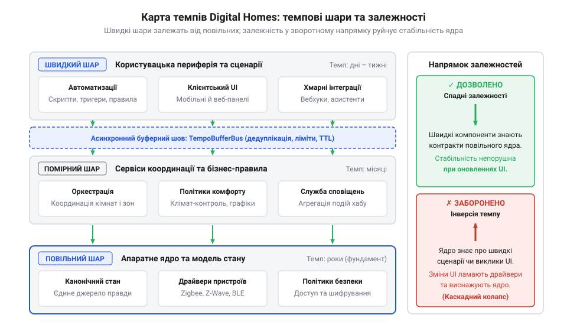
*Пошаровий розподіл підсистем Digital Homes за частотою змін: усі стрілки залежностей спрямовані згори вниз — від мінливої периферії до консервативного фундаменту.*

> 🔧 **Навіщо це.**
> Карта темпів переводить абстрактні міркування про «гарну архітектуру» в чітку координатну сітку. Під час перегляду коду інженеру більше не потрібно дискутувати про суб'єктивну красу класів. Достатньо визначити висоту розташування залучених файлів на карті темпів: якщо стрілка імпорту йде згори вниз — рішення архітектурно коректне; якщо стрілка спрямована знизу вгору — перед нами системний брак, який неминуче спричинить деградацію надійності.

## Інверсія темпів: як мінлива периферія ламає повільне ядро

Найбільш руйнівним порушенням закону градієнта стабільності є **інверсія темпів** (від англ. @@en|tempo inversion@@; лат. *inversio* — перевертання, переставляння). Це архітектурний дефект, за якого повільний компонент фундаменту або ядра системи отримує пряму висхідну залежність від швидкого, мінливого компонента периферії.

Розглянемо виникнення цього дефекту на життєвому прикладі з кодової бази Digital Homes.
Основою комфорту та збереження будівлі є служба зонального обігріву `HeatingZoneController`. Її функція критична: щохвилини опитувати локальні датчики температури через внутрішню шину, розраховувати похибку термостатичного регулювання й подавати керуючі імпульси на сервоприводи клапанів теплоносія. Якщо контролер вийде з ладу взимку під час сильних морозів, кімнати охолонуть, радіатори розірве замерзлою водою, а збитки сягнуть вартості капітального ремонту. Цей компонент належить до консервативного ядра: його алгоритм детермінований, стабільний і не повинен модифікуватися роками.

Згодом виникає бізнес-вимога додати режим енергетичної оптимізації: якщо на зовнішній біржі електроенергії ціна кіловата падає, котел має тимчасово підняти цільову температуру на один градус, накопичуючи дешеве тепло; коли ціна зростає — знизити навантаження на мережу. Додатково мешканець хоче отримувати сповіщення на смартфон у разі перемикання режиму обігріву.

Прагнучи якнайшвидше виконати завдання, розробник відкриває модуль контролера опалення й напряму імпортує в нього клієнт біржових тарифів та сервіс доставки мобільних повідомлень:

:::code dh-tempo-map-d/py/heatingzonecontroller.py

Зовні код виглядає працездатним і компактним, але в експлуатації він провокує ланцюгову реакцію відмов:
1. **Блокування робочого циклу мережевою затримкою.**
   Хмарний біржовий сервіс зазнає пікового навантаження або мережевого збою. Запит `get_current_spot_price()` зависає на сокеті на 30–60 секунд в очікуванні відповіді. Оскільки виклик виконується синхронно всередині `evaluate_heating_cycle()`, потік виконання контролера опалення блокується. Контролер пропускає такти зчитування датчиків і не може вчасно перекрити клапан або зупинити нагрів. Повільне локальне ядро виявляється паралізованим через затримку на віддаленому сервері в іншій країні.
2. **Аварійна зупинка через дрейф схеми даних.**
   Сторонній провайдер біржових даних оновлює формат відповіді: поле `price_eur` замінюється на вкладену структуру валютних курсів. Клієнт `SpotPriceCloudClient` зазнає збою при парсингу JSON і генерує виняток `KeyError`. Оскільки цей виклик вбудовано прямо в основний цикл регулювання, виняток пробиває стек викликів контролера. Служба обігріву аварійно завершує процес. Контур опалення зупиняється повністю.
3. **Зараження циклу випуску релізів.**
   Щоб полагодити парсинг одного поля в клієнті тарифів, команді достатньо виправити один рядок коду. Проте через те, що `HeatingZoneController` статично пов'язаний із цим клієнтом, оновлювати доводиться весь монолітний образ прошивки хабу. Реліз вимагає перезапуску апаратних служб будинку та проходження повного циклу випробувань безпеки котла. Дрібна зміна у швидкій периферії блокує розгортання всього ядра.

Причинно-наслідковий зв'язок очевидний: у момент, коли повільний компонент A починає залежати від швидкого компонента B, надійність компонента A опускається до надійності B, а частота примусових змін A зростає до частоти змін B. Опалення будинку втрачає статус надійної автономної системи й перетворюється на крихку веб-надбудову.

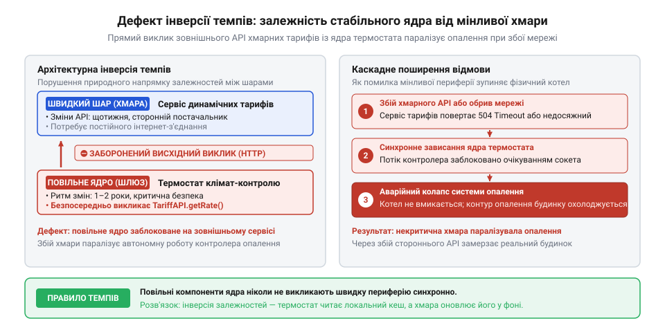
*Порушення градієнта стабільності: прямий виклик хмарного сервісу тарифів із ядра термостата спричиняє зупинку обігріву через мережеву затримку або збій формату даних.*

Щоб системно виявляти подібні інверсії в проєктах із сотнями модулів, архітектори застосовують формальний математичний аналіз графа залежностей.

1. **Матриця структури залежностей (DSM):**
   Представимо зв'язки модулів у вигляді квадратної матриці залежностей (від англ. @@en|Dependency Structure Matrix@@, DSM). Упорядкуємо рядки й стовпці за внутрішньою частотою змін: від найповільніших драйверів унизу до найшвидших інтерфейсів угорі. За домовленістю комірка на перетині рядка i та стовпця j містить позначку залежності, якщо компонент i імпортує або викликає компонент j.
   Якщо градієнт стабільності не порушено, усі ненульові комірки зосереджуються строго в одній половині матриці відносно головної діагоналі — швидкі верхні модулі залежать від повільних нижніх. Будь-яка комірка залежності у зворотній половині матриці вказує на дефект інверсії темпів.

2. **Метрики нестабільності Роберта Мартіна:**
   Для кожного вузла архітектури розраховують два показники зчеплення:
   - Аферентне зчеплення `C_a` (від лат. *afferens* — той, що приносить; англ. @@en|afferent coupling@@) — кількість зовнішніх компонентів, які залежать від цього модуля (вхідні стрілки).
   - Еферентне зчеплення `C_e` (від лат. *efferens* — той, що виносить; англ. @@en|efferent coupling@@) — кількість зовнішніх компонентів, від яких залежить цей модуль (вихідні стрілки).

   Метрика нестабільності `I` (від англ. @@en|instability@@) визначається часткою вихідних залежностей у загальній кількості зв'язків:
   `I = C_e / (C_a + C_e)`

   Показник `I` змінюється від 0 до 1:
   - `I = 0` означає абсолютно стабільний компонент (багато модулів спираються на нього, він не залежить ні від кого).
   - `I = 1` означає абсолютно нестабільний компонент (він залежить від багатьох інших, від нього не залежить ніхто).

   Закон градієнта стабільності в метриках Мартіна формулюється як вимога монотонності: для будь-якої спрямованої залежності `A → B` нестабільність джерела повинна бути не меншою за нестабільність цілі:
   `I(A) ≥ I(B)`

   У нашому прикладі контролер опалення є центральною підсистемою життєзабезпечення: від нього залежить безпека будинку, його `C_a` велике, а власні залежності мали б обмежуватися парою стабільних апаратних інтерфейсів (`C_e` мале). Його природна нестабільність низька: `I(HeatingZoneController) ≈ 0.1`.
   Клієнт біржових тарифів, навпаки, імпортує мережеві бібліотеки, парсери JSON і конфігурації, при цьому ніякі внутрішні апаратні служби від нього не залежать: його нестабільність висока: `I(SpotPriceCloudClient) ≈ 0.9`.
   Прямий імпорт `HeatingZoneController → SpotPriceCloudClient` призводить до співвідношення:
   `0.1 < 0.9`
   Це строгий алгебраїчний доказ порушення градієнта стабільності: стабільний модуль штучно зроблений залежним від нестабільного. Математичний апарат розрахунку ймовірностей поширення змін уздовж матриці зв'язків викладено у статті [math-tempo-gradient-metrics](root:progarch/dh-tempo-map/math-tempo-gradient-metrics.md).

Покладатися лише на уважність інженерів під час код-рев'ю недостатньо: під тиском термінів прямий імпорт зовнішнього сервісу легко не помітити. Тому контроль градієнта стабільності автоматизують у конвеєрі CI/CD за допомогою спеціальних архітектурних лінтерів.

Лінтер об'єднує два аналітичні виміри:
1. Аналіз журналу git-репозиторію за тривалий проміжок часу, що обчислює реальну історичну частоту модифікацій (темп) кожного файлу.
2. Синтаксичний аналіз дерева імпортів (AST), що будує граф фактичних статичних викликів.

Якщо інструмент фіксує, що файл із низькою частотою комітів (консервативне ядро) напряму імпортує файл із високою частотою комітів (мінлива периферія), конвеєр збірки негайно переривається з помилкою порушення темпу [proj-git-tempo-inversion-linter](root:progarch/dh-tempo-map/proj-git-tempo-inversion-linter.md).

> 🔧 **Навіщо це.**
> Виявлення інверсій темпів усуває приховані канали передачі відмов. Локальний контролер має спиратися на відмовостійкі значення за замовчуванням ([fail-safe defaults](root:progarch/fallback-and-degradation)): за відсутності зв'язку з біржею або падіння хмари контур опалення продовжує стабільно гріти будинок за базовим температурним графіком, жодної мікросекунди не очікуючи на відповідь від зовнішньої мережі.

Інверсія темпів виникає тоді, коли два окремі модулі з різними внутрішніми годинниками зв'язуються неправильно спрямованим викликом. Проте інверсія — не єдина загроза для стабільності системи. Ще небезпечнішою є ситуація, коли різнотемповий код навіть не намагаються розділити на окремі файли, а склеюють низькорівневі байти керування реле, бізнес-правила обігріву та текстові рядки для мобільного екрана всередині одного-єдиного класу. Цей дефект називають змішуванням темпів (tempo smear), і його природу ми розглянемо в наступному розділі.

## Темпове склеювання всередині модуля

Правка в один рядок: дизайнер мобільного додатка просить оновити текст системного сповіщення — замість «Світло увімкнено» показувати «Освітлення коридору активовано (екорежим)». Розробник змінює один текстовий літерал, відкриває запит на злиття, тести проходять. Але після планового оновлення прошивки на домашньому шлюзі вибиває ввідний силовий автомат або згорає біметалічний контакт фізичного реле.

Чому безневинна правка інтерфейсного тексту ламає апаратне забезпечення? На макрорівні архітектура системи може виглядати бездоганно: діаграми пакетів чисті, заборонених циклів між модулями немає, а міжмодульні залежності суворо дотримуються градієнта стабільності. Причина ховається глибше — на рівні окремого файлу чи класу. Це дефект **темпового склеювання** (від лат. @@la|tempus@@ — час і англ. @@en|smear@@ — мазок, розмиття, склеювання; @@en|tempo smear@@).

Темпове склеювання виникає тоді, коли в межах одного програмного модуля чи класу об'єднують обов'язки, що підпорядковуються кардинально різним природним ритмам змін. Це наслідок хибного розуміння зв'язності (від лат. @@la|cohaerere@@ — бути зчепленим, пов'язаним; @@en|cohesion@@): розробник вважає, що все, пов'язане з сутністю «розумний вимикач», повинно лежати в одному класі `LightActuator` (від лат. @@la|actuare@@ — приводити в дію, здійснювати; @@en|actuator@@).

У результаті в одному файлі починають цокати три несумісні годинники, чиї частоти відрізняються на кілька порядків:
1. **Апаратний годинник (побітовий протокол радіошини).** Формування двійкових кадрів, обчислення контрольної суми CRC-16, пряме керування регістрами мікроконтролера та обмін даними через UART чи SPI. Цей код диктується фізичною схемотехнікою та ревізією кремнію. Він живе роками: після випуску пристрою протокол змінюється лише з фундаментальним оновленням стандарту зв'язку. Помилка на цьому рівні загрожує зависанням шини зв'язку, зношуванням енергонезалежної пам'яті шлюзу або апаратною поломкою, про що детально йдеться в довідці класу пристроїв [шлюз периферійних обчислень](root:progarch/dh-tempo-map/comp-iot-edge-gateway.md).
2. **Бізнес-годинник (доменні правила захисту обладнання).** Алгоритм гасіння брязкоту контактів (@@en|anti-chattering@@ — примусова затримка щонайменше 500 мс між циклами перемикання реле для запобігання утворенню електричної дуги), обмеження сумарного пускового навантаження лінії та лічильник ресурсів комутації. Цей код живе місяцями: він змінюється при перегляді профілів електробезпеки чи підключенні нового типу навантаження.
3. **Інтерфейсний годинник (представлення для користувача).** Текстові формулювання, правила локалізації, форматування статусів для push-сповіщень, вибір піктограм для мобільного екрана. Цей шар живе днями або годинами: він постійно зазнає змін під впливом маркетингу, продуктових експериментів та A/B-тестування.

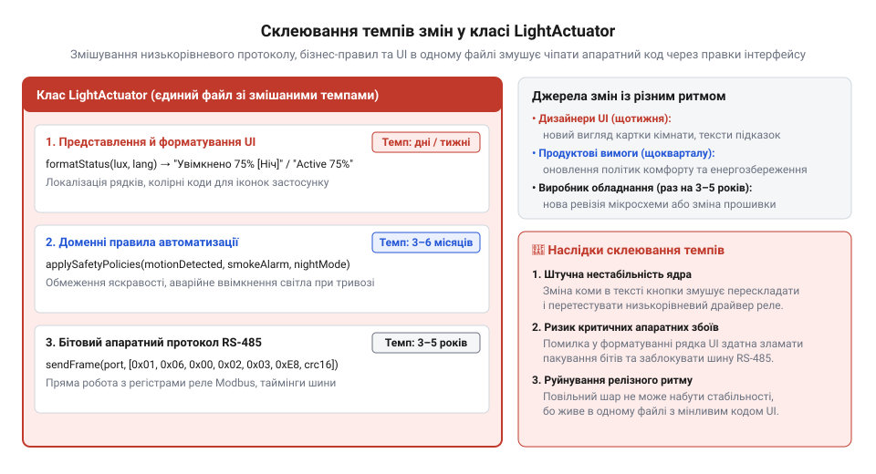
*Три часові шкали всередині єдиного класу LightActuator: правка рядка інтерфейсу змушує перекомпілювати й повторно тестувати апаратний драйвер силового реле.*

Коли ці три обов'язки спресовані в один файл, найшвидший годинник насильно нав'язує свій темп найповільнішому, породжуючи два руйнівні наслідки:

Перший наслідок — штучне зчеплення життєвих циклів релізу. Будь-яка правка рядка інтерфейсу змінює контрольний хеш кодового файлу. Система безперервної інтеграції фіксує зміну файлу актуатора і зобов'язана запустити повний цикл апаратного тестування на спеціалізованому фізичному стенді. Замість секундної публікації інтерфейсу інженерна команда годинами чекає проходження апаратних тестів.

Другий наслідок — перенесення ризиків на рівень виконання. Якщо у функції форматування рядка стається помилка (наприклад, виняток через відсутність ключа локалізації або хибне приведення типів), виклик аварійно переривається в моменті, коли фізична команда вже частково відправлена, а транзакція на апаратній шині не завершена. Драйвер не встигає звільнити блокування послідовного порту, мікроконтролер зависає в проміжному стані, а фізичний контакт реле залишається під неконтрольованим навантаженням.

Ось як виглядає небезпечне змішування обов'язків у монолітному класі:

:::tabs
:::code dh-tempo-map-d/ts/lightactuator.ts
:::code dh-tempo-map-d/py/lightactuator.py
:::

Розв'язання полягає у фізичному розщепленні класу за лініями природних темпів змін. Кожен рівень виноситься у власний модуль із чітким життєвим циклом:
1. `RelayRadioDriver` — низькорівневий апаратний драйвер. Знає лише про байти, регістри та протокол радіошини. Не залежить ні від чого іншого в системі.
2. `RelaySafetyGuard` — доменний захисник силового обладнання. Контролює мінімальні інтервали перемикань і температурний режим. Залежить виключно від інтерфейсу драйвера.
3. `LightNotificationPresenter` — інтерфейсний презентер. Форматує рядки та локалізації для відображення на мобільних пристроях. Слухає доменні події та не має жодного доступу до апаратного порту.

:::tabs
:::code dh-tempo-map-d/ts/relayradiodriver.ts
:::code dh-tempo-map-d/py/relayradiodriver.py
:::

> 🔧 **Навіщо це.**
> Поділ коду за природними темпами змін усуває фальшиву зв'язність і робить збірку модульною. Тепер маркетингові правки текстів чи впровадження нових мовних пакетів проходять крізь конвеєр за лічені секунди, не торкаючись фізичного драйвера. Апаратний модуль реле піддається дорогим і тривалим стендовим випробуванням лише тоді, коли справді змінилася логіка взаємодії з мікроконтролером.

Такий поділ відтворює загальносистемне правило: [різні частини — різні годинники](root:progarch/different-clocks). У концепції зсувних шарів Френка Даффі та Стюарта Бренда, викладеній у нарисі [історія зсувних шарів](root:progarch/dh-tempo-map/hist-shearing-layers.md), спроба жорстко зчепити оздоблення кімнати з несівними стінами гарантовано призводить до руйнування будівлі під час косметичного ремонту. У програмній інженерії темпове склеювання діє точно так само: воно перетворює дрібну заміну інтерфейсного рядка на ризик апаратного збою.

## Канонічна модель стану як непорушний якір

Відокремлення інтерфейсних текстів від апаратного коду в межах окремого актуатора усуває локальний дефект, але висвітлює глибшу системну проблему: навколо чого має обертатися інформаційний простір розумного будинку Digital Homes?

Якщо центральну модель пристрою проектувати під запити мобільного інтерфейсу, вона неминуче обростає візуальними атрибутами: назвою іконки, порядковим номером відображення у списку кімнати, кольором плашки у віджеті чи прапорцем закріплення на головному екрані. Якщо ж модель намагається задовольнити сценарії автоматизації, у ній з'являються прапорці режимів на кшталт «активна вечірка» або тимчасові таймери очікування. Нарешті, якщо модель напряму копіює формат пакетів конкретного радіомодуля, ядро отримує сирі байти вендорних регістрів і специфічні бітові маски.

Наслідки такого підходу руйнівні для всієї системи. Центральна модель пристрою стає заручницею випадкових зовнішніх примх. Редизайн мобільного додатку, оновлення стороннього хмарного API або підключення нової моделі бездротової розетки вимагають внесення змін у головну сутність пристрою. Оскільки від цієї сутності залежать сховища даних, диспетчери подій, аналітика та апаратні драйвери, будь-яка зовнішня правка спричиняє хвилю регресійних збоїв і тотальну перекомпіляцію проекту. Ядро платформи, яке мало б служити найнадійнішим фундаментом, виявляється найхиткішим елементом.

Щоб зупинити хаос постійних змін, центром системи має стати **канонічна модель стану** (від грец. @@el|kanon@@ — правило, мірило, норма; @@en|canonical device state@@). Це архітектурний якір, що описує виключно об'єктивну фізичну реальність обладнання та повністю очищений від будь-яких уявлень про візуальні інтерфейси, користувацькі сценарії чи сторонні мережеві протоколи.

Канонічна модель фіксує лише фундаментальні властивості домену:
1. **Розмежування цільового та фактичного станів.** У матеріальному світі фізична дія ніколи не відбувається миттєво. Наказ користувача увімкнути освітлення формує **цільовий стан** (від англ. @@en|target state@@). Фізичне реле може замикатися кілька мілісекунд, передача радіосигналу може затриматися через завади в ефірі, або лінію живлення може бути знеструмлено аварійним автоматом. Реальний фізичний стан, підтверджений датчиками чи апаратним контролером, становить **фактичний стан** (від англ. @@en|actual state@@). Канонічна модель тримає обидва стани поруч. Якщо між ними виникає розбіжність (@@en|state discrepancy@@), система запускає процедуру узгодження, не намагаючись маскувати реальний стан обладнання фіктивними успішними відповідями.
2. **Канонічні можливості та фізичні величини SI.** Кожен пристрій розкладається на набір стандартних апаратних можливостей (від англ. @@en|capabilities@@): бінарне перемикання (`BinarySwitch`), дискретне регулювання рівня (`DimmableRange`), вимірювання температури (`TemperatureSensor`), моніторинг енергоспоживання (`PowerMeter`). Усі вимірювання виражаються виключно в міжнародних одиницях системи SI: вати, вольти, ампери, градуси Цельсія, відсотки. Жодних вендорних діапазонів 0..255 чи нетипізованих двійкових прапорців.
3. **Ідемпотентні команди мутації.** Зміна стану пристрою виконується не через перезаписування властивостей пам'яті, а через публікацію типізованих команд (`SetPowerCommand`, `SetBrightnessCommand`). Кожна команда містить унікальний ідентифікатор мутації, що гарантує захист від повторного помилкового спрацьовування при дублюванні радіопакетів.
4. **Повна ізоляція від мінливості.** З канонічної моделі беззастережно усунено назви кімнат, переклади, піктограми, кольори та правила автоматизацій. Якщо повністю знищити мобільний клієнт і вимкнути хмарні інтеграції, канонічна модель залишається цілісною і працездатною, оскільки фізичний настінний перемикач залишається двопозиційним реле.

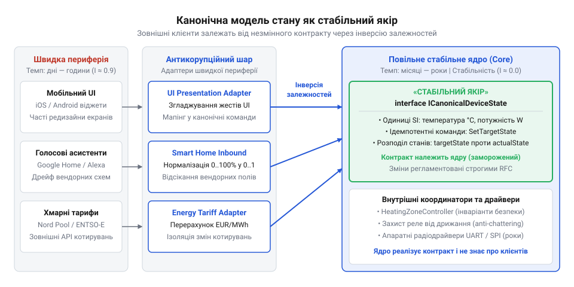
*Канонічна модель фіксує виключно фізичні властивості обладнання, змушуючи мінливі інтерфейси та сторонні протоколи адаптуватися до стабільного ядра через інверсію залежностей.*

Стабілізація досягається через фундаментальний принцип **інверсії залежностей** (від лат. @@la|inversio@@ — перевертання, переставляння; @@en|dependency inversion@@). Замість того щоб ядро пристосовувалося до потреб периферії, ядро фіксує публічний і незмінний контракт — [Canonical Device State API](root:progarch/dh-tempo-map/api-canonical-device-state.md).

Усі швидкі підсистеми зобов'язані підлаштовуватися під цей контракт за допомогою власних адаптерів:
- Мобільний інтерфейс використовує власний презентаційний шар: він зіставляє ідентифікатор пристрою з назвою «Світильник на кухні» та піктограмою жовтого кольору, зберігаючи ці дані в локальній базі користувацького профілю.
- Апаратний драйвер радіошини конвертує вхідні двійкові кадри у канонічні події оновлення фактичного стану.
- Хмарний шлюз транслює зовнішні запити сторонніх асистентів у канонічні команди мутації ядра.

Залежності вирівнюються строго в одному напрямку: мінлива периферія залежить від стабільного ядра, а ядро не має жодного зворотного посилання на клієнтів. Оскільки фізичні закони роботи електромагнітних реле та напівпровідникових сенсорів не змінюються десятиліттями, ядро Digital Homes стає непорушним якорем стабільності.

Поглянемо на реалізацію канонічної моделі стану та ізоляції периферійного інтерфейсу:

:::tabs
:::code dh-tempo-map-d/ts/devicecapability.ts
:::code dh-tempo-map-d/py/devicecapability.py
:::

> 🔧 **Навіщо це.**
> Канонічна модель стану ізолює фізичні закони домену від естетичних та маркетингових експериментів. Інженерна команда може переробляти дизайн мобільного застосунку, змінювати розташування віджетів, додавати нові теми або інтегрувати чергового голосового помічника без перекомпіляції ядра системи та без ризику порушити стабільність фізичних пристроїв будинку.

Коли через апаратний збій виникає тривала розбіжність між цільовим і фактичним станом пристрою, в дію вступає спеціалізований механізм [узгодження станів обладнання](root:sf-distributed/reconciliation). Він обробляє таймаути радіомережі та повертає систему до узгодженого стану, зберігаючи канонічну модель чистою і непорушною.

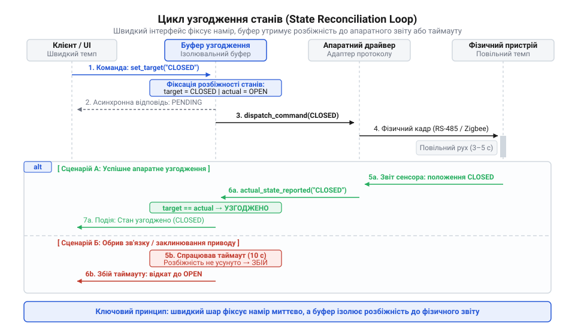
*Взаємодія під час узгодження станів: розведення цільового та фактичного станів у часі дозволяє коректно зафіксувати апаратний збій за таймаутом замість надсилання фіктивної успішної відповіді.*

## Буфер темпів: згладжування навантажень між швидкою периферією та повільним ядром

Коли користувач у мобільному застосунку проводить пальцем по повзунку яскравості люстри, сенсорний екран генерує координати з частотою 60 або 120 герців. За пів секунди рушій вебсокета вистрілює в хаб пачку з тридцяти запитів на зміну рівня світла. Схожа лавина трапляється щоранку, коли спрацьовує сценарій «Прокидання»: центральний контролер одночасно видає пів сотні директив — підняти вісім ролетів, відкрити клапани термостатів на радіаторах і плавно засвітити світильники в трьох кімнатах.

Швидка периферія — вебсервер, панелі керування, хмарні вебхуки — оперує в масштабі мілісекунд. Проте внизу, на рівні фізичних актуаторів, система впирається в обмеження бездротових радіомереж Zigbee, Thread або Z-Wave. Радіотрансивер стандарту IEEE 802.15.4 має теоретичну пропускну здатність 250 кілобітів на секунду, але реальний корисний трафік у багатовузловій комірчастій мережі на порядок скромніший. Через конкурентний доступ до середовища CSMA/CA, проміжні стрибки через маршрутизатори та необхідність апаратного підтвердження кожного кадру передача однієї команди забирає від 20 до 150 мілісекунд. Апаратний координатор хаба на базі типового мікроконтролера, такого як описано в огляді шлюзу [comp-iot-edge-gateway](root:progarch/dh-tempo-map/comp-iot-edge-gateway.md), здатен надійно відправити в ефір не більше 10–15 пакетів на секунду.

Якщо з'єднати швидкий інтерфейс із драйвером радіошини напряму, виникає руйнівний темповий конфлікт:
1. Внутрішній буфер передавача мікроконтролера, розрахований на десяток дескрипторів, миттєво переповнюється.
2. Радіопакети губляться, стек починає повторні спроби передачі (@@en|retry storm@@), викликаючи радіоколізії в ефірі.
3. Бездротова мережа захлинається: критичні повідомлення від датчиків протікання води чи відкриття дверей блокуються чергою проміжних регулювань яскравості.
4. На боці операційної системи хаба виснажується пул потоків обробки HTTP-запитів, які зависають в очікуванні відповіді від заліза, спричиняючи каскадні тайм-аути та зависання всього хабу.
5. Фізичні електромеханічні реле при отриманні високочастотної пачки команд «увімкнути/вимкнути» переходять у стан апаратного брязкоту контактів, що призводить до підгоряння дугогасильних пластин або залипання контактної групи.

Причина цієї деградації — спроба змусити повільну підсистему працювати з темпом швидкої. Концепція внутрішніх годинників ([Різні частини — різні годинники](root:progarch/different-clocks)) доводить, що компоненти мають різну природну швидкість. Щоб узгодити їхню взаємодію без взаємного руйнування, між мінливою периферією та консервативним ядром встановлюють спеціалізований розв'язувальний буфер — шину темпів (@@en|Tempo Buffer Bus@@).

Термін «буфер» (від англ. @@en|buffer@@, що сходить до старофранцузького @@fr|buffe@@ — удар, ляпас, поштовх) історично означає пружне пристосування для пом'якшення сили поштовхів. В архітектурі системи шина темпів виконує роль амортизатора, що розщеплює прямий синхронний виклик на незалежні контури читання та запису.

Шина темпів складається з чотирьох узгоджених компонентів:

1. **Кеш знімків стану (@@en|state snapshot cache@@)**. Клієнтські застосунки ніколи не опитують радіоефір для відображення поточного стану інтерфейсу. При відкритті екрана з тридцятьма лампами застосунок читає моментальний знімок з оперативної пам'яті за частки мілісекунди. Радіомережа взагалі не бере участі в цій операції, заощаджуючи ресурси батарейних пристроїв і пропускну здатність каналу. Кеш оновлюється виключно висхідними підтвердженими подіями з ядра.
2. **Асинхронна черга команд (@@en|asynchronous command queue@@)**. Користувацька дія транслюється в повідомлення наміру і потрапляє в чергу. Вебсервер негайно повертає клієнту відповідь про прийняття команди в чергу, не блокуючи мережевий потік очікуванням фізичного відгуку реле.
3. **Дедуплікація та злиття (@@en|command conflation@@)**. Злиття команд (від лат. @@la|conflare@@ — здувати, сплавляти разом) та дедуплікація (від лат. @@la|de-@@ — усунення, та @@la|duplicare@@ — подвоювати) запобігають марній роботі. Якщо користувач провів пальцем по повзунку від 10% до 80%, у черзі за короткий проміжок часу накопичується кілька десятків проміжних значень для одного й того самого каналу світильника. Проміжні команди 15%, 23%, 45% не мають фізичної цінності, адже кінцевий намір користувача — 80%. Буфер об'єднує завдання за унікальним ключем пристрою і властивості: кожна нова зміна яскравості перезаписує попередню ще не відправлену в ефір команду. Замість тридцяти радіопакетів в антену надходить рівно один.
4. **Регулювання темпу та політики скидання (@@en|rate limiting & shedding policies@@)**. Диспетчер шини темпів вичитує команди з черги з фіксованою швидкістю, безпечною для радіомережі (наприклад, не більше 5–10 викликів на секунду для одного Zigbee-координатора). Швидкість контролюється за допомогою [маркерного кошика](root:sf-distributed/admission-control). Якщо черга переповнюється через тривалу недосяжність пристрою, набувають чинності правила скидання навантаження: непринципові регулювання відкидаються найпершими, тоді як команди захисту або зміни живлення зберігають гарантію доставки.

> 🔧 **Навіщо це.**
> Швидкий користувацький інтерфейс очікує негайного відгуку за мілісекунди, тоді як радіомережа IEEE 802.15.4 фізично блокується при спробі прийняти понад десяток пакетів на секунду. Буфер темпів усуває блокування потоків вебсервера, запобігає переповненню черг апаратного координатора, захищає механічні реле від брязкоту контактів і водночас гарантує користувачеві плавний візуальний відгук без затримок.

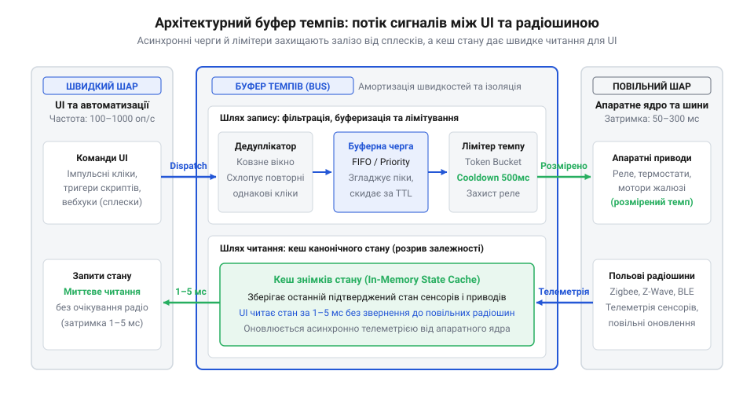
*Архітектурний буфер темпів: схема проходження сигналів через асинхронні черги, кеш знімків стану та лімітери частоти між швидким UI та повільною радіошиною.*

Конструкція шини темпів вимагає суворого дотримання інтерфейсних контрактів. Специфікація [api-tempo-buffer-bus](root:progarch/dh-tempo-map/api-tempo-buffer-bus.md) визначає правила реєстрації та конфігурації черг, а проект [proj-dh-state-isolation-buffer](root:progarch/dh-tempo-map/proj-dh-state-isolation-buffer.md) містить еталонну реалізацію буфера. Нижче наведено практичну реалізацію шини темпів мовою TypeScript, що ілюструє роботу кешу стану, злиття проміжних команд та дозовану відправку команд у повільне ядро за канонічною моделлю стану [api-canonical-device-state](root:progarch/dh-tempo-map/api-canonical-device-state.md).

:::code dh-tempo-map-d/ts/tempobufferbus.ts

Завдяки такій структурі швидкий інтерфейс звільняється від обмежень повільної радіошини: користувач бачить миттєве оновлення знімка на екрані, тоді як апаратний передавач опрацьовує злиті завдання у спокійному, контрольованому ритмі без перевантаження трансивера.

---

## Антикорупційні адаптери: ізоляція канонічного ядра від сторонньої ентропії

Платформа Digital Homes взаємодіє не лише з фізичними вимикачами, а й зі стороннім цифровим світом. Користувачі підключають голосові асистенти Google Home та Amazon Alexa, мобільні хаби Apple HomeKit, а також сервіси обліку погоди й динамічних погодинних тарифів на електроенергію на кшталт ENTSO-E чи Nord Pool.

Сторонній хмарний світ має надзвичайно швидкий внутрішній годинник. Комерційні платформи змінюють схеми API щокілька місяців:
- Google Home раптово перейменовує назви полів у JSON-пейлоадах, змінює обов'язкові параметри синхронізації пристроїв (@@en|SYNC request@@) або переходить на нові протоколи авторизації.
- Amazon Alexa використовує власні контролери директив, де яскравість виражається цілим числом від 0 до 100, тоді як окремі API передають десятковий дріб від 0.0 до 1.0, а старий локальний прилад вимагає байт від 0 до 255.
- Постачальник динамічних тарифів може сьогодні транслювати погодинні ціни через REST JSON у євро за мегават-годину, завтра запровадити обов'язкові географічні зони споживання, а післязавтра змінити формат міток часу.

Якщо внутрішня логіка хабу напряму розбирає формати Google чи Alexa, виникає архітектурна ентропія. Будь-яке оновлення стороннього API змушує інженерів переписувати код всередині ядра системи, вносити зміни в базу даних пристроїв і проводити повний цикл регресійного тестування прошивки. Ще гірше те, що помилка в сторонній хмарі — наприклад, неочікуване значення `null` або зміна формату дати в тарифах — здатна порушити роботу внутрішнього кінцевого автомата й залишити будинок без опалення чи освітлення.

Це класична інверсія темпів: стабільна підсистема, що управляє фізичними електроприладами й має надійно працювати роками без перевантаження, стає заручником мінливого стороннього вебсервісу, чий цикл релізів вимірюється тижнями.

Щоб захистити внутрішню модель від чужої нестабільності, використовують шар антикорупційних адаптерів (@@en|Anti-Corruption Layer@@, або скорочено ACL).

Слово «адаптер» походить від латинського @@la|adaptare@@ — пристосовувати, підганяти одне під одне. Термін «корупція» в архітектурі (від лат. @@la|corruptio@@ — псування, пошкодження, розклад) означає руйнування первинної чистоти доменної моделі чужорідними концепціями. Антикорупційний шар — це бар'єр перекладу на зовнішній межі системи.

Антикорупційний шар розміщується виключно в найшвидшому периферійному шарі карти темпів. Його завдання — виконувати двосторонній переклад між мовою стороннього протоколу та канонічним контрактом ядра:

1. **Трансляція вхідних запитів (@@en|inbound mapping@@)**. Коли Google надсилає виклик `action.devices.commands.BrightnessAbsolute` зі значенням `75`, адаптер перевіряє структуру повідомлення. Якщо сторонній пейлоад містить невідомі поля або пошкоджені типи, запит скеровується до [карантину пошкоджених повідомлень](root:sf-distributed/dead-letter-queue), а не в ядро. Валідні параметри адаптер перетворює на канонічну команду `SetCapabilityCommand` із цільовим значенням `0.75` у системних одиницях SI відповідно до контракту [api-canonical-device-state](root:progarch/dh-tempo-map/api-canonical-device-state.md). Ядро отримує стерильний виклик і взагалі не підозрює про існування Google.
2. **Трансляція вихідних подій (@@en|outbound mapping@@)**. Коли фізичне реле змінює стан або датчик фіксує температуру, канонічне ядро публікує подію у власному форматі. Адаптер підписується на цю подію, трансформує дані у пропрієтарну схему `ReportState` компанії Google і передає в хмару через HTTP/2.
3. **Ізоляція життєвого циклу релізів**. Адаптери конструюються як тонкі змінні модулі. Якщо постачальник електроенергії змінює структуру API тарифів, розробники модифікують лише один файл адаптера в швидкому шарі. Цей модуль має власний щоденний конвеєр розгортання: його оновлення відбувається без зупинки ядра хаба, без перекомпіляції драйверів радіошини й без ризику вивести з ладу фізичне обладнання.

> 🔧 **Навіщо це.**
> Зовнішні хмарні гіганти оновлюють протоколи та змінюють формати повідомлень щокварталу. Антикорупційний шар локалізує чужу ентропію на крайньому зовнішньому рубежі системи: коли Google або постачальник енергії змінює схему API, переписується лише 50 рядків коду в ізольованому адаптері швидкого шару. Стабільне апаратне ядро, модель стану та драйвери фізичних реле продовжують безперебійно працювати без перекомпіляції, повторного тестування чи перезапуску хабу.

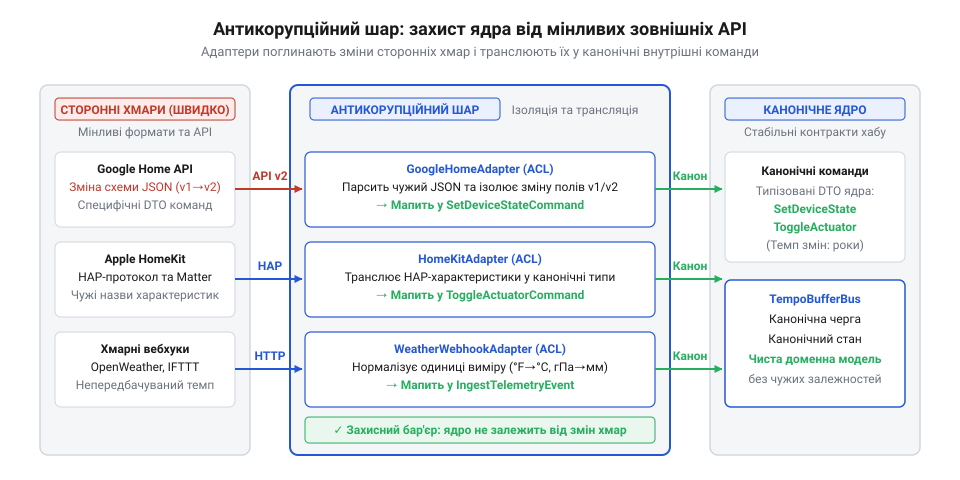
*Антикорупційний шар швидкої периферії: адаптери зовнішніх хмарних API, які поглинають зміни сторонніх контрактів і транслюють їх у канонічні команди.*

Практична реалізація антикорупційного шару в системі Digital Homes базується на жорсткій типізації контрактів. Нижче наведено код двох адаптерів мовою TypeScript: перший транслює директиви Google Smart Home у канонічні команди ядра, а другий ізолює систему від змін зовнішнього API динамічних тарифів на електроенергію.

:::code dh-tempo-map-d/ts/googlehomeanticorruptionadapter.ts

Антикорупційний шар слугує надійним демпфером проти чужих змін: що б не відбувалося з протоколами хмарних сервісів чи постачальників електроенергії, канонічне ядро Digital Homes залишається ізольованим, надійним і незмінним.

## Висхідні сповіщення, зворотний тиск та узгодження оптимістичного стану

Фізичні пристрої не чекають на запити від екрана смартфона. Механічне реле нагрівача може розімкнути контакти через спрацювання біметалевого теплового захисту. Датчик на кухні може зафіксувати витік метану й миттєво віддати апаратну команду на перекриття ввідного електромагнітного клапана. Людина може просто клацнути фізичним настінним вимикачем. В усіх цих випадках первинний сигнал виникає на найнижчому апаратному рівні — там, де діють повільні драйвери та консервативні мікроконтролери.

Цю подію необхідно доставити нагору — на панель мобільного застосунка чи в модуль екстрених сповіщень. Якщо спробувати викликати інтерфейс напряму — наприклад, передати мережевий сокет чи функцію зворотного виклику @@en|callback@@ углиб апаратного драйвера, — виникне небезпечне порушення градієнта стабільності. Повільне ядро, чий код розрахований на роки безвідмовної роботи без оновлень, стане заручником мінливого інтерфейсу. Якщо мобільний клієнт утратить зв'язок, зависне під час обробки анімації або змінить свій протокол, апаратний драйвер клапана ризикує заблокувати потік виконання на мертвому сокеті чи спричинити аварійну зупинку системи.

Щоб передати інформацію знизу вгору без виникнення статичних зворотних залежностей, застосовують інверсію керування на основі шаблону публікації та підписки (@@en|Pub/Sub@@, від англ. *publish-subscribe* — видавати й підписуватися; лат. *publicare* — оголошувати загалу, *subscribere* — писати під чимось).

Повільне ядро не знає про існування графічного інтерфейсу, користувацьких правил автоматизації чи зовнішніх вебхуків. Воно лише фіксує фізичну зміну у формі незмінного факту — доменної події: «стан реле змінено на ВИМКНЕНО через перевантаження» або «концентрація газу перевищила критичний поріг». Цю подію ядро передає у власну локальну чергу повідомлень, визначену через [API буфера ізоляції подій та команд](root:progarch/dh-tempo-map/api-tempo-buffer-bus.md). Швидкі периферійні компоненти підписуються на цей потік через стабільний [канонічний контракт пристроїв](root:progarch/dh-tempo-map/api-canonical-device-state.md). Залежність у коді залишається строго односпрямованою: інтерфейс знає структуру канонічних подій ядра та імпортує її, а ядро взагалі не містить імпортів компонентів верхніх шарів.

### Захист від переповнення та зворотний тиск

Апаратні датчики здатні генерувати потік телеметрії з високою частотою: наприклад, вимірювач потужності фіксує коливання напруги десятки разів на секунду, а лічильник імпульсів створює сотні повідомлень. На протилежному кінці перебуває мобільний клієнт, що працює через нестабільну стільникову мережу з пропускною здатністю у кілька кілобайтів на секунду.

Якщо буферна шина накопичуватиме всі згенеровані події в пам'яті до моменту їх відправлення повільному клієнту, оперативна пам'ять шлюзу вичерпається. Для вбудованих контролерів ([шлюз периферійних обчислень](root:progarch/dh-tempo-map/comp-iot-edge-gateway.md)) вичерпання RAM означає аварійну зупинку демона або скидання системи сторожовим таймером. Спроба вивантажити надлишок черги у файл на внутрішній пам'яті eMMC швидко вичерпує ресурс циклів перезапису мікросхеми.

Для вирівнювання швидкостей генерації та споживання застосовують механізм зворотного тиску (@@en|backpressure@@, англ. *back* — назад, *pressure* — тиск). Буферна шина ізоляції темпів ([проєкт буфера ізоляції темпів](root:progarch/dh-tempo-map/proj-dh-state-isolation-buffer.md)) обмежує максимальний розмір черги підписника та впроваджує дві дисципліни обробки надлишку:

1. Злиття телеметрії (@@en|conflation@@, лат. *conflare* — сплавляти, з'єднувати): для звичайних змін числових параметрів (температура, миттєва потужність, яскравість) у черзі зберігається лише найсвіжіший знімок стану кожного конкретного пристрою. Якщо клієнт не встиг вичитати проміжне значення температури 21.4 °C, а датчик уже надіслав 21.5 °C, старе значення замінюється новим без зростання черги.
2. Пріоритетне скидання (@@en|load shedding@@, англ. *shed* — скидати): критичні події безпеки (спрацювання датчика витоку газу, аварійне розмикання контактора, сигнал пожежної тривоги) позначаються найвищим пріоритетом і ніколи не відкидаються. У разі переповнення системного буфера шина жертвує низькопріоритетною телеметрією, звільняючи пам'ять для гарантованої доставки захисних сигналів.

### Оптимістичний інтерфейс та узгодження станів

Передача сигналу в реальному світі має фізичну затримку. Коли користувач торкається перемикача теплої підлоги на екрані телефона, сигнал проходить через мережу, потрапляє на хаб, проходить чергу буфера, транслюється радіомодулем у пакет Zigbee чи Matter, приймається мікроконтролером термостата й замикає контакти реле. Повний цикл підтвердження займає від 200 до 800 мілісекунд.

Якщо перемикач на екрані телефона чекатиме фізичного підтвердження від реле, інтерфейс сприйматиметься повільним і «ватним». Користувач не розумітиме, чи спрацював дотик, і почне хаотично клацати кнопку повторно.

Щоб усунути затримку відгуку, швидкий шар реалізує оптимістичний інтерфейс (@@en|optimistic UI@@; лат. *optimus* — найкращий): стан елемента на екрані перемикається миттєво (за 16 мілісекунд), створюючи відчуття бездоганної швидкодії. Одночасно в буферну шину асинхронно відправляється команда на зміну стану.

Але оптимізм створює ризик розбіжності: що робити, якщо фізичне реле несправне, лінія живлення обірвана або спрацював вбудований захист від перевантаження за струмом? Тоді оптимістичний стан на екрані перетворюється на хибне свідчення.

Для ліквідації цієї суперечності використовується механізм узгодження станів (@@en|reconciliation@@; лат. *reconciliatio* — повернення до ладу, примирення; [узгодження станів оптимістичного інтерфейсу](root:sf-apps/optimistic-ui-update)):

1. Кожна команда, надіслана з інтерфейсу, отримує унікальний ідентифікатор кореляції (@@en|correlation ID@@).
2. Презентаційний адаптер фіксує дію в локальній таблиці незавершених транзакцій: ідентифікатор пристрою, оптимістичний стан, початковий стан та граничний час очікування.
3. Апаратний рівень виконує команду. У разі фізичної відмови драйвер реле публікує висхідну подію помилки `DeviceCommandFailed` із тим самим ідентифікатором кореляції та кодом несправності або надсилає подію фактичного стану `DeviceStateChanged(actualState: OFF)`.
4. Презентаційний адаптер отримує цю подію через підписку. Зіставивши ідентифікатор кореляції, він фіксує невідповідність, негайно відкочує візуальний перемикач назад у вихідне положення `OFF` і показує людині повідомлення про фізичну несправність.

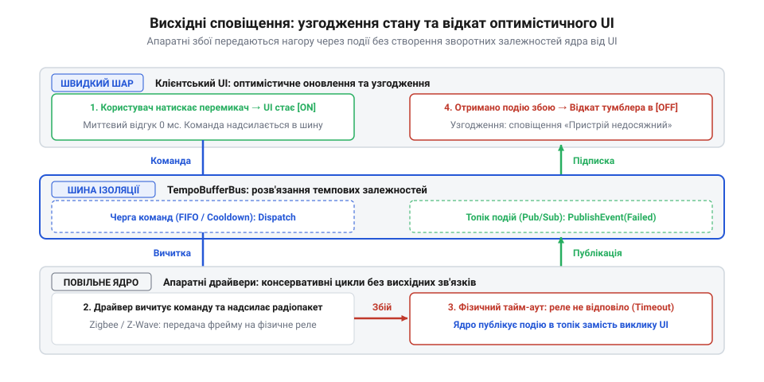
*Висхідні сповіщення та узгодження станів: передача апаратних збоїв нагору через чергу подій без створення статичних залежностей та відкат оптимістичного UI.*

> 🔧 **Навіщо це.**
> Оптимістичний інтерфейс з асинхронним узгодженням станів поєднує тактильну швидкість відгуку програми із суворою надійністю апаратного ядра. Інтерфейс ніколи не блокується повільним залізом, а ядро залишається єдиним непорушним джерелом правди про фізичний світ без жодного рядка залежності від UI-компонентів.

### Реалізація презентаційного сховища з відкатом стану

Нижче наведено практичну реалізацію клієнтського сховища стану на мові TypeScript, яке керує оптимістичними оновленнями, відстежує кореляцію команд та автоматично узгоджує стан при отриманні висхідних подій або відмов від буферної шини ядра.

:::code dh-tempo-map-d/ts/deviceid.ts

Коли реле успішно спрацьовує, шина повертає подію `DEVICE_STATE_CHANGED` з відповідним значенням `correlationId`. Таймер скасовується, а стан залишається ввімкненим. Якщо ж у силовому колі сталося коротке замикання, ядро публікує подію `DEVICE_COMMAND_FAILED`. Сховище миттєво відкочує прапорець назад до вихідного значення й передає помилку в інтерфейс, відновлюючи єдність між відображенням на склі та фізичним станом силового реле.

## Організація репозиторіїв, конвеєри CI/CD та автоматизований нагляд за темпами

Архітектурна карта темпів залишається мертвою схемою, якщо вона існує лише у вигляді креслення в проєктній документації. Під тиском чергового релізу розробники стикаються зі спокусою швидких компромісів: для виведення нового віджета на екран простіше імпортувати службову структуру з конфігурації апаратного драйвера, ніж погоджувати зміни канонічного контракту.

Якщо весь проєкт Digital Homes розміщено в єдиному спільному репозиторії монолітної структури зі спільним конвеєром збірки, виникає руйнівне змішування темпів:
- Або розробка інтерфейсу сповільнюється до темпу заліза: кожна правка кольору кнопки чи підпису екрана змушена чекати кількагодинного циклу регресійного тестування прошивки мікроконтролерів на апаратних стендах, перш ніж потрапити в реліз.
- Або повільне ядро втягується в небезпечний щоденний ритм деплою периферії: прошивка випускається поспіхом без багатоденного тестування під навантаженням, через що прихований дефект у драйвері пам'яті перетворює тисячі домашніх хабів на непридатні до відновлення пристрої.

### Розподіл сховищ коду за природними ритмами змін

Щоб підтримувати закон градієнта стабільності на практиці, фізичну структуру репозиторіїв вирівнюють відповідно до внутрішніх годинників підсистем ([Різні частини — різні годинники](root:progarch/different-clocks)). Код Digital Homes розноситься на три ізольовані категорії репозиторіїв:

1. **Репозиторій повільного ядра (`dh-core-firmware`)**:
   Містить драйвери радіомодулів, шар апаратних абстракцій HAL, механізм захисту від зношування флеш-пам'яті eMMC ([шлюз периферійних обчислень](root:progarch/dh-tempo-map/comp-iot-edge-gateway.md)), буфер команд і фізичні петлі безпеки. Темп релізів — консервативний (раз на один-три місяці). До коду пред'являються найвищі вимоги до надійності: жодних зовнішніх неперевірених бібліотек, сувора типізація, повна заборона зворотних залежностей від сервісів інтерфейсу.
2. **Репозиторій стабільних контрактів (`dh-canonical-contracts`)**:
   Зберігає схеми канонічної моделі стану ([канонічний контракт стану пристроїв](root:progarch/dh-tempo-map/api-canonical-device-state.md)), формати серіалізації Protobuf та інтерфейси шини повідомлень ([API буфера ізоляції подій та команд](root:progarch/dh-tempo-map/api-tempo-buffer-bus.md)). Цей репозиторій змінюється виключно за правилами зворотної сумісності через формальні запити на зміну архітектури (@@en|RFC@@, англ. *request for comments*). Він публікується як версіонований артефакт (пакет бібліотеки), який інші підсистеми підключають через жорстку фіксацію версій.
3. **Репозиторії швидкої периферії (`dh-ui-mobile`, `dh-cloud-adapters`, `dh-user-rules`)**:
   Охоплюють мобільні інтерфейси, адаптери сторонніх хмарних платформ і призначені для користувача сценарії автоматизацій. Ритм змін — надшвидкий (щоденні випуски або безперервне постачання). Вони залежать виключно від версіонованого пакета контрактів і взаємодіють з ядром через мережеві виклики та шину подій, не маючи прямого доступу до вихідного коду драйверів чи ядра.

### Диференційовані конвеєри неперервної інтеграції

Оскільки вартість помилки в різних шарах відрізняється на порядки, кожен репозиторій отримує власний конвеєр неперервної інтеграції та доставки (@@en|CI/CD@@, від англ. *continuous integration / continuous delivery* — неперервна інтеграція та неперервна доставка):

- **Швидкий конвеєр периферії**: виконується за 2–4 хвилини. Запускає легкі модульні тести, перевіряє форматування коду, збирає інтерфейс чи контейнери адаптерів і негайно розгортає їх у робоче середовище або публікує тестову збірку для мобільних пристроїв.
- **Повільний захищений конвеєр ядра**: триває від кількох годин до діб. Він включає строгий статичний аналіз коду, валідацію споживання пам'яті, фазинг драйверів і багатоетапне тестування з апаратурою в контурі (@@en|HIL@@, від англ. *hardware-in-the-loop* — апарат у контурі; [тестування з апаратурою в контурі](root:embedded/hil-testing)). На спеціалізованих стендах фізичні плати піддаються перепадам живлення під час запису у флеш-пам'ять, радіозавадам і циклічним перевантаженням реле.
- **Канаркове розгортання оновлень ядра (@@en|canary release@@)**: навіть після успішного проходження HIL-тестів нова прошивка ядра розгортається лише на 1% хабів добровольців, витримується в роботі протягом семи днів, і лише за відсутності повідомлень про збої в системних журналах стає доступною для решти пристроїв.

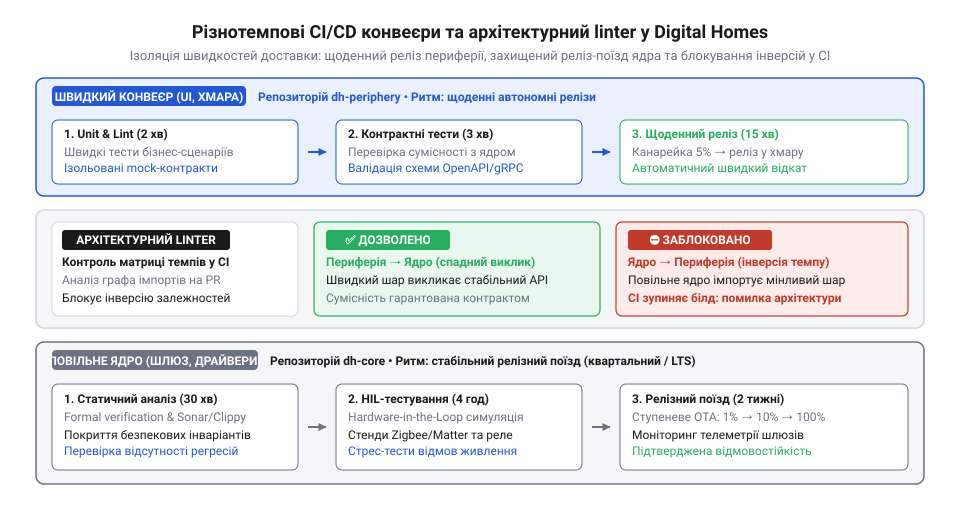
*Розподіл репозиторіїв та конвеєрів доставки за темпами: щоденний реліз периферії, захищений багатоетапний конвеєр ядра та архітектурний linter у CI.*

> 🔧 **Навіщо це.**
> Розділення конвеєрів CI/CD звільняє розробників периферії від багатогодинного очікування результатів апаратних стендів під час кожної правки екрана, одночасно захищаючи фізичні пристрої користувачів від поспішних релізів мікроконтролерного коду без належного регресійного контролю.

### Автоматизований контроль градієнта темпів у CI

Людська дисципліна не здатна втримати межі архітектури під час дедлайнів без автоматизованого інструменту контролю. Якщо розробник спробує підключити мінливий модуль швидкого шару до повільного ядра або додати нестабільну залежність у канонічний контракт, збірка має зупинятися автоматично.

Для цього в конвеєр CI вбудовують архітектурний лінтер (@@en|linter@@, англ. *lint* — пух, первісно утиліта статичного аналізу коду мови C, створена Стівеном Джонсоном у 1978 році). Лінтер аналізує абстрактне синтаксичне дерево (@@en|AST@@, англ. *abstract syntax tree*) та граф залежностей модулів ([математичний апарат аналізу стабільності за DSM](root:progarch/dh-tempo-map/math-tempo-gradient-metrics.md)). Якщо повільний компонент імпортує швидший за природним ритмом модуль, лінтер генерує фатальну помилку збірки `TempoInversionError`.

Практична реалізація такого аналізатора на основі історії git та імпортів детально розглянута у [проєкті git-лінтера інверсій темпів](root:progarch/dh-tempo-map/proj-git-tempo-inversion-linter.md).

Така інженерна організація реалізує фундаментальний системний принцип зсувних шарів Стюарта Бренда та Френка Даффі ([історія теорії зсувних шарів](root:progarch/dh-tempo-map/hist-shearing-layers.md)): довговічні шари конструкцій будівлі не повинні бути зчепленими з легкозмінними меблями та оздобленням. У програмній інженерії репозиторії, конвеєри збірки та архітектурні лінтери виступають тими самими технологічними швами, які дозволяють швидким шарам ковзати повз повільні, не руйнуючи цілісність системи.

### Код архітектурного лінтера перевірки імпортів

Нижче наведено робочий скрипт валідації архітектурних меж на мові Python, який інтегрується у фазу перевірки конвеєра CI ядра `dh-core-firmware`. Скрипт перевіряє кожне дерево імпортів і забороняє посилання на швидкі периферійні шари, прямі шляхи до UI або нестабільні гілки контрактів.

:::code dh-tempo-map-d/py/violation.py

Лінтер виконується перед будь-якими іншими кроками компіляції чи тестування в конвеєрі ядра. Якщо розробник у спробі прискорити реалізацію фічі імпортує модуль із `digital_homes.ui` або `digital_homes.cloud_integrations`, конвеєр моментально зупиняється на першій хвилині з кодом `1`. Це гарантує, що жодне компромісне рішення не потрапить до основної гілки коду й не зламає стабільність ядра.
