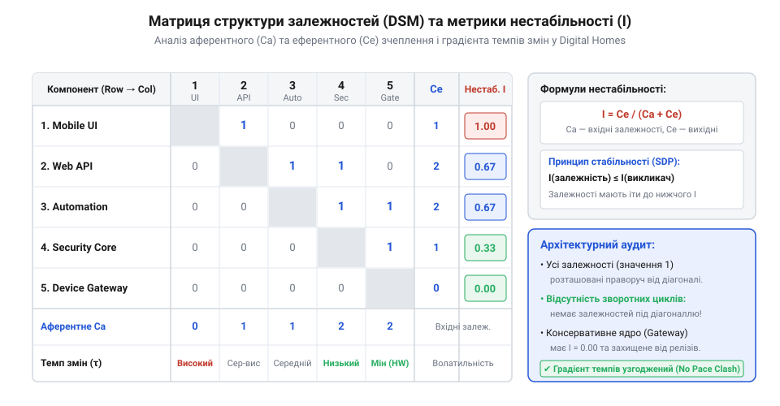
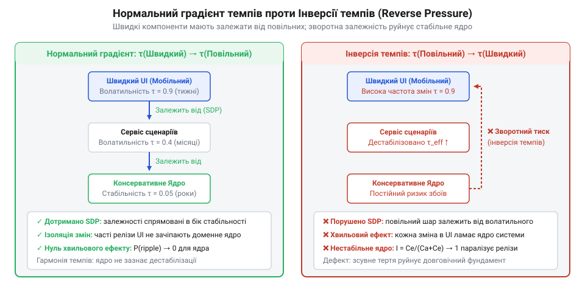
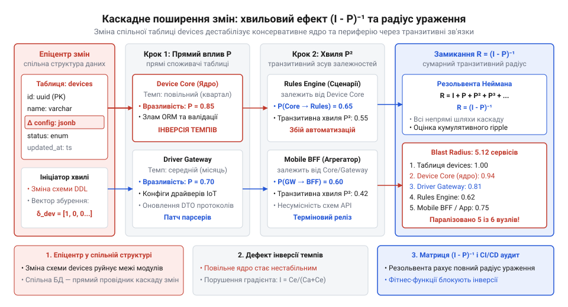

# Карта темпів Digital Homes

<preknowlist>
- [Різні частини — різні годинники](root:progarch/different-clocks) — Концепція внутрішніх годинників підсистем, пастка монолітних релізів через спільну базу даних та необхідність розчеплення темпів змін компонентів.
</preknowlist>

## Інженерна криза спільних контрактів: коли інтуїція дає збій

Уяви релізний день платформи розумного будинку Digital Homes. Команда мобільного інтерфейсу випускає нову функціональність: користувачі хочуть бачити детальний заряд батареї кожного пристрою та рівень сигналу радіозв'язку на екрані кімнати. Для цього розробники додають дві колонки в таблицю бази даних і оновлюють поля сутності. Мобільний застосунок живе у швидкому ритмі: релізи відбуваються двічі на тиждень, фічі тестуються на живих користувачах, а зміни інтерфейсу є щоденною рутиною.

Поруч існує сервіс автоматизації безпеки. Він контролює електрозамки вхідних дверей, геркони вікон і датчики чадного газу. Його релізний цикл — консервативний і повільний, не частіше одного разу на квартал, бо ціна будь-якої помилки тут вимірюється не зіпсованим відгуком у магазині застосунків, а фізичною безпекою мешканців будинку. Як показано в матеріалі [Різні частини — різні годинники](root:progarch/different-clocks), підсистеми неминуче мають різні внутрішні ритми розвитку через різну природу бізнес-вимог.

Катастрофа стається в мить, коли з'ясовується, що мобільний клієнт і ядро безпеки напряму звертаються до спільної реляційної таблиці `devices`. Міграція бази даних змінює схему таблиці та вимагає перезавантаження пулу з'єднань. Допоміжний сервіс безпеки, чий код ніхто не чіпав останні два місяці, раптово падає під час нічного релізу мобільного застосунку через несумісність кешованих підготовлених запитів. Замки блокуються в поточному стані, тривожні сповіщення перестають надходити на шлюз, а спільний релізний поїзд зупиняється на невизначений термін.

> 🔧 **Навіщо це.**
> Інтуїтивні відчуття на кшталт «це ядро здається стабільним» або «цей компонент надійний» не рятують від раптових збоїв. Кількісний апарат темпів дозволяє архітектору замінити здогадки строгими числовими критеріями й унеможливити ситуації, де мінливий інтерфейс диктує умови функціонування критичного ядра.

Спроба розв'язати проблему організаційними домовленостями — спільними регламентами, комітетами змін чи заморожуванням коду перед випуском — лише уповільнює розробку всієї платформи до темпу найповільнішого модуля. Інтуїція архітектора тут безсила, бо людське око не здатне відстежити нелінійні наслідки зв'язків у розгалуженій системі:
- Метрики обсягу коду на кшталт кількості рядків (@@en|lines of code@@) або класів не несуть інформації про напрямок передачі збурень.
- Сам факт наявності зв'язку між двома компонентами ще не пояснює, чи спричинить він збій, доки не враховано співвідношення частоти їхніх модифікацій.
- Ланцюжки непрямих викликів приховують справжніх винуватців нестабільності за фасадами сторонніх бібліотек чи спільних баз даних.

Щоб проєктувати життєздатні межі, архітектору потрібна математична модель, здатна однозначно відповісти на два запитання: чи узгоджується напрямок конкретної залежності з природними ритмами компонентів і з якою ймовірністю зміна в одній точці системи змусить переписати решту кодової бази.

## Формалізація темпу та матриця структури залежностей

Щоб перейти від якісних міркувань до точних обчислень, формалізуємо архітектуру як дискретну структуру. Нехай система складається з `n` взаємодіючих компонентів (модулів, мікросервісів або пакетів), що утворюють множину вершин `V = {v₁, v₂, ..., vₙ}`.

Кожному компоненту `vᵢ` притаманний власний темп змін `τᵢ` (позначений грецькою літерою тау; термін «темп» походить від лат. @@la|tempus@@ — час). Темп виражає інтенсивність модифікацій компонента за фіксований проміжок спостереження (наприклад, кількість випусків або структурних правок коду за місяць). Сукупність темпів усіх компонентів утворює вектор темпів системи:

```
τ = (τ₁, τ₂, ..., τₙ)ᵀ ∈ ℝⁿ
```

Для системи Digital Homes виділимо п'ять характерних підсистем і зафіксуємо їхні емпіричні темпи (кількість релізів за місяць):
1. `v₁` — Ядро безпеки та автоматизації (`SecurityCore`): `τ₁ = 0.33` (один реліз на квартал).
2. `v₂` — Сховище конфігурації пристроїв (`DeviceStorage`): `τ₂ = 1.0` (один плановий реліз на місяць).
3. `v₃` — Сервіс збору телеметрії сенсорів (`SensorTelemetry`): `τ₃ = 2.0` (двічі на місяць).
4. `v₄` — Шлюз сторонніх хмарних провайдерів (`CloudGateway`): `τ₄ = 4.0` (щотижнева адаптація до зовнішніх API).
5. `v₅` — Мобільний клієнт та користувацький інтерфейс (`MobileUI`): `τ₅ = 8.0` (два релізи на тиждень).

Вектор темпів платформи набуває конкретного числового вигляду:

```
τ = (0.33, 1.0, 2.0, 4.0, 8.0)ᵀ
```

Структурні зв'язки між цими компонентами описуються за допомогою [матриці структури залежностей](root:sf-apps/dependency-structure-matrix) (@@en|Dependency Structure Matrix@@, DSM). Це квадратна бінарна матриця `A ∈ {0, 1}ⁿˣⁿ`, розмірність якої дорівнює кількості компонентів у системі.

Елементи матриці підпорядковані загальноприйнятій конвенції:
- Рядки відповідають за споживання: елемент `A[i, j] = 1`, якщо компонент `vᵢ` безпосередньо залежить від компонента `vⱼ` (тобто `vᵢ → vⱼ`, модуль `vᵢ` викликає або посилається на `vⱼ`). Якщо прямого зв'язку немає, `A[i, j] = 0`.
- Стовпці відповідають за надання: стовпець `j` містить одиниці в усіх тих рядках `i`, компоненти яких покладаються на послуги модуля `vⱼ`.
- Головна діагональ складається з нулів: `A[i, i] = 0` для всіх `i`, оскільки внутрішні залежності модуля не змінюють його міжмодульного статусу.

На основі матриці DSM `A` виводяться класичні архітектурні метрики зв'язності Роберта Мартіна:
- Аферентне зчеплення `C_a[i]` (від лат. @@la|afferens@@ — той, що приносить): кількість зовнішніх модулів, які покладаються на компонент `vᵢ`. Алгебраїчно це сума елементів стовпця `i`:

```
C_a[i] = ∑_{j=1}^{n} A[j, i]    [сума по стовпцю i: вхідні залежності]
```

Значення `C_a[i]` відображає ступінь архітектурної відповідальності модуля: що більше компонентів залежать від `vᵢ`, то важчими будуть наслідки будь-якої зміни його публічного контракту.

- Еферентне зчеплення `C_e[i]` (від лат. @@la|efferens@@ — той, що виносить): кількість зовнішніх модулів, від яких залежить сам компонент `vᵢ`. Алгебраїчно це сума елементів рядка `i`:

```
C_e[i] = ∑_{j=1}^{n} A[i, j]    [сума по рядку i: вихідні залежності]
```

Значення `C_e[i]` показує ступінь уразливості компонента перед зовнішніми збуреннями: що більше вихідних ребер має модуль, то частіше він змушений підлаштовуватися під чужі правки.

- Коефіцієнт нестабільності (@@en|instability metric@@) `I[i]`: нормалізоване відношення вихідних залежностей до загальної кількості зв'язків компонента:

```
I[i] = C_e[i] / (C_a[i] + C_e[i])    [частка вихідних залежностей у повному зчепленні]
```

Величина `I[i] ∈ [0, 1]` задає фундаментальну класифікацію модулів:
- `I = 0` — гранично стабільний компонент (`C_e = 0, C_a > 0`). Модуль не має жодної зовнішньої залежності, але слугує опорою для інших. Його вкрай важко змінювати, оскільки кожна модифікація загрожує зламати численних споживачів.
- `I = 1` — гранично нестабільний компонент (`C_e > 0, C_a = 0`). Модуль залежить від оточення, але від нього не залежить ніхто. Його модифікація повністю безпечна для решти системи.
- Якщо `C_a + C_e = 0` (ізольований вузол), нестабільність приймають рівною `0` за домовленістю, оскільки модуль самодостатній.

Для платформи Digital Homes побудуємо матрицю зв'язності `A` розміром 5 × 5, де присутня проблемна залежність ядра безпеки від спільного сховища даних:

```
      v₁  v₂  v₃  v₄  v₅     C_e    I      τ
v₁ [  0   1   0   0   0  ]    1    1.00   0.33   (SecurityCore)
v₂ [  0   0   0   0   0  ]    0    0.00   1.00   (DeviceStorage)
v₃ [  0   1   0   0   0  ]    1    1.00   2.00   (SensorTelemetry)
v₄ [  0   1   0   0   0  ]    1    1.00   4.00   (CloudGateway)
v₅ [  0   1   0   1   0  ]    2    1.00   8.00   (MobileUI)
---------------------------------------
C_a   0   4   0   1   0
```

Обчислимо метрики для кожного компонента покроково:
- Для `v₁` (`SecurityCore`): `C_a[1] = 0`, `C_e[1] = 1` (залежить від `v₂`).
```
I[1]
= C_e[1] / (C_a[1] + C_e[1])    [означення коефіцієнта нестабільності]
= 1 / (0 + 1)                   [підстановка Ca=0, Ce=1]
= 1.00                          [хибна нестабільність ядра через вихідну залежність]
```
- Для `v₂` (`DeviceStorage`): `C_a[2] = 4` (від нього залежать `v₁`, `v₃`, `v₄`, `v₅`), `C_e[2] = 0`.
```
I[2]
= C_e[2] / (C_a[2] + C_e[2])    [означення коефіцієнта нестабільності]
= 0 / (4 + 0)                   [підстановка Ca=4, Ce=0]
= 0.00                          [абсолютно стабільний центр тяжіння системи]
```
- Для `v₅` (`MobileUI`): `C_a[5] = 0`, `C_e[5] = 2` (залежить від `v₂` та `v₄`).
```
I[5]
= C_e[5] / (C_a[5] + C_e[5])    [означення коефіцієнта нестабільності]
= 2 / (0 + 2)                   [підстановка Ca=0, Ce=2]
= 1.00                          [чиста периферія з нульовою відповідальністю]
```


*Матриця структури залежностей (DSM) компонентів Digital Homes: поєднання частоти змін τ з метриками аферентного й еферентного зчеплення унаочнює точки накопичення напруги.*

Отримана матриця наочно демонструє корінь інженерної суперечності: `DeviceStorage` має коефіцієнт нестабільності `I = 0`, тобто за топологією зв'язків він зобов'язаний бути найбільш консервативним і непорушним елементом архітектури. Проте його власний темп змін `τ₂ = 1.0` значно вищий, ніж темп ядра безпеки `τ₁ = 0.33`.

Пара `(τ, A)` перетворює розмиті побоювання на вимірювану математичну сутність: архітектурна напруга виникає там, де високий структурний тягар (велике `C_a`) накладається на високу частоту вимушених модифікацій `τ`.

## Градієнт темпів і критерій архітектурної стійкості

Уяви дві суміжні гідравлічні труби: якщо рідина має текти самопливом, потік спрямовують від резервуара з вищим потенціалом або тиском до нижчого. Спроба проштовхнути воду проти природного спаду висоти без насосної станції спричиняє застій або гідроудар, що руйнує стики магістралі.

В архітектурі програмних систем кожен структурний зв'язок між компонентами є каналом передачі вимог, припущень та обмежень. Коли модуль `vᵢ` викликає або імпортує модуль `vⱼ` (`A[i, j] = 1`), він неявно покладається на стабільність публічного інтерфейсу та незмінність поведінки `vⱼ`. Якщо постачальник `vⱼ` зазнає модифікацій, споживач `vᵢ` змушений адаптуватися: оновлювати сигнатури викликів, змінювати моделі даних або щонайменше проходити повний цикл регресійного тестування та позапланового розгортання.

Напрямок залежності визначає напрямок тиску змін: хвиля збурень поширюється у бік, протилежний стрілці виклику — від постачальника контракту до його клієнта. З цього випливає фундаментальна вимога до динаміки системи: компонент, який змінюється рідко і вимагає найвищої надійності, не може спиратися на компонент, який живе у стані постійних переробок.

### Алгебраїчне визначення градієнта темпу

Щоб перевірити сумісність внутрішніх ритмів двох взаємодіючих модулів, зіставимо вектор темпів `τ` із топологією зв'язків у матриці `A`. Для кожної спрямованої дуги залежності `vᵢ → vⱼ` (де `A[i, j] = 1`, тобто модуль `vᵢ` використовує послуги `vⱼ`) перепад або градієнт темпу (від лат. @@la|gradiens@@ — той, що крокує, зростає) визначається як алгебраїчна різниця між темпом споживача та темпом постачальника:

```
Δτ[i, j] = τ[i] - τ[j]
```

Значення `Δτ[i, j]` визначає динамічний баланс зв'язку:
- Якщо `Δτ[i, j] > 0`: споживач `vᵢ` змінюється частіше за постачальника `vⱼ` (`τ[i] > τ[j]`). Це природний стан архітектури: мінлива периферія (наприклад, мобільний інтерфейс із щотижневими правками екранів) спирається на стабільне, консервативне ядро. Споживач безболісно адаптується до рідкісних оновлень постачальника.
- Якщо `Δτ[i, j] = 0`: обидва модулі розвиваються з однаковою швидкістю (`τ[i] = τ[j]`). Між ними відсутній конфлікт частот модифікацій.
- Якщо `Δτ[i, j] < 0`: споживач `vᵢ` змінюється повільніше, ніж постачальник `vⱼ` (`τ[i] < τ[j]`). Консервативний модуль опиняється під загрозою постійного зовнішнього тиску, оскільки постачальник модифікується швидше, ніж споживач здатний верифікувати свій стан.

### Принцип стабільності за темпом

На основі попарного аналізу формулюється строгий алгебраїчний критерій архітектурної стійкості.

Архітектурна система `(τ, A)` перебуває у стані динамічної рівноваги за темпом тоді й лише тоді, коли для кожної наявної залежності виконується умова монотонності (від грец. @@gr|monotonos@@ — одноманітний, незмінний):

```
∀ i, j ∈ {1, 2, ..., n}: A[i, j] = 1 ⇒ Δτ[i, j] ≥ 0
```

Еквівалентне формулювання у термінах частот релізів:

```
∀ i, j ∈ {1, 2, ..., n}: A[i, j] = 1 ⇒ τ[i] ≥ τ[j]
```

Ця умова розгортає концепцію [Різні частини — різні годинники](root:progarch/different-clocks) у точну математичну вимогу: швидкому компоненту дозволено залежати від повільного, але повільному компонентові заборонено залежати від швидкого. Уся піраміда залежностей мусить спадати від мінливих верхів до консервативного базису.

### Дефект інверсії темпів

Порушення принципу стабільності породжує [дефект інверсії темпів](root:sf-apps/tempo-inversion-defect) (від лат. @@la|inversio@@ — перевертання, перестановка). Якщо для деякої пари вузлів існує залежність `A[i, j] = 1`, але `Δτ[i, j] < 0`, у системі формується ефект зворотного тиску (@@en|backpressure defect@@).

Повільний компонент `vᵢ`, чий релізний цикл триває місяці через необхідність фізичної верифікації та регуляторних аудитів, виявляється заручником щотижневих правок компонента `vⱼ`. Будь-який поспішний випуск `vⱼ` здатний змінити неявні контракти, змушуючи команду ядра позапланово переривати роботу, проводити термінові виправлення або накладати вето на випуск нових функцій продукту.


*Граф архітектурних залежностей: при нормальному спадному градієнті швидка периферія спирається на стабільну основу; інверсія темпів створює дефект зворотного тиску, коли повільне ядро змушене безперервно підлаштовуватися під мінливе оточення.*

У платформі Digital Homes наочним проявом цього дефекту є зв'язок між ядром автоматизації безпеки та сховищем конфігурації:
- `v₁` (`SecurityCore`): темп `τ₁ = 0.33` релізу на місяць (один випуск на квартал).
- `v₂` (`DeviceStorage`): темп `τ₂ = 1.00` реліз на місяць.
- Наявне ребро в матриці DSM: `A[1, 2] = 1`.

Обчислимо градієнт темпу вздовж цієї дуги:

```
Δτ[1, 2]
= τ₁ - τ₂              [визначення градієнта темпу вздовж зв'язку 1 → 2]
= 0.33 - 1.00          [підстановка емпіричних темпів підсистем]
= -0.67                [від'ємний градієнт: інверсія темпу]
```

Оскільки `Δτ[1, 2] = -0.67 < 0`, умова монотонності порушена. Ядро контролю замків і сигналізацій напряму залежить від сховища, яке піддається модифікаціям утричі частіше через запити користувацьких застосунків.

> 🔧 **Навіщо це.**
> Класичний структурний аналіз зазвичай перевіряє лише відсутність циклів або дотримання шарів (наприклад, «сервіс звертається до сховища»). Проте числовий розрахунок `Δτ[i, j]` виявляє приховану вразливість: якщо спільне сховище безперервно еволюціонує під тиском швидких клієнтів, воно втрачає властивості надійної опори і починає дестабілізувати критичне ядро.

### Скалярна міра загальної інверсійності системи

На практиці інженеру необхідно оцінювати стан не лише окремих зв'язків, а й архітектури загалом. Щоб звести всі виявлені розриви до єдиної числовий оцінки, вводиться скалярний індекс загальної інверсійності системи `Ω` (велика грецька літера омега, від грец. @@gr|omega@@ — велике, міра підсумку):

```
Ω = ∑_{i=1}^{n} ∑_{j=1}^{n} A[i, j] · max(0, τ[j] - τ[i])
```

Математична будова цього індексу має чіткий інженерний зміст:
1. Множник `A[i, j]` діє як топологічний селектор: якщо зв'язку між компонентами немає (`A[i, j] = 0`), пара не бере участі у розрахунку.
2. Різниця `τ[j] - τ[i] = -Δτ[i, j]` показує абсолютну величину невідповідності темпів. Якщо дуга задовольняє правило стабільності `τ[i] ≥ τ[j]`, то `τ[j] - τ[i] ≤ 0`. Функція `max(0, ·)` перетворює такий внесок на нуль: коректно спроєктовані зв'язки не штрафуються.
3. Якщо на зв'язку присутня інверсія темпу (`τ[i] < τ[j]`), функція `max(0, ·)` повертає додатне значення `τ[j] - τ[i]`. Що суттєвіший розрив між консервативністю споживача та мінливістю постачальника, то більшу вагу штрафу отримує система.

Індекс `Ω` володіє ключовими властивостями:
- **Невід'ємність:** `Ω ≥ 0` для будь-якого графа залежностей і будь-яких темпів.
- **Критерій стійкості:** `Ω = 0` тоді й лише тоді, коли система повністю задовольняє умову монотонності темпів уздовж усіх своїх зв'язків.
- **Адитивність штрафу:** загальне значення `Ω` строго зростає з появою кожної нової інверсії або при збільшенні частоти змін нестабільного постачальника.

### Розрахунок індексу інверсійності для Digital Homes

Проведемо покрокове обчислення скалярного індексу `Ω` для платформи Digital Homes, використовуючи матрицю зв'язності `A` та вектор темпів `τ = (0.33, 1.0, 2.0, 4.0, 8.0)ᵀ` із розділу 2.

**Умова:**
У матриці `A` розміром 5 × 5 зафіксовано п'ять ребер залежностей:
1. `(1, 2)`: `SecurityCore → DeviceStorage` (`A[1, 2] = 1`)
2. `(3, 2)`: `SensorTelemetry → DeviceStorage` (`A[3, 2] = 1`)
3. `(4, 2)`: `CloudGateway → DeviceStorage` (`A[4, 2] = 1`)
4. `(5, 2)`: `MobileUI → DeviceStorage` (`A[5, 2] = 1`)
5. `(5, 4)`: `MobileUI → CloudGateway` (`A[5, 4] = 1`)

Обчислимо штрафний внесок кожного наявного ребра:

```
Штраф(1, 2)
= A[1, 2] · max(0, τ₂ - τ₁)
= 1 · max(0, 1.00 - 0.33)
= 1 · 0.67
= 0.67                               [інверсія: повільне ядро залежить від швидкого сховища]

Штраф(3, 2)
= A[3, 2] · max(0, τ₂ - τ₃)
= 1 · max(0, 1.00 - 2.00)
= 1 · 0.00
= 0.00                               [нормальний спад: телеметрія змінюється частіше за сховище]

Штраф(4, 2)
= A[4, 2] · max(0, τ₂ - τ₄)
= 1 · max(0, 1.00 - 4.00)
= 1 · 0.00
= 0.00                               [нормальний спад: шлюз змінюється частіше за сховище]

Штраф(5, 2)
= A[5, 2] · max(0, τ₂ - τ₅)
= 1 · max(0, 1.00 - 8.00)
= 1 · 0.00
= 0.00                               [нормальний спад: мобільний UI змінюється частіше за сховище]

Штраф(5, 4)
= A[5, 4] · max(0, τ₄ - τ₅)
= 1 · max(0, 4.00 - 8.00)
= 1 · 0.00
= 0.00                               [нормальний спад: мобільний UI змінюється частіше за шлюз]
```

Підсумуємо внески всіх ребер для отримання підсумкової оцінки системи:

```
Ω
= ∑_{i=1}^{5} ∑_{j=1}^{5} A[i, j] · max(0, τ[j] - τ[i])   [означення загальної інверсійності]
= Штраф(1, 2) + Штраф(3, 2) + Штраф(4, 2) + Штраф(5, 2) + Штраф(5, 4) [сума ненульових ребер]
= 0.67 + 0.00 + 0.00 + 0.00 + 0.00                       [підстановка обчислених внесків]
= 0.67                                                   [підсумковий індекс інверсійності]
```

Отриманий результат `Ω = 0.67 > 0` дає однозначний алгебраїчний вердикт: архітектура Digital Homes перебуває у зоні ризику. В системі існує рівно одна точка дестабілізації — ребро `(1, 2)`. Проте саме вона зумовлює постійні релізні конфлікти між швидкою мобільною командою та інженерами безпеки.

Для приведення системи до стану рівноваги архітектура вимагає рефакторингу, спрямованого на обнулення цього штрафу. Зокрема, ізоляція `SecurityCore` через виділену незмінну модель даних або перехід на асинхронні події усуває безпосередній зв'язок `A[1, 2] = 0`, що знижує показник `Ω` до ідеального нуля (`Ω = 0.00`).

## Хвильовий ефект змін: транзитивне замикання та радіус ураження

Аналіз безпосередніх зв'язків у матриці `A` та розрахунок градієнта `Δτ` дають точну відповідь для сусідніх вузлів, проте приховують каскадні процеси. У реальних системах модифікація рідко зупиняється на першому споживачеві: змінивши контракт виклику, модуль змушує свого клієнта адаптувати власні структури даних, що тягне за собою переписування інтерфейсів наступного рівня.

Уявімо тихий реліз: розробники сховища змінюють тип ідентифікатора пристрою з 32-бітного цілого на глобальний UUID. Прямий споживач — шлюз інтеграцій — оновлює клієнтську бібліотеку й успішно проходить тести. Проте шлюз транслює цей ідентифікатор у подіях, які слухає мобільний клієнт. Мобільний інтерфейс падає під час парсингу JSON через неочікуваний формат рядка. Спроба оцінити масштаб модифікацій лише за прямими дугами створює ілюзію локальності, тоді як реальна хвиля змін здатна накрити всю платформу.

### Матриця ймовірностей поширення збурень

Щоб перейти від бінарного факту наявності зв'язку до кількісної оцінки ризику каскаду, введемо зважену стохастичну матрицю передачі збурень `P ∈ ℝⁿˣⁿ` (від грец. @@gr|stochastikos@@ — здогадний, імовірнісний).

Кожен елемент `P[i, j] ∈ [0, 1]` позначає умовну ймовірність того, що внесення структурної зміни в компонент `j` (постачальник) неминуче змусить розробників модифікувати або перетестувати компонент `i` (споживач):

```
P[i, j] = Pr(компонент i змінюється | компонент j змінено)
```

Матриця `P` має виражені структурні властивості:
- Якщо компонент `i` взагалі не залежить від компонента `j` (`A[i, j] = 0`), передача прямого імпульсу неможлива: `P[i, j] = 0`.
- Якщо прямий зв'язок існує (`A[i, j] = 1`), величина `P[i, j]` визначається ступенем логічного зчеплення: крихкий контракт на базі спільної пам'яті чи відкритої схеми таблиці дає значення, близькі до `1.0`, тоді як суворий версіонований DTO зі зворотним захистом знижує ймовірність до `0.1–0.2`.
- Діагональні елементи дорівнюють нулю: `P[i, i] = 0`, оскільки ми досліджуємо передачу збурень між різними вузлами.

### Транзитивне поширення та ряд Неймана

Прямий вплив через один крок виклику описується самою матрицею `P`. Проте як формалізувати вплив через ланцюжок посередників?

Розглянемо поширення [хвилі змін](root:sf-apps/change-ripple-effect) (@@en|change ripple effect@@) через два послідовні кроки: збурення виникає у вузлі `j`, передається проміжному вузлу `k`, а від нього б'є по вузлу `i`. Сумарна очікувана передача через усі можливі шляхи довжини два відповідає добутку матриць:

```
(P²)[i, j] = ∑_{k=1}^{n} P[i, k] · P[k, j]   [хвиля змін через один транзитивний вузол]
```

Аналогічно, передача імпульсу через маршрути довжини три виражається матрицею `P³`, довжини `k` — степенем `Pᵏ`.

Повна кумулятивна матриця транзитивного поширення збурень `R` (від лат. @@la|repercussio@@ — відлуння, зворотний удар) є сумою хвиль за всіма можливими довжинами транзитивних ланцюгів від одного до нескінченності:

```
R = ∑_{k=1}^{∞} Pᵏ = P + P² + P³ + ...
```

Для обчислення цієї нескінченної матричної суми застосуємо класичний апарат функціонального аналізу — ряд Неймана (на честь німецького математика Карла Неймана, @@de|Carl Neumann@@).

Згадаймо розклад матричної геометричної прогресії:

```
(I - P) · (I + P + P² + ... + Pᵏ)
= (I + P + P² + ... + Pᵏ) - (P + P² + P³ + ... + Pᵏ⁺¹)   [розкриття дужок]
= I - Pᵏ⁺¹                                              [взаємне скорочення проміжних членів]
```

Якщо при `k → ∞` матричний степінь `Pᵏ⁺¹` прямує до нульової матриці, то у границі маємо:

```
(I - P) · ∑_{k=0}^{∞} Pᵏ = I
```

Помноживши обидві частини рівності зліва на обернену матрицю `(I - P)⁻¹`, отримуємо замкнений вираз для повної суми ряду:

```
∑_{k=0}^{∞} Pᵏ = (I - P)⁻¹
```

Оскільки матриця транзитивного відгуку `R` підсумовує ланцюжки починаючи з першого кроку (`k ≥ 1`), виділимо нульовий степінь `P⁰ = I`:

```
R
= ∑_{k=1}^{∞} Pᵏ
= (∑_{k=0}^{∞} Pᵏ) - I         [виділення нульового члена I]
= (I - P)⁻¹ - I                [підстановка формули ряду Неймана]
= P · (I - P)⁻¹                [факторизація матриці переходів]
```

Таким чином, повна матриця поширення змін `R` обчислюється точно через єдину операцію матричного інвертування `(I - P)⁻¹`.

### Умова збіжності та спектральний радіус

Ряд Неймана збігається не для будь-якої матриці `P`. Необхідною і достатньою умовою абсолютної збіжності є обмеження на спектральний радіус (від лат. @@la|spectrum@@ — образ, діапазон значень):

```
ρ(P) < 1
```

Спектральний радіус `ρ(P)` (грецька літера ро, від грец. @@gr|rho@@) визначається як максимальний модуль власного значення матриці `P`:

```
ρ(P) = max { |λ| : λ ∈ spec(P) }
```

Ця математична вимога має фундаментальний інженерний зміст:
- Якщо архітектура являє собою спрямований ациклічний граф (@@en|DAG@@), матриця `P` є нільпотентною: існує таке натуральне `m ≤ n`, що `Pᵐ = 0`. Усі її власні значення дорівнюють нулю, отже `ρ(P) = 0 < 1`. У такій системі хвиля змін гарантовано згасає за скінченну кількість кроків.
- Якщо в системі присутні зворотні циклічні залежності (наприклад, сервіс `A` викликає `B`, а `B` за певних умов викликає `A`), матриця `P` містить ненульові власні значення. Якщо коефіцієнти взаємного зчеплення високі, спектральний радіус досягає або перевищує одиницю (`ρ(P) ≥ 1`).
- При `ρ(P) ≥ 1` ряд розбігається: система потрапляє у резонансну пастку нескінченного релізного відлуння, коли виправлення одного дефекту безперервно породжує нові поломки по колу.

### Радіус ураження та сумарна чутливість

Матриця `R = (I - P)⁻¹ - I` містить у собі повну картину каскадних ризиків:
1. **Очікуваний радіус ураження (@@en|blast radius@@) компонента `j`:**
Сума елементів стовпця `j` матриці `R` показує математичне сподівання кількості підсистем, які доведеться переписати чи адаптувати, якщо компонент `j` зазнає змін:

```
B[j] = ∑_{i=1}^{n} R[i, j]    [сума по стовпцю j матриці транзитивних впливів]
```

2. **Сумарна чутливість (вразливість) компонента `i`:**
Сума елементів рядка `i` матриці `R` показує інтегральну залежність компонента `i` від нестабільності всього зовнішнього середовища:

```
S[i] = ∑_{j=1}^{n} R[i, j]    [сума по рядку i матриці транзитивних впливів]
```

> 🔧 **Навіщо це.**
> Звичайний граф залежностей вводить архітектора в оману: модуль із двома вихідними стрілками здається безпечним. Проте матричне інвертування `(I - P)⁻¹` автоматично підсумовує всі транзитивні маршрути довільної довжини. Це дозволяє на етапі дизайну точно розрахувати радіус ураження релізу і побачити приховані точки критичного накопичення каскадного ризику.

### Розрахунок каскаду для Digital Homes

Застосуємо виведений апарат до платформи Digital Homes. Зафіксуємо емпіричну матрицю ймовірностей збурень `P` для наших п'яти компонентів:
1. `v₁` (`SecurityCore`)
2. `v₂` (`DeviceStorage`)
3. `v₃` (`SensorTelemetry`)
4. `v₄` (`CloudGateway`)
5. `v₅` (`MobileUI`)

Нехай правка схеми у спільному сховищі `DeviceStorage` (`v₂`) з високою ймовірністю порушує роботу споживачів:
- `P[1, 2] = 0.80` (ядро безпеки жорстко прив'язане до структур збереження).
- `P[3, 2] = 0.50` (сервіс телеметрії записує метрики у таблиці пристроїв).
- `P[4, 2] = 0.60` (хмарний шлюз синхронізує зовнішні ідентифікатори).
- `P[5, 2] = 0.70` (мобільний застосунок безпосередньо вичитує стан пристроїв).

Крім того, оновлення у хмарному шлюзі `CloudGateway` (`v₄`) впливає на інтерфейс мобільного додатка:
- `P[5, 4] = 0.50` (мобільний UI споживає API хмарного шлюзу).

Решта елементів дорівнюють `0.00`. Матриця переходів `P` набуває вигляду:

```
        v₁    v₂    v₃    v₄    v₅
v₁  [  0.00  0.80  0.00  0.00  0.00  ]
v₂  [  0.00  0.00  0.00  0.00  0.00  ]
v₃  [  0.00  0.50  0.00  0.00  0.00  ]
v₄  [  0.00  0.60  0.00  0.00  0.00  ]
v₅  [  0.00  0.70  0.00  0.50  0.00  ]
```

Оскільки граф залежностей ациклічний, власні значення матриці дорівнюють нулю, а спектральний радіус `ρ(P) = 0.00 < 1`. Ряд Неймана абсолютно збігається.

Обчислимо квадрат матриці `P²` для виявлення транзитивних хвиль довжини два:

```
(P²)[5, 2]
= ∑_{k=1}^{5} P[5, k] · P[k, 2]
= P[5, 4] · P[4, 2]             [єдиний активний транзитивний шлях v₂ → v₄ → v₅]
= 0.50 · 0.60
= 0.30                          [ймовірність каскадної правки UI через шлюз]
```

Усі інші елементи матриці `P²` дорівнюють `0.00`, а степені `P³ = 0`, `P⁴ = 0`.

Знайдемо повну матрицю відгуку `R = P + P²`:

```
        v₁    v₂    v₃    v₄    v₅     S (чутливість)
v₁  [  0.00  0.80  0.00  0.00  0.00  ]    0.80
v₂  [  0.00  0.00  0.00  0.00  0.00  ]    0.00
v₃  [  0.00  0.50  0.00  0.00  0.00  ]    0.50
v₄  [  0.00  0.60  0.00  0.00  0.00  ]    0.60
v₅  [  0.00  1.00  0.00  0.50  0.00  ]    1.50
---------------------------------------
B      0.00  2.90  0.00  0.50  0.00
```

Підсумкова матриця ураження `(I - P)⁻¹ = I + R` містить одиничну діагональ і повністю збігається з аналітичним розв'язком:

```
(I - P)⁻¹
        v₁    v₂    v₃    v₄    v₅
v₁  [  1.00  0.80  0.00  0.00  0.00  ]
v₂  [  0.00  1.00  0.00  0.00  0.00  ]
v₃  [  0.00  0.50  1.00  0.00  0.00  ]
v₄  [  0.00  0.60  0.00  1.00  0.00  ]
v₅  [  0.00  1.00  0.00  0.50  1.00  ]
```


*Схема каскадного поширення змін: модифікація спільного сховища пристроїв породжує радіус ураження 2.9 підсистеми, викликаючи подвійний удар по мобільному інтерфейсу через прямий доступ і через хмарний шлюз.*

Проаналізуємо отримані значення радіуса ураження `B`:
- Для `v₂` (`DeviceStorage`): `B[2] = 0.80 + 0.50 + 0.60 + 1.00 = 2.90`. Очікувана кількість підсистем, що постраждають від релізу схеми БД, становить майже три компоненти з чотирьох наявних.
- Для `v₄` (`CloudGateway`): `B[4] = 0.50`. Вплив локалізований виключно на мобільному клієнті.
- Для `v₁` (`SecurityCore`) та `v₅` (`MobileUI`): `B = 0.00`. Вони є листям графа залежностей і не передають хвилю далі.

Розрахунок показує разючий ефект непрямого зв'язку: для компонента `v₅` (`MobileUI`) загальний ризик модифікації від правок сховища становить суму прямого і транзитивного каналу: `R[5, 2] = 0.70 + 0.30 = 1.00`. Зміни у базі даних неминуче вдарять по мобільному клієнту двічі — через несумісність кешованих даних та через розсинхронізацію відповідей хмарного шлюзу.

## Межі та сліпі зони моделі: неявне зчеплення, цикли та факторизація DSM

Математичний апарат матриць DSM та інверсії ряду Неймана створює оманливе враження всеосяжності. Здається, що достатньо запустити статичний аналізатор коду, витягти граф залежностей і перемножити матриці, щоб отримати вичерпний аудит надійності системи. Проте будь-яка математична модель спирається на базові припущення, і щойно реальна архітектура порушує ці аксіоми, розрахунки починають давати хибні висновки.

Уявімо команду, яка пишається тим, що їхня матриця DSM демонструє нульову інверсійність `Ω = 0` та нульовий радіус ураження ядра: статичні парсери не знаходять жодного імпорту між повільним сервісом безпеки та швидким клієнтським додатком. Проте під час нічного випуску ядро безпеки падає. Причина криється у спільній базі даних, зміну схеми якої статичний аналізатор вихідного коду просто не здатний побачити. Інженер зобов'язаний розуміти межі застосовності методу та вміти розпізнавати сліпі зони лінійного моделювання.

### Сліпа зона 1: Неявне логічне зчеплення

Класична матриця суміжності `A` фіксує лише явні, видимі на рівні мови програмування зв'язки: виклики методів, імпорти пакетів або клієнтські HTTP-запити. Проте у розподілених та монолітних системах величезна частка взаємодій відбувається через посередників інфраструктури:
- **Спільні реляційні таблиці:** кілька мікросервісів читають і записують в одну сутність бази даних.
- **Брокери повідомлень:** зміна структури корисного навантаження в черзі ламає споживачів, про існування яких відправник навіть не знає.
- **Спільні кеші та розподілені блокування:** неявна залежність від ключів і форматів серіалізації в оперативній пам'яті.

Це явище називають неявним або логічним зчепленням (@@en|hidden coupling@@). Якщо модуль `v₁` і модуль `v₅` працюють з однією таблицею без взаємних викликів у коді, статичний парсер ставить `A[1, 5] = 0` та `A[5, 1] = 0`. Формула показує відсутність ризику, але насправді зміна від `v₅` б'є по `v₁` із силою прямого імпорту.

Для нейтралізації цієї сліпої зони застосовують регуляризацію матриці (від лат. @@la|regularis@@ — підпорядкований правилу). До матриці додають фіктивні вузли спільних ресурсів або розширюють бінарну DSM даними з історії контролю версій:

```
p_логич[i, j] = N_спільних(i, j) / N_усього(j)
```

Якщо при зміні компонента `j` компонент `i` змінювався у тому ж комміті у понад `20%` випадків (`p_логич ≥ 0.20`), у матрицю штучно вводиться ребро `A[i, j] = 1`, навіть якщо в коді немає жодного прямого посилання.

### Сліпа зона 2: Зворотні цикли та розбіжність ряду

Друга небезпека криється у виникненні циклічних зв'язків. У розділі про хвильовий ефект було показано, що умова збіжності ряду Неймана вимагає:

```
ρ(P) < 1
```

У чистих деревоподібних чи шаруватих архітектурах граф залежностей є ациклічним, тому власні значення дорівнюють нулю (`ρ(P) = 0`), а ряд обривається за кілька кроків. Проте на практиці системи швидко накопичують циклічні виклики: сервіс сповіщень запитує статус користувача, а сервіс користувачів під час оновлення профілю смикає сервіс сповіщень.

Щойно у матриці `P` утворюється цикл зі значними ймовірностями передачі збурень, спектральний радіус стрімко наближається до одиниці або перевищує її:

```
ρ(P) ≥ 1 ⇒ ∑_{k=1}^{∞} Pᵏ → ∞   [розбіжність ряду Неймана]
```

Фізично це означає «релізний резонанс» або нескінченний пінг-понг: правка в компоненті `A` ламає `B`, виправлення в `B` знову змінює контракт `A`, і система входить у самопідтримуваний цикл регресій. Матриця `(I - P)` втрачає оборотність (її визначник прямує до нуля), а поняття радіуса ураження втрачає скінченний зміст.

Щоб повернути модель у зону збіжності, застосовують математичне демпфування (від нім. @@de|dämpfen@@ — глушити, гасити). Матрицю переходів масштабують за допомогою коефіцієнта згасання `α ∈ (0, 1)`:

```
P_регул = α · P
```

Параметр `α` моделює природне поглинання збурень інженерними бар'єрами (тестами, адаптерами), гарантуючи `ρ(P_регул) < 1` та повертаючи стійкість обчисленням.

### Сліпа зона 3: Калібрування ймовірностей за git-логами

Математична формула безсила, якщо числа на її вході взяті зі стелі. Оцінка переходів `p_{ij}` у матриці `P` є найбільш уразливим місцем усього розрахунку.

Спроба вивести ймовірності автоматично з історії комітів натрапляє на практичні перешкоди:
- **Злиття репозиторіїв та монорепозиторії:** атомарні комміти часто зачіпають десятки модулів суто через оновлення версії збирача чи форматування коду, штучно завищуючи зв'язність.
- **Нерівномірність вибірки:** нові модулі мають коротку історію комітів, через що їхні емпіричні ймовірності мають високу статистичну дисперсію.
- **Людський фактор:** сквош комітів (@@en|squash merges@@) зливає дрібні зміни у гігантські дифи, ховаючи реальний хронологічний ланцюжок передачі помилок.

> 🔧 **Навіщо це.**
> Архітектор не повинен сприймати цифри матриці як абсолютну істину. Числовий апарат DSM — це діагностичний індикатор напруги, а не бухгалтерський баланс. Якщо модель показує відсутність ризиків, але інженери скаржаться на зірвані релізи, шукайте неявне зчеплення в базі даних та приховані цикли викликів.

### Алгоритми квазітрикутної факторизації DSM

Коли недоліки виявлено, постає зворотна задача: як перевпорядкувати заплутаний клубок компонентів, щоб мінімізувати каскадні ризики та ізолювати повільні модулі від швидких? Для цього використовують [алгоритми структурування та квазітрикутної факторизації матриці DSM](root:sf-apps/dsm-clustering-partitioning) (від лат. @@la|factor@@ — розклад на складові).

#### 1. Розбиття на рівні (@@en|partitioning / sequencing@@)

Мета алгоритму — знайти таку перестановку рядків і стовпців матриці, яка зводить її до строго нижньотрикутного (або верхньотрикутного) вигляду:

```
A[i, j] = 0 для всіх i < j   [усі залежності лежать під головною діагоналлю]
```

Кроки алгоритму:
1. Знайти всі компоненти з нульовим аферентним зчепленням (`C_a = 0`, від них ніхто не залежить). Це вершини піраміди (наприклад, `MobileUI`). Розмістити їх у перших рядках матриці.
2. Тимчасово викреслити знайдені компоненти та їхні зв'язки з матриці.
3. Повторювати пошук вузлів із `C_a = 0` для решти системи, призначаючи їм наступні рівні.
4. Якщо на певному кроці вузлів із `C_a = 0` не знайдено, але в графі ще лишилися елементи — в системі знайдено циклічну залежність. Усі компоненти цього циклу згортаються в один блок за допомогою алгоритму пошуку сильно зв'язаних компонентів (алгоритм Тар'яна).

Нижньотрикутний вигляд гарантує, що жоден повільний компонент не зможе викликати компонент вищого рівня: хвилі змін рухаються строго в одному напрямку.

#### 2. Кластеризація (@@en|clustering@@)

Якщо цикли неможливо розірвати негайно, матрицю факторизують на щільні підматриці (кластери, від англ. @@en|cluster@@ — скупчення):

```
         Кластер 1      Кластер 2
Кл. 1 [  [Внутрішні]       0       ]
Кл. 2 [  [Міжкластерні] [Внутрішні]]
```

Модулі всередині одного кластера мають високе взаємне зчеплення і можуть містити цикли, проте між кластерами дозволені лише односпрямовані ациклічні зв'язки.

Для архітектури це означає фундаментальне рішення: модулі одного кластера об'єднуються у єдиний релізний поїзд і синхронізують свої годинники. Як показано в матеріалі [Різні частини — різні годинники](root:progarch/different-clocks), розчеплення темпів має сенс лише між різними кластерами; всередині ж кластера темп змін стає спільним і визначається найповільнішим або найвибагливішим модулем групи.

Факторизація DSM перетворює хаотичну мережу викликів на дисципліновану блочно-трикутну структуру: повільне ядро опиняється на самому дні, надійно захищене від зворотного тиску периферії.

## Архітектурні фітнес-функції: автоматизація контролю темпів у CI/CD

Архітектурна документація, діаграми та математичні викладки на папері швидко втрачають зв'язок із реальністю. Під тиском термінових дедлайнів розробник швидкого інтерфейсу може підключити прямий імпорт до таблиці ядра безпеки, а рецензент пулл-реквесту (@@en|Pull Request@@, PR) не помітить небезпеки у дифі на кількасот рядків. За кілька місяців спокійної розробки індекс інверсії темпів `Ω` непомітно зростає, консервативне ядро дестабілізується, а випуск релізів перетворюється на нескінченне гасіння пожеж.

Єдиний спосіб захистити виведені архітектурні інваріанти (від лат. @@la|invarians@@ — незмінний) — зробити їх виконуваним кодом. Для цього розрахунок метрик DSM та градієнта темпів інтегрують у конвеєр неперервної інтеграції (@@en|CI/CD@@, від лат. @@la|convehere@@ — зносити докупи) у вигляді [архітектурних фітнес-функцій](root:sf-apps/architectural-fitness-functions) (від англ. @@en|fitness function@@ — функція відповідності або пристосованості).

### Алгоритм автоматизованого архітектурного аудиту

Пайплайн архітектурного нагляду виконується під час кожної спроби злиття коду у головну гілку і складається з чотирьох послідовних кроків:

1. **Визначення темпів `τᵢ` за git-історією:**
   Скрипт аналізує історію репозиторію за ковзним вікном спостереження (наприклад, останні 90 днів). Для кожної підсистеми підраховується кількість значущих модифікацій (комітів, що торкнулися сирцевих файлів модуля) і нормалізується до місячного еквівалента:

   ```
   τᵢ = N_комітів(модуль i, 90 днів) / 3   [місячний темп змін компонента]
   ```

2. **Побудова актуальної матриці DSM `A`:**
   Статичний аналізатор синтаксичного дерева (@@en|AST@@) сканує імпорти у коді гілки PR. При виявленні виклику чи залежності між модулем `vᵢ` та `vⱼ` встановлюється `A[i, j] = 1`. За наявності спільних міграцій бази даних або спільних моделей з розділу 5, матриця доповнюється ребрами неявного зчеплення.

3. **Розрахунок вектора градієнта темпів та індексу `Ω`:**
   Для кожного ребра `A[i, j] = 1` обчислюється перепад `Δτ[i, j] = τ[i] - τ[j]` та сумарна інверсійність системи `Ω`.

4. **Оцінка радіуса ураження `(I - P)⁻¹`:**
   Формується зважена матриця переходів `P`, обчислюється спектральний радіус `ρ(P)` та вектор очікуваного ураження `B = col_sum((I - P)⁻¹ - I)`.

### Реалізація фітнес-функції на стороні CI/CD

Наведемо повноцінний приклад архітектурного тесту на мові Python, який виконується як частина тестового набору в пайплайні перевірки PR. Тест будує матриці для компонентів Digital Homes і блокує складання, якщо новий код створює інверсію темпів або порушує ліміти каскадного ризику.

:::code math-tempo-gradient-metrics/py/load-tempo-vector.py

### Політика блокування злиття PR

Застосування наведених архітектурних тестів встановлює прозорі правила для всієї інженерної організації:

1. **Червоний білд при появі інверсії:**
   Якщо новий код містить зв'язок, де `Δτ[i, j] < 0`, конвеєр падає з детальним поясненням: вказується ім'я компонента, його власний темп і темп постачальника. Розробник не може злити PR, доки не розірве прямий зв'язок (наприклад, через шар антикорупції, порти й адаптери або фасад подій).

2. **Захист темпів різних підсистем:**
   Як підкреслюється в матеріалі [Різні частини — різні годинники](root:progarch/different-clocks), команди повинні мати змогу релізитися з автономною швидкістю. Фітнес-функції гарантують, що мобільна команда може прискорювати свої випуски хоч до кількох разів на день, не ризикуючи зруйнувати стабільність сервісів із квартальним циклом.

3. **Автоматична актуалізація порогів:**
   Оскільки темпи `τ` перераховуються динамічно на основі ковзного вікна комітів, архітектурний нагляд адаптується до зміни інтенсивності розробки компонентів без необхідності ручного редагування конфігурацій.

> 🔧 **Навіщо це.**
> Архітектура живе лише тоді, коли вона автоматизована. Ручні домовленості забуваються за кілька спринтів. Перенесення матриці DSM, градієнта темпів та інверсії ряду Неймана у форму автоматичного CI-тесту перетворює теоретичний математичний аналіз на надійний щоденний інструмент інженерного захисту системи.
