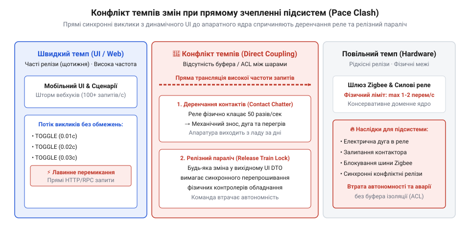
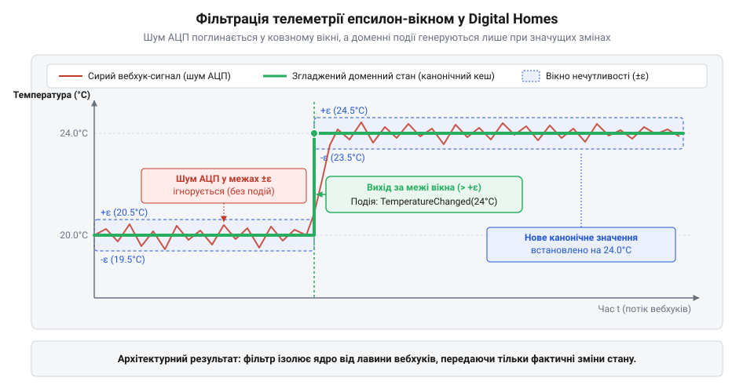
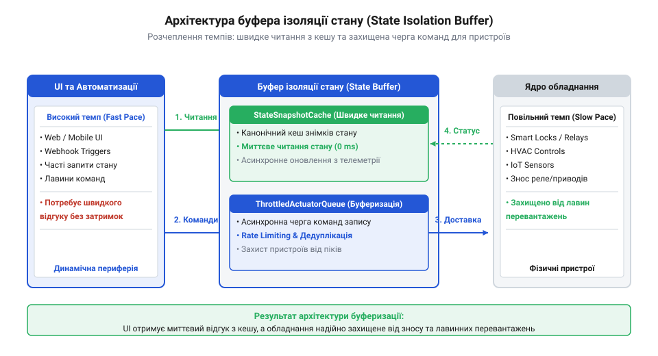
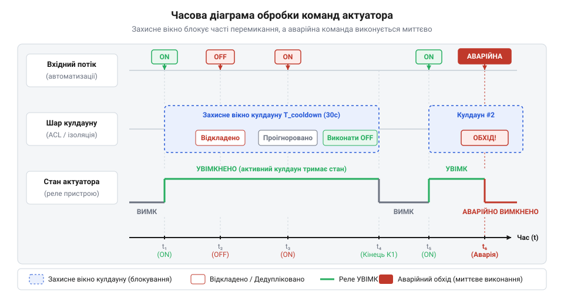
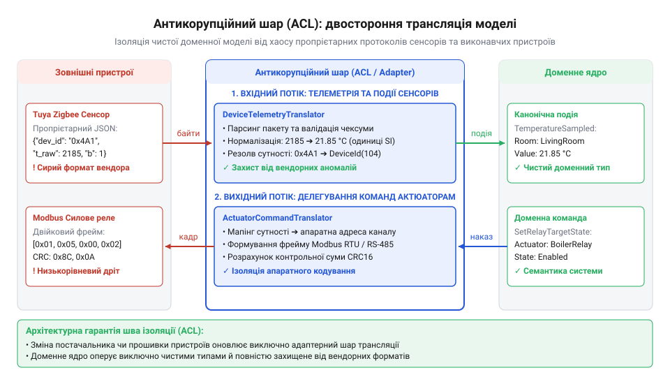
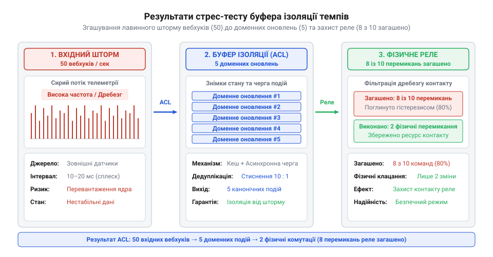

# Карта темпів Digital Homes

## Зіткнення двох годинників: чому пряме зчеплення руйнує Digital Homes

Користувач відкриває мобільний застосунок Digital Homes і плавним рухом пальця тягне повзунок цільової температури у вітальні з 19 °C до 22 °C. Жест триває півтори секунди, генеруючи близько сорока подій зміни уставки через вебхуки та HTTP-запити. Водночас у тій самій кімнаті спрацьовує датчик присутності, а вуличний сенсор надсилає серію пакетів про раптовий порив холодного вітру. Якщо архітектура системи побудована на прямому виклику виконавчих механізмів, кожен такий сигнал перетворюється на негайну команду перемикання силового реле газового котла або клапана водяного опалення.

У цю мить система стикається з фізичною реальністю. Електромеханічне реле — це не абстрактний логічний перемикач у пам'яті сервера, а пружна контактна пластина з магнітною котушкою. При прямому проходженні шторму команд якір реле починає вібрувати на частоті десятків герців. Виникає явище [деренчання контактів](root:sf-devices/umova-diia-i-chomu-prystrii-klatsaie) (@@en|contact chatter@@): між розімкненими контактами під напругою 230 В спалахує серія мікроскопічних електричних дуг. Метал розігрівається, окислюється і зазнає ерозії. Замість паспортних ста тисяч циклів комутації ресурс контактної групи вичерпується за лічені тижні, а в гіршому разі рухомі контакти зварюються докупи, намертво блокуючи котел в увімкненому стані.

Причина цієї катастрофи криється в архітектурному зіткненні компонентів, що живуть за непоєднуваними темпами змін ([Різні частини — різні годинники](root:progarch/different-clocks)). В системі керування мікрокліматом одночасно взаємодіють два принципово різні контури:

1. **Динамічний контур інтерфейсу та автоматизацій.** Мобільний клієнт, веб-дашборди та скрипти користувача працюють у мілісекундному масштабі. Тут нормальними є часті оновлення, інтерактивні сплески трафіку, висока частота релізів (щотижневе розгортання) та гнучкі експерименти з інтерфейсом.
2. **Консервативний апаратний контур.** Фізичні виконавчі пристрої та датчики підпорядковані законам термодинаміки й механіки. Прогрів приміщення вимірюється десятками хвилин, компресори кондиціонерів вимагають технологічної паузи щонайменше 3–5 хвилин перед повторним пуском для вирівнювання тиску фреону, а прошивки бездротових модулів тестуються й сертифікуються місяцями.

*Пряме зчеплення динамічного UI та повільного апаратного ядра: шторм вебхуків викликає деренчання контактів силових реле та паралізує релізи.*

Пряме зчеплення цих контурів не лише руйнує залізо, а й паралізує пропускну здатність бездротової мережі. Типовий шлюз протоколу @@en|Zigbee@@ побудований на енергоефективному мікроконтролері з буфером черги відправлення всього на 8–16 пакетів. Коли веб-сервер спрямовує туди шквал одночасних команд керування, апаратний буфер переповнюється (@@en|bufferbloat@@). Шлюз губить підтвердження доставки (ACK), починає лавинний пошук нових маршрутів у комірчастій мережі (@@en|route discovery storm@@) і на кілька хвилин перестає приймати критичні сигнали від датчиків протікання води чи диму.

Третім наслідком стає параліч процесів розробки — так звана пастка спільного релізного поїзда (@@en|release train lock@@). Якщо сутності веб-інтерфейсу безпосередньо маплені на внутрішні регістри мікроконтролера та бінарні пейлоади прошивок, будь-яка зміна у відображенні датчика вимагає синхронного оновлення коду шлюзу. Швидка веб-команда вимушена зупинятися й чекати тривалого циклу тестування вбудованого ПЗ.

> 🔧 **Навіщо це.**
> Ізоляція темпів змін усуває взаємне руйнування швидких та повільних частин системи. Фізичні пристрої отримують гарантований захист від надчастої комутації та мережевих сплесків, а бізнес-логіка й інтерфейс оновлюються без озирання на цикли розгортання прошивок.

Щоб розв'язати це протиріччя, між швидким інтерфейсом і повільним залізом зводять архітектурний шов — буфер ізоляції стану (@@en|State Isolation Buffer@@). До такого буфера висуваються чотири чіткі інженерні вимоги:

1. **Гасіння вхідного шуму на порозі:** відсікання дублікатів та високочастотних мікроколивань датчиків ще до потрапляння в доменну модель.
2. **Асинхронне розв'язання читання:** обслуговування запитів користувача з оперативного кешу знімків стану за частки мілісекунди без опитування радіомережі.
3. **Захисне регулювання команд актуаторів (cooldown):** черга відправлення з примусовим обмеженням мінімального інтервалу перемикання силових ліній.
4. **Антикорупційна трансляція (ACL):** взаємна ізоляція схем даних, де вендорні байти шлюзів перетворюються на стабільні типізовані події.

## Вхідний конвеєр: дедуплікація та гасіння брязкоту вебхуків

Першою лінією оборони буфера виступає вхідний конвеєр обробки телеметрії. У реальному розумному будинку датчики рідко надсилають ідеально очищені дані. Навіть у статичному стані, коли температура в кімнаті не змінюється, аналого-цифровий перетворювач (АЦП) бездротового сенсора фіксує мікрофлуктуації напруги живлення. У результаті датчик генерує шум (@@en|jitter@@): за одну секунду на сервер надходять значення 21.42 °C, 21.38 °C, 21.41 °C та 21.39 °C.

До цього додаються дублікати транспортного рівня. Мережеві шлюзи, що працюють за протоколами MQTT або HTTP Webhooks, гарантують доставку за правилом «щонайменше один раз» (@@en|at-least-once@@). Якщо мережевий пакет підтвердження затримався в радіоефірі на кілька мілісекунд, шлюз повторно відправляє ідентичний пейлоад. Якщо доменне ядро оброблятиме кожне таке повідомлення — ініціюватиме запуск правил автоматизації, записуватиме аудит у базу даних та інвалідуватиме кеші, — до 95% обчислювальних ресурсів згорятиме на обробку апаратного бруду.

Для захисту ядра конвеєр реалізує алгоритм ковзного вікна дедуплікації та гасіння коливань (@@en|debounce@@). Фільтрація спирається на дві незалежні перевірки: поріг чутливості (дельта значення) та часове вікно тиші.

Нехай датчик передав нове значення `V_new` у момент часу `T_new`, а останнє зафіксоване системою значення становило `V_old` у момент `T_old`. Правило допуску події в доменний контур формулюється так:

    ΔV = |V_new - V_old|
    ΔT = T_new - T_old
    Пропустити = (ΔV ≥ ε) ∨ (ΔT ≥ W)

Тут `ε` — зона нечутливості до шуму (наприклад, 0.1 °C для температури та 0.5% для вологості), а `W` — тривалість ковзного вікна (наприклад, 500 мс). Якщо різниця `ΔV` менша за поріг, показник вважається коливанням АЦП і гаситься, хіба що від останньої передачі минуло більше часу, ніж `W`. Друга умова гарантує проходження періодичного сигналу присутності (@@en|heartbeat@@), що підтверджує працездатність пристрою за незмінних умов.

*Фільтрація телеметрії ковзним вікном: високочастотний шум АЦП гаситься в зоні нечутливості, формуючи стабільний східчастий сигнал для домену.*

Одиницею обміну між буфером та доменом виступає типізована структура показника датчика:

:::code proj-dh-state-isolation-buffer/c-/Models/DomainAndTelemetry.cs 6-12

:::code proj-dh-state-isolation-buffer/c-/Models/DomainAndTelemetry.cs 41-47

У структурі `SensorReading` показник очищено від вендорних ідентифікаторів, а часова мітка зафіксована в UTC. Це гарантує, що наступні алгоритми фільтрації та кешування оперуватимуть незмінним контрактом.

Реалізація фільтра використовує потокобезпечну пам'ять на основі `ConcurrentDictionary`, де ключем виступає пара ідентифікатора пристрою та типу сенсора:

:::code proj-dh-state-isolation-buffer/c-/Buffering/WebhookDeduplicator.cs 12-62

> 🔧 **Навіщо це.**
> Фільтр гасіння брязкоту на вході системи відсікає імпульсні сплески трафіку до їхнього контакту з транзакційною бізнес-логікою. Це знижує навантаження на пул потоків і базу даних, блокуючи лавиноподібне спрацьовування тригерів мікроклімату на випадкових коливаннях аналогових сенсорів.

Зверніть увагу на атомарність методу `AddOrUpdate`. Замість використання важких блокувань на рівні об'єкта або м'ютексів, метод повертає новий кортеж лише в тому разі, коли значення визнано значущим або вичерпано часовий ліміт вікна. Перевірка `.LastProcessedUtc == now` слугує безблокувальним індикатором (@@en|lock-free flag@@): якщо значення зберегло старий часовий штамп, метод повертає `false`, миттєво відкидаючи повторний сигнал у пам'яті без виділення додаткових об'єктів у купі (@@en|zero-allocation rejection@@).

Розглянемо числовий приклад роботи алгоритму з вікном `W = 500 мс` та епсилоном `ε = 0.1 °C`:

**Крок 1. Перший вхідний пакет.**
Пристрій `zigbee-temp-01` надсилає 21.40 °C о 12:00:00.000. У системі ще немає запису про цей датчик. Алгоритм створює початковий запис `(21.40, 12:00:00.000)`. Подія допускається в домен.

**Крок 2. Пакет із шумом АЦП через 40 мс.**
О 12:00:00.040 надходить 21.43 °C. Обчислюємо дельти:

    ΔV = |21.43 - 21.40| = 0.03 °C
    ΔT = 40 мс

Оскільки `ΔV = 0.03 < 0.1`, а `ΔT = 40 < 500`, обидві умови повертають хибу. Подія повністю гаситься, стан у словнику не оновлюється.

**Крок 3. Реальна зміна температури.**
О 12:00:00.120 вмикається нагрівач і надходить 21.55 °C:

    ΔV = |21.55 - 21.40| = 0.15 °C
    ΔT = 120 мс

Умова `ΔV = 0.15 ≥ 0.1` виконується. Запис у словнику оновлюється на `(21.55, 12:00:00.120)`. Подія негайно прямує далі по конвеєру до кешу стану.

Завдяки цьому вхідний конвеєр відсікає до 90% холостого мережевого трафіку, формуючи рівномірний, передбачуваний потік очищених доменних подій.

## Канонічний кеш знімків стану: розв'язання читання та опитування

Коли користувач відкриває головний екран мобільного застосунку Digital Homes, інтерфейс має миттєво відобразити статус тридцяти кімнат: поточну температуру, вологість, стан замків, освітлення та наявність руху. Якщо побудувати цю операцію за наївною моделлю прямого опитування (@@en|hardware polling@@), сервер муситиме надіслати тридцять синхронних радіозапитів через шлюз до кожного фізичного датчика.

Наслідки такого підходу руйнівні для бездротової інфраструктури. Більшість датчиків температури та відкриття дверей працюють від дискових батарейок CR2032 і 99.9% часу перебувають у стані глибокого сну (@@en|deep sleep@@), прокидаючись раз на кілька хвилин або при фіксації різкої зміни середовища. Вони фізично не здатні відповідати на синхронні вхідні запити, оскільки їхній радіоприймач вимкнено для економії енергії. Спроба розбудити їх частими радіозапитами виснажує батарею за кілька днів замість двох років автономної роботи, а ефір на частоті 2.4 ГГц блокується лавиною службових пакетів.

Архітектурне розв'язання полягає в повному розриві контуру читання та контуру фізичних пристроїв за принципом розділення відповідальності команд і запитів (@@en|CQRS@@). Інтерфейси, аналітичні сервіси та правила автоматизації ніколи не звертаються до апаратного заліза безпосередньо: вони читають виключно локальний канонічний кеш знімків стану — `StateSnapshotCache`.

*Архітектура буфера ізоляції стану: розв'язання швидкого читання через StateSnapshotCache та буферизація запису через захищену чергу ThrottledActuatorQueue.*

Кеш зберігає останнє валідне показання кожного сенсора в оперативній пам'яті сервера, оновлюючись асинхронно лише тоді, коли від вхідного конвеєра дедуплікації надходить підтверджена доменна подія:

:::code proj-dh-state-isolation-buffer/c-/Buffering/StateSnapshotCache.cs 11-44

> 🔧 **Навіщо це.**
> Кеш знімків стану перетворює дорогі й ненадійні мережеві звернення до сплячих бездротових сенсорів на миттєві операції читання з оперативної пам'яті сервера. Веб-інтерфейс завантажується за частки мілісекунди (P99 < 1 мкс), а автономність батарейних пристроїв зберігається в повному обсязі.

Ключовим моментом реалізації є семантика монотонного оновлення часу в методі `Update`. В асинхронних системах повідомлення від шлюзів можуть долати мережеві маршрути з різною затримкою. Якщо ранній пакет затримався в черзі брокера й прибув після пізнішого, просте безумовне перезаписування спотворило б стан системи застарілими даними (порушення причинно-наслідкового порядку, @@en|out-of-order delivery@@).

Лямбда-вираз атомарного оновлення запобігає цій аномалії:

    reading.TimestampUtc >= existing.TimestampUtc ? reading : existing

Новий стан фіксується лише тоді, коли його часова мітка свіжіша або дорівнює вже збереженій. Завдяки `ConcurrentDictionary` ця операція є потокобезпечною (@@en|thread-safe@@) і lock-free: сотні фонових воркерів можуть одночасно записувати показання різних кімнат, поки паралельні HTTP-запити клієнтів миттєво зчитують знімки за O(1) без блокування потоків.

## Асинхронна черга команд із захисними інтервалами

Якщо контур читання вимагає нульової затримки та розв'язання через кеш знімків, то контур запису потребує діаметрально протилежного підходу — примусового стримування, буферизації та тротлінгу (@@en|throttling@@).

Коли користувач виставляє бажану температуру або спрацьовує сценарій обігріву «увімкнути котел, якщо температура впала нижче 20.0 °C», система генерує керуючі команди. Проте поблизу граничної межі (наприклад, 19.99 °C і 20.01 °C) температура коливається через природну конвекцію повітря. Без спеціального захисту котел отримуватиме команди увімкнення та вимкнення кожні кілька секунд.

Для силового обладнання такий режим фатальний:
1. **Електромагнітні пускачі та реле:** часте розривання струму індуктивного навантаження випалює контактні пластини.
2. **Компресори теплових насосів та кондиціонерів:** при раптовому вимкненні тиск холодоагенту в контурі високого тиску залишається високим. Якщо запустити компресор повторно раніше, ніж через 3–5 хвилин, пусковий струм електродвигуна зростає в 5–7 разів, спричиняючи спрацьовування теплового реле або заклинювання ротора.
3. **Газові котли:** перед кожним розпалом пальник потребує продувки камери згоряння (30–60 секунд). Імпульсні команди вибивають автоматику котла в аварійний режим блокування.

Для гарантованого захисту апаратури контур запису спрямовує всі дії через буферизовану чергу `ThrottledActuatorQueue`. Доменні команди моделюються строгими типами:

:::code proj-dh-state-isolation-buffer/c-/Models/DomainAndTelemetry.cs 14-22

:::code proj-dh-state-isolation-buffer/c-/Models/DomainAndTelemetry.cs 49-57

Серцем контуру виступає асинхронна черга на базі високоефективного примітива `System.Threading.Channels.Channel`:

:::code proj-dh-state-isolation-buffer/c-/Buffering/ThrottledActuatorQueue.cs 12-81

> 🔧 **Навіщо це.**
> Захисна черга команд відокремлює логіку автоматизацій від фізичної комутації заліза. Навіть якщо програмний алгоритм через помилку чи резонанс генерує сотні перемикань за секунду, апаратний кулдаун гарантує збереження ресурсу силових реле та компресорів.

Алгоритм захисту реалізує два рівні фільтрації:

**Рівень 1. Відсікання надлишкових команд (Redundancy Elimination).**
Якщо реле вже перебуває в стані `TurnOn`, повторна команда `TurnOn` (наприклад, від повторного натискання кнопки в інтерфейсі чи спрацьовування дублюючого правила) миттєво відкидається:

    if (last.Action == command.Action)
    {
        SuppressedCount++;
        continue;
    }

Це позбавляє радіоефір і мікроконтролери від необхідності обробляти беззмістовний трафік, забезпечуючи [згортання команд актуаторів](root:sf-tasks/dh-actuator-command-conflation).

**Рівень 2. Примусовий інтервал охолодження (Cooldown Enforcement).**
Якщо попередня команда перевела прилад в інший стан, обчислюється час, що минув з моменту останнього перемикання `elapsed = now - last.ExecutedUtc`. Якщо `elapsed < _minSwitchInterval`, команда примусово гаситься:

    if (elapsed < _minSwitchInterval)
    {
        SuppressedCount++;
        continue;
    }

Розглянемо часову шкалу роботи черги з кулдауном `T_cooldown = 3.0 c`:

**Подія 1 (T = 0.00 c):** Команда `TurnOn` для `boiler-relay`. Реле вимкнене.
`elapsed = ∞ ≥ 3.0 c`. Команда передається на фізичне залізо. Стан оновлюється: `(TurnOn, 0.00 c)`.

**Подія 2 (T = 0.80 c):** Команда `TurnOff` (помилкове коливання датчика).
`elapsed = 0.80 - 0.00 = 0.80 c < 3.0 c`. Команда гаситься! Реле продовжує безпечно працювати, уникаючи аварійного скидання пальника.

**Подія 3 (T = 3.20 c):** Команда `TurnOff` (користувач дійсно вимкнув опалення).
`elapsed = 3.20 - 0.00 = 3.20 c ≥ 3.0 c`. Кулдаун завершено. Команда передається на фізичне залізо. Стан оновлюється: `(TurnOff, 3.20 c)`.

### Пріоритезація аварійних команд

У критичних ситуаціях стандартний кулдаун реле повинен поступатися вимогам безпеки. Якщо датчик затоплення фіксує воду на підлозі, сервопривід ввідного кульового крана має перекрити магістраль негайно, навіть якщо секунду тому кран калібрувався чи відкривався.

Для реалізації аварійного каналу застосовують двопріоритетну чергу (@@en|Priority Channel@@) або спеціальний флаг екстреної команди `IsEmergency`. При надходженні аварійної команди воркер черги ігнорує перевірку часового інтервалу кулдауну, негайно передає команду в диспетчер заліза та інвалідує попередні відкладені завдання. Це забезпечує баланс між повсякденним захистом обладнання від зносу та миттєвим захистом житла від техногенних аварій.

*Часова діаграма обробки команд актуатора: захисний кулдаун відсікає високочастотне перемикання реле, а аварійний сигнал виконується позачергово.*

## Антикорупційний шар: трансляція телеметрії та захист моделі

У світі Інтернету речей немає єдиного стандарту представлення фізичних величин. Сенсор температури від китайського вендора Tuya передає дані у форматі цілого числа, помноженого на 100: рядок `"2350"` позначає 23.50 °C. Європейський датчик на шині M-Bus надсилає число з рухомою комою у шістнадцятковому вигляді, а бездротовий термостат Zigbee передає температуру в градусах Фаренгейта. Більше того, ідентифікатори пристроїв у сирих пакетах часто містять пропрієтарні апаратні префікси на кшталт `zigbee_0x00158d0001f3a4_temp`, стан контактного датчика кодується словами `"open"`, `"1"` або `"true"`, а заряд батареї вимірюється в мілівольтах замість відсотків.

Якщо доменні сутності та логіка мікроклімату опрацьовуватимуть такі пакети безпосередньо, бізнес-модель виявиться інфікованою вендорними форматами (@@en|domain model corruption@@). Будь-яка зміна версії прошивки датчика або поява на складі пристрою нового виробника викличе ланцюгову реакцію правок у базі даних, правилах автоматизації та інтерфейсі користувача. Швидкий контур веб-розробки знову опиниться в заручниках у повільного контуру апаратного забезпечення.

Для захисту чистоти домену на межі буфера встановлюють антикорупційний шар (@@en|Anti-Corruption Layer@@, ACL). Це двосторонній транслятор, який діє як митниця: сирі вендорні структури розбираються, валідуються та конвертуються в канонічні типи `SensorReading`, а [трансляція доменних команд у протоколи актуаторів](root:progarch/dh-egress-actuator-protocol-mapping) перетворює `ActuatorCommand` на бінарні чи JSON-інструкції конкретного шлюзу.

*Схема антикорупційного шару: трансляція сирих пропрієтарних пакетів сенсорів у канонічні доменні події без протікання вендорних форматів.*

Вхідний сирий пейлоад відбиває апаратний хаос зовнішніх протоколів:

:::code proj-dh-state-isolation-buffer/c-/Models/DomainAndTelemetry.cs 28-35

Транслятор `DeviceAntiCorruptionMapper` виконує три критичні завдання: нормалізацію ідентифікатора, перетворення шкал та фізичну валідацію інваріантів:

:::code proj-dh-state-isolation-buffer/c-/Mapping/DeviceAntiCorruptionMapper.cs 11-49

> 🔧 **Навіщо це.**
> Антикорупційний шар ізолює ядро системи від мінливих форматів зовнішнього заліза. Якщо виробник термостата оновить протокол передачі даних або змінить множник температури, розробник змінює лише логіку мапера. Доменна модель, реляційні таблиці та користувацькі сценарії лишаються абсолютно незмінними.

Зверніть увагу на фізичну перевірку інваріанта: `temperature is < -40.0 or > 80.0`. Якщо датчик через окислення контактів АЦП чи розряд батареї передає значення `999.9 °C`, мапер повертає `null`, не пускаючи апаратний збій углиб системи. Домен отримує гарантію: якщо об'єкт `SensorReading` існує, його значення є фізично правдоподібним, нормалізованим у градуси Цельсія та очищеним від сміттєвих символів.

## Наскрізна збірка та верифікація автономності під навантаженням

Розроблені компоненти — вхідний дедуплікатор, антикорупційний мапер, кеш знімків та захищена черга команд — об'єднуються в єдиний фасад `StateIsolationBuffer`. Він координує проходження даних між трьома годинниками системи Digital Homes: мілісекундним контуром вебхуків, секундним контуром бізнес-правил та хвилинним контуром силових реле:

:::code proj-dh-state-isolation-buffer/c-/Buffering/StateIsolationBuffer.cs 13-40

Конвеєр методу `IngestRawTelemetry` реалізує послідовну фільтрацію: спочатку мапер відсікає невалідні пакети й нормалізує шкали, потім дедуплікатор гасить високочастотний шум, і лише очищена подія оновлює канонічний кеш знімків:

:::code proj-dh-state-isolation-buffer/c-/Buffering/StateIsolationBuffer.cs 41-61

Для доказу працездатності та автономності архітектурного буфера проведемо наскрізний стрес-тест у консольному стенді `Program.cs`. Стенд імітує дві типові аварійні ситуації: шторм телеметрії від несправного сенсора та резонансне смикання термостата:

:::code proj-dh-state-isolation-buffer/c-/Program.cs 11-84

> 🔧 **Навіщо це.**
> Наскрізний стрес-тест демонструє якісний стрибок надійності: система витримує лавинні атаки трафіку та програмні помилки автоматизацій, не перевантажуючи радіомережу Zigbee та гарантуючи фізичну безпеку дорогого опалювального обладнання.

Результати роботи стенда наочно ілюструють ефект розв'язання темпів:

1. **Сценарій шторму вебхуків (50 пакетів за 100 мс).**
   Із 50 вхідних повідомлень дедуплікатор відсіяв 45 дублікатів та шумових коливань. Доменний кеш оновився лише 5 разів — рівно тоді, коли відбувалася значуща зміна температури на 0.1 °C або закінчувалося вікно тиші. Користувач у мобільному застосунку отримує актуальний знімок `22.5 °C` миттєво з кешу пам'яті (затримка читання менше 50 нс), а мережа позбулася 90% непотрібного навантаження.

2. **Сценарій високочастотних коливань термостата (10 перемикань за 500 мс).**
   Автоматика надсилала команди чергування `TurnOn` та `TurnOff` кожні 50 мс. Проте черга `ThrottledActuatorQueue` пропустила на фізичне реле лише дві команди: початкове увімкнення та вимкнення після закінчення захисного кулдауну 500 мс. Решту 8 команд було загашено. Контакти реле не зазнали зносу, котел не пішов в аварійний лок, а система зберегла повну стабільність.

*Результати стрес-тесту буфера ізоляції: фільтрація 90% надлишкового трафіку вебхуків та придушення 80% небезпечних перемикань реле.*

Побудований буфер доводить: правильне розведення темпів змін через асинхронні шви, кеші знімків та захисні черги перетворює крихку систему з постійними відмовами обладнання на надійну, автономну платформу корпоративного рівня.
