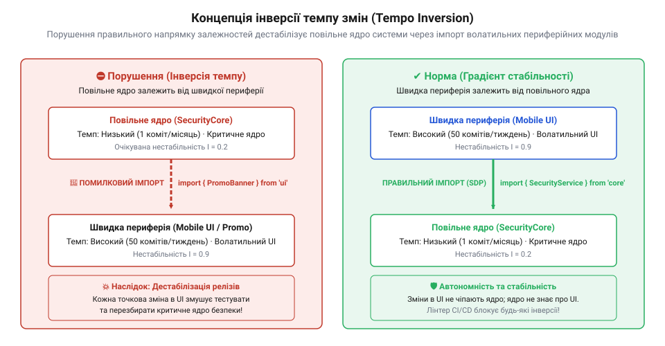
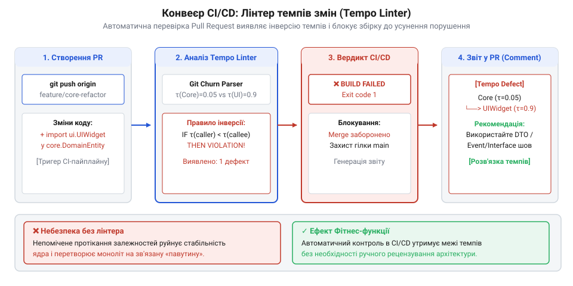
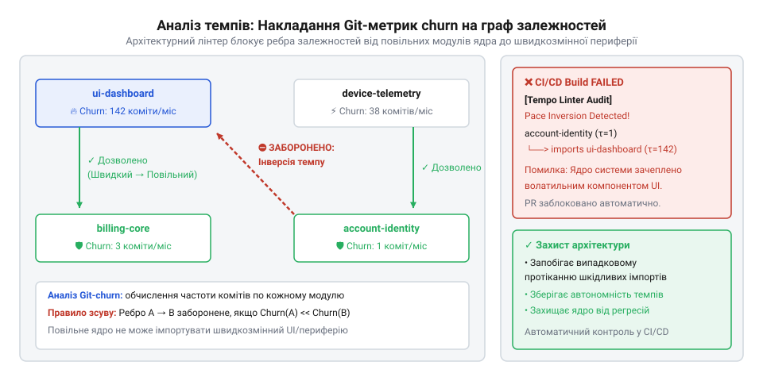

# Карта темпів Digital Homes

## Чому правила темпів згасають: проблема прихованої інверсії залежностей

Будь-яка складна програмна система складається з модулів, які розвиваються з принципово різною швидкістю. В архітектурі цей факт описує концепція [шарування за темпами змін](root:sf-apps/pace-layering-architecture) (англ. @@en|Pace Layering@@, див. [Різні частини — різні годинники](root:progarch/different-clocks)). Низькорівневі драйвери обладнання та базові алгоритми безпеки розробляються роками й вимагають суворих перевірок перед кожним релізом. Натомість користувацькі інтерфейси, мобільні екрани та маркетингові віджети змінюються щотижня за вимогами продуктових аналітиків.

На початкових етапах розробки платформи розумного дому Digital Homes архітектурна межа між цими світами здається очевидною. Проте з часом під тиском жорстких термінів розробники починають зрізати кути. Розглянемо критичний модуль автоматизації та безпеки `core/automation-engine`. У ньому реалізовано сервіс оповіщення про аварії `AlertService`. Коли виникає потреба негайно показувати баннер про витік води в мобільному застосунку, інженер додає прямий імпорт віджета `PromoBannerWidget` із модуля `apps/mobile-dashboard` безпосередньо в ядро безпеки:

```typescript
// Порушення: сервіс аварійного сповіщення ядра залежить від UI-віджета!
import { PromoBannerWidget } from '../../mobile-dashboard/src/promo-banner';

export class AlertService {
  notifyWaterLeak() {
    const banner = new PromoBannerWidget();
    banner.showEmergencyPopup('Увага: виявлено протікання води в системі!');
  }
}
```

У цей момент виникає **інверсія темпу** (англ. @@en|tempo inversion@@): консервативний, повільний модуль ядра стає прямо залежним від швидкоплинного, волатильного периферійного компонента.

> 🔧 **Навіщо це.** Автоматизоване відстеження напрямку залежностей між шарами різної швидкості запобігає ситуації, коли випадковий імпорт у коді UI-віджета прив'язує реліз критичного ядра безпеки до щоденних правок маркетингових банерів.

Наслідки цієї невеликої правки виявляються руйнівними для всього процесу релізів. Оскільки `core/automation-engine` оновлюється раз на квартал і вимагає повного циклу регресійного тестування, будь-яка щотижнева зміна стилів або рефакторинг у `PromoBannerWidget` ламає збірку ядра або вимагає його позапланового перетестування. Стабільність ядра знижується до рівня найволатильнішого UI-компонента, від якого воно залежить.


*Концепція інверсії темпу: повільний модуль ядра помилково імпортує швидкий периферійний модуль, що призводить до дестабілізації релізів.*

Людський контроль та кодекс розробки (англ. @@en|code review@@) не здатні зупинити деградацію на великих масштабах кодової бази. У міру зростання команди інженери перестають тримати в голові повну карту швидкостей усіх модулів. Документовані архітектурні правила згасають, перетворюючись на формальні побажання.

Щоб повернути контроль над архітектурними межами, правила темпів змін необхідно перетворити на вимірювані числові критерії та вбудувати їх безпосередньо в конвеєр неперервної інтеграції (англ. @@en|CI/CD pipeline@@). Лінтер архітектурних темпів (англ. @@en|tempo linter@@) повинен:
1. Автоматично вимірювати реальну швидкість модифікації кожного модуля за допомогою статистичного аналізу репозиторію.
2. Сканувати вихідний код та будувати орієнтований граф статичних залежностей (`import` та `require`).
3. Виявляти заборонені ребра в графі, де модуль з повільним темпом залежить від модуля з швидким темпом.
4. Блокувати злиття змін у створі (англ. @@en|pull request@@) із вихідним кодом помилки, якщо виявлено критичну інверсію.


*Схема роботи лінтера в конвеєрі CI/CD: аналіз pull request, блокування збірки та виведення діагностичного звіту інженеру.*

## Видобуток емпіричного темпу: аналіз історії Git

Спроба задавати швидкість модулів вручну через конфігураційні файли (наприклад, позначати модуль у маніфесті як `"tier": "stable"`) приречена на розходження з реальністю. Модуль, який вважався консервативним, під час активної доробки може зазнавати десятків правок на день. Справжній архітектурний темп є **емпіричним** (англ. @@en|empirical metrics@@) і міститься в історії системи керування версіями Git.

Кожен коміт у Git зберігає точну інформацію про час модифікації, автора та список змінених файлів із кількістю доданих і видалених рядків. Запустивши команду `git log --numstat`, ми отримуємо вичерпні дані для [аналізу волатильності коду](root:sf-apps/git-churn-analysis) (англ. @@en|code churn@@).

> 🔧 **Навіщо це.** Автоматичний аналіз історії комітів перетворює абстрактні уявлення про "повільні" та "швидкі" модулі на вимірювані числові метрики. Це усуває людську суб'єктивність під час оцінки стабільності кодової бази.

Щоб перетворити сирий журнал Git на об'єктивний індекс темпу змін, розраховується нормалізована місячна частота модифікацій для кожного модуля. Нехай `T_days` — часове вікно спостереження в днях (наприклад, 90 днів). Кількість місяців у періоді спостереження визначається як:

```
M_obs = max(1.0, T_days / 30.0)
```

Якщо модуль `m` зафіксував `C_m` комітів у межах обраного часового вікна, його нормалізована місячна частота `F_m` становить:

```
F_m = C_m / M_obs
```

Паралельно обчислюється сумарний кодовий шум `S_m` як сума всіх доданих та видалених рядків:

```
S_m = sum(linesAdded_i + linesDeleted_i)  для всіх комітів i модуля m
```

Метрика `F_m` дозволяє відсіяти випадкові шумові сплески. Масовий разовий рефакторинг (наприклад, зміна форматування тисячі рядків в одному коміті) збільшить `S_m`, але розрахована частота `F_m` залишиться низькою, що запобігає хибному переведенню стабільного модуля до категорії волатильних.

На основі отриманої частоти `F_m` кожному модулю присвоюється відповідний шар темпу (англ. @@en|Pace Layer@@) та числовий ранг стабільності від 1 (найповільніший) до 5 (найшвидший):

1. **`FOUNDATION`** (`F_m < 2.0` зм/міс, ранг 1): Апаратні драйвери, Zigbee/Matter-протоколи (`packages/device-protocols`).
2. **`CORE_DOMAIN`** (`F_m < 6.0` зм/міс, ранг 2): Бізнес-інваріанти, ядро автоматизації (`packages/automation-engine`).
3. **`SUPPORTING`** (`F_m < 15.0` зм/міс, ранг 3): Реєстри сутностей, локальні сховища конфігурацій (`packages/device-registry`).
4. **`INTEGRATION`** (`F_m < 35.0` зм/міс, ранг 4): Зовнішні хмарні сервіси, голосові шлюзи Alexa/HomeKit (`packages/voice-assistant`).
5. **`VOLATILE_UI`** (`F_m >= 35.0` зм/міс, ранг 5): Мобільні екрани, промо-віджети (`packages/mobile-dashboard`).


*Накладання метрик частоти змін із Git на орієнтований граф залежностей: підсвічування заборонених ребер від повільних вузлів до швидких.*

Для програмного втілення цього аналізу створимо типи даних для представлення метрик та модуль `GitHistoryAnalyzer`. У файлі `types.ts` оголошуються константи шарів темпу, їхні ранги та структури комітів:

:::code proj-git-tempo-inversion-linter/ts/src/types.ts 1-61

Модуль `GitHistoryAnalyzer` відповідає за розбір текстового виводу `git log` та агрегацію метрик:

:::code proj-git-tempo-inversion-linter/ts/src/git-history-analyzer.ts 1-165

Алгоритм аналізу працює в чотири послідовні кроки:
1. **Парсинг логу (`parseGitLogOutput`)**: Метод сканує вивід команди `git log --numstat --pretty=format:"COMMIT:%H|%at|%an"`. Маркер `COMMIT:` задає початок нового коміту з гешем, Unix-timestamp та автором, після чого зчитуються рядки статусу модифікації файлів.
2. **Обчислення вікна спостереження (`calculateObservationWindowMonths`)**: За різницею найновішого та найстарішого timestamp у вибірці комітів розраховується реальна тривалість спостереження в місяцях (з розрахунку 30 днів на місяць).
3. **Агрегація модифікацій (`analyzeModules`)**: Для кожного оголошеного модуля система підраховує кількість комітів, які зачіпають файли з префіксом шляху модуля (`def.pathPrefix`), та підсумовує загальну кількість змінених рядків `moduleChurn`.
4. **Класифікація шару (`classifyPaceLayer`)**: Обчислена середня місячна частота зіставляється з пороговими значеннями, перетворюючи числову метрику на конкретний рівень `PaceLayerType` від `FOUNDATION` до `VOLATILE_UI`.

Отримані емпіричні метрики зберігаються в мапі `Map<string, ModuleMetrics>` і стають основою для наступного етапу — зіставлення часових шарів із графом статичних залежностей вихідного коду.

## Побудова орієнтованого графа залежностей коду

Числові метрики активності git-репозиторію самі по собі не показують, які частини кодової бази наражаються на ризик. Знання того, що один модуль змінюється п'ятдесят разів на місяць, а інший — лише тричі, стає архітектурно цінним лише тоді, коли відомо, як ці модулі зв'язані між собою через імпорти та виклики. Якщо стабільна частина системи звертається до модуля, який постійно перебуває в стані перебудови, вона мимоволі переймає його нестабільність. Щоб виявити такі приховані зв'язки, необхідно перетворити вихідний текст файлів на орієнтований граф залежностей вигляду `A → B`, де ребро означає «модуль `A` залежить від модуля `B`».

> 🔧 **Навіщо це.**
> Для того щоб автоматично визначати статичні ребра зв'язку між підсистемами без ручного ведення мап залежностей та будувати топологію кодової бази для CI/CD-перевірок.

Аналіз залежностей починається зі зіставлення фізичних файлів репозиторію з архітектурними межами компонентів. Кожен модуль визначається своєю назвою та шляхом-префіксом у каталозі проєкту. Під час ініціалізації екстрактора графа клас `CodeDependencyGraph` нормалізує ці шляхи, приводячи файлові роздільники Windows `\` до єдиного формату Unix `/` та видаляючи кінцеві сліші. Це гарантує, що порівняння шляхів буде коректним незалежно від операційної системи, на якій запускається лінтер.


*Конвертація вихідних файлів коду з імпортами в орієнтований граф залежностей між модулями.*

:::code proj-git-tempo-inversion-linter/ts/src/code-dependency-graph.ts 12-20

Коли список префіксів сформовано, модуль `CodeDependencyGraph` сканує вихідні файли `SourceFile` та визначає належність кожного файла до відповідного компонента за допомогою методу `resolveModuleForPath`. Якщо файл не потрапляє під жоден із зареєстрованих префіксів, він ігнорується, оскільки не належить до контрольованих архітектурних меж.

:::code proj-git-tempo-inversion-linter/ts/src/code-dependency-graph.ts 123-132

Після прив'язки файла до джерельного модуля починається порядковий розбір його вмісту. Для вилучення залежностей застосовуються регулярні вирази, що шукають дві основні форми імпорту в @@en|JavaScript@@ та @@en|TypeScript@@: синтаксис ES-модулів (`import ... from '...'`) та CommonJS-виклики (`require('...')`).

Під час парсингу критично важливо уникати хибних спрацьовувань у коментарях. Рядки, що починаються з `//` або `/*`, пропускаються до застосування регулярних виразів. Для кожного знайденого імпорту функція витягує два ключові значення: специфікатор імпорту (шлях до цільового файла або пакета) та список імпортованих символів (класів, функцій чи типів).

:::code proj-git-tempo-inversion-linter/ts/src/code-dependency-graph.ts 50-120

Головна складність статичного аналізу залежностей полягає в перетворенні імпортованого шляху `importSpecifier` на конкретне ім'я цільового модуля. Специфікатор імпорту може мати одну з трьох форм:
1. Зовнішня бібліотека (наприклад, `express` або `lodash`). Такі імпорти не починаються з `.`, `/` або внутрішнього аліасу і відсікаються як зовнішні залежності `node_modules`.
2. Внутрішній аліас проєкту (наприклад, `@digital-homes/device-registry`). Метод `resolveTargetModule` вилучає ім'я модуля з аліасу та зіставляє його з зареєстрованими префіксами.
3. Відносний шлях (наприклад, `../../device-protocols/src/zigbee-driver`). Для розшифровки відносних шляхів метод будує масив сегментів каталогу поточного файла та послідовно застосовує оператори `.` (поточна тека) та `..` (перехід на рівень вгору через видалення останнього елемента зі стеку шляху).

Після обчислення підсумкового нормалізованого шляху метод `resolveModuleForPath` повертає назву цільового модуля. Якщо цільовий модуль збігається з джерельним (`targetModule === sourceModuleName`), таке ребро ігнорується, оскільки внутрішні зв'язки всередині одного модуля не створюють міжмодульної інверсії темпів.

:::code proj-git-tempo-inversion-linter/ts/src/code-dependency-graph.ts 134-189

Результатом роботи статичного аналізатора є об'єкт `DependencyGraph`. Він поєднує в собі карту метрик темпів компонентів `moduleMetrics` та масив виявлених міжмодульних ребер `edges`. Кожне ребро `DependencyEdge` містить повний контекст: який модуль імпортує, який модуль є цільовим, який саме файл і рядок містять директиву імпорту та які символи були вилучені.

:::code proj-git-tempo-inversion-linter/ts/src/code-dependency-graph.ts 22-48

Описана модель даних зафіксована у структурі типів лінтера:

:::code proj-git-tempo-inversion-linter/ts/src/types.ts 62-80

## Алгоритм виявлення інверсій темпу

Побудований граф залежностей описує топологію зв'язків між модулями, але сам по собі не вказує на дефекти. Щоб перетворити граф на інструмент контролю якості, його необхідно об'єднати з емпіричними метриками темпів змін, отриманими з історії git-комітів. Концепція темпів змін спирається на правило [Різні частини — різні годинники](root:progarch/different-clocks): консервативні шари системи мають змінюватися повільно і не повинні мати прямих залежностей від волатильних компонентів.

> 🔧 **Навіщо це.**
> Для автоматичного виявлення точок архітектурної деградації в CI/CD та надання розробникам чітких рекомендацій щодо розв'язання паразитних залежностей через інверсію управління.

Класифікатор темпів розподіляє модулі за п'ятьма архітектурними шарами (від `FOUNDATION` до `VOLATILE_UI`), кожному з яких відповідає числовий ранг стабільності `PACE_RANK` від 1 (найповільніший) до 5 (найшвидший).

:::code proj-git-tempo-inversion-linter/ts/src/types.ts 5-36

Правило валідації `TempoInversionRule` аналізує кожне орієнтоване ребро `A → B` у графі. Якщо ранг джерельного модуля менший за ранг цільового модуля (`sourceRank < targetRank`), це означає, що повільний або фундаментальний компонент імпортує швидший або менш стабільний компонент. Такий напрямок залежності є інверсією темпу (англ. @@en|tempo inversion@@).


*Виявлення забороненого вектора залежності між шарами темпів.*

Однак не кожна інверсія має однакову руйнівну силу. Для відрізнення незначних відхилень активності від критичних структурних помилок алгоритм обраховує поріг чутливості за двома критеріями:
1. Абсолютний розрив між шарами: `rankDiff = targetRank - sourceRank`.
2. Співвідношення частот правок на місяць: `freqRatio = targetMetric.monthlyFrequency / sourceMetric.monthlyFrequency`.

Якщо розрив між шарами становить 2 або більше (наприклад, модуль ядра `CORE_DOMAIN` з рангом 2 імпортує мобільне UI-представлення `VOLATILE_UI` з рангом 5) або цільовий модуль змінюється принаймні втричі частіше за джерельний (`freqRatio ≥ 3.0`), порушенню присвоюється критичний рівень `CRITICAL`. В інших випадках небезпека вважається помірною і позначається рівнем `WARNING`.

:::code proj-git-tempo-inversion-linter/ts/src/tempo-inversion-rule.ts 14-81

Для кожного виявленого порушення правило не лише фіксує діагноз, а й автоматично будує покроковий план виправлення за допомогою методу `generateRemediationPlan`. План спирається на принцип інверсії залежностей (DIP, англ. @@en|Dependency Inversion Principle@@): замість прямого імпорту волатильного модуля повільне ядро має оголосити абстрактний інтерфейс (порт або подію), реалізацію якого покладають на швидкий шар або зовнішній адаптер.

:::code proj-git-tempo-inversion-linter/ts/src/tempo-inversion-rule.ts 83-101

Головний оркестратор `TempoLinterEngine` об'єднує всі етапи аналізу в єдиний конвеєр: спочатку `GitHistoryAnalyzer` обчислює частоту правок файлів за журналом комітів, потім `CodeDependencyGraph` будує граф імпортів, після чого `TempoInversionRule` проводити валідацію ребер.

:::code proj-git-tempo-inversion-linter/ts/src/index.ts 16-52

Підсумковий звіт формується компонентом `CiConsoleReporter`. Якщо в графі виявлено хоча б одне порушення з рівнем `CRITICAL`, репортер встановлює код виходу `exitCode = 1`. Це дозволяє використовувати утиліти в CI/CD-пайплайнах (наприклад, GitHub Actions або GitLab CI) для автоматичного блокування злиття pull request, що порушують архітектурний порядок.

:::code proj-git-tempo-inversion-linter/ts/src/ci-console-reporter.ts 13-34

## Пакування в CLI та інтеграція в конвеєр CI/CD

Детектор інверсій темпу, який працює лише як внутрішній клас або вбудована функція у тестовому скрипті, не може захистити кодову базу від архітектурної деградації. Інженер може забути запустити перевірку вручну або зігнорувати попередження перед створенням коміту. Щоб архітектурні обмеження дійсно працювали, вони повинні перетворитися на невідворотний автоматизований гейт у конвеєрі неперервної інтеграції (англ. @@en|Continuous Integration / Continuous Deployment@@, CI/CD).

Створення інтерфейсу командного рядка (англ. @@en|Command Line Interface@@, CLI) для архітектурного лінтера вимагає вирішення трьох задач:
1. Конфігурування параметрів сканування (часові горизонти аналізу історії, винятки, правила).
2. Форматування результатів для двох різних аудиторій: читабельний текстовий звіт для розробника в консолі та службові коди повернення для сервера збірки.
3. Управління кодом виходу (англ. @@en|exit code@@) процесу, який визначає, чи пропустити pull request далі по конвеєру.

> 🔧 **Навіщо це.**
> Пакування аналізатора темпів у CLI-утиліту перетворює абстрактне поняття «правильної архітектури» на суворий критерій якості коду. Якщо волатильний мобільний віджет проникає в імпорти стабільного ядра, CI/CD автоматично блокує злиття гілки (англ. @@en|merge@@), гарантуючи, що жодна інверсія темпів не потрапить до головної гілки репозиторію.

Для роботи в реальному репозиторії лінтер оперує чітко визначеними типами даних, що описують шари темпу (англ. @@en|Pace Layers@@), метрики модулів та результати перевірки.

Покажемо структуру основних типів, що використовуються для класифікації шарів та генерації підсумкового звіту:

:::code proj-git-tempo-inversion-linter/ts/src/types.ts 5-35
:::code proj-git-tempo-inversion-linter/ts/src/types.ts 83-115

Кожен шар має своє числове значення стабільності `PACE_RANK` (від 1 для найповільнішого `FOUNDATION` до 5 для найшвидшого `VOLATILE_UI`). Коли ребро графа залежностей іде від нижчого рангу до вищого, лінтер фіксує порушення. Звіт `LintReport` збирає статистику аналізу та розраховує прапор `hasCriticalViolations`, який визначає числовий `exitCode`.

Клас `CiConsoleReporter` відповідає за перетворення сирих даних про залежності й порушення у структуроване консольне подання:

:::code proj-git-tempo-inversion-linter/ts/src/ci-console-reporter.ts 13-34

Метод `generateReport` перевіряє, чи є серед знайдених порушень хоча б одне з рівнем серйозності `CRITICAL`. Якщо критичні інверсії присутні, `exitCode` встановлюється в `1`, що для будь-якої системи CI/CD (GitHub Actions, GitLab CI, Jenkins) означає аварійне завершення кроку збірки.

Друк звіту складається з трьох основних блоків: загальної метрики сканування, карти темпів (Pace Map) та деталізованого переліку порушень з рекомендаціями щодо їх усунення:

:::code proj-git-tempo-inversion-linter/ts/src/ci-console-reporter.ts 39-68
:::code proj-git-tempo-inversion-linter/ts/src/ci-console-reporter.ts 73-101
:::code proj-git-tempo-inversion-linter/ts/src/ci-console-reporter.ts 106-124

У таблиці `printPaceMap` модулі впорядковуються від найменшої частоти змін до найбільшої. Це дає розробнику наочну картину розподілу швидкостей у системі. Блок `printViolations` виводить точний шлях до файла та рядок коду, де виявлено заборонений імпорт, а також готовий план рефакторингу на основі принципу інверсії залежностей (англ. @@en|Dependency Inversion Principle@@, DIP).

Головний клас `TempoLinterEngine` об'єднує аналіз історії Git, побудову графа залежностей та перевірку правил в єдиний конвеєр:

:::code proj-git-tempo-inversion-linter/ts/src/index.ts 16-66

Завдяки такій архітектурі CLI-утиліту можна легко інтегрувати в скрипт автоматизації. Конфігураційний файл `.tempolintrc` у реальних системах дозволяє задавати часовий горизонт аналізу історії (наприклад, 90 днів) та список винятків (англ. @@en|whitelist@@) для легітимних тимчасових переходів між модулями.

## Практичний експеримент у Digital Homes: від діагностики до усунення інверсії

Розглянемо практичну ситуацію на прикладі платформи розумного будинку «Digital Homes». Система складається з кількох модулів з різними швидкостями еволюції: низькорівневих апаратних драйверів пристроїв, ядра автоматизації опалення та сценаріїв безпеки, сервісу конфігурацій, хмарних інтеграцій із голосовими помічниками та волатильного мобільного дашборда з промо-віджетами.

З часом унаслідок поспіху під час випуску нових функцій у кодову базу проник деструктивний зв'язок: сервіс сповіщень про аварії у ядрі автоматизації почав напряму імпортувати віджет промо-банера з мобільного додатка, щоб показувати спливаюче повідомлення про витік води. На перший погляд, функціональність працює, але архітектурний темп системи зламано.

Згадаймо принципи [Різні частини — різні годинники](root:progarch/different-clocks): якщо модуль ядра змінюється в середньому 3 рази на місяць, а мобільний UI — 50 разів на місяць, пряма залежність ядра від UI змушує стабільне ядро перетестовуватися й перевидаватися з кожною правкою верстки чи акційного шрифту.

> 🔧 **Навіщо це.**
> Покроковий експеримент показує повний цикл роботи архітектурного лінтера в реальних умовах: від виявлення прихованої інверсії темпів у консолі CI/CD до її виправлення за допомогою винесення інтерфейсного порту. Це перетворює теоретичні знання про темпи змін на практичну навичку рефакторингу.

Створимо тестове оточення, що імітує структуру модулів, історію комітів за 90 днів та вихідні файли платформи Digital Homes:

:::code proj-git-tempo-inversion-linter/ts/src/index.ts 72-100
:::code proj-git-tempo-inversion-linter/ts/src/index.ts 102-166

Історія комітів чітко розділяє модулі за швидкостями:
- `packages/device-protocols`: ~1.0 зм/міс → `FOUNDATION` (ранг 1)
- `packages/automation-engine`: ~3.0 зм/міс → `CORE_DOMAIN` (ранг 2)
- `packages/device-registry`: ~9.3 зм/міс → `SUPPORTING` (ранг 3)
- `packages/voice-assistant`: ~23.3 зм/міс → `INTEGRATION` (ранг 4)
- `packages/mobile-dashboard`: ~50.0 зм/міс → `VOLATILE_UI` (ранг 5)

Тепер розглянемо файли коду, які передаються на аналіз:

:::code proj-git-tempo-inversion-linter/ts/src/index.ts 168-247

У файлі `packages/automation-engine/src/alert-service.ts` міститься прямий імпорт `PromoBannerWidget` із модуля `mobile-dashboard`. Також у `packages/device-protocols/src/zigbee-driver.ts` низькорівневий драйвер імпортує `AlexaSkillHandler` із модуля `voice-assistant`.

Правило `TempoInversionRule` порівнює ранги стабільності модулів для кожного імпорту:

:::code proj-git-tempo-inversion-linter/ts/src/tempo-inversion-rule.ts 14-81
:::code proj-git-tempo-inversion-linter/ts/src/tempo-inversion-rule.ts 86-101

Коли `TempoLinterEngine` виконує аналіз (`main()`), правило виявляє, що `automation-engine` (ранг 2) імпортує `mobile-dashboard` (ранг 5). Оскільки різниця рангів становить `5 - 2 = 3 >= 2`, правило присвоює порушенню критичний статус `CRITICAL`.

Запуск лінтера завершується з наступним консольним виводом:

```text
================================================================================
  TEMPO-LINTER :: Digital Homes Architectural Stability Gate
================================================================================
Час сканування: 2026-09-10T11:15:46.000Z
Проаналізовано модулів: 5
Виявлено міжмодульних імпортів: 4
Тривалість перевірки: 12 мс

[ КАРТА АРХІТЕКТУРНИХ ТЕМПІВ (PACE MAP) ]
--------------------------------------------------------------------------------
Модуль                          Шар темпу       Ранг    Змін/міс    Комітів
--------------------------------------------------------------------------------
core/device-protocols           FOUNDATION      1/5     1.0/міс     3
core/automation-engine          CORE_DOMAIN     2/5     3.0/міс     9
services/device-registry        SUPPORTING      3/5     9.3/міс     28
integrations/voice-assistant    INTEGRATION     4/5     23.3/міс    70
apps/mobile-dashboard           VOLATILE_UI     5/5     50.0/міс    150

[ РЕЗУЛЬТАТ ПЕРЕВІРКИ ПРАВИЛА TEMPO-INVERSION ]
--------------------------------------------------------------------------------

⛔ [CRITICAL] Порушення #1:
  Файл:        packages/automation-engine/src/alert-service.ts:200
  Напрямок:    core/automation-engine (FOUNDATION) ➔ apps/mobile-dashboard (VOLATILE_UI)
  Діагноз:     Інверсія темпів: стабільний модуль 'core/automation-engine' залежить від волатильного 'apps/mobile-dashboard'.
  Виправлення:
  Застосуйте принцип інверсії залежностей (DIP) (зокрема для PromoBannerWidget):
    1. Оголосіть абстрактний порт або подію всередині повільного модуля 'core/automation-engine'.
    2. Перенесіть конкретну реалізацію адаптера у швидкий модуль 'apps/mobile-dashboard' або шину подій.
    3. Приберіть прямий імпорт із 'core/automation-engine', щоб волатильні зміни 'apps/mobile-dashboard' не провокували ретест ядра.

--------------------------------------------------------------------------------
❌ CI/CD PIPELINE BLOCKED: Виявлено критичні інверсії темпів!
   Повільні стабільні шари імпортують волатильні модулі.
   Рекомендація: виправте залежності за вказаними планами. Код виходу: 1
================================================================================

[CI/CD Runner] Процес завершився з кодом 1. Збірка зупинена.
```

Конвеєр CI/CD отримує код виходу `1` і блокує pull request.

Щоб ліквідувати інверсію темпів і розблокувати збірку, виконаємо рефакторинг за порадою лінтера:

1. **Оголошення стабільного порту в ядрі.** Усередині `packages/automation-engine/src/` створюємо інтерфейс `EmergencyNotificationPort`:
```typescript
export interface EmergencyNotificationPort {
  notifyEmergency(message: string): void;
}
```

2. **Використання порту у сервісі сповіщень.** Модуль `AlertService` тепер залежить від абстракції, а не від конкретного віджета UI:
```typescript
import { EmergencyNotificationPort } from './emergency-notification-port';

export class AlertService {
  constructor(private notifier: EmergencyNotificationPort) {}

  notifyWaterLeak() {
    this.notifier.notifyEmergency('Увага: виявлено протікання води в системі!');
  }
}
```

3. **Реалізація адаптера у швидкому шарі.** Мобільний додаток `packages/mobile-dashboard` створює адаптер `UiEmergencyNotifier`, який реалізує `EmergencyNotificationPort` і передає сповіщення у `PromoBannerWidget`. Напрямок статичної залежності інвертується: швидкий UI залежить від повільного ядра, що відповідає правилам архітектурних темпів.

Після усунення прямих імпортів із шкідливим напрямком запускаємо `TempoLinterEngine` повторно. Детектор фіксує, що всі ребра графа спрямовані від вищих рангів до нижчих або рівних (`VOLATILE_UI` ➔ `SUPPORTING` ➔ `FOUNDATION`).

Консольний вивід лінтера змінюється на успішний:

```text
================================================================================
  TEMPO-LINTER :: Digital Homes Architectural Stability Gate
================================================================================
...
✅ CI/CD PIPELINE PASSED: Усі залежності спрямовані правильно (від швидких до повільних).
   Код виходу: 0
================================================================================

[CI/CD Runner] Процес завершився успішно. Злиття дозволено.
```

Завдяки автоматизованій перевірці в CI/CD деградація архітектурних меж зупинена на етапі pull request, а стабільність ядра автоматизацій збережена.
