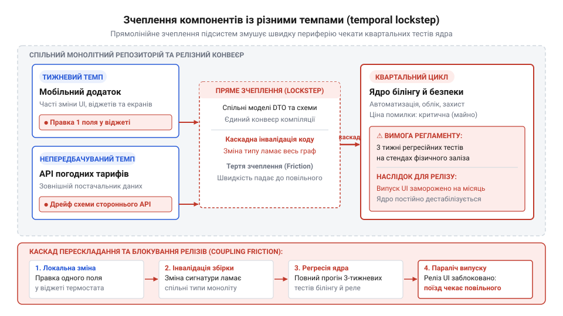
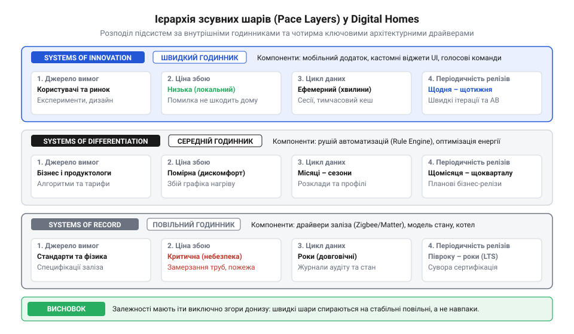
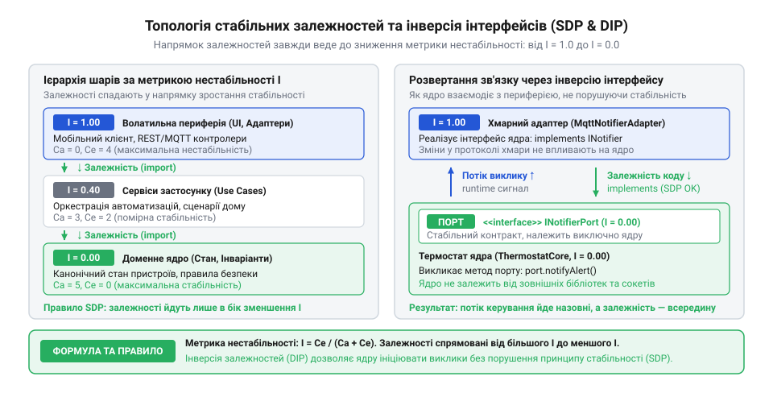
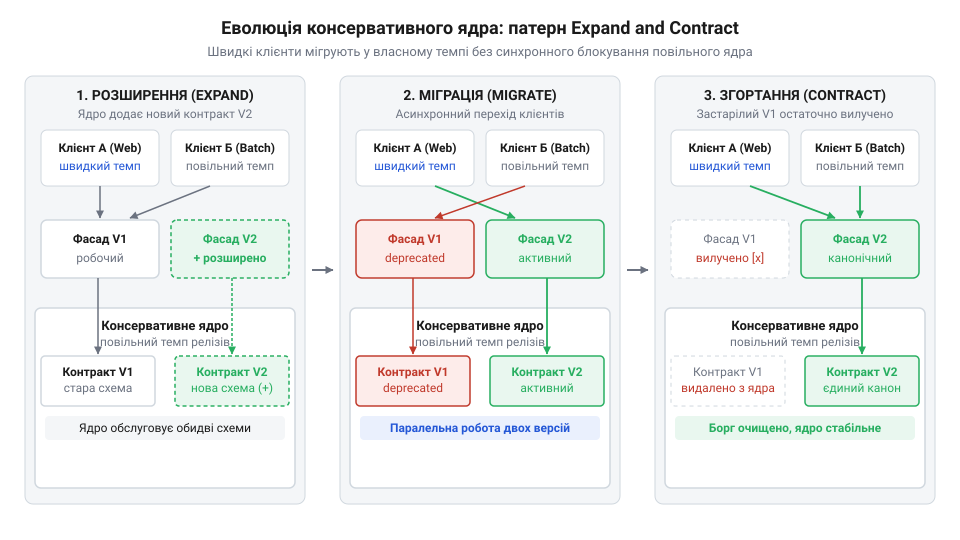
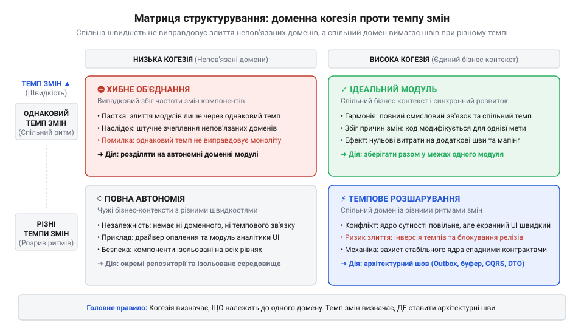

# Різні частини — різні годинники

<preknowlist>
- [Карта темпів Digital Homes](root:progarch/dh-tempo-map) — Базовий функціональний склад системи Digital Homes (ядро автоматизації, телеметрія сенсорів, мобільний інтерфейс, шлюзи зовнішніх провайдерів) та типовий розподіл бізнес-відповідальності між ними.
</preknowlist>

## Пастка спільного поїзда: чому ламаються релізи Digital Homes

П'ятничний випуск системи розумного будинку Digital Homes мав бути непомітним і рутинним. У мобільному застосунку змінювали відтінок кнопки оплати та текст акційного банера для щотижневого маркетингового експерименту. Одночасно сторонній провайдер динамічних погодних тарифів без попередження оновив схему свого сервісу: додав нову градацію нічного споживання електроенергії та перейменував одне необов'язкове поле у відповіді. Інженери шлюзу підготували швидку правку парсера, мобільні розробники оновили верстку екрана, і всі зміни попрямували в конвеєр розгортання.

Але в Digital Homes ці компоненти зібрані в єдиний моноліт (грец. *monolithos* — від *monos* «один» і *lithos* «камінь») або зчеплені прямими викликами через спільний репозиторій. Процес доставки організовано за схемою @@en|release train@@ (англ. *release train* — «релізний поїзд», регулярний календарний розклад спільного розгортання всіх підсистем). Будь-який модуль, що сідає в такий поїзд, змушений ділити спільну долю з рештою системи: реліз або виходить цілком, або блокується для всіх.

Поруч із мобільним інтерфейсом і тарифним шлюзом у тому самому проєкті живе модуль білінгу й автоматизації безпеки житла. Цей компонент керує фізичними пристроями: газовими клапанами, нагрівальними котлами, сервоприводами дверних замків і квартальними аудиторськими розрахунками комунальних нарахувань. Збій у цьому ядрі загрожує розривом замерзлих водопровідних труб узимку, неконтрольованим відмиканням дверей або мільйонними санкціями регуляторів за спотворені фінансові звіти.

Через колосальну ціну помилки інженерні регламенти безпеки вимагають для ядра автоматизації повного регресійного тестування (лат. *regressio* — «зворотний рух», від *regredi* «відступати»). Перед кожним випуском код проходить багатоденні випробування на апаратних симуляторах @@en|hardware-in-the-loop@@, вимірювання затримок шини датчиків і ручний аудит контрольних сум транзакцій. Повний цикл перевірки ядра триває щонайменше два тижні, а плановий випуск відбувається лише раз на квартал.

Коли дрібна зміна кнопки в мобільному інтерфейсі потрапляє в один релізний поїзд із консервативним ядром, виникає руйнівне тертя. Мобільна команда живе щотижневими ітераціями: їй критично перевіряти гіпотези конверсії, тестувати нові сценарії взаємодії та усувати незручності користувачів кожні кілька днів. Постачальник погодних тарифів оновлює контракти непередбачувано, ламаючи розрахунок вартості в довільний момент посеред місяця. Якщо на будь-яку периферійну правку вимагати повного двотижневого тестування ядра безпеки, продуктовий конвеєр мобільного застосунку повністю зупиняється.

У такій пастці організація неминуче вдається до небезпечних поступок. Керівництво тисне на інженерів із вимогою терміново проштовхнути нову кнопку під заплановану рекламну кампанію вихідного дня. Команда вирішує зекономити час: зміна ж суто косметична, навіщо повторно ганяти тривалі тести опалювального контуру? Правки мобільного екрана та погодного адаптера позначають терміновим виправленням і викачують без повного регресійного прогону.

У неділю вночі сервери Digital Homes зустрічають перші заморозки. Погодний адаптер отримує новий формат відповіді, але під час поспішного оновлення розробники випадково скоригували спільну структуру даних тарифів, яку використовував і алгоритм розрахунку опалення. Виникає неперехоплена виняткова ситуація під час обчислення точки роси. Демон керування опаленням аварійно завершує роботу в кількох тисячах будинків. Опалення вимикається, датчики температури сигналізують про аварію, а чергова зміна проводить ніч у панічних спробах відкотити реліз.

Після такого інциденту в команді закріплюється стійкий страх релізів — @@en|release anxiety@@ (англ. *release anxiety* — «релізна тривожність», психологічний опір розробників будь-яким викаткам через непередбачуваність збоїв). Менеджмент видає жорсткий наказ: відтепер жоден рядок коду не потрапляє на сервери без підпису архітектора та проходження абсолютно всіх перевірок. Релізи стають рідкісними, виснажливими подіями, до яких готуються місяцями. Розмір кожного пакета змін розростається, а що більше правок накопичено в поїзді, то вища ймовірність нової аварії на стиках.

Керівництво та інженери ставлять цій біді хибний діагноз. Вони вважають, що причина в недостатній уважності програмістів, поганому покритті тестами чи порушенні дисципліни під час перевірки коду (@@en|code review@@). Проте код кожного окремого класу міг бути чистим, архітектура класів — акуратною, а модульне покриття — високим.

Справжня причина криється в ігноруванні часового виміру архітектури. Складові системи з принципово різними темпами змін виявилися жорстко синхронізованими у спільному релізному поїзді — стан, що зветься @@en|lockstep@@ (англ. *lockstep* — «марширування нога в ногу», примусова синхронізація ходи).


*Жорстке зчеплення модулів із різною швидкістю змін змушує периферійні правки проходити тривале регресійне тестування повільного ядра, паралізуючи релізний цикл.*

Коли мінлива периферія напряму посилається на повільне ядро або пов'язана з ним спільним розгортанням, система потрапляє у подвійну залежність: найповільніший компонент диктує швидкість оновлень усій компанії, а найбільш нестабільний — визначає частоту відмов усього продукту.

> 🔧 **Навіщо це.**
> Розпізнавання часового конфлікту модулів уберігає команди від марних спроб «змусити всіх деплоїтися щодня» або, навпаки, «заморозити розробку суворими регламентами». Архітектор виявляє невідповідність внутрішніх ритмів і розриває спільний релізний поїзд, ізолюючи контури розгортання.

Для огляду повної карти підсистем Digital Homes та їхнього функціонального призначення зверніться до [карти темпів Digital Homes](root:progarch/dh-tempo-map). А для того, щоб не прив'язувати мінливі інтерфейсні екрани до спільних бекенд-контрактів, використовують [патерн Backend for Frontend для мінливих клієнтів](root:sf-apps/backend-for-frontend-pattern).

Проте перш ніж будувати технічні буфери між модулями, необхідно з'ясувати: чому взагалі виникає ця різниця темпів і які сили визначають природну швидкість кожної підсистеми?

## Анатомія швидкості: що задає внутрішній годинник підсистеми

Типова помилка спрощеного погляду на архітектуру — вважати швидкість компонента суто організаційним рішенням. Здається, що достатньо зібрати команду, впровадити спритні процеси та налаштувати конвеєр автоматизації, щоб ядро безпеки почало оновлюватися так само стрімко, як мобільний екран. Проте швидкість підсистеми не є параметром, який можна довільно змінити вольовим рішенням.

Кожен модуль програмної системи володіє власним внутрішнім годинником — об'єктивним темпом змін, який диктується природою його завдань і середовищем існування. Спроба штучно прискорити повільне ядро призводить до катастрофічних збоїв у фізичному світі. Спроба штучно сповільнити швидку периферію позбавляє продукт здатності адаптуватися до ринку.

Цей внутрішній годинник формується під дією чотирьох фундаментальних сил.

**Джерела бізнес-вимог.** Темп життя коду насамперед визначається тим, хто генерує привід для змін. Якщо модуль реалізує нормативні вимоги державних органів, стандарти електробезпеки чи правила бухгалтерського обліку, його годинник іде повільно й розмірено. Регуляторні норми змінюються роками, кожна поправка узгоджується заздалегідь, а перевірка відповідності вимагає суворих аудиторських процедур. Навпаки, якщо джерелом вимог є маркетингові експерименти, продуктова аналітика чи поведінкові реакції користувачів, зміни народжуються щодня. Життя нової кнопки визначається результатом тесту: якщо гіпотеза не спрацювала протягом тижня, код змінюють або видаляють.

**Ціна помилки.** Що важчими є наслідки дефекту, то довшим має бути цикл перевірки, і то повільніше цокає годинник компонента. Збій у контролері фізичних клапанів опалення чи алгоритмі захисного відсікання газу може зруйнувати будівлю або створити загрозу людському життю. Помилка у нарахуванні плати за енергоносії тягне за собою штрафи фінансових регуляторів і втрату репутації. Тут будь-яка неточність є безповоротною, тому код проходить тривалі етапи валідації. Водночас дефект у промо-банері чи помилка зміщення кнопки на мобільному екрані коштують дешево: екран виглядає неохайно, але мешканці не втрачають тепла. Низька ціна помилки дозволяє периферійним компонентам експериментувати та випускати оновлення без тривалих погоджень.

**Життєвий цикл даних.** Різні типи даних мають принципово різний термін корисності й вимоги до збереження, що безпосередньо впливає на темп оновлення структур коду. Транзакційні записи платежів, журнали реєстрації доступу та конфігурації підключених будинків зберігаються роками й десятиліттями. Зміна схеми таких даних — складна інженерна операція, яка вимагає сумісності зі старими версіями, міграції мільйонів записів без простою системи та гарантій цілісності. Як детально розкриває [еволюція схем і міграція довгоживучих даних](root:sf-data/database-migrations), консерватизм даних сковує швидкість змін усього модуля. Натомість презентаційні моделі користувацького інтерфейсу, сесійні кеші чи списки сповіщень живуть години або дні. Їхню форму можна переписати будь-якої миті: старі структури просто скидають разом із кешем, не потребуючи міграцій.

**Горизонт планування.** Фундаментальні сутності предметної області проектуються з розрахунком на тривалу експлуатацію. Базові поняття на кшталт «Пристрій», «Абонент», «Подія безпеки» чи «Тарифна сітка» закладаються на роки наперед. Якщо фундаментальна модель зазнає перегляду щомісяця, це означає помилку доменного аналізу, яка руйнує всю надбудову системи. Горизонт планування ядра сягає 5–10 років. Натомість інтерфейсні сценарії, промо-акції чи тимчасові інтеграції з партнерськими сервісами створюються на горизонт від кількох тижнів до кількох місяців: вони покликані відпрацювати конкретне тактичне завдання і поступитися місцем новим рішенням.

Розуміння того, що будь-яка довговічна споруда природно розпадається на складові з різним ритмом оновлення, прийшло у розробку програмного забезпечення з класичної архітектури будівель.

Британський архітектор Френк Даффі звернув увагу на те, що споруда не є монолітною цілісністю: різні її складові оновлюються, зношуються та замінюються з кардинально відмінною швидкістю. Цю ідею детально описав і популяризував Стюарт Бренд у книзі «Як будівлі навчаються» (@@en|How Buildings Learn@@, 1994), сформулювавши концепцію шести зсувних шарів (модель 6S):
- Ділянка (@@en|Site@@) — географічні межі та земля, незмінні десятиліттями;
- Несуча конструкція (@@en|Structure@@) — фундамент і тримальні колони, термін служби яких становить від 30 до 300 років;
- Оболонка (@@en|Skin@@) — зовнішні стіни, покрівля та фасади, які оновлюють приблизно раз на 20 років;
- Інженерні комунікації (@@en|Services@@) — електрична мережа, водопровід, опалення та вентиляція, що зношуються і потребують ремонту чи заміни кожні 7–15 років;
- Планування простору (@@en|Space Plan@@) — внутрішні перегородки, двері та робочі зони, які перекроюються кожні 3–30 років;
- Речі (@@en|Stuff@@) — столи, стільці, техніка та декор, що переміщуються щодня.

Головне спостереження Бренда полягає в тому, що будівля зберігає життєздатність лише тоді, коли ці шари можуть вільно зміщуватися один відносно одного без руйнування сусідніх — звідси поняття @@en|shearing layers@@ (англ. *shearing layers* — «зсувні шари», термін, запозичений із геології для позначення тектонічного ковзання пластів). Якщо інженер замурує водопровідні труби чи електричні дроти безпосередньо у залізобетонні тримальні колони, перша ж аварія комунікацій змусить розбивати фундамент будівлі. Несумісність ритмів без архітектурного зазору веде до передчасного руйнування споруди.

Про те, як цей принцип адаптували для коду дослідники Браєн Фут і Джозеф Йодер, докладно розповідає [вставка про зсувні шари в архітектурі програмного забезпечення](root:progarch/different-clocks/hist-shearing-layers-in-software.md).

Компанія Gartner формалізувала це бачення для інформаційних систем підприємств у модель темпових шарів (@@en|Pace-Layered Application Strategy@@), виділивши три ключові страти:

1. **@@en|Systems of Record@@ (Системи запису)** (лат. *recordari* — «згадувати, фіксувати»). Фундаментальний рівень ядра, де зосереджені критичні транзакційні дані та непорушні бізнес-правила організації. У Digital Homes це реєстр пристроїв, білінговий механізм обліку споживання та контролер аварійного відключення. Для систем запису характерні висока стабільність, консервативні регламенти внесення змін, тривале тестування та періодичність випуску від кількох місяців до пів року. Зміни тут ініціюються лише масштабними трансформаціями бізнесу або регуляторними актами.

2. **@@en|Systems of Differentiation@@ (Системи диференціації)** (лат. *differentia* — «відмінність, різниця»). Модулі, що реалізують унікальні бізнес-процеси компанії та забезпечують її конкурентну відмінність на ринку. У Digital Homes це алгоритми енергоефективного керування мікрокліматом, розрахунок оптимізованого графіка роботи побутових приладів та індивідуальні сценарії автоматизації. Цей шар змінюється із середньою швидкістю — релізи виходять кожні кілька тижнів, адаптуючись до сезонних коливань тарифів чи появи нових алгоритмічних моделей.

3. **@@en|Systems of Innovation@@ (Системи інновацій)** (лат. *innovatio* — «оновлення», від *novus* «новий»). Швидкозмінний шар експериментів, пілотних запусків та взаємодії з користувачем. У Digital Homes це мобільний клієнт, голосові інтерфейси, пілотні інтеграції з пристроями сторонніх виробників та маркетингові кабінети. Ритм оновлень тут становить лічені дні або години. Значна частина коду в цьому шарі має короткий життєвий цикл і без жалю утилізується у разі невдачі експерименту.


*Розподіл компонентів на системи запису, диференціації та інновацій визначається ціною помилки, джерелом вимог і життєвим циклом даних: що глибший шар, то повільніший його ритм.*

Ієрархія зсувних шарів формує природний каркас програми. Що глибше розташований компонент, то міцнішим і повільнішим він є, гарантуючи надійність усієї конструкції. Що ближче компонент до периферії, то вищою є його пластичність, яка дозволяє бізнесу швидко маневрувати на ринку.

> 🔧 **Навіщо це.**
> Темпова стратифікація встановлює диференційований підхід до інженерного контролю: вона усуває шкідливу уніфікацію вимог. Команда перестає вимагати багатотижневого ручного тестування для експериментальної кнопки в мобільному інтерфейсі, але водночас не дозволяє поспішних неперевірених правок у ядрі керування фізичними виконавчими механізмами.

Коли зв'язки між цими шарами спроєктовані без урахування різниці швидкостей, система неминуче деградує: або швидкі інновації блокуються тривалим циклом перевірки ядра, або повільне ядро втрачає стабільність під ударами постійних оновлень периферії.

Щоб запобігти цьому, архітектура вимагає дотримання золотого правила темпових шарів: **залежності в коді завжди мають спрямовуватися від мінливих, швидких шарів до стабільних і повільних, але ніколи у зворотний бік**. Формальне обґрунтування цієї закономірності дає [принцип стабільних залежностей та зрілість модулів](root:sf-apps/stable-dependencies-principle), а практичну ізоляцію повільного ядра від мінливих зовнішніх контрактів забезпечує [патерн запобіжного шару (Anti-Corruption Layer)](root:sf-apps/anti-corruption-layer).

Як виміряти стабільність модулів мовою точних інженерних метрик і якими технічними засобами розв'язати взаємодію між компонентами з різними годинниками — розбираємо далі.

## Топологія зв'язків та правило орієнтації залежностей у бік стабільності

Уявімо консервативне серце системи автоматизації розумного будинку — ядро керування опаленням. Його алгоритми розраховують термодинаміку будівлі, координують реле котлів і запобігають перегріву теплоносія. Це код із низьким темпом змін: він формувався місяцями, вимагає суворого регресійного тестування перед кожним оновленням, а збій у ньому загрожує аварією опалювального контуру посеред зими. Тепер припустімо, що для оптимізації витрат цьому ядру знадобилися поточні комерційні тарифи на електроенергію. Найпростіше рішення, до якого часто підштовхує інтуїція недосвідченого інженера, — безпосередньо викликати з ядра клієнтську бібліотеку біржового сервісу енергоринку чи зовнішній REST API хмарного провайдера погоди.

Такий прямий виклик миттєво створює катастрофу темпів. Зовнішні біржові та погодні API змінюють структуру JSON-відповідей, правила автентифікації та версії клієнтських SDK щомісяця, якщо не щотижня. Оскільки ядро безпосередньо імпортує код зовнішнього клієнта, будь-яка незначна зміна в протоколі стороннього постачальника змушує інженерів правити, перекомпілювати, заново тестувати й розгортати фундаментальне ядро опалення. Мінливість периферії миттєво заражає консервативний фундамент, перетворюючи його на джерело постійних аварій і затримок релізів.

### Природний напрямок залежностей

Уникнути цього руйнування можна лише за умови суворого дотримання топології зв'язків між підсистемами з різним темпом життєвого циклу. Фундаментальний архітектурний закон стверджує: компоненти зі швидким темпом змін повинні залежати від компонентів із повільним темпом, але повільні компоненти ніколи не мають залежати від швидких.

Ця асиметрія продиктована механікою стабільності (від лат. @@la|stabilis@@ — стійкий, непорушний). Коли волатильний модуль користувацького інтерфейсу чи зовнішній інтеграційний адаптер залежить від повільного ядра, жодного тертя не виникає. Ядро змінюється вкрай рідко, тому фундамент під ногами швидкого компонента залишається непорушним: периферія може оновлюватися, експериментувати та виходити в реліз хоч кілька разів на день. Проте варто залежності повернути у зворотний бік — від повільного до швидкого, — як стабільне ядро стає заручником примх мінливого оточення. Система втрачає стійкість, а вартість підтримки зростає експоненційно. Детально цей механізм розкриває [Принцип стабільних залежностей та зрілість модулів](root:sf-apps/stable-dependencies-principle).

### Метрики зв'язності та формалізація нестабільності

Щоб архітектурні рішення не спиралися на суб'єктивні відчуття окремих розробників, стабільність і темп змін модуля вимірюють кількісно. Архітектор Роберт Мартін формалізував ці властивості через метрики зв'язності коду, розділивши залежності на вхідні та вихідні.

Для кожного пакета чи модуля визначають два показники:
1. Аферентне зчеплення (від лат. @@la|afferens@@ — той, що приносить), позначається `C[a]`: кількість класів або компонентів з інших пакетів, які залежать від типів усередині цього пакета. Це вхідні зв'язки. Високе значення `C[a]` свідчить про те, що модуль несе велику відповідальність перед оточенням: змінити його публічний контракт важко, бо це зламає багатьох залежних клієнтів.
2. Еферентне зчеплення (від лат. @@la|efferens@@ — той, що виносить), позначається `C[e]`: кількість типів за межами цього пакета, від яких залежать класи всередині нього. Це вихідні зв'язки. Високе значення `C[e]` показує, наскільки модуль чутливий до зовнішніх коливань: кожна зовнішня залежність є потенційним джерелом вимушених змін.

На основі цих величин обчислюють коефіцієнт нестабільності (англ. @@en|instability metric@@), що позначається `I`:

```
I = C[e] / (C[a] + C[e])
```

Значення `I` перебуває в замкненому діапазоні `[0, 1]` і безпосередньо відображає архітектурну стійкість:
- `I = 0` (максимальна стабільність): еферентне зчеплення дорівнює нулю (`C[e] = 0`), тоді як аферентне є додатним (`C[a] > 0`). Модуль ні від кого не залежить, але безліч інших компонентів залежать від нього. Його надзвичайно важко змінити, проте жодна зовнішня вібрація не здатна його похитнути. Саме до такого стану має прагнути консервативне ядро системи запису (англ. @@en|System of Record@@).
- `I = 1` (максимальна нестабільність або волатильність): на модуль не посилається жоден інший компонент (`C[a] = 0`), тоді як сам він спирається на зовнішні класи чи бібліотеки (`C[e] > 0`). Такий модуль легко замінити чи переписати цілком, адже жоден клієнт у системі від нього не залежить. До цього стану природно належить периферія інновацій (англ. @@en|System of Innovation@@) — мобільні екрани, віджети та шлюзи сторонніх постачальників.

**Розрахунок коефіцієнта нестабільності для ядра системи**
У [карті темпів Digital Homes](root:progarch/dh-tempo-map) сервіс автоматизації мікроклімату `HeatingCore` використовується 10 модульними контролерами кімнат і 4 сервісами моніторингу енергії (`C[a] = 14`), не маючи жодного вихідного посилання на зовнішні бібліотеки чи модулі (`C[e] = 0`).

```
I = C[e] / (C[a] + C[e])
  = 0 / (14 + 0)       [підстановка вихідних значень C[a] = 14 та C[e] = 0]
  = 0 / 14             [додавання в знаменнику]
  = 0                  [ділення нуля на додатне число]
```
*Значення `I = 0` означає, що ядро перебуває в стані абсолютної стабільності: воно ізольоване від чужих змін, але має високу інерцію.*

**Розрахунок коефіцієнта нестабільності для зовнішнього адаптера**
Адаптер біржових тарифів `NordPoolAdapter` викликає клієнтську бібліотеку біржі, HTTP-модуль, бібліотеку парсингу часу та модуль конфігурації (`C[e] = 4`), тоді як жоден інший модуль системи не імпортує його класи безпосередньо (`C[a] = 0`).

```
I = C[e] / (C[a] + C[e])
  = 4 / (0 + 4)        [підстановка значень C[a] = 0 та C[e] = 4]
  = 4 / 4              [додавання в знаменнику]
  = 1                  [ділення рівних чисел]
```
*Значення `I = 1` свідчить про повну волатильність: адаптер можна переробляти або замінювати в будь-який момент без ризику вплинути на інші модулі програми.*

Правило стабільних залежностей вимагає: стрілка будь-якої залежності в графі архітектури повинна бути спрямована в бік зменшення коефіцієнта `I`. Модуль із вищим `I` має право залежати від модуля з нижчим або рівним `I`, але в жодному разі не навпаки: `I[залежності] ≤ I[клієнта]`.


*Топологія зв'язків між шарами: компоненти периферії з високим коефіцієнтом нестабільності I залежать від стабільного ядра з I = 0, а потік викликів розвертається на межі через абстрактний порт.*

### Баланс абстрактності та стійкості

Абсолютно стабільний модуль (`I = 0`) породжує небезпечну пастку, якщо він складається виключно з конкретних реалізацій. Оскільки від нього залежить безліч клієнтів, будь-яка спроба адаптувати його під нові вимоги перетворюється на виснажливу працю узгодження змін. Архітектура потрапляє в так звану «зону болю» (англ. @@en|zone of pain@@): модуль жорсткий, неподатливий, але життєво необхідний.

Щоб залишатися стабільним і водночас гнучким, повільне ядро мусить бути абстрактним. Мартін доповнює аналіз коефіцієнтом абстрактності `A` (відношення кількості інтерфейсів та абстрактних класів до загальної кількості типів у модулі) та відстанню до головної послідовності `D = |A + I - 1|`. Збалансований модуль перебуває поблизу лінії `A + I = 1`: що стабільніший компонент (`I → 0`), то вищою має бути його абстрактність (`A → 1`). Це означає, що ядро повинно складатися з лаконічних абстракцій та інтерфейсів портів, залишаючи конкретні деталі мінливій периферії. Повний математичний апарат, розрахунок відхилень та аналіз зон ризику викладено у вставці [Математичний апарат кількісної оцінки стабільності та волатильності модулів](root:progarch/different-clocks/math-coupling-instability-metrics.md).

### Механіка інверсії залежностей на межі темпів

Виникає практична дилема: якщо стабільне ядро автоматизації опалення не має права імпортувати волатильний біржовий адаптер тарифів (бо це збільшить `C[e]` ядра і зруйнує його стабільність), як ядру отримати потрібні дані про ціну кіловат-години під час виконання програми?

Розв'язок дає механіка інверсії залежностей (англ. @@en|Dependency Inversion Principle@@, DIP; від лат. @@la|inversio@@ — перевертання). Ми відокремлюємо напрямок передачі керування під час виконання (англ. @@en|control flow@@) від напрямку залежностей у вихідному коді (англ. @@en|source code dependency@@):

1. **Ядро володіє контрактом.** Доменний шар ядра сам оголошує інтерфейс порту, який описує виключно його внутрішні бізнес-потреби (наприклад, `TariffProvider`). Інтерфейс формулюється в чистих поняттях домену (гроші за кіловат-годину) і не містить жодної згадки про конкретні біржі, мережеві протоколи чи сторонні бібліотеки.
2. **Адаптер реалізує контракт ядра.** Волатильний периферійний модуль підключає інтерфейс ядра як свою залежність і реалізує його методи, транслюючи виклики до зовнішнього SDK.
3. **Зв'язок розвертається.** У вихідному коді адаптер залежить від ядра, тобто стрілка залежності спрямована від мінливого компонента (`I = 1`) до стабільного (`I = 0`). Під час виконання потік керування безпечно переходить із ядра в адаптер через абстрактний поліморфний виклик.

Розглянемо практичну реалізацію цієї межі в коді системи керування мікрокліматом [Digital Homes](root:progarch/dh-tempo-map).

:::tabs
:::code different-clocks-d/ts/heatingautomationservice.ts
:::code different-clocks-d/py/energyrate.py
:::

У цій схемі ядро `HeatingAutomationService` залишається повністю ізольованим. Якщо біржа NordPool вирішить змінити протокол з REST на gRPC, перейменувати поля чи оновити схему авторизації, модифікується виключно файл `nordpool-tariff-adapter`. Жоден рядок коду ядра не змінюється, файли ядра не перекомпілюються, а його тести не потребують перезапуску. Більш складні сценарії взаємодії, де зовнішній контракт радикально відрізняється від внутрішнього, реалізують через [Патерн запобіжного шару (Anti-Corruption Layer)](root:sf-apps/anti-corruption-layer).

> 🔧 **Навіщо це.**
> Інверсія залежностей і орієнтація зв'язків у бік стабільності ліквідують релізне тертя між командами з різними життєвими циклами. Команда консервативного ядра відповідає за критичну надійність системи, тому її цикли релізів природно тривають місяцями. Команда зовнішніх інтеграцій та користувацького інтерфейсу повинна адаптуватися до ринку щотижня. Коли ядро володіє портом, а периферія залежить від нього, адаптери можна оновлювати десятки разів на місяць без узгоджень із командою ядра. Водночас мінливі клієнти для мобільних пристроїв будують за схемою [Backend for Frontend](root:sf-apps/backend-for-frontend-pattern), ізолюючи специфічні потреби презентаційного шару від бізнес-сервісів.

### Автоматичний контроль напрямку зв'язків

На практиці навіть досвідчені розробники можуть випадково порушити напрямок залежностей. Сучасні середовища розробки мають функцію автоматичного імпорту: достатньо натиснути клавішу автодоповнення, щоб у доменний клас ядра потрапив прямий імпорт типу з периферійного адаптера. У мить, коли ядро імпортує адаптер, `C[e]` ядра зростає, `I` стрибає вгору, і бар'єр стабільності падає.

Щоб запобігти такій непомітній ерозії меж, архітектурний напрямок залежностей закріплюють програмно. Для цього застосовують [Архітектурні фітнес-функції для контролю меж](root:sf-apps/fitness-functions) — спеціальні автоматизовані тести, які перевіряють граф імпортів під час збирання проєкту в CI-конвеєрі. Якщо тест виявляє, що клас із пакета ядра імпортує щось із пакета адаптерів або зовнішніх бібліотек, збірка негайно переривається з помилкою. У такий спосіб закон стабільних залежностей стає не просто побажанням в архітектурному документі, а непорушним технічним обмеженням репозиторію.

## Синхронне узгодження темпів через запобіжний шар (Anti-Corruption Layer)

Уявіть серце розумного будинку [Digital Homes](root:progarch/dh-tempo-map) — ядро автоматизації клімату й енергоспоживання. Воно керує тепловими насосами, інверторами сонячних батарей і реле накопичувачів. Це ядро консервативне за своєю природою: будь-який збій у ньому загрожує перевантаженням електромережі будинку або замерзанням системи опалення взимку. Його релізний цикл повільний, виважений і вимагає тижнів регресійного тестування на апаратних стендах.

А тепер подивіться на зовнішнє середовище, з яким це ядро змушене взаємодіяти. Щоби мінімізувати витрати власника, система мусить щогодини отримувати динамічні тарифи на електроенергію від стороннього постачальника та метеорологічні прогнози від комерційного погодного сервісу. Ці зовнішні сервіси розробляють сторонні компанії за власними графіками. Їхній темп змін — щотижневі або навіть щоденні оновлення. Сьогодні постачальник енергії надсилає вартість у центах за кіловат-годину під полем `rate_per_kwh`, а наступного тижня вирішує уніфікувати API: перейменовує поле на `price_eur_mwh`, змінює формат чисел з рухомою комою на рядки з назвою валюти й загортає погодинні інтервали у вкладену структуру тарифних зон.

Якщо ядро автоматизації звертається до зовнішнього постачальника напряму і використовує структури його відповідей у своїх внутрішніх обчисленнях, стається найгірше: консервативне ядро виявляється прив'язаним до чужого темпу змін. Щойно зовнішній провайдер оновлює схему даних чи протокол, внутрішня бізнес-логіка ядра розсипається. Інженери змушені відкривати доменні сутності, переписувати класи обчислення енергобалансу, проводити повний цикл випробувань і робити аварійний реліз ядра. Висока волатильність периферії миттєво зруйнувала стабільність критичного фундаменту, порушуючи [принцип стабільних залежностей](root:sf-apps/stable-dependencies-principle).

Звичайний технічний адаптер, який лише пересилає HTTP-запити, тут не зарадить. Якщо адаптер повертає назовні об'єкт, чия форма дзеркально повторює структуру відповіді постачальника — @@en|Data Transfer Object@@ (об'єкт передавання даних, DTO; лат. *transferre* — переносити), — то чужі концепції та нестабільні поля все одно проникнуть у доменну логіку. Щойно змінюється зовнішній DTO, змінюється й внутрішній код.

Щоби розірвати це примусове сполучення темпів, між консервативним ядром і мінливим зовнішнім світом зводять спеціальний архітектурний буфер (англ. @@en|buffer@@, від старофр. *buffe* — поштовх) — **запобіжний шар** (англ. @@en|Anti-Corruption Layer@@, або скорочено ACL; лат. *corruptio* — псування, руйнування, від *corrumpere* — пошкоджувати, спотворювати; докладніше про патерн див. [Патерн запобіжного шару](root:sf-apps/anti-corruption-layer)).

Запобіжний шар — це не один роздутий клас, а скоординована співпраця трьох функціональних компонентів:

1. **Фасад** (фр. *façade*, від лат. *facies* — обличчя, зовнішній вигляд; @@en|facade@@): надає ядру простий, чистий і доменно-орієнтований інтерфейс. Він приховує заплутану топологію зовнішнього сервісу. Якщо для отримання актуального тарифу зовнішнє API вимагає спочатку пройти авторизацію, потім отримати ідентифікатор вузла обліку й окремим запитом витягнути сітку цін, фасад згортає весь цей багатокроковий процес в один зрозумілий виклик: `getCurrentTariff(zoneId)`.
2. **Адаптер** (лат. *adaptare* — припасовувати, пристосовувати; @@en|adapter@@): бере на себе низькорівневу технічну різницю протоколів і транспорту. Він інкапсулює HTTP-клієнт, заголовки авторизації, обробку мережевих таймаутів, повторні спроби та серіалізацію пакетів.
3. **Транслятор** (лат. *translatio* — перенесення, переклад; @@en|translator@@): семантичний центр запобіжного шару. Він здійснює двостороннє перетворення між мінливими зовнішніми DTO та стійкими внутрішніми сутностями ядра. Транслятор виступає фільтром: він відкидає зайві зовнішні поля, перевіряє інваріанти, конвертує одиниці вимірювання (наприклад, перетворює рядкові мегават-години в євро на внутрішній тип `EnergyPrice` у центах за кіловат-годину) і гарантує, що жодне «брудне» значення не перетне межу домену.


*Послідовна ізоляція консервативного ядра Digital Homes від мінливого зовнішнього API: фасад спрощує вхідний контракт, адаптер узгоджує мережевий протокол, а транслятор перетворює мінливі сторонні структури на захищені внутрішні сутності.*

> 🔧 **Навіщо це.**
> Зовнішні комерційні API змінюють формати, додають необов'язкові поля або змінюють правила валідації без узгодження з вашим релізним календарем. Якщо допустити зовнішні DTO всередину ядра, кожна така зміна викликає каскадну правку десятків файлів бізнес-правил. Запобіжний шар замикає ударну хвилю змін усередині одного ізольованого модуля транслятора: зовнішній постачальник оновлює контракт хоч щотижня, а ядро продовжує працювати зі своєю незмінною моделлю і випускається за власним стабільним графіком.

Розглянемо практичну реалізацію цього механізму для системи Digital Homes мовою TypeScript. Зверніть увагу: ядро визначає власний інтерфейс `ITariffProvider` та незмінний тип значення `EnergyTariff`. Воно взагалі нічого не знає про існування постачальника «NordicEnergyApi» чи формат його JSON-відповідей (повний контекст проєкту розібрано у вставці [Практична реалізація запобіжного шару](root:progarch/different-clocks/proj-anti-corruption-layer-buffer.md)).

:::code different-clocks-d/ts/energytariff.ts

У такій структурі напрямок зв'язків чітко підпорядкований [інверсії залежностей](root:sf-apps/stable-dependencies-principle): модуль ядра володіє інтерфейсом `ITariffProvider` і не має жодного імпорту із зовнішнього модуля. Запобіжний шар залежить від ядра і реалізує цей інтерфейс.

Коли зовнішній постачальник змінює свій API — наприклад, переходить на версію `v3` чи замінює `price_raw_str` числовим полем `price_in_nano_units`, — зміни зазнають лише файли `VendorTariffPayloadDto`, `VendorTariffTranslator` та `VendorHttpAdapter`. Ядро автоматизації Digital Homes взагалі не відкривається для редагування: його тести залишаються зеленими, його двійковий код не змінюється, а його квартальний графік релізів не зазнає жодних потрясінь. Буфер виконав своє призначення — він погасив кінетичну енергію чужих швидких змін.

---

## Асинхронне узгодження темпів через подійні буфери та денормалізовані вітрини

Розглянемо протилежну ситуацію, що виникає вже всередині меж нашої власної системи. Тут повільне консервативне ядро опиняється під тиском внутрішніх користувацьких підсистем.

Ядро обліку та стану обладнання Digital Homes живе в повільному темпі суворої консистентності. Воно фіксує фізичний стан реле, баланси споживання кіловат-годин та права доступу до житла. Ці дані зберігаються в нормалізованій реляційній базі даних під захистом транзакцій із рівнем ізоляції Serializable або Repeatable Read. Для цього ядра недопустимі будь-які аномалії: не можна двічі списати той самий ліміт потужності або зареєструвати некоректне перемикання силового вимикача. Схема бази даних ядра змінюється вкрай рідко — раз на кілька місяців чи квартал, супроводжуючись ретельно спланованими міграціями (див. [Еволюція схем і міграція довгоживучих даних](root:sf-data/database-migrations)).

Натомість на іншому кінці системи діють мобільні додатки мешканців, вебпанелі операторів розумних кварталів та аналітичні графіки енергоефективності. Їхній бізнес-темп — стрімкий. Маркетологи та дизайнери інтерфейсів вимагають нових функцій щотижня: додати віджет «енергоспоживання за останні 24 години з накладенням погоди», вивести згруповану статистику по кімнатах, реалізувати повнотекстовий пошук за історією спрацювання пристроїв або провести A/B-тестування макета головного екрана.

Якщо мобільні інтерфейси та аналітичні сервіси звертаються до реляційного ядра напряму — синхронними SQL-запитами чи через синхронний REST API, — виникає гострий системний конфлікт:

1. **Ресурсне блокування ядра**: коли сотні тисяч мобільних клієнтів одночасно відкривають застосунки, їхні складні вибірки з багатьма табличними з'єднаннями (`JOIN`) та агрегаціями навантажують пул з'єднань і процесорні ядра бази даних. Критичні транзакції автоматизації починають чекати в черзі на блокування рядків, втрачаючи здатність реагувати на аварійні сигнали в реальному часі.
2. **Сковування релізних циклів**: для кожного нового віджета мобільній команді потрібні нові поля або оптимізовані індекси в базі. Але команда ядра не може додавати нові індекси чи змінювати структуру щотижня — кожна міграція довгоживучої бази вимагає вікна обслуговування та глибоких тестів надійності. Швидкий мобільний застосунок опиняється заручником повільного квартального поїзда релізів ядра.

Спроба поставити між ними синхронний шлюз на зразок [Backend for Frontend](root:sf-apps/backend-for-frontend-pattern) не розв'язує корінь проблеми, якщо цей шлюз під час кожного запиту продовжує синхронно навантажувати ядро. Потрібне повне часове розв'язання (грец. *ἀ-* — без + *σύγχρονος* — одночасний; @@en|temporal decoupling@@): підсистеми мають бути незалежними не лише в коді, а й у часі виконання та в життєвому циклі збереження даних.

Розв'язання полягає в поділі системи на два самостійні боки за принципом CQRS — @@en|Command Query Responsibility Segregation@@ (розділення відповідальності команд і запитів; лат. *segregare* — відокремлювати від отари, роз'єднувати):
- **Транзакційне ядро** обробляє виключно команди зміни стану (увімкнути обігрів, змінити ліміт). Воно оперує нормалізованими таблицями, захищає бізнес-інваріанти й оновлюється раз на квартал.
- **Швидкозмінні вітрини читання** (англ. @@en|read models@@; лат. *de-* — скасування + *norma* — правило, мірило; детальніше див. [Денормалізовані вітрини та проєкції читання в CQRS](root:progarch/read-model-projection)) зберігають дані у попередньо знеструмленому, денормалізованому вигляді, оптимізованому під конкретні запити клієнтських інтерфейсів. Вони можуть базуватися на документоорієнтованих чи пам'яттєвих сховищах і розгортатися хоч кілька разів на добу.

Зв'язком між ними слугує **асинхронний подійний буфер**. Щойно в ядрі відбувається зміна стану, воно публікує мінімалістичну доменну подію («стан пристрою змінено», «температуру скориговано»). Швидкі підсистеми читають ці події з черги повідомлень у власному темпі й самостійно будують власні вітрини даних.

Але тут виникає класична інженерна пастка: **проблема подвійного запису** (англ. @@en|dual-write problem@@). Якщо сервіс спочатку фіксує зміну в базі даних ядра, а потім окремим викликом відправляє подію до черги повідомлень (наприклад, Apache Kafka чи RabbitMQ), надійність системи втрачається:
- База зафіксувала зміну, але під час надсилання події впала мережа чи перезавантажився сервер → подія не пішла, вітрини читання назавжди відстали від реальності.
- Сервіс надіслав подію першою, але транзакція бази відкотилася через помилку інваріанта → у чергу потрапила подія про дію, якої насправді не сталося.

Для гарантованого подолання цієї розбіжності використовують патерн **транзакційної вихідної скриньки** (англ. @@en|Transactional Outbox@@; лат. *transactio* — завершення справи, судова домовленість; детальніше див. [Патерн транзакційної вихідної скриньки](root:progarch/transactional-outbox-pattern)). Зміна бізнес-сутності та збереження події у спеціальній таблиці `outbox_messages` відбуваються в межах **однієї атомарної локальної транзакції** реляційної бази даних.


*Розв'язання темпів через подійний буфер: повільне транзакційне ядро зберігає стан і доменну подію в єдиній транзакції через Outbox, а швидкі споживачі асинхронно транслюють потік повідомлень у власні денормалізовані вітрини читання.*

> 🔧 **Навіщо це.**
> Прямі синхронні запити від мобільних додатків до реляційного ядра призводять до виснаження пулів з'єднань і ризику взаємних блокувань бази даних. Застосування Transactional Outbox та денормалізованих вітрин ізолює ядро від навантаження читання: ядро гарантує надійність фактів, а клієнтські сервіси трансформують потік подій у готові структури екранів. Мобільна команда може щотижня створювати нові агреговані вітрини без внесення змін до схем ядра та без загрози для його продуктивності.

Розглянемо програмну реалізацію цього механізму. Вона складається з ядра, що безпечно формує вихідну скриньку, процесу ретрансляції та автономного споживача, який будує швидку денормалізовану вітрину (робочий стенд архітектури див. у вставці [Практична реалізація асинхронного буфера темпів](root:progarch/different-clocks/proj-event-driven-pace-buffer.md)).

:::code different-clocks-d/ts/devicecommandservice.ts

У цій схемі досягнуто головного архітектурного результату: повного розділення життєвих ритмів.
1. **Ядро захищене від перевантажень**: коли мільйон користувачів оновлює свій застосунок, мільйон запитів іде до вітрини читання (`MobileDashboardProjection`), яка живе в оптимізованому пам'яттєвому кеші чи документному сховищі. До транзакційного ядра не доходить жоден із цих запитів.
2. **Команди розвиваються автономно**: якщо продуктова команда мобільного застосунку вирішує змінити формат відображення дат чи ввести новий показник «енергетичного комфорту», вона просто модифікує клас `MobileDashboardProjectionHandler` і схему документа у своїй базі. Вона викачує оновлення в продакшен тричі на тиждень, не вимагаючи від команди ядра жодної зміни у схемі реляційних таблиць.
3. **Темповий амортизатор**: брокер повідомлень діє як еластичний накопичувач. Якщо сервіс вітрини читання тимчасово перезавантажується під час чергового розгортання або перебудовує свої індекси, транзакційне ядро продовжує реєструвати команди в штатному режимі. Події накопичуються у брокері й будуть прочитані проєкцією одразу після завершення її релізу.

Завдяки цьому повільне ядро зберігає свою консервативну надійність, а периферія отримує повну свободу інноваційного руху.

## Архітектурні антипатерни примусової синхронізації темпів

Уявіть команду, яка щойно завершила поділ моноліту на десяток незалежних сервісів. Кожен сервіс отримав власний репозиторій, ізольований конвеєр розгортання та виділену команду інженерів. Інтерфейсна група прагне випускати оновлення щодня: додавати нові віджети, експериментувати з формами керування та оперативно реагувати на відгуки користувачів. Проте перший же робочий реліз розбивається об несподівану перешкоду: викласти оновлення на продуктивне середовище неможливо без узгодження з командою облікового ядра, чий релізний цикл триває місяць і вимагає тижнів регресійного тестування.

Кордони на діаграмах виявилися ілюзією. Попри фізичне рознесення коду по окремих віртуальних вузлах, швидкість розвитку інтерфейсу миттєво сповільнилася до темпу найконсервативнішої частини системи. Цей феномен породжений антипатернами (від грецького *anti* — проти, та латинського *patronus* — захисник, зразок; англ. @@en|anti-pattern@@) примусової синхронізації темпів. Це типові конструктивні помилки, які на етапі прототипування видаються зручними та дешевими, але згодом непомітно зшивають внутрішні ритми компонентів, примушуючи швидкі підсистеми жити за годинником повільного ядра.

Розглянемо чотири головні архітектурні пастки, які знищують темпову незалежність.

### Спільна реляційна база даних

Спільна реляційна база даних (англ. @@en|Shared Database@@) — найпоширеніший спосіб інтеграції, до якого вдаються заради позірного спрощення системи. Замість проєктування мережевих інтерфейсів, узгодження DTO та витрат на серіалізацію, кілька сервісів із принципово різним життєвим циклом підключають безпосередньо до спільних таблиць однієї СУБД.

Проблема криється в тому, що реляційна схема є спільним змінним контрактом, жорстко зафіксованим на рівні фізичного збереження. Щойно два сервіси починають ділити одну таблицю, їхні релізні цикли стають монолітними. Будь-яка модифікація схеми перестає бути внутрішньою справою одного компонента й вимагає повної синхронізації з усіма споживачами.

Звернемося до системи розумного будинку Digital Homes ([Карта темпів Digital Homes](root:progarch/dh-tempo-map)). Нехай сервіс мобільного інтерфейсу (шар інновацій, релізи кілька разів на тиждень) та сервіс автоматизації захисту (консервативне ядро запису, що контролює замки й системи пожежогасіння, релізи раз на квартал) напряму працюють зі спільною таблицею пристроїв:

```sql
-- Таблиця у спільній реляційній базі даних:
CREATE TABLE devices (
    id UUID PRIMARY KEY,
    serial_number VARCHAR(64) NOT NULL,
    firmware_version VARCHAR(32) NOT NULL,
    status VARCHAR(16) NOT NULL
);
```

Команда мобільного застосунку вирішує додати підтримку колірних позначок для кімнат у новому графічному віджеті. Інженер інтерфейсу виконує міграцію структури:

```sql
-- Інтерфейсна підсистема додає обов'язкове поле:
ALTER TABLE devices ADD COLUMN display_badge VARCHAR(32) NOT NULL;
```

Щойно ця зміна потрапляє до робочої бази даних, сервіс автоматизації захисту зазнає аварії. Під час реєстрації нового апаратного датчика диму він виконує свій стандартний запит:

```sql
INSERT INTO devices (id, serial_number, firmware_version, status)
VALUES ('a1b2c3d4-e5f6-7a8b-9c0d-1e2f3a4b5c6d', 'SMK-9901', 'v1.4.2', 'ACTIVE');
```

СУБД негайно відхиляє запит: стовпець `display_badge` не має значення за замовчуванням і забороняє `NULL`. Критичний процес захисту житла паралізовано через зміну піктограми в інтерфейсі.

Навіть якщо розробники уникають обов'язкових полів або перейменування стовпців, виникає інша загроза — блокування на рівні рушія сховища. Масштабні операції `ALTER TABLE` над таблицями з мільйонами записів телеметрії можуть накладати монопольне блокування (англ. @@en|exclusive lock@@) на десятки секунд. Для мобільного додатка затримка у дві секунди означає повільний інтерфейс, але для ядра автоматизації це означає пропуск порогу спрацьовування аварійного клапана води.

Щоб уникнути збоїв, організація змушена ввести жорсткий регламент: будь-які зміни структури бази даних проходять тривалий аудит команди ядра. У цей момент швидкий годинник інтерфейсної розробки остаточно зупиняється, а швидкість експериментів продукту обмежується темпом перевірки сховища. Механізми розв'язання цього зчеплення через поділ даних та неблокуючі стратегії змін докладно вивчаються в темі [Еволюція схем і міграція довгоживучих даних](root:sf-data/database-migrations).

### Єдина канонічна модель даних

Канонічна модель даних (від грецького *kanon* — мірило, правило; англ. @@en|Canonical Data Model@@) виникає з бажання уніфікувати корпоративні формати: створити єдиний всеосяжний словник і спільні структури сутностей (наприклад, універсальний об'єкт `Device`, `Measurement` чи `UserAccount`), які мають використовувати всі сервіси системи.

Проте за позірним порядком криється фундаментальна пастка — семантична несумісність контекстів із різними темпами змін:

1. Високошвидкісний конвеєр прийому телеметрії оперує гранично мінімалістичним поглядом: числовий ідентифікатор сенсора, мітка часу та сире значення сигналу. Йому важлива пропускна здатність і мінімальний розмір пакета.
2. Мобільний інтерфейс вимагає багатої презентаційної інформації: ієрархії кімнат, локалізованих назв, стану заряду батареї, колірних маркерів та прапорців видимості віджетів. Ці структури змінюються з кожним дизайнерським експериментом.
3. Модуль гарантійного та бухгалтерського обліку цікавлять договірні зобов'язання, дата розмитнення партії, митні декларації та серійні номери постачальника. Ці дані мають суворий регламент зберігання й рідкісний цикл оновлень.

Коли всі три підсистеми змушені спиратися на єдину канонічну схему, будь-яка зміна перетворюється на міжвідомче узгодження. Команда мобільного застосунку не може самостійно додати експериментальний атрибут для A/B-тестування: вона має подати заявку до архітектурного комітету на зміну канонічної моделі підприємства. Будь-яке розширення схеми веде до перевипуску спільної бібліотеки контрактів і змушує всі інші сервіси проводити тестування, чи не порушилася сумісність серіалізації.

Канонічна модель перетворює семантику на гальмо, зв'язуючи темпи динамічних вітрин із консервативним ядром. Замість єдиного громіздкого стандарту стійка архітектура пропонує автономні моделі для кожного контексту, відокремлюючи клієнтські потреби за допомогою рішення [Патерн Backend for Frontend для мінливих клієнтів](root:sf-apps/backend-for-frontend-pattern).

### Каскади синхронних викликів

Синхронний ланцюжок (від грецького *syn* — разом, та *chronos* — час; англ. @@en|synchronous@@) виникає за наївного мікросервісного поділу, коли взаємодію між виділеними компонентами організовують через блокуючі мережеві запити HTTP або gRPC. 

У такій структурі виникає часове зчеплення (англ. @@en|temporal coupling@@): компонент не здатен завершити свою роботу, доки наступний вузол у ланцюжку не надасть відповідь у реальному часі. Якщо вхідний шлюз звертається до оркестратора, оркестратор — до служби пристроїв, а та — до консервативного сховища облікових записів або зовнішнього постачальника, доступність усієї системи стрімко деградує:

```
A_total
= A₁ × A₂ × A₃ × A₄                   [множення ймовірностей незалежних подій]
= 0.999 × 0.999 × 0.999 × 0.999      [підстановка доступності кожного вузла 99.9%]
≈ 0.996                              [підсумкова доступність ланцюжка 99.6%]
```

Доступність ланцюжка виявляється нижчою за доступність кожного окремого вузла. Проте ще небезпечнішим є наслідок для внутрішнього темпу:

1. **Множення затримок і вичерпання ресурсів.** Якщо найглибший вузол у ланцюжку (повільне ядро або зовнішній API) уповільнює обробку запиту на 3 секунди через планову індексацію, усі вищі сервіси тримають відкритими мережеві з'єднання та виділені робочі потоки. За високої інтенсивності вхідного трафіку пул з'єднань мобільного шлюзу вичерпується за кілька секунд, і система перестає приймати навіть ті запити користувачів, які взагалі не зачіпають проблемний вузол.
2. **Релізна зв'язаність.** Синхронний протокол вимагає суворої сумісності контрактів прямо під час запиту. Будь-яка зміна формату виклику посередині ланцюжка змушує випускати всі пов'язані вузли одночасно, перетворюючи незалежні сервіси на розподілений моноліт.

У Digital Homes це проявляється, коли мобільний клієнт надсилає команду «Увімкнути світло», а шлюз синхронно очікує перевірки тарифного плану в білінгу, запиту до контролера живлення та запису до віддаленого журналу аудиту. Збій або регламентне оновлення аудиту блокує фізичне освітлення в оселі.

Розрив синхронних ланцюжків здійснюють через асинхронні подійні буфери, а заборону прямої синхронної взаємодії між різнотемповими шарами закріплюють за допомогою автоматизованих перевірок, описаних у темі [Архітектурні фітнес-функції для контролю меж](root:sf-apps/fitness-functions).

### Організаційна пастка непідготовленого «двошвидкісного IT»

Концепція бімодального IT (від латинського *bi-* — подвійний, та *modus* — спосіб, міра; англ. @@en|Bimodal IT@@) була запропонована аналітичною компанією Gartner у 2014 році. Вона рекомендувала організаціям розділити IT на два напрями: Режим 1 (стабільність, передбачуваність, системи запису) та Режим 2 (швидкість, експерименти, системи інновацій).

Ідея виглядала логічним відображенням теорії зсувних шарів, проте на практиці масове впровадження цієї моделі без створення відповідних технічних буферів спричинило катастрофічні організаційні наслідки.

Керівництво компаній розділило людей за організаційною структурою: швидка «цифрова команда» отримала сучасні фреймворки, щотижневі спринти та право на експерименти, тоді як команда ядра залишилася зі старим технологічним стеком, вимогами суворої надійності та щоквартальними релізами. Проте архітектурно обидві групи продовжили працювати з однією базою даних, тим самим монолітом і неізольованими внутрішніми бібліотеками.

У результаті виник гострий конфлікт мотивацій:
- Швидку команду оцінюють за швидкістю викатки функцій (англ. @@en|time-to-market@@). Для них будь-яка затримка — це провал продуктових показників.
- Команду ядра оцінюють за безвідмовністю (англ. @@en|uptime@@) та відсутністю збоїв. Для них будь-яка поспішна зміна — це загроза стабільності бізнесу.

Без технічної ізоляції швидка команда починає вимагати термінових правок від ядра, на що ядро відповідає відмовами або вимогами тривалих аудитів. Інноватори таврують інженерів ядра як «бюрократичне гальмо бізнесу», а інженери ядра сприймають колег з інтерфейсу як «легковажних експериментаторів, які ламають робочу систему заради нових кнопок».

У безвиході швидкі команди починають створювати тіньове IT (англ. @@en|shadow IT@@): звертатися до некерованих реплік баз даних, самостійно копіювати шматки облікової логіки у свої сервіси або писати несанкціоновані скрипти для витягування даних. Наслідком стає дублювання коду, розбіжність фінансових та операційних показників і стрімке зростання технічного боргу.

Існування компонентів із різною швидкістю розвитку — це об'єктивний закон природи програмних систем. Проте співіснування різних швидкостей неможливо забезпечити наказом керівництва чи введенням гнучких методологій розробки. Воно вимагає матеріальних інженерних конструкцій: запобіжних шарів ([Патерн запобіжного шару (Anti-Corruption Layer)](root:sf-apps/anti-corruption-layer)), автономних сховищ для кожного сервісу та взаємного дотримання правила стабільності ([Принцип стабільних залежностей та зрілість модулів](root:sf-apps/stable-dependencies-principle)). Без цих архітектурних розв'язок спроба організувати «двошвидкісну розробку» перетворюється на фабрику токсичних конфліктів і каскадних аварій.

> 🔧 **Навіщо це.**
> Систематичний аналіз архітектури на антипатерни примусової синхронізації дозволяє виявити невидимі конструктивні зачепи, які паралізують продуктовий розвиток. Замість безплідних спроб прискорити консервативне ядро або змусити продуктові команди чекати квартальних релізів, архітектор розриває фізичне зчеплення: ізолює сховища, замінює глобальні канонічні структури локальними адаптерами та ліквідує синхронні блокуючі виклики. Це повертає швидким підсистемам свободу експериментів, а повільним — гарантію стабільності.

## Еволюція повільного ядра без блокування швидких клієнтів

Консервативне ядро системи проєктується так, щоб змінюватися якомога рідше. У [Digital Homes](root:progarch/dh-tempo-map) це ядро утримує фундаментальні бізнес-інваріанти: обліковує баланс спожитої електроенергії, фіксує фінансові розрахунки квартир і гарантує непорушність фізичних лімітів мережі. Ці правила захищені десятками залежних клієнтів: мобільним застосунком мешканця, настінними сенсорними панелями, сценаріями автоматизації мікроклімату та шлюзами передачі даних комунальним підприємствам. Будь-яка помилка в ядрі загрожує прямими фінансовими збитками або фізичним знеструмленням будівлі.

Однак стабільність не означає остаточну нерухомість. Рано чи пізно бізнес вимагає якісної зміни самої моделі обліку: наприклад, переходу від простого сумарного лічильника (`total_kwh`) до багатозонного динамічного тарифу (пікові години, денний тариф, нічний тариф і компенсація за віддачу надлишків домашніх сонячних панелей у мережу).

Якщо спробувати провести таку модифікацію одномоментно, так званим «великим вибухом» (@@en|Big Bang@@, з англ. *big bang* — великий вибух), система опиняється в релізному зашморгу. Нова модель ядра більше не оперує одним числом: вона вимагає погодинного розбиття споживання за тарифними зонами. Але мобільний клієнт оновлюється раз на два тижні через тривалу модерацію в магазинах застосунків, автоматизація мікроклімату проходить місячний цикл стендового тестування, а зовнішній шлюз міської електромережі випускає оновлення протоколу лише раз на пів року.

Спроба синхронізувати випуск нової версії ядра з усіма споживачами паралізує розробку. Якщо хоча б один клієнт затримується — реліз ядра відкладається на невизначений термін. Якщо ж ядро оновлюють силоміць — клієнти старого покоління миттєво ламаються в продакшені через несумісність контрактів. Різниця природних ритмів перетворює планову еволюцію системи на аварійну кризу.

### Три фази паралельного бігу

Для розв'язання цього протиріччя застосовують патерн поступової еволюції @@en|Expand and Contract@@ (з англ. *expand* — розширювати, та *contract* — скорочувати, згортати; в інженерній практиці також відомий як @@en|Parallel Run@@, з англ. *parallel run* — паралельний біг). Його суть полягає в тому, що поява нового контракту та видалення старого розносяться в часі, утворюючи коридор безпечного співіснування двох поколінь коду.

Процес складається з трьох послідовних кроків:

1. **Розширення (Expand)**. Ядро додає нову модель розрахунку, нові таблиці сховища або розширені структури даних поруч із наявними, не видаляючи жодного старого методу й не змінюючи чинних інваріантів ([Еволюція схем і міграція довгоживучих даних](root:sf-data/database-migrations)). Одночасно в ядрі створюється внутрішній транслятор або перехідний адаптер. Якщо старий споживач запитує сумарні показники через застарілий виклик, адаптер прозоро обчислює агрегований підсумок на основі нових багатозонних даних і повертає звичний формат. Ядро вже працює за новою логікою, але залишається цілком зрозумілим для клієнтів попереднього покоління.
2. **Асинхронний перехід (Migrate / Parallel Run)**. Команда консервативного ядра успішно завершує свій цикл релізу, перевіряє фінансову звітність і переводить код у режим промислової експлуатації. Тепер споживачі адаптуються незалежно: мобільні розробники додають багатозонні діаграми у найближчому спринті; сценарії автоматизації оптимізують включення бойлерів під нічний тариф через місяць; зовнішні провайдери оновлюють свої шлюзи через два квартали. Жодна команда не підганяє іншу й не ризикує стабільністю свого релізу.
3. **Згортання (Contract)**. За допомогою систем моніторингу трафіку та журналу аудиту викликів фіксується момент, коли старі кінцеві точки перестають отримувати запити. Лише тоді команда ядра безпечно видаляє застарілі інтерфейси, тимчасові транслятори та непотрібні міграційні поля з бази даних. Ядро повертається до лаконічного, монолітного стану нової версії без нашарування перехідного сміття.


*Три послідовні фази еволюції контракту консервативного ядра: додавання нової моделі поруч зі старою, незалежний перехід клієнтів у власному темпі та безпечне видалення застарілих структур після вичерпання перехідного вікна.*

> 🔧 **Навіщо це.**
> Патерн Expand and Contract замінює ризиковане одномоментне перемикання всієї системи на контрольований часовий буфер. Це дає змогу консервативному ядру зберігати максимальну надійність, а швидким клієнтам — мігрувати в природному для них темпі без зупинки продуктових релізів.

### Branch by Abstraction: еволюція ядра в єдиному стовбурі

Expand and Contract розв'язує задачу несумісності зовнішніх інтерфейсів. Проте що робити, якщо саму математику тарифного ядра потрібно переписати з нуля, і ця робота забирає кілька місяців ретельного рефакторингу?

Типовий шлях — створити тривалу гілку в системі контролю версій (@@en|Feature Branch@@, з англ. *feature branch* — тематична гілка). Поки інженери ядра місяцями переписують розрахунковий рушій в окремій гілці, розробники швидких модулів відправляють десятки комітів на день у головну гілку проєкту (`main` або `trunk`). Коли настає час об'єднання, виникає релізне пекло (@@en|Merge Hell@@, з англ. *merge hell* — пекло злиття гілок): сотні конфліктів у коді, зламані неявні залежності та тижні ручного пошуку регресійних помилок.

Альтернативою є техніка поступової внутрішньої заміни [Branch by Abstraction](root:progarch/branch-by-abstraction) (з англ. *branch by abstraction* — галуження через абстракцію). Замість розгалуження кодової бази в системі контролю версій розробники створюють шов безпосередньо в коді спільного стовбура:

1. **Виділення абстракції**. Навколо наявного розрахункового рушія створюється інтерфейс, що фіксує його обов'язки. Поточний клас стає реалізацією цієї абстракції.
2. **Переведення викликів**. Усі внутрішні споживачі перемикаються на взаємодію через інтерфейс. Зміни негайно потрапляють в основну гілку й виходять у щоденні білди, не змінюючи реальної поведінки.
3. **Розробка нової реалізації поруч**. У тій самій основній гілці створюється нова реалізація тарифного рушія. Вона розробляється поетапно, покривається модульними тестами й щодня збирається разом з усім проєктом як «темний код» (@@en|Dark Launch@@, з англ. *dark launch* — прихований запуск), не обслуговуючи робочі виклики до повної готовності.
4. **Контрольована міграція навантаження**. За допомогою маршрутизатора або прапорця функціональності (@@en|Feature Flag@@) виклики починають спрямовуватися на новий рушій: спочатку для синтетичних тестів, потім для тестових будинків, і врешті — для всіх споживачів.
5. **Видалення старого коду**. Коли новий рушій підтверджує стійкість під реальними навантаженнями, застарілий клас просто видаляють з репозиторію.

Нижче наведено приклад практичної реалізації обох підходів у тарифному модулі Digital Homes:

:::code different-clocks-d/ts/timeofusetariffcalculator.ts

Така конструкція дозволяє ядру безпечно змінювати математику й формати даних, не вимагаючи одномоментного оновлення жодної залежної підсистеми.

## Межі предметної області: де закінчується темпове структурування

Архітектурні буфери, асинхронні черги подій, запобіжні шари ([Патерн запобіжного шару (Anti-Corruption Layer)](root:sf-apps/anti-corruption-layer)) та шаблони паралельного бігу створюють привабливе враження абсолютної незалежності. У розробника, який уперше відчув свободу від релізної синхронізації, виникає природне бажання розділити кожну пару модулів захисним шаром трансформації, винести взаємодію в чергу повідомлень і реплікувати дані в персональні проєкції.

Проте будь-яка архітектурна ізоляція має свою невідворотну ціну. Якщо темпові буфери будуються там, де між підсистемами немає об'єктивної різниці швидкостей, система не набуває гнучкості, а захлинається у випадковій складності (@@en|accidental complexity@@, з лат. *accidens* — випадковість).

### Критерії достатності: коли буфери стають баластом

Запровадження будь-якого темпового розв'язання вимагає постійної інженерної ренти. Ви платите затримкою на серіалізацію даних, втрачаєте простоту налагодження синхронного стеку викликів, пишете подвійні транслятори DTO та змушені керувати наслідками узгодженості в кінцевому підсумку (@@en|eventual consistency@@, з лат. *eventus* — наслідок): боротися з дублікатами повідомлень, порушенням порядку подій та необхідністю компенсаційних механізмів.

Темповий буфер перетворюється на необґрунтоване ускладнення у трьох типових ситуаціях:

- **Єдина команда та спільна зона відповідальності**. Якщо два компоненти з формально різними циклами життя перебувають у віданні однієї невеликої інженерної групи (наприклад, алгоритми обігріву підлоги та локальний екран термостата в коридорі), спорудження між ними асинхронної черги або складного ACL є архітектурною помилкою. Команда з трьох розробників не потребує розподіленої шини повідомлень, щоб узгодити зміну схеми даних: вони оновлюють інтерфейс і реалізацію в межах одного пул-реквесту. Час на спільне тестування та скоординований реліз у такому разі вимірюється хвилинами, тоді як підтримка шарів трансляції забиратиме години щотижня.
- **Вимога суворої транзакційної атомарності (ACID)**. Розведення темпів через подійні буфери несумісне з миттєвою узгодженістю. Якщо бізнес-правило вимагає непорушної одномоментності дій — наприклад, підтвердження сплати аварійного тарифу та негайного розблокування резервного введення живлення в електрощитку, — будь-які асинхронні проміжні структури неприпустимі. Намагання замінити атомарну транзакцію бази даних розподіленою сагою заради «різних темпів викатки» породжує високий ризик часткових відмов, за яких гроші списано, а живлення не подано.
- **Незначна різниця швидкостей**. Темповий буфер окупається лише тоді, коли різниця частоти змін вимірюється порядками: щоденні релізи користувацького інтерфейсу проти річних оновлень ядра фінансового обліку. Якщо ж один модуль випускається раз на два тижні, а сусідній — раз на три тижні, цей перепад не виправдовує створення додаткових шарів абстракцій. Синхронізація релізного циклу на найближчу дату коштує набагато менше, ніж постійна підтримка версіонованих контрактів.

> 🔧 **Навіщо це.**
> Архітектурний темповий буфер — це пружинний амортизатор між масивними деталями механізму. Якщо між вузлами немає вібрації та різниці швидкостей, надійне болтове з'єднання є значно міцнішим, дешевшим і безпечнішим за будь-яку складну гідравліку.

### Чим темпове зонування не є

Щоб зберегти чистоту архітектурного мислення, темп змін необхідно чітко розмежувати із суміжними інженерними поняттями, з якими його часто плутають:

1. **Темп змін — це не доменна когезія**. Доменна когезія (@@en|Domain Cohesion@@, з лат. *cohaesus* — зчеплений, зв'язаний) визначає природну спорідненість бізнес-концепцій. Схожа швидкість змін у жодному разі не є підставою для об'єднання непов'язаних понять у спільний модуль. Наприклад, правила нарахування податку на нерухомість у Digital Homes та драйвери контролерів водяних насосів змінюються вкрай рідко — приблизно раз на рік. Але їхнє об'єднання в єдиний модуль створить жахливу суміш бухгалтерського обліку та низькорівневого мережевого коду. Темп змін слугує критерієм для розміщення буферів *на стиках* доменних меж, але ніколи не замінює самі доменні межі.


*Матриця перетину доменної когезії та темпу змін: висока доменна когезія формує природний моноліт за однакового темпу, тоді як злиття непов'язаних концепцій лише через спільну швидкість є грубою архітектурною помилкою.*

2. **Темп змін — це не інфраструктура розгортання**. Наявність мікросервісів у Kubernetes, Docker-контейнерів і пайплайнів канареєчного розгортання дає змогу оновлювати процеси незалежно на рівні операційної системи. Проте якщо два сервіси мають жорстке неверсіоноване зчеплення за схемами запитів або структурами бази даних, жоден контейнерний оркестратор не врятує їх від каскадного падіння. Архітектурне структурування коду та контрактів ([Архітектурні фітнес-функції для контролю меж](root:sf-apps/fitness-functions), [Принцип стабільних залежностей та зрілість модулів](root:sf-apps/stable-dependencies-principle)) створює логічну незалежність компонентів, яку інфраструктура розгортання лише обслуговує фізично.
3. **Темп змін — це не оптимізація продуктивності**. Кешування в оперативній пам'яті покликане знизити затримку доступу (@@en|latency@@, з лат. *latens* — прихований) і зняти навантаження з дискової підсистеми. Денормалізована вітрина (як у патернах CQRS чи [Backend for Frontend](root:sf-apps/backend-for-frontend-pattern)) створюється для структурного захисту транзакційного ядра від релізного тиску клієнтських застосунків. Якщо розробник трактує темповий буфер як простий кеш, виникає спокуса скидати його при кожній зміні або ставити короткий TTL, що миттєво повертає високу частоту запитів і блокування назад на повільне ядро.

### Баланс форми застосунку

Форма програмної системи досягає довголіття не тоді, коли розробники намагаються зацементувати кожну деталь у монолітній непорушності, і не тоді, коли все подрібнюється на сотні мікроскопічних асинхронних часток. Стійкість виникає з поваги до природних ритмів предметної області.

Консервативне ядро утримує фундаментальні бізнес-правила та довгоживучі дані, гарантуючи стійкість підприємства крізь роки. Мінлива периферія адаптерів, віджетів і користувацьких інтерфейсів безперервно експериментує та адаптується до ринку щодня. А вивірені архітектурні буфери надійно поглинають вібрації на межі цих світів, дозволяючи системі еволюціонувати без тертя, перебоїв і втрати керованості.
