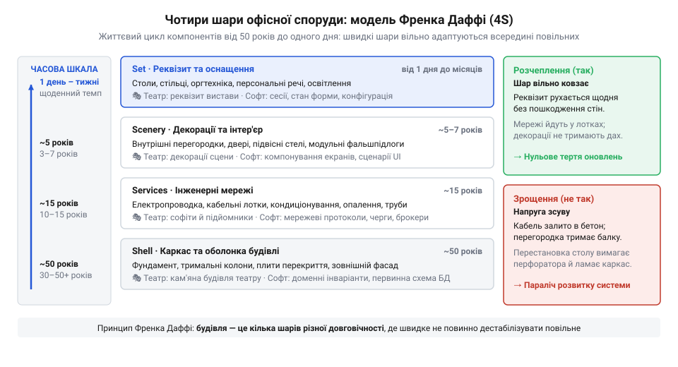
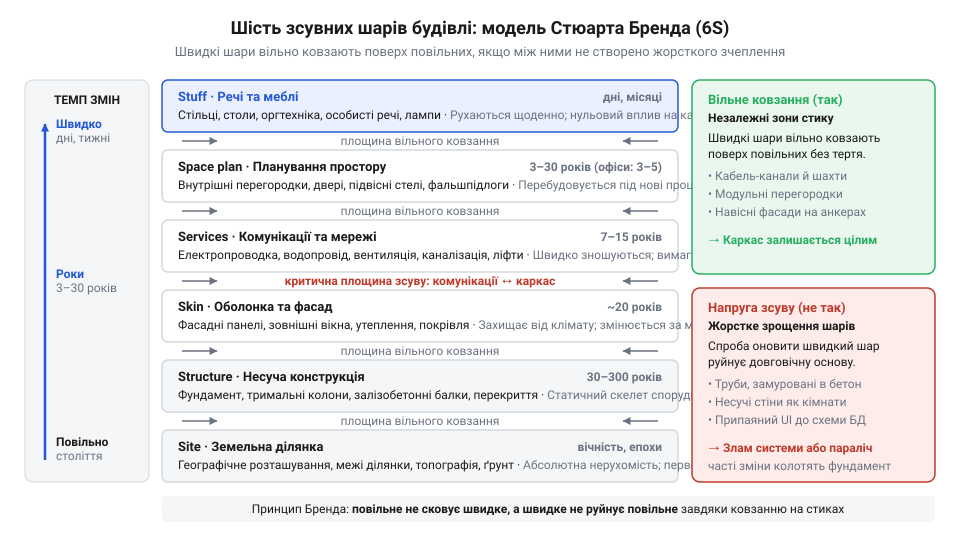
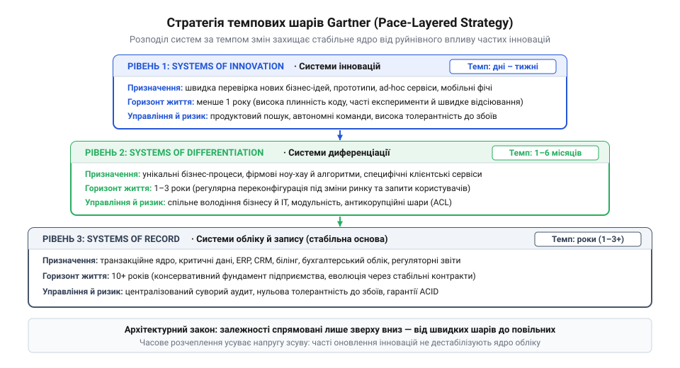
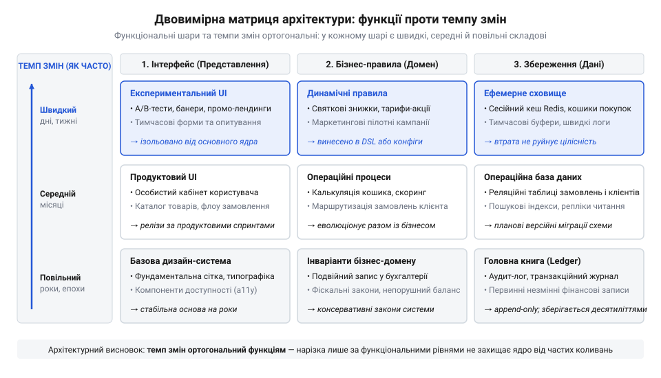

# Різні частини — різні годинники

## Пастка монолітного життєвого циклу та напруга зсуву

Уявіть величну банківську споруду кінця XIX століття або промисловий адміністративний корпус середини XX століття. Проєктувальники заклали в неї метрової товщини цегляні стіни, важкі залізобетонні склепіння й монументальні гранітні сходи. Будівлю конструювали як неподільний моноліт із єдиним очікуваним строком служби — на століття бездоганної експлуатації. Але минає два десятиліття, настає епоха масової телефонізації, згодом з'являються централізовані системи вентиляції та кондиціонування, а ще за двадцять років — кабельні комп'ютерні мережі й сервери. І тут починається катастрофа.

Щоби прокласти мідні дроти чи повітропроводи, інженери змушені відбійними молотками довбати капітальні несні стіни, послаблюючи опорні конструкції будівлі. Аби змінити конфігурацію тісних кабінетів на відкритий робочий простір, доводиться ламати перекриття. Елементи, які природно вимагають оновлення кожні п'ять-десять років, виявилися намертво замоноліченими всередині фундаменту, розрахованого на сотню літ. Будь-яка спроба пристосувати таку споруду до нових вимог мешканців або вимагає гігантських витрат і загрожує аварійним обвалом, або завершується знесенням цілком міцного будинку, який виявився фатально непридатним до змін.

У фізичній механіці це явище має точну наукову назву: **напруга зсуву** (англ. @@en|shear stress@@; від давньоангл. *sceran* — різати, відокремлювати; лат. *stringere* — стискати, стягувати). Це механічна напруга, що виникає в матеріалі вздовж площини контакту двох шарів, коли зовнішні сили намагаються змістити їх з різною швидкістю або в протилежних напрямках. Якщо між цими шарами немає ковзного з'єднання чи еластичного амортизатора, внутрішні сили зчеплення не витримують різниці рухів: матеріал тріскається, деформується і зрештою руйнується.

Точно така сама криза десятиліттями підстерігає архітектуру програмного забезпечення. Коли софтверну систему проєктують як статичну діаграму компонентів, вважаючи кожен модуль однаково постійним і довговічним, виникає невидиме конструктивне зрощення. Щойно бізнес вимагає переробити екранну форму або додати новий маркетинговий звіт, з'ясовується, що користувацький інтерфейс жорстко переплетений із реляційними таблицями ядра. База даних повинна зберігати фінансові транзакції роками й вимагає суворої консервативності, тоді як презентаційний шар має змінюватися щотижня. Оскільки шва розчеплення між ними немає, потреба частих змін на периферії породжує кодову напругу зсуву: розробники змушені постійно переписувати базові таблиці ядра, ламаючи збережені інваріанти й провокуючи аварійні збої.

> 🔧 **Навіщо це.**
> Розуміння природи напруги зсуву захищає архітектора від наївного статичного проєктування. Якщо жорстко спаяти компоненти з кардинально різними природними темпами змін, швидкі оновлення периферії неминуче розірвуть або спотворять повільний фундамент, паралізуючи подальший розвиток системи.

## Відкриття Френка Даффі: розшарування будівлі за темпом життя

У 1970-х роках британський архітектор Френк Даффі (англ. @@en|Frank Duffy@@), майбутній президент Королівського інституту британських архітекторів (RIBA) та співзасновник дослідницького бюро DEGW, зіткнувся з цією проблемою безпосередньо під час масштабного вивчення офісних центрів Великої Британії та США. Корпоративний світ стрімко перетворювався на інформаційний: реорганізації компаній відбувалися щороку, комп'ютерна периферія оновлювалася що кілька років, але офісні будівлі виявлялися зашкарублими кам'яними кайданами.

Досліджуючи реальну поведінку приміщень у часі, Даффі дійшов радикального висновку, який кинув виклик багатовіковій традиції сприйняття будівлі як завершеного монумента:
«Наш засадничий аргумент полягає в тому, що ніякої "будівлі" як єдиної незмінної сутності просто не існує. Будівля в адекватному розумінні — це кілька автономних шарів, що мають принципово різну тривалість життя».

Даффі запропонував розділити споруду на чотири функціонально-часові шари, що отримали назву моделі «4S»:

1. **Каркас** (англ. @@en|Shell@@; прагерм. *skaljo* — шкаралупа, мушля): тримальна конструкція будівлі — залізобетонні чи металеві колони, балки, перекриття та фундамент. Це найбільш повільний, капітальний шар споруди, чий життєвий цикл розраховується на півстоліття або століття.
2. **Інженерні мережі** (англ. @@en|Services@@; лат. *servitium* — служіння, допомога): комунікації, що забезпечують функціонування об'єкта — труби водопостачання й каналізації, електропроводка, шахти вентиляції, опалення, кабельні колектори та ліфтові підйомники. Їхній фізичний та моральний знос настає приблизно за п'ятнадцять років.
3. **Планування простору** (англ. @@en|Scenery@@, буквально «декорації»; грец. *skene* — поміст, намет): внутрішні некапітальні перегородки, двері, фальшпідлоги, гіпсокартонні екрани та підвісні стелі. Цей шар перекроюють відповідно до вимог нових відділів чи орендарів кожні п'ять-сім років.
4. **Речі та обстановка** (англ. @@en|Set@@; старофр. *sette* — розміщення, комплект): робочі столи, стільці, полиці, настільні світильники та дрібна оргтехніка. Їх пересувають або міняють щомісяця, щотижня, а іноді й щодня.

*Чотири функціонально-часові шари офісної споруди за Френком Даффі: розподіл компонентів будівлі за швидкістю змін від вікового каркаса до летких щоденних речей.*

Головний інженерний прорив Даффі полягав у принципі **просторової та монтажної незалежності**: будівля залишається живою й довговічною лише тоді, коли швидші шари не замуровані всередині повільних. Прокладання кабельних мереж під знімною фальшпідлогою або в навісних коробах замість бетонування в підлогу дозволяє замінити шар мереж (Services), не руйнуючи опорний каркас (Shell). Так само використання модульних розбірних перегородок дає змогу змінити планування (Scenery), не пошкоджуючи вентиляційні траси.

Ця логіка повністю дієва й для сучасних інженерних комплексів розумного житла: наприклад, в архітектурній платформі [Digital Homes](root:progarch/dh-tempo-map) силові реле керування живленням та комутаційні шини монтуються з розрахунком на десятиліття стабільної служби, тоді як віджети мобільного застосунку мешканця та призначені для користувача сценарії комфорту зазнають модифікацій хоч щотижня. Даффі довів, що успіх архітектурного рішення вимірюється не монолітною незворушністю форми, а свободою взаємного руху складових частин, кожна з яких цокає за власним часовим годинником.

## Модель шести шарів Стюарта Бренда та закон зсуву

У 1994 році американський культуролог, винахідник і засновник легендарного видання «Whole Earth Catalog» Стюарт Бренд (англ. @@en|Stewart Brand@@) опублікував книжку, якій судилося змінити не лише теорію містобудування, а й методологію комп'ютерних наук: «How Buildings Learn: What Happens After They're Built» («Як будівлі вчаться: що відбувається після того, як їх звели»). Надихнувшись ідеями Френка Даффі, Бренд пішов значно далі: він узагальнив спостереження за офісними центрами у фундаментальну філософію еволюції складних штучних систем.

Бренд зауважив, що чотирьох категорій Даффі замало для опису повної динаміки споруди. Він виділив у самостійні виміри нерухому основу будинку — географічну ділянку — та зовнішню захисну оболонку, що протистоїть клімату. Так народилася канонічна модель «шести S» (англ. @@en|6S framework@@), яка ранжує складові простору за швидкістю їхнього природного оновлення:

1. **Ділянка** (англ. @@en|Site@@; лат. *situs* — розташування, місцевість): конкретна точка на карті, рельєф ґрунту та юридичні межі власності. Це найбільш незмінний рівень: його життєвий цикл вимірюється століттями, змінами поколінь або геологічними епохами. Будівлі приходять і руйнуються, але ділянка залишається вічною.
2. **Каркас** (англ. @@en|Structure@@; лат. *structura* — споруда, від *struere* — зводити, складати): фундамент, залізобетонні палі, несні колони, сталеві балки та опорні перекриття. Строк експлуатації каркаса становить від 30 до 300 років. Вносити зміни в цей шар смертельно небезпечно й колосально дорого, тому він слугує незрушним консервативним якорем усього комплексу.
3. **Оболонка** (англ. @@en|Skin@@; прагерм. *skinna* — шкура, хутро): фасадні панелі, зовнішня цегляна кладка, віконні блоки та покрівля. Оболонка приймає на себе вивітрювання, дощі, перепади температур і змінюється кожні 20–30 років заради енергозбереження, відновлення герметичності чи оновлення естетичного вигляду.
4. **Інженерні мережі** (англ. @@en|Services@@): кровоносна й нервова система будівлі — електрична проводка, труби опалення та водопостачання, вентиляційні канали, газопроводи, ліфти й комунікаційні шахти. Їхній нормативний ресурс вичерпується за 7–15 років унаслідок технічного зносу або появи нових технологічних стандартів.
5. **Планування простору** (англ. @@en|Space plan@@): внутрішнє некапітальне розмежування — гіпсокартонні перегородки, міжкімнатні двері, покриття підлоги й підвісні стелі. У комерційних офісах зміна планування відбувається кожні 3–5 років під час ротації команд чи зміни орендарів, а в житлових будинках — раз на 20–30 років під час капітального перепланування.
6. **Речі** (англ. @@en|Stuff@@; старофр. *estoffe* — матеріал, спорядження): меблі, комп'ютерна техніка, телефони, настільні світильники, картини та посуд. Це максимально рухливий світ, чиї елементи мігрують щомісяця, щотижня чи щодня за примхою мешканців.

*Шість зсувних шарів Стюарта Бренда: від повільної стабільності ділянки й каркаса до стрімкої волатильності речей і внутрішнього планування.*

Саме Бренд запровадив в інженерний обіг метафоричний термін **«зсувні шари»** (англ. @@en|shearing layers@@), запозичивши фізичне поняття зсуву з механіки матеріалів і геології тектонічних плит. Він сформулював фундаментальну закономірність функціонування будь-яких складових систем:
«Через принципово різну швидкість змін своїх компонентів будівля завжди перебуває в процесі саморозірвання».

За Брендом, довговічність і життєздатність системи народжуються не з її монолітності, а з діалектичної взаємодії протилежних темпів:
- **Повільне забезпечує тривкість і безперервність**: масивні низові шари (Site, Structure) утримують форму, гарантують безпеку й захищають систему від руйнування під час зовнішніх бур.
- **Швидке забезпечує адаптацію та інновації**: леткі поверхневі шари (Space plan, Stuff) першими відчувають нові потреби мешканців, експериментують із формою й пристосовують середовище до мінливого світу.

Якщо між шарами немає еластичного ковзання — конструктивного зазору або спеціального розв'язувального шва, — швидкий шар під час кожного руху намагається зсунути повільний, руйнуючи точки кріплення. Майстерність архітектора полягає у створенні таких стиків, де швидкі елементи можуть вільно переміщатися, не розхитуючи капітальних конструкцій.

> 🔧 **Навіщо це.**
> Модель 6S дає чітку інженерну шкалу для зонування системи за темпом життя: від незмінних фундаментів до леткої периферії. У програмній інженерії це усуває спокусу звести всю систему до однорідного коду. Якщо компоненти з темпом змін у роки (схеми довгоживучих баз даних, доменні інваріанти) не відокремлені еластичними буферами від компонентів із тижневим темпом (екранні макети, експериментальні вебвіджети), система неминуче розриває власні зв'язки.

## Перехід аналогії в софт: порятунок від «великої купи багна»

Наприкінці 1990-х років індустрія розробки програмного забезпечення опинилася в центрі важкої архітектурної кризи. Об'єктно-орієнтована парадигма обіцяла легке повторне використання коду та елегантну модульність, але в реальних промислових проєктах складні системи швидко деградували. Незалежно від того, наскільки продуманою була початкова архітектура, за кілька років інтенсивних доробок вона неминуче перетворювалася на клубок некерованих взаємозалежностей, де зміна рядка в одному класі спричиняла лавину збоїв у протилежному кутку системи.

У 1997 році американські дослідники комп'ютерних наук та патернів проєктування Браєн Фут (англ. @@en|Brian Foote@@) і Джозеф Йодер (англ. @@en|Joseph Yoder@@) з Іллінойського університету в Урбана-Шампейн представили на конференції PLoP (англ. @@en|Pattern Languages of Programs@@; лат. *exemplar* — зразок) класичну статтю, що стала культовою: «Big Ball of Mud» («Велика купа багна»). Вони констатували факт, про який інженери воліли мовчати: найпоширенішим архітектурним патерном у світі є цілковита відсутність архітектури — аморфна маса коду, в якій порушено всі мислимі межі та абстракції.

Шукаючи першопричину того, чому програмні системи так фатально сповзають у стан «купи багна», Фут і Йодер звернулися до праці Стюарта Бренда про будівлі. Аналогія виявилася приголомшливо точною. У серії статей про зсувні шари в програмуванні дослідники прямо вказали: код гниє тому, що програмісти намагаються збудувати його як однорідний статичний моноліт, ігноруючи різницю життєвих циклів його частин.

У програмних системах діє той самий закон: різні частини коду змінюються з принципово різною швидкістю. Коли розробники жорстко зрощують у єдиних класах або модулях довгоживучі бізнес-правила (наприклад, розрахунок відсотків за кредитом чи облік кіловат-годин) зі швидкоплинними деталями користувацького інтерфейсу або мінливими форматами сторонніх API, у кодовій базі спалахує руйнівна напруга зсуву:
- Щоразу, коли дизайнери змінюють верстку головного екрана чи маркетологи додають новий формат відображення цін, інженери відкривають файли фундаментального ядра.
- Щоразу, коли постачальник зовнішнього сервісу змінює схему своїх відповідей, здригається стабільна база даних.

Швидкі зміни периферії б'ють по повільному ядру, змушуючи консервативну частину випускати позапланові аварійні релізи. Зрештою команда припиняє рефакторинг через страх зламати щось життєво важливе, і система остаточно застигає у формі «великої купи багна».

Фут і Йодер першими усвідомили, що порятунок лежить у свідомому проектуванні **софтверних зсувних шарів** (англ. @@en|shearing layers in software@@). Архітектура має бути розділена на компоненти не лише за функціональними обов'язками, а й за темпом їхньої природної еволюції:
1. **Повільний фундамент**: довгоживучі доменні сутності, транзакційні інваріанти та схеми збереження мають бути спроєктовані максимально консервативно, подібно до будівельного каркаса (Structure). Вони повинні мати мінімум залежностей і не знати нічого про те, хто саме їх викликає.
2. **Швидка периферія**: призначені для користувача інтерфейси, адаптери зовнішніх сервісів, сезонні акції та генератори звітів мають проектуватися як легкі знімні конструкції (Space plan, Stuff).
3. **Еластичні шви**: між ними мають існувати м'які трансляційні прошарки, поліморфні інтерфейси та брокери подій, які поглинають коливання швидких шарів і не пускають ударну хвилю змін усередину ядра.

> 🔧 **Навіщо це.**
> Робота Фута та Йодера розширила сенс архітектурного поділу: правильна межа між модулями — це межа між різними темпами змін. Якщо відділити рідко змінюване ядро від щотижневої метушні периферійних модулів еластичними інтерфейсами, розробники позбавляються страху перед частими релізами, а система отримує здатність жити й розвиватися десятиліттями без деградації в хаос.

## Корпоративна формалізація: темпова стратегія Gartner

На зламі 2000-х і 2010-х років криза узгодження темпів змін із площини академічних дискусій перемістилася в саме серце корпоративного бізнесу. Великі підприємства витрачали сотні мільйонів доларів на впровадження монолітних систем планування ресурсів підприємства — ERP (англ. @@en|Enterprise Resource Planning@@; лат. *planum* — рівень, план). Менеджмент сподівався створити єдину безшовну платформу, де бухгалтерський облік, виробничі лінії, логістика та продажі підпорядковувалися єдиній моделі даних. Проте на практиці цей ідеал обернувся технологічним паралічем.

Бізнес вимагав стрімких змін: відкриття мобільних каналів продажу, регулярних маркетингових експериментів та щотижневої інтеграції з новими партнерськими сервісами. Але щоразу, коли бізнес-підрозділи приходили до корпоративного ІТ-відділу із запитом на новий екран чи зміну форми заявки, відповідь була однаковою: очікування триватиме від року до півтора. Будь-яке мінімальне втручання в код монолітної системи вимагало регресійного тестування сотень пов'язаних процесів. Коли ж розробники намагалися піти на поступки й розгортали зміни поспіхом, траплялися катастрофи: аварійно зупинялося нарахування заробітної плати, викривлялася фінансова звітність або губилися податкові документи.

У 2012 році дослідницька компанія Gartner під керівництвом аналітиків Джима Даггана (англ. @@en|Jim Duggan@@) та Івонн Дженовезе (англ. @@en|Yvonne Genovese@@) запропонувала системний вихід із глухого кута. Прямо спираючись на концепцію зсувних шарів Стюарта Бренда, вони опублікували стратегію темпових шарів застосунків — **Pace-Layered Application Strategy** (англ. @@en|pace@@ від лат. *passus* — крок, темп ходи).

Gartner закликала припинити сприймати корпоративний софт як монолітний масив з єдиним темпом релізів і розділила програмний ландшафт підприємства на три фундаментальні темпові шари:

1. **Системи запису** (англ. @@en|Systems of Record@@): ядро корпоративного обліку, що фіксує критичні й юридично зобов'язуючі факти існування організації — головна бухгалтерська книга, транзакційні банківські реєстри, кадровий облік персоналу, медичні карти пацієнтів, складські залишки. Схема даних і бізнес-правила тут змінюються вкрай повільно — раз на кілька років або десятиліть. Будь-який збій чи втрата даних загрожує багатомільйонними збитками або втратою ліцензії, тому ці системи оновлюються консервативно, за суворими протоколами безпеки та у виділені вікна обслуговування.
2. **Системи диференціації** (англ. @@en|Systems of Differentiation@@; лат. *differentia* — різниця, відмінність): системи, які забезпечують унікальну бізнес-специфіку компанії та її конкурентну перевагу на ринку — власні алгоритми оцінки кредитоспроможності, унікальна логістика доставки, специфічні ланцюжки взаємодії з клієнтами (CRM). Їхній темп змін середній: конфігурація та правила оновлюються кожні кілька тижнів чи місяців відповідно до ринкових викликів, а середній життєвий цикл становить від одного до трьох років.
3. **Системи інновацій** (англ. @@en|Systems of Innovation@@; лат. *innovatio* — оновлення, від *novus* — новий): високодинамічні експериментальні додатки для швидкої перевірки продуктових гіпотез — мобільні застосунки мешканців, акційні вебвітрини, експериментальні чат-боти на базі штучного інтелекту, сервіси зворотного зв'язку. Їхній життєвий цикл — швидкі релізи щотижня чи щодня, а загальний строк існування може вимірюватися місяцями. Якщо гіпотеза не підтвердилася, таку систему ліквідують без жодного жалю, оскільки в неї не закладено капітальних витрат.

*Три темпові шари корпоративного софту за класифікацією Gartner: розведення систем за швидкістю змін, рівнем ризику та горизонтом планування.*

Головне досягнення концепції Gartner полягало в тому, що вона **зняла фальшиву вимогу технологічної та організаційної однорідності**. До цього корпоративні лідери вимагали застосування єдиного підходу до всього портфеля: або надважкий регламентований водоспадний процес для кожного скрипту, або наївні спроби впровадити щотижневий Agile до транзакційного ядра. Gartner узаконила існування різних життєвих ритмів під одним дахом:
- Системи запису вимагають консервативного водоспадного планування, ретельних міграцій схем і бездоганної стабільності контрактів.
- Системи інновацій вимагають стрімкого ітеративного циклу розробки, свободи вибору сучасних технологічних стеків і права на швидку помилку.

Єдине непорушне правило полягало в забороні жорсткого зачеплення: легкі системи інновацій у жодному разі не повинні звертатися до важких систем запису напряму. Між ними має бути прокладено асинхронні брокери повідомлень, шлюзи API та запобіжні шари, які гасять кінетичну енергію частих релізів периферії й оберігають консервативне ядро від перевантажень.

> 🔧 **Навіщо це.**
> Темпова стратегія Gartner дає мову порозуміння між інженерами та бізнес-керівництвом. Вона знімає з розробників докори в «повільності» під час підтримки фундаментальних баз даних і водночас позбавляє інноваційні команди необхідності проходити піврічні бюрократичні комітети заради запуску нового користувацького віджета.

## Спростування міфів: історія авторства та ортогональність шарів

У корпоративній культурі та презентаціях для технічного менеджменту концепцію темпових шарів зазвичай подають як ексклюзивний винахід аналітиків Gartner 2012 року. Проте в історії інженерної думки це класична ілюзія авторства: вдала маркетингова назва затьмарила сорокарічну передісторію концепції. Gartner не винайшла темпове розшарування з нуля — вона лише переклала на мову бюджетів і закупівель ідеї, які десятиліттями визрівали в роботах архітекторів-урбаністів та теоретиків програмування.

Справжній родовід концепції зсувних шарів має чітку послідовність інтелектуальної спадкоємності:
1. Британський архітектор Френк Даффі у 1970-х роках уперше відкрив, що будівля не є неподільним об'єктом, виділивши чотири шари з різними циклами оновлення.
2. Американський мислитель Стюарт Бренд у 1994 році узагальнив це відкриття до універсальної моделі шести шарів (6S) та сформулював закон механіки зсуву.
3. Дослідники Браєн Фут і Джозеф Йодер наприкінці 1990-х адаптували модель Бренда для софту як порятунок від деградації кодових баз у стан «купи багна».
4. Аналітики Gartner у 2012 році лише припасували цей фундамент до корпоративного портфеля enterprise-систем.

Набагато серйознішою інженерною помилкою сучасності є підміна понять: ототожнення темпових зсувних шарів із класичними технічними шарами абстракції. Коли інженер чує термін «шари», професійна інтуїція автоматично підказує знайомі патерни: тришарову архітектуру, чисту архітектуру (англ. @@en|Clean Architecture@@; лат. *architectura*), розділення на контролери, сервіси та репозиторії або мережеву модель OSI. Виникає оманливе заспокоєння: «Ми відокремили користувацький інтерфейс від бази даних, отже, наша система вже розшарована».

Це фундаментальна омана. Класичні рівні абстракції розрізають систему за **функціональними обов'язками** (англ. @@en|technical concerns@@; лат. *functio* — звершення, виконання): презентаційний рівень займається формуванням візуальних компонентів і протоколів зв'язку, доменний рівень виконує бізнес-правила, а рівень доступу до даних виконує команди збереження на диск. Натомість зсувні шари розрізають систему за **вектором часу** — за природною швидкістю змін, рівнем волатильності та горизонтом життя компонентів.

Ці дві осі є абсолютно ортогональними (взаємно перпендикулярними):
- Презентаційний шар інтерфейсу користувача не є обов'язково «швидким». Наприклад, у медичних апаратах штучної вентиляції легень або бортових комп'ютерах авіалайнерів користувацький інтерфейс проходить багатомісячні державні сертифікації й залишається незмінним протягом десятиліть — він функціонує в повільному темпі надійного каркаса.
- Рівень збереження даних не є обов'язково «повільним». Поряд із фундаментальними транзакційними реєстрами рахунків у сховищах існують таблиці сесійних кешів або тимчасові документи A/B-тестування, чия структура кардинально переписується щотижня.

*Двовимірна матриця архітектури: функціональні шари (обов'язки компонентів) та темпові шари (швидкість змін і строк життя) існують у взаємно перпендикулярних площинах.*

Як наочно показує координатна матриця, кожен темповий шар (Systems of Record, Differentiation, Innovation) усередині себе має власний повний набір функціональних рівнів: власне представлення, власну логіку та власні механізми збереження. Головна лінія архітектурної напруги та ризику зсуву проходить не між призначеним для користувача інтерфейсом і базою даних, а саме вздовж межі між різними темпами життя систем.

Концепція зсувних шарів здійснила вирішальний поворот у свідомості архітекторів: від наївних спроб збудувати незмінну систему до проектування середовища, яке вміє адаптуватися. Довговічність системи вимірюється не товщиною її монолітних стін, а точністю побудови еластичних стиків, які дозволяють швидким частинам стрімко розвиватися, не розхитуючи повільного консервативного фундаменту.

> 🔧 **Навіщо це.**
> Розуміння ортогональності функцій і темпів змін захищає архітектора від помилкового відчуття безпеки. Розбиття програми на шари контролерів і репозиторіїв не врятує проект від ентропії, якщо всі вони жорстко зв'язані й оновлюються в єдиному релізі. Архітектурна дисципліна вимагає проєктувати систему у двох вимірах водночас: по вертикалі — за обов'язками, а по горизонталі — за природним темпом змін.
