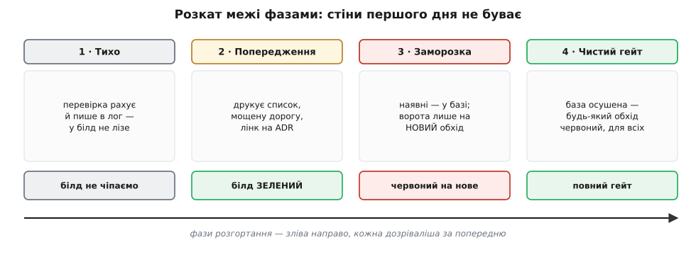
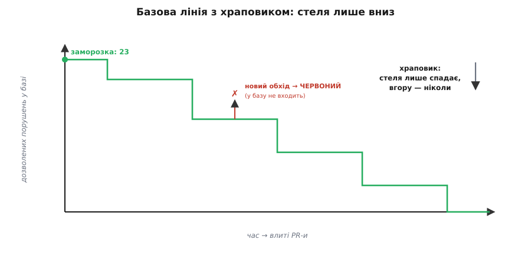

# ⚙️ Фітнес-функція, яку не зненавидять

Двадцять рядків, що валять білд, коли якийсь файл поза адаптером `storage/` тягне драйвер Postgres, уже написані. Вони працюють: обхід ловиться, збірка червоніє, політика виїхала з голови в машину. Здавалося б, готово.

Та між «перевірка працює» і «команда з нею живе» — прірва, ширша за сам код. Червоний білд не знає дипломатії. Він не чув, як ти вислуховував панель-сквад, не бачив, як мостив дорогу. Він просто одного ранку падає їм на голову — і якщо зробити це необережно, машина завдасть рівно тієї образи, від якої ти всю дорогу тікав: образи на наказ, тільки тепер наказ безликий, і його навіть не переспориш. Перевірка, яку зненавиділи, живе до першого «а вимкнімо її, вона заважає» — і по тому межа знову тримається лише на тобі.

Тож задача цього розбору не «написати перевірку»: це вже зроблено. Задача — **розгорнути її так, щоб її не вимкнули**. Спершу доведемо ті двадцять рядків до чесного робочого стану, а тоді — головне — впровадимо їх, як дипломат, а не як поліцай. Сама перевірка тут — [фітнес-функція](root:sf-apps/fitness-functions): автоматичний тест, що міряє код не за поведінкою, а за **архітектурною** властивістю й тримає його в межах.

## Від «працює на моїй машині» до «тримає в чужих руках»

Наївна перевірка зі статті має три діри, і кожну команда знайде швидше за тебе.

**Перша — хибні спрацьовування.** Шукатимеш підрядок `pg` — перевірка спіткнеться об `pg-format`, об `imgPage`, об слово «Postgres» у коментарі. Кожне таке фальшиве «порушення» — це розробник, що згаяв пів години на неіснуючу проблему й тихо занотував: «ця штука бреше». Дві-три такі зустрічі — і довіри нема; а перевірку, якій не вірять, скоро закоментують. Отже, ловити треба не підрядок, а **справжній імпорт**: рядок виду `from "pg"` з лапками, `import psycopg` на початку рядка. Якір на синтаксис імпорту відсіює і коментарі, і сусідні пакети з тим самим коренем у назві.

**Друга — територія, що не наша.** Міграції БД **мусять** говорити з базою напряму — це їхня робота. Тестові фікстури, згенерований код, приклади в доках — теж законні винятки. Без ігнор-списку перевірка чіпляється до них і знову бреше. Тому **ігнор-список** — не поблажка, а частина визначення правила: він каже, чого межа свідомо **не** стереже.

**Третя, найважливіша — повідомлення.** Наївна версія друкує список винних, і крапка. Але повідомлення про помилку — це єдина мить, коли перевірка **говорить із людиною**, ще й майже завжди з людиною роздратованою: у неї щойно впав білд. Скажеш у цю мить лише «не можна» — відтворив наказ. Покажеш **мощену дорогу** («ходи через `TelemetryStore.energyByPeriod()`») і **чому** її вимощено — коротке посилання на [ADR](root:sf-apps/architecture-decision-records), де записано рішення разом із причиною, — і той самий червоний білд перестає бути доганою, стає підказкою. Повідомлення несе не заборону, а вихід.

Зберемо три латки в одну перевірку. Логіка та сама, що в статті, двома мовами — вона однаково лягає і на TS, і на Python.

:::tabs
:::code proj-arch-fitness-gate/ts/vid-pratsiuie-na-moii.ts
:::code proj-arch-fitness-gate/py/vid-pratsiuie-na-moii.py
:::

Уже це — чесна перевірка: точна, з винятками, з людяним повідомленням і з перемикачем `ARCH_MODE`, до якого ми повернемося за хвилину. Але якщо ти ввімкнеш її **гейтом** просто зараз, станеться катастрофа.

## Не пиши сам те, що вже написали за тебе

Перш ніж іти далі — чесна зупинка. Обхід дерева регуляркою добрий, щоб **зрозуміти** механізм, і годиться для однієї вузької межі. Та регулярка не бачить справжнього графа залежностей: транзитивний імпорт (файл тягне `db.ts`, а той уже тягне `pg`) вона проґавить, а на хитрому рядку — спіткнеться. Для серйозної межі є інструменти, що будують **справжній** граф модулів і тому не дають ні фальшивих спрацьовувань від коментарів, ні дір на транзиті.

У світі JS/TS це насамперед **dependency-cruiser** — валідатор залежностей, де правило описуєш декларативно: звідки й куди імпорт заборонено. Те саме правило межі виглядає так:

:::code proj-arch-fitness-gate/js/index.js

Поле `severity` тут — уже половина нашої дипломатії: `warn` друкує зауваження, але **не валить** збірку; `error` валить. Поруч живе **eslint-plugin-boundaries** — той працює на рівні редактора, підсвічуючи перетин межі просто під час набору, ще до коміту; він мислить «типами елементів» (`storage`, `domain`, `ui`) і правилами, хто кого сміє імпортувати. А в екосистемі JVM канон — **ArchUnit**, бібліотека, де архітектурне правило пишеться звичайним Java-тестом:

```java
// одне правило межі, звичайним тестом
ArchRule dbDriverOnlyInStorage =
    noClasses().that().resideOutsideOfPackage("..storage..")
        .should().dependOnClassesThat().resideInAPackage("org.postgresql..")
        .because("драйвер БД тримаємо за TelemetryStore — ADR-0007");
```

Мораль проста: **межу, яку варто стерегти, стережи готовим інструментом**, а не саморобною регуляркою. Ручний скрипт лиши для випадку, який жоден інструмент не покриває, — і навіть тоді пиши його так само дбайливо, як вище. Але хоч би чим ти ловив порушення — регуляркою чи ArchUnit, — лишається те, чого **жоден інструмент не зробить за тебе**: акуратно ввести перевірку в живу команду. Ось де починається справжня робота.

## Головне: як увімкнути це без бійки

Уяви найгірше. Ти пишеш перевірку в п'ятницю, ставиш її гейтом, мерджиш у понеділок вранці. Команда приходить — і **весь білд червоний**. Не через новий код: перевірка знайшла двадцять три старі порушення, що мирно жили в кодовій базі роками. Ніхто з них рядка не написав за вихідні, а працювати вже не можуть, поки хтось не розгребе чужу історію. Що вони відчують? Рівно те, що відчували б від самодурного наказу: хтось згори одноосібно вирішив і зробив їм боляче. Ти щойно машиною відтворив образу, якої чотири важелі впливу мали уникнути. Це і є **червона стіна першого дня** — найпевніший спосіб зробити так, щоб гарну перевірку зненавиділи ще до того, як вона принесе бодай грам користі.

Ліки — розгортати перевірку **фазами**, де перші кроки взагалі нічого не ламають. Ідея одна: спершу нехай межа **говорить**, і лише коли команда звикла до її голосу — нехай **зупиняє**.


*Ті самі ворота, введені за чотири фази. Перші дві білд не червонять узагалі; третя червоніє **лише на новий** обхід, лишаючи старі порушення дозрівати в базі; і тільки коли база осушена, гейт стає чистим для всіх. Жодна фаза не влаштовує стіни першого дня.*

**Фаза 1 — тихо.** Перевірка ганяється в CI, рахує порушення й пише число в лог, але у висновок білда не втручається взагалі. Ти просто дивишся, скільки їх насправді (двадцять три — цифра, яку до заміру ніхто не знав) і **де** вони. Заразом ловиш власні хибні спрацьовування на реальному коді, доки вони нікому не заважають. Це розвідка, не оборона.

**Фаза 2 — попередження.** Тепер перевірка друкує на кожен обхід той самий людяний блок — список, мощену дорогу, лінк на ADR, — але білд **лишається зеленим** (`ARCH_MODE=warn`, `severity: "warn"`). Головне тут — **публічне «чому»**: не тихцем увімкнути, а сказати команді вголос, у спільному каналі: «з понеділка з'явиться ось таке попередження, ось рішення й його причина в ADR, поки що нічого не ламається». Люди бачать межу заздалегідь, звикають до її повідомлення й — головне — розуміють, що це не пастка. Наказ приходить раптово; порада приходить оголошеною.

**Фаза 3 — заморозка й ворота на нове.** Аж тепер перевірка починає **валити** білд — але хитро. Ми робимо знімок усіх наявних порушень і кладемо його в **базову лінію** (`baseline`, вона ж allowlist): «оці двадцять три — відомі, вони не червонять білд». Далі гейт спрацьовує **лише на те, чого в базі немає** — на **новий** обхід. Стара кодова база лишається зеленою; ніхто не мусить у понеділок розгрібати чуже. А новий обхід просто не пройде рев'ю — і саме тоді, коли автор ще пам'ятає, навіщо його писав, і поруч у повідомленні лежить мощена дорога.

**Фаза 4 — чистий гейт.** Базу поступово осушують (про темп — нижче), і коли в ній нуль, будь-яке порушення — старе чи нове — червонить білд однаково. Тепер межа стоїть повна, і стала вона такою **без жодної стіни першого дня**.

Ось код фази 3 — базова лінія з храповиком. Він доростає до `offenders()` з попереднього блоку.

:::tabs
:::code proj-arch-fitness-gate/ts/holovne-iak-uvimknuty-tse.ts
:::code proj-arch-fitness-gate/py/holovne-iak-uvimknuty-tse.py
:::

Два рухи роблять усю магію. Перший: **на першому запуску база = всі наявні порушення**, тож `fresh` порожній і білд зелений — стіни першого дня фізично не може бути. Другий, тонший: **храповик** *(він же заскочник, розм. «тріскачка»: зубчасте колесо із заскочкою — вільно йде в один бік і намертво стопориться у зворотний)*. Щойно хтось полагодив старе порушення, воно зникає з `found`, `survived` коротшає — і ми **перезаписуємо базу коротшим списком**. Тепер це порушення в базі не значиться; якщо його спробують повернути, воно вже `fresh` — і білд червоніє. База — стеля дозволеного — вміє лише спадати. Назад ходу нема.


*Скільки порушень база дозволяє з часом. Заморозили на двадцяти трьох; кожне полагоджене старе опускає стелю на сходинку, і вгору вона не вертається. Новий обхід, що пробує підняти лік понад стелю, відскакує червоним білдом і в базу не потрапляє — тому лінія лише вниз.*

Формально інваріант простий — три множини на кожен запуск `t`:

```
база(t)   = база(t−1) ∩ порушення(t)     // зникле з коду випадає з бази назавжди
нове(t)   = порушення(t) \ база(t−1)      // чого в базі не було
білд(t)   = ЧЕРВОНИЙ,  якщо нове(t) ≠ ∅
            ЗЕЛЕНИЙ,   інакше

|база(t)| ≤ |база(t−1)|                    // храповик: стеля лише не зростає
```

> 🔧 **Навіщо це.** Базова лінія з храповиком розв'язує головну суперечність будь-якого нового правила: старий код йому не відповідає, а зламати роботу команди в понеділок не можна. Заморозка каже «з минулим розберемося без паніки», храповик — «але назад дороги нема». Разом вони перетворюють неможливе «полагодьте все негайно» на спокійне «нове — за правилом, старе — коли руки дійдуть». І — ключове — ти не мусиш вибивати цей компроміс щоразу в перемовинах: його тримає механізм. Саме тому три інструменти вище везуть цю логіку в комплекті: ArchUnit — як `FreezingArchRule`, що на першому запуску складає порушення в сховище й далі валить лише на нових; dependency-cruiser — як базу відомих порушень (`--ignore-known`). Ти рідко пишеш храповик руками — але мусиш **розуміти**, що всередині, бо саме він робить перевірку соціально можливою.

**І остання, найважливіша деталь: перевірка однакова для всіх, тебе включно.** Жодного `// arch-ignore`, який дозволено ставити «тільки архітекторові». Жодного винятку для твоєї гілки. Твій власний PR червоніє точнісінько так само, як чужий. Це не формальність — це весь сенс. Хвилину тому авторитет тримався на твоїй посаді; тепер він у механізмі, безособовому й однаковому. Та щойно з'явиться лазівка, якою користуєшся лише ти, авторитет умить **вертається в людину** — і то в найгіршому вигляді, бо тепер видно, що правило не для всіх. Мощена дорога, якою тобі можна не йти, — то знову звичайний наказ, лише прикрашений машиною.

## Пастки

Тепер, коли перевірка стоїть, її ще легко занапастити. Найгучніший спосіб — **хибні спрацьовування**. Раз збрехавши, перевірка щоразу докладає до рахунку недовіри; кілька фальшивих червоних білдів — і команда не полагодить її, а **вимкне**, бо простіше жити без брехливого сторожа, ніж із ним. Тому точність — не естетика, а виживання: краще зрідка **проґавити** справжнє порушення, ніж часто зчиняти галас на порожньому місці. Хибний спокій пробачають; хибну тривогу — ні.

Друга пастка тихіша й підступніша — **база, що не осушується**. Заморозити двадцять три порушення легко; забути про них — ще легше. Мине рік, база так і стоїть на двадцяти трьох, і ти вже не поставив межу, а **узаконив безлад**: у коді офіційно живуть двадцять три дозволені обходи. Це прямий шлях до **[розбитих вікон](root:sf-apps/technical-debt)** — коли видима, дозволена нечупарність каже кожному: тут так можна. Храповик гарантує, що стеля не росте, але **сам стелю не опускає** — опускають люди. Тому базу треба тримати на очах: її розмір — у дашборді, тренд — на рев'ю, і невеликий сталий бюджет на «мінус одне порушення за спринт». Найкраще, коли храповик клацає сам собою — бо люди й так проходять повз ці файли й принагідно чистять; та якщо лік місяцями стоїть, це сигнал, що правило перестали вважати за живе.

Третя — **надто галаслива перевірка**. Якщо вона повільна, миготлива (то падає, то ні на тому самому коді) або сипле десятком повідомлень там, де досить одного, — її сприймуть як шум, а шум глушать. Швидко, детерміновано, одне ясне повідомлення на проблему — не розкіш, а умова, щоб перевірку взагалі слухали. Перевірка, яку навчилися ігнорувати, гірша за відсутню: вона створює **оману** захищеної межі там, де межі вже нема.

І остання, вже названа, але варта повтору, бо ламає все одразу: **лазівка не для всіх**. Тільки-но перевірку можна обійти комусь одному — прапорцем, винятком, «ну то я вручну змерджу», — вона перестає бути безособовим механізмом і знову стає чиєюсь волею. А воля, прикрита машиною, дратує сильніше за відкритий наказ, бо вдає справедливість, якої не має.

Збери все докупи — і побачиш, що ці двадцять рядків несуть у собі всі чотири важелі впливу, спресовані у файл. Точне повідомлення з мощеною дорогою — це «зрозумій і зроби правильне легким». Фазовий розкат і заморозка — це «говори їхньою валютою»: не ламай людям понеділок. Однакове для всіх правило в CI — це «хай авторитет несе механізм, а не ти». Але спрацьовує ця машинерія лише тоді, коли вкотити її по-дипломатичному — оголошено, поетапно, без стіни першого дня й без лазівки для себе. Перевірка, впроваджена як наказ, збирає всю ненависть наказу. Та сама перевірка, впроваджена як порада, тримає межу роками — і ніхто вже й не згадає, що колись про неї треба було домовлятися.
