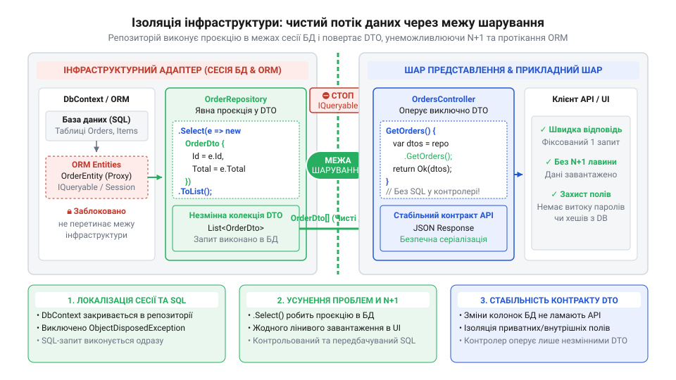

# Протікання шару

<preknowlist>
- [Ціна мапінгу між шарами](root:progarch/cost-of-layer-mapping) — Розуміння стратегії ізоляції зовнішнього периметра (Boundary-Only Mapping), вразливості масового призначення (over-posting) та принципу прямих проєкцій для операцій читання.
- [Шар, що лише передає далі](root:progarch/pass-through-layer) — Розуміння відмінності між марним транзитним кодом і захисним бар'єром адаптера, який утримує транзакційну межу й захищає ядро від витоку деталей збереження.
</preknowlist>

## Вхідна аварія: невидима лавина SQL-запитів та раптовий ObjectDisposedException у веб-контролері

У системі керування розумним будинком Digital Homes сервіс моніторингу клімату відповідає за збір даних із сотень приміщень: температури, вологості та стану підключених датчиків. На етапі розробки та локального тестування все працює бездоганно. Розробник виконує HTTP-запит `GET /api/leaky/rooms`, отримує охайний JSON із двома кімнатами та кількома сенсорами, а час відповіді вимірюється кількома мілісекундами. Проте після розгортання в продакшені, де кількість приміщень сягає тисяч, а навантаження вимірюється сотнями запитів на секунду, веб-сервер раптово деградує: час відповіді зростає до десятків секунд, пули з'єднань із базою даних вичерпуються, а в логах з'являється лавина помилок.

Причина цієї аварії криється в невидимому витоку деталей інфраструктурного фреймворку Object-Relational Mapping (ORM, об'єктно-реляційне відображення, від лат. @@en|relatio@@ — відношення) крізь межі веб-контролера. Замість того щоб повернути повністю зчитану колекцію об'єктів або готових контрактів даних, веб-метод віддає зовні інтерфейс `IQueryable<RoomEntity>`.

:::code proj-refactoring-leaky-orm-boundary/c-/Entities/RoomEntities.cs 1-32

Для реалізації лінивого завантаження (англ. @@en|Lazy Loading@@) фреймворк Entity Framework Core вимагає позначити навігаційну властивість `Devices` ключовим словом `virtual`. Це дозволяє ORM згенерувати під час виконання динамічний проксі-клас (англ. @@en|proxy@@, від лат. @@en|procurator@@ — представник), який перехоплює кожне звернення до властивості `Devices`.

Коли веб-контролер `LeakyRoomsController` викликає `_context.Rooms`, SQL-запит до бази даних ще навіть не надсилається. Виконання контролера завершується за частки мілісекунди, і об'єкт `IQueryable` передається далі в конвеєр ASP.NET Core — безпосередньо серіалізатору JSON (англ. @@en|serialization@@, від лат. @@en|series@@ — ряд).

:::code proj-refactoring-leaky-orm-boundary/c-/Controllers/LeakyRoomsController.cs 1-37

Серіалізатор починає ітеруватися по списках кімнат і для кожного об'єкта `RoomEntity` читає його властивості. Як тільки серіалізатор звертається до геттера `room.Devices`, динамічний проксі ORM виявляє, що колекція пристроїв ще не завантажена в пам'ять. Проксі неявно відкриває мережеве з'єднання та виконує окремий SQL-запит вигляду `SELECT ... FROM Devices WHERE RoomId = @p`.

Якщо в базі даних зберігається 500 кімнат, система виконує 1 первинний запит для вибірки списку кімнат, а потім ще 500 окремих послідовних SQL-запитів для вибірки пристроїв кожної кімнати. Це класична катастрофічна проблема N+1 (англ. @@en|N+1 query problem@@). Замість одного ефективного запиту з об'єднанням таблиць (`JOIN`) база даних бомбардується сотнями дрібних мережевих викликів.


*Прихований витік деталей ORM через межу контролера: серіалізатор неявно виконує SQL-запити під час передачі HTTP-відповіді.*

Однак лавина SQL-запитів — лише перша частина катастрофи. Другий фатальний симптом проявляється під час зміни конфігурації життєвого циклу контексту бази даних.

:::code proj-refactoring-leaky-orm-boundary/c-/Persistence/AppDbContext.cs 1-41

:::code proj-refactoring-leaky-orm-boundary/c-/Program.cs 17-23

У налаштуваннях контейнера впровадження залежностей (англ. @@en|Dependency Injection@@) контекст `AppDbContext` зареєстрований із життєвим циклом `Scoped` — тобто один екземпляр на один HTTP-запит. Коли контролер повертає `IQueryable` або сутність `RoomEntity`, виконання самого методу контролера завершується, і конвеєр може закрити область видимості (англ. @@en|scope@@) або вивільнити сесію бази даних.

Коли JSON-серіалізатор намагається зчитати ліниву властивість `room.Devices` вже після того, як сесію `AppDbContext` було закрито або вивільнено (англ. @@en|disposed@@), ORM-проксі викидає критичний виняток `ObjectDisposedException`: `Cannot access a disposed context instance`. Причому ця аварія відбувається не всередині коду розробника, а глибоко в надрах веб-сервера під час формування HTTP-відповіді, перетворюючи звичайну помилку читання на непередбачуваний збій з кодом 500 Internal Server Error.

> 🔧 **Навіщо це.**
> Виявлення витоку ORM-сутностей та `IQueryable` за межі інфраструктурного шару дозволяє попередити непомітне вичерпання пулу з'єднань БД, ліквідувати приховану лавину запитів N+1 та усунути раптові аварії `ObjectDisposedException` у продакшені.

## Анатомія витоку: як IQueryable та ліниве завантаження підривають інкапсуляцію шарів

Щоб зрозуміти, чому повернення `IQueryable` спричиняє руйнування архітектурних меж, необхідно розібрати внутрішній механізм роботи цього інтерфейсу.

Всупереч поширеній омані, `IQueryable<T>` не є колекцією об'єктів у пам'яті комп'ютера. Це об'єктний вираз-будівельник SQL-запитів, який зберігає дерево виразів (англ. @@en|expression tree@@, `Expression<Func<T, bool>>`). Коли сервіс або репозиторій повертає `IQueryable`, він не віддає дані — він віддає інструкцію, як ці дані слід вибирати з бази, делегуючи момент і спосіб виконання запиту зовнішньому споживачу.

Коли веб-контролер отримує `IQueryable`, межа між прикладною логікою та базой даних стирається. Презентаційний шар (веб-контролер або навіть бібліотека серіалізації JSON) стає тим місцем, де формується і виконується SQL-запит.

Розглянемо три основні шляхи витоку деталей реалізації в антипатерні `LeakyRoomsController`:

:::code proj-refactoring-leaky-orm-boundary/c-/Controllers/LeakyRoomsController.cs 31-37

Перший витік полягає у відкладеному виконанні. Оскільки `_context.Rooms` повертає `IQueryable`, запит не матеріалізується всередині контролера. З'єднання з базой даних залишається відкритим доти, доки серіалізатор не завершить запис останнього байта HTTP-пакета. Будь-яка затримка мережі або збій у клієнта блокує потік і з'єднання з БД.

:::code proj-refactoring-leaky-orm-boundary/c-/Controllers/LeakyRoomsController.cs 44-56

Другий витік — прямий експорт ORM-сутності `RoomEntity`. Використання методів на зразок `Find(id)` повертає сутність, яка залишається прив'язаною до відстежувача змін (англ. @@en|Change Tracker@@) сесії ORM. Це створює жорстку залежність публічного контракту API від структури таблиць у БД:
1. Зміна назви колонки в таблиці миттєво ламає зовнішній HTTP API для всіх клієнтів.
2. Нові технічні або службові поля бази даних випадково потрапляють у публічну JSON-відповідь, створюючи витік приватних даних.
3. Звернення до навігаційних властивостей в оболонці сутності неявно викликає ліниві мережеві запити.

Важливо чітко розрізняти два типи обробки даних:
- **In-memory фільтрація** (у пам'яті): виконання делегатів C# над колекціями `IEnumerable<T>`, коли всі дані вже завантажені в оперативну пам'ять.
- **In-database трансляція** (у базі даних): перетворення дерева виразів `Expression<Func<T, bool>>` провайдером ORM у текст SQL-запиту, який виконується безпосередньо на сервері СКБД.

Коли `IQueryable` витікає у веб-шар, розробник може випадково написати у контролері виклик C#-методу, який ORM не здатна транслювати в SQL (наприклад, складне форматування дати або виклик локальної функції). Це призводить або до винятку `InvalidOperationException` під час спроби трансляції, або до неявного вичітування мільйонів рядків із бази в пам'ять сервера для локальної фільтрації (англ. @@en|client-side evaluation@@).

Третій витік — вразливість масового призначення (англ. @@en|Over-posting@@ або @@en|Mass Assignment@@), що виникає при прямій прив'язці сутностей у методах модифікації даних.

:::code proj-refactoring-leaky-orm-boundary/c-/Controllers/LeakyRoomsController.cs 62-80

Коли метод `UpdateClimate` приймає `RoomEntity payload` безпосередньо з тіла HTTP-запиту, зовнішній клієнт отримує можливість передати будь-які поля сутності. Зловмисник може надіслати підроблені ідентифікатори або модифікувати зв'язані пристрої, минаючи доменну валідацію. Крім того, прямий виклик `_context.SaveChanges()` у веб-контролері переносить управління транзакціями у шар представлення. Якщо запис ламається через обмеження унікальності або зовнішнього ключа, контролер замість коректної бізнес-помилки HTTP 400 повертає технічний стек викликів ORM.

Більше про наслідки відсутності мапінгу та правильне проєктування меж контрактів можна дізнатися у статті [ціна мапінгу між шарами](root:progarch/cost-of-layer-mapping). А про те, як правильно організувати бар'єр між адаптерами збереження та прикладним ядром, ідеться у матеріалі [шар, що лише передає далі](root:progarch/pass-through-layer).

> 🔧 **Навіщо це.**
> Заборона виходу `IQueryable` та ORM-сутностей за межі інфраструктурного адаптера відновлює інкапсуляцію шарів, гарантує виконання SQL-запитів суто всередині визначених меж та унеможливлює вразливості масового призначення.

## Крок 1: перекриття витоку запитів явними проєкціями та випереджальним завантаженням

Коли прикладний сервіс або веб-контролер повертає інтерфейс `IQueryable<T>`, межа між бізнес-логікою та персистентністю руйнується. Зовні це видається зручним розширенням: веб-шар може додати фільтрацію або сортування перед відправкою відповіді. Проте насправді відбуваються три руйнівні речі: виконання SQL-запиту відкладається до етапу серіалізації в JSON, сесія бази даних залишається відкритою за межами репозиторію, а будь-яка спроба прочитати зв'язану колекцію спричиняє неконтрольовану серію додаткових звернень до бази.

Розглянемо початковий стан сервісу моніторингу приміщень Digital Homes. У ньому доменні сутності містять навігаційні властивості з модифікатором `virtual`, що дозволяє ORM-фреймворку підключати динамічні проксі для лінивого завантаження (з англ. @@en|Lazy Loading@@ — ліниве завантаження):

:::code proj-refactoring-leaky-orm-boundary/c-/Entities/RoomEntities.cs 1-32

Контекст сесії Entity Framework Core реєструє ці сутності та налаштовує відношення між кімнатами та пристроями:

:::code proj-refactoring-leaky-orm-boundary/c-/Persistence/AppDbContext.cs 1-42

Контролер `LeakyRoomsController` отримує екземпляр `AppDbContext` напряму й повертає `IQueryable<RoomEntity>` безпосередньо з веб-екшна:

:::code proj-refactoring-leaky-orm-boundary/c-/Controllers/LeakyRoomsController.cs 1-37

У чому тут проблема? По-перше, виклик `_context.Rooms` не виконує жодного SQL-запиту всередині методу `GetRooms()`. Повернений `IQueryable` потрапляє у конвеєр ASP.NET Core, і запит до бази даних ініціюється лише тоді, коли JSON-серіалізатор починає ітерувати колекцію.

По-друге, оскільки в конфігурації додатка увімкнено проксі лінивого завантаження (`UseLazyLoadingProxies`), під час серіалізації кожної сутності `RoomEntity` серіалізатор звертається до властивості `Devices`. Це звернення перехоплюється проксі-об'єктом ORM, який послідовно виконує новий SQL-запит для кожної кімнати. Якщо система повертає N кімнат, база даних отримує 1 запит на список кімнат плюс N окремих запитів на їхні пристрої. Це класична проблема запитів N+1 (з англ. @@en|N+1 query problem@@).

> 🔧 **Навіщо це.**
> Ізоляція виконання запитів усередині репозиторію гарантує детерміновану продуктивність: код виклику точно знає, коли запит починається і завершується, скільки ресурсів він споживає і який обсяг даних повертає в пам'ять.

Якщо ж сесію `DbContext` буде закрито до того, як серіалізатор дійде до властивості `Devices`, додаток аварійно завершиться з помилкою `ObjectDisposedException`. Веб-шар не повинен управляти життєвим циклом підключення до бази чи тримати транзакційну сесію відкритою під час формування HTTP-пакета.

Перший крок рефакторингу полягає у повному вилученні `IQueryable` із публічного інтерфейсу персистентності та впровадженні детермінованих проєкцій.

Створимо контракт репозиторію `IRoomRepository`, який повертає лише примусово матеріалізовані незмінні колекції `IReadOnlyList`:

:::code proj-refactoring-leaky-orm-boundary/c-/Persistence/RoomRepository.cs 1-16

Для операцій читання реалізація `RoomRepository` застосовує пряму проєкцію через LINQ-метод `Select`. Цей підхід відсікає проблему N+1 і гарантує виконання єдиного SQL-запиту:

:::code proj-refactoring-leaky-orm-boundary/c-/Persistence/RoomRepository.cs 38-78

Зверніть увагу на два ключові інженерні рішення в цьому методі:
1. `AsNoTracking()` повідомляє ORM, що об'єкти не потрібно реєструвати в Change Tracker. Це звільняє пам'ять процесу та прискорює обробку результату.
2. `Select` транслюється Entity Framework у SQL-оператор `JOIN`, який вибирає лише потрібні поля кімнати та її пристроїв за один мережевий крок. Результуючі об'єкти матеріалізуються у пам'яті через `ToListAsync()` до того, як метод поверне керування.

Для сценаріїв зміни стану (команд модифікації) читання через `Select` не підходить, оскільки нам потрібна сама доменна сутність для перевірки інваріантів та збереження змін. У таких випадках репозиторій використовує явне випереджальне завантаження (з англ. @@en|Eager Loading@@ — випереджальне завантаження) через `.Include()`, проте при одночасному завантаженні кількох незалежних колекцій виникає ризик [декартового помноження в ORM-запитах](root:sf-data/sql-cartesian-explosion-in-orm):

:::code proj-refactoring-leaky-orm-boundary/c-/Persistence/RoomRepository.cs 84-115

Метод `UpdateClimateAsync` завантажує кімнату разом із пристроями за один запит, перевіряє межі допустимих значень клімату, оновлює сутність і викликає `SaveChangesAsync()` всередині межі сховища. Контекст сесії закривається до повернення керування у веб-контролер.

Конфігурація залежностей додатка в `Program.cs` реєструє репозиторій та заповнює базові дані:

:::code proj-refactoring-leaky-orm-boundary/c-/Program.cs 1-74

Завдяки цьому ми повністю ліквідували витік `IQueryable` та Lazy Loading. Усі запити до бази стали детермінованими, матеріалізованими та локалізованими всередині інфраструктурного адаптера.

## Крок 2: зведення зовнішнього периметра DTO та ізоляція від дрейфу схеми

Після перекриття витоку запитів система все ще зберігає суттєву архітектурну вразливість: веб-контролер продовжує оперувати доменними сутностями ORM. Подивимося на методи отримання та оновлення кімнати в початковому контролері:

:::code proj-refactoring-leaky-orm-boundary/c-/Controllers/LeakyRoomsController.cs 40-80

Пряме віддавання `RoomEntity` назовні створює тісне зчеплення між структурою таблиць бази даних і публічним HTTP-інтерфейсом. Якщо розробники додають до сутності внутрішнє поле (наприклад, службовий хеш стану або ключ безпеки), воно автоматично потрапляє у вихідний JSON-пакет. Будь-який дрейф схеми бази даних розриває сумісність із зовнішніми споживачами API.

Ще небезпечнішим є використання сутності БД у якості вхідного параметра методу оновлення `UpdateClimate(int id, [FromBody] RoomEntity payload)`. Це відкриває можливість для атак масового призначення (з англ. @@en|Over-posting@@ або @@en|Mass Assignment@@ — масове призначення). Зловмисник може передати в JSON додаткові поля, такі як `Id` або масив `Devices`, підміняючи внутрішній стан об'єкта в оминання бізнес-правил.

Крім того, виклики `_context.SaveChanges()` безпосередньо у контролері призводять до того, що будь-яке порушення обмежень цілісності бази даних повертає клієнту технічний виняток ORM із внутрішнім стеком викликів (HTTP 500) замість зрозумілої бізнес-помилки (HTTP 400).

Другий крок рефакторингу вибудовує непроникну межу з об'єктів передачі даних (з англ. @@en|Data Transfer Object@@, DTO).

Створимо окремий модуль контрактів `RoomDtos.cs`, що містить незмінні записи (records) для відповідей та вхідних команд:

:::code proj-refactoring-leaky-orm-boundary/c-/Contracts/RoomDtos.cs 1-33

Ці об'єкти виступають фіксованою публічною угодою:
- `RoomResponseDto` та `DeviceDto` містять лише ті поля, які необхідні клієнтам, і не мають жодних посилань на EF Core чи навігаційні властивості ORM. Докладніше про вибір рівнів ізоляції читайте у матеріалі [Ціна мапінгу між шарами](root:progarch/cost-of-layer-mapping).
- `UpdateRoomClimateCommand` обмежує вхідні дані лише двома цільовими показниками — температурою та вологістю. Всі інші поля сутності стають недоступними для зовнішньої модифікації.

Тепер створимо відрефакторений контролер `CleanRoomsController`, який працює виключно через абстракцію `IRoomRepository` та контракти DTO:

:::code proj-refactoring-leaky-orm-boundary/c-/Controllers/CleanRoomsController.cs 1-75

Зверніть увагу, як змінилася поведінка веб-шару:
1. Контролер більше не має жодної залежності від `AppDbContext` або моделей persistence-шару. Роль захисного бар'єра виконує репозиторій, детальніше розібраний у статті [Шар, що лише передає далі](root:progarch/pass-through-layer).
2. Метод `UpdateClimate` приймає типізовану команду `UpdateRoomClimateCommand`, виключаючи атаки over-posting.
3. Помилки валідації доменних інваріантів (`ArgumentOutOfRangeException`), що виникають при спробі встановити неприпустиму температуру чи вологість, перехоплюються і перетворюються на коректну HTTP-відповідь 400 Bad Request із повідомленням про помилку.

Архітектурний потік даних після проведення рефакторингу наведено на схемі:


*Схема ізольованої межі після рефакторингу: репозиторій виконує явну проєкцію всередині контексту бази даних і повертає незмінні DTO; веб-контролер оперує виключно вихідним контрактом, а контекст сесії та сутності ORM не перетинають інфраструктурний адаптер.*

> 🔧 **Навіщо це.**
> Чітке розмежування DTO та моделей персистентності гарантує, що рефакторинг бази даних чи зміна ORM-фреймворку не зачеплять публічний API-контракт, а бізнес-правила системи залишаться захищеними від несанкціонованого зовнішнього впливу.

Завдяки впровадженим крокам сервіс Digital Homes позбувся витоків `IQueryable`, прихованих запитів N+1 та загрози over-posting, отримавши стійку та передбачувану шарову архітектуру.

## Крок 3: інкапсуляція Unit of Work та локалізація життєвого циклу сесії

Навіть якщо операції читання було повністю очищено від витоків і переведено на прямолінійні проєкції та DTO, у системі нерідко залишається інша серйозна архітектурна вразливість — витік життєвого циклу сесії персистентності (від лат. @@en|persistere@@ — продовжувати існувати) та неконтрольоване керування транзакціями у веб-контролері.

У деградованій системі контролер напряму залежить від екземпляра контексту бази даних `AppDbContext` і самостійно керує фіксацією змін під час обробки модифікуючих HTTP-запитів:

:::code proj-refactoring-leaky-orm-boundary/c-/Controllers/LeakyRoomsController.cs 62-80

Зовні такий підхід здається лаконічним, але він породжує одразу кілька системних вад:

1. **Розмивання транзакційної межі:** Веб-контролер бере на себе роль координатора збереження, самостійно вирішуючи, в який момент викликати `_context.SaveChanges()`. Презентаційний шар (від англ. @@en|Presentation@@) починає відповідати за цілісність даних у базі.
2. **Витік низькорівневих ORM-винятків:** Якщо під час виклику `SaveChanges()` виникає помилка бази даних (наприклад, конфлікт паралельного доступу чи порушення обмеження зовнішнього ключа), контекст `EF Core` викидає технічний виняток `DbUpdateException`. Оскільки цей виняток не перехоплюється інфраструктурним адаптером, веб-сервер повертає клієнту неочищену помилку HTTP 500 із внутрішніми деталями таблиць СКБД.
3. **Неконтрольований життєвий цикл сесії:** Сесія з'єднання з базою даних залишається відкритою протягом усього оброблення HTTP-запиту. Якщо клієнтський код або серіалізатор звертається до об'єктів після закриття сесії, виникає аварія `ObjectDisposedException`.

Для розв'язання цієї проблеми застосовують паттерн Unit of Work (від англ. @@en|Unit of Work@@ — одиниця роботи). Його мета — об'єднати групу операцій над сховищем у єдину атомарну транзакцію та приховати механіку збереження за бізнес-абстракцією.

У фреймворку `EF Core` клас `DbContext` уже реалізує Unit of Work всередині себе. Проте, коли `DbContext` потрапляє безпосередньо у контролер, ця реалізація перестає бути інкапсульованою. Будь-який веб-метод отримує можливість прочитати одні сутності, модифікувати інші й довільно викликати збереження.

Справжня інкапсуляція вимагає, щоб Unit of Work та життєвий цикл сесії ORM були локалізовані всередині інфраструктурного сховища — репозиторію (від лат. @@en|repositorium@@ — сховище).

> 🔧 **Навіщо це.**
> Інкапсуляція Unit of Work та сесії ORM всередині репозиторію унеможливлює виклик операцій збереження чи транзакцій із веб-шару. Веб-контролер оперує суто бізнес-намірами, а репозиторій самостійно відповідає за відкриття, перевірку інваріантів, атомарну фіксацію та закриття сесії персистентності.

У відрефактореній версії сховища метод оновлення клімату приймає строго типізовану команду `UpdateRoomClimateCommand` і повністю інкапсулює роботу з сесією `AppDbContext`:

:::code proj-refactoring-leaky-orm-boundary/c-/Persistence/RoomRepository.cs 84-115

Розглянемо ключові інженерні рішення в цій реалізації:

- **Перевірка бізнес-інваріантів:** Перш ніж звертатися до бази даних, метод перевіряє допустимі межі температури й вологості. Порушення інваріанту (від лат. @@en|invarians@@ — незмінний) генерує чіткий виняток `ArgumentOutOfRangeException` ще до відкриття транзакції.
- **Випереджальне завантаження (Eager Loading):** Виклик `.Include(r => r.Devices)` явно вказує ORM завантажити пов'язані пристрої в одному SQL-запиті під час вибірки агрегату для оновлення, запобігаючи лінивим зверненням.
- **Атомарна фіксація та закритість сесії:** Метод `await _context.SaveChangesAsync(ct)` виконує транзакцію всередині репозиторію. Увесь життєвий цикл сесії починається і повністю завершується всередині цього асинхронного виклику.

Після такої інкапсуляції контролер `CleanRoomsController` повністю позбувається залежностей від ORM:

:::code proj-refactoring-leaky-orm-boundary/c-/Controllers/CleanRoomsController.cs 53-74

Контролер більше не знає про існування `EF Core` або `AppDbContext`. Якщо бізнес-валідація у сховищі не проходить, контролер перехоплює доменний виняток і повертає коректний HTTP 400 Bad Request, не розкриваючи внутрішніх деталей бази даних.

Для зв'язування компонентів у контейнері інверсії керування (від англ. @@en|IoC@@ — Inversion of Control) реєструється відповідна залежність:

:::code proj-refactoring-leaky-orm-boundary/c-/Program.cs 25-27

Контролер залежить виключно від абстрактного інтерфейсу `IRoomRepository`. Як детально пояснювалося у матеріалі [Шар, що лише передає далі](root:progarch/pass-through-layer), репозиторій у цій схемі — це не марний проміжний код, а захисний адаптер інфраструктури, який тримає транзакційну межу. У поєднанні з принципами з матеріалу [Ціна мапінгу між шарами](root:progarch/cost-of-layer-mapping) це дає повністю ізольований веб-периметр.

## Архітектурна верифікація: тести на протікання меж та аналіз системи до і після

Навіть після успішного проведення рефакторингу кодова база залишається вразливою до регресії під час командної розробки. Достатньо одному розробнику випадково повернути `IQueryable` або забути проєкцію в новому веб-методі — і проблеми з N+1 чи витоком сесій повернуться в систему.

Для запобігання деградації застосовують автоматизовану архітектурну верифікацію — процес систематичного контролю чистоти меж за допомогою спеціалізованих тестів у CI/CD конвеєрі.

Найбільш надійним способом верифікації відсутності витоків Lazy Loading та N+1 є тест із лічильником SQL-запитів. Для цього у середовищі `EF Core` створюється інтерцептор (від лат. @@en|interceptio@@ — перехоплення) `DbCommandInterceptor`, який перехоплює та підраховує кількість команд, відправлених до СКБД під час виконання операції.

Нижче наведено приклад інтеграційного тесту, який автоматично перевіряє, що вибірка списку кімнат з усіма їхніми пристроями здійснюється строго за **1 SQL-запит**, незалежно від кількості об'єктів:

```csharp
using System.Data.Common;
using DigitalHomes.Persistence;
using Microsoft.EntityFrameworkCore;
using Microsoft.EntityFrameworkCore.Diagnostics;
using Xunit;

namespace DigitalHomes.Tests;

/// <summary>
/// Інтерцептор для підрахунку кількості виконаних SQL-запитів.
/// </summary>
public class QueryCounterInterceptor : DbCommandInterceptor
{
    public int QueryCount { get; private set; }

    public override InterceptionResult<DbDataReader> ReaderExecuting(
        DbCommand command, CommandEventData eventData, InterceptionResult<DbDataReader> result)
    {
        QueryCount++;
        return base.ReaderExecuting(command, eventData, result);
    }
}

public class RoomRepositoryBoundaryTests
{
    [Fact]
    public async Task GetAllRoomsAsync_ExecutesSingleQuery_AndPreventsNPlusOne()
    {
        // Arrange: Створюємо базу даних у пам'яті з підключеним лічильником запитів
        var interceptor = new QueryCounterInterceptor();
        var options = new DbContextOptionsBuilder<AppDbContext>()
            .UseInMemoryDatabase(databaseName: Guid.NewGuid().ToString())
            .AddInterceptors(interceptor)
            .Options;

        await using var context = new AppDbContext(options);
        
        // Наповнюємо базу 50 кімнатами, кожна з яких має по 5 пристроїв (разом 250 залежних об'єктів)
        for (int i = 1; i <= 50; i++)
        {
            var room = new DigitalHomes.Entities.RoomEntity
            {
                Id = i,
                Name = $"Кімната {i}",
                TargetTemperature = 21.0,
                TargetHumidity = 50.0,
                Devices = Enumerable.Range(1, 5).Select(d => new DigitalHomes.Entities.DeviceEntity
                {
                    Id = i * 100 + d,
                    RoomId = i,
                    Type = "Sensor",
                    SerialNumber = $"SN-{i}-{d}",
                    IsActive = true
                }).ToList()
            };
            context.Rooms.Add(room);
        }
        await context.SaveChangesAsync();

        var repository = new RoomRepository(context);

        // Act: Викликаємо відрефакторений метод з проєкцією
        var rooms = await repository.GetAllRoomsAsync();

        // Assert: Переконуємося, що повернено всі 50 DTO, а кількість SQL-запитів дорівнює 1
        Assert.Equal(50, rooms.Count);
        Assert.Equal(250, rooms.Sum(r => r.Devices.Count));
        
        // Кількість запитів має бути строго фіксованою (1), а не N+1 (51 запит)
        Assert.Equal(1, interceptor.QueryCount);
    }
}
```

Детальніше техніку вимірювання запитів розглянуто в матеріалі [Автоматизоване тестування кількості SQL-запитів](root:sf-release/query-counter-testing). Якщо в кодову базу випадково потрапить Lazy Loading чи неоптимальний цикл вибірки, цей тест впаде на етапі збірки.

Другим суттєвим плюсом рефакторингу є спрощення юніт-тестування контролерів веб-шару.

Для нерефактореного `LeakyRoomsController` написання юніт-тесту вимагає складного імітування (мокання) `DbSet<RoomEntity>` та провайдера `IQueryable`. Через це ізольовані тести для таких контролерів у реальних проєктах майже не пишуть.

Для відрефактореного `CleanRoomsController` юніт-тест створюється за кілька рядків коду, оскільки контролер залежить виключно від бізнес-абстракції `IRoomRepository` та оперує чистими DTO:

```csharp
using DigitalHomes.Contracts;
using DigitalHomes.Controllers;
using DigitalHomes.Persistence;
using Microsoft.AspNetCore.Mvc;
using Moq;
using Xunit;

namespace DigitalHomes.Tests;

public class CleanRoomsControllerTests
{
    [Fact]
    public async Task GetRoomById_ReturnsOkResult_WithRoomResponseDto()
    {
        // Arrange: Створення мока для бізнес-інтерфейсу сховища
        var mockRepo = new Mock<IRoomRepository>();
        var expectedDto = new RoomResponseDto(
            1, "Кабінет", 22.0, 45.0, new List<DeviceDto>()
        );

        mockRepo.Setup(r => r.GetRoomByIdAsync(1, It.IsAny<CancellationToken>()))
                .ReturnsAsync(expectedDto);

        var controller = new CleanRoomsController(mockRepo.Object);

        // Act: Виклик веб-методу
        var actionResult = await controller.GetRoomById(1, CancellationToken.None);

        // Assert: Перевірка HTTP-відповіді без з'єднання з базою даних
        var okResult = Assert.IsType<OkObjectResult>(actionResult.Result);
        var returnedRoom = Assert.IsType<RoomResponseDto>(okResult.Value);
        Assert.Equal("Кабінет", returnedRoom.Name);
    }
}
```

Проведені зміни кардинально змінюють системні характеристики застосунку:

| Характеристика системи | До рефакторингу (`LeakyRoomsController`) | Після рефакторингу (`CleanRoomsController` + `RoomRepository`) |
| :--- | :--- | :--- |
| **Кількість SQL-запитів (список)** | `1 + N` (вибірка кімнат + окремий запит на кожну кімнату під час серіалізації) | `1` (єдиний запит із проєкцією `Select` на рівні СКБД) |
| **Складність часу відгуку** | `O(N)` мережевих затримок (зростає лінійно від кількості сутностей) | `O(1)` фіксований мережевий запит |
| **Використання пам'яті (RAM)** | Високе (завантаження повних ORM-сутностей, створення проксі Lazy Loading, відстеження в Change Tracker) | Мінімальне (вичитання напряму в `record DTO`, `AsNoTracking` вимикає трекінг) |
| **Стабільність контракту API** | Крихка (зміна полів сутності в БД змінює JSON; загроза Over-posting) | Стабільна (DTO повністю захищає контракт API від змін у схемі БД) |
| **Безпека життєвого циклу сесії** | Загроза `ObjectDisposedException` та витік ORM-винятків у HTTP 500 | Повна інкапсуляція Unit of Work; сесія локалізована в сховищі |
| **Юніт-тестування контролерів** | Вкрай складне (потребує мокання `IQueryable` та `DbSet`) | Просте та швидке (тестування проти чистих DTO та абстракції `IRoomRepository`) |

> 🔧 **Навіщо це.**
> Сувора ізоляція ORM-деталей та інкапсуляція життєвого циклу сесії перетворюють крихку систему на передбачуваний і швидкий сервіс. Автоматизована архітектурна верифікація гарантує, що досягнуті характеристики швидкодії та чистоти шарів залишатимуться стабільними при подальшому розвитку проєкту.
