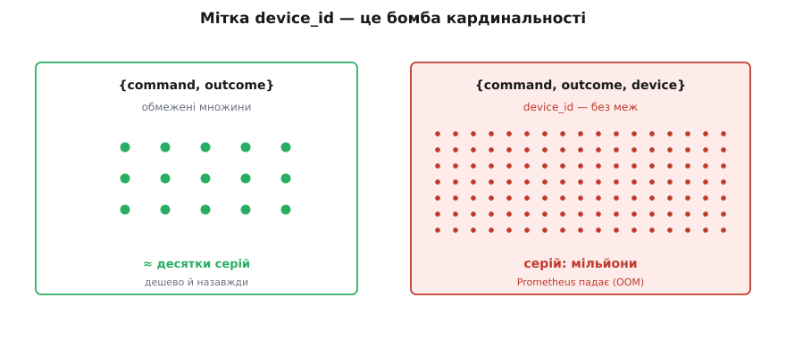

# ⚙️ Один ендпоінт DH під наскрізним інструментуванням

Ми вже пропустили команду пристрою крізь [шов](root:progarch/seams-and-boundaries) у тесті: вставили в гніздо дублера й довели, що політика поводиться як треба. Але тест жив у пам'яті процесу й закінчився на зеленій галочці. У проді світ не спиниш — команди течуть від справжніх орендарів до справжнього заліза, і зупинити цей потік, щоб «перевірити», не можна. Зате можна інше: **на той самий шов, куди в тесті ставав дублер, у проді посадити датчик.** І посадити так, щоб кожен сигнал, який він видає, був не прикрасою в логах, а живим тестом на справжньому трафіку.

Візьмімо рівно один ендпоінт Digital Homes — «надіслати команду пристрою», `POST /devices/{id}/commands` — і зшиймо його наскрізно. Не «додамо логування», а зробимо так, щоб кожен сигнал — структурована подія, RED-метрики (частота, помилки, тривалість), інваріант-assertion, перевірка готовності — відповідав на своє питання про поведінку, і кожен можна було *проганяти* після інциденту так само, як ми проганяємо тести перед релізом. А тоді назвемо пастки, кожна з яких тихо перетворює цю красу на брехню.

## Задача: ендпоінт, що сам себе перевіряє

Що робить ендпоінт, ясно: приймає команду («грій», «встанови ціль», «перезавантажся»), проштовхує її крізь шов до пристрою, дістає підтвердження — і повертає результат. Пристрій може відповісти успіхом, може мовчати до таймауту, може відхилити команду. У підтвердженні пристрій рапортує свій стан, зокрема рівень заряду, на який у нас є [інваріант](root:progarch/invariants-and-validation): завжди 0..100.

Ось повний перелік того, що ми хочемо чути від цього ендпоінта в проді — і, головне, який тестовий рух кожен сигнал заміняє:


*Один ендпоінт — і пʼять сигналів, кожен навпроти тестового поняття, яке він заміняє. Це не «додаткове логування», а той самий набір перевірок, тільки перенесений за лінію релізу.*

Тримаймо цю відповідність в голові весь код нижче: **приклад-тест** стає структурованою подією, **assert** — лічильником, **очікування щодо швидкодії** — гістограмою з p99, **assert інваріанта** — лічильником порушень, а **передумова тесту** (те, що має бути готове, перш ніж тест узагалі почне) — перевіркою готовності. Наприкінці кожен рядок коду можна буде прочитати як «а це який тест».

## Ідея: сигнал сідає туди, де стояв дублер

Механіка одна на всіх сигналів, і вона до банальності проста. У тесті ми обгортали виклик шва дублером, який записував, *що* сталося. У проді ми обгортаємо той самий виклик датчиком, який записує те саме — тільки не в пам'ять тестового процесу, а в подію, лічильник і гістограму, які переживуть запит. Дублер каже «мене покликали з `on`» тестові; датчик каже «команду `heat` завершено за 240 мс з наслідком `ok`» усьому світу. Це одна й та сама точка спостереження, використана двічі.

Тому інструментування не «додається» до ендпоінта — воно **сідає на вже прорізані шви**. Місце виклику до пристрою, місце перевірки інваріанта, вхід і вихід хендлера — це не нові точки, а ті самі, які тестованість вимагала виокремити. Спроєктований під тест ендпоінт дає точки спостереження задарма; неспостережний ендпоінт — це той, у якому й дублера нема куди вставити.

## Робочий код: усі сигнали в одному хендлері

Спершу оголосимо сигнали. Роблять це **раз при старті процесу** — це «тести», що вже чекають на трафік. Ключове рішення тут — мітки: типів команд десятки, наслідків чотири, і тільки їх ми пускаємо в мітки. Жодного `device`, жодного `tenant` — чому саме, розберемо в пастках, бо це найдорожча помилка всієї теми.

Домен тут — хмарний бекенд-ендпоінт із метриками Prometheus і структурованими подіями; це територія Go (клієнт Prometheus рідний саме тут), тож основний код — Go, а поруч вкладка на Node/TypeScript для тих, у кого стек такий.

:::tabs
:::code proj-instrument-dh-endpoint/go/robochyi-kod-usi-syhnaly-v.go
:::code proj-instrument-dh-endpoint/ts/index.ts
:::

Один хендлер, а в ньому вже живуть чотири різні тести — і жоден не вимагав окремого каркаса. Тепер лишилася перевірка готовності: п'ятий сигнал, той, що стоїть **перед** усіма іншими. У тестовій мові це передумова — те, що має бути зелене, перш ніж тіло тесту взагалі виконають (у наборі тестів це `setUp`, дим-тест залежностей). У проді це `readiness`: балансувальник не має слати цьому екземпляру трафік, поки шов до пристроїв не живий.

:::tabs
:::code proj-instrument-dh-endpoint/go/robochyi-kod-usi-syhnaly-v-2.go
```ts
// Readiness: передумова. Готові — лише коли шов до пристроїв відповідає.
export async function readyz(_req: Request, res: Response) {
  try {
    await withTimeout(gateway.ping(), 2000);
    res.status(200).send("ready");
  } catch {
    res.status(503).send("not ready: device gateway");
  }
}
```
:::

Тут варто відрізнити `readiness` від `liveness`, бо їх плутають, і плутанина коштує аварій. `Liveness` питає «чи процес живий взагалі, чи його треба вбити й перезапустити». `Readiness` питає «чи я *зараз* здатен обслуговувати». Різниця гостра: коли шов до пристроїв відпав, екземпляр **живий** (перезапуск не поможе — проблема ззовні), але **не готовий** (слати сюди трафік — марно віддавати запити в стіну). Переплутаєш — і при збої сусіднього сервісу оркестратор почне безглуздо перезапускати цілком здорові екземпляри. Readiness — це передумова, яку прод переобчислює щосекунди й сам вирішує, впускати трафік чи ні.

> 🔧 **Навіщо це.** Придивись, чого в хендлері **немає**: немає окремого «шару моніторингу», який хтось колись прикрутить збоку. Сигнали ростуть із тих самих чотирьох точок, які й так були в коді, — виклик шва, перевірка інваріанта, вхід і вихід. Саме тому інструментування не має ваги окремого проєкту: якщо ендпоінт спроєктований під тест, датчики сідають на готові гнізда за кілька рядків. Якщо ж доводиться *прорізати* точку під метрику — це сигнал, що там і тесту не було куди стати.

## Запити, які проженеш після інциденту

Код вище лишає сліди. Але слід без запиту — мертвий: усе окупається аж тоді, коли о третій ночі ти ставиш системі питання й дістаєш відповідь. Ось запити, які насправді проганяєш під час розбору, і кожен — це assert, тільки заднім числом.

**Метрики (PromQL) кажуть, ЩО і КОЛИ.** Вони згорнуті по всій популяції, тож відповідають на питання про систему в цілому — швидко й дешево:

```promql
# E з RED: частка невдалих команд за 5 хв — головний «червоний тест».
sum(rate(dh_device_commands_total{outcome!="ok"}[5m]))
  / sum(rate(dh_device_commands_total[5m]))

# D з RED: p99 тривалості за типом команди — хвіст, а не середнє.
histogram_quantile(0.99,
  sum by (le, command) (rate(dh_device_command_seconds_bucket[5m])))

# R з RED: частота команд за типом — чи не впав/не стрибнув трафік.
sum by (command) (rate(dh_device_commands_total[1m]))

# Інваріант: скільки разів «такого не буває» таки сталося за годину.
increase(dh_invariant_violation_total[1h])
```

Зверни увагу на p99: він тягне суфікс `_bucket`, бо гістограма зберігає не окремі тривалості, а лічильники по кошиках, і `histogram_quantile` відновлює квантиль із них. Тому [p99](root:math-probability/percentiles-quantiles) чесний рівно настільки, наскільки вдало нарізані кошики — про це в пастках.

**Події (запит до логів) кажуть, ЯКИЙ саме.** Метрика підняла тривогу — «помилки команд стрибнули». Але яких орендарів, яких пристроїв, яких команд це торкнулося? Метрика цього не знає (і не має знати). Знає подія:

```logql
# У сховищі логів: усі невдалі команди орендаря X за останню годину.
{service="dh-commands"} | json
  | event = "device.command" and tenant = "acme-42" and outcome != "ok"
```

І ось де замикається логіка коду. Метрика **не має** мітки `device`/`tenant` — тому вона дешева й вічна, але сліпа до окремого запиту. Подія **має** ці поля — тому вона бачить кожен запит, але коштує дорожче й індексується інакше. Це поділ праці: **питання про систему в цілому → метрика; питання про конкретну сутність → подія** (і [трасування](root:sf-release/distributed-tracing)) — бо перше має малу кардинальність, а друге величезну. Спершу метрика показує, *що* і *коли* горить; тоді подія показує, *хто саме* горить; далі йдеш у ту саму [структуровану подію](root:sf-release/structured-logging), уже знаючи, що фільтрувати. Порушиш цей поділ — спробуєш відповісти на питання про сутність міткою метрики — і отримаєш першу з пасток.

## Складність і пастки

Кожна пастка нижче — це спосіб, яким гарний на вигляд ендпоінт тихо бреше, що все під контролем.

**Вибух кардинальності — найдорожча помилка теми.** Спокуса очевидна: «хай метрика розрізняє пристрої, додам `device` в мітки».

```go
// ОТРУТА: device як мітка. Кожен унікальний device_id — НОВА серія назавжди.
commands = promauto.NewCounterVec(prometheus.CounterOpts{
	Name: "dh_device_commands_total",
}, []string{"command", "outcome", "device"}) // ← мільйони пристроїв = мільйони серій
```

Порахуймо, що це коштує. Кожна унікальна комбінація значень міток — **окремий часовий ряд**, який зберігається й тримається в пам'яті:

```
серій = |command| · |outcome| · |device|
      =    ~10     ·    4      ·  2 000 000   ≈  80 000 000 серій
```

Вісімдесят мільйонів рядів там, де без `device` було б сорок. Prometheus тримає активні ряди в пам'яті — і на такій кардинальності просто гине з нестачею пам'яті. Це не крайовий випадок, а задокументована пересторога: власна порада Prometheus з іменування прямо каже не класти в мітки виміри з «high cardinality … such as user IDs, email addresses» — саме тому, що кожна комбінація народжує новий ряд ([Prometheus, «Metric and label naming»](https://prometheus.io/docs/practices/naming/)). `device_id` — рівно такий вимір: без меж і весь час росте.



*Дві мітки — десятки рядів, які живуть роками задарма. Додаси `device_id` — і кожен пристрій приносить свій ряд; поле рядів вибухає, і сховище метрик гине.*

**Метрика-на-користувача — та сама бомба в іншій обгортці.** Приходить продукт: «зроби панель успішності *по кожному орендарю*». Рука тягнеться додати мітку `tenant` — і це той самий вибух, лише мотивований бізнес-питанням, а не недоглядом. Ліки не «відмовити продукту», а **скерувати питання в правильний сигнал**. Питання про конкретну сутність має величезну кардинальність, а таким місце в подіях і трасуванні (їх запитують на вимогу, вони не висять у пам'яті вічно), а не в мітках метрик (ті мусять лишатися малими й працюють цілодобово). Панель «топ-10 орендарів за помилками за годину» будується запитом до логів, а не міткою на лічильнику. Метрика лишається згорткою по всій популяції; «хто саме» завжди дістають із події — рівно так, як ми робили в розборі інциденту вище.

**PII в логах — сила події, обернена проти тебе.** Подія цінна саме тим, що її можна *питати* й що вона *зберігається*. Але ці дві властивості й роблять її небезпечною: усе, що ти в неї поклав, осідає в індексованому сховищі з довгим строком зберігання. Тож ніколи не логуй сире тіло команди наосліп:

```go
// ОТРУТА: сире тіло у подію. А що, як команда — це provision із Wi-Fi-паролем?
a.Log.Info("device.command", "tenant", tenant, "payload", string(rawBody))
```

Команда `provision` цілком може нести пароль до Wi-Fi, токен, а «команда» з іншого ендпоінта — адресу чи ім'я мешканця. Один такий рядок — і секрет лежить у логах, доступний на пошук усім, хто має доступ до сховища, місяцями. Логуй **стабільні ідентифікатори** (`tenant`, `device` — це технічні ключі, не персональні дані) і **наслідок**, а чутливі поля або не пиши зовсім, або редагуй (`"arg", "***"`). Правило просте: у подію потрапляє те, за чим ти шукатимеш під час інциденту, а не те, чим користувач тобі довірився.

**Кошики, що не бачать SLO.** Дрібніша, але підступна пастка — гістограма, чиї межі кошиків не охоплюють поріг, який тобі важить. Класична гістограма похибку квантиля має завширшки з кошик, у який той квантиль упав; тож коли ціль — «швидше за 300 мс», а найближчі межі кошиків 200 і 500 мс, твій p99 інтерполюється по всьому цьому провалу й може серйозно збрехати. Тому в оголошенні вище `0.3` стоїть **окремою межею кошика**: якщо знаєш ціль наперед, постав її межею й дістанеш точний рахунок ([Prometheus, «Histograms and summaries»](https://prometheus.io/docs/practices/histograms/)). Гістограма міряє SLO чесно лише тоді, коли її кошики нарізані під цей самий SLO.

## Кожен сигнал — рядок у тому самому реєстрі тестів

Озирнімося на зшите. Ми не додали ендпоінту «моніторинг» — ми перенесли за лінію релізу той самий інстинкт, що тримав його під тестом: доведи, що воно поводиться як треба. Кожен сигнал прив'язаний назад до руху, який він заміняє, і — головне — до запиту, яким його *проганяють*:

| Сигнал у проді | Тест, який він заміняє | Чим «проганяється» |
|---|---|---|
| структурована подія | приклад-тест (вхід → вихід) | запит до логів постфактум |
| лічильник R + E | assert, що рахує провали | `rate(…{outcome!="ok"})` |
| гістограма D → p99 | властивість на популяції | `histogram_quantile(0.99, …)` |
| лічильник інваріанта | `assert 0 ≤ level ≤ 100` у проді | `increase(…_violation_total)` |
| readiness `/readyz` | передумова (`setUp` / дим-тест) | проба балансувальника |
| SLO | ворота релізу (CI-гейт) | [бюджет помилок](root:sf-release/slo-sli-sla) за 30 днів |

Останній рядок дописує те, чого в самому хендлері не видно, але що виростає з його ж лічильника й гістограми: **SLO — це ворота, що переїхали з CI у прод.** У CI гейт казав «котити чи ні»; той самий поріг, злічений на живому трафіку («99.9% команд успішні, швидші за 300 мс, за 30 днів»), тепер каже «котити далі чи гальмувати й лагодити». Один ендпоінт, шість сигналів — і жодного окремого каркаса: усе стало на шви, які тестованість прорізала раніше, ніж ми взагалі згадали про прод.
