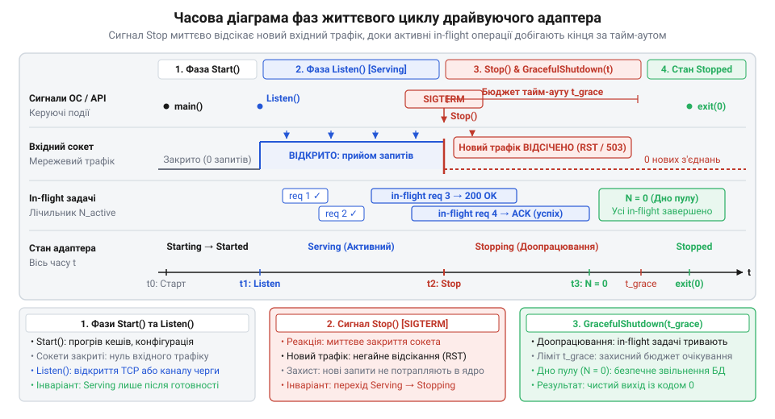
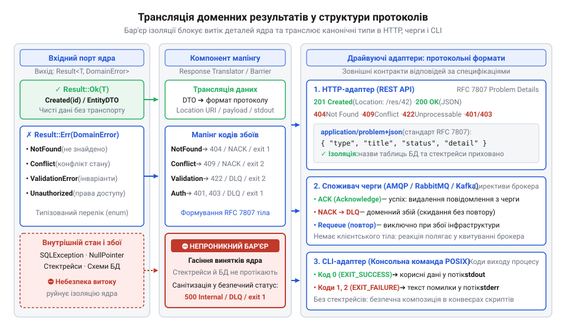

# Програмний інтерфейс життєвого циклу драйвуючого адаптера та трансляції доменних відповідей

<preknowlist>
- [DH v2: застосунок набуває форми](root:progarch/dh-v2-hexagon) — гексагональна структура системи Digital Homes v2, поділ на внутрішні порти застосунку й зовнішні адаптери та роль композиційного кореня у зв'язуванні компонентів
</preknowlist>

## Пастка некерованого адаптера: обриви та витоки

У [гексагональній архітектурі системи](root:progarch/dh-v2-hexagon) зовнішні події та запити потрапляють до серцевини застосунку крізь драйвуючий адаптер (@@en|driving adapter@@; від англійського *drive* — рухати, приводити в дію) — компонент, що сприймає зовнішній сигнал і передає керування доменному юзкейсу. На перший погляд здається достатнім написати простий веб-контролер або споживач черги повідомлень, який отримує вхідні байти, викликає потрібний метод вхідного порту та відправляє результат клієнтові. Проте такий некерований адаптер перетворюється на джерело системних аварій у двох критичних точках: під час перезапуску процесу та в момент виникнення доменних збоїв.

Коли операційна система надсилає процесу сигнал завершення під час планового оновлення версії хаба керування будинком Digital Homes, некерований HTTP-сервер миттєво обриває мережеві сокети. Якщо в цей момент виконувалася транзакція зміни сценарію опалення, клієнт отримує скидання TCP-з'єднання, а внутрішній стан системи може зависнути в неконсистентному вигляді. Не менш небезпечною є ситуація у фоновому споживачі черги: миттєве падіння робітника посеред обробки пакета телеметрії залишає повідомлення або назавжди втраченим через передчасне квитування, або заблокованим у нескінченному циклі повторної доставки.

Друга частина пастки криється у відсутності ізоляції відповідей. Коли бізнес-правило ядра відхиляє неприпустиму цільову температуру чи виявляє конфлікт ідентифікаторів пристрою, сирий доменний виняток безконтрольно спливає у вихідний транспорт. Клієнт веб-інтерфейсу отримує помилку з повним стеком викликів середовища виконання, назвами таблиць сховища та внутрішніми шляхами, а споживач черги падає через неочікуваний формат помилки. Адаптер не має права бути ні пасивним скриптом запуску, ні прямим транзитом внутрішніх структур ядра: він зобов'язаний тримати строгий контроль над життєвим циклом власного виконання та ізолювати клієнтів від деталей домену за допомогою виділеного транслятора відповідей.

## Контракт життєвого циклу драйвуючого адаптера

Щоб запобігти раптовим обривам операцій під час планового перезапуску служби, кожен вхідний адаптер підпорядковується формальному контракту, що описує життєвий цикл (@@en|lifecycle@@; від грецького *kyklos* — коло, оберт) компонента. Цей цикл складається з чотирьох послідовних фаз: первинної ініціалізації (`Start`), прийому навантаження (`Listen`), зупинки прийому нових подій (`Stop`) та граційного завершення активної роботи (`GracefulShutdown`).

*Часова діаграма фаз життєвого циклу драйвуючого адаптера: переходи між станами запуску, відкриття сокетів, припинення прийому та доопрацювання активних запитів за тайм-аутом.*

Під час фази `Start` адаптер підготовлює внутрішні ресурси, перевіряє доступність залежностей і налаштовує маршрути, не відкриваючи при цьому зовнішні мережеві порти. Лише після успішного старту композиційний корінь переводить адаптер у стан `Listen`. У цій фазі відкривається мережевий сокет або оформлюється підписка на чергу повідомлень, а проба готовності служби сигналізує оркестратору про спроможність приймати робочий трафік.

Коли надходить сигнал завершення від операційної системи, адаптер переходить у фазу `Stop`: він негайно закриває слухаючий сокет або відписується від брокера, унеможливлюючи надходження нових звернень. Відтак настає фаза граційного завершення (@@en|graceful shutdown@@; від англійського *graceful* — плавний, чемний та *shutdown* — зупинка), протягом якої адаптер дає змогу вже прийнятим незавершеним запитам у польоті (@@en|in-flight requests@@; від англійського *in-flight* — у польоті, у процесі виконання) коректно дійти до завершення.

| Метод контракту | Стан адаптера | Дії адаптера | Інваріант стану |
|---|---|---|---|
| `Start()` | `Starting` → `Started` | Прогрів залежностей, підготовка структур пам'яті | Вхідний трафік заблокований, сокети закриті |
| `Listen()` | `Started` → `Serving` | Відкриття мережевого сокета або каналу брокера | Прапорець готовності активний, трафік обробляється |
| `Stop()` | `Serving` → `Stopping` | Закриття точки прийому, скидання прапорця готовності | Нові запити відхиляються на рівні мережі |
| `GracefulShutdown(timeout)` | `Stopping` → `Stopped` | Очікування обробки активних запитів до вичерпання ліміту | Після тайм-ауту незавершені операції примусово скасовуються |

Композиційний корінь (@@en|composition root@@; від латинського *compositio* — складання, узгодження) виступає єдиним координатором цього процесу. Він утримує лічильник незавершених завдань і керує спільним тайм-аутом: якщо всі поточні операції добігли кінця за відведений термін, процес зупиняється штатно; якщо тайм-аут вичерпано, активні контексти операцій скасовуються, а служба завершує роботу примусово.

## Реалізація адаптерів: HTTP, черги, CLI

Контракт життєвого циклу однаковий для всієї системи, проте його конкретне втілення залежить від фізичної природи вхідного транспорту. Для одноразових консольних утиліт може здатися, що [гексагональний поділ надлишковий](root:progarch/hexagon-when-overkill), однак збереження тонкого адаптера захищає бізнес-правила від прив'язки до параметрів командного рядка так само надійно, як і в мережевих службах.

В адаптері веб-сервера фаза `Start` ініціалізує конфігурацію маршрутизації та проміжних обробників, а виклик `Listen` відкриває порт TCP. У процесі роботи адаптер збільшує атомарний лічильник активних запитів на початку кожного з'єднання та зменшує його після відправки HTTP-відповіді. Коли викликається `Stop`, адаптер закриває слухаючий сокет операційної системи: нові клієнти миттєво отримують мережеву відмову, тоді як наявні з'єднання залишаються відкритими. Під час `GracefulShutdown` адаптер очікує обнулення лічильника запитів і лише після цього закриває пул з'єднань.

В асинхронному споживачі черги фаза `Start` створює сесію з брокером, а `Listen` реєструє функцію зворотного виклику для надходження повідомлень. При переході в стан `Stop` адаптер надсилає брокеру команду скасування споживання, вимикаючи потік нових подій у цей канал. Під час фази граційного завершення адаптер дочікується квитування повідомлення, яке вже перебуває на стадії виконання в доменному юзкейсі, після чого безпечно закриває транспортний канал.

В утилітах командного рядка (CLI) життєвий цикл адаптера вироджується в синхронну послідовність без довготривалого фонового слухання. Метод `Start` розбирає аргументи та змінні оточення, конвертуючи їх у типізовану доменну команду, а виклик `Listen` пропускається, оскільки джерелом події є одноразовий запуск процесу. Адаптер передає команду на вхідний порт ядра, блокує потік до отримання результату, а при отриманні сигналу переривання негайно скасовує токен доменної операції та звільняє термінальні ресурси.

## Трансляція доменних відповідей у HTTP

Тонкий драйвуючий адаптер не обмежується керуванням виконанням: він виконує роль захисного муру, що транслює результати ядра в протокольні відповіді. Якщо доменний шар викидає HTTP-винятки або повертає транспортні структури даних, його [вхідний порт починає пахнути](root:progarch/port-smelling-of-storage) сторонніми інфраструктурними деталями, що руйнує ізоляцію серцевини.

*Схема трансляції результатів доменного порту компонентом мапінгу: ізолюючий бар'єр перетворює канонічні доменні типи помилок і успішні результати на формати протоколів.*

Виклики доменних юзкейсів повертають типізований результат — успішне значення або канонічну помилку домену. Компонент мапінгу в HTTP-адаптері відповідає за однозначне зіставлення цих станів із кодами та заголовками протоколу:

1. **Успішне створення ресурсу (`Created`):** перетворюється на статус `201 Created` із заголовком `Location`, що містить відносний шлях до новоствореного пристрою чи сценарію.
2. **Відсутність сутності (`NotFound`):** транслюється у статус `404 Not Found`.
3. **Конфлікт стану (`Conflict`):** наприклад, спроба одночасного редагування розкладу двома користувачами, транслюється у статус `409 Conflict`.
4. **Помилка бізнес-правил (`ValidationError`):** порушення меж значень або суперечливі параметри перетворюються на статус `422 Unprocessable Entity`.
5. **Порушення прав (`Unauthorized` / `Forbidden`):** транслюються відповідно у `401 Unauthorized` або `403 Forbidden`.

Для стандартизованої передачі діагностики збоїв використовується формат деталей проблеми (@@en|Problem Details@@; специфікація RFC 7807). Замість довільних текстових повідомлень чи внутрішніх стектрейсів клієнт отримує документ типу `application/problem+json`, що містить стабільний ідентифікатор типу збою `type`, короткий опис `title`, числовий код `status` та контекстну інформацію `detail`. Мапер повністю приховує внутрішні назви таблиць бази даних, службові ідентифікатори та винятки сторонніх бібліотек, гарантуючи чистоту публічного контракту.

## Мапінг для черг і CLI-команд

У взаємодії через брокери повідомлень та системний командний рядок вимоги до ізоляції залишаються незмінними, проте канали зворотного зв'язку докорінно відрізняються від веб-відповідей. Тоді як вхідний адаптер транслює зовнішній потік у виклики ядра, зворотна [трансляція доменних команд](root:progarch/dh-egress-actuator-protocol-mapping) у фізичні кадри контролерів покладається на вихідні адаптери актуаторів.

В асинхронному воркері споживач черги не має можливості повернути клієнту HTTP-тіло. Його єдиний спосіб реакції — директиви квитування повідомлень брокера:

1. **Підтвердження успіху (@@en|acknowledgement@@, ACK; від англійського *acknowledge* — підтверджувати, визнавати):** відправляється тоді, коли доменний юзкейс успішно виконав зміну стану. Брокер безповоротно видаляє повідомлення з черги.
2. **Повторна постановка в чергу (@@en|requeue@@; від англійського *re-* — повторно та *queue* — черга):** застосовується виключно при тимчасових інфраструктурних збоях, таких як тайм-аут мережевого з'єднання до бази даних. Повідомлення повертається в чергу для наступної спроби.
3. **Негативне підтвердження (@@en|negative acknowledgement@@, NACK; від англійського *negative* — заперечний та *acknowledge* — підтверджувати) без повтору:** єдина коректна реакція на доменні збої валідації (`ValidationError`) або пошкоджену структуру корисного навантаження. Оскільки повторна обробка завідомо хибного повідомлення ніколи не завершиться успіхом, воно скидається в тупикову чергу (@@en|Dead Letter Queue@@, DLQ; від англійського *dead letter* — недоставлений лист), запобігаючи нескінченному отруєнню воркера.

Для утиліти командного рядка стандартом зворотного зв'язку виступає числовий код завершення @@en|POSIX@@ (Portable Operating System Interface) та системні потоки виводу. Успішне виконання доменної операції завжди повертає системний код `0` (`EXIT_SUCCESS`), а серіалізований результат спрямовується виключно в потік `stdout`. Помилки валідації чи відсутності сутностей транслюються у ненульові коди виходу (наприклад, `1` або `2`), а зрозумілий людині текст повідомлення записується в потік `stderr`. Такий поділ забезпечує безпечну композицію консольної команди в конвеєрах скриптів без змішування корисних даних із діагностикою.
