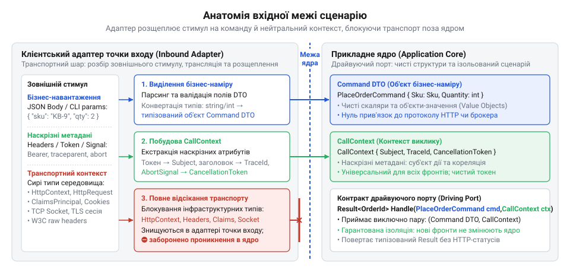
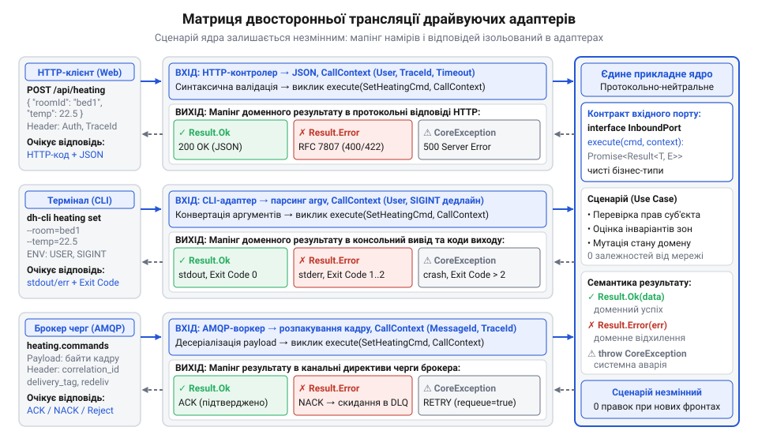

# Програмний контракт інтерфейсу вхідного порту та об'єктів сценарію

<preknowlist>
- [DH v2: застосунок набуває форми](root:progarch/dh-v2-hexagon) — Архітектурне структурування платформи Digital Homes v2 за гексагональним шаблоном, виділення прикладних сценаріїв (Use Cases) та концептуальне розмежування драйвуючих і керованих адаптерів
</preknowlist>

## Ціна прив'язки сценарію до транспорту

Коли в прикладній платформі @@en|Digital Homes@@ [набувала форми архітектура](root:progarch/dh-v2-hexagon) другого покоління, сценарій постановки периметра на охорону реалізували як пряму реакцію на веб-запит. Сценарій приймав об'єкт інфраструктури сервера `HttpContext`, з якого бізнес-код безпосередньо вичитував ідентифікатор користувача із заголовка авторизації, перелік охоронних зон із тіла @@en|JSON@@ та мережевий таймаут. Поки система працювала виключно з мобільним застосунком через @@en|REST API@@, прямий доступ до веб-контексту здавався швидким рішенням без зайвих перекладань.

Криза виникла під час збою зовнішнього зв'язку. Інженерам знадобилася автономна консольна утиліта командного рядка для аварійного блокування дверей на місці, а планувальнику завдань — обробник повідомлень із черги брокера для автоматичної нічної охорони. Жодна з нових точок входу не мала веб-сервера й не формувала @@en|HTTP@@-запитів. Щоб викликати наявний сценарій із консолі, розробники спершу спробували створити фіктивний об'єкт `HttpContext` із фальшивими заголовками та порожніми сокетами. Спроба обернулася падіннями в експлуатації: під час звернення до неініціалізованих полів веб-сесії виникали нульові покажчики, а код переривався системними аваріями.

Команда пішла шляхом найменшого опору й продублювала логіку перевірки датчиків у три окремі місця: для контролера, для утиліти та для черги. За кілька місяців правила перевірки замків розійшлися. Консольна утиліта ставила будинок на сигналізацію з відкритими вікнами, тоді як веб-контролер відхиляв таку дію.

Пряма прив'язка сценарію до транспорту інфікує доменне ядро зовнішніми бібліотеками, змушує бізнес-логіку знати про мережеві протоколи й унеможливлює додавання нових інтерфейсів без руйнування цілісності системи. Бізнес-сценарій не повинен знати, звідки надійшов сигнал — із мережевого сокета, термінала оператора чи бездротового сенсора. Його має закривати протокольно-нейтральна межа — @@en|драйвуючий порт@@ (англ. *drive* — приводити в рух, спонукати), який приймає лише чисті дані бізнес-наміру. Подібно до того, як керований порт не повинен [пахнути специфікою сховища](root:progarch/port-smelling-of-storage), вхідний інтерфейс має бути повністю очищеним від деталей веб-сервера чи термінала.

## Структури наміру: Command та Query DTO

Протокольно-нейтральна межа вимагає очищення вхідних даних від транспортної оболонки ще до того, як вони перетнуть границю ядра. Замість сирих рядків командного рядка чи бітових потоків протоколу сценарій взаємодіє з типізованими структурами бізнес-наміру — об'єктами @@en|DTO@@ (англ. *Data Transfer Object* — об'єкт передачі даних). Залежно від мети виклику структури чітко розмежовують на @@en|Command DTO@@ та @@en|Query DTO@@.

@@en|Command DTO@@ виражає намір змінити стан системи. Це суворо незмінна структура, яка містить лише ті атрибути, що необхідні для виконання конкретної операції: наприклад, ідентифікатор охоронної зони та цільовий рівень захисту. Об'єкт не містить методів поведінки чи бізнес-правил, проте оперує сильними доменними типами замість примітивів: типізованими ідентифікаторами замість довільних рядків та об'єктами значень. На противагу йому, @@en|Query DTO@@ фіксує параметри запиту інформації без побічних ефектів, інкапсулюючи критерії фільтрації, пагінації та сортування.

Кожна команда обов'язково несе унікальний маркер — `CommandId`. Це забезпечує @@en|ідемпотентність@@ (лат. *idem* — той самий, *potens* — здатний): здатність системи повторно приймати ту саму команду без дублювання змін. Мережеві запити повторюються через таймаути клієнта, брокери повідомлень гарантують доставку щонайменше один раз, а оператори повторно натискають кнопки в консолі. Наявність `CommandId` дозволяє ядру відсікти повторні виклики на рівні сховища операцій.

Межа вхідного порту встановлює чіткий вододіл між двома видами валідації. Зовнішній @@en|адаптер@@ (лат. *adaptare* — пристосовувати) відповідає за поверхневу синтаксичну перевірку: коректність структури @@en|JSON@@, наявність обов'язкових полів і відповідність типів даних. Якщо запит синтаксично спотворений, він відсікається ще в транспортному шарі. Сам об'єкт @@en|Command DTO@@ під час конструювання гарантує власну семантичну цілісність: значення не можуть бути порожніми, діапазони чисел мають відповідати допустимим фізичним межам, а стан об'єкта фіксується раз і назавжди.


*Анатомія вхідної межі: драйвуючий адаптер перетворює сирий вхідний стимул на чистий об'єкт наміру Command DTO та відокремлений CallContext, не пропускаючи інфраструктурні типи в ядро.*

## Контекст виклику: метадані без інфраструктури

Сценарію для роботи потрібні не лише бізнес-параметри операції, а й операційні метадані: хто ініціював дію, як простежити шлях запиту крізь розподілені сервіси та скільки часу виділено на обчислення. Якщо помістити ці дані всередину @@en|Command DTO@@, бізнес-структура змішається з технічними реквізитами виконання. Передача ж вихідних об'єктів транспорту знову поверне нас до протікання інфраструктури.

Розв'язанням є виділення паралельного протокольно-нейтрального об'єкта — @@en|контексту виклику@@ (лат. *contextus* — тісний зв'язок, сплетіння), або @@en|CallContext@@. Він створюється драйвуючим адаптером у момент отримання зовнішнього сигналу та інкапсулює три обов'язкові групи метаданих:

Перша група — ідентифікація та безпека. Вона містить знеособлений ідентифікатор суб'єкта `SubjectId`, ідентифікатор орендаря `TenantId` для ізоляції даних у багатокористувацькому середовищі та перелік підтверджених ролей чи дозволів. Сценарій не перевіряє криптографічні підписи @@en|JWT@@ чи сесійні куки — цим займається @@en|адаптер@@. Ядро отримує вже верифіковані дані авторизації.

Друга група — наскрізна спостережуваність. Маркери `TraceId` та `CorrelationId` пов'язують логічний ланцюжок дій між мікросервісами. Незалежно від того, чи запит надійшов із веб-шлюзу, чи був породжений кроном у консолі, у журналі аудиту ядра операція отримує єдиний маркер трасування для діагностики інцидентів.

Третя група — контроль життєвого циклу через `CancellationToken` та @@en|дедлайн@@ (англ. *dead line* — крайня межа). Драйвуючий адаптер перетворює переривання сокета, сигнал завершення процесу @@en|POSIX@@ чи таймаут веб-запиту на кооперативне скасування. Якщо клієнт розірвав з'єднання або вичерпався допустимий час виконання, сценарій вчасно зупиняє роботу із зовнішніми шинами сенсорів, не витрачаючи ресурси на непотрібну операцію.

## Семантика Result та класифікація збоїв

Традиційне використання винятків для сигналізації про неможливість виконати бізнес-дію створює приховані шляхи виконання. Коли метод кидає виняток у разі відхилення команди, сигнатура вхідного порту приховує цей факт, змушуючи викликача вгадувати можливі типи помилок або перехоплювати базовий клас помилок наосліп.

Надійний вихідний контракт порту спирається на типізовану структуру повернення `Result<TResponse, TDomainError>`. Замість неконтрольованих аварій сценарій повертає результат за [залізничним патерном обробки](root:sf-apps/result-pattern-domain-errors), явно розділяючи успіх і бізнес-відмову в системі типів. Типізована відповідь змушує будь-який драйвуючий @@en|адаптер@@ явно обробити обидві гілки: або розпакувати дані успішної відповіді, або відреагувати на зафіксовану доменну проблему.

Усі збої під час виконання сценарію поділяються на дві несумісні категорії:

1. Доменні відхилення (@@en|Domain Error@@) — це очікувані варіанти перебігу бізнес-логіки, за яких операцію неможливо виконати через порушення бізнес-правил. Приклади: «Периметр уже на охороні», «Датчик руху в зоні недоступний» або «Введено недійсний пін-код». Це не аварії системи, а штатні результати оцінки інваріантів. Вони описуються закритим переліком типів або дискримінованим об'єднанням і повертаються всередині значення `Result.Error`.

2. Системні аварії — це непередбачувані технічні збої інфраструктури, за яких сценарій не може завершити обчислення: відмова бази даних, аварійне падіння апаратного моста сенсорів чи вичерпання пам'яті. Такі збої не повертаються в `Result`, оскільки вони свідчать про порушення цілісності середовища. Їх сценарій ізолює в контрольованій ієрархії винятків ядра (`CoreException`), сигналізуючи викликачеві про необхідність аварійного завершення чи перезапуску.

Завдяки такій семантиці клієнтський адаптер чітко розрізняє, коли користувачеві слід повідомити про некоректні дії, а коли сповістити чергового інженера про технічну катастрофу.

## Сигнатура порту та протокольний мапінг

Інтерфейс вхідного порту поєднує структури наміру, контекст і результат у єдиний протокольно-нейтральний метод виконання. Драйвуючий порт визначається параметризованим інтерфейсом з єдиним методом `execute(command, context)`.

:::tabs
```typescript
interface InboundPort<TCommand, TResponse, TError> {
  execute(
    command: TCommand, 
    context: CallContext
  ): Promise<Result<TResponse, TError>>;
}
```
```cpp
template <typename TCommand, typename TResponse, typename TError>
class InboundPort {
public:
    virtual ~InboundPort() = default;
    virtual Result<TResponse, TError> execute(
        const TCommand& command, 
        const CallContext& context
    ) = 0;
};
```
```c
typedef struct InboundPort {
    void* instance;
    Result (*execute)(
        void* instance, 
        const void* command, 
        const CallContext* context
    );
} InboundPort;
```
:::

Драйвуючі адаптери виконують двосторонню @@en|трансляцію@@ (лат. *translatio* — перенесення, переклад): на вході вони розбирають зовнішній стимул у `Command DTO` та `CallContext`, а на виході транслюють результат `Result` або системні винятки у специфіку свого протоколу:

Для @@en|HTTP@@-контролера успішне виконання `Result.Ok` перетворюється на статус `200 OK` або `201 Created` із серіалізацією вмісту в @@en|JSON@@. Доменна помилка `Result.Error` мапиться на клієнтські статуси помилок `400 Bad Request`, `409 Conflict` або `422 Unprocessable Entity` у стандартному форматі @@en|RFC 7807@@ (@@en|Problem Details@@). Системний виняток ядра перехоплюється фільтром і повертає `500 Internal Server Error` без витоку деталей реалізації назовні.

Для консольної @@en|CLI@@-утиліти результат `Result.Ok` виводить повідомлення в потік стандартного виводу та повертає код завершення `0`. Доменне відхилення транслюється в зрозумілий текст у потоці помилок із кодом виходу `1` чи `2`. Необроблена аварія інфраструктури аварійно завершує процес із системним кодом помилки.

Для воркера черги брокера повідомлень статус `Result.Ok` генерує команду підтвердження @@en|ACK@@ (англ. *acknowledgment* — підтвердження). Бізнес-відхилення `Result.Error`, повторення якого не має сенсу, спричиняє відхилення @@en|NACK@@ без повторної постановки або переміщення в чергу мертвих листів @@en|DLQ@@ (@@en|Dead Letter Queue@@). Лише у разі системного винятку повідомлення залишається в черзі для повторної спроби після відновлення інфраструктури.


*Двостороння трансляція на межі адаптера: вхідний протокольний стимул розбирається в Command DTO і CallContext, а типізований результат Result транслюється в статуси HTTP, коди CLI або директиви черги.*

Поки керовані вихідні порти системи відповідають за [трансляцію команд актуаторів](root:progarch/dh-egress-actuator-protocol-mapping) у фізичні сигнали, вхідні порти утримують непохитну межу для клієнтів. Якщо для простої монолітної утиліти [гексагональна форма надлишкова](root:progarch/hexagon-when-overkill), то поява двох і більше каналів взаємодії робить протокольно-нейтральний вхідний контракт єдиним надійним захистом від дублювання та деградації коду.
