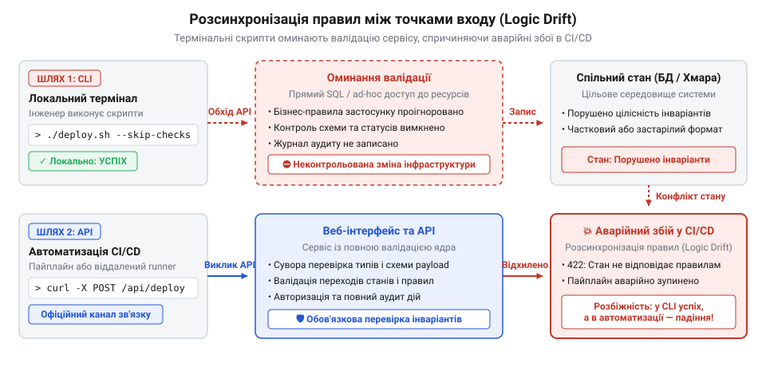
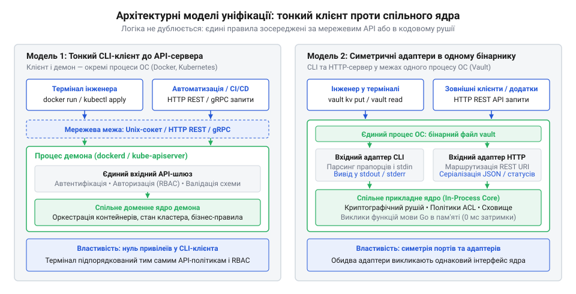

# Конвергенція термінальних утиліт та мережевих API в інструментах хмарної ери

## Розсинхронізація правил на світанку DevOps

На межі 2000-х і 2010-х років зародження культури @@en|DevOps@@ (від англ. @@en|development@@ — розробка та @@en|operations@@ — експлуатація) зіштовхнуло інженерні практики з небезпечною розбіжністю інструментів. Системи мали два незалежні канали керування. З одного боку розвивалися вебпанелі та ранні мережеві @@en|API@@ (від англ. @@en|application programming interface@@ — програмний інтерфейс застосунку), розраховані на інтеграції. З іншого боку системні адміністратори керували серверами за допомогою локальних скриптів термінала — @@en|CLI@@ (від англ. @@en|command-line interface@@ — інтерфейс командного рядка).

Кожен вхідний канал створював власну реалізацію бізнес-правил. Вебсервіс містив жорсткі перевірки схеми даних, прав доступу й доменних інваріантів перед зміною ресурсів. Натомість адміністративні утиліти, написані для швидкого розв'язання аварій, оминали мережевий інтерфейс. Скрипт отримував права суперкористувача й напряму редагував конфігураційні файли або таблиці бази даних, реалізуючи спрощену валідацію або ігноруючи її взагалі.

Ця розбіжність неминуче призводила до аварійних збоїв. Під час нічного інциденту черговий інженер виправляв помилку в терміналі через локальний скрипт, який не враховував нових бізнес-обмежень і завершувався з кодом успіху `0`. Проте зранку автоматизований пайплайн @@en|CI/CD@@ (від англ. @@en|continuous integration / continuous delivery@@ — неперервна інтеграція та неперервне доставлення) звертався до штатного @@en|API@@ застосунку. Застосунок натрапляв на невалідний стан у базі, відхиляв операцію й зупиняв випуск релізу. Замість того щоб [зібрати бізнес-правила в ядрі](root:progarch/dh-v2-hexagon), логіку розкидали по вхідних адаптерах, утворивши небезпечну розсинхронізацію між діями людини та автоматизацією.

*Схема розсинхронізації: пряма зміна системних ресурсів локальними утилітами в обхід доменної валідації призводить до аварійних розбіжностей під час машинної автоматизації.*

## Тонкий клієнт Docker над демоном

До 2013 року ізоляція застосунків у Linux залишалася хаотичним набором розрізнених системних утиліт: @@en|LXC@@, інструментів конфігурації мережі та безпосередньої взаємодії із системними викликами ядра. Щоб запустити контейнер, інженери створювали крихкі обгортки, які керували процесами напряму.

У березні 2013 року на конференції @@en|PyCon@@ у Санта-Кларі франко-американський інженер Соломон Хайкс (@@en|Solomon Hykes@@) представив відкритий проєкт @@en|Docker@@ (від англ. @@en|docker@@ — портовий вантажник), створений у надрах платформи @@en|dotCloud@@. Хайкс запропонував не просто зв'язати [системні механізми ізоляції](root:sys-unix/namespaces) ядра Linux, а кардинально змінити архітектуру вхідних точок.

Термінальна утиліта @@en|docker@@ більше не мала привілейованого доступу до ресурсів хоста. Систему розділили на фонову службу — @@en|демон@@ (від англ. @@en|daemon@@, що сходить до дав.-грец. @@grc|δαίμων@@ — божество чи дух, який діє непомітно у фоні) @@en|dockerd@@ — та тонкий клієнт командного рядка. Команди на кшталт `docker run` чи `docker ps` не створювали процесів і не змінювали файлову систему власноруч. Клієнт @@en|CLI@@ транслював уведені прапорці й аргументи у звичайний HTTP-запит до @@en|REST API@@ (від англ. @@en|representational state transfer@@ — передавання репрезентативного стану) над локальним сокетом (від англ. @@en|socket@@ — роз'єм, гніздо) @@en|UNIX@@ або мережевим протоколом @@en|TCP@@.

Уся валідація, керування життєвим циклом контейнерів та системні виклики зосередилися всередині демона. Для системи зникла принципова різниця між інженером, який набирає команду в терміналі, та сценарієм автоматизації в @@en|CI/CD@@: обидва зверталися до одного й того самого @@en|REST API@@ через ідентичний контракт.

## Декларативний API та симетрія Kubernetes

Модель тонкого клієнта над демоном у @@en|Docker@@ усунула дублювання логіки, проте залишалася імперативною. Команда вимагала виконати конкретну дію негайно. Якщо під час розгортання на групі серверів зв'язок переривався, система зависала в проміжному стані: частина процесів стартувала, частина зазнала збою, а термінальний клієнт завершував роботу з помилкою без гарантій самозцілення.

У червні 2014 року інженери компанії @@en|Google@@ анонсували проєкт @@en|Kubernetes@@ (від дав.-грец. @@grc|κυβερνήτης@@ — стерновий, керманич). Спираючись на досвід експлуатації внутрішніх систем кластеризації @@en|Borg@@ та @@en|Omega@@, вони заклали в основу платформи декларативний підхід до оркестрації.

Єдиним джерелом правди кластера став сервіс @@en|kube-apiserver@@. Замість послідовних наказів користувачі й програми описують бажаний стан системи у маніфестах, а @@en|kube-apiserver@@ валідує їх і записує у [розподілене сховище консенсусу](root:sf-distributed/raft) @@en|etcd@@. Фундаментальним архітектурним рішенням стала абсолютна симетрія точок входу: консольна утиліта @@en|kubectl@@ позбавлена будь-яких прихованих каналів зв'язку, привілеїв чи прямого доступу до робочих вузлів або бази @@en|etcd@@. Вона є таким самим тонким клієнтом до @@en|REST API@@, як і внутрішні фонові контролери оркестрації.

І людина, яка запускає `kubectl apply`, і внутрішній контролер реплікації використовують однакові клієнтські бібліотеки й викликають той самий мережевий ендпоінт. Запит завжди проходить єдиний неподільний ланцюг автентифікації, перевірки прав та валідації схеми. Будь-які привілейовані обхідні шляхи виявилися конструктивно неможливими, гарантуючи передбачувану поведінку системи за будь-якого способу виклику.

## Єдине ядро HashiCorp Vault

Успіх @@en|Docker@@ та @@en|Kubernetes@@ закріпив уявлення, ніби єдиний спосіб узгодити поведінку термінала й автоматизації — запустити мережевий сервер і перетворити @@en|CLI@@ на тонкий клієнт до нього. Проте розподілена модель має відчутну ціну. Щоразу передавати байти через мережевий стек чи сокети операційної системи означає втрачати продуктивність на серіалізації, керувати мережевими портами, правами доступу до сокетів і сертифікатами шифрування. Для інструментів, що оперують секретами чи чутливими даними, створення обов'язкового мережевого шлюзу для локальних операцій невиправдано розширює поверхню атаки.

У квітні 2015 року американський розробник Мітчел Хашімото (@@en|Mitchell Hashimoto@@) та компанія @@en|HashiCorp@@ представили систему керування секретами @@en|Vault@@ (від англ. @@en|vault@@ — підземелля, сховище цінностей). Головною вимогою була абсолютна тотожність бізнес-правил: створення токенів, перевірка прав доступу, шифрування даних чи запис аудиту мусили виконуватися однаково як для локального виклику адміністратора, так і для віддаленої служби. Замість прив'язки до обов'язкового мережевого демона архітектуру системи побудували навколо спільного внутрішньопроцесного ядра.

Усі доменні правила @@en|Vault@@ зосереджені в ізольованому рушії. Цей рушій реалізує валідацію, криптографічні перетворення та [захист ключів у пам'яті](root:sf-security/secrets-management), не залежачи від протоколів зовнішнього світу. Консольний інтерфейс та мережевий сервер @@en|HTTP@@ (від англ. @@en|hypertext transfer protocol@@ — протокол передавання гіпертексту) підключаються до рушія як рівноправні паралельні адаптери вхідних портів. Під час локальних операцій утиліта викликає методи ядра безпосередньо в адресному просторі того самого процесу — без серіалізації в @@en|JSON@@ і без мережевих затримок. Коли ж @@en|Vault@@ запускають як централізовану службу, той самий рушій підключає мережевий адаптер, а віддалені виклики транслюються через мережу до того самого доменного контракту.

*Зіставлення архітектурних підходів: розподілений мережевий шлюз відокремлює клієнт від сервера протоколом, тоді як спільне внутрішнє ядро виконує доменні правила в одному процесі без мережевих накладних витрат.*

Так у практиці закріпилися дві фундаментальні моделі уніфікації. Перша — мережевий тонкий клієнт (як у @@en|Docker@@ та @@en|Kubernetes@@), незамінний для розподіленого керування спільним станом багатьох серверів. Друга — внутрішнє спільне ядро (як у @@en|Vault@@), де доменні правила інкапсульовані в локальній бібліотеці чи рушії, а консоль і мережевий транспорт є рівноправними адаптерами над ним.

## Розвінчання міфів про привілеї CLI

Попри успіх обох моделей, у розробці продовжують існувати упередження щодо привілейованості термінала.

Перший міф стверджує, ніби консольна утиліта системного адміністратора мусить мати прямий доступ до бази даних чи конфігураційних файлів в обхід доменного ядра — нібито заради швидкодії чи прав суперкористувача. Такий компроміс виглядає спокусливим під час ліквідації аварій, проте він миттєво руйнує цілісність системи. Пряма зміна записів у базі оминає валідацію, не викликає доменних обробників і спотворює інваріанти структури даних. Коли згодом штатний сервіс вичитує такий модифікований стан, він зазнає аварійного збою. Вимоги до швидкодії не виправдовують створення тіньових точок входу: операції слід оптимізувати всередині самого ядра через пакетну обробку чи ефективні індекси, не порушуючи загальних правил.

Другий міф полягає в переконанні, що уніфікація інтерфейсів обов'язково вимагає підняття мережевої служби, виділення портів і клієнт-серверної взаємодії. Інженери нерідко відмовляються від спільних правил для консольних скриптів, вважаючи витрати на демона та сокети надмірними. Проте уніфікація точок входу є питанням організації кодової бази, а не мережевих протоколів. Гексагональний поділ розмежовує сценарії ядра та способи доставки виклику. Навіть [коли гексагон виглядає зайвим](root:progarch/hexagon-when-overkill) для примітивних одноразових утиліт, поява кількох інтерфейсів робить виділення спільного ядра безальтернативним: воно дозволяє консолі й мережевим контролерам звертатися до єдиної бібліотеки правил без жодних накладних витрат на мережу.

## Сучасний стандарт проєктування точок входу

Сучасна розробка відмовилася від паралельного ручного програмування термінальних команд і мережевих ендпоінтів. Інженерним каноном став контрактоорієнтований підхід, де первинним джерелом правди є машиннозчитувана специфікація: схема @@en|OpenAPI@@ (від англ. @@en|open@@ — відкритий, та @@en|API@@) для систем на основі @@en|REST@@ або контракт @@en|Protobuf@@ (від англ. @@en|protocol buffers@@ — протокольні буфери) для @@en|gRPC@@ (від @@en|Google@@ та @@en|RPC@@, англ. @@en|remote procedure call@@ — віддалений виклик процедур).

Застосування [формальних специфікацій контрактів](root:com-protocol/interface-definition-language) уможливлює автоматичну генерацію коду серверних маршрутів, клієнтських бібліотек (@@en|SDK@@, від англ. @@en|software development kit@@ — набір для розробки програмного забезпечення) та каркаса команд @@en|CLI@@ з деревом прапорців і параметрів. Щойно в контракті змінюється поле чи правило валідації, кодогенератор синхронно оновлює перевірки в мережевому сервісі та парсері термінала, запобігаючи розходженню інтерфейсів ще на етапі збирання.

Різниця між точками входу зводиться до адаптації протоколу, тоді як контекст виконання уніфікується. Адаптер @@en|CLI@@ зчитує аргументи рядка, перевіряє інтерактивний термінал і форматує виведення для людини, а мережевий адаптер десеріалізує запити та перевіряє HTTP-заголовки. Обидва адаптери приводять параметри до єдиного внутрішнього контексту виклику: ідентифікатора користувача, переліку прав, міток трасування й сигналу скасування. Доменне ядро приймає очищену команду, не знаючи, хто є її джерелом — інженер у терміналі чи сценарій у @@en|CI/CD@@.

Вибір між двома архітектурними моделями визначається місцем збереження стану:
- **Внутрішнє спільне ядро** обирають для автономних утиліт, пакетованих завдань, криптографічних інструментів або службових компонентів усередині контейнера. Воно забезпечує максимальну швидкодію без фонових служб, якщо вся потрібна інформація доступна локально.
- **Тонкий клієнт до мережевого сервісу** обирають у розподілених системах із централізованим станом (оркестраторах, хмарних платформах, сховищах даних), де зміна ресурсів вимагає кластерної координації, централізованого аудиту та фонового узгодження. У цій схемі єдиний мережевий сервер контролює стан, а консоль є лише зручним вікном доступу нарівні з іншими клієнтами.
