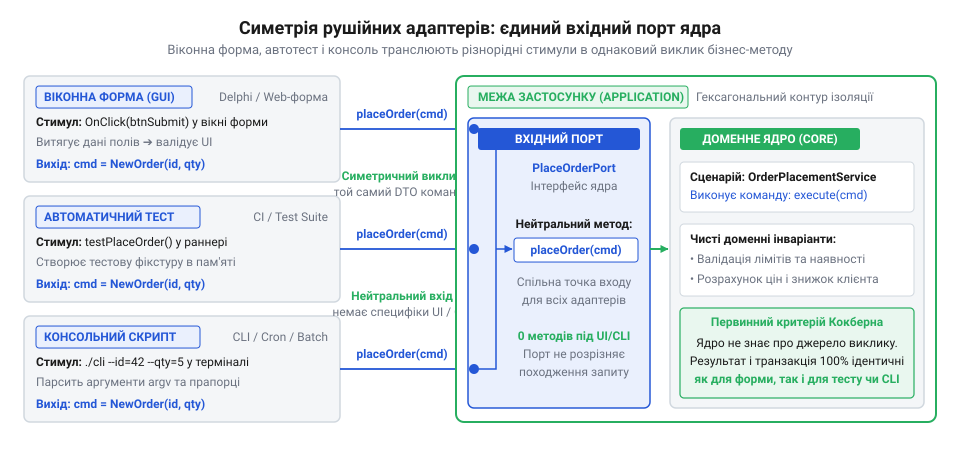
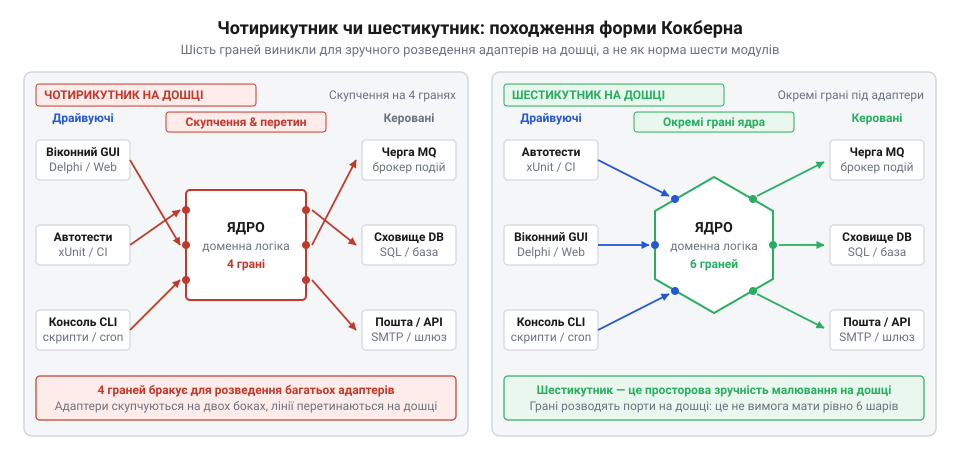

# Виникнення гексагональної архітектури та еволюція драйвуючих адаптерів Алістера Кокберна

## Заручники кнопок у віконних формах

На початку 1990-х років індустрію захопила революція швидкої розробки програмного забезпечення (@@en|RAD@@, англ. @@en|Rapid Application Development@@). Середовища @@en|Visual Basic@@ від компанії @@en|Microsoft@@ (1991 рік) та @@en|Delphi@@ від @@en|Borland@@ (1995 рік) обіцяли разючу продуктивність. Інженер малював мишею віконну форму, перетягував на полотно текстові поля й кнопку, двічі клікав по ній і одразу опинявся в редакторі коду обробника події.

Справжня пастка полягала в тому, що саме всередину процедури обробки натискання кнопки програмісти поміщали весь сценарій. У межах одного методу код зчитував текстовий рядок із поля форми, перевіряв формат даних, розраховував знижку чи кредитний відсоток, надсилав прямий @@en|SQL@@-запит до таблиці бази даних і відмальовував підсумок у напис на екрані. Доменні правила виявилися намертво вшитими у віконні компоненти конкретної операційної системи.

Криза вибухала тоді, коли бізнес вимагав автоматизації без участі людини — наприклад, щонічного перерахунку балансів чи імпорту банківських виписок із файлу через консольну команду. Викликати потрібний розрахунок окремо було неможливо, адже він існував лише як приватна підпрограма конкретного вікна. Інженери опинилися перед вибором між двома лихами. Перший шлях — скопіювати алгоритм розрахунку в окремий скрипт чи збережену процедуру бази даних, що призводило до неминучого розходження правил за першої ж правки коду. Другий шлях — створювати штучні обхідні ланцюжки: невидимо запускати віконну форму у фоновому режимі та імітувати клацання миші через системні повідомлення операційної системи. Для цього зовнішня програма зверталася до @@en|Windows API@@ і через функцію @@en|SendMessage@@ надсилала вікну повідомлення @@en|WM_COMMAND@@ (від англ. @@en|Windows message command@@ — повідомлення вікна про команду) з числовим ідентифікатором цільової кнопки. Віконна процедура сприймала це повідомлення як реальний сигнал від користувача і запускала прив'язаний обробник події. Такий неприродний механізм залишався єдиним способом достукатися до коду, адже бізнес-правила не існували окремо від форми й були замкнені за її внутрішнім диспетчером подій. Ця імітація дорого коштувала системі: заради одного фонового обчислення доводилося створювати графічний контекст, виділяти віконні дескриптори та ініціалізувати всі візуальні елементи форми в пам'яті. До того ж конструкція виявлялася надзвичайно крихкою: будь-яке несподіване діалогове вікно з помилкою чи запитом підтвердження блокувало чергу повідомлень і намертво зупиняло фоновий процес без оператора перед монітором, а зміна ідентифікатора кнопки у візуальному редакторі призводила до мовчазного збою без жодного попередження від компілятора.

Автоматизоване тестування за таких умов було нездійсненним: перевірити правильність формули можна було тільки руками, натискаючи кнопку на моніторі. Бізнес-логіка стала заручником графічного інтерфейсу та людини за клавіатурою. Детальніше розібрати цю проблему та з'ясувати, як саме [протікання бізнес-логіки в обробники подій інтерфейсу](root:sf-apps/gui-event-handler-business-leak) блокує автономне тестування та повторне використання коду, допоможе окремий огляд.

## Відкриття симетрії між тестом і інтерфейсом

На зламі 1990-х і 2000-х років рух екстремального програмування висунув вимогу суцільного охоплення коду швидкими модульними тестами. Поява фреймворків родини @@en|xUnit@@ вимагала запускати десятки й сотні перевірок за секунди без участі оператора. Проте інженери щоразу натикалися на віконну залежність: щоб перевірити бізнес-правило, програмі доводилося ініціалізувати графічну підсистему чи чекати на реальні події введення.

Американський консультант з програмної інженерії @@en|Алістер Кокберн@@ (@@en|Alistair Cockburn@@), досліджуючи техніку моделювання @@en|сценаріїв використання@@ (англ. @@en|use case@@ — випадок використання), звернув увагу на приховану симетрію. Якщо поглянути на бізнес-логіку зсередини, для неї немає жодної різниці, звідки надійшов сигнал на виконання операції: оператор клацнув мишею по кнопці екранної форми, тест @@en|JUnit@@ викликав метод із тестовими даними чи системний планувальник передав аргументи через командний рядок. В усіх трьох випадках намір той самий — виконати конкретний крок бізнес-процесу.

Кокберн запропонував надати ядру застосунку @@en|драйвуючий порт@@ (англ. @@en|to drive@@ — вести, надавати руху; лат. @@la|porta@@ — брама, вхід). Це абстрактний програмний інтерфейс, який оголошує доступні доменні операції мовою самої предметної області, без жодної згадки про кнопки чи протоколи. А зовнішні джерела сигналів реалізують @@en|драйвуючі адаптери@@ (лат. @@la|adaptare@@ — пристосовувати).

*Ядро застосунку взаємодіє з оточенням через драйвуючий порт, до якого інтерфейс користувача, тестовий набір і консольна утиліта підключаються як рівноправні адаптери.*

Драйвуючий адаптер бере на себе всю брудну роботу з перекладу: він перехоплює клік віконної кнопки, @@en|HTTP@@-запит веб-сервера чи запуск тестової функції, дістає звідти сирі параметри, перетворює їх на чисті доменні структури та викликає метод драйвуючого порту. Відповідь ядра адаптер пакує назад у форму, зрозумілу клієнту — оновлює вікно, повертає код стану або формує твердження тесту.

У цій моделі графічний інтерфейс користувача втратив привілейований статус центральної точки програми. Він перетворився на один із багатьох рівноправних механізмів доставки команд, а автоматичний тест здобув прямий доступ до ядра без потреби в емуляції дій людини.

## Маніфест 2005 року та метафора шестикутника

У 2005 році Кокберн опублікував маніфест нового підходу у статті під заголовком «@@en|Hexagonal Architecture@@», назвавши сам патерн «@@en|Порти й адаптери@@» (@@en|Ports and Adapters@@). Публікація миттєво викликала суперечки довкола форми: інженери намагалися зрозуміти, чому архітектура саме шестикутна і чи вимагає вона ділити систему рівно на шість частин або шарів.

Насправді геометрична фігура була суто практичною метафорою для малювання архітектури на офісній маркерній дошці. Коли Кокберн зображав ядро програми класичним чотирикутником, чотирьох сторін фізично не вистачало для охайного креслення. Ліворуч намагалися підключити всі драйвуючі адаптери — форми, консоль, тести, веб-контролери, — а праворуч під'єднували керовані адаптери сховищ, черг повідомлень та поштових шлюзів. Стрілки перетиналися, написи зливалися, а схема перетворювалася на клубок ліній. Шестикутник (грец. @@el|hexagōnos@@: @@el|hex@@ — шість, @@el|gōnia@@ — кут) просто дав більший периметр і чіткі роздільні грані для кожного типу адаптерів.

*Шестикутник народився як спосіб розвантажити креслення на дошці: додаткові грані дають змогу розвести адаптери без перетину стрілок.*

Фундаментальне відкриття полягало не в кількості кутів, а в непорушному правилі залежностей: зовнішній світ знає про внутрішній, але внутрішній світ ніколи не знає про зовнішній. Доменне ядро цілковито ізольоване від деталей інфраструктури. Будь-який адаптер перебуває за межами шестикутника і залежить від ядра, підлаштовуючись під його контракти.

Пізніше початкову простоту Кокберна часто захаращували чужими приписами. Від гексагональної схеми вимагали обов'язкового запровадження важких тактичних конструкцій предметно-орієнтованого проєктування (@@en|DDD@@) або жорстких концентричних кіл @@en|Clean Architecture@@ @@en|Роберта Мартіна@@ (@@en|Robert Martin@@) зі створенням окремого класу на кожен рух даних. Для простих систем без вираженої бізнес-поведінки [таке відокремлення надмірне](root:progarch/hexagon-when-overkill), адже порти лише дублюють таблиці. Справжній критерій Кокберна набагато лаконічніший: чи здатна бізнес-логіка повністю виконатися в ізольованому автоматичному тесті без бази даних, мережі та віконного середовища. Якщо ж для перевірки розрахунку доводиться створювати реальні таблиці або [інтерфейс виказує сховище](root:progarch/port-smelling-of-storage), зв'язність залишається хибною.

## Спотворення задуму нашаруваннями Clean Architecture

Первинна модель @@en|Алістера Кокберна@@ ділила систему лише на дві зони: внутрішнє доменне ядро та зовнішній світ адаптерів. Проте лаконічна ідея швидко почала обростати новими внутрішніми кільцями. У 2008 році американський інженер @@en|Джеффрі Палермо@@ (@@en|Jeffrey Palermo@@) запропонував концепцію [цибулевої архітектури](root:sf-apps/onion-architecture) (англ. @@en|Onion Architecture@@: @@en|onion@@ — цибуля), де розбив простір ядра на концентричні шари доменних моделей, доменних служб та служб застосунку. За кілька років, у 2012 році, @@en|Роберт Мартін@@ (@@en|Robert C. Martin@@) розвинув цю ідею в маніфесті @@en|Clean Architecture@@ (англ. @@en|clean@@ — чистий), додавши жорсткі правила взаємодії між сутностями, сценаріями використання, презентерами й контролерами.

Ситуацію посилило зростання популярності предметно-орієнтованого проєктування: гексагональну структуру почали вважати неповноцінною без обов'язкового впровадження [тактичних патернів DDD](root:sf-apps/tactical-domain-driven-design) — репозиторіїв, фабрик і коренів агрегатів. Замість гнучкої межі індустрія отримала новий інженерний @@en|карго-культ@@ (англ. @@en|cargo cult@@). Будь-яка бізнес-операція тепер вимагала власного сценарію, окремого інтерфейсу @@en|драйвуючого порту@@ та десятків транзитних об'єктів передачі даних (@@en|DTO@@, англ. @@en|Data Transfer Object@@) для вхідних і вихідних параметрів. Інженери писали кілометри церемоніального коду лише для того, щоб перекласти однакові поля з одного класу в інший, аби жоден внутрішній тип випадково не перетнув умовне кільце.

Коли завдання зводиться до звичайного збереження чи читання даних, такі багаторівневі перекладачі перетворюють код на нерухому конструкцію, де [гексагон стає зайвим](root:progarch/hexagon-when-overkill). Кокберн ніколи не вимагав множення концентричних оболонок чи заборони на передачу доменних типів через драйвуючий порт. Його правило було набагато простішим: доменне ядро керує власними контрактами й не залежить від деталей реалізації зовнішніх систем.

## Первинний критерій життєздатності архітектурного ядра

Серед десятків створених модулів, папок і транзитних класів легко втратити розуміння, чи справді програма має незалежне ядро. Багатошарова структура в проєкті сама по собі не гарантує архітектурної чистоти. @@en|Алістер Кокберн@@ сформулював прямий інженерний критерій перевірки: архітектура побудована правильно тоді й лише тоді, коли повноцінний бізнес-сценарій виконується автоматичним тестом або консольним скриптом так само повноцінно й успішно, як і через графічний інтерфейс чи веб-сторінку.

Головним мірилом розв'язання системи є автономність ядра в часі та просторі. Справді ізольована бізнес-логіка здатна ініціалізуватися й виконати сценарій за лічені мілісекунди без запуску веб-сервера, без відкриття віконного компонента та без підняття реальної бази даних. Підключення @@en|in-memory@@ замінників сховищ дозволяє виконати повний цикл розрахунку без мережевих затримок. Замість передачі запитів через сокети до віддаленої бази даних ядро оперує станом через звичайні колекції в оперативній пам'яті процесу. Такий розрахунок позбавлений витрат на серіалізацію даних та очікування диска: доменні правила зчитують і змінюють об'єкти безпосередньо в адресному просторі процесу. Якщо для перевірки доменного правила тесту необхідно запустити екземпляр сервера або якщо інтерфейс вимагає структур збереження таблиць, у системі виникає [порт, що пахне сховищем](root:progarch/port-smelling-of-storage), а межа між бізнесом та інфраструктурою залишається пробитою.

Тестовий набір у моделі Кокберна виступає як найсуворіший @@en|драйвуючий адаптер@@. Він передає до порту чисті вхідні дані, підставляє швидкі замінники замість зовнішніх сервісів у @@en|керовані адаптери@@ та миттєво перевіряє вихідний результат. Якщо повний ланцюжок бізнес-правил бездоганно працює в оперативній пам'яті за частку секунди, @@en|драйвуючий порт@@ повністю виконав своє призначення, незалежно від кількості шарів у проєкті.
