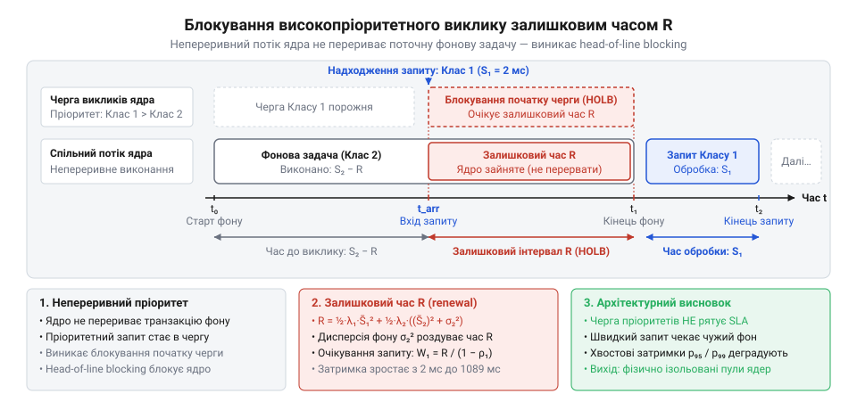
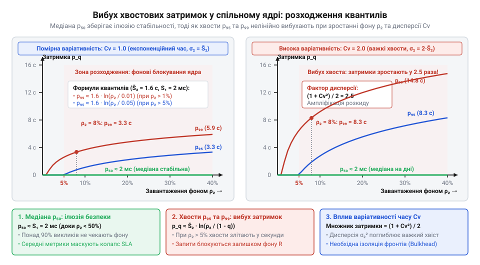

# Математична модель конкуренції гетерогенних потоків за спільні ресурси ядра

<preknowlist>
- [DH v2: застосунок набуває форми](root:progarch/dh-v2-hexagon) — Організація архітектури системи Digital Homes навколо прикладного ядра, концепція застосункових сценаріїв (Use Cases) як точок входу та спільне використання пулу з'єднань до бази даних через вихідні порти інфраструктури.
</preknowlist>

## Пастка спільного пулу в ядрі

У системі розумного будинку @@en|Digital Homes@@ швидкі інтерактивні запити мешканців — відімкнути замок дверей, увімкнути світло або перевірити показники кімнатних датчиків — мають виконуватися за лічені мілісекунди. Водночас ядро застосунку виконує регулярні фонові задачі: збирає щогодинні зведення енергоспоживання, усереднює показники телеметрії десятків контролерів та індексує журнал подій. Під час [трансляції доменних команд](root:progarch/dh-egress-actuator-protocol-mapping) у фізичні дії користувач очікує негайного відгуку.

Коли обидва типи навантажень обслуговує єдиний монолітний процес, побудований навколо спільних інфраструктурних ресурсів — [архітектури ядра Digital Homes](root:progarch/dh-v2-hexagon), — вони ділять спільний пул потоків (англ. @@en|thread pool@@) і спільний пул з'єднань (англ. @@en|connection pool@@) із базою даних. Пул потоків виділяє воркери для обчислень, а пул з'єднань обмежує кількість одночасних сесій до сховища даних.

Інтуїтивно здається, що низьке середнє навантаження на процесор (наприклад, 15–20% утилізації процесорного часу) гарантує стабільну роботу системи. Проте під час запуску щогодинного розрахунку телеметрії інтерфейс мешканців раптово паралізує: мобільний застосунок зависає, а запити керування замками відвалюються за таймаутом. Системи моніторингу водночас демонструють оманливий спокій: медіанна затримка — 50-й перцентиль (від лат. @@la|per centum@@ — на сотню) — майже не змінюється. Справжня катастрофа розгортається у хвості розподілу: 95-й та 99-й перцентилі затримки злітають від кількох мілісекунд до десятків секунд.

Причина полягає у фундаментальній гетерогенності потоків. Фонова задача захоплює робочий потік та утримує відкриту транзакцію бази даних протягом тривалого часу. Хоча таких фонових завдань небагато, вони повністю монополізують неподільні ресурси ядра. Короткий інтерактивний запит потрапляє в чергу позаду важкої фонової операції й очікує не процесорного часу, а звільнення заблокованого з'єднання чи воркера.

Середні показники маскують катастрофічну деградацію хвостових затримок у неоднорідних середовищах. Щоб розрахувати критичні пороги вичерпання ресурсів ядра та захистити критичний інтерактивний трафік, інженеру потрібен строгий математичний апарат аналізу черг із гетерогенним навантаженням.

## Черга гетерогенних потоків у ядрі

Математично описати конкуренцію за неподільні ресурси ядра дозволяє теорія масового обслуговування (англ. @@en|queueing theory@@). Розглянемо неподільний ресурс ядра — окремий потік виконання або одне з'єднання з базою даних — як обслуговуючий пристрій черги `M/G/1` за класичною класифікацією Кендалла. Символ `M` позначає марковський пуассонівський потік (англ. @@en|Poisson process@@) надходження запитів із незалежними експоненційними інтервалами між подіями; `G` — загальний довільний розподіл (англ. @@en|general distribution@@) тривалості обслуговування задач; `1` — один неподільний обслуговуючий пристрій.

На вхід пристрою надходять два незалежні пуассонівські потоки:
- інтерактивний потік швидких запитів з інтенсивністю `λ₁` операцій за секунду та детермінованим коротким часом виконання `S₁`, що має математичне сподівання `S̄₁`;
- фоновий потік важких операцій з інтенсивністю `λ₂` операцій за секунду та випадковим тривалим часом виконання `S₂`, що має математичне сподівання `S̄₂` і підпорядковується довільному розподілу ймовірностей.

Частка часу, протягом якого обслуговуючий пристрій зайнятий виконанням завдань кожного класу, визначається його коефіцієнтом завантаження. Для кожного потоку обчислимо парціальний коефіцієнт завантаження ядра як добуток інтенсивності надходження на середній час виконання:

    ρ₁ = λ₁ · S̄₁    [коефіцієнт завантаження ядра інтерактивним потоком]
    ρ₂ = λ₂ · S̄₂    [коефіцієнт завантаження ядра фоновим потоком]

Тут `ρ₁` позначає частку утилізації ядра швидкими викликами, а `ρ₂` — важкими фоновими задачами. Сумарний коефіцієнт завантаження ядра `ρ` дорівнює сумі цих парціальних часток:

    ρ = ρ₁ + ρ₂
      = λ₁ · S̄₁ + λ₂ · S̄₂    [сумарне навантаження ядра від двох потоків]

Отримане значення `ρ` виражає сумарну частку часу, коли ядро перебуває в робочому стані. Система зберігає ергодичність (від грец. @@el|ergon@@ — робота та @@el|hodos@@ — шлях; стан динамічної рівноваги, за якого черга не росте нескінченно) лише тоді, коли сумарне завантаження строго менше одиниці:

    ρ < 1    [умова ергодичності та стійкості черги M/G/1]

Якщо умова порушується і `ρ ≥ 1`, черга завдань зростає до нескінченності, спричиняючи гарантоване вичерпання пам'яті процесу.

**Розрахунок часток утилізації ядра Digital Homes**
Нехай інтерактивні запити надходять з інтенсивністю `λ₁ = 50` зап/с із середнім часом обробки `S̄₁ = 0.002` с (2 мс). Важкі фонові розрахунки надходять рідко: `λ₂ = 0.5` зап/с (один запит на 2 секунди), проте тривають у середньому `S̄₂ = 1.4` с (1400 мс).
Обчислимо парціальні та сумарні частки завантаження ядра:

    ρ₁ = 50 · 0.002 = 0.10    [інтерактивний потік займає 10% ресурсу ядра]
    ρ₂ = 0.5 · 1.4 = 0.70     [фоновий потік займає 70% ресурсу ядра]
    ρ  = 0.10 + 0.70 = 0.80   [сумарне навантаження ядра становить 80%]

Хоча фонових операцій надходить у 100 разів менше (`λ₂ ≪ λ₁`), через їхню значну тривалість `S̄₂` саме вони забирають 70% усієї пропускної спроможності ядра. Система залишається математично стабільною (`ρ = 0.80 < 1`), проте баланс ресурсу зміщений на користь фону.

## Непереривний пріоритет та залишковий час

Природною реакцією на затримки користувацьких команд є спроба надати інтерактивному трафіку абсолютний пріоритет у черзі задач. Проте на рівні операцій ядра такий механізм є непереривним пріоритетом (англ. @@en|non-preemptive priority@@, від лат. @@la|praeemptio@@ — випереджальне скуповування). Потік виконання не може безпечно перервати транзакцію бази даних або обчислювальний крок фонового воркера без ризику пошкодження цілісності доменних даних. Якщо спільний ресурс ядра вже зайнятий виконанням фонової операції, новий високопріоритетний запит змушений чекати її повного завершення.

*Часова діаграма надходження інтерактивного запиту під час обробки фонової задачі: навіть за найвищого пріоритету виклик блокується залишковим інтервалом R.*

Унаслідок цього виникає блокування початку черги (англ. @@en|head-of-line blocking@@). Час, який високопріоритетний виклик змушений чекати до завершення поточної операції на обслуговуючому пристрої, називається залишковим часом обслуговування (англ. @@en|residual service time@@, від лат. @@la|residuus@@ — залишений позаду) і позначається символом `R`.

Новий запит знаходить ядро зайнятим виконанням інтерактивної задачі з імовірністю `ρ₁`, або виконанням фонової задачі з імовірністю `ρ₂`. За класичною [теоремою відновлення](root:math-probability/renewal-theory-residual-lifetime), математичне сподівання залишкової тривалості випадкового інтервалу зі середнім значенням `S̄` та другим моментом `S̄²` дорівнює відношенню `S̄² / (2 · S̄)`.
Оскільки ймовірність застати операцію класу `i` в обробці дорівнює `ρᵢ = λᵢ · S̄ᵢ`, обчислимо середній залишковий час затримки ядра `R` за формулою Поллачека — Хінчіна:

    R = ½ · λ₁ · S̄₁² + ½ · λ₂ · S̄₂²    [середній залишковий час затримки ядра]

У цьому виразі `S̄₁²` та `S̄₂²` позначають другі початкові моменти часу виконання запитів обох класів. Щоб виявити вплив нестабільності фонового навантаження, виразимо другий момент `S̄₂²` через математичне сподівання `S̄₂` та дисперсію (від лат. @@la|dispersio@@ — розсіювання) часу виконання `σ₂²`:

    S̄₂² = (S̄₂)² + σ₂²    [зв'язок другого початкового моменту з дисперсією]

Тепер обчислимо середній час очікування інтерактивного запиту в черзі `W₁` для системи з [чергою непереривного пріоритету](root:math-probability/mg1-priority-queue) з урахуванням залишкового часу `R`:

    W₁ = R / (1 - ρ₁)    [середній час очікування високопріоритетного класу]

Підставивши вирази залишкового часу та другого моменту фонового потоку, дістанемо остаточну залежність затримки інтерактивного виклику:

    W₁ = (½ · λ₁ · S̄₁² + ½ · λ₂ · ((S̄₂)² + σ₂²)) / (1 - ρ₁)    [залежність затримки від дисперсії фону]

Отриманий вираз доводить, що затримка високопріоритетних запитів `W₁` прямо пропорційна дисперсії часу фонових задач `σ₂²`. Що більша варіативність тривалості важких операцій, то довше інтерактивні запити простоюють у стані блокування початку черги.

**Розрахунок затримки інтерактивного виклику при варіативному фоні**
Візьмемо параметри платформи: `λ₁ = 50` зап/с, детермінований час `S₁ = 0.002` с (відповідно, дисперсія `σ₁² = 0`, а другий момент `S̄₁² = 0.002² = 0.000004` с²), частка `ρ₁ = 0.10`.
Фоновий потік надходить з інтенсивністю `λ₂ = 0.5` зап/с та середньою тривалістю `S̄₂ = 1.4` с. Якщо тривалість фонової телеметрії має значний розкид зі середньоквадратичним відхиленням `σ₂ = 1.4` с (отже, дисперсія `σ₂² = 1.96` с²), обчислимо величину другого моменту `S̄₂²`, залишковий час `R` та середню затримку інтерактивного виклику `W₁`:

    S̄₂² = 1.4² + 1.96 = 1.96 + 1.96 = 3.92 с²
    R   = ½ · 50 · 0.000004 + ½ · 0.5 · 3.92
        = 0.0001 + 0.98 = 0.9801 с
    W₁  = 0.9801 / (1 - 0.10)
        = 0.9801 / 0.90 ≈ 1.089 с

Незважаючи на найвищий пріоритет у черзі, короткий запит відімкнення замка з власним часом виконання 2 мілісекунди очікує в черзі понад одну секунду (1089 мс) виключно через випадковий залишковий час важких фонових транзакцій.

## Деградація хвостових затримок інтерактивного трафіку

Середня затримка оманлива: секунда очікування здається прийнятною ціною, але користувачі стикаються з відгуком конкретних викликів.

За властивістю Пуассона ймовірність застати ядро зайнятим фоном дорівнює завантаженню `ρ₂ = λ₂ · S̄₂`. Це розщеплює затримку на бімодальний розподіл (від лат. @@la|bi-@@ — подвійний та @@la|modus@@ — міра) із важким хвостом (англ. @@en|heavy tail@@). З імовірністю `1 - ρ₂` виклик не чекає фону й виконується за швидкий час `S₁`, а з імовірністю `ρ₂` — блокується й очікує випадковий залишковий час `R`.

Квантиль (від лат. @@la|quantus@@ — скільки) затримки фіксує поріг для заданої частки запитів. За `ρ₂ < 0.50` медіана `p₅₀` лишається в швидкій моді (`p₅₀ ≈ S₁`). Проте якщо `ρ₂ > 0.05`, 95-й та 99-й перцентилі відриваються від медіани на порядки, визначаючись залишками важких інтервалів `S₂`.

Виміряємо нестабільність фону коефіцієнтом варіації (від лат. @@la|variatio@@ — зміна):

    C_v = σ₂ / S̄₂    [коефіцієнт варіації тривалості фонових задач]

Коли `C_v > 1`, затримки отримують надважкий хвіст. За умови `ρ₂ > 1 - q` хвостовий квантиль `p_q` порядку `q` апроксимується через час фону `S̄₂`:

    p_q ≈ S̄₂ · ln(ρ₂ / (1 - q))    [апроксимація хвостового квантиля затримки]

Затримка зростає прямо пропорційно до тривалості фону `S̄₂` та поглиблюється логарифмічно.

*Залежність квантилів часу перебування від завантаження ядра фоновими задачами: медіана залишається на рівні одиниць мілісекунд, тоді як дев'яносто п'ятий і дев'яносто дев'ятий перцентилі нелінійно вибухають при зростанні варіативності важких операцій.*

**Розрахунок квантилів затримки інтерактивних запитів**
Швидкі запити мають час `S₁ = 0.002` с при `ρ₁ = 0.10`, а фоновий потік — `λ₂ = 0.05` зап/с, `S̄₂ = 1.6` с та `σ₂ = 1.6` с (`C_v = 1.0`).
Обчислимо завантаження `ρ₂`, медіану `p₅₀` та перцентилі `p₉₅`, `p₉₉`:

    ρ₂  = 0.05 · 1.6 = 0.08          [фонове завантаження ядра становить 8%]
    p₅₀ ≈ S₁ = 0.002 с               [медіана швидка: 0.08 < 0.50]
    p₉₅ ≈ 1.6 · ln(0.08 / 0.05) ≈ 0.752 с    [95-й перцентиль сягає 752 мс]
    p₉₉ ≈ 1.6 · ln(0.08 / 0.01) ≈ 3.326 с    [99-й перцентиль сягає 3.33 с]

Медіана становить 2 мс, але 99-й перцентиль зростає до 3.3 секунди, руйнуючи угоду про рівень послуг (англ. @@en|Service Level Agreement@@, @@en|SLA@@).

## Критичні пороги вичерпання спільних пулів

Теорія черг припускає нескінченний буфер, проте ядро обмежене пулом потоків `T` і пулом з'єднань із базою даних `C`. Пул з'єднань у [вивідному адаптері сховища](root:progarch/port-smelling-of-storage) є найвужчим місцем: база даних витримує лише лімітовану кількість сесій.

Середню кількість з'єднань визначає [закон Літтла](root:math-probability/littles-law) як добуток інтенсивності на час утримання. Позначивши час утримання інтерактивним викликом як `S̄_{1,db}`, а фоном як `S̄_{2,db}`, обчислимо навантаження для кожного потоку:

    L₁ = λ₁ · S̄_{1,db}    [середнє число з'єднань для інтерактивного потоку]
    L₂ = λ₂ · S̄_{2,db}    [середнє число з'єднань для фонового потоку]

Сумарний попит дорівнює `L = L₁ + L₂`. Пул вичерпується за умови досягнення місткості `C`:

    L₁ + L₂ ≥ C    [умова вичерпання пулу з'єднань]

Тоді виникає ресурсне голодування (англ. @@en|starvation@@, від давньоангл. @@ang|steorfan@@ — гинути). Фонова транзакція триває секундами (`S̄_{2,db} ≫ S̄_{1,db}`). Навіть якщо процесор вільний (`ρ ≪ 1`), кілька фонових задач монополізують усі `C` з'єднань. Швидкі запити відхиляються за таймаутом (від англ. @@en|time-out@@ — вихід часу за межу) `T_{timeout}`.

Прирівнявши попит до місткості `C`, знайдемо критичну інтенсивність фону `λ_{2,crit}`:

    λ_{2,crit} = (C - L₁) / S̄_{2,db}
               = (C - λ₁ · S̄_{1,db}) / S̄_{2,db}    [критична інтенсивність фонового потоку]

Поріг вичерпання обернено пропорційний до тривалості фонової транзакції `S̄_{2,db}`.

**Розрахунок критичного порогу пулу з'єднань Digital Homes**
Пул налічує `C = 10` з'єднань. Інтерактивний потік з `λ₁ = 50` зап/с утримує транзакцію `S̄_{1,db} = 0.04` с (40 мс). Фонова телеметрія утримує з'єднання `S̄_{2,db} = 4.0` с.
Обчислимо інтерактивну частку `L₁` та критичний поріг фону `λ_{2,crit}`:

    L₁         = 50 · 0.04 = 2.0         [інтерактивний потік займає 2 з'єднання]
    C - L₁     = 10 - 2.0 = 8.0          [залишок ємності для фону]
    λ_{2,crit} = 8.0 / 4.0 = 2.0 зап/с   [критична інтенсивність фону]

Якщо фоновий потік перевищить 2 операції на секунду, пул заблокується. Інтерактивні виклики чекатимуть довше за таймаут у 250 мс і масово відкидатимуться, хоча процесор вільний на 80%.

## Математичне обґрунтування фізичної ізоляції фронтів

Коли відомі хвостові затримки та пороги пулів, архітектор оцінює, [де ізоляція виправдана](root:progarch/hexagon-when-overkill), а де монолітний процес є безпечним і допустимим.

Норматив угоди про рівень послуг для 99-го перцентиля затримки `p₉₉ ≤ T_{SLA}` задає строге обмеження на середній залишковий час ядра `R` за інтерактивного завантаження `ρ₁`:

    R < (1 - ρ₁) · T_{SLA}    [критерій виконання SLA у спільному ядрі]

Якщо залишковий час фонових завдань `R = ½ · λ₂ · S̄₂²` порушує цю нерівність, або якщо необхідний розмір пулу перевищує технічний ліміт СУБД `C_{max}`, спільне виконання стає неприпустимим.

У такій ситуації безальтернативним є [патерн відсіків](root:sf-apps/bulkhead-pattern-resource-isolation) (англ. @@en|bulkhead@@ — судноплавна водонепроникна перебірка). Точки входу виносять в окремі процеси чи контейнери з ізольованими квотами пам'яті, потоків та розділеними пулами з'єднань `C₁` і `C₂`:

    C₁ + C₂ ≤ C_{max}    [бюджетування пулів з'єднань за відсіками]

Розподіл гарантує, що вичерпання пулу `C₂` фоном не позбавить з'єднань `C₁` інтерактивний фронт.

Обчислимо новий залишковий час ядра `R₁` в ізольованому відсіку інтерактивного фронту, де фоновий потік відсутній (`λ₂ = 0`):

    R₁ = ½ · λ₁ · S̄₁²    [залишковий час в ізольованому інтерактивному відсіку]

Вилучення важкого фону зводить залишковий час лише до власних швидких запитів.

**Розрахунок затримок в ізольованому відсіку Digital Homes**
За параметрів `λ₁ = 50` зап/с, `S₁ = 0.002` с (`S̄₁² = 0.000004` с², `ρ₁ = 0.10`) обчислимо залишковий час `R₁` та очікування `W₁`:

    R₁ = ½ · 50 · 0.000004 = 0.0001 с    [залишковий час становить 0.1 мс]
    W₁ = 0.0001 / (1 - 0.10)
       = 0.0001 / 0.90 ≈ 0.00011 с       [середнє очікування становить 0.11 мс]

Залишковий час блокування падає з 980 мс до 0.1 мс. Бімодальний хвіст зникає, а затримка інтерактивних команд укладається в межі однієї мілісекунди.

Фізична ізоляція зайва лише за виконання обох нерівностей: `R ≪ (1 - ρ₁) · T_{SLA}` та `L₁ + L₂ ≪ C_{max}`. Якщо ж фонові задачі важкі або пул вичерпується, фізичний поділ середовищ є строгою математичною вимогою надійності.
