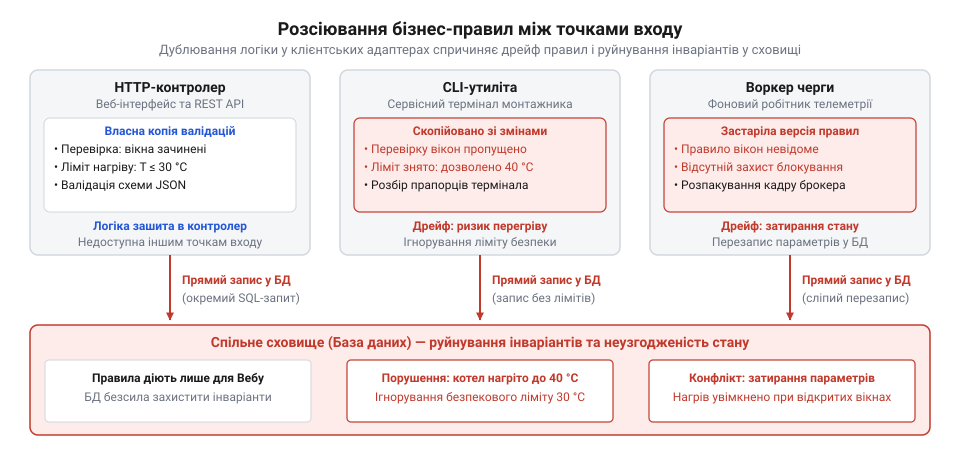
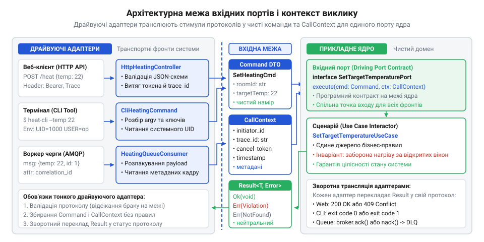
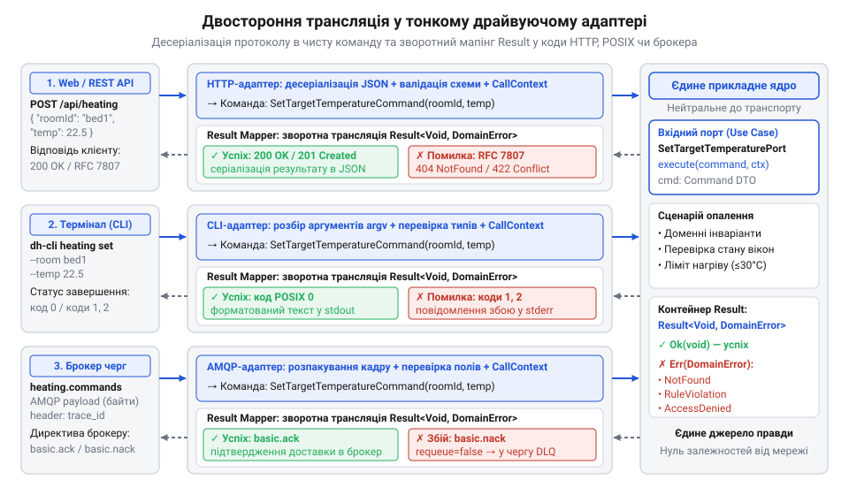
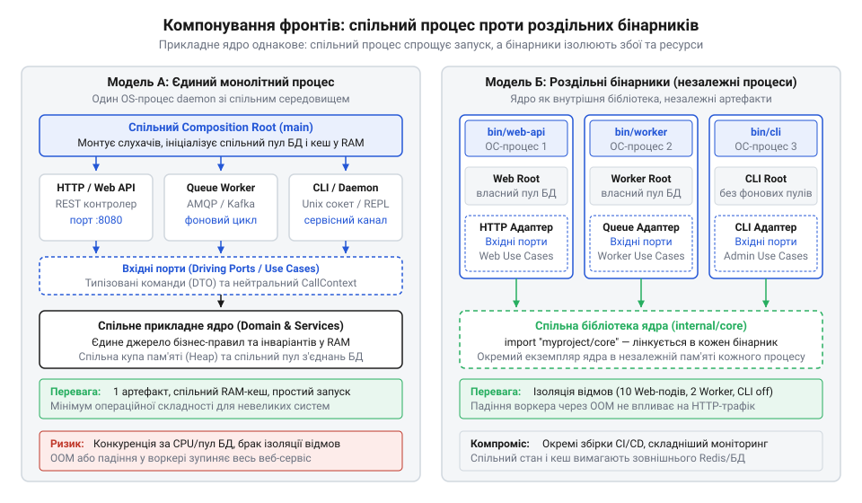
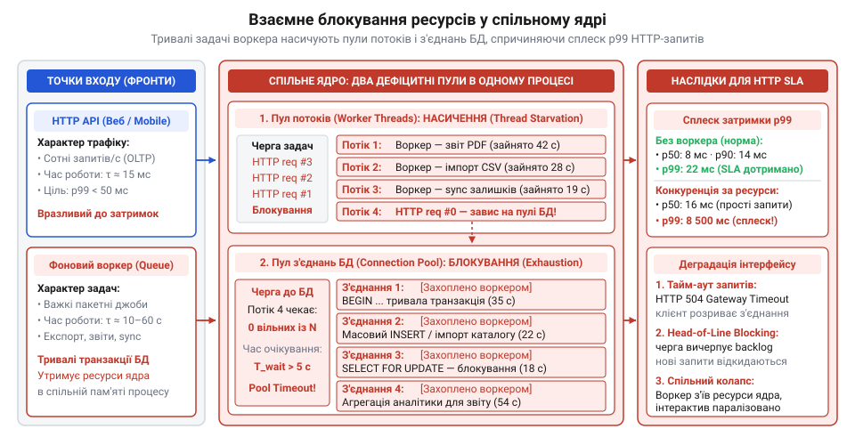

# Одне ядро, кілька фронтів

<preknowlist>
- [DH v2: застосунок набуває форми](root:progarch/dh-v2-hexagon) — Архітектурна організація системи Digital Homes навколо прикладного ядра: відокремлення застосункових сценаріїв (Use Cases) від зовнішнього оточення та ізоляція бізнес-правил розумного будинку
</preknowlist>

## Розсинхронізація правил між точками входу

Коли система має лише одну @@en|точку входу@@ — веб-сервер, — спокуса розмістити бізнес-правила безпосередньо в обробниках запитів здається нешкідливою. У системі Digital Homes саме так і вчинили: HTTP-@@en|контролер@@ перевіряв формат JSON-документа, перевіряв стан вікон перед увімкненням опалення, обмежував граничну температуру котла тридцятьма градусами й записував новий стан напряму в базу даних. Поки єдиним клієнтом залишався веб-інтерфейс, система поводилася передбачувано. Обмеження виконувалися стабільно, бо кожен вхідний запит неминуче проходив крізь один і той самий ланцюжок перевірок @@en|контролера@@.

Криза почалася в той момент, коли системі знадобився другий @@en|фронт@@ (від лат. *frons* — передній край, передова межа) — сервісна термінальна утиліта для монтажників, яким потрібен швидкий доступ до конфігурації без браузера. Щоб не запускати важкий веб-сервер, інженери написали окрему консольну команду. Потрібні перевірки клімату поспіхом скопіювали з веб-@@en|контролера@@, а ліміт температури навмисно прибрали, вважаючи, що кваліфікований монтажник не помилиться. Незабаром з'явився третій @@en|фронт@@ — фоновий робітник черги телеметрії, який автоматично коригував роботу опалення за сигналами вуличних датчиків. Його розробник узяв стару копію коду з репозиторію, не знаючи, що у веб-інтерфейсі нещодавно додали критичну заборону: ніколи не вмикати котел, якщо в кімнаті відчинені вікна.

Такий поділ породив неминучий @@en|дрейф логіки@@ (від нід. *drijven* — нестися за течією; відхилення копій поведінки). Консольний термінал монтажника спокійно дозволяв виставити небезпечні сорок градусів і запустити пальники за відкритих вікон, тоді як веб-інтерфейс цю саму операцію блокував. Фоновий робітник узагалі писав команди напряму в таблиці бази даних без жодних перевірок блокування, затираючи налаштування власника оселі. Будь-який бізнес-@@la|інваріант@@ (від лат. *invarians* — незмінний; непорушна умова коректності стану) виявився розмитим між трьома точками входу. Кожна з них зверталася до сховища напряму, діючи так, ніби вона єдиний господар системи.

Контраст між реалізаціями унаочнює код двох клієнтів: захисне правило перевірки вікон існує лише як умовний оператор усередині веб-@@en|контролера@@, тоді як консольна утиліта взагалі позбавлена цієї перевірки й одразу мутує записи в базі даних.

:::tabs
:::code one-core-many-fronts-d/ts/runcli.ts
:::code one-core-many-fronts-d/py/start-heating-web.py
:::

Коли бізнес-обмеження реалізують як звичайні інструкції розгалуження в транспортному обробнику, вони залишаються прив'язаними виключно до одного механізму доставки. Веб-@@en|контролер@@ перевіряє стан вікон лише тому, що автор конкретного запиту власноруч додав запит до таблиць і перевірку умови. Натомість розробник консольної утиліти створював інструмент для швидкого сервісного доступу: він або не знав про нове обмеження, або навмисно відкинув зайві рядки, щоб прискорити виконання команди. У результаті термінальний скрипт надсилає пряму команду оновлення в базу даних і переводить котел у небезпечний режим роботи за відчинених вікон. Спільне сховище безсиле захистити бізнес-@@la|інваріанти@@, якщо кожна @@en|точка входу@@ самостійно вирішує, які правила виконувати, а які ігнорувати.


*Коли кожна точка входу самостійно перевіряє правила та напряму змінює записи в базі даних, будь-яка відмінність у реалізації руйнує цілісність системи.*

Причина цієї розсинхронізації полягає в тому, що механізми доставки перебрали на себе обов'язки доменних правил. Веб-@@en|контролер@@, консольна команда чи підписник черги відрізняються виключно транспортом: розбором запиту HTTP, читанням позиційних аргументів командного рядка чи вичитуванням кадрів брокера. Проте транспортний протокол не має права вирішувати, за яких умов безпечно запускати нагрів. Спроба втримати однакову логіку ручним копіюванням коду між точками входу завжди програє: щойно число фронтів зростає, правила розходяться через людський фактор і різні темпи релізів.

Ця пастка відома в індустрії ще з 1990-х років, коли логіка намертво вростала у віконні форми та скрипти раннього вебу. Тоді кожна нова утиліта змушувала копіювати доменний код, доки [ідея симетричних портів](root:progarch/one-core-many-fronts/hist-cockburn-hexagonal-genesis.md) не звела графічний інтерфейс, термінал і черги до рівноправних зовнішніх збудників ядра. Єдиний порятунок від розсинхронізації — повністю звільнити транспортні обробники від прийняття рішень: вони повинні лише перетворювати зовнішній сигнал на намір, передаючи його на виконання в спільне [прикладне ядро](root:progarch/dh-v2-hexagon).

## Прикладне ядро та нейтральні вхідні порти

Перша спроба винести бізнес-правила з обробників доставки в єдине ядро часто розбивається об інтерфейс самого ядра. Коли розробник створює загальну функцію для зміни опалення, виникає спокуса передати в неї сирий об'єкт запиту — `HttpRequest`, кортеж аргументів командного рядка чи повідомлення з черги. Усередині прикладного методу з'являються звернення до транспорту на кшталт `request.headers["Authorization"]` або `args.get("--temperature")`. Така межа створює лише ілюзію відокремлення: щойно ядро торкається деталей конкретного протоколу, воно стає його заручником. Щоб викликати ту саму дію з термінала чи обробника черги, розробникам доведеться або створювати штучний фіктивний HTTP-запит, або знову розмножувати перевірки.

Щоб ядро залишалося єдиним джерелом правди для будь-якого клієнта, його вхідну межу проєктують як @@en|драйвуючий порт@@ (англ. *driving port*, від лат. *porta* — ворота; вхідний інтерфейс). Драйвуючий порт — це програмний контракт прикладного @@en|сценарію@@ (англ. *use case*), який нічого не знає про сокети, парсери JSON чи рядки термінала. Кожен сценарій приймає на вхід виключно чистий об'єкт передавання даних — @@en|DTO@@ (англ. *Data Transfer Object*). Для дій, що змінюють стан системи, це об'єкт команди (наприклад, `SetTargetTemperatureCommand`), який містить лише скалярні значення та доменні типи: ідентифікатор кімнати, числову цільову температуру та прапорець пріоритету. Для операцій читання формується об'єкт запиту (Query).

:::tabs
```ts
// Об'єкт команди: чистий намір без транспортних полів
export interface SetTargetTemperatureCommand {
  readonly roomId: string;
  readonly targetTemperature: number;
  readonly isPriority: boolean;
}

// Драйвуючий порт: програмний контракт сценарію на межі ядра
export interface SetTargetTemperaturePort {
  execute(command: SetTargetTemperatureCommand): void;
}
```
```py
from dataclasses import dataclass
from typing import Protocol

# Об'єкт команди: чистий намір без транспортних полів
@dataclass(frozen=True)
class SetTargetTemperatureCommand:
    room_id: str
    target_temperature: float
    is_priority: bool = False

# Драйвуючий порт: програмний контракт сценарію на межі ядра
class SetTargetTemperaturePort(Protocol):
    def execute(self, command: SetTargetTemperatureCommand) -> None:
        ...
```
:::

У цих структурах немає HTTP-заголовків, куків, аргументів командного рядка чи брокерських метаданих: ядро бачить чистий намір, виражений мовою предметної області. Незмінність полів @@en|DTO@@ гарантує цілісність переданих даних, унеможливлюючи приховані побічні мутації під час виконання сценарію. Якщо розробник піддасться спокусі замінити типізований @@en|DTO@@ на динамічний словник або передасть у метод сиру структуру веб-фреймворку, ізоляція негайно руйнується: ядро стає заручником деталей транспорту, а компілятор втрачає здатність верифікувати коректність виклику на етапі збірки. Жорсткий контракт @@en|драйвуючого порту@@ змушує будь-яку @@en|точку входу@@ транслювати зовнішній стимул у строго типізовану команду ще до перетину межі ядра, гарантуючи однаковість бізнес-поведінки для всіх @@en|фронтів@@.

Проте для виконання бізнес-сценарію самих параметрів команди недостатньо: системі потрібно знати, хто саме ініціював дію, чи має користувач право її виконувати, як зв'язати записи в розподілених логах і чи не минув термін дії операції. Якщо прокинути в ядро HTTP-заголовок `Authorization` або ім'я системного користувача з термінала, межа абстракції знову буде зламана. Усі службові відомості виносять в окремий @@en|контекст виклику@@ (англ. *call context*) — протокольно-нейтральну структуру, яку зовнішній обробник збирає перед зверненням до порту:
- **Ідентифікатор ініціатора (`initiator_id`)** та набір його доменних прав чи ролей незалежно від того, де вони зберігалися — у токені JWT, сертифікаті чи системному UID процесу;
- **Маркер трасування (`correlation_id` або `trace_id`)** для наскрізного зв'язування подій у журналах спостереження та розподілених трасах;
- **@@en|Токен скасування@@ (англ. *cancellation token*)**, що сигналізує ядру про необхідність припинити тривале обчислення, якщо клієнт розірвав з'єднання або вичерпано встановлений ліміт часу;
- **Часова мітка створення наміру (`timestamp`)**, яка фіксує момент реєстрації запиту зовнішнім середовищем.


*Вхідний порт відокремлює доменні сценарії від протоколів доставки, приймаючи виключно типізовані DTO та нейтральний контекст виклику.*

Нейтральність порту вимагає симетричної чистоти й на виході: ядро не повинно повертати специфічні протокольні коди на кшталт 404 або 500 і не має кидати сирі винятки у сподіванні, що хтось нагорі їх перехопить. Якщо клієнтський обробник змушений ловити загальний `Exception`, він втрачає контроль над причинами збою. Замість цього метод вхідного порту повертає типізований @@en|патерн Result@@ (від лат. *resultare* — випливати; типізований контейнер результату). Контейнер несе в собі або значення успіху з результатом операції, або типізовану доменну помилку. Помилки класифікують семантично: сутність не знайдено (`NotFound`), конфлікт правил (`Conflict`), порушення інваріанта стану (`RuleViolation`) чи відмова у доступі (`AccessDenied`). Така [ізоляція доменних збоїв](root:sf-apps/transport-agnostic-error-handling) робить межу передбачуваною: ядро пояснює причину відмови власною мовою, залишаючи формат представлення на розсуд зовнішнього клієнта.

Коли [специфікацію інтерфейсу порту](root:progarch/one-core-many-fronts/api-inbound-port-contract.md) закріплено в коді, застосунок отримує ще одну фундаментальну перевагу: ядро стає повністю автономним і не потребує запущеного веб-сервера чи брокера повідомлень для перевірки своєї логіки. Це відкриває шлях до [тестування бізнес-сценаріїв](root:progarch/one-core-many-fronts/proj-in-memory-driving-test-suite.md) безпосередньо в пам'яті процесу: приймальний тест підключається напряму до вхідного порту, передає команду з контекстом і перевіряє стан ядра за частки мілісекунди без найменших мережевих флапань.

## Двостороння трансляція у тонких драйвуючих адаптерах

Коли прикладне ядро надійно захищене нейтральним портом, постає завдання з'єднати його з реальними клієнтами. Цю роль виконує @@en|драйвуючий адаптер@@ (від лат. *adaptare* — пристосовувати) — компонент зовнішнього шару, який слухає свій транспортний канал і керує виконанням сценаріїв ядра. Головна вимога до драйвуючого адаптера — бути тонким. У ньому не має бути жодного розгалуження, що перевіряє стан доменних сутностей чи ухвалює рішення про допустимість операції. Адаптер робить лише три речі: перевіряє коректність протоколу доставки, перетворює зовнішні дані на команду порту й передає назад повернений доменний результат.

На першому кроці адаптер виконує пряму трансляцію вхідного запиту:
- **Для REST API:** здійснюється @@la|десеріалізація@@ (від лат. *de-* — скасування та *series* — ряд; відновлення структури з байтового потоку) тіла JSON, зчитування параметрів маршруту з URI та вилучення службових заголовків;
- **Для CLI:** виконується розбір рядка аргументів, позиційних параметрів та прапорців запуску утиліти;
- **Для брокера черг:** відбувається розпакування байтового корисного навантаження кадру та читання атрибутів доставки.

Одразу після розбору адаптер здійснює первинну протокольну валідацію: чи відповідають типи даним схеми, чи присутні обов'язкові поля документа, чи не перевищено граничний розмір корисного навантаження. Якщо вхідне повідомлення пошкоджено, адаптер негайно відхиляє запит, не навантажуючи ядро. Тут діє непорушне правило: [перевірка структури запиту](root:sf-apps/inbound-protocol-vs-domain-validation) відсікає синтаксичний брак на межі системи, тоді як семантичну перевірку бізнес-інваріантів виконує виключно ядро. Після успішної валідації адаптер збирає нейтральний контекст виклику й викликає метод відповідного порту.


*Драйвуючий адаптер здійснює симетричний переклад між зовнішнім протоколом доставки та типізованими контрактами ядра в обох напрямках.*

Справжня відповідальність тонкого адаптера полягає у зворотній трансляції: він мусить донести результат виконання сценарію до клієнта найбільш природним для його середовища способом.
Коли сценарій завершується успішно:
- HTTP-контролер повертає статус `200 OK` або `201 Created` із серіалізованим у JSON корисним навантаженням;
- Консольна утиліта виводить форматований текст чи таблицю у стандартний потік виводу `stdout` і завершує процес із числовим кодом `0`;
- Обробник черги надсилає брокеру директиву підтвердження доставки — @@en|ACK@@ (англ. *acknowledgement*), що дозволяє видалити опрацьоване повідомлення.

Аби логіка зворотної трансляції не розпорошувалася по ендпоінтах контролерів у вигляді хаотичних перевірок умов, її виділяють в окремий компонент — @@en|обробник результату@@ (англ. *result mapper*, від лат. *mappa* — полотно, карта; перетворювач результату на протокольну відповідь). Обробник приймає типізований @@en|патерн Result@@ прикладного сценарію: у разі успіху він серіалізує дані у JSON, а при виникненні доменної помилки зіставляє її семантичну категорію з числовим HTTP-статусом і пакує деталі збою у стандартизований документ за специфікацією RFC 7807 (*Problem Details for HTTP APIs*).

:::tabs
:::code one-core-many-fronts-d/ts/domainerrorkind.ts
:::code one-core-many-fronts-d/py/domainerror.py
:::

Уніфікований обробник результату позбавляє веб-контролер необхідності аналізувати семантику доменних відмов: контролер лише викликає метод порту та передає отриманий контейнер у мапер. Специфікація RFC 7807 стандартизує структуру помилки завдяки фіксованим атрибутам: `type` вказує на URI-ідентифікатор типу збою, `title` містить коротку назву, `status` дублює числовий код відповіді, а `detail` описує конкретну причину відмови. Завдяки заголовку `Content-Type: application/problem+json` клієнтська програма однозначно розпізнає формат помилки та розбирає її машинним способом.

Проте централізація мапінгу вимагає суворої дисципліни типів: за кожною новою семантичною помилкою ядра розробник мусить закріпити відповідний HTTP-статус у кожному веб-адаптері, не допускаючи невідомих станів за замовчуванням. Якщо ж контролери почнуть обходити обробник результату та самостійно формувати відповіді або перехоплювати помилки через довільні блоки `catch`, архітектурна межа миттєво зруйнується. У системі виникне неузгодженість протоколу: різні ендпоінти повертатимуть суперечливі структури даних для однакових доменних відмов, а необроблені винятки ядра пробиватимуться назовні у вигляді статусу `500 Internal Server Error` із витоком внутрішніх стек-трейсів у відповідь клієнту.

Якщо ж ядро повертає відмову, адаптер транслює категорію доменної помилки у специфічні протокольні коди:
- **REST API:** адаптер зіставляє `NotFound` зі статусом HTTP `404`, `AccessDenied` — з `403`, а порушення інваріанта `RuleViolation` — зі статусом `422 Unprocessable Entity` або `409 Conflict`. Формат відповіді стандартизується за специфікацією RFC 7807 (Problem Details), повертаючи клієнту структурований JSON з типом, описом та полями помилки.
- **CLI:** адаптер виводить зрозуміле повідомлення у потік помилок `stderr` і встановлює відмінний від нуля код завершення процесу за стандартом POSIX (наприклад, код `1` для загальної помилки або `2` для некоректних параметрів).
- **Queue Worker:** робітник черги визначає долю повідомлення в брокері. Якщо сталася бізнес-помилка, яку неможливо усунути повтором, надсилається директива відхилення @@en|NACK@@ (англ. *negative acknowledgement*) із переміщенням кадру в чергу мертвих листів (Dead Letter Queue). Якщо ж ядро повідомило про тимчасову недоступність інфраструктури, адаптер наказує брокеру повернути повідомлення в чергу (Requeue) для повторної спроби.

Такий двосторонній переклад гарантує абсолютну симетрію поведінки системи незалежно від способу збудження. Коли [контракти життєвого циклу](root:progarch/one-core-many-fronts/api-driving-adapter-lifecycle.md) адаптерів уніфіковано, підключення нового фронту полягає лише у створенні ще одного тонкого транслятора без жодних змін у ядрі. Цю потребу довела [уніфікація термінальних утиліт](root:progarch/one-core-many-fronts/hist-cli-api-unification-in-devops.md) під час підйому DevOps-платформ Docker і Kubernetes, де дії інженера в терміналі та мережеві запити оркестратора спрямовуються до однакових прикладних операцій. Повноцінну реалізацію такої структури показано в [багатоканальному сервісі з ядром](root:progarch/one-core-many-fronts/proj-single-core-multichannel-service.md), де веб-сервер, консольна утиліта та черги працюють поверх єдиного прикладного ядра без найменшого дублювання логіки.

## Тестовий драйвер та перевірка в пам'яті

Традиційний підхід до перевірки поведінки застосунку вимагає розгортання повного стека доставки: запуску веб-сервера, виділення вільних TCP-портів, серіалізації тестових даних у JSON та надсилання реальних мережевих запитів через HTTP-клієнт. Такий спосіб перевірки надзвичайно дорогий. Запуск мережевого контуру додає сотні мілісекунд затримки на кожен запит, створює ризик конфліктів за порти в середовищі неперервної інтеграції та спричиняє флапання тестів через випадкові мережеві таймаути. Якщо бізнес-правила переплетені з кодом веб-контролера, розробник опиняється в пастці: перевірити поведінку системи без важкої інфраструктури стає неможливо.

Чиста межа ядра докорінно змінює цю картину. Оскільки @@en|драйвуючий порт@@ приймає виключно технологічно нейтральні команди та повертає типізований @@en|патерн Result@@, ядру байдуже, звідки надійшов стимул. Зовнішнім джерелом виклику не обов'язково має бути реальний користувач чи мережевий демон. Автоматизований тестовий набір стає таким самим повноправним клієнтом, реалізуючи @@en|тестовий драйвер@@ (англ. *test driver*, від давн.-англ. *drīfan* — приводити в рух; адаптер тестового середовища, що керує виконанням порту безпосередньо в процесі). Тестовий код напряму викликає метод прикладного @@en|сценарію@@ у пам'яті процесу, передаючи сконструйований об'єкт команди та тестовий @@en|контекст виклику@@.

Цю фундаментальну рівність зовнішніх клієнтів сформулював Алістер Кокберн, коли обґрунтував [принцип симетрії драйверів](root:progarch/one-core-many-fronts/hist-cockburn-hexagonal-genesis.md) як відповідь на неможливість протестувати бізнес-логіку застосунків 1990-х років в ізоляції від віконних інтерфейсів і ранніх серверних контролерів. Кокберн наполягав: інтерфейс користувача, термінальна утиліта, споживач черги та набір автоматичних перевірок є рівноправними зовнішніми драйверами, які мають взаємодіяти з ядром через однакові порти.

На практиці це дає змогу будувати наскрізний @@en|приймальний тест@@ (англ. *acceptance test*, від лат. *acceptare* — приймати; наскрізна верифікація сценарію на відповідність бізнес-вимогам), який виконується за лічені частки мілісекунди. Тестовий драйвер підключається безпосередньо до вхідного порту, а керовані [порти сховищ](root:progarch/port-smelling-of-storage) та зовнішніх служб замінюються швидкими дублерами в пам'яті. Тест надсилає команду, одразу отримує повернений результат і перевіряє стан ядра. У такому середовищі відсутні серіалізація, дискове введення-виведення та мережеві сокети. Помилка в сценарії виявляється миттєво, а поведінка системи стає цілком детермінованою.

Таке [приймальне тестування через порти](root:progarch/one-core-many-fronts/proj-in-memory-driving-test-suite.md) змінює порядок розробки системи. Інженер може повністю спроєктувати, реалізувати та верифікувати всі сценарії ядра ще до того, як напише перший рядок коду для HTTP-контролера чи CLI-команди. Робочий приклад такої структури демонструє [стенд тестування в пам'яті](root:progarch/one-core-many-fronts/proj-in-memory-driving-test-suite.md), у якому повний комплекс користувацьких сценаріїв проходить перевірку без підняття сервера чи брокера черг. Оскільки бізнес-правила вже верифіковані на рівні вхідних портів, мережевим та консольним адаптерам залишається лише роль тонких трансляторів, чия перевірка зводиться до ізольованих контрактних тестів протоколу.

## Композиційні корені та топології розгортання фронтів

Коли бізнес-правила надійно сховані за портами, а драйвуючі адаптери перевірені в пам'яті, постає питання експлуатації: як зібрати ці компоненти в робочу програму. У гексагональній архітектурі прикладне ядро оформлюють як внутрішню бібліотеку: воно не має власної точки входу `main`, не прив'язане до конкретного фреймворку та не знає, у якому оточенні його запускатимуть. Збирання системи відбувається на зовнішньому рівні, де точка входу організовує [монтування точок входу](root:sf-apps/di-container) через @@en|композиційний корінь@@ (англ. *composition root*, від лат. *compositio* — складання та давн.-англ. *rōt* — основа; місце монтування графа залежностей застосунку). Саме тут конфігуруються керовані адаптери сховищ, створюються екземпляри прикладних @@en|сценаріїв@@ та ініціалізуються потрібні @@en|драйвуючі адаптери@@. Завдяки технологічній нейтральності ядра розробник отримує повну свободу у виборі фізичної форми застосунку: той самий набір сценаріїв можна скомпонувати в різні топології розгортання без зміни жодного рядка бізнес-коду.

Перша топологія — єдиний процес-демон зі спільним @@en|композиційним коренем@@. Під час старту процес ініціалізує кілька паралельних неблокуючих слухачів: мережевий сокет для REST API та споживача повідомлень із брокера черг. Для невеликих систем це найпростіший шлях: один артефакт розгортання, спільне використання оперативної пам'яті та централізоване спостереження. Проте в міру зростання навантаження значно надійнішою стає альтернативна топологія — роздільні бінарні файли або незалежні контейнери під кожен фронт. Тут ядро як бібліотека підключається до окремих виконуваних файлів: веб-сервера, фонового воркера та консольної утиліти. Кожен виконуваний файл містить власний мінімальний @@en|композиційний корінь@@. Консольна команда монтує лише задіяні сценарії без запуску мережевого сервера, а фоновий робітник ініціалізує виключно адаптери черг.


*Прикладне ядро залишається незмінним як за монолітного процесу з багатьма слухачами, так і при розділенні на незалежні бінарні файли під окремі фронти.*

Вибір між цими моделями визначається динамікою споживання ресурсів. Спроба об'єднати гетерогенні фронти в одному процесі створює небезпеку взаємного блокування: інтерактивний трафік HTTP вимагає мінімальної затримки відгуку, тоді як фонові черги опрацьовують масивні пакетні завдання. Коли обидва слухачі працюють в одному просторі пам'яті, вони змагаються за спільний пул системних потоків і пул підключень до бази даних. Раптовий сплеск завдань у черзі вичерпує доступні з'єднання з базою даних, змушуючи інтерактивні веб-запити чекати у черзі планувальника. У результаті 99-й перцентиль затримки HTTP-відповідей різко зростає. Кількісні межі такої деградації розкриває [модель конкуренції за спільні ресурси](root:progarch/one-core-many-fronts/math-shared-core-resource-contention.md), яка дозволяє обчислити поріг навантаження, коли фізичне винесення воркера в окремий процес чи контейнер з ізольованими лімітами ресурсів стає критичною необхідністю.


*Конкуренція гетерогенних потоків за спільні пули потоків і з'єднань усередині одного процесу деградує 99-й перцентиль затримки інтерактивних клієнтів.*

Паралельна робота кількох слухачів вимагає узгодженого керування їхнім життєвим циклом під час перезапуску або планового оновлення системи. Раптове переривання процесу системним сигналом `SIGTERM` обриває незавершені транзакції та спричиняє помилки з'єднання у зовнішніх клієнтів. Щоб зберегти цілісність даних, @@en|композиційний корінь@@ координує процедуру @@en|узгодженої зупинки@@ (англ. *graceful shutdown*; плавне припинення роботи компонентів без втрати транзакцій). @@en|Драйвуючі адаптери@@ зупиняються у суворо визначеному порядку: спершу закриваються вхідні мережеві сокети й припиняється забирання повідомлень із черги, після чого активним @@en|сценаріям@@ надається часовий ліміт на безпечне завершення. Тільки після зупинки всіх активних операцій по черзі закриваються з'єднання зі сховищами та звільняються системні дескриптори. Практичні шаблони розгортання [окремих композиційних коренів](root:progarch/one-core-many-fronts/proj-multi-entrypoint-composition-roots.md) та архітектуру, що забезпечує [коректне завершення роботи слухачів](root:sf-release/graceful-shutdown), реалізують на рівні коду точок входу, залишаючи прикладне ядро повністю автономним.

У коді @@en|точки входу@@ цю координацію реалізують як централізовану процедуру, яку операційна система активує через перехоплення сигналів `SIGTERM` або `SIGINT`. Такий механізм спирається на [життєвий цикл драйвуючих адаптерів](root:progarch/one-core-many-fronts/api-driving-adapter-lifecycle.md) і розгортає @@en|узгоджену зупинку@@ у три послідовні фази: відсікання вхідних потоків, очікування завершення активних @@en|сценаріїв@@ та безпечне звільнення спільних ресурсів.

:::tabs
:::code one-core-many-fronts-d/ts/activeoperationstracker.ts
:::code one-core-many-fronts-d/py/drivingadapter.py
:::

Сувора черговість фаз захищає транзакційну цілісність системи. Якщо порушити цей порядок і закрити з'єднання з базою даних до завершення активних @@en|сценаріїв@@, незавершені операції миттєво зазнають краху через розрив сесії, залишивши дані в спотвореному стані. Навпаки, спроба дочекатися спорожнення ядра без попереднього закриття вхідних сокетів перетворює процес на нескінченне очікування: зовнішній трафік безперервно генеруватиме нові виклики. Ліміт очікування захищає процес від завислих операцій: якщо окремий виклик блокується стороннім сервісом, процедура примусово перериває очікування, звільняє дескриптори сховищ і сигналізує операційній системі про нештатне завершення кодом `1`. Коли ж усі операції встигають завершитися вчасно, процес повертає чистий код `0`, дозволяючи системному супервізору або платформі оркестрації безпечно оновити вузол.

## Конкуренція ресурсів та межі фізичної ізоляції

Об'єднання всіх точок входу в межах єдиного процесу приваблює мінімальними операційними витратами: спільна оперативна пам'ять, один артефакт розгортання та просте спостереження. Проте в промисловому середовищі таке сусідство наражається на ризик конфлікту гетерогенних навантажень. Інтерактивні HTTP-запити від користувачів є низьколатентними: вони вимагають швидкого відгуку за лічені десятки мілісекунд. Натомість фонові обробники черг виконують важкі пакетні завдання — імпорт масивів телеметрії, генерацію звітів чи масову синхронізацію пристроїв, що тривають секунди або хвилини. Коли ці два потоки сходяться в одному просторі виконання, вони неминуче змагаються за спільні ресурси операційної системи.

Головними вузькими місцями стають спільний пул обчислювальних потоків середовища виконання та пул з'єднань із базою даних. Пакетний воркер запускає тривалі операції й швидко захоплює доступні потоки планувальника. Коли на мережевий сокет надходить новий веб-запит, для нього не залишається вільного ресурсу, що спричиняє @@en|голодування потоків@@ (англ. *thread starvation*, від давн.-англ. *steorfan* — гинути; брак обчислювальних потоків для нових завдань через монополізацію пулу іншими операціями). Одночасно фонова задача відкриває довгу транзакцію до сховища, утримуючи дескриптор підключення. Легкий інтерактивний запит, якому для виконання @@en|сценарію@@ потрібно лише два мілісекундних читання, стає в чергу очікування на вільне з'єднання. Хоча бізнес-правила на рівні @@en|драйвуючих портів@@ повністю ізольовані, спільна інфраструктура змушує клієнта платити часом за важку роботу фонового робітника.

На моніторингу середня затримка системи може виглядати стабільною, приховуючи критичну деградацію сервісу. Проте, як доводить [аналіз систем масового обслуговування](root:progarch/one-core-many-fronts/math-shared-core-resource-contention.md), коли варіативність тривалості виконання операцій у спільній черзі різко зростає, час очікування збільшується нелінійно. Пакетні сплески обробника черг катастрофічно спотворюють показники 99-го @@en|перцентиля затримки@@ (англ. *latency percentile*, від лат. *latens* — прихований та *per centum* — на сотню; часова межа, в яку вкладається визначена частка запитів). Для переважної більшості користувачів система продовжує відповідати швидко, але кожен сотий запит потрапляє на вичерпаний пул і зависає на кілька секунд або скидається мережевим таймаутом шлюзу.

Поки інтенсивність трафіку невелика, запуск слухачів в одному процесі дозволяє уникнути [надмірного ускладнення архітектури](root:progarch/hexagon-when-overkill) передчасним поділом інфраструктури. Проте перехід від логічного розмежування до фізичної ізоляції стає обов'язковим за наявності чітких кількісних та операційних критеріїв:
— Розходження вимог до затримки: інтерактивний трафік має жорсткий цільовий показник доступності (відгук до 200 мілісекунд), тоді як воркер черги допускає затримку обробки в хвилини.
— Асиметрія використання ресурсів: пакетні завдання створюють раптові сплески споживання пам'яті, що загрожує аварійним падінням усього процесу через вичерпання виділеної оперативної пам'яті.
— Насичення пулу з'єднань: коефіцієнт утилізації спільних з'єднань до бази даних перевищує поріг 70–80%, або час очікування з'єднання починає перевищувати тривалість самого запиту до сховища.
— Потреба в незалежному масштабуванні: кількість веб-вузлів повинна динамічно слідувати за денною активністю людей, а кількість інстансів воркера — за глибиною накопичення повідомлень у брокері.

Щоб гарантувати виконання цих критеріїв, параметри фізичної ізоляції закріплюють декларативно — наприклад, у конфігурації `docker-compose` через пряме керування контрольними групами ядра операційної системи (cgroups):

```yaml
# Розподіл ресурсів між інтерактивним API та пакетним воркером
services:
  web-api:
    image: digital-homes-core:latest
    command: ["run-api"]
    cpuset: "0,1"
    mem_limit: 512m

  queue-worker:
    image: digital-homes-core:latest
    command: ["run-worker"]
    # Закріплення за виділеними ядрами CPU для захисту інтерактивного трафіку
    cpuset: "2,3"
    # Жорстка стеля оперативної пам'яті для захисту від збоїв через брак пам'яті
    mem_limit: 1024m
```

Директива `cpuset` виділяє для фонового робітника конкретні процесорні ядра (`2,3`). Коли воркер починає масовий розрахунок агрегатів чи синхронізацію пристроїв, планувальник операційної системи утримує його обчислення в межах призначених ядер. Завдяки цьому ядра `0,1` залишаються вільними для негайної обробки веб-запитів, усуваючи затримки диспетчеризації для користувачів. Параметр `mem_limit` установлює нездоланну межу споживання оперативної пам'яті: якщо пакетне завдання через аномальне навантаження спричинить витік пам'яті, штатний диспетчер операційної системи примусово зупинить виключно контейнер воркера, зберігши працездатність веб-вузла.

Ціною такого розмежування стає статична фрагментація апаратних ресурсів: зарезервовані за воркером ядра та пам'ять простоюють у періоди порожньої черги й не можуть бути використані веб-сервісом під час сплесків трафіку. Крім того, якщо стелю пам'яті встановлено без запасу на піковий обсяг валідної транзакції, воркер потрапляє у нескінченний цикл аварійних перезапусків під час звичайної роботи.

Коли ці пороги перевищено, монолітний процес фізично розділяють на окремі контейнери навколо спільної бібліотеки ядра. Кожне середовище виконання отримує власну @@en|квоту ресурсів@@ (англ. *resource quota*, від лат. *quota pars* — яка частка; жорстке обмеження процесорного часу та оперативної пам'яті на рівні операційної системи чи контрольної групи процесів) і власний виділений пул підключень до бази даних. Контейнер веб-API налаштовується на високий процесорний пріоритет і компактний пул підключень із короткими таймаутами очікування. Контейнер фонового воркера ізолюється жорстким лімітом пам'яті, щоб захистити веб-сервер від збоїв, і підключається через окремий пул із дозволом на довші транзакції. Така фізична ізоляція завершує побудову [багатоканального сервісу з єдиним ядром](root:progarch/one-core-many-fronts/proj-single-core-multichannel-service.md), де однакова бізнес-поведінка надійно захищена від взаємного вичерпання ресурсів під час промислової експлуатації.
