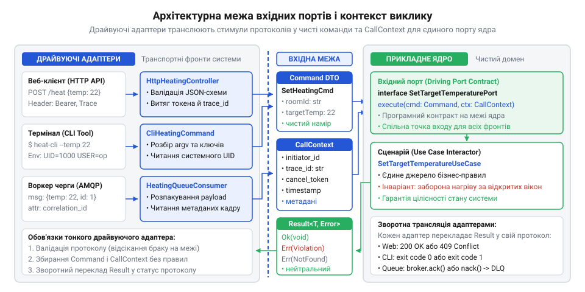

# Одне ядро, кілька фронтів

<preknowlist>
- [DH v2: застосунок набуває форми](root:progarch/dh-v2-hexagon) — Архітектурна організація системи Digital Homes навколо прикладного ядра: відокремлення застосункових сценаріїв (Use Cases) від зовнішнього оточення та ізоляція бізнес-правил розумного будинку
</preknowlist>

## Розсинхронізація правил між точками входу

Поки застосунок має лише веб-сервер, розміщення правил усередині мережевого @@en|контролера@@ (від лат. @@la|rotulus@@ — сувій) здається безпечним. У системі @@en|Digital Homes@@ HTTP-обробник перевіряв стан вікон, блокував опалення й записував стан у базу даних. За єдиного клієнта обмеження діяли без збоїв.

Небезпека виникає з появою нових @@en|фронтів@@ (від лат. @@la|frons@@ — чоло, передній край): сервісної консольної утиліти для монтажників і фонового робітника черги для датчиків. Логіку опалення скопіювали, проте в утиліті перевірку вікон вимкнули заради швидкості налагодження, а робітник узяв застарілий код. Виник @@en|дрейф логіки@@ (від нід. @@nl|drijven@@ — нестися за течією): термінал вмикав котел за відкритих вікон, а робітник затирав налаштування в сховищі.

Спільна база даних безсила захистити бізнес-@@la|інваріанти@@ (від лат. @@la|invarians@@ — незмінний): кожна точка входу звертається до сховища напряму й самостійно обирає, що виконувати. Спроби синхронізувати правила дублюванням перевірок програють через людський фактор і різні темпи оновлень. Єдиний порятунок — повністю винести прийняття рішень у [спільне прикладне ядро](root:progarch/dh-v2-hexagon).

## Нейтральні вхідні порти прикладного ядра

Коли методи ядра приймають структури `HttpRequest` чи аргументи термінала, домен стає заручником транспорту. Виклик того самого сценарію з іншого фронту вимагатиме штучних об'єктів запиту або дублювання коду. Вхідна межа ядра має бути повністю протокольно-нейтральною.

Цю ізоляцію забезпечує @@en|драйвуючий порт@@ (англ. @@en|driving port@@, від лат. @@la|porta@@ — брама) — програмний контракт прикладного сценарію. Він приймає лише типізовані команди чи запити з незмінними полями в термінах домену. Разом із командою порт отримує нейтральний @@en|контекст виклику@@ (англ. @@en|call context@@): ідентифікатор ініціатора, мітки розподіленого трасування й @@en|токен скасування@@ (англ. @@en|cancellation token@@), відсікаючи транспортні заголовки.

*Вхідний порт відокремлює сценарії від протоколів доставки, приймаючи виключно типізовані команди та нейтральний контекст виклику.*

На виході ядро не повертає статусів мережі й не викидає сирих винятків. Метод порту повертає типізований @@en|патерн Result@@ (від лат. @@la|resultare@@ — випливати) зі значенням або семантичною категорією помилки: порушення інваріанта, відсутність сутності чи брак прав. Ядро сигналізує про відмову власною мовою, залишаючи протокольну форму клієнтам.

## Двостороння трансляція у тонких адаптерах

Зовнішні канали доставки з'єднує з портами @@en|драйвуючий адаптер@@ (від лат. @@la|adaptare@@ — пристосовувати). Він має бути тонким: не містити бізнес-логіки й виконувати лише двосторонній переклад.

Пряма трансляція відсікає синтаксичний брак на вході. Адаптер перевіряє цілісність формату й десеріалізує (від лат. @@la|series@@ — ряд) байти мережі, аргументи термінала чи кадри черги в чисту команду порту. Пошкоджений запит адаптер відхиляє негайно, захищаючи ядро.

Зворотна трансляція відображає доменний результат у форму протоколу. За успіху веб-контролер повертає статус `200 OK`, консоль виводить дані в `stdout` із кодом `0`, а робітник черги надсилає підтвердження @@en|ACK@@ (англ. @@en|acknowledgement@@). У разі відмови адаптер перетворює семантичну помилку ядра:
- для REST API формує відповідь за стандартом @@en|RFC 7807@@ (`Problem Details`) зі статусом `404`, `409` чи `422`;
- для консолі повертає ненульовий код виходу процесу;
- для брокера черг надсилає директиву відхилення @@en|NACK@@ (англ. @@en|negative acknowledgement@@) із переміщенням кадру в чергу збоїв.

Симетрична ізоляція дозволяє підключати нові точки входу та тестові драйвери для верифікації в пам'яті без змін у коді прикладного ядра.
