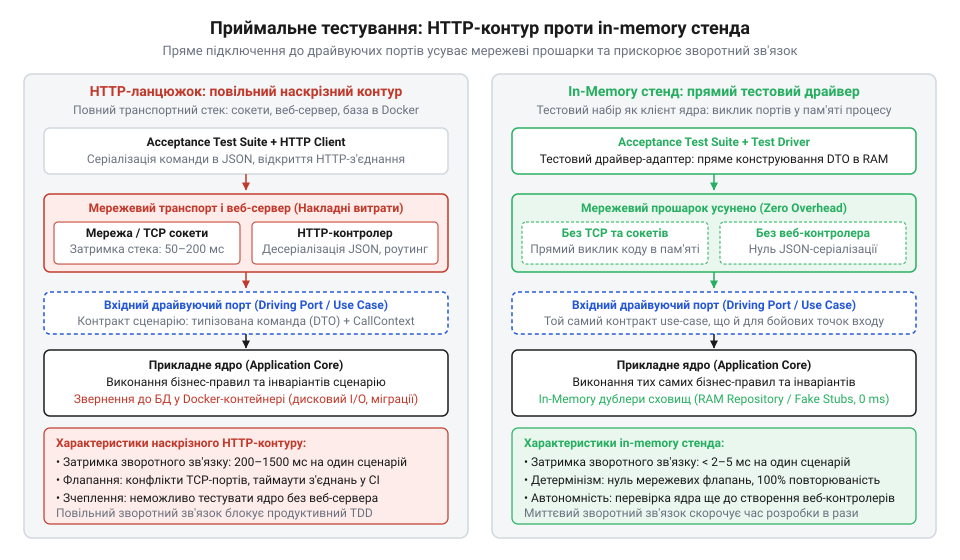
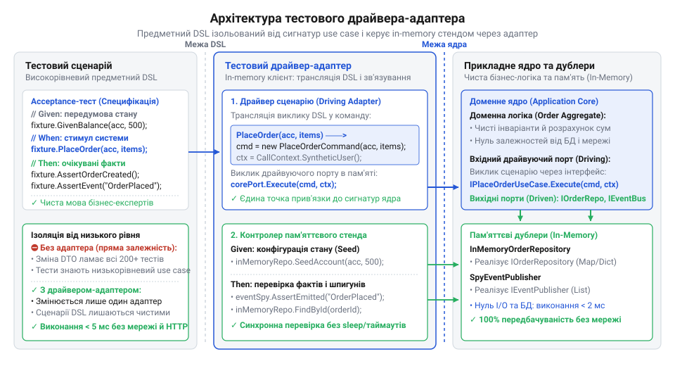

# Стенд приймального тестування ядра через пряме підключення до драйвуючих портів

<preknowlist>
- [DH v2: застосунок набуває форми](root:progarch/dh-v2-hexagon) — Архітектурна організація системи Digital Homes навколо прикладного ядра: відокремлення застосункових сценаріїв (Use Cases) від зовнішнього оточення та ізоляція бізнес-правил розумного будинку
</preknowlist>

## Пастка тестування ядра через HTTP

Під час перевірки бізнес-сценаріїв системи @@en|Digital Homes@@ розробники звично пишуть приймальні тести (англ. @@en|acceptance test@@ — приймальний тест, від лат. Під час перевірки бізнес-сценаріїв системи @@en|Digital Homes@@ розробники звично пишуть приймальні тести (англ. @@en|acceptance test@@ — приймальний тест, від лат. *acceptare* — приймати), розгортаючи повноцінний веб-сервер, відкриваючи мережевий сокет, надсилаючи @@en|HTTP@@-запит (від англ. @@en|Hypertext Transfer Protocol@@) і розбираючи тіло @@en|JSON@@-відповіді (англ. @@en|JavaScript Object Notation@@). Такий підхід створює ілюзію максимальної реалістичності, проте обертається важкими архітектурними проблемами, які сповільнюють розробку та знижують надійність тестового набору.

Запуск веб-сервера, серіалізація корисного навантаження, прив'язка до локального порту й трансляція пакетів крізь мережевий стек операційної системи потребують десятків мілісекунд на кожен запит замість часток мікросекунди. Коли набір розростається до сотень сценаріїв, конвеєр безперервної інтеграції — @@en|CI@@-конвеєр (від англ. @@en|Continuous Integration@@) — розтягується з секунд до десятків хвилин. Розробники втрачають миттєвий зворотний зв'язок і припиняють запускати перевірки локально перед кожним збереженням коду. Ба більше, паралельний запуск тестів на спільних агентах породжує конфлікти портів, вичерпання пулу сокетів і фальшиві падіння через таймаути під високим навантаженням на процесор. Виникають нестабільні тести (англ. @@en|flaky tests@@), що руйнують довіру команди до автоматизованої верифікації.

Найглибша вада полягає в хибному зчепленні: приймальний тест крізь мережу перевіряє протокол доставки замість доменних правил. Якщо зміна вимог клієнтського інтерфейсу перейменовує поле JSON із `zone_id` на `zoneId` або змінює числовий код стану HTTP з 400 на 422, тест ламається, хоча саме бізнес-правило — заборона ставити на охорону зону з відкритими вікнами — залишилося абсолютно незмінним. Крім того, перевірка доменних сценаріїв штучно блокується доти, доки для них не реалізовано веб-контролери, маршрутизацію та серіалізатори, хоча логіка розумного будинку від транспорту не залежить.

Причиною фальшивих падінь стає технічна механіка конкурентного розгортання мережевого середовища у спільному контейнері @@en|CI@@-агента. Коли паралельні тестові потоки одночасно піднімають власні веб-сервери, вони виділяють сокети, зв'язують порти й завантажують процесорні ядра ініціалізацією фреймворків. Такий піковий сплеск вичерпує чергу слухача (англ. @@en|backlog queue@@ — черга накопичених запитів, від *back* — назад і *log* — колода) мережевого стека операційної системи. Якщо планувальник витісняє процес сервера задля обслуговування сусіднього тесту, виконання мережевого рукостискання (англ. @@en|handshake@@ — рукостискання, від *hand* — рука і *shake* — трясти) затримується. Клієнтський @@en|HTTP@@-драйвер чекає відповіді до вичерпання відведеного інтервалу й перериває виклик помилкою таймауту (англ. @@en|timeout@@ — перевищення відведеного часу, від *time* — час і *out* — вихід). У результаті приймальний тест падає не через дефект у доменній логіці @@en|Digital Homes@@, а через процесорне голодування на транспортному рівні.


*Порівняння тестування через мережевий транспорт і через пряме підключення до драйвуючих портів: перенесення перевірок у пам'ять прибирає мережеві прошарки й ізолює доменні правила від змін у протоколах доставки.*

Щоб усунути цю нестабільність, тестовий стенд розглядають не як зовнішнього мережевого спостерігача, а як повноцінного клієнта системи. Завдяки принципам, за якими [застосунок набуває форми](root:progarch/dh-v2-hexagon), бізнес-правила ізолюються від способів їх доставки, а тестовий код підключається напряму до вхідної межі ядра в пам'яті.

## Контракти драйвуючих портів для сценаріїв

Пряме виконання бізнес-сценаріїв у пам'яті вимагає точки входу, очищеної від протокольних артефактів. Якщо метод ядра приймає HTTP-запит або повертає заголовки відповіді, транспортний шар протікає в домен, роблячи запуск тестів чи консольних утиліт неможливим без симуляції веб-оточення.

Вхідною межею ядра виступає драйвуючий порт (англ. @@en|driving port@@, від лат. *porta* — ворота, вхід). Це типізований інтерфейс конкретного сценарію використання — @@en|Use Case@@ (англ. @@en|use case@@ — прецедент використання). Драйвуючий порт визначає операцію мовою предметної області системи @@en|Digital Homes@@ і проводить чітку межу між синтаксичною валідацією (від грец. Драйвуючий порт визначає операцію мовою предметної області системи @@en|Digital Homes@@ і проводити чітку межу між синтаксичною валідацією (від грец. *syntaxis* — порядок, побудова; перевіркою форматної коректності типів та наявності обов'язкових полів) вхідного командного @@en|DTO@@ на межі входу та семантичною перевіркою (від грец. *semantikos* — значущий) доменних інваріантів (від лат. *invarians* — незмінний) усередині сценарію. Синтаксична валідація відсікає структурно некоректні дані ще до їхнього потрапляння в ядро, тоді як семантична перевірка у @@en|Use Case@@ звіряє операцію з бізнес-правилами та поточним станом агрегатів — наприклад, контролює, чи перебуває зона безпеки у стані, що дозволяє її взяття під охорону. Для цього драйвуючий порт взаємодіє з клієнтами виключно через типізовані структури:

1. 1. **Командний DTO** (англ. @@en|DTO@@, від @@en|Data Transfer Object@@ — об'єкт перенесення даних, від лат. *dare* — давати, *transferre* — переносити). Чиста структура, що містить лише необхідні для операції ідентифікатори та параметри. Вона не має прив'язки до параметрів URL, заголовків авторизації чи форматування рядків.
2. 2. **Типізований Result** (від лат. *resultare* — випливати). Об'єкт або перелік результатів виконання операції (успіх із даними або явні доменні помилки). Він повертає доменний стан замість числових кодів HTTP-відповідей на зразок 200 або 404.

Для ядра веб-контролер, фоновий робітник, командний рядок @@en|CLI@@ (від англ. @@en|Command Line Interface@@) та приймальний тест є абсолютно рівноправними клієнтами. Тестовий набір виступає як драйвуючий адаптер (лат. *adaptare* — пристосовувати): він конструює командний @@en|DTO@@ і викликає метод порту безпосередньо у виклику функції.

:::tabs
:::code proj-in-memory-driving-test-suite/go/armsecurityzonecommand.go
:::code proj-in-memory-driving-test-suite/c/dharmsecurityzoneusecase.c
:::code proj-in-memory-driving-test-suite/cpp/armsecurityzonecommand.cpp
:::

Такий протокольно-нейтральний контракт повністю захищає приймальні тести від змін у форматі доставки даних.

## Пам'яттєві дублери для керованих портів

Прямий виклик драйвуючого порту усуває мережевий транспорт на вході, але виконання сценарію негайно зупиняється на виході: ядру потрібно завантажити стан датчиків із бази даних та передати команду на закриття замків чи активацію сирени. Якщо сценарій звертається до реальної бази SQL або шлюзу польової шини актуаторів (від лат. *actuare* — приводити в дію), стенд знову втрачає швидкість і детермінізм.

Усі вихідні зв'язки ядра ізолюються керованими портами (англ. @@en|driven port@@). При їх проєктуванні стежать, щоб виникало [уникнення запаху сховища](root:progarch/port-smelling-of-storage): порт репозиторію оперує сутностями домену, а не SQL-таблицями чи транзакційними курсорами. Для тестування замість повільних реальних драйверів створюють швидкі детерміновані пам'яттєві дублери (англ. @@en|test double@@). @@en|test double@@, детальніше див. [Класифікація тестових дублерів](root:sf-release/test-doubles-in-memory-fakes)):

1. 1. **Підробка репозиторію** (англ. @@en|Fake@@ — підробка). Адаптер сховища на базі хеш-таблиці або динамічного масиву. Він імітує збереження агрегатів у пам'яті процесу, гарантуючи мікросекундний доступ без взаємодії з диском чи мережею.
2. 2. **Шпигун подій** (англ. @@en|Spy@@ — шпигун). Адаптер шини доменних подій або порту актуаторів. Замість [перетворення доменних сигналів](root:progarch/dh-egress-actuator-protocol-mapping) у фізичні кадри шини, шпигун зберігає надіслані команди у внутрішній список, дозволяючи тесту перевірити факт блокування дверей чи активації сирени простим оглядом пам'яті.

:::tabs
:::code proj-in-memory-driving-test-suite/go/securityzone.go
:::code proj-in-memory-driving-test-suite/c/dh-repo-init.c
:::code proj-in-memory-driving-test-suite/cpp/securityzone.cpp
:::

Поєднання чистих контрактів драйвуючих портів із детермінованими пам'яттєвими дублерами робить ядро повністю автономним. Приймальні тести виконуються в оперативній пам'яті за частки мілісекунди без жодного мережевого чи дискового виклику.

Проте висока швидкість викликів у пам'яті створює приховану загрозу: оскільки дублери мутують свій внутрішній стан (хеш-таблиці агрегатів чи списки зафіксованих подій), виконання кількох тестів у межах одного процесу може призвести до перехресного забруднення даних (англ. @@en|cross-test data pollution@@). Якщо один тестовий сценарій зберігає зону безпеки або генерує доменні події, а наступний не очищує стан дублерів перед запуском, результати попереднього тесту викривлять перевірку наступного, створюючи нестабільні тести, що залежать від порядку їх виконання. Щоб запобігти цьому, застосовують стратегію повного ізолювання тестових фікстур (англ. @@en|test fixture@@, від лат. *fixus* — закріплений): перед кожним сценарієм пам'яттєві дублери або створюються заново як нові об'єкти, або викликають явний метод скидання стану, який повністю очищує внутрішні колекції та відновлює детермінований початковий стан.

## Драйвер-адаптер тестового стенда й DSL

Прямий виклик драйвуючих портів у кожному тесті захаращує тестовий набір рутиною. Сценарії змушені власноруч наповнювати пам'яттєві сховища, формувати командні @@en|DTO@@ та розбирати типізовані @@en|Result@@. Якщо сигнатура сценарію використання — @@en|Use Case@@ — змінюється, ламаються десятки перевірок одночасно. Специфікація втрачає предметний зміст, потопаючи в технічних деталях.

Щоб ізолювати тести від змін у сигнатурах ядра, створюють тестовий драйвер-адаптер — @@en|test harness@@ (англ. *test harness* — випробувальне оснащення, від давньофр. *harnois* — бойовий обладунок). Він огортає взаємодію з ядром у лаконічну предметну мову — @@en|DSL@@ (англ. @@en|domain-specific language@@ — мова предметної області). Адаптер інкапсулює налаштування стану в пам'яттєвих репозиторіях, виклик вхідних сценаріїв та опитування шпигунів подій за схемою @@en|Given-When-Then@@ (англ. *given-when-then* — дано-коли-тоді). Коли бізнес-сценарії запускають [трансляцію подій в актуатори](root:progarch/dh-egress-actuator-protocol-mapping) асинхронно, пряма перевірка стану одразу після виконання команди викликає @@en|race condition@@ (англ. *race condition* — стан гонитви) та робить тести нестабільними. Щоб зберегти детермінованість, пам'яттєвий фасад реалізує два механізми очікування. Перший підхід — синхронне прокачування черги (англ. *event flushing*), за якого тестова шина-дублер примусово спорожнює всі накопичені фонові події перед переходом до перевірок. Другий підхід — приховане всередині методів перевірки активне опитування — @@en|polling@@ (англ. @@en|polling@@ — опитування) — або очікування на каналі сповіщень із таймаутом, яке зупиняє виконання тесту лише до моменту появи події. Завдяки такій інкапсуляції приймальні специфікації позбуваються ручних пауз на кшталт `time.Sleep` і виконуються миттєво та надійно.


*Архітектура тестового драйвера-адаптера: високорівневий предметний DSL приховує низькорівневі сигнатури сценаріїв і координує виклики драйвуючих портів та пам'яттєвих дублерів.*

:::tabs
:::code proj-in-memory-driving-test-suite/go/securitytestharness.go
:::code proj-in-memory-driving-test-suite/c/dh-harness-given-zone.c
:::code proj-in-memory-driving-test-suite/cpp/securitytestharness.cpp
:::

Тестовий фасад стає єдиною точкою контакту між бізнес-специфікацією та ядром. Будь-які зміни внутрішніх параметрів @@en|DTO@@ чи контексту виклику змінюють лише реалізацію адаптера, не зачіпаючи самі сценарії. Патерни побудови виразних і стійких до змін тестових мов детально висвітлює [проєктування предметного DSL для приймальних тестів](root:sf-release/acceptance-test-dsl-design).

## Приймальні сценарії та верифікація меж

Маючи тестовий фасад, розробники формулюють вимоги системи @@en|Digital Homes@@ як декларативні приймальні тести (англ. @@en|acceptance test@@). Тест перевіряє наскрізну реакцію: постановку зони під охорону, блокування замків та спрацювання сирени, які в реальному середовищі виконує [трансляція доменних команд](root:progarch/dh-egress-actuator-protocol-mapping) у польову шину.

:::tabs
```go
func TestArmSecurityZone_EngagesLocksAndArms(t *testing.T) {
	repo, spy := NewInMemorySecurityZoneRepository(), &ActuatorEventSpy{}
	h := SecurityTestHarness{repo: repo, spy: spy, useCase: NewArmSecurityZoneService(repo, spy)}

	h.GivenZone("zone-1", "1234", false)
	h.WhenArming("zone-1", "1234")

	if !h.ThenStatusIs(ArmZoneStatusSuccess) || !h.ThenHasEvent("LOCK:ENGAGED") {
		t.Fatal("очікувалося взяття зони під охорону та замикання замків")
	}
}
```
```c
void test_arm_zone_engages_locks_and_arms(void) {
    DhInMemoryZoneRepository repo; dh_repo_init(&repo);
    DhActuatorEventSpy spy; dh_spy_init(&spy);
    DhArmSecurityZoneUseCase uc = dh_make_arm_service(&repo, &spy);
    DhSecurityHarness h = { &repo, &spy, &uc };

    dh_harness_given_zone(&h, "zone-1", "1234", false);
    dh_harness_when_arm(&h, "zone-1", "1234");

    assert(dh_harness_then_status_is(&h, DH_ARM_STATUS_SUCCESS));
    assert(dh_harness_then_has_event(&h, "LOCK:ENGAGED"));
}
```
```cpp
void test_arm_zone_engages_locks_and_arms() {
    InMemorySecurityZoneRepository repo;
    ActuatorEventSpy spy;
    ArmSecurityZoneService uc(repo, spy);
    SecurityTestHarness h(uc, repo, spy);

    h.given_zone("zone-1", "1234", false);
    h.when_arming("zone-1", "1234");

    assert(h.then_status_is(ArmZoneStatus::Success));
    assert(h.then_has_event("LOCK:ENGAGED"));
}
```
:::

Перевірка виконується за мікросекунди без мережевих сокетів і дискових операцій. Проте навіть у пам'яттєвому середовищі виникають типові помилки зчеплення, коли тестовий код несанкціоновано викликає внутрішні методи доменних агрегатів напряму в пам'яті. Оскільки приймальний стенд і ядро працюють у єдиному адресному просторі, без жорсткого обмеження видимості виникає спокуса виставляти стан сутностей вручну в обхід @@en|driving port@@. Щоб запобігти такому несанкціонованому виклику, застосовують інструменти й техніки автоматизованого контролю меж: мовну інкапсуляцію через виділення приватних модулів (як-от пакетів `internal` у Go чи обмеженої видимості пакетів у Java та C++) та статичний аналіз (англ. @@en|static analysis@@, від грец. *στατικός* — зафіксований, та *ἀνάλυσις* — розкладання). Автоматизований архітектурний @@en|linter@@ залежностей аналізує граф імпортів під час збирання та завалює компіляцію, якщо тестовий набір намагається звернутися до внутрішніх методів агрегатів замість виклику сценарію використання. Якщо ж подібні автоматичні бар'єри відсутні, виникають типові помилки зчеплення, які руйнують [архітектурну організацію ядра](root:progarch/dh-v2-hexagon):

1. **Пряме мутування стану агрегатів.** Тест безпосередньо змінює поля сутності в пам'яттєвому репозиторії замість виклику операцій ядра. Це обходить бізнес-інваріанти й створює невалідні стани, неможливі в експлуатації. Тестовий стенд зобов'язаний діяти суворо як легітимний клієнт через інтерфейси сценаріїв.
2. **Протікання концепцій доставки.** Перевірка HTTP-заголовків, кодів стану або статусів серіалізації всередині ядра чи приймального фасаду знищує переваги гексагону. У простих сервісах [гексагональна ізоляція буває зайвою](root:progarch/hexagon-when-overkill), але для складної автоматики розумного будинку вона гарантує непохитність бізнес-правил ще до появи перших контролерів доставки.
