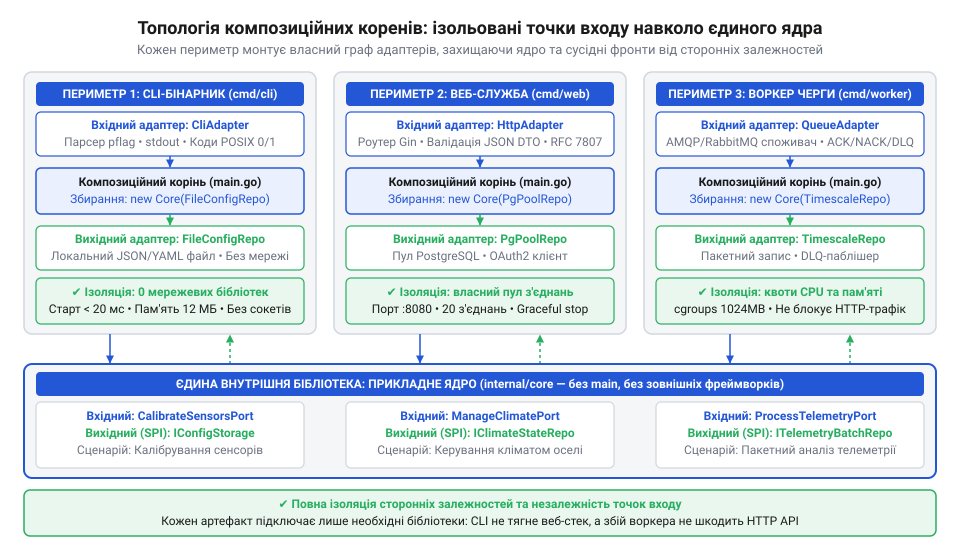
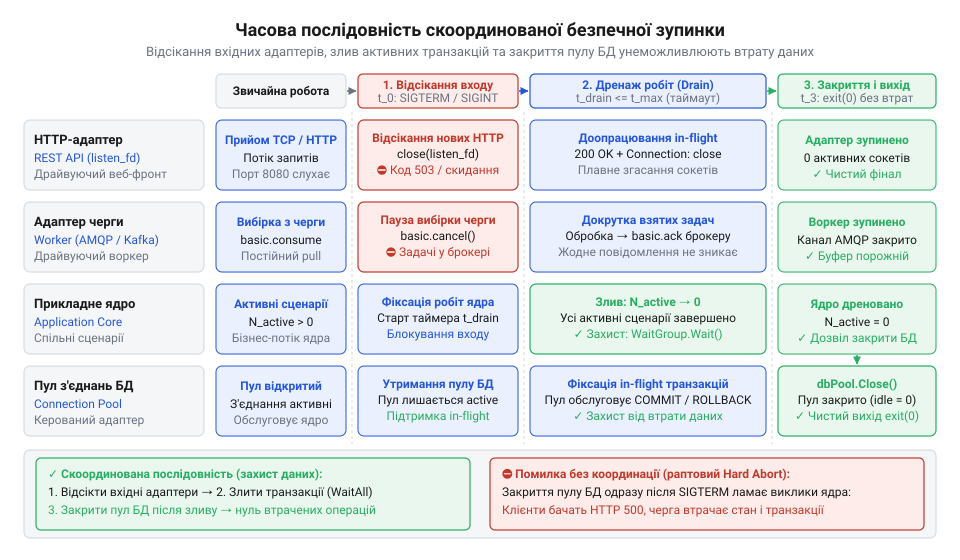

# Побудова окремих композиційних коренів та монолітного процесу з кількома слухачами

<preknowlist>
- [DH v2: застосунок набуває форми](root:progarch/dh-v2-hexagon) — Архітектурна модель системи Digital Homes навколо чистого ядра: відокремлення застосункових сценаріїв (Use Cases) від зовнішніх адаптерів та інфраструктури.
</preknowlist>

## Пастка змішування збірки та виконання

Швидка службова дія не повинна вимагати запуску всієї інфраструктури. Коли інженер платформи розумного будинку @@en|Digital Homes@@ запускає в терміналі консольну команду для калібрування датчиків вологості, він очікує оновлення коефіцієнтів за частку секунди. Натомість процес падає з критичною помилкою: мережевий порт `8080` уже зайнятий основним веб-сервером. Утиліта командного рядка (англ. @@en|CLI@@, @@en|Command Line Interface@@) взагалі не містить мережевих обробників, але її точка входу напряму імпортувала загальний конфігуратор програми. Той на старті безумовно підіймав веб-маршрутизатор, відкривав мережеві сокети та підключався до зовнішніх брокерів. Команда калібрування виявилася заручником інфраструктури, яка їй не потрібна.

Спроба запустити фоновий обробник черги поруч із HTTP-сервером в одному скрипті спричиняє ще важчу аварію. Коли потік телеметрії від датчиків різко зростає, воркер вичерпує спільний пул з'єднань і блокує обробку запитів користувачів. Коли ж оркестратор надсилає процесу сигнал завершення `SIGTERM` для планового перезапуску, нерозділений процес миттєво обриває виконання. Система перериває незавершену транзакцію коригування клапанів опалення посеред запису в базу даних, залишаючи актуатор котла в невизначеному аварійному стані.

Корінь проблеми криється в змішуванні двох фаз життя програми: конструювання об'єктного графа та його виконання. Коли доменні сервіси чи точки входу самостійно створюють залежності або спираються на всеосяжний глобальний стан, демаркація між компонентами зникає. Життєвий цикл короткоживучої команди стає намертво зчепленим із довгоживучими демонами. Щоб усунути це зачеплення, конфігурацію зв'язків виносять на зовнішній периметр: бізнес-правила ізолюють у самостійне ядро-бібліотеку, для кожного бінарника створюють окремий корінь композиції (від лат. @@la|compositio@@ — складання, поєднання; англ. @@en|composition root@@), а для паралельних довгоживучих слухачів проєктують скоординований демон (від грец. @@gr|daimon@@ — дух-хранитель; англ. @@en|daemon@@).

## Оформлення ядра як внутрішньої бібліотеки

Бізнес-логіка не повинна знати, звідки надійшов запит і в якому оточенні вона працює. Коли в системі [відокремлюють прикладне ядро](root:progarch/dh-v2-hexagon) від зовнішнього периметра, доменні сценарії позбавляються прив'язки до деталей транспорту. Ядро оформлюють як самостійну внутрішню бібліотеку — окремий пакет, повністю очищений від зовнішніх інфраструктурних залежностей. У ньому немає структур `http.Request`, анотацій фреймворків, розбору прапорців командного рядка чи клієнтів черг повідомлень. Бібліотека містить лише правила розрахунку мікроклімату, доменні сутності та абстрактні контракти портів.

Взаємодія з ядром будується навколо двох типів інтерфейсів. Для керування ззовні ядро надає вхідні порти (англ. @@en|inbound port@@) — типізовані сценарії використання (англ. @@en|use case@@), розділені на команди модифікації стану (`CalibrateSensorCommand`) та запити читання (`GetZoneMetricsQuery`). Для звернення до інфраструктури ядро декларує керовані вихідні порти (англ. @@en|outbound port@@). Вихідний контракт має виражати суто потреби бізнес-логіки: якщо інтерфейс вимагає специфічних табличних ключів чи прапорців СУБД, виникає [порт зі запахом сховища](root:progarch/port-smelling-of-storage), який руйнує нейтральність ядра. Так само порт керування актуатором приймає абстрактну команду, тоді як [трансляція команд у протоколи](root:progarch/dh-egress-actuator-protocol-mapping) шин залишається обов'язком зовнішнього адаптера.

Ядро ніколи не створює інфраструктурні об'єкти самостійно. Будь-які адаптери передаються виключно через параметри конструктора — за принципом впровадження залежностей (від лат. @@la|injectio@@ — внесення; англ. @@en|dependency injection@@). Проте довгоживучі адаптери в конструкторі вирішують лише питання статичного зв'язування компонентів, тоді як динамічне керування виконанням вимагає окремого каналу. Коли зовнішній клієнт обриває HTTP-з'єднання або сервер розпочинає планову зупинку, тривалий сценарій використання має вчасно зупинитися, аби не витрачати ресурси та не здійснювати запізнілих записів. Щоб не затягувати в ядро деталі транспорту — такі як прапорці сокетів чи системні сигнали, — сигнатури методів @@en|вхідних портів@@ приймають абстрактний контекст скасування (від лат. @@la|contextus@@ — з'єднання; англ. @@en|cancellation context@@), прикладом якого є `context.Context` або `std::stop_token`. Точка входу транслює свій специфічний життєвий цикл у цей універсальний сигнал і передає його параметром під час виклику сценарію. Доменне ядро не знає природи переривання, але передає контекст далі у @@en|вихідні порти@@ сховищ чи перевіряє його стан перед обчисленнями, зберігаючи повну технологічну нейтральність:

:::tabs
:::code proj-multi-entrypoint-composition-roots/go/sensorrepository.go
:::code proj-multi-entrypoint-composition-roots/c/make-calibrate-sensor-uc.c
:::code proj-multi-entrypoint-composition-roots/cpp/sensorrepository.cpp
:::

Таке оформлення перетворює ядро на автономний бібліотечний артефакт. Воно компілюється без сторонніх мережевих драйверів і підключається до будь-якої точки входу без змін у доменному коді.

## Окремі композиційні корені для бінарників

Оскільки ядро не зв'язує залежності самостійно, збирання об'єктів виноситься в одну точку. Нею є @@en|composition root@@ — точка входу виконуваного артефакту (функція `main`), розташована на крайньому зовнішньому периметрі програми. Тут застосунок зчитує конфігурацію, створює екземпляри інфраструктурних адаптерів, передає їх у конструктори сценаріїв ядра й активує точку входу. Жоден шар нижче кореня композиції не має права самостійно створювати зовнішні залежності.

Для платформи @@en|Digital Homes@@ це означає побудову трьох незалежних бінарників:
- **Консольна команда (`cmd/cli`)**. Корінь композиції парсить параметри виклику, конструює легковажний адаптер локального файлу або прямого апаратного порту, виконує `CalibrateSensorUseCase` і повертає код завершення. Вона не містить веб-сервера, не займає мережеві сокети й стартує за мілісекунди.
- **Веб-сервіс (`cmd/web`)**. Довгоживучий процес, чий корінь композиції налаштовує пул з'єднань із базою даних, реєструє HTTP-маршрути, огортає сценарії ядра мережевими контролерами й запускає слухач порту.
- **Фоновий воркер (`cmd/worker`)**. Автономна служба черги. Корінь композиції підключається до брокера повідомлень, зв'язує потік подій сенсорів із відповідним сценарієм і запускає цикл обробки без відкриття публічних HTTP-портів.

*Архітектурна топологія коренів композиції: кожен бінарник самостійно збирає специфічні адаптери у вхідні та вихідні порти спільного ядра без взаємного перехресного зачеплення.*

Коли при виконанні однакових сценаріїв ядра виникають інфраструктурні збої, однакова реакція на них у всіх бінарниках руйнує вимоги до їхнього середовища. Для короткоживучої CLI-команди недоступність апаратного адаптера чи некоректний параметр вимагають негайного аварійного завершення (англ. @@en|fail-fast@@): процес миттєво віддає ненульовий код помилки операційній системі та звільняє ресурси, щоб не блокувати автоматизовані сценарії розгортання. Натомість у фоновому воркері тимчасова втрата зв'язку з брокером повідомлень або базою даних не повинна спричиняти падіння процесу, адже це призводить до нескінченного перезапуску демона (англ. @@en|crash loop@@) та втрати необроблених подій. Тому корінь композиції воркера огортає вихідні порти стратегією відкладених повторів (англ. @@en|retry@@) із повторним очікуванням, утримуючи повідомлення в черзі до відновлення інфраструктури. Така розбіжність показує, що стратегія реакції на збої належить зовнішньому периметру застосунку, а не доменній логіці ядра.

Повна ізоляція композиційних коренів гарантує надійність системи: збій брокера повідомлень у воркері не може заблокувати веб-сервіс, а навантаження на чергу телеметрії не впливає на затримки запитів користувачів. Для простих сервісів із прямолінійним життєвим циклом [гексагональний поділ виявляється зайвим](root:progarch/hexagon-when-overkill), оскільки множення точок складання ускладнює супровід. Проте для системи з багатьма формами розгортання незалежні корені композиції усувають зайві бібліотеки з бінарників і забезпечують детерміноване керування кожним процесом.

## Монолітний процес із кількома слухачами

Поділ застосунку на автономні бінарні файли виправдовує себе у хмарі, але стає проблемою на апаратурі з жорсткими обмеженнями. Коли крайові шлюзи (англ. @@en|edge gateway@@) платформи @@en|Digital Homes@@ — компактні контролери з невеликим обсягом оперативної пам'яті — одночасно запускають окремі бінарники веб-сервісу та воркера черги, операційна система виділяє ресурси на два незалежні середовища виконання. Кожен процес відкриває власний пул з'єднань (англ. @@en|connection pool@@) із базою даних, виділяє пам'ять під буфери сокетів і дублює дескриптори взаємодії з апаратурою. У результаті процеси конкурують за обмежену пам'ять, а їхні пули швидко вичерпують ліміти підключень до сховища.

Оскільки доменні сценарії не залежать від зовнішнього транспорту, [модель системи навколо ядра](root:progarch/dh-v2-hexagon) дозволяє об'єднати обидва сервіси в єдиний монолітний @@en|daemon@@ без змін у бізнес-логіці. Замість кількох точок входу створюють один спільний @@en|composition root@@. Він одноразово ініціалізує спільний пул з'єднань із базою даних, конструює екземпляри сценаріїв використання (@@en|use case@@) і передає їх одночасно в мережевий HTTP-маршрутизатор та в обробник черги повідомлень брокера. Обидва адаптери реєструються як неблокуючі слухачі (англ. @@en|listener@@) і запускаються паралельно — в асинхронному циклі подій або в незалежних легковагих потоках. Єдиний процес утримує спільне ядро, споживає один набір системних дескрипторів і ділить один пул бази між усіма завданнями.

Спільне середовище виконання вимагає суворої ізоляції збоїв та обдуманого розмежування ресурсів між паралельними каналами. Якщо підписник черги телеметрії отримує пошкоджений двійковий пакет від несправного датчика і зазнає невиправної помилки під час розбору, ця помилка не повинна завершувати весь процес чи блокувати відповіді на HTTP-запити користувачів. Єдиний @@en|composition root@@ огортає цикл кожного слухача бар'єром перехоплення аварій: невдале повідомлення черги відкидається або перенаправляється в журнал помилок, тоді як сам @@en|listener@@ продовжує роботу. Поряд із розділенням обробки помилок виникає проблема конкурентного доступу до спільних даних: коли веб-потік і слухач черги ділять спільний оперативний кеш сутностей (фр. @@fr|cacher@@ — ховати; англ. @@en|in-memory cache@@) доменного ядра, одночасне вичитування й оновлення стану викликає гонку даних (англ. @@en|data race@@). Для збереження узгодженості потрібні примітиви синхронізації — наприклад, блокування читання-запису (англ. @@en|read-write lock@@) чи атомарне копіювання під час запису, але за це доводиться платити затримками: якщо обробник черги під сплеском телеметрії тривало утримує ексклюзивний доступ для оновлення, це блокує паралельне читання веб-запитів, а в разі нехтування порядком захоплення ресурсів спричиняє взаємне блокування (англ. @@en|deadlock@@). З цієї ж причини розмір пулу з'єднань розмежовують суворими квотами, щоби сплеск вхідної телеметрії не захопив усі відкриті сесії до бази даних і не спричинив відмову в обслуговуванні веб-інтерфейсу.

## Скоординована безпечна зупинка активних слухачів

Об'єднання кількох активних слухачів в одному процесі загострює проблему його зупинки. Коли операційна система надсилає процесу сигнал завершення `SIGTERM` під час планового оновлення чи `SIGINT` при зупинці з термінала, моноліт не може раптово перервати виконання. Якщо демон обірве роботу миттєво, незавершені HTTP-запити втратять відповіді, а воркер кине оновлення датчиків посеред транзакції. Якщо ж закрити спільні ресурси передчасно — наприклад, одразу зупинити пул бази даних, — паралельні слухачі спробують записати стан у вже мертві з'єднання і спровокують пошкодження даних. Навпаки, якщо обробник черги зависне в очікуванні відповіді без обмеження часу, процес перетвориться на завислий процес (англ. @@en|hung process@@) і буде жорстко вбитий системою через `SIGKILL` із втратою незбереженого стану.

Щоб уникнути втрати повідомлень і руйнування транзакційного стану, процес реалізує алгоритм скоординованої безпечної зупинки (англ. @@en|graceful shutdown@@). Вимкнення компонентів виконується суворо у зворотному порядку до їхнього запуску. Спершу виділений обробник сигналів перехоплює `SIGINT` або `SIGTERM`, переводячи систему в стан вимкнення. Обидва слухачі негайно перекривають прийом нового навантаження: HTTP-сервер перестає приймати нові з'єднання, а підписник черги припиняє вичитувати повідомлення з брокера. Завдяки цьому потік вхідних задач обнуляється, а активні обробники дістають чітко обмежений ліміт часу (англ. @@en|deadline@@) на завершення поточної роботи.

Під час цього зливу активних операцій сценарії дописують транзакції в базу даних, не ризикуючи отримати раптовий обрив сокета. Якщо сценарій коригує положення заслінок чи клапанів опалення, [трансляція команд у протоколи](root:progarch/dh-egress-actuator-protocol-mapping) встигає відправити фінальний пакет актуатору до вимкнення інтерфейсів, після чого воркер надсилає брокеру підтвердження обробки. Тільки тоді, коли обидва слухачі повністю спорожнили черги виконання й зупинилися, @@en|composition root@@ закриває спільний пул з'єднань із базою даних, змиває буфери журналів і повертає операційній системі код виходу `0`.

*Скоординована безпечна зупинка: перехоплення системного сигналу припиняє прийом нових запитів і вичитування черги, дозволяючи активним транзакціям завершитися до закриття пулу з'єднань.*
