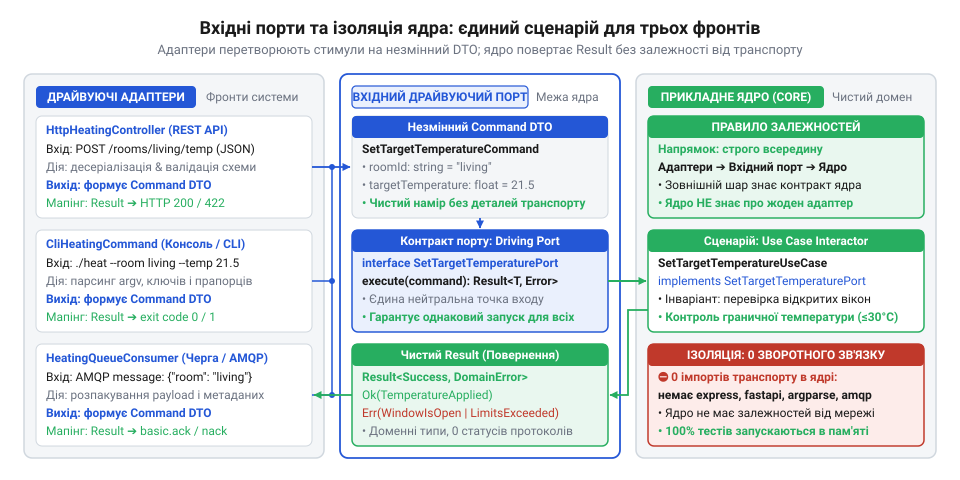
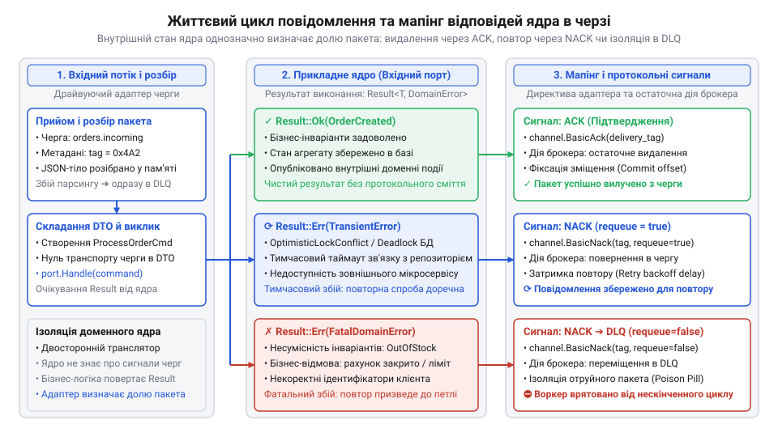

# Реалізація єдиного прикладного ядра з REST API, CLI та Queue Worker адаптерами

<preknowlist>
- [DH v2: застосунок набуває форми](root:progarch/dh-v2-hexagon) — Структурування проєкту за гексагональним шаблоном із розділенням доменного ядра, портів та зовнішніх адаптерів.
</preknowlist>

## Розсинхронізація бізнес-правил між трьома каналами

У системі мікроклімату розумного будинку температура регулюється безперервно: мешканець змінює налаштування через мобільний або веб-інтерфейс, черговий інженер коригує параметри через термінал, а датчики надсилають телеметрію через чергу повідомлень. Найпростіший спосіб реалізувати першу точку входу — написати HTTP-обробник, який вичитує тіло @@en|JSON@@, дістає назву зони й цільові градуси. Одразу в цьому обробнику розробник перевіряє права оператора, допустимий діапазон від 15 до 30 °C, крок регулювання та захисне блокування у разі тривоги. Код працює, доки не виникає потреба додати консольну команду для локального адміністрування та фонового робітника черги для автономних пристроїв.

Коли ту саму операцію відкривають для нових каналів, з'являється спокуса скопіювати блок перевірок у консольну утиліту та в цикл споживача черги. Проте консоль оперує позиційними аргументами й прапорцями запуску, черга приймає сирі бінарні пакети брокера, а веб-контролер зав'язаний на структури запиту HTTP-сервера. Щойно вимоги змінюються — наприклад, нижню межу для сервера підвищують до 18 °C або додають контроль ідемпотентності, — перевірку оновлюють у веб-контролері, але забувають про консоль чи воркер. Правила розходяться по точках входу: через консоль стає можливим переохолодити приміщення, а повідомлення з черги оминають захисне блокування.

Ця розсинхронізація стається тому, що бізнес-логіку змішали з транспортом. Допоки валідація інваріантів та мутація стану вшиті в транспортні структури, система не має єдиної точки істини. Щоб поведінка системи була абсолютно ідентичною за будь-якого способу виклику, потрібен [чистий гексагональний поділ](root:progarch/dh-v2-hexagon), де всі бізнес-правила зосереджені в ізольованому центрі, а зовнішні канали лише постачають туди очищений намір користувача.

## Ізольоване прикладне ядро та вхідні порти

Прикладне ядро мусить виконувати операцію однаково незалежно від транспорту, що доставив запит. Для цього ядро ізолюють від деталей зовнішнього світу й захищають вхідним портом — @@en|inbound port@@ (англ. *inbound* — вхідний, *port* — гавань, стикувальний вузол). Вхідний порт фіксує суворий технологічно нейтральний контракт прикладного сценарію — @@en|use case@@ (англ. *use* — застосування, *case* — випадок, сценарій). Він нічого не знає про HTTP-заголовки, коди 200 чи 404, синтаксис консольних ключів або директиви брокерів повідомлень.

Спілкування через порт відбувається виключно мовою домену. Намір клієнта пакується в незмінний об'єкт передачі команди — @@en|Command DTO@@ (англ. *command* — наказ, розпорядження; *Data Transfer Object* — об'єкт передачі даних). Команда містить лише примітиви предметної області: ідентифікатор зони, числове значення температури та ключ ідемпотентності. Супутні метадані виклику — ідентифікатор суб'єкта дії та наскрізний ключ трасування — передаються через нейтральну структуру @@en|CallContext@@. Завдяки цьому уникають пастки, де з'являється [порт із запахом сховища](root:progarch/port-smelling-of-storage), зв'язаний із типами сховищ або транспорту.

*Трансляція різнорідних зовнішніх протоколів у технологічно нейтральну команду вхідного порту прикладного ядра.*

:::tabs
@tab Go
:::code proj-single-core-multichannel-service/go/port.go 8-79

@tab C
:::code proj-single-core-multichannel-service/c/include/inbound_port.h 31-92

@tab C++
:::code proj-single-core-multichannel-service/cpp/temperature_core.hpp 15-88
:::

Усередині сценарію першим бар'єром захисту стає перевірка ключа ідемпотентності — @@en|idempotency key@@ (лат. *idem* — той самий, *potens* — дієвий; англ. *key* — ключ). Якщо в журналі операцій уже збережено запис із цим ключем, ядро негайно повертає попередній знімок результату без повторного виконання дій. Без такого бар'єра мережевий повтор через вичерпання часу очікування в HTTP або повторна доставка повідомлення з черги призвели б до подвійного зміщення температури чи помилкового спрацювання обмеження на крок зміни. Збереження журналу операцій вимагає пам'яті для таблиці результатів, проте захищає сценарій від накопичення похибок при повторних спробах доставки. Для нових команд ядро перевіряє непорушні доменні інваріанти — @@en|domain invariant@@ (лат. *invarians* — незмінний): наявність зони в реєстрі, відсутність захисного блокування, допустимість діапазону температур і величину кроку зміни. Результатом є чистий об'єкт @@en|TemperatureResult@@ із зафіксованими даними стану або закритий перелік типізованих помилок @@en|DomainError@@. Ядро не повертає HTTP-статуси чи коди повернення ОС: воно констатує доменний факт, віддаючи інтерпретацію зовнішнім адаптерам. Докладніше про організацію журналювання результатів та збереження чистоти порту читайте у статті про [ключі ідемпотентності у вхідних портах команд](root:sf-apps/idempotency-keys-in-command-ports).

:::tabs
@tab Go
:::code proj-single-core-multichannel-service/go/service.go 43-120

@tab C
:::code proj-single-core-multichannel-service/c/src/climate_core.c 50-124

@tab C++
:::code proj-single-core-multichannel-service/cpp/temperature_core.cpp 41-82
:::

Така ізоляція гарантує, що жодне бізнес-правило неможливо обійти через додавання нового каналу зв'язку. Вхідний порт стає єдиною захищеною брамою для всіх зовнішніх викликачів.

## Синхронні драйвери: REST контролер і CLI

Коли зовнішній клієнт надсилає запит через мережу або запускає утиліту в терміналі, виникає спокуса перевірити параметри прямо в обробнику запиту. Але варто вбудувати перевірку меж температури в HTTP-обробник — і ту саму логіку доведеться дублювати в парсері прапорців командного рядка. Щойно бізнес-правило зміниться, один із каналів обов'язково забудуть оновити, і система почне поводитися по-різному залежно від точки входу.

Щоб зберегти цілісність, кожен синхронний вхідний канал реалізують як окремий @@en|драйвуючий адаптер@@ (від лат. *adaptare* — припасовувати). Його обов'язок строго обмежений: він працює двостороннім транслятором між специфічним протоколом і нейтральним ядром застосунку. Адаптер нічого не знає про допустимі діапазони температур чи блокування зон безпеки — він лише перетворює зовнішні байти на типізовану команду й викликає контракт вхідного порту. Таке [структурування гексагонального застосунку](root:progarch/dh-v2-hexagon) унеможливлює розмивання доменних інваріантів по точках входу.

Трансляція відбувається у два зустрічні кроки.

На вході адаптер видобуває сирі значення з транспорту й конструює з них уніфіковану команду `ChangeTemperatureCommand` разом із контекстом виклику `CallContext`. Для веб-@@en|контролера@@ (від старофр. *contrerôle* — перевірочний список) у протоколі @@en|REST API@@ (англ. *Representational State Transfer*) це вичитування JSON із тіла HTTP-запиту та заголовків трасування. Для консольного @@en|CLI@@ (англ. *Command-Line Interface*) — розбір позиційних аргументів і прапорців запуску. Якщо клієнт надіслав пошкоджений JSON чи пропустив обов'язковий аргумент, адаптер відсікає запит на рівні синтаксису, взагалі не турбуючи прикладне ядро.

Для захисту від повторного виконання операцій ядро вимагає обов'язковий @@en|ключ ідемпотентності@@ (від лат. *idem* — той самий і *potens* — дієвий). У протоколі @@en|REST API@@ клієнт передає його через заголовок `Idempotency-Key` або поле в тілі JSON. Якщо запит не містить жодного з них, веб-@@en|контролер@@ сам генерує унікальний ідентифікатор із системною міткою часу. У консольному @@en|CLI@@ оператор натомість вказує значення через опціональний прапорець `-idempotency`, а за його відсутності утиліта автоматично формує локальний ключ. Обидва адаптери приводять ці відмінності до обов'язкового поля `IdempotencyKey` у команді `ChangeTemperatureCommand`, тому прикладне ядро отримує однаковий контракт і не залежить від транспорту.

На виході адаптер отримує чистий доменний результат або помилку `DomainError` і транслює їх у протокольну форму:
- У веб-@@en|контролері@@ успіх повертає статус `200 OK`. Синтаксичний брак дає `400 Bad Request`, відсутність прав — `403 Forbidden`, невідома зона — `404 Not Found`, а доменна відмова ядра (перевищення безпечної межі чи завеликий крок) — `422 Unprocessable Entity`. Деталі помилки пакуються у стандартизований формат @@en|Problem Details@@ (англ. *problem details* — деталі проблеми за RFC 7807).
- У консолі @@en|CLI@@ статусів HTTP немає. Замість них результат відображають стандартні числові коди виходу процесу: `0` — успіх, `1` — доменне відхилення бізнес-правил ядра, `2` — синтаксична помилка виклику прапорців.

В обох випадках адаптери залишаються тонкими: жодне бізнес-правило в них не повторюється.

:::tabs
:::code proj-single-core-multichannel-service/go/adapter_http.go 68-191
:::code proj-single-core-multichannel-service/c/src/http_adapter.c 102-224
:::code proj-single-core-multichannel-service/cpp/http_controller.hpp 45-76
:::

Для термінального клієнта трансляція симетрична, але виходом є системний потік `stderr` і числовий код процесу:

:::tabs
:::code proj-single-core-multichannel-service/go/adapter_cli.go 28-102
:::code proj-single-core-multichannel-service/c/src/cli_adapter.c 74-171
:::code proj-single-core-multichannel-service/cpp/cli_adapter.hpp 29-93
:::

## Асинхронний обробник черги з трансляцією помилок

Синхронні драйвери мають того, хто безпосередньо чекає на відповідь: відкритий HTTP-сокет або термінал оператора. В асинхронній черзі клієнта на проводі немає. Єдиний адресат, із яким взаємодіє @@en|обробник черги@@ (англ. *queue worker*), — це сам брокер повідомлень.

Якщо в такому каналі бездумно повертати будь-який збій назад у чергу, система швидко опиниться в пастці. Пошкоджений JSON або неможливе доменне значення (наприклад, температура 80 °C) крутитиметься в нескінченному циклі, блокуючи чергу й перевантажуючи сервіс. Це класичне @@en|отруйне повідомлення@@ (англ. *poison message*).

Щоб захистити брокер від зациклення, обробник розкриває @@en|конверт повідомлення@@ (від фр. *envelopper* — огортати), витягує ідентифікатор трасування, лічильник спроб доставки та сирий корисний вантаж. Далі дані пакуються в той самий `Command DTO` і передаються в той самий вхідний порт. Доменне ядро виконує інваріанти за єдиними правилами, не здогадуючись, звідки прийшла команда.

Специфіка асинхронного адаптера полягає у вихідному мапінгу: він мусить узгодити результат ядра з життєвим циклом повідомлення у брокері за тригілковою схемою:
1. **Успіх** — брокеру повертається підтвердження @@en|ACK@@ (англ. *acknowledgement*, від *acknowledge* — підтверджувати отримання). Команду зафіксовано, повідомлення остаточно вилучається з черги.
2. **Тимчасовий збій** (транзієнтна помилка ядра, як-от `DeviceBusy` через калібрування регулятора) — повертається заперечення @@en|NACK@@ (англ. *negative acknowledgement* — заперечне підтвердження) з поверненням повідомлення в чергу на повторну спробу (re-queue), поки не вичерпано ліміт спроб.
3. **Детермінована доменна помилка або синтаксичний брак** — повідомлення негайно переміщується в @@en|DLQ@@ (англ. *Dead Letter Queue* — черга недійсних повідомлень) без жодних повторів. Якщо кімната не існує, заблокована безпекою або температура виходить за межі [15; 30] °C, повтор через мілісекунду дасть той самий результат. Повторювати детерміновано хибне повідомлення небезпечно для стабільності брокера: його негайно ізолюють у @@en|DLQ@@ для аналізу інциденту інженерами. Туди ж спрямовуються повідомлення, для яких вичерпано ліміт повторних спроб після @@en|NACK@@.

*Життєвий цикл повідомлення в асинхронному обробнику черги: розбір конверта, передача команди у вхідний порт і розділення результатів на підтвердження, повтор або ізоляцію в DLQ.*

:::tabs
:::code proj-single-core-multichannel-service/go/adapter_queue.go 78-157
:::code proj-single-core-multichannel-service/c/src/queue_adapter.c 37-112
:::code proj-single-core-multichannel-service/cpp/queue_worker.hpp 53-102
:::

## Корінь композиції та додавання нових адаптерів

Коли сервіс обслуговує три незалежні канали — REST, CLI та чергу, — виникає спокуса інстанціювати ядро всередині кожного адаптера або сховати його за глобальною змінною. Обидва рішення руйнують архітектуру: кілька екземплярів ядра призводять до розсинхронізації стану зон у пам'яті, а глобальний стан блокує паралельне тестування й створює неявні залежності.

Щоб зберегти чисті межі, застосовують [патерн кореня композиції](root:sf-apps/di-container). Це єдина точка на старті процесу (`main`), де система збирається докупи:
1. Створюється єдиний спільний екземпляр прикладного ядра, який ініціалізує стан кліматичних зон і тримає бізнес-інваріанти.
2. Інстанціюються драйвуючі адаптери (веб-@@en|контролер@@, консольний @@en|CLI@@, @@en|обробник черги@@), і кожному з них передається посилання на ядро через абстрактний інтерфейс вхідного порту.
3. Запускаються фонові слухачі та налаштовується коректне завершення роботи компонентів.

Адаптери взагалі нічого не знають про сусідні канали й не контролюють життєвий цикл ядра. Вони спираються виключно на контракт вхідного порту.

Справжня архітектурна перевага такого розділення стає очевидною, коли бізнес вимагає додати новий канал взаємодії — наприклад, регулярне зниження температури вночі за розкладом. Ми не змінюємо жодного рядка в існуючому ядрі чи вже написаних адаптерах. Ми створюємо четвертий @@en|драйвуючий адаптер@@ — планувальник `SchedulerTemperatureAdapter`. У момент спрацювання таймера він формує вже відому командну структуру `SetTemperatureCommand` і викликає той самий порт `execute()`.

Прикладне ядро залишається на сто відсотків закритим для модифікацій, але система є повністю відкритою до підключення нових транспортних інтерфейсів.

:::tabs
:::code proj-single-core-multichannel-service/go/main.go 30-87
:::code proj-single-core-multichannel-service/c/src/main.c 319-333
:::code proj-single-core-multichannel-service/cpp/main.cpp 18-44
:::

Під час ініціалізації в корені композиції всі чотири фронти підключаються до єдиного інтерфейсу:

:::tabs
:::code proj-single-core-multichannel-service/go/main.go 105-115
:::code proj-single-core-multichannel-service/c/src/main.c 320-332
:::code proj-single-core-multichannel-service/cpp/main.cpp 58-68
:::
