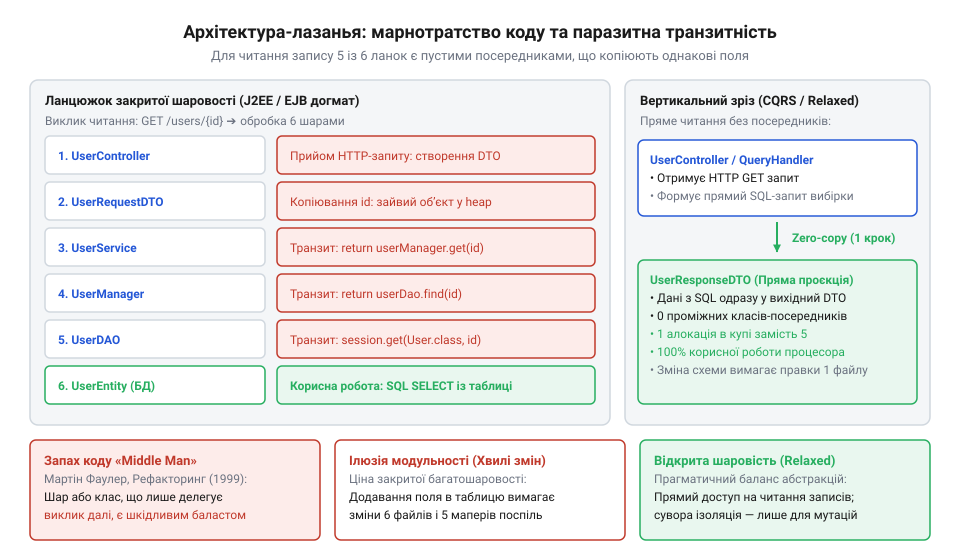
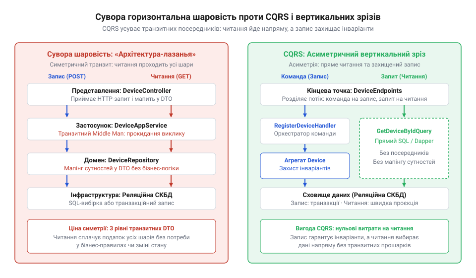

# Шар, що лише передає далі

<preknowlist>
- [Ціна мапінгу між шарами](root:progarch/cost-of-layer-mapping) — Розуміння накладних витрат процесора та захаращення купи (allocation churn) під час багаторазового транзитного копіювання даних між шарами.
- [Протікання шару](root:progarch/layer-leakage) — Розуміння того, як догматичне введення ізолюючих шарів без зміни семантики призводить до протікання абстракцій або виродження шарів у пусті посередники.
</preknowlist>

## Втеча від клієнт-серверного хаосу та народження догмату закритої шаровості

На початку 1990-х років індустрія розробки корпоративного програмного забезпечення переживала бурхливий перехід від монолітних мейнфреймів до дволанкової (@@en|two-tier@@) клієнт-серверної архітектури. Поява середовищ швидкої розробки графічних інтерфейсів (@@en|Rapid Application Development, RAD@@), таких як @@en|Visual Basic@@, @@en|Borland Delphi@@ та @@en|PowerBuilder@@, дозволила інженерам створювати складні екранні форми за допомогою візуального перетягування компонентів. Клієнтські застосунки під'єднувалися напряму до реляційних баз даних (Oracle, Microsoft SQL Server, Sybase) через протоколи ODBC або OLE DB.

Проте за миттєву швидкість побудови перших версій довелося заплатити системною деградацією кодових баз. У дволанковій моделі бізнес-правила, SQL-запити, керування БД-транзакціями та логіка відображення інтерфейсу опинилися в одному місці — безпосередньо у формах екранного коду (наприклад, у обробниках подій `OnClick` чи `OnValidate`). Для змінення алгоритму розрахунку знижки інженер мусив відшукати й відредагувати десятки екранних форм. Правила валідації даних легко обходилися, якщо нова екранна форма або сторонній скрипт виконували прямий оператор `UPDATE` у базі даних.

Щоб зупинити хаос спагеті-коду, інженерна спільнота сформулювала концепцію багатошарової архітектури (@@en|multi-tier / layered architecture@@). Її головною метою було розділити систему на незалежні рівні відповідальності, ізолювавши деталі збереження даних від користувацького інтерфейсу.

Наприкінці 1990-х років ця концепція була офіційно канонізована компанією @@en|Sun Microsystems@@ у специфікації @@en|Java 2 Platform, Enterprise Edition@@ (J2EE 1.2, 1999 рік) та стандартах @@en|Enterprise JavaBeans@@ (EJB 1.1 / 2.0). Еталонні архітектурні керівництва @@en|J2EE Blueprints@@ зафіксували суворий розподіл застосунку на чотири основні рівні: рівень клієнта (@@en|Client Tier@@), веб-рівень (@@en|Web Tier@@), рівень бізнес-логіки (@@en|EJB Business Tier@@) та рівень корпоративних даних (@@en|Enterprise Information System Tier, EIS@@).

> 🔧 **Навіщо це.**
> Багатошарова архітектура створювалася для захисту системи від фатального зчеплення UI-коду з базами даних. Вона дозволила ізолювати реляційні схеми й SQL-запити за стабільними інтерфейсами, даючи змогу командам розробників паралельно змінювати інтерфейс користувача та схему збереження даних без ризику взаємного руйнування.

Однак прагнення до структурованості швидко виродилося у жорстку корпоративну догму — «закриту шаровість» (@@en|closed layering@@). Згідно з цим догматом, будь-який міжкомпонентний виклик мусив проходити виключно послідовний ланцюжок суміжних шарів. Пряме звернення з вищого шару до нижчого через один рівень (наприклад, із контролера до бази даних) оголошувалося грубим порушенням архітектурної дисципліни.

Типовий канонічний ланцюжок обробки запиту в J2EE-застосунку виглядав так:

1. **Презентаційний контролер** (@@en|Web Controller / Servlet@@) приймав HTTP-запит.
2. Викликав **Делегат бізнес-логіки** (@@en|Business Delegate@@), щоб приховати деталі звернення до корпоративної мережі.
3. Делегат звертався до **Сесійного компонента** (@@en|Session Bean@@) у корпоративному контейнері.
4. Сесійний компонент викликав **Об'єкт доступу до даних** (@@en|Data Access Object, DAO@@).
5. DAO вичитував дані через **Сутність ORM** (@@en|Entity Bean / ORM Entity@@) та повертав її назад у ланцюг.

Такий каскад гарантував симетрію та повне абстрагування кожного кроку. Проте коли цю модель почали назавжди й безвинятково застосовувати до всіх типів операцій, індустрія зіткнулася з новою системною кризою.

## Розквіт абсурду: «архітектура-лазанья» та паразитна індустрія транзитних класів

Догматична заборона «жоден контролер не сміє звертатися до сховища напряму» зіткнулася з реаліями корпоративних застосунків, де понад 70–80% усіх операцій складають тривіальні читання — вичитування списків для випадаючих меню, відображення карток користувачів або формування простих звітів.

Оскільки закрита шаровість вимагала дзеркальної наявності всіх рівнів для кожного виклику, інженери були змушені створювати 5–7 класів-посередників навіть для вичитування десяти рядків із бази даних. Контролер перекладав дані у DTO веб-шару, викликав сервісний шар; сервіс перекладав DTO у командний об'єкт і передавав його менеджеру; менеджер викликав DAO, а DAO перетворював табличні рядки у об'єкти сутностей.

Таку систему індустрія влучно назвала «архітектурою-лазаньєю» (@@en|lasagna architecture@@): на відміну від прозорих та ізольованих шарів, вона складалася з десятків тонких, щільно притиснутих один до одного проміжних прошарків коду.

*Порівняння корисної роботи та транзитного бойлерплейту в архітектурі-лазаньї: 5 із 6 переходів є чистим копіюванням однаковісіньких полів, що породжує накладні витрати на мапінг та навантаження на збирач сміття.*

У 1999 році Мартін Фаулер (@@en|Martin Fowler@@) у своїй фундаментальній праці *«Refactoring: Improving the Design of Existing Code»* дав чіткий діагноз цьому архітектурному патогенезу, виокремивши запах коду **Посередник** (@@en|Middle Man@@). Клас-посередник — це клас, який не виконує жодної власної бізнес-обробки, валідації чи перетворення даних, а лише механічно перенаправляє всі свої виклики іншому об'єкту.

Коли понад 80% коду в системі стають такими пустими транзитними ланками, це призводить до двох важких системних наслідків:

1. **Процесорне та пам'ятне марнотратство**: Постійне перекладання однакових полів між `Entity`, `DAO DTO`, `Service DTO` та `Response DTO` викликає системні витрати на копіювання пам'яті (детально це розкрито у статті [Ціна мапінгу між шарами](root:progarch/cost-of-layer-mapping)). Мільйони короткоживучих транзитних об'єктів перевантажують купу (@@en|allocation churn@@), змушуючи збирач сміття (@@en|Garbage Collector@@) регулярно зупиняти виконання застосунку.
2. **Ефект хвилі при тривіальних змінах**: Додавання одного нового поля (наприклад, `battery_level`) до таблиці бази даних вимагає модифікації 6–7 файлів у всіх шарах застосунку, оновлення 4 функцій мапінгу та написання фіктивних модульних тестів для перевірки класів, які нічого не роблять (детальніше див. [Протікання шару](root:progarch/layer-leakage)).

Реакція індустрії на кризу «архітектури-лазаньї» сформувала сучасний архітектурний консенсус. Спочатку Фаулер та провідні деталізатори корпоративних паттернів легітимізували концепцію **відкритої шаровості** (@@en|relaxed layering@@). У відкритій шаровій моделі вищі рівні мають право звертатися до нижчих напряму, якщо проміжні шари не додають жодної бізнес-семантики або захисту інваріантів.

Подальший розвиток цієї думки дав початок розділенню команд і запитів (@@en|CQRS@@) та архітектурі вертикальних зрізів (@@en|Vertical Slice Architecture@@).

*Порівняння традиційної суворої шаровості та вертикальних зрізів CQRS: відокремлення читання дозволяє звертатися до сховища напряму без транзитних посередників.*

В операціях читання (@@en|Query@@) немає бізнес-інваріантів, які потрібно захищати: дані лише вичитаються з БД для відображення. Тому контролер або обробник запиту може читати денормалізоване сховище напряму через прості DTO. Складні інваріанти, доменні сутності та захищені шари потрібні лише в операціях зміни стану (@@en|Command@@).

> 🔧 **Навіщо це.**
> Розуміння історичної помилки закритої шаровості звільняє інженера від ритуального створення пустих сервісів та DTO. Воно дає право випрямляти шлях читання даних напряму до сховища, зберігаючи складні захисні шари лише там, де дійсно виконується перевірка бізнес-правил.

## 1999 рік: діагноз Мартіна Фаулера — запах коду Middle Man та легітимізація Relaxed Layering

Наприкінці 1990-х років корпоративна розробка зіткнулася з наслідками сліпого дотримання догмату строгої (закритої) багатошаровості. У добу панування ранніх специфікацій J2EE та EJB будь-яка операція читання чи запису мала беззастережно проходити крізь повний ланцюжок: від презентаційного контролера до сервісу додатку, бізнес-компонента та дата-мапера. На практиці це призвело до виродження архітектури у так звану «архітектуру-лазанью» (@@en|lasagna architecture@@) — монструозну піраміду з десятків шарів, де проміжні класи не виконували жодної обчислювальної чи захисної функції, а лише транзитом перенаправляли виклики далі й перекладали однакові поля між безліччю дубльованих DTO. Кожна найпростіша зміна у схемі бази даних вимагала каскадного редагування п'яти-шести файлів, що створювало високу [ціну мапінгу між шарами](root:progarch/cost-of-layer-mapping) і нищило продуктивність команди.

Поворотним моментом у подоланні цієї кризи стала публікація 1999 року фундаментальної праці британського архітектора Мартіна Фаулера (@@en|Martin Fowler@@) «Рефакторинг: вдосконалення дизайну існуючого коду» (@@en|Refactoring: Improving the Design of Existing Code@@), створеної у співпраці з Кентом Беком (@@en|Kent Beck@@). У цій книзі Фаулер уперше дав чітке діагностичне визначення запаху коду (@@en|code smell@@) під назвою **Middle Man** (посередник).

Сутність цього запаху полягає в тому, що клас втрачає свою автономну семантику й перетворюється на «порожню оболонку». Якщо більшість методів класу лише делегують роботу іншому об'єкту без будь-якої валідації, фільтрації, збагачення даних чи перевірки бізнес-інваріантів, такий клас перестає виправдовувати своє існування в системі. Для лікування цього симптому Фаулер запропонував канонічний [рефакторинг Remove Middle Man](root:sf-apps/refactoring-remove-middle-man) (видалення посередника) — пряме спрямування клієнта до реального виконавця операції.

> 🔧 **Навіщо це.**
> Видалення класу-посередника (Remove Middle Man) ліквідує фіктивні абстракції та звільняє виклик від транзитного накладного коду. Якщо шар не володіє власною доменною логікою, керуванням транзакціями або межами авторизації, його згортання зменшує когнітивне навантаження на інженера й усуває паразитні алокації пам'яті.

Діагноз Фаулера виявився чимось більшим, ніж просто порадою з мікрорефакторингу коду. Він спростував головний міф корпоративної архітектури про те, що перетин шарів напряму нібито завжди призводить до хаосу та [протікання шару](root:progarch/layer-leakage). Це відкрило шлях до офіційної легітимізації в теорії програмної інженерії концепції **відкритої шаровості** (@@en|relaxed layering@@ або @@en|open layering@@).

У моделі відкритої шаровості шари більше не утворюють глухий непроникний бар'єр. Верхній шар (наприклад, презентаційний контролер або UI) отримує абсолютно законне право звертатися напряму до нижчих шарів (сховища даних чи інфраструктурного адаптера), перестрибуючи проміжні сервіси, якщо для конкретної операції — зокрема для простих читань чи вибірок — проміжним рівням нема чого додати до інваріантів системи.

Відкрита шаровість чітко розділила поняття «модульність» і «ритуальна трансляція». Єдиним виправданням існування проміжного шару є наявність бізнес-інваріантів:
1. Валідація та перевірка обмежень доменної моделі.
2. Керування транзакційними межами (@@en|transaction boundaries@@).
3. Контроль доступу та авторизація.
4. Трансляція специфічних винятків інфраструктури у типізовані доменні помилки.

Якщо жодна з цих чотирьох функцій не виконується, будь-який проміжний сервіс є анемічним посередником. Звільнившись від догматичного обов'язку будувати закриті шари для кожної операції, індустрія сформувала підґрунтя для сучасної асиметричної обробки запитів і розділення читання й запису.

## Розвінчання центрального міфу: пастка симетрії читання й запису та криза Service Layer

Чому програмна інженерія понад десятиліття підтримувала у кодових базах тисячі порожніх класів-посередників? У центрі корпоративного стандарту лежала глибока когнітивна помилка — **міф про симетрію шарів** (@@en|Layer Symmetry Myth@@).

Цей міф спирався на уявлення про те, що будь-яка операція в системі — незалежно від того, чи вона створює складний фінансовий документ, чи просто вичитує п'ять рядків для випадаючого списку в інтерфейсі, — має однакову структуру і зобов'язана дзеркально проходити один і той самий канонічний набір шарів. Корпоративні стандарти та інструкції з кодування суворо проповідували: *«Контролер ніколи не повинен звертатися до сховища напряму. Створюйте сервісний шар»*. Це правило подавалося як універсальний закон інкапсуляції та розділення відповідальностей.

Проте системний аналіз показує фундаментальну асиметрію між операціями зміни стану (@@en|Command@@) та читання (@@en|Query@@):

* **Зміна стану (Command)** змінює системну правду. Вона вимагає перевірки складної бізнес-логіки, валідації доменних інваріантів, дотримання меж транзакцій та генерації доменних подій. Тут наявність доменного шару та сервісів є абсолютно виправданою, адже вона захищає цілісність даних від пошкодження.
* **Читання даних (Query)** має **нуль бізнес-інваріантів** та **нуль мутацій стану**. Це пасивна проєкція вже існуючих фактів.

Коли операція читання примусово проганяється крізь доменний сервіс чи сутності ORM, система не отримує жодного захисту. Доменний об'єкт вичитується з бази даних лише для того, щоб його поля були негайно скопійовані у `ServiceDTO`, а потім — у `ResponseDTO`.

Така дзеркальність генерує накладні витрати на копіювання пам'яті (див. [Ціна мапінгу між шарами](root:progarch/cost-of-layer-mapping)) та створює витоки абстракцій проміжних шарів (див. [Протікання шару](root:progarch/layer-leakage)).

У результаті сервісні класи на кшталт `UserService` чи `OrderService` перетворилися на гігантські гібридні файли, де лише 10% методів виконували реальну бізнес-обробку, а 90% складали порожні методи-прокладки `getUserById()` чи `getOrdersByFilter()`, які просто викликали DAO і повертали DTO.

> 🔧 **Навіщо це.**
> Усвідомлення асиметрії між читанням та записом звільняє архітектора від потреби будувати симетричний сервісний шар для кожної таблиці. Це дозволяє усунути транзитні методи-прокладки під час вичитання даних без жодного ризику для безпеки чи цілісності домену.

## Архітектурний злам: CQRS Грега Янга та вертикальні зрізи Джиммі Богарда

Революція в архітектурному мисленні відбулася наприкінці 2000-х років, коли інженерна спільнота остаточно переглянула монополію суворих горизонтальних шарів. 

У 2010 році архітектор Грег Янг (@@en|Greg Young@@), розвиваючи принцип розділення команд і запитів Бертрана Мейєра (@@en|CQS@@), формалізував паттерн розділення відповідальності команд та запитів (@@en|Command Query Responsibility Segregation, CQRS@@) на рівні всієї системної архітектури. 

Янг довів, що спроба використовувати єдину доменну модель і для запису, і для читання є концептуально хибною. Запис вимагає багатих доменних моделей із суворою інкапсуляцією; читання вимагає максимально швидких денормалізованих проєкцій, підлаштованих під конкретні екрани чи API. 

Розділивши систему на **тракт запису** (@@en|Command Track@@) та **тракт читання** (@@en|Query Track@@), CQRS легітимізував прямий обхід доменного шару під час читання. У тракті читання контролер отримав право виконувати прямі проєкційні SQL-запити або звертатися до спеціальних читальних вітрин без утворення транзитних об'єктів ORM чи доменних сутностей.

У 2015 році Джиммі Богард (@@en|Jimmy Bogard@@), автор популярних бібліотек AutoMapper та MediatR, довів цю еволюцію до логічного завершення, запропонувавши архітектуру вертикальних зрізів (@@en|Vertical Slice Architecture@@).

Традиційна шарова архітектура нарізає застосунок горизонтально: кожна фіча мусить проходити через шари Controller, Service, Domain та Repository. 

Vertical Slice Architecture пропонує групувати код навколо окремих бізнес-операцій (вертикальних зрізів). Кожен обробник запиту (наприклад, `GetCustomerOrdersQueryHandler`) є автономним зрізом, який має саме таку глибину абстракції, якої вимагає його логіка:

* Якщо операція є простим читанням, її зріз складається з 15 рядків коду: HTTP-ендпоінт робить прямий проєкційний SQL-запит і повертає JSON. У ньому немає сервісних інтерфейсів, немає DTO-маперів і немає шарів-прокладок.
* Якщо операція є складною транзакцією переказу коштів, її зріз використовує багатий доменний агрегат із транзакційними межами.

Сучасний архітектурний консенсус більше не вимірює якість коду кількістю горизонтальних шарів чи суворістю закритої шаровості. Існування проміжного шару є виправданим **лише тоді, коли він захищає бізнес-інваріанти або утримує важливу системну межу** (безпека, транзакції, ізоляція зовнішнього контракту).

Якщо шар не виконує перетворень, не перевіряє правил і не захищає стан — це **Посередник** (@@en|Middle Man@@), паразитний шар-прокладка, який має бути безжально демобілізований.

> 🔧 **Навіщо це.**
> Розуміння CQRS та вертикальних зрізів дає інженерний інструментарій для підлаштування глибини абстракцій під реальну складність задачі. Це усуває класи-посередники на шляхах читання та зберігає суворі доменні межі там, де дійсно відбувається мутація стану системи.

## Сучасний синтез: тест на інваріанти та інженерія усунення шару-паразита

Для сучасного інженера головний висновок із тридцятирічної історії боротьби з «архітектурою-лазаньєю» є детермінованим: **жоден шар, клас чи інтерфейс не має права існувати в кодовій базі лише заради дотримання структурної симетрії**.

Кожен проміжний компонент мусить виправдовувати своє існування доданою вартістю. Якщо шар не виконує трансформації даних, не перевіряє правил і не утримує системну межу, він є паразитною прокладкою, яка лише помножує когнітивне навантаження та виклики збирача сміття.

Щоб провести об'єктивний аудит будь-якого проміжного класу в коді, застосовують **тест на інваріанти** (@@en|Invariant Test@@). Для цього компоненту по черзі ставлять чотири фундаментальні запитання:

1. **Захист бізнес-інваріантів**: Чи виконує цей клас нетривіальну валідацію, обчислення чи мутацію доменного стану?
2. **Утримання системної межі**: Чи забезпечує цей клас керування транзакціями бази даних, перевірку прав доступу чи ведення системного аудиту?
3. **Ізоляція зовнішнього контракту**: Чи транслює цей клас зовнішній API-протокол у внутрішню модель для захисту домену від змін зовнішніх залежностей?
4. **Приховування алгоритмічної складності**: Чи агрегує цей клас дані з кількох різнорідних джерел або асинхронних сервісів?

Якщо відповідь на всі чотири запитання є **«ні»**, перед нами класичний **Посередник** (@@en|Middle Man@@).

> 🔧 **Навіщо це.**
> Тест на інваріанти дає інженеру практичний інструмент для швидкої ревізії кодової бази. Він дозволяє об'єктивно відокремити захисні шари від проміжних прокладок і прийняти обґрунтоване рішення про спрощення ланцюжка викликів.

Усунення шару-паразита виконується за чітким рефакторинговим алгоритмом:

* **Вбудовування викликів** (@@en|Inline Method / Inline Class@@): Порожні сервісні методи, які лише перенаправляють виклик до сховища (`return repository.findById(id)`), демонтуються, а контролер отримає право викликати сховище напряму.
* **Ліквідація дзеркальних DTO**: Якщо `ResponseDTO`, `ServiceDTO` та `Entity` мають однаковісінькі поля, проміжні DTO усуваються на користь єдиної проєкції для читання (детальніше про наслідки мапінгу див. [Ціна мапінгу між шарами](root:progarch/cost-of-layer-mapping)).
* **Спрощення модульних тестів**: Видалення класів-пустушок дозволяє усунути сотні фіктивних тестів, які лише перевіряли, чи викликає сервіс свій DAO-компонент, звільняючи час для тестування реальних доменних інваріантів (див. [Протікання шару](root:progarch/layer-leakage)).

Справжня архітектурна зрілість полягає не у догматичному дотриманні закритої шаровості, а в умінні будувати лаконічні та прямі шляхи виконання коду. Пряме звернення до сховища в операціях читання — це не компроміс і не технічний борг, а свідомий інженерний вибір на користь простоти, швидкодії та чистоти кодової бази.
