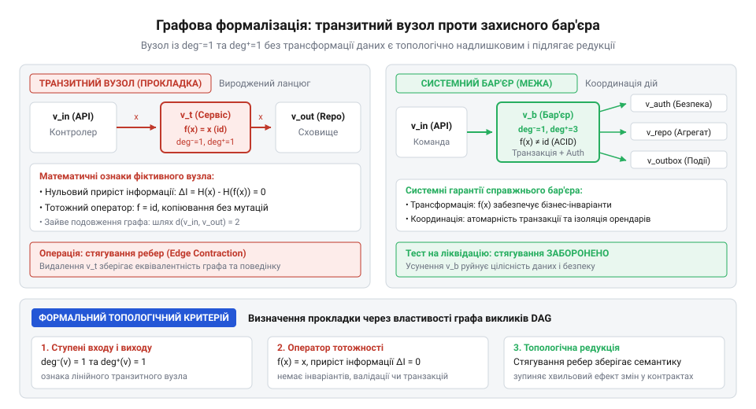
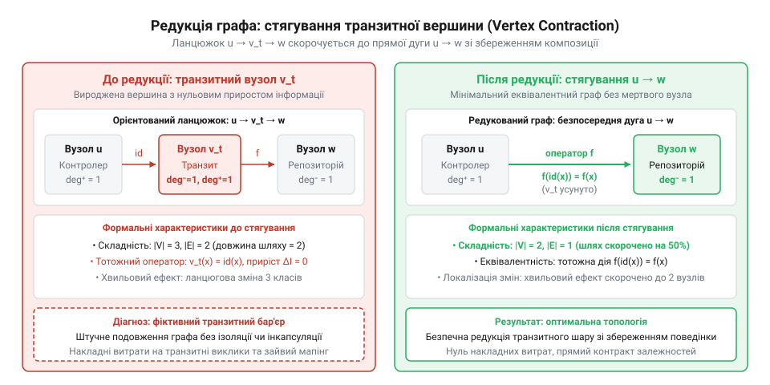

# Шар, що лише передає далі

<preknowlist>
- [Ціна мапінгу між шарами](root:progarch/cost-of-layer-mapping) — механіка виникнення накладних витрат під час дублювання та копіювання даних на проміжних кордонах
- [Протікання шару](root:progarch/layer-leakage) — поняття архітектурного бар'єра та ризики прямого зчеплення несумісних компонентів
</preknowlist>

## Подовження ланцюжків викликів та ціна фіктивного посередника

Прагнення створити «гнучку на майбутнє» розробку часто спонукає інженерів вставляти між точкою запиту та реальною бізнес-логікою проміжні класи-посередники. Типовий приклад у шаровій архітектурі — сервіс-проксі або проміжний фасад, єдиний метод якого без жодних перевірок, трансформацій чи розгалужень транслює параметр далі:

```csharp
public class OrderServiceProxy : IOrderService
{
    private readonly OrderService _target;

    public OrderServiceProxy(OrderService target)
    {
        _target = target;
    }

    public OrderResult Process(OrderRequest request)
    {
        // Пасивний виклик без додавання бізнес-правил
        return _target.Process(request);
    }
}
```

Створення такого прошарку (англ. @@en|pass-through layer@@) обґрунтовують можливістю додати в майбутньому кешування, логування або авторизацію. Проте доки цієї логіки немає, шар працює як пасивний ретранслятор. Системний ефект такого рішення виявляється не у збереженні часу, а у прямому множенні трудомісткості розробки.

Кожна нова вимога до бізнес-функціоналу спричиняє каскад синхронних правок уздовж усього ланцюжка викликів. Якщо в структуру замовлення додається нове поле або змінюється тип ідентифікатора, інженер змушений послідовно відредагувати інтерфейс входу, структуру даних проміжного класу, метод ретрансляції та підпорядкований сервіс. Разом із цим дублюються юніт-тести: розробник пише перевірки для посередника, які лише стверджують, що проксі дійсно викликав цільовий метод із тими самими аргументами.

Таке паразитне розростання кодової бази збільшує [ціну мапінгу між шарами](root:progarch/cost-of-layer-mapping), не створюючи жодної архітектурної ізоляції. На відміну від справжнього захисного бар'єра, який обмежує [протікання шару](root:progarch/layer-leakage) та інкапсулює деталі інфраструктури, пасивний посередник пропускає всі зміни наскрізь. Жорсткість системи зростає пропорційно довжині ланцюжка, оскільки коефіцієнт логічного зчеплення між початковим клієнтом і кінцевим обробником залишається рівним одиниці, але кількість точок редагування коду множиться на кількість пасивних ланок.

> 🔧 **Навіщо це.**
> Виявлення та усунення транзитних посередників дозволяє скоротити обсяг шаблонного коду (англ. @@en|boilerplate@@), зменшити кількість каскадних правок при зміні контрактів даних та знизити витрати на підтримку фіктивних тестів.

## Графова формалізація шарової системи та оператора транзитності

Для строгого виявлення пасивних ланок у кодовій базі шарову архітектуру подають у вигляді орієнтованого ациклічного графа залежностей (грец. ἄκυκλος — ациклічний; англ. @@en|directed acyclic graph@@, DAG):

```
G = (V, E)
```

Де множина вершин `V` відповідає модулям, інтерфейсам або окремим класам системи, а множина орієнтованих дуг `E ⊆ V × V` фіксує напрямок передачі даних та викликів методів. Напрямок дуги `(u, v) ∈ E` означає, що вузол `u` безпосередньо викликає вузол `v`.

У цій моделі транзитний вузол `v_t ∈ V` строго визначається через два топологічні та інформаційні обмеження.

Перша умова — топологічне обмеження на степені вершини. Вхідний степінь (англ. @@en|in-degree@@) `deg⁻(v_t)` та вихідний степінь (англ. @@en|out-degree@@) `deg⁺(v_t)` транзитного вузла мусять дорівнювати одиниці:

```
deg⁻(v_t) = 1
deg⁺(v_t) = 1
```

Це означає, що вузол `v_t` має єдиного попередника `u ∈ V` та єдиного наступника `w ∈ V`. У ньому відсутні розгалуження, маршрутизація чи поліморфний вибір обробника.

Друга умова — інформаційне обмеження на оператор трансформації. Нехай `X` — множина вхідних станів або структур даних, що надходять від `u`, а `Y` — множина вихідних станів, що передаються до `w`. Оператор `T: X → Y`, який виконується всередині `v_t`, є тотожним відображенням (латин. @@en|identificatio@@; identity map `id`):

```
T(x) = x    [для всіх x ∈ X]
```

Приріст інформації (приріст ентропії Шеннона `ΔI`) на даному вузлі дорівнює нулю:

```
ΔI(v_t) = H(Y) - H(X|Y)
= 0
```

Вузол `v_t` не здійснює фільтрації даних, не перевіряє доменні інваріанти, не перехоплює винятки й не змінює структуру повідомлення.


*Орієнтований ациклічний граф викликів з виділенням транзитного вузла v_t зі степенями входу й виходу, рівними одиниці.*

Ці критерії дозволяють провести чітку межу між транзитним вузлом і справжнім архітектурним бар'єром. Дійсний захисний шар завжди порушує щонайменше одну з двох умов:
1. Має `deg⁺(v) > 1` або `deg⁻(v) > 1` (диспатчеризація, фасад над багатьма сервісами, адаптер багатьох джерел).
2. Реалізує нетривіальний оператор `T: X → Y`, для якого `ΔI(v) > 0` (трансляція помилок інфраструктури в доменні типи, валідація входів, мапінг між несумісними схемами даних).

Якщо вузол `v_t` є транзитним, ланцюжок викликів `u → v_t → w` є топологічно надлишковим. Розглянемо композицію операторів уздовж шляху довжиною 2:

```
f_composite = T_w ∘ T_(v_t) ∘ T_u
= T_w ∘ id ∘ T_u                [T_(v_t) є тотожним відображенням id]
= T_w ∘ T_u                      [властивість нейтрального елемента композиції]
```

Оскільки композиція `T_w ∘ id ∘ T_u` тотожно дорівнює `T_w ∘ T_u`, на графі залежностей можна застосувати операцію стягування вершин (англ. @@en|vertex contraction@@; `root:math-combinatorics/graph-vertex-contraction`). Вершина `v_t` вилучається з множини `V`, а дуги `(u, v_t)` та `(v_t, w)` замінюються прямою дугою `(u, w) ∈ E_new`.


*Топологічна редукція графа викликів шляхом стягування транзитної вершини v_t у прямий зв'язок u → w.*

Оцінимо зміну кількості шляхів у матриці суміжності `A` розміру `N × N`. До редукції елемент `A²[u, w]`, що відповідає кількості шляхів довжини 2 від `u` до `w`, обчислювався так:

```
A²[u, w]
= ∑_(k ∈ V) A[u, k] · A[k, w]
= A[u, v_t] · A[v_t, w]          [єдиний послідовний шлях через v_t]
= 1 · 1
= 1                              [доведено існування шляху довжини 2]
```

Після стягування вершини `v_t` елемент нової матриці суміжності `A_new[u, w] = 1`, що означає перехід до безпосереднього зв'язку довжини 1. Довжина шляху між `u` та `w` зменшується на 1 (`L_new = L - 1`), а загальна кількість вершин редукується до `|V_new| = |V| - 1` без жодної зміни підсумкової функціональної поведінки системи.

> 🔧 **Навіщо це.**
> Математичні критерії `deg⁻ = 1`, `deg⁺ = 1` та `ΔI = 0` слугують алгоритмічною основою для статичного аналізу коду (англ. @@en|static code analysis@@) та автоматизованих архітектурних фітнес-функцій, які виявляють непотрібні шар-посередники у великих проєктах.

## Розрахунок хвильового ефекту змін через матрицю досяжності

Для кількісної оцінки поширення модифікацій у шаровій системі використовуються інструменти матричної алгебри на графах. Нехай шарова архітектура представлена орієнтованим ациклічним графом викликів `G = (V, E)` із кількістю вершин `N = |V|`.

Структура зв'язків системи описується матрицею суміжності (англ. @@en|adjacency matrix@@) `A` розміру `N × N`:

```
A[i, j] = 1    [якщо існує дуга (v_i, v_j) ∈ E]
A[i, j] = 0    [якщо дуга (v_i, v_j) ∉ E]
```

Значення k-го степеня матриці суміжності `Aᵏ[i, j]` дорівнює кількості шляхів точної довжини `k` від вершини `v_i` до вершини `v_j`.

Для обчислення повного потенціалу розповсюдження змін — хвильового ефекту (англ. @@en|ripple effect@@) — використовується матриця досяжності ([транзитивне замикання](root:sf-algorithms/transitive-closure); англ. @@en|transitive closure@@) R. Вона визначається як сума степенів матриці суміжності для всіх можливих довжин шляхів у DAG:

```
R = ∑_(k=1)^(N-1) Aᵏ
= A + A² + A³ + ... + Aⁿ⁻¹
```

Якщо елемент `R[i, j] > 0`, то будь-яка зміна у контракті або реалізації компонента `v_i` здатна потенційно зруйнувати роботу компонента `v_j`.

Розглянемо ланцюжок викликів із залученням транзитного вузла `v_t`: `u → v_t → w`. У цьому випадку `A[u, v_t] = 1` та `A[v_t, w] = 1`. Елемент матриці досяжності для шляху між джерелом `u` та кінцевим споживачем `w` обчислюється так:

```
R[u, w]
= A²[u, w]
= A[u, v_t] · A[v_t, w]          [єдиний послідовний шлях через v_t]
= 1 · 1
= 1                              [існує досяжність довжини 2]
```

Множина зони ураження рефакторингу (англ. @@en|impact set@@) при модифікації вузла `u` визначається як множина всіх досяжних з `u` вершин:

```
Impact(u) = { v_j ∈ V | R[u, j] > 0 }
```

За наявності транзитного вузла `v_t` зона ураження дорівнює `Impact(u) = {v_t, w}`. Інженер змушений перевіряти та коригувати два підпорядковані компоненти замість одного. Оскільки вузол `v_t` реалізує тотожний оператор `T = id`, він не створює семантичного захисту і не запобігає [протіканню шару](root:progarch/layer-leakage).

Крім того, наявність пасивного посередника збільшує сумарне зчеплення в системі `C_total`, яке розраховується як загальна кількість дуг у графі:

```
C_total = ∑_(i=1)^N ∑_(j=1)^N A[i, j]
```

Заміна прямого зв'язку `u → w` на транзитний ланцюжок `u → v_t → w` збільшує `C_total` на 1 дугу, розширюючи матрицю досяжності та штучно збільшуючи складність підтримки коду.

> 🔧 **Навіщо це.**
> Матричний розрахунок досяжності `R` надає кількісну метрику для автоматичної оцінки ризику рефакторингу: кожен пасивний проксі-вузол збільшує розмір зони ураження `Impact(u)` та довжину шляхів розповсюдження помилок.

## Операція стягування вершин та доведення еквівалентності

Для усунення топологічної надлишковості транзитних шарів застосовується математична операція стягування вершин (латин. @@en|contractio@@; англ. @@en|vertex contraction@@).

Нехай `G = (V, E)` — граф викликів, що містить транзитний вузол `v_t` зі степенями `deg⁻(v_t) = 1` (від `u`) та `deg⁺(v_t) = 1` (до `w`), де оператор вузла є тотожним `T_(v_t) = id`. Редукований граф `G' = G / v_t` будується за такими правилами:
1. Вершина `v_t` вилучається з множини вершин: `V' = V \ {v_t}`.
2. Дуги `(u, v_t)` та `(v_t, w)` вилучаються та замінюються прямою дугою `(u, w)`: `E' = (E \ {(u, v_t), (v_t, w)}) ∪ {(u, w)}`.

Доведемо поведінкову еквівалентність систем `G` та `G'`.

**Теорема про функціональну еквівалентність при стягуванні:**
Підсумковий оператор обробки даних на шляху `u → v_t → w` у графі `G` тотожно дорівнює оператору прямої дуги `u → w` у редукованому графі `G'`.

Доведення розгортається через асоціативність композиції функціональних операторів:

```
F_G(x)
= (T_w ∘ T_(v_t) ∘ T_u)(x)        [за визначенням послідовного виклику в G]
= T_w(T_(v_t)(T_u(x)))             [за визначенням композиції операторів]
= T_w(id(T_u(x)))                  [оскільки T_(v_t) є тотожним відображенням id]
= T_w(T_u(x))                      [за властивістю тотожного відображення id(y) = y]
= (T_w ∘ T_u)(x)                   [за визначенням композиції в G']
= F_G'(x)                          [результати тотожні для всіх x ∈ X]
```

Отже, `F_G = F_G'`. Усунення транзитного вузла зберегло бізнес-поведінку системи для всіх вхідних станів `X`.

**Теорема про зменшення топологічної складності:**
Операція стягування транзитної вершины строго зменшує кількість вершин і дуг графа, зберігаючи відношення досяжності між усіма решта компонентами.

Доведення:
1. Кількість вершин зменшується на одиницю: `|V'| = |V| - 1`.
2. Кількість дуг зменшується на одиницю: `|E'| = (|E| - 2) + 1 = |E| - 1`.
3. Для будь-якої пари збережених вершин `p, q ∈ V'` існування шляху `P` у графі `G` еквівалентне існуванню шляху `P'` у графі `G'`. Якщо шлях `P` проходив через підшлях `(u, v_t, w)`, у `G'` він проходить через дугу `(u, w)`. Отже, `R_G'[p, q] = R_G[p, q]`.

Така топологічна редукція зменшує [ціну мапінгу між шарами](root:progarch/cost-of-layer-mapping) за рахунок ліквідації зайвого дублювання об'єктів у пам'яті, скорочуючи довжину шляху виконання з `L = 2` до `L' = 1`.

> 🔧 **Навіщо це.**
> Математичне доведення еквівалентності дає архітектору строге обґрунтування для рефакторингу: видалення транзитних сервісів і DTO-проксі гарантовано не порушує доменну логіку системи, оптимізуючи пам'ять та швидкість виконання.

## Інженерний критерій редукції та межі застосування

Математичний апарат графової редукції дозволяє звести розпізнавання пасивних шарів до чіткого трикрокового алгоритму аудиту кодової бази. Перш ніж вилучати проміжний модуль або сервіс-проксі із системи, архітектор перевіряє виконання трьох послідовних критеріїв:

1. **Інформаційно-семантична перевірка (`ΔI = 0`).** Клас або модуль не мусить здійснювати фільтрації даних, валідації доменних інваріантів, трансляції типів винятків або збагачення структур повідомлень. Якщо метод лише переправляє прийнятий об'єкт у підпорядкований метод, приріст інформації є нульовим.
2. **Топологічна перевірка (`deg⁻ = 1`, `deg⁺ = 1`).** Вузол має строго одного вхідного споживача та одного вихідного постачальника. У ньому відсутній поліморфний вибір обробника, маршрутизація, розгалуження чи фасадне агрегування декількох джерел.
3. **Синхронність темпів змін (однаковий годинник змін).** Будь-яка модифікація контракту нижнього компонента вимагає негайного синхронного оновлення проміжного класу та його юніт-тестів за тими самими бізнес-причинами.

Якщо всі три умови виконуються одночасно, проміжний вузол є виродженим транзитним елементом. Його стягування є математично безпечним: воно ліквідує [ціну мапінгу між шарами](root:progarch/cost-of-layer-mapping) та зменшує довжину шляху виконання без порушення бізнес-поведінки.

Проте алгоритм редукції має строгі межі застосовності. Спроба бездумно ліквідувати будь-яку вершину зі степенями `deg⁻ = 1` та `deg⁺ = 1` може зруйнувати потрібні архітектурні бар'єри. Збереження проміжного вузла є обов'язковим у трьох інженерних ситуаціях:

- **Часове розчеплення (демпфер темпів змін).** Проміжний шар слугує асинхронною чергою повідомлень або буфером обмеження швидкості (англ. @@en|rate limiter@@). Хоча оператор даних може здаватися тотожним, вузол змінює часовий контекст виконання і захищає повільні довгоживучі підсистеми від пікових навантажень.
- **[Захисний антикорупційний шар](root:progarch/anti-corruption-layer) (англ. @@en|anti-corruption layer@@, ACL).** Якщо нижній компонент є зовнішньою нестабільною бібліотекою або застарілою системою, проміжний вузол ізолює домен від її внутрішніх моделей. Навіть якщо зараз мапінг є 1:1, цей шар закриває [протікання шару](root:progarch/layer-leakage) при зміні зовнішнього вендора.
- **Межа безпеки та міжпроцесної взаємодії.** Вузол виконує роль міжпроцесного адаптера (англ. @@en|inter-process communication@@, IPC) або точки перевірки прав доступу.

Застосування трикрокового критерію дозволяє інженерній команді аргументовано усувати пасивні транзитні прошарки в коді, одночасно захищаючи справжні архітектурні межі від передчасного демонтажу.

> 🔧 **Навіщо це.**
> Трикроковий інженерний критерій захищає проєкт від двох крайнощів: нагромадження неефективних проксі-шарів через передчасну абстракцію та руйнування дійсних захисних меж під час агресивного рефакторингу.
