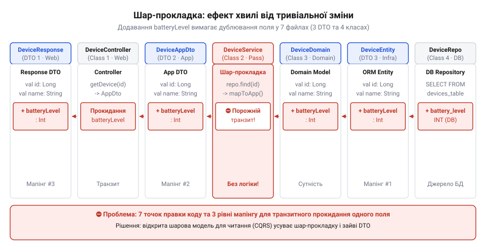
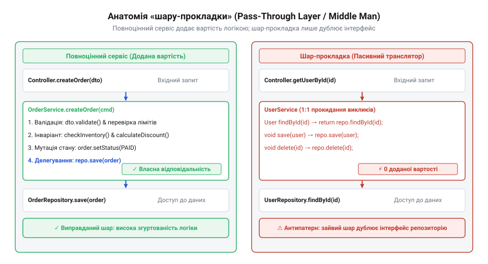
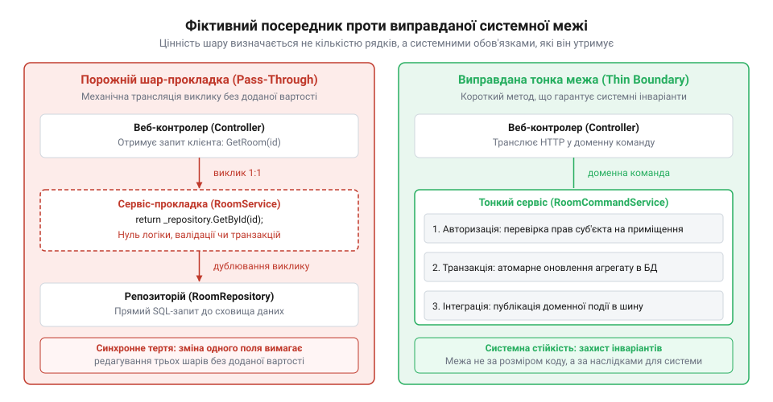
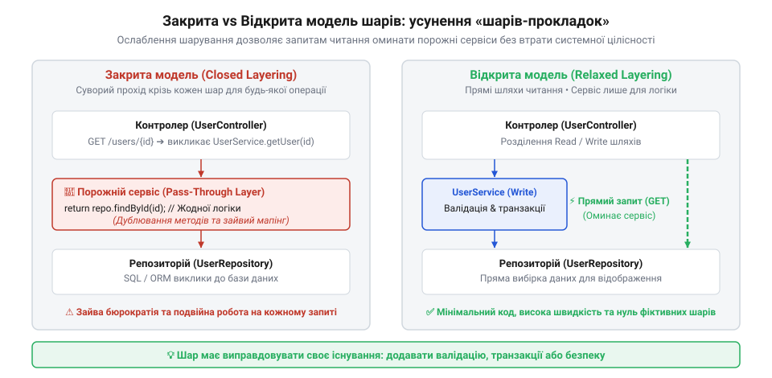
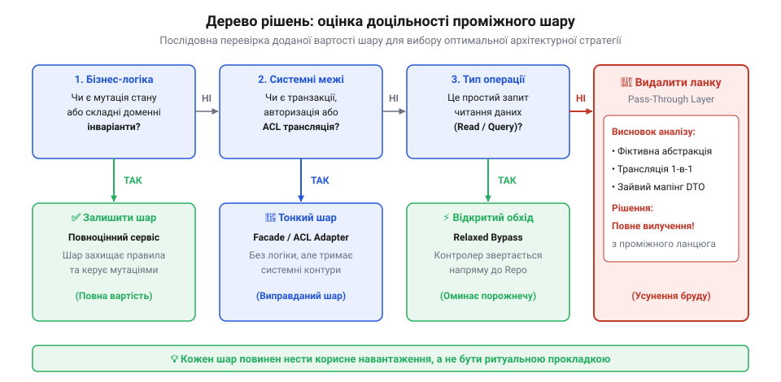
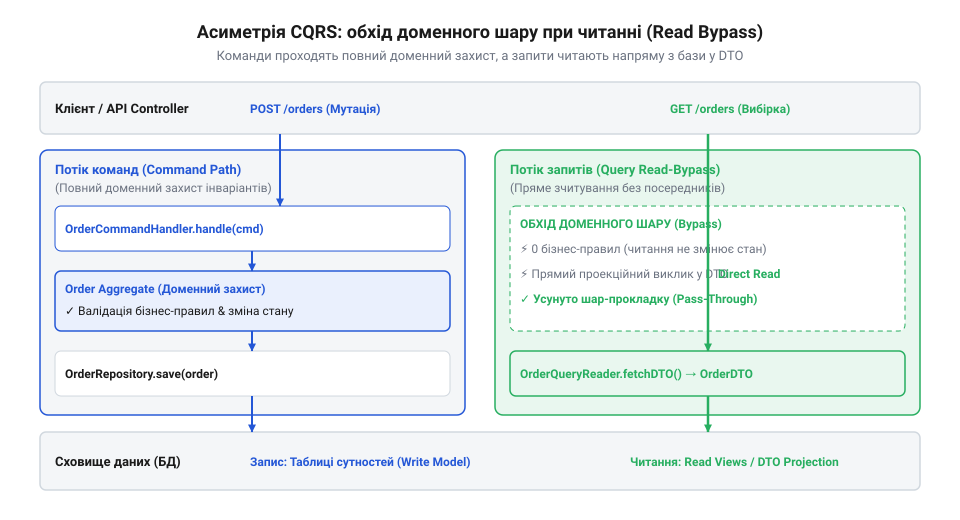
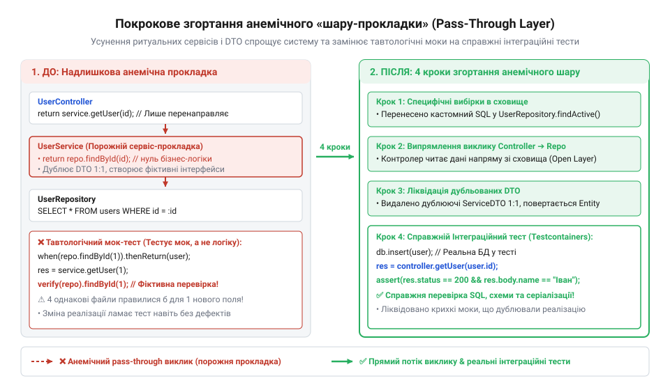
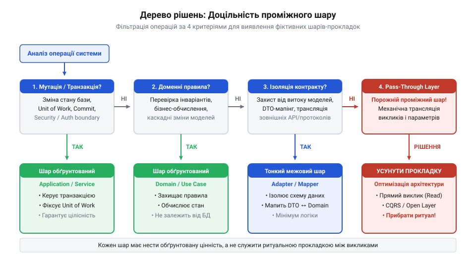

# Шар, що лише передає далі

## Сім файлів заради одного поля: ціна ритуального прокидання

Користувачі розумного будинку Digital Homes почали масово скаржитися в службу підтримки: бездротові кліматичні датчики раптово зникають із панелі моніторингу. Причина банальна — у пристроях розряджається пласка літієва батарейка CR2032, а мобільний застосунок показує лише температуру та вологість, ніяк не попереджаючи про низький заряд. Інженер бере в роботу ранковий тікет: додати рівень заряду акумулятора у відсотках (`batteryLevel`) до відповіді кінцевої точки перегляду поточного стану датчика.

У сховищі даних потрібне значення вже є. Двома тижнями раніше інженери прошивок оновили мережевий шлюз Zigbee, і фоновий процес телеметрії справно зберігає ціле число від 0 до 100 у колонку `battery_level` таблиці `climate_sensors`. Завдання здається справою на п'ять хвилин: виконати вибірку колонки з бази даних і додати відповідне поле до JSON-відповіді HTTP-запиту `GET /api/v1/climate/sensors/:id`.

Проте кодова база Digital Homes суворо наслідує правила класичної тришарової архітектури. В інженерній культурі команди панує непорушний догмат: контролер ніколи не звертається до репозиторію напряму; будь-який запит зобов'язаний пройти крізь шар сервісів, а кожен шар мусить володіти власними моделями даних.

Інженер відкриває середовище розробки, і проста правка перетворюється на марафон редагування семи окремих файлів.

Першим кроком оновлюється сутність бази даних:

:::code pass-through-layer-d/ts/climatesensorentity.ts

Другим кроком інженер перевіряє інтерфейс репозиторію. Контракт доступу до таблиці не змінюється — метод вибірки за ідентифікатором уже існує:

```typescript
// ClimateSensorRepository.ts
export interface ClimateSensorRepository {
  findById(id: string): Promise<ClimateSensorEntity | null>;
}
```

Третім кроком інженер переходить до внутрішнього контракту сервісного шару. Доменне DTO не може використовувати сутність бази напряму, тому до нього додається дублікат нового поля:

```typescript
// SensorReadingDto.ts
export interface SensorReadingDto {
  readonly id: string;
  readonly temperature: number;
  readonly humidity: number;
  readonly batteryLevel: number;
}
```

Четвертим кроком відкривається інтерфейс доменного сервісу. Сигнатура методу залишається незмінною, але інженер мусить переконатися, що типи узгоджені:

```typescript
// ClimateMonitoringService.ts
export interface ClimateMonitoringService {
  getSensorMetrics(sensorId: string): Promise<SensorReadingDto>;
}
```

П'ятим кроком змінюється клас реалізації сервісу. Оскільки для простої операції читання немає жодних бізнес-правил, метод лише перекладає поля з сутності в DTO:

:::code pass-through-layer-d/ts/climatemonitoringserviceimpl.ts

Шостим кроком оновлюється вихідне DTO рівня представлення — модель, що формує тіло відповіді для вебклієнта:

```typescript
// ClimateMetricsResponse.ts
export class ClimateMetricsResponse {
  id: string;
  temperature: number;
  humidity: number;
  batteryLevel: number;
}
```

Сьомим кроком модифікується HTTP-контролер. Він приймає результат роботи сервісу і знову копіює ті самі поля у вихідний контракт представлення:

:::code pass-through-layer-d/ts/climatemonitoringcontroller.ts

Здавалося б, коло замкнулося. Але залишається восьмий файл — обов'язковий модульний тест сервісу:

:::code pass-through-layer-d/ts/snippet-4.ts

Цей тест не перевіряє жодної бізнес-поведінки. Він лише засвідчує, що метод сервісу викликав метод репозиторію з тим самим аргументом і переклав поле `batteryLevel` без змін.


*Додавання єдиного поля змушує змінювати сім файлів уздовж усього стеку, хоча проміжні класи не виконують жодної трансформації чи перевірки.*

Це явище називають хвильовим ефектом змін (англ. *ripple effect*, від *ripple* — брижі на воді): точкова зміна в структурі зберігання спричиняє ланцюгову реакцію редагувань у кожному вищому рівні системи. Математичний апарат опису такого поширення змін через матрицю досяжності орієнтованого ациклічного графа викликів подано у вставці root:progarch/pass-through-layer/math-call-chain-graph-reduction.md.

Тут у всій повноті проявляється ціна мапінгу між шарами (root:progarch/cost-of-layer-mapping). Замість кількох хвилин інженер витрачає пів дня на рутинне оновлення сигнатур, інтерфейсів і перекладачів. Запит на злиття (pull request) розростається на десятки змінених рядків у семи файлах. Якщо інший розробник паралельно додає поле версії прошивки `firmwareVersion`, виникає неминучий конфлікт злиття в контролері, обох DTO та сервісі. Зусилля інженерів витрачаються не на створення функціональності, а на обслуговування штучного архітектурного ритуалу.

## Анатомія шару-прокладки: структурні маркери посередника

Коли проміжний архітектурний компонент не виконує власної роботи, валідації чи змістовних обчислень, а лише механічно транслює виклики й дані далі по ланцюжку, виникає шар-прокладка, або транзитний шар (англ. *pass-through layer*, від *pass through* — проходити наскрізь). У каталозі запахів коду це явище відоме як клас-посередник (@@en|Middle Man@@, від англ. *middle* — середина та *man* — людина) (root:sf-apps/middleman-code-smell).

Першопричиною появи таких порожніх ланок є догматична вимога закритої шарової архітектури (англ. *closed layered architecture*, від лат. *architectura* — будівництво, зодчество). Класична ідея шарів формулювалася заради ізоляції напрямку залежностей: високорівневі концепції не повинні залежати від деталей низькорівневої інфраструктури. Проте закрита модель трактує це правило надмірно жорстко: будь-який запит із рівня `N` зобов'язаний послідовно пройти крізь рівень `N-1`, перш ніж досягне рівня `N-2`. Пряме звернення через рівень суворо забороняється, навіть якщо на проміжному поверсі немає жодної роботи.

> 🔧 **Навіщо це.**
> Вміння розпізнавати структурні маркери шару-прокладки дає інженеру об'єктивні технічні аргументи під час перегляду коду. Замість безплідних суперечок про уявну «чистоту архітектури», команда отримує вимірні індикатори: відсутність бізнес-інваріантів, дзеркальні сигнатури та тавтологічні тести вказують на те, що клас не створює цінності й може бути усунений без ризику для надійності системи.

Спроба застосувати єдиний закритий шаблон до всіх типів операцій неминуче розділяє систему на два нерівні світи. Для операцій зміни стану (запис, оновлення, видалення) проміжний сервісний шар дійсно необхідний: він відкриває транзакції, перевіряє складні бізнес-інваріанти та публікує доменні події. Але для операцій читання бізнес-правил найчастіше немає: клієнту просто потрібні дані в певному форматі. Заборона прямого доступу змушує розробника створювати фіктивні класи-транслятори, які лише імітують наявність архітектурного порядку.

Ця проблема виникла не сьогодні. На зламі 1990-х і 2000-х років корпоративні стандарти корпоративних платформ вимагали суворого розмежування компонентів незалежно від складності завдання. Будь-яка дія вимагала наявності сервлета, сесійного компонента, сутності та об'єкта доступу до даних. Це породжувало так звану архітектуру-лазанью (італ. *lasagna* — листкова запіканка) — незліченні тонкі шари абстракцій без реального доменного змісту між ними. Історію виникнення цього догмату та реакцію індустрії на проміжні класи-пустишки детально розкрито у вставці root:progarch/pass-through-layer/hist-layered-dogma-and-middleman.md.

Щоб безпомилково ідентифікувати шар-прокладку в кодовій базі, достатньо перевірити чотири анатомічні маркери.

**1. Точне дзеркалювання сигнатур методів (1-в-1)**.
Методи проміжного шару повністю повторюють назви, параметри й семантику методів нижчого рівня. Якщо репозиторій надає методи `findById(id)`, `findByStatus(status)` та `listAll()`, сервіс створює ідентичні методи `findById(id)`, `findByStatus(status)` та `listAll()`. Єдина різниця між ними полягає в суфіксах типів: замість `Entity` метод повертає `Dto`. Така структура не створює нової абстракції, а лише клонує інтерфейс залежності.

**2. Повна відсутність бізнес-логіки та інваріантів**.
Тіло методу зводиться до єдиного рядка виклику залежності: `return this.repository.findById(id)`. У методі відсутні розгалуження (`if`, `switch`), немає валідації попередніх умов системи, немає розрахунків і немає узгодження кількох джерел даних. Метод не захищає жодного системного інваріанта.

**3. Тотожний мапінг даних (@@en|identity mapping@@, від лат. *identitas* — тотожність)**.
Проміжний шар перекладає поля з однієї пласкої структури в іншу пласку структуру з ідентичними назвами й типами. Дані не агрегуються, не фільтруються за специфічними правилами домену й не збагачуються додатковим контекстом. Процесор витрачає час на копіювання значень у пам'яті, а інженер змушений підтримувати два ідентичні описи типів.

**4. Тавтологічні тести (грец. *tauto* — те саме та *logos* — слово/вчення)**.
Оскільки метод не містить логіки, його неможливо протестувати на коректність обчислень. Єдине, що залишається розробнику, — створити мок-об'єкт залежності й перевірити сам факт виклику: `expect(repo.findById).toHaveBeenCalledWith(id)`. Такі тести є тавтологією: вони стверджують, що код робить саме те, що написано в коді. Вони не здатні виявити помилку інтеграції чи неправильну поведінку системи, але миттєво ламаються при будь-якій спробі змінити внутрішню структуру класів.


*Справжній сервіс захищає доменні інваріанти й керує бізнес-правилами, тоді як шар-прокладка лише дзеркалює інтерфейс репозиторію та беззмістовно пересилає виклики.*

Різницю між життєздатним бізнес-сервісом і фіктивним посередником наочно видно при зіставленні двох компонентів тієї самої системи Digital Homes:

:::code pass-through-layer-d/ts/climatecontrolserviceimpl.ts

У першому випадку сервіс заробляє право на існування: він зв'язує докупи датчики вікон, обігрівач і шину подій, гарантуючи, що система не витрачатиме енергію на обігрів вулиці. У другому випадку сервіс лише створює видимість шару, перекладаючи поля з однієї коробки в іншу.

Усунення таких фіктивних абстракцій вимагає перегляду ставлення до шаровості. Зокрема, перехід до відкритої шарової архітектури (root:progarch/relaxed-layered-architecture) дозволяє звертатися до сховища даних безпосередньо там, де додатковий захист непотрібний. Проте перш ніж видаляти проміжну ланку, необхідно навчитися відрізняти порожнього посередника від виправданого тонкого шару, який не містить розгалужень, але тримає межі транзакцій чи безпеки.

## Повна ціна володіння: від хвильових змін до фіктивних тестів

Коли інженер пропонує позбутися порожнього сервісного класу, у відповідь майже завжди звучить звичний аргумент: «Чим він заважає? Це лише три рядки коду. Комп'ютер виконує їх за частки наносекунди, пам'яті вистачає, зате в проєкті панує порядок — кожен запит акуратно проходить крізь контролер, сервіс і репозиторій».

Таке міркування здається переконливим лише доти, доки ми сприймаємо код як застиглий текст, що виконується у вакуумі. У реальній системі код не просто виконується процесором: його щодня читають, змінюють, зневаджують і тестують живі люди. Справжню ціну будь-якого архітектурного елемента визначає його сукупна вартість володіння (англ. @@en|total cost of ownership@@, TCO, від лат. @@la|totus@@ — цілий, повний). І в цій вартості на процесорний час припадає мізерна частка: левову частку ресурсу забирають зміна структури, орієнтація в коді та підтримка тестів.

Уявімо тривіальну зміну: до розумного замка в системі Digital Homes додається нове поле — рівень заряду батареї `batteryLevel`. Якщо між базою даних і веб-клієнтом стоїть шар-прокладка, цей шар не виконує жодного перетворення чи валідації. Проте він вимагає власного контракту — проміжного об'єкта передавання даних (DTO).

Оскільки проміжна ланка є суто транзитною, зміна одного поля змушує розробника відкрити й синхронно модифікувати весь вертикальний стек: схему таблиці, сутність сховища, внутрішній інтерфейс репозиторію, проміжне DTO сервісу, мапінг у сервісі, зовнішній контракт контролера та мапінг у контролері. Одне додане поле породжує лавину змін уздовж семи файлів.

Це явище називають хвильовим ефектом змін (англ. @@en|ripple effect@@, від @@en|ripple@@ — дрібні хвилі на воді). Що довша ланка викликів без приросту бізнес-сенсу, то вища ціна кожної модифікації. Ба більше, кожен ручний мапінг — це потенційне джерело дефектів: розробник може забути скопіювати поле, переплутати однойменні властивості, проігнорувати порожнє значення (null) або втратити часовий пояс під час перетворення дати.

**Обчислення ймовірності безпомилкового оновлення ланцюжка з 4 шарів при ймовірності помилки на одному кроці p = 0.05:**
```
P_успіху(1)
= 1 - p                  [один прямий мапінг зі сховища в контракт]
= 1 - 0.05
= 0.95                   [95% ймовірність успішного перенесення поля]

P_успіху(4)
= (1 - p)⁴               [ланцюжок із 4 незалежних ручних мапінгів]
= 0.95⁴
≈ 0.8145                 [81.5% підсумкова ймовірність успіху]
```
Висновок: додавання трьох фіктивних посередників збільшує ризик появи дефекту майже вчетверо — з 5% до 18.5%, навіть коли жоден шар не містить алгоритмічної складності.

Графову математичну формалізацію цього явища через матриці досяжності та операцію стягування вершин розкрито у вставці [Графова формалізація ланцюжків викликів та стягування вершин](root:progarch/pass-through-layer/math-call-chain-graph-reduction.md). Якщо проміжний вузол має вхідний і вихідний степінь 1 і виконує тотожне відображення, його стягування строго зберігає семантичну еквівалентність системи, водночас кардинально скорочуючи граф залежностей і площу поширення змін.

Коли в системі стається аварія — наприклад, датчик вологості раптово повертає від'ємні значення, — черговий інженер починає зневадження. Він відкриває точку входу: `HumidityController.GetStatus(id)`.

Інженер бачить виклик `_humidityService.GetStatusAsync(id)`. Що робить цей метод? Можливо, там закладено фільтрацію викидів? Можливо, там перевіряються права чи кеш? Інженер натискає клавішу переходу до реалізації й потрапляє в `HumidityService`. Там написано: `return await _humidityRepository.GetStatusAsync(id);`. Жодної валідації, жодного перетворення. Інженер знову тисне перехід і лише на третьому кроці добирається до справжнього SQL-запиту.

У цей момент витрачається найцінніший ресурс — когнітивний буфер розробника (англ. @@en|cognitive load@@, від лат. @@la|cognitio@@ — пізнання, вивчення). Людина змушена тримати в короткочасній пам'яті ланцюжок із трьох класів, перевіряти їхні анотації та залежності, аби наприкінці з'ясувати, що проміжні ланки були фікцією. Коли вся система побудована на таких порожніх прольотах, у розробників притупляється увага: вони перестають очікувати бізнес-логіку всередині сервісів. Парадоксальним наслідком стає те, що коли справжня бізнес-логіка нарешті з'являється, її за інерцією запхають або прямо в контролер, або в збережену процедуру бази даних, оскільки сервісний шар сприймається як бюрократичний шум. Це канонічний прояв проблеми, відомої як [Запах коду «Посередник»](root:sf-apps/middleman-code-smell).

Міф про те, що зайвий шар не коштує машинного ресурсу, спростовується профілюванням пам'яті. У керованих середовищах (C#, Java, Go, Node.js) ізоляція шарів традиційно супроводжується створенням окремих об'єктів для кожного поверху: сутність бази мапиться в доменну модель, доменна модель — у сервісне DTO, а сервісне DTO — у відповідь API.

Коли система працює під значним навантаженням — наприклад, шлюз розумного будинку обробляє 10 000 телеметричних звітів щосекунди, — кожен такий ланцюжок невпинно продукує короткоживучі об'єкти в купі.

**Обчислення сміття в купі для сервісу телеметрії (10 000 запитів на секунду):**
```
V_запиту
= M_entity + M_service_dto + M_web_dto     [виділення пам'яті під 3 об'єкти на запит]
= 64 + 64 + 64                             [байтів у керованій купі]
= 192                                      [байтів на один запит]

V_секунда
= 10 000 × 192 байтів                      [обсяг нових об'єктів за 1 секунду]
= 1 920 000 байтів
≈ 1.83 МБ/с                                [швидкість утворення сміття]

V_година
= 1.83 МБ/с × 3600 с
≈ 6.6 ГБ                                   [короткоживучих алокацій щогодини]
```
Висновок: механічне прокидання даних крізь надлишкові класи генерує понад 6.4 гігабайтів об'єктів-сміття щогодини. Це явище має назву навантаження виділення пам'яті (англ. @@en|allocation churn@@, від лат. @@la|allocare@@ — розміщувати). Збирач сміття (Garbage Collector) змушений безперервно запускати фази очищення нульового покоління пам'яті, що вимиває кеш процесора (CPU cache invalidation) і спричиняє раптові затримки на 99-му перцентилі (p99 latency). Детальніше фінансові та системні наслідки таких перетворень розглянуто в статті [Ціна мапінгу між шарами](root:progarch/cost-of-layer-mapping).

Найбільшого удару шар-прокладка завдає по культурі тестування. Коли корпоративний стандарт вимагає високого покриття ліній коду (наприклад, не менше 80%), інженери змушені писати модульні тести для класів, у яких немає жодної логіки.

Ось як виглядає типовий тест для порожнього сервісу:

```csharp
public class DeviceServiceTests
{
    [Fact]
    public async Task GetDeviceAsync_CallsRepositoryAndReturnsSameResult()
    {
        // Влаштування: готуємо мок сховища
        var mockRepository = new Mock<IDeviceRepository>();
        var expectedDevice = new DeviceDto { Id = "sensor-42", BatteryLevel = 88 };
        
        mockRepository
            .Setup(repo => repo.GetByIdAsync("sensor-42"))
            .ReturnsAsync(expectedDevice);

        var service = new DeviceService(mockRepository.Object);

        // Дія: викликаємо метод посередника
        var result = await service.GetDeviceAsync("sensor-42");

        // Перевірка: стверджуємо те, що щойно власноруч записали в налаштування мока
        Assert.Same(expectedDevice, result);
        mockRepository.Verify(repo => repo.GetByIdAsync("sensor-42"), Times.Once);
    }
}
```

Що насправді перевірив цей тест? Він не перевірив жодного бізнес-правила, жодного розгалуження і жодного граничного випадку. Метод `Assert.Same` стверджує, що сервіс повернув рівно те посилання, яке йому підсунув мок, а `Verify` засвідчує, що інструкція виклику репозиторію спрацювала. Це канонічний [Тавтологічні тести](root:sf-release/tautological-testing) (англ. @@en|tautological test@@, від грец. @@el|tauto@@ — те саме, та @@el|logos@@ — слово). Він перевіряє не поведінку системи, а факт написання конкретного рядка коду мовою C#.

Шкода від таких тестів стає катастрофічною під час найменшого рефакторингу. Варто додати в інтерфейс репозиторію маркер скасування операції (`CancellationToken cancellationToken`) або ідентифікатор орендаря (`TenantId`), як сотні подібних тестів миттєво падають. Їхнє падіння викликане не помилкою в логіці — логіка не змінилася, — а невідповідністю конфігурації моків. Команда витрачає дні на механічне лагодження тестів-пустишок. Такі тести називають крихкими (англ. @@en|fragile tests@@, від лат. @@la|fragilis@@ — ламкий). Замість надійної страховки вони стають цементом, що блокує будь-яку еволюцію архітектури.

Спростуймо головне психологічне виправдання: «Цей шар дає нам запас гнучкості — якщо завтра тут знадобиться логіка, ми просто допишемо її».

Формула вартості володіння архітектурним компонентом у часі виглядає так:
```
TCO = C_створення + ∑ [C_хвильових_змін + C_когнітивна + C_алокацій + C_хибних_тестів]
```
Міф про «безкоштовну гнучкість» базується на хибному припущенні, ніби утримання порожнього шару дорівнює нулю. У реальності кожен коміт, що зачіпає дані, сплачує податок у кожному проміжному класі. Якщо шар проіснував порожнім два роки, компанія витратила тисячі доларів інженерного часу на обслуговування фікції. Створити сервіс у той день, коли бізнес-логіка дійсно з'явиться, за допомогою сучасних засобів автоматизованого рефакторингу займає рівно десять хвилин. Зберігати його роками про запас — це найдорожчий спосіб купівлі ілюзорного спокою.

> 🔧 **Навіщо це.**
>
> Коли вам пропонують зберегти шар-прокладку «для уніфікації чи гнучкості», відкрийте журнал версій і підрахуйте кількість змін у сутності за останній рік. Якщо кожна зміна вимагала синхронного редагування 5–7 файлів і лагодила десяток тавтологічних мок-тестів без жодної доменної логіки — помножте витрачені години на ставку команди. Це дасть вам точну цифру збитків, якою можна аргументовано захистити видалення посередника перед технічним лідом.

## Спекулятивне проєктування й карго-культ: чому прокладки виживають

Якщо технічні збитки від порожніх посередників настільки очевидні — від хвильових правок і деградації затримок до крихких тестів, — чому вони залишаються чи не найпоширенішим явищем у корпоративних кодових базах? Чому розумні, досвідчені команди власноруч зводять конструкції, які не виконують жодної роботи, і завзято захищають їх на кожному код-рев'ю?

Корінь проблеми криється не в комп'ютерних науках, а в людській психології: страху перед невизначеністю, захисному проєктуванні та перетворенні корисних інженерних порад на ритуальний карго-культ.

Головний щит, яким захищають порожній клас, — це міркування про майбутнє: «Зараз ми просто вичитуємо профіль користувача, але вже в наступному кварталі бізнес обов'язково вимагатиме перевірки прав доступу, підрахунку бонусів або аудиту запитів. Якщо ми не виділимо окремий сервіс сьогодні, завтра доведеться ламати контролер і перебудовувати архітектуру!»

Такий підхід називають спекулятивним проєктуванням (англ. @@en|speculative design@@, від лат. @@la|speculari@@ — споглядати, вистежувати, будувати припущення) або передчасною генералізацією (англ. @@en|premature generalization@@, від лат. @@la|generalis@@ — загальний). Розробник намагається розв'язати проблему, якої ще не існує, спираючись на власні фантазії щодо планів бізнесу.

Проте емпірична статистика розробки реальних систем невблаганна: **понад 80% операцій читання та базових CRUD-методів за весь життєвий цикл програмного продукту ніколи не отримують нетривіальної доменної логіки**. Вибірка залишається простою вибіркою від моменту створення до списання сервісу: прочитати рядок або з'єднати дві таблиці за зовнішнім ключем, відфільтрувати за ідентифікатором користувача та повернути результат. Справжні інваріанти, правила валідації та конфлікти бізнес-станів майже повністю зосереджені в операціях зміни стану — командах запису.

Будувати для простого читання важку багатошарову оборону — це все одно що зводити фортечні мури навколо піщаного замку на випадок, якщо він раптом перетвориться на банківське сховище.

У програмуванні добре відомий принцип YAGNI (англ. @@en|You Aren't Gonna Need It@@ — «вам це не знадобиться»). Більшість інженерів легко застосовують його до бізнес-функцій: ніхто не підключає мультивалютний конвертер, якщо магазин торгує виключно в національній валюті.

Однак на рівні архітектурної форми у багатьох розробників виникає сліпа зона: вони суворо відкидають зайву бізнес-функціональність, але без вагань плодять порожні шари, інтерфейси та DTO «на виріст».

Архітектурний принцип YAGNI категоричний: **будь-яка структура системи мусить заробляти своє право на існування вирішенням актуальної задачі сьогодення, а не потенційної проблеми наступного року**. Якщо вибудувати структурні прокладки під гіпотетичне майбутнє, яке з імовірністю 80% ніколи не настане, команда вже сьогодні отримує стовідсотковий податок на кожен крок розробки. Ціна запровадження сервісу в той момент, коли в ньому дійсно з'явиться потреба, становить лічені хвилини. Натомість ціна його безцільного тримання вимірюється місяцями колективних зусиль.

Коли прагнення перестрахуватися закріплюється на рівні командних інструкцій, виникає архітектурний карго-культ (англ. @@en|cargo cult@@, від ісп. @@es|cargo@@ — вантаж). Так називають явище, коли інженери сліпо відтворюють зовнішні атрибути авторитетного підходу, втративши розуміння причин, з яких цей підхід узагалі виник.

Типовий прояв такого культу — догмат: «Контролер ніколи не має звертатися до репозиторію напряму, бо в канонічній книжці написано, що кожен шар має спілкуватися лише з безпосереднім сусідом».

Історія виникнення цього правила та його трансформації в тягар детально простежена у вставці [Історія виникнення догмату закритої багатошаровості та реакція індустрії](root:progarch/pass-through-layer/hist-layered-dogma-and-middleman.md). На зламі 1990-х і 2000-х років корпоративна платформа J2EE вимагала суворого ланцюжка: Web-рівень (Struts/Servlets) звертався до Session Bean, той викликав DAO, а DAO працював з Entity Bean. Така ізоляція була вимушеною: компоненти виконувалися на фізично різних серверах у розподіленому середовищі (CORBA/RMI), де мережеві бар'єри диктували форму коду.

Проте коли індустрія повернулася до монолітних внутрішньопроцесних застосунків (Spring, .NET), розподілені сервери зникли, а звичка зводити стіни залишилася. Ще у 1999 році Мартін Фаулер виокремив це як запах коду, попередивши: посередник, який не додає вартості, стає баластом. Архітектура, де кожен простий запит змушений пробиватися крізь безліч однакових пластин коду без жодної начинки між ними, влучно зветься «архітектурою-лазаньєю» (англ. @@en|lasagna architecture@@).

Чому ж цей карго-культ настільки стійкий? Його цементує страх порушити формальний стандарт і прагнення оманливої однорідності.

На код-рев'ю набагато простіше перевірити відповідність ритуалу, ніж оцінити доцільність рішення. Перевірити, чи є у файловій структурі клас `*Service` і чи викликає він `*Repository`, може навіть автоматичний лінтер або джуніор. Натомість запитати себе: «А навіщо цей клас тут взагалі?» — вимагає розуміння доменної моделі та сміливості взяти на себе відповідальність за спрощення.

Часто лунає виправдання: «Нехай краще всі запити будуть влаштовані однаково, навіть якщо 80% із них нічого не роблять. Зате розробнику не треба думати, де класти код». Проте однаковість ритуалу — це фальшива стабільність. Вона веде до однакової захаращеності.

Зріла архітектура спирається не на механічну однаковість, а на функціональну доцільність. Вона використовує моделі, що природно розрізняють потоки читання та запису:
- [Відкрита шарова архітектура](root:progarch/relaxed-layered-architecture) (англ. @@en|relaxed layered architecture@@), яка дозволяє інтерфейсу читання звертатися безпосередньо до джерел даних для отримання готових проєкцій, оминаючи сервіси, коли немає доменних мутацій;
- [Архітектура вертикальних зрізів](root:progarch/vertical-slice-architecture) (англ. @@en|vertical slice architecture@@), де кожен окремий сценарій будується як незалежний вертикальний канал із рівно тією глибиною ланок, яка потрібна саме йому.

> 🔧 **Навіщо це.**
>
> Щоб подолати карго-культ у команді, замініть процедурні заборони критерієм інваріанта. Замість правила «контролер не може викликати сховище» введіть правило: «Будь-який проміжний клас повинен захищати конкретний інваріант, транзакційну межу або ізоляцію зовнішнього протоколу». Якщо в методі сервісу немає перевірок, транзакцій, мутацій стану чи оркестрації декількох джерел — він не захищає нічого. Видалення такого класу не порушує архітектуру, а очищує її від мертвого шуму.

## Коли тонкий шар є системним бар'єром, а не прокладкою

Коли інженер бачить ціну зайвих посередників і втомлюється переписувати сім файлів заради одного нового поля, виникає природний імпульс: оголосити війну всім компактним класам. Погляд чіпляється за сервісний метод, який складається лише з двох-трьох рядків:

```kotlin
class DeviceCommandService(
    private val lockRepository: LockRepository
) {
    fun unlockDoor(deviceId: DeviceId) {
        val lock = lockRepository.findById(deviceId) ?: throw DeviceNotFoundException(deviceId)
        lock.unlock()
        lockRepository.save(lock)
    }
}
```

Виникає спокуса: навіщо тримати цілий клас `DeviceCommandService`? Контролер міг би напряму отримати замок із `lockRepository`, викликати `unlock()` і зберегти стан назад у сховище. Здається, що це типовий @@en|Middle Man@@ — зайва ланка, яку варто негайно вилучити заради лаконічності кодової бази.

Спрощення виглядає привабливо, але саме тут криється найнебезпечніша пастка архітектурного рефакторингу. Оцінювати доцільність шару лише за кількістю рядків у його методах — оманлива евристика. Рядки коду відображають обчислювальну складність алгоритму, тоді як архітектурні шари часто існують не для математичних обчислень, а для надання незмінних системних гарантій.

### Обчислювальна складність проти системної відповідальності

Різниця між шкідливою прокладкою та життєво необхідним системним бар'єром (від старофранц. *barriere* — завада, огорожа) полягає не в розмірі файлу, а в тому, що стається із системою у мить його ліквідації.

Шар-прокладка (@@en|pass-through layer@@) — це механічний транслятор без власної системної ролі. Він приймає параметри, перекладає їх у виклик сусіднього компонента з тотожними типами даних і повертає результат далі. Він не перевіряє правил, не керує ресурсами, не тримає контекст виконання і не відповідає за наслідки системних збоїв. Якщо видалити таку прокладку й з'єднати клієнта з постачальником напряму, поведінка системи не зміниться: зникне лише зайвий крок копіювання пам'яті та транзитного делегування.

Тонкий системний бар'єр зовні може виглядати так само лаконічно, але він тримає межі надійності й безпеки. Його завдання — не пережовувати дані всередині циклів, а гарантувати неподільність операцій, легітимність прав суб'єкта, захист доменної моделі від сторонніх впливів та надійну фіксацію наслідків бізнес-подій.

Розглянемо чотири фундаментальні системні обов'язки, які здебільшого маскуються під «порожні» короткі виклики.

### 1. Межі транзакцій та атомарність

Транзакція (від лат. *transactio* — угода, завершення справи) забезпечує атомарність (@@en|atomicity@@): сукупність дій або завершується успішно як єдине ціле, або повністю скасовується у разі помилки, не залишаючи систему в половинчастому стані.

У системі Digital Homes команда відмикання дверей не зводиться до простого оновлення одного прапорця в таблиці. Зміна стану замка тягне за собою запис у журнал аудиту безпеки, оновлення лічильника спроб доступу та генерацію події для домашньої автоматизації. Якщо метод сервісу усунути, а виклики перенести безпосередньо у вебконтролер, виникає нерозв'язна суперечність: де саме відкривати й закривати транзакцію бази даних?

Якщо повісити транзакційну анотацію безпосередньо на дію HTTP-контролера, транзакція бази даних утримуватиме фізичне з'єднання протягом усього життєвого циклу запиту: під час вичитування й парсингу JSON-тіла, перевірки TLS-сертифікатів, очікування відповіді повільного мобільного клієнта чи виклику зовнішніх мережевих шлюзів. Будь-яка затримка в мережі призведе до вичерпання пулу підключень до бази даних, що зупинить увесь застосунок під мінімальним навантаженням.

Якщо ж контролер виконуватиме кілька операцій послідовно без єдиної транзакції, система втратить атомарність. Якщо після збереження відімкненого стану замка станеться мережевий збій або відмова запису в аудит, двері залишаться фізично відчиненими, але система безпеки не зафіксує жодного сліду цієї дії.

Тонкий сервісний метод є природною межею транзакції: він відкриває транзакційний контекст рівно на ті кілька мілісекунд, які потрібні для завантаження стану, перевірки правил і атомарного збереження результатів.

### 2. Авторизація та ізоляція контексту орендарів

Авторизація (від лат. *auctoritas* — повноваження, законне право) визначає, чи має клієнт право виконати операцію над ресурсом. У багатоорендарній архітектурі (@@en|multi-tenant@@, від італ. *isolato*, від лат. *insula* — острів) це питання збереження критичної таємниці: мешканець однієї квартири в розумному будинку не повинен мати доступу до керування замками чи камерами іншої оселі.

HTTP-контролер отримує ідентифікатор пристрою з адреси маршруту, наприклад `/api/devices/{deviceId}/unlock`. Ідентифікатор поточної оселі (`homeId`) водночас надходить із верифікованого токена безпеки. Якщо прибрати проміжний шар і дозволити контролеру напряму викликати репозиторій за `deviceId`, кожен автор нової кінцевої точки муситиме пам'ятати про ручне додавання фільтра за `homeId`. Рано чи пізно хтось із розробників припуститься помилки, відкривши прямий шлях до чужих пристроїв.

Тонкий сервісний бар'єр централізовано перевіряє зв'язок між суб'єктом безпеки та цільовим об'єктом. Ця перевірка займає всього один рядок перевірки інваріанта, але саме вона відокремлює стабільну систему від катастрофічного витоку конфіденційних даних.

### 3. Гарантія фіксації подій через надійну скриньку вихідних

Доменні сутності не повинні мати залежностей від зовнішньої інфраструктури брокерів повідомлень чи транспортних шин. Коли розумний замок відмикається, сутність генерує доменну подію `DoorUnlocked`. Але сам замок не знає, як відправити її до брокера подій.

Якщо контролер самостійно викличе збереження замка, а наступним рядком спробує надіслати подію в мережевий брокер, система зіткнеться з проблемою подвійного запису: повідомлення може успішно надійти до черги, але транзакція бази даних згодом упаде через конфлікт версій. Як наслідок, автоматика вимкне тривогу, хоча в базі замок залишився замкненим.

Тонкий сервісний метод узгоджує збереження сутності з реєстрацією події в таблиці вихідних повідомлень (патерн [Transactional Outbox](root:sf-distributed/outbox-pattern)) у межах однієї локальної транзакції бази даних. Декілька лаконічних рядків коду забезпечують надійну доставку повідомлень у розподіленому середовищі.

### 4. Запобіжний шар для збереження чистоти домену

При взаємодії зі стороннім апаратним забезпеченням — контролерами Zigbee чи вендорськими шлюзами — структури даних ззовні несуть відбиток чужих компромісів: магічні коди станів, шістнадцяткові байти чи незручні бітові маски.

Якщо впустити такі моделі всередину ядра, доменні сутності Digital Homes миттєво втратять чистоту понять. Запобіжний шар ([Anti-Corruption Layer](root:progarch/cost-of-a-translator), ACL) створює кордон ізоляції: він перетворює сторонні технічні формати на виразні доменні поняття. Навіть якщо адаптер складається лише з кількох рядків зіставлення полів, він служить захисним щитом. Ліквідація такого посередника призводить до [протікання шару](root:progarch/layer-leakage), після чого будь-яке оновлення прошивки стороннього датчика змушує ламати внутрішні бізнес-правила застосунку.


*Ліворуч — метод-посередник лише дублює виклик без додаткових обов'язків; праворуч — зовні лаконічний метод тримає транзакційну межу, перевірку прав та публікацію події, тож його видалення руйнує системні гарантії.*

### Порівняння в коді: марний посередник проти тонкого бар'єра

Різницю між фіктивною прокладкою та системним бар'єром найкраще видно при зіставленні двох повсякденних компонентів системи Digital Homes.

:::code pass-through-layer-d/kotlin/devicequeryservice.kt

У першому прикладі `DeviceQueryService` — класичний порожній посередник. Його існування лише примушує розробників оплачувати [ціну мапінгу між шарами](root:progarch/cost-of-layer-mapping). Запит на читання інформації не змінює стану бази, не потребує захисту від часткових збоїв і може йти безпосередньо через [відкриту шарову архітектуру](root:progarch/relaxed-layered-architecture).

У другому прикладі видалення `DeviceCommandService` руйнує систему. Якщо перенести ці виклики в контролер, інженер або розмаже координацію транзакцій та збереження подій по HTTP-обробниках, або забуде про перевірку оселі, що призведе до розгерметизації безпеки.

### Діагностичне правило: тест на ліквідацію

Щоб під час проєктування та рефакторингу не знищити життєво необхідний бар'єр під виглядом боротьби за лаконічність коду, використовують мислений експеримент.

Перед видаленням проміжного класу слід поставити одне діагностичне запитання:
**«Що зламається в роботі застосунку, якщо видалити цей клас і звернутися до наступного компонента напряму?»**

Аналіз наслідків дає однозначне рішення:

1. **Якщо порушується системна гарантія** — розривається межа транзакції при збої, виникає загроза доступу до чужого орендаря, губляться доменні події під час аварій або внутрішній домен отруюється стороннім форматом даних, — **шар легітимний**. Його стислість є ознакою чистої архітектури, а не надлишковості. Такий бар'єр слід берегти.
2. **Якщо усунення ланки прибирає лише транзитне перекладання параметрів з одного типу в інший**, не зачіпаючи безпеки, транзакційної цілісності та ізоляції бізнес-правил, — перед нами **шар-прокладка** (запах коду [Посередник](root:sf-apps/middleman-code-smell)). Його варто без вагань ліквідувати.

> 🔧 **Навіщо це.**
> Інженери нерідко хитаються між двома крайнощами: або споруджують однаковий багатоповерховий ланцюг класів для кожної простої вибірки, або починають вичищати сервіси всюди підряд, опускаючи роботу з базою даних і бізнес-правила просто в контролери. Тест на ліквідацію дає об'єктивний орієнтир для командного code review: він надійно захищає операції мутації від втрати безпекових і транзакційних меж, водночас позбавляючи операції читання від штучних бюрократичних шарів.

## Відкрита шарова модель: легітимізація прямого доступу

Коли інженер розробляє інтерфейс моніторингу для системи Digital Homes, найчастіший запит клієнта — це банальне зчитування поточного заряду акумулятора бездротового датчика або отримання списку зареєстрованих розумних розеток у вітальні. У сховищі ці дані вже лежать у готовому, валідованому вигляді. Проте класичний канон закритої архітектури висуває догматичну вимогу: будь-який вхідний HTTP-запит зобов'язаний послідовно подолати контролер, сервісний рівень і рівень доступу до даних. Оскільки для простої вибірки заряду батареї немає жодних бізнес-правил, розробник змушений створити клас `DeviceQueryService`, єдиний метод якого бере ідентифікатор із контролера, без жодних змін передає його в репозиторій, отримує запис і повертає його назад. Цей код не перевіряє інваріантів, не відкриває транзакцій і не модифікує дані. Він існує виключно заради дотримання правила: «рівень N ніколи не повинен звертатися до рівня N-2 напряму».

У такій конфігурації проміжний шар перетворюється на [запах коду «Посередник»](root:sf-apps/middleman-code-smell) (англ. @@en|Middle Man@@). Щойно в системі з'являються десятки подібних операцій читання, архітектура починає душити власну продуктивність: додавання одного поля до відповіді вимагає синхронного редагування семи файлів, когнітивне навантаження команди подвоюється, а тести перетворюються на беззмістовне перевіряння того, чи викликав один метод інший із тими самими аргументами.

Вихід із цієї пастки полягає у відмові від штучної ізоляції там, де немає чого ізолювати. Цей підхід відомий як відкрита шарова модель (від англ. @@en|relaxed layering@@ або @@en|open layering@@, з латинської *relaxare* — послаблювати, вивільняти; [відкрита шарова архітектура](root:progarch/relaxed-layered-architecture)). На відміну від закритої моделі (англ. @@en|strict layering@@), де шар має право взаємодіяти лише з безпосереднім сусідом знизу, відкрита архітектура легітимізує кероване перестрибування: презентаційний рівень дістає право викликати напряму репозиторій або джерело даних, коли між ними немає бізнес-правил, обчислень чи транзакційних меж.


*Закрита модель зобов'язує кожен виклик проходити крізь усі проміжні поверхи, тоді як відкрита модель усуває фіктивний сервіс і дозволяє пряме звернення контролера до репозиторію для простих операцій читання.*

Важливо зафіксувати: відкритість не означає хаосу чи руйнування архітектурної дисципліни. Вона непохитно зберігає головну системну властивість шарування — строгий односпрямований потік залежностей зверху вниз. Презентаційний рівень знає про абстракцію сховища, але сховище ніколи не знає про контролер; жоден нижній шар не звертається до верхнього без механізму інверсії керування. Більше того, контролер не перетворюється на звалище сирих SQL-запитів чи сокетів підключення до бази даних: він звертається до типізованого інтерфейсу читання (`IDeviceReadRepository`), що живе на нижньому рівні. Ми усуваємо не саму системну межу, а штучну ляльку-ретранслятора між двома суміжними абстракціями.

Історично догмат про обов'язкове проходження всіх шарів без винятку виник на рубежі 1990-х і 2000-х років в епоху стандарту J2EE та технології EJB, де корпоративні вимоги вимагали наявності DTO, сесійного біна, бізнес-менеджера та DAO для найпростішої операції: [Історія виникнення догмату закритої багатошаровості та реакція індустрії на проміжні класи-пустишки](root:progarch/pass-through-layer/hist-layered-dogma-and-middleman.md). З математичного погляду ланцюжок викликів є орієнтованим ациклічним графом, а шар-прокладка — транзитною вершиною з нульовим приростом інформації; її видалення шляхом стягування вершин зберігає поведінкову еквівалентність системи, кардинально знижуючи хвильовий ефект змін: [Графова формалізація ланцюжків викликів та оцінка розповсюдження змін через операцію стягування вершин](root:progarch/pass-through-layer/math-call-chain-graph-reduction.md).

Проте відкрита шарова модель — це не дозвіл повністю ігнорувати бізнес-сервіси. Вона вимагає чіткого системного розділення всіх запитів за двома неперетинними категоріями:

1. **Операції прямого доступу (відкритий обхід):**
   - **Ідемпотентні вибірки** (від латинського *idem* — той самий, та *potens* — дієвий): отримання поточної конфігурації термостата, списку доступних кімнат, зчитування заряду акумуляторів чи фільтрація історії сповіщень Digital Homes.
   - **Відсутність побічних ефектів:** операція читання не змінює стан жодної сутності в базі даних, не генерує фінансових транзакцій і не потребує блокування записів.
   - **Відсутність валідації інваріантів:** дані, збережені у сховищі, вже вважаються коректними; їхня видача клієнту не потребує повторного прогону крізь бізнес-правила домену.

2. **Операції закритої межі (обов'язковий прохід крізь сервісний шар):**
   - **Мутації стану** (від латинського *mutatio* — зміна): постановка периметра під охорону, відмикання електрозамка вхідних дверей, калібрування датчика руху або списання коштів за хмарну підписку.
   - **Захист доменних інваріантів** (від латинського *invarians* — незмінний): бізнес-правила, що вимагають неподільної перевірки комплексу умов. Наприклад, заборонено переводити сигналізацію в режим «Охорона», якщо датчик геркона фіксує відкрите вікно на першому поверсі.
   - **Транзакційні межі та оркестрація:** операції, що вимагають атомарного підтвердження змін, фіксації запису в журналі аудиту та відправлення подій у чергу повідомлень (патерн Outbox).
   - **Динамічний контроль доступу:** перевірка того, чи має конкретний мешканець право виконувати дію саме над цією зоною в поточний час доби.


*Послідовність перевірок операції: наявність мутацій стану та доменних інваріантів вимагає збереження сервісної межі, тоді як для чистих вибірок без бізнес-правил застосовується відкритий обхід або повне видалення прокладки.*

> 🔧 **Навіщо це.**
> Відкрита шарова модель усуває до половини транзитного коду в типовому бекенді, не порушуючи модульних меж системи. Замість написання десятків порожніх методів-ретрансляторів інженер зосереджує ресурси на реальних доменних інваріантах: операції читання стають швидкими та прямими, а сервісний шар повертає собі первинну функцію — надійного захисника транзакцій та бізнес-правил.

Подивімося, як відкрита шарова модель виглядає на практиці в контролері системи Digital Homes. Запит на отримання заряду батареї датчика звертається безпосередньо до інтерфейсу читання репозиторію, оминаючи неіснуючий сервіс-прокладку. Натомість запит на зміну режиму охорони зони направляється в спеціалізований сервіс безпеки, який відповідає за валідацію відкритих вікон, перевірку прав доступу та відкриття транзакції:

:::tabs
:::code pass-through-layer-d/ts/devicecontroller.ts
```csharp
// Контролер пристроїв Digital Homes з відкритою шаровою моделлю
namespace DigitalHomes.Api.Controllers;

public record BatteryStatusDto(
    string DeviceId,
    int Percentage,
    bool IsLowPower,
    DateTime UpdatedAt
);

public interface IDeviceReadRepository
{
    Task<BatteryStatusDto?> FindBatteryLevelAsync(string deviceId, CancellationToken ct);
}

public record ArmZoneRequest(string UserId, string PinCode);

public record ArmZoneCommand(
    string ZoneId,
    string UserId,
    string PinCode,
    DateTime RequestedAt
);

[ApiController]
[Route("api/devices")]
public class DeviceController : ControllerBase
{
    private readonly IDeviceReadRepository _deviceReadRepo;
    private readonly SecurityCommandService _securityService;

    public DeviceController(
        IDeviceReadRepository deviceReadRepo,
        SecurityCommandService securityService)
    {
        _deviceReadRepo = deviceReadRepo;
        _securityService = securityService;
    }

    // Прямий відкритий обхід: читання заряду акумулятора без проміжного сервісу-пустишки
    [HttpGet("{id}/battery")]
    public async Task<ActionResult<BatteryStatusDto>> GetBatteryStatus(string id, CancellationToken ct)
    {
        var status = await _deviceReadRepo.FindBatteryLevelAsync(id, ct);
        if (status is null)
        {
            return NotFound($"Пристрій з ідентифікатором {id} не знайдено");
        }
        return Ok(status);
    }

    // Закрита межа: мутація стану зобов'язана пройти крізь сервісну межу та інваріанти
    [HttpPost("zones/{zoneId}/arm")]
    public async Task<IActionResult> ArmZone(string zoneId, [FromBody] ArmZoneRequest request, CancellationToken ct)
    {
        await _securityService.ArmZoneAsync(new ArmZoneCommand(
            zoneId,
            request.UserId,
            request.PinCode,
            DateTime.UtcNow
        ), ct);

        return NoContent();
    }
}
```
:::

Така організація негайно ліквідує хвильовий ефект змін: додавання нового параметра в контракт вибірки більше не чіпає сервісний рівень. Детальний покроковий процес видалення анемічних сервісів-прокладок із наявного тришарового застосунку розібрано в практичній вставці: [Покроковий рефакторинг тришарового бекенд-застосунку з ліквідацією порожнього сервісного шару](root:progarch/pass-through-layer/proj-collapsing-anemic-service.md).

## CQRS на шляху читання: виділений обхідний канал

Навіть після запровадження відкритої шарової моделі в системі часто залишається прихований баласт: репозиторій, до якого напряму звертається контролер, зазвичай залишається спроєктованим навколо доменних сутностей. Розглянемо екран зведеного дашборду будинку в застосунку Digital Homes: він відображає поточну температуру у вітальні, стан контуру охорони, перелік відкритих вікон та середній заряд батарей усіх бездротових сенсорів. Щоб сформувати таку відповідь, класичний репозиторій вимушений завантажити з бази даних повні агрегати `Home`, `SecuritySystem`, `Thermostat` і `SensorList`. Кожен такий агрегат містить власні внутрішні інкапсульовані колекції, механізми валідації стану та службові поля для відстеження змін (dirty checking). Програма витрачає пам'ять і такти процесора на гідрацію важких об'єктів складної поведінки лише для того, щоб наступним рядком коду висмикнути з них чотири скалярні поля й викинути самі агрегати на поталу збирачу сміття.

Цей парадокс виникає через ілюзію архітектурної симетрії. Десятиліттями вважалося аксіомою, що запис і читання даних мають обслуговуватися однаковими абстракціями: якщо зміна стану вимагає доменного агрегата, отже, і читання має здійснюватися крізь той самий доменний шар. Проте операції читання та запису мають кардинально різну природу:
- **Команда (Command)** — це намір змінити стан системи. Вона несе ризик порушення узгодженості, тому вимагає захисту інваріантів (від латинського *invarians* — незмінний), песимістичних або оптимістичних блокувань у сховищі, оркестрації бізнес-транзакцій і генерації доменних подій. Результатом команди зазвичай є простий статус успіху або ідентифікатор створеного ресурсу.
- **Запит (Query)** — це пасивна вибірка даних для відображення клієнту. Запит є суто ідемпотентним і не містить побічних ефектів. Головне: дані, збережені в базі даних, уже пройшли повну валідацію в момент запису. Вони апріорі є консистентними. Підіймати доменні агрегати під час вибірки — це безглузда спроба повторно захищати правила, які в цей момент ніхто не намагається порушити.

Фундаментальним рішенням цієї проблеми є архітектурний патерн CQRS (від англ. @@en|Command Query Responsibility Segregation@@ — розділення відповідальності команд і запитів; з латинської *segregare* — відділяти, розрізняти; [розділення відповідальності команд і запитів](root:progarch/cqrs-pattern)). Замість єдиної симетричної моделі система розсікається на два незалежні потоки обробки: глибокий і захищений потік команд та виділений канал обходу для читання (англ. @@en|read bypass@@).

У каналі читання запити оминають не лише доменні сервіси, але й самі доменні агрегати. Замість побудови складного графа об'єктів запит звертається безпосередньо до механізму проєкцій (від латинського *projectio* — винесення вперед, відтворення). Джерело даних повертає виключно ті стовпчики, які потрібні вихідному контракту, і вони матеріалізуються безпосередньо в об'єкт передачі даних (DTO):
`База даних -> [SQL / проєкція] -> HomeDashboardDto`.
Цей прямий шлях усуває багаторівневі перетворення сутностей та виключає зайві витрати на [ціну мапінгу між шарами](root:progarch/cost-of-layer-mapping).


*Команди зміни стану проходять крізь сервісну межу та доменний агрегат для захисту інваріантів, тоді як запити на вибірку прямують виділеним обхідним каналом і читають проекції безпосередньо зі сховища у вихідне DTO.*

Масштаб оптимізації стає очевидним, якщо поглянути на статистику реальних систем: вибірки даних становлять від 80% до 90% усіх операцій у типовому бізнес-застосунку. Користувачі постійно оновлюють дашборди, переглядають журнали подій, фільтрують графіки та перевіряють статуси датчиків, тоді як зміна режиму сигналізації чи переналаштування температурних зон трапляються лише зрідка. У традиційній багатошаровій системі 80–90% коду сервісного шару є паразитною бюрократією — методами `getById`, `findSummary`, `searchDevices`, які нічого не валідують і лише перекладають байти.

Запровадження каналу @@en|read bypass@@ вичищає майже всі шари-прокладки в системі за один архітектурний крок. Потік читання перетворюється на компактний вертикальний зріз ([архітектура вертикальних зрізів](root:progarch/vertical-slice-architecture)): кожен обробник запиту містить лише оптимізований запит до сховища та формує конкретне DTO. При цьому зовсім не обов'язково розгортати окремі бази даних чи складні черги Event Sourcing: патерн чудово реалізується в межах єдиної реляційної СУБД, де команди використовують ORM для захисту агрегатів, а запити — легковагі SQL-проєкції (наприклад, через Dapper або нативні SQL-вибірки) для миттєвої віддачі результату.

> 🔧 **Навіщо це.**
> Канал обходу читання усуває до 90% фіктивних сервісів-передавачів і ліквідує накладні витрати на гідрацію доменних сутностей та проблему N+1 запитів під час формування складних екранів. Ви змінюєте структуру клієнтського представлення чи додаєте нову колонку у звіт, оновивши лише один SQL-запит і одне DTO, не торкаючись доменних моделей, транзакційних меж і бізнес-валідацій системи.

Проілюструємо повну асиметрію CQRS на прикладі комплексу охорони Digital Homes. З одного боку — команда зняття будинку з охорони, що вимагає підняття агрегата `SecuritySystem`, суворої перевірки пін-коду, контролю кількості спроб введення, збереження транзакції та публікації події. З іншого боку — запит на отримання зведеного дашборду будинку, який виконує пряму проєкцію зі сховища у вихідне DTO за один запит, оминаючи будь-які доменні сутності й посередники:

:::tabs
:::code pass-through-layer-d/ts/disarmsecurityzonehandler.ts
```csharp
// Асиметрична обробка запитів за патерном CQRS у системі Digital Homes
namespace DigitalHomes.Application.Cqrs;

// --- 1. КОНТУР КОМАНД (MUTATION PATH): глибокий захист інваріантів ---

public record DisarmSecurityZoneCommand(
    string ZoneId,
    string UserId,
    string PinCode
);

public class DisarmSecurityZoneHandler
{
    private readonly ISecurityZoneRepository _zoneRepository;
    private readonly IUnitOfWork _unitOfWork;
    private readonly IDomainEventPublisher _eventPublisher;

    public DisarmSecurityZoneHandler(
        ISecurityZoneRepository zoneRepository,
        IUnitOfWork unitOfWork,
        IDomainEventPublisher eventPublisher)
    {
        _zoneRepository = zoneRepository;
        _unitOfWork = unitOfWork;
        _eventPublisher = eventPublisher;
    }

    public async Task HandleAsync(DisarmSecurityZoneCommand command, CancellationToken ct)
    {
        await _unitOfWork.ExecuteInTransactionAsync(async () =>
        {
            // Завантаження повного доменного агрегата
            var zone = await _zoneRepository.LoadForUpdateAsync(command.ZoneId, ct);
            if (zone is null)
            {
                throw new InvalidOperationException($"Зону безпеки {command.ZoneId} не знайдено");
            }

            // Доменний інваріант: перевірка пін-коду та лічильника невдалих спроб
            zone.Disarm(command.PinCode, DateTime.UtcNow);

            // Збереження мутації та публікація доменних подій
            await _zoneRepository.SaveAsync(zone, ct);
            await _eventPublisher.PublishAllAsync(zone.ReleaseEvents(), ct);
        }, ct);
    }
}

// --- 2. КОНТУР ЗАПИТІВ (READ BYPASS): плоска проекція без доменних сутностей ---

public record HomeDashboardDto(
    string HomeId,
    string SecurityStatus,
    int ActiveAlertsCount,
    double AverageTemperature,
    int LowBatteryDeviceCount
);

public class GetHomeDashboardHandler
{
    private readonly IDbConnectionFactory _connectionFactory;

    public GetHomeDashboardHandler(IDbConnectionFactory connectionFactory)
    {
        _connectionFactory = connectionFactory;
    }

    // Пряма SQL-проекція: жодної гідрації доменних сутностей Home чи Device
    public async Task<HomeDashboardDto> HandleAsync(string homeId, CancellationToken ct)
    {
        using var connection = _connectionFactory.CreateConnection();

        const string sql = """
            SELECT
                h.id AS HomeId,
                s.status AS SecurityStatus,
                COUNT(DISTINCT a.id) AS ActiveAlertsCount,
                COALESCE(AVG(t.current_temperature), 20.0) AS AverageTemperature,
                COUNT(DISTINCT CASE WHEN d.battery_level < 20 THEN d.id END) AS LowBatteryDeviceCount
            FROM homes h
            LEFT JOIN security_zones s ON s.home_id = h.id
            LEFT JOIN security_alerts a ON a.home_id = h.id AND a.is_resolved = false
            LEFT JOIN thermostats t ON t.home_id = h.id
            LEFT JOIN devices d ON d.home_id = h.id
            WHERE h.id = @HomeId
            GROUP BY h.id, s.status
            """;

        var dashboard = await connection.QuerySingleOrDefaultAsync<HomeDashboardDto>(
            new CommandDefinition(sql, new { HomeId = homeId }, cancellationToken: ct)
        );

        if (dashboard is null)
        {
            throw new InvalidOperationException($"Будинок з ідентифікатором {homeId} не знайдено");
        }

        return dashboard;
    }
}
```
:::

Такий підхід остаточно усуває необхідність у проміжних сервісах вибірки даних. Детальну практичну реалізацію каналу обходу для читання з порівнянням швидкодії та структури класів наведено у вставці: [Реалізація каналу обходу проміжних шарів для операцій читання за патерном CQRS](root:progarch/pass-through-layer/proj-cqrs-read-bypass.md).

## Покрокова тактика згортання надлишкових шарів

У кодових базах, де шарова структура сприймається як непорушний догмат, видалення посередника часто викликає інженерний острах. Коли метод контролера лише передає аргументи в сервіс, а той без жодної обробки викликає метод репозиторію, непотрібність проміжної ланки зрозуміла кожному розробнику. Проте спроба миттєво стерти клас посередника одним необережним кроком зазвичай розбивається об сотні завалених юніт-тестів і ризик втратити непомічений побічний ефект — транзакційну межу, аудит або перевірку прав доступу. Щоб усунути посередника без ризику для функціонування системи, застосовують покрокове згортання шарів (латинське @@en|collapsus@@ — опадання, спадання порожнечі всередину). Це контрольована процедура вилучення фіктивних абстракцій, у якій кожен крок зберігає працездатність системи.


*Покроковий процес ліквідації анемічного посередника: перенесення критеріїв вибірки до сховища, підставляння прямого виклику з вилученням DTO та захист контракту інтеграційними тестами дозволяють безболісно усунути зайвий шар без регресій.*

### Відокремлення читання від мутацій та перенесення вибірок

Згортання ніколи не починають з усього сервісу одночасно. Перший крок полягає в аудиті його методів та їхньому чіткому розділенні на дві групи: операції зміни стану (мутації) та операції зчитування даних.

Мутації вимагають перевірки інваріантів, фіксації транзакцій та публікації доменних подій, тому їхнє згортання відкладають або оформлюють окремо. Операції ж читання здебільшого є ідеальними кандидатами на негайне спрощення. В анемічних сервісах операції читання часто містять псевдокоординацію, яка створює ілюзію корисної роботи:

:::code pass-through-layer-d/ts/deviceservice.ts

Метод `getActiveSensors` завантажує з бази даних усі пристрої приміщення, а потім фільтрує їх засобами мови програмування. Це марно навантажує мережу між базою та сервером застосунку, витрачає пам'ять на гідрацію непотрібних сутностей і одночасно служить хибним виправданням існування сервісу: мовляв, тут же зосереджена логіка фільтрації.

Рефакторинг починається з повернення відповідальності сховищу. Умова вибірки записів — це справа бази даних, а не посередника в оперативній пам'яті:

```typescript
export class DeviceRepository {
  // Фільтрація перенесена в SQL-запит: база даних використовує індекси
  async findActiveSensorsByRoom(roomId: string): Promise<DeviceReadModel[]> {
    return this.db('devices')
      .where({ room_id: roomId, type: 'sensor', is_active: true })
      .select('id', 'room_id', 'type', 'name', 'battery_level');
  }

  async findById(id: string): Promise<DeviceReadModel | null> {
    return this.db('devices').where({ id }).first();
  }
}
```

Після перенесення критерію вибірки до репозиторію метод `getActiveSensors` у сервісі втрачає останні ознаки логіки й перетворюється на банальний однорядковий виклик `return this.deviceRepo.findActiveSensorsByRoom(roomId)`.

### Підставляння викликів та усунення транзитного мапінгу

Коли методи сервісу зведені до тривіального прокидання викликів, у системі фіксують класичний [запах коду «Посередник»](root:sf-apps/middleman-code-smell) (англійське @@en|middle man smell@@). Його ліквідують через підставляння (англійське @@en|inlining@@ — вбудовування виклику за місцем звернення).

У точці входу — HTTP-контролері — посилання на сервіс замінюють прямим викликом репозиторію. Це є легітимним переходом до [відкритої шарової моделі](root:progarch/relaxed-layered-architecture), за якої транспортний шар має прямий доступ до шару збереження для операцій читання:

:::code pass-through-layer-d/ts/devicecontroller.ts

Разом із підставлянням викликів зникає потреба в транзитному DTO: клас `DeviceServiceDto` видаляють із кодової бази. У традиційній багатошаровій схемі сутність перекладалася в сервісний DTO, а той — у веб-відповідь. Таке потрійне перекладання полів не додає надійності, проте стабільно витрачає такти процесора та породжує сміття в пам'яті (докладно механіку розкрито в статті [Ціна мапінгу між шарами](root:progarch/cost-of-layer-mapping)).

Останнім кроком на цьому етапі стає видалення штучного інтерфейсу `IDeviceService`. Створення інтерфейсу з єдиною реалізацією «на майбутнє» або суто для генерації моків під час тестування не створює поліморфізму, а лише змушує підтримувати два синхронні файли замість одного під час кожної зміни сигнатури.

> 🔧 **Навіщо це.**
> Згортання проміжних ланок ліквідує штучну розпорошеність коду. Коли виконання операції зосереджене в одному місці, інженер бачить увесь маршрут запиту без перемикання між п'ятьма файлами в редакторі, а додавання чи зміна полів не вимагає хвильового редагування ланцюжка тотожних DTO.

### Очищення тестового набору: заміна тавтологій на інтеграційні перевірки

Найпоширеніша причина, чому команди відкладають згортання посередників, — падіння юніт-тестів. Розробник прибирає метод `DeviceService.getDevice`, і тестовий раннер негайно сигналізує про помилки в десятках файлів.

Однак аналіз цих тестів показує, що вони нічого не повідомляють про коректність поведінки системи:

```typescript
// ── Тавтологічний тест: фіксація внутрішньої реалізації замість поведінки ──

test('getDevice викликає findById у репозиторії з переданим ідентифікатором', async () => {
  const repoMock = {
    findById: jest.fn().mockResolvedValue({ id: 'dev-1', type: 'sensor', isActive: true }),
  };
  const service = new DeviceService(repoMock as any);

  const result = await service.getDevice('dev-1');

  // Тест перевіряє лише те, що рядок коду написаний так, як він написаний
  expect(repoMock.findById).toHaveBeenCalledWith('dev-1');
  expect(result.id).toBe('dev-1');
});
```

Цей тест перевіряє одне: чи викликає однорядковий метод сервісу інший однорядковий метод репозиторію. Якщо видалити сервіс і звернутися до репозиторію з контролера напряму, поведінка системи для кінцевого користувача не зміниться ні на йоту, але тест зламається. Тести, що дослівно повторюють структуру коду, називаються тавтологічними. Вони не ловлять дефекти, проте вимагають постійного переписування під час найменшого структурного рефакторингу.

Тавтологічні мок-тести сервісу безжально видаляють разом із самим сервісом. Замість них контракт системи захищають компонентними або інтеграційними тестами на рівні HTTP-межі:

```typescript
// Інтеграційний тест контракту: перевірка кінцевого результату без прив'язки до шарів
test('GET /rooms/:roomId/sensors повертає лише активні датчики кімнати', async () => {
  await seedDevices([
    { id: 'dev-1', roomId: 'room-10', type: 'sensor', isActive: true },
    { id: 'dev-2', roomId: 'room-10', type: 'sensor', isActive: false },
    { id: 'dev-3', roomId: 'room-10', type: 'switch', isActive: true },
  ]);

  const response = await request(app).get('/rooms/room-10/sensors');

  expect(response.status).toBe(200);
  expect(response.body).toHaveLength(1);
  expect(response.body[0].id).toBe('dev-1');
});
```

Цей тест перевіряє реальний контракт ендпойнта. Йому байдуже, скільки горизонтальних класів лежить між маршрутизатором і базою даних; він залишається зеленим і при наявності сервісу, і після його повного згортання.

Практичний приклад рефакторингу з ліквідацією проміжного класу на повноцінному коді бекенду наведено у вставці [proj-collapsing-anemic-service](root:progarch/pass-through-layer/proj-collapsing-anemic-service.md).

### Чеклист безпечного згортання

Перш ніж видалити файл посередника з репозиторію, необхідно переконатися, що на ньому не трималися неявні системні механізми. Для цього застосовують контрольний перелік:

1. **Валідація вхідних даних.** Чи не перевіряв сервіс діапазони значень, непорожність рядків або формат ідентифікаторів? Якщо такі перевірки були, їх переносять у валідатор схеми вхідного DTO контролера або в конструктор доменного об'єкта-значення.
2. **Контекст безпеки та авторизація.** Чи не містив клас сервісу або його методи декораторів на кшталт `@Roles('operator')` чи перевірки прав доступу до конкретного пристрою? Втрата цієї анотації відкриває пролом у системі захисту. Правило авторизації переносять на рівень захисників маршрутів (route guards) контролера або політику безпеки запиту.
3. **Транзакційні межі.** Чи не була на методі присутня анотація `@Transactional`? Для зчитування даних транзакційний контекст найчастіше є надлишковим, але якщо метод виконував мутацію кількох сутностей, межа атомарності має бути збережена в обробнику відповідної команди.
4. **Аудит і спостережуваність.** Чи не генерував сервіс метрик виконання, викликів розподіленого трасування або записів у журнал безпеки? Якщо аудит був присутній, його переносять у системне проміжне програмне забезпечення (middleware) або аспект контролера, де він охоплює запит природним чином.

### Альтернатива горизонтальному розшаруванню: вертикальні зрізи

Сам процес згортання шарів розкриває фундаментальну ваду горизонтальної організації системи: розбиття коду на пласти «контролери — сервіси — репозиторії» неминуче змушує будь-яку просту операцію проходити крізь усі штучні бар'єри.

Принципово інший підхід пропонує [Архітектура вертикальних зрізів](root:progarch/vertical-slice-architecture) (англійське @@en|Vertical Slice Architecture@@). Вона відмовляється від горизонтальних технічних шарів на користь організації коду навколо окремих бізнес-операцій (use cases):

```typescript
// Вертикальний зріз: операція інкапсульована в єдиному обробнику без горизонтальних прокладок
export class GetActiveSensorsHandler {
  constructor(private readonly db: DatabaseConnection) {}

  async execute(query: { roomId: string }): Promise<SensorResponseDto[]> {
    // Пряма SQL-проекція без проміжних сутностей і посередників
    return this.db('devices')
      .where({ room_id: query.roomId, type: 'sensor', is_active: true })
      .select('id', 'name', 'battery_level');
  }
}
```

У такій будові кожна дія користувача живе у власному ізольованому обробнику. Запит на читання напряму адресує базу даних за потрібними полями, минаючи доменні сутності й сервіси; команда на складну мутацію використовує доменний агрегат із повною перевіркою правил. Проблема шару-прокладки зникає конструктивно: у системі просто немає спільного обов'язкового шару, в якому міг би завестися бездіяльний посередник.

---

## Інженерний алгоритм: чи виправданий проміжний шар

Коли розробник проєктує нову можливість або проводить ревізію існуючого коду, він неминуче постає перед дилемою: виділяти окремий сервісний шар між точкою входу та сховищем чи поєднати їх напряму? Помилка в один бік створює безкорисного посередника, а помилка в інший — провокує [протікання шару](root:progarch/layer-leakage), за якого транспортні або технологічні деталі забруднюють ядро системи.

Щоб це рішення не залежало від особистих уподобань розробника чи бездумного дотримання шаблонів, застосовують прагматичний алгоритм оцінки потреби в проміжному шарі.

### Дерево рішень для ланцюжка викликів

Оцінка базується на послідовній перевірці чотирьох інженерних критеріїв:

```text
Операція в системі (новий ланцюжок викликів)
  │
  ├── 1. Чи змінює операція стан системи?
  │     ├── НІ (Читання):
  │     │     ├── Чи потрібне агрегування з кількох незалежних джерел?
  │     │     │     ├── ТАК ──► Запит-оркестратор / Фасад (шар ВИПРАВДАНИЙ)
  │     │     │     └── НІ  ──► Пряма проекція зі сховища (посередник ЗАБОРОНЕНИЙ)
  │     │
  │     └── ТАК (Мутація):
  │           │
  ├── 2. Чи існують доменні інваріанти або складна валідація?
  │     ├── ТАК ──► Доменна сутність / Агрегат (шар НЕОБХІДНИЙ)
  │     └── НІ  ──► Простий запис CRUD (пряме збереження без фіктивного сервісу)
  │           │
  ├── 3. Чи потрібна координація транзакцій, Outbox або авторизація?
  │     ├── ТАК ──► Сервіс застосунку / Command Handler (шар НЕОБХІДНИЙ)
  │     └── НІ  ──► Автономна операція в межах одного сховища
  │           │
  └── 4. Чи є потреба в ізоляції від мінливого зовнішнього контракту?
        ├── ТАК ──► Запобіжний шар (ACL, шар НЕОБХІДНИЙ)
        └── НІ  ──► Внутрішній стабільний контракт (посередник ЗАБОРОНЕНИЙ)
```

Розберемо логіку кожного запитання дерева:

1. **Чи змінює операція стан системи?**
   Операції читання не мають побічних ефектів і не можуть перевести систему в некоректний стан. Якщо операція лише вибирає дані з однієї таблиці чи пов'язаного графа бази даних, проміжний сервіс не має права на існування. Запит виконується напряму через репозиторій або проекцію згідно з принципами [відкритої шарової архітектури](root:progarch/relaxed-layered-architecture). Винятком є лише ситуація, коли для формування відповіді необхідно звернутися до кількох незалежних сервісів і агрегувати їхні відповіді: тут виникає потреба в оркестраторі запиту.

2. **Чи існують доменні інваріанти або валідація?**
   Інваріант (латинське @@en|invarians@@ — незмінний) — це умова узгодженості даних, яка має залишатися істинною за будь-яких обставин. Якщо зміна температури в термостаті вимагає перевірки доступного ліміту енергоспоживання всього будинку, ця логіка належить доменній моделі. Пряме оновлення полів бази контролером суворо заборонено. Навпаки, якщо дія є звичайним оновленням рядка опису кімнати, де бізнес-правил немає, створення штучного доменного сервісу лише помножить кількість файлів без жодного зиску для надійності.

3. **Чи потрібна транзакційна координація або авторизація?**
   Коли успішне завершення операції вимагає узгодженого оновлення трьох різних таблиць або паралельного запису події в таблицю Outbox для гарантованої доставки повідомлень у брокер, системі потрібен координатор транзакції. Цю функцію бере на себе сервіс рівня застосунку або обробник команди. Якщо ж операція цілком вкладається в єдиний атомарний запит до однієї сутності, виділяти окремий шар-оркестратор не має сенсу.

4. **Чи є потреба в ізоляції від нестабільного зовнішнього контракту?**
   Якщо застосунок інтегрується зі стороннім постачальником погодних даних або хмарною платформою відеоспостереження, формат яких може змінитись у будь-який момент, на межі системи обов'язково розгортають [Запобіжний шар](root:progarch/cost-of-a-translator) (англійське @@en|Anti-Corruption Layer@@, ACL). Цей шар перекладає чужі структури у внутрішні канонічні типи. Він не є посередником-пустишкою, оскільки несе життєво важливу функцію захисту домену від сторонньої ентропії. Але якщо взаємодія відбувається між внутрішніми модулями системи зі спільними типами, розставляння буферних адаптерів є шкідливим карго-культом.

Якщо на всі чотири запитання відповідь негативна, будь-який запропонований проміжний клас є паразитичним посередником ([Запах коду «Посередник»](root:sf-apps/middleman-code-smell)). Його впровадження порушує принцип YAGNI (англійське @@en|You Aren't Gonna Need It@@ — вам це не знадобиться).


*Блок-схема інженерного дерева запитань: послідовна фільтрація операції за критеріями мутацій, доменних інваріантів, транзакційних меж та зовнішніх контрактів визначає необхідність виділення нового сервісу або пряме використання сховища.*

> 🔧 **Навіщо це.**
> Чітке дерево запитань усуває нескінченні суб'єктивні дискусії під час рецензування коду. Замість аргументів «так прийнято» команда спирається на детерміновані технічні фактори: немає мутацій, транзакцій, інваріантів чи стороннього протоколу — отже, проміжний шар заборонено за стандартом проєкту.

Математична формалізація цього вибору спирається на теорію графів: кожен транзитний вузол графа викликів зі степенем входу 1 і степенем виходу 1, що виконує тотожний мапінг, розширює матрицю досяжності та збільшує хвильовий ефект оновлень при зміні типів, не додаючи системі жодної інформації (детальне математичне виведення редукції графа наведено у вставці [math-call-chain-graph-reduction](root:progarch/pass-through-layer/math-call-chain-graph-reduction.md)).
Водночас історичний аналіз доводить, що сліпе насадження обов'язкових шарів для будь-якої операції стало головною причиною колапсу корпоративних систем епохи J2EE, звідки індустрія винесла гіркий досвід «архітектури-лазаньї» (див. вставку [hist-layered-dogma-and-middleman](root:progarch/pass-through-layer/hist-layered-dogma-and-middleman.md)).

### Правила щоденної архітектурної гігієни

Щоб система з часом знову не обросла бездіяльними класами, інженерна культура має спиратися на правила щоденної архітектурної гігієни (грецьке @@en|hygieinos@@ — цілющий, здоровий):

1. **Автоматичний контроль глибини ланцюжка викликів.** Для будь-якої операції зчитування даних шлях від точки входу (HTTP-контролера чи GraphQL-резолвера) до виконання запиту до бази не повинен перевищувати трьох викликів. Контроль здійснюють автоматизовано за допомогою спеціальних тестів — це [функції архітектурної відповідності](root:progarch/architectural-fitness-functions) (англійське @@en|architectural fitness functions@@). Інструменти на зразок TsArch, ArchUnit або NetArchTest перевіряють правила структури проєкту під час кожного прогону CI:

```typescript
// Приклад архітектурного тесту на обмеження залежностей шару читання
describe('Архітектурні обмеження ланцюжка читання', () => {
  it('контролери читання не повинні звертатися до порожніх сервісів-прокладок', () => {
    const rule = filesOfProject()
      .inFolder('src/controllers/queries')
      .shouldNot()
      .dependOnFiles()
      .inFolder('src/services/anemic');

    expect(rule).toHold();
  });
});
```

2. **Статичний аналіз на дзеркалювання сигнатур.** Спеціальні правила лінтерів сигналізують про появу класів, методи яких дослівно повторюють імена, типи параметрів та типи повернення суміжних репозиторіїв. Якщо клас має більше двох методів, чиє тіло складається виключно з виклику аналогічного методу залежності, він маркується як підозрілий на наявність запаху Middle Man.

3. **Ревізія однорядкових методів-делегатів під час перегляду коду.** Будь-який запит на злиття коду (Pull Request), що додає метод вигляду `return this.dependency.action(...)`, вимагає від автора явного коментаря: яку саме системну додану вартість забезпечує ця ланка? Якщо відповіддю є «на майбутнє» або «так вимагає шаровий шаблон», метод має бути відхилений або замінений на прямий виклик.

Архітектурна зрілість полягає не в кількості шарів у системі, а в умінні тримати їхній мінімум, необхідний для підтримки інваріантів та ізоляції. Кожен шар у системі — це платна конструкція, яка вимагає ресурсів на підтримку, розуміння та тестування. Він має право на життя лише тоді, коли його додана вартість переважає витрати на його існування.
