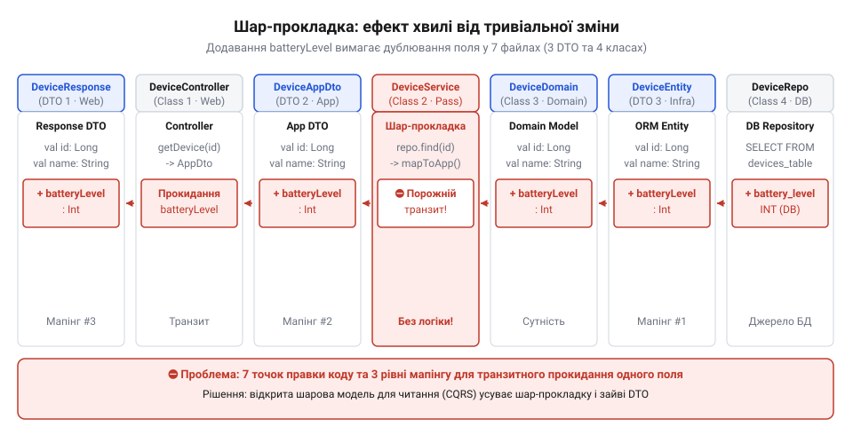
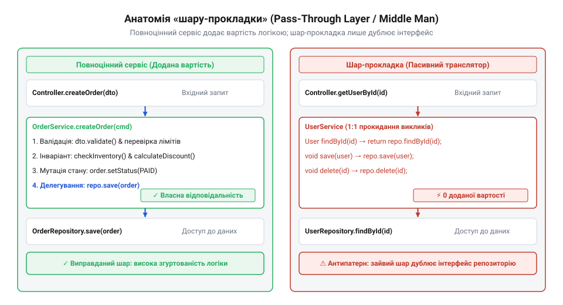
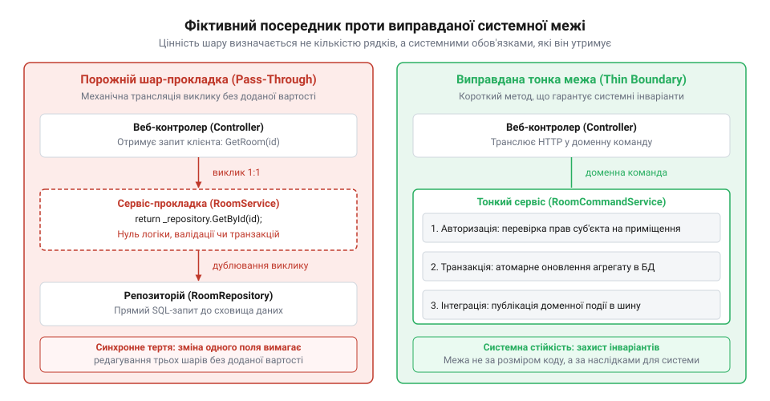
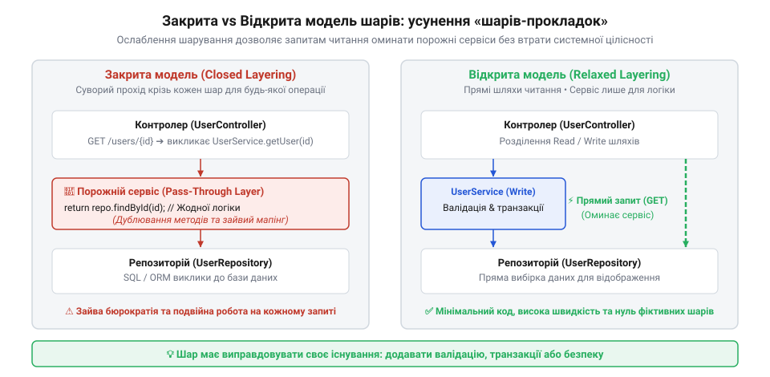

# Шар, що лише передає далі

## Сім файлів заради одного поля: ціна ритуального прокидання

У системі розумного будинку Digital Homes виникла типова інженерна задача: додати показник рівня заряду батареї бездротових датчиків (`batteryLevel`) до кінцевої точки `GET /api/v1/climate/sensors/:id`. У базі даних колонка `battery_level` таблиці `climate_sensors` уже містить потрібне значення, тож залишається лише передати його у вихідний JSON-об'єкт.

Проте кодова база проєкту суворо дотримується канону закритої шарової архітектури (@@en|closed layered architecture@@, від лат. *architectura* — будівництво, зодчество). В інженерній культурі команди панує непорушний догмат: контролер ніколи не звертається до репозиторію напряму; будь-який запит зобов'язаний послідовно пройти крізь сервісний шар, а кожен поверх системи мусить володіти власними моделями даних.

У результаті проста модифікація перетворюється на виснажливе редагування семи окремих файлів уздовж усього вертикального стеку:

1. **Сутність бази даних** (`ClimateSensorEntity`): додається властивість `batteryLevel` для мапінгу колонки таблиці.
2. **Інтерфейс репозиторію** (`ClimateSensorRepository`): інженер перевіряє типізацію вибірки, переконуючись у доступності нового поля.
3. **Внутрішній контракт сервісу** (`SensorReadingDto`): шар бізнес-логіки не має права повертати сутність бази даних назовні, тому створюється тотожна копія поля в сервісному DTO.
4. **Інтерфейс сервісу** (`ClimateMonitoringService`): оновлюється контракт повернення значень для узгодження типів.
5. **Клас реалізації сервісу** (`ClimateMonitoringServiceImpl`): оскільки жодної бізнес-обробки для читання немає, метод лише механічно перекладає значення з сутності в DTO.
6. **Вихідна модель представлення** (`ClimateMetricsResponse`): контролер не може віддати внутрішній сервісний DTO клієнту, тому створюється ще один дублікат поля для HTTP-відповіді.
7. **HTTP-контролер** (`ClimateMonitoringController`): метод обробки запиту приймає результат сервісу та знову копіює ті самі поля у вихідний контракт.

Ось як виглядає цей транзитний ланцюжок у коді:

:::code pass-through-layer/ts/snippet-1.ts

До цього списку додається восьмий файл — обов'язковий модульний тест сервісу, який тепер вимагає оновлення мок-об'єктів і додаткових перевірок.

*Додавання єдиного поля змушує змінювати сім файлів уздовж усього стеку, хоча проміжні класи не виконують жодної трансформації чи перевірки.*

Це явище називають хвильовим ефектом змін (@@en|ripple effect@@, від англ. *ripple* — брижі на воді): точкова зміна в структурі збереження спричиняє ланцюгову реакцію правок на кожному вищому рівні системи. Коли шари закриті штучно, а між ними немає якісної різниці в семантиці даних, команда сплачує повну [ціну мапінгу між шарами](root:progarch/cost-of-layer-mapping). Замість реалізації корисних бізнес-можливостей розробники витрачають години на синхронне переписування дубльованих контрактів, роздмухують запити на злиття та провокують конфлікти в системі контролю версій.

> 🔧 **Навіщо це.**
> Відстеження хвильового ефекту змін дає змогу виявити нездорову жорсткість архітектури на ранніх етапах. Якщо додавання одного поля вимагає синхронного редагування понад трьох файлів без зміни бізнес-правил, архітектурний поділ перестає ізолювати зміни й починає працювати як мультиплікатор інженерних витрат.

## Анатомія шару-прокладки: структурні маркери та вартість володіння

Коли проміжний архітектурний рівень не виконує власних обчислень, валідацій чи захисту бізнес-правил, а лише транзитно пересилає виклики й дублює структури даних, виникає шар-прокладка (@@en|pass-through layer@@, від англ. *pass through* — проходити наскрізь). В інженерній практиці та каталогах запахів коду такий елемент називають класом-посередником (@@en|Middle Man@@, від англ. *middle* — середина та *man* — людина, [Запах коду «Посередник»](root:sf-apps/middleman-code-smell)).

Посередник з'являється не через злий умисел, а внаслідок надмірного страху перед [протіканням шару](root:progarch/layer-leakage). Намагаючись за будь-яку ціну запобігти витоку деталей сховища у вебконтролери, команда механічно вставляє сервіс між кожною парою компонентів, не замислюючись, чи є для нього реальна робота.

Виявити шар-прокладку в кодовій базі дозволяють чотири анатомічні маркери:

1. **Точне дзеркалювання сигнатур (1-в-1)**. Методи проміжного класу повністю дублюють назви, параметри та семантику методів залежності. Якщо репозиторій надає `findById(id)` та `listByRoom(roomId)`, сервіс оголошує ідентичні методи `findById(id)` та `listByRoom(roomId)`, відрізняючись лише суфіксом типу повернення (`Entity` замість `Dto`).
2. **Повна відсутність бізнес-інваріантів (від лат. *invarians* — незмінний)**. У методі немає розгалужень, обчислень і перевірок стану системи. Його тіло зводиться до тривіального виклику `return this.repository.findById(id)`.
3. **Тотожний мапінг даних (@@en|identity mapping@@, від лат. *identitas* — тотожність)**. Проміжний шар копіює значення з однієї пласкої структури в іншу пласку структуру з ідентичними типами й назвами полів, не агрегуючи й не трансформуючи інформацію.
4. **Тавтологічні тести (від грец. *tauto* — те саме, та *logos* — слово)** ([Тавтологічні тести](root:sf-release/tautological-tests)). Метод сервісу не містить алгоритмічної поведінки, тому тест не може перевірити бізнес-результат. Інженер змушений підміняти репозиторій мок-об'єктом і перевіряти сам факт виклику:

:::code pass-through-layer/ts/snippet-2.ts

Цей тест перевіряє виключно внутрішню будову методу: чи викликав один клас інший клас. Якщо видалити сервіс і викликати репозиторій напряму, для клієнта нічого не зміниться, проте тест зламається. Такі тести стають крихкими й лише цементують невдалі архітектурні рішення.

*Справжній сервіс захищає доменні інваріанти й керує бізнес-правилами, тоді як шар-прокладка лише дзеркалює інтерфейс репозиторію та беззмістовно пересилає виклики.*

Присутність порожніх посередників різко підвищує сукупну вартість володіння системою (@@en|total cost of ownership@@, TCO, від лат. *totus* — цілий, повний). Основні витрати формуються з трьох прихованих чинників:

- **Когнітивне навантаження (@@en|cognitive load@@, від лат. *cognitio* — пізнання)**. Під час зневадження помилки інженер змушений подумки утримувати три поверхи класів і відкривати зайві файли в редакторі, аби наприкінці з'ясувати, що сервіс не робить нічого. З часом увага команди притупляється, і коли справжня бізнес-логіка нарешті з'являється, її за інерцією запхають у контролер або в базу даних.
- **Навантаження на пам'ять та збирач сміття (@@en|allocation churn@@)**. Масове створення транзитних DTO спричиняє часті паузи збирача сміття та деградацію затримок на 99-му перцентилі (p99).
- **Ризик людської помилки**. Що більше ланок ручного перекладання полів, то вища ймовірність помилки: розробник може пропустити поле, переплутати типи або втратити часовий пояс. При чотирьох послідовних мапінгах навіть за низької ймовірності одиничної помилки сумарний ризик дефекту зростає майже вчетверо.

> 🔧 **Навіщо це.**
> Чотири маркери посередника дають чіткий інженерний критерій для перегляду коду (code review). Якщо проміжний метод лише дзеркалює сигнатуру, копіює поля й покритий мок-тестом без єдиного умовного переходу — він не створює цінності й підлягає видаленню або відкритому обходу.

## Системний бар'єр проти прокладки: тест на ліквідацію

Усвідомивши ціну посередників, виникає спокуса спростити архітектуру радикально: оголосити всі дворядкові класи «паразитними» та видалити їх на користь прямого звернення до баз даних. Проте фізичний розмір методу не визначає його архітектурної ваги: лаконічний клас без обчислювальної логіки часто виконує фундаментальну роль системного бар'єра.

Обчислювальна складність і системна відповідальність — принципово різні речі. Системний бар'єр захищає не внутрішній алгоритм, а цілісність застосунку як розподіленого або багатокористувацького середовища. Існує чотири типові системні обов'язки, за яких компактний проміжний клас є незамінним:

1. **Транзакційні межі та атомарність**. Сервісний метод утримує активну транзакцію бази даних рівно стільки, скільки потрібно для збереження узгодженого стану. Якщо винести транзакцію вище — у контролер, з'єднання з базою буде заблоковане на час мережевих затримок клієнта. Якщо опустити її нижче — у репозиторій, операція над кількома таблицями втратить атомарність і при збої залишить систему в напіврозваленому стані.
2. **Авторизація та ізоляція орендарів**. Межа гарантує перевірку прав користувача та фільтрацію даних за ідентифікатором орендаря (@@en|tenant ID@@). Винесення перевірки в HTTP-обробник дозволить повідомленням із черг або фоновим задачам обійти авторизацію й створити діру в безпеці.
3. **Фіксація подій через скриньку вихідних** (@@en|Transactional Outbox@@). Метод сервісу забезпечує сумісну фіксацію доменного стану та вихідної події в межах єдиної транзакції бази даних.
4. **Запобіжний шар** (@@en|Anti-Corruption Layer@@, лат. *corruptio* — псування). Тонкий адаптер ізолює доменне ядро від зовнішніх протоколів або специфічних форматів постачальників (як-от сирих байтових пакетів пристроїв розумного будинку). Без нього відбувається небезпечне [протікання деталей реалізації](root:progarch/layer-leakage) безпосередньо в бізнес-модель.

*Ліворуч — метод-посередник лише механічно повторює сигнатуру виклику; праворуч — зовні лаконічний метод тримає транзакційну межу, безпеку й публікацію події, тож його видалення руйнує системні гарантії.*

Щоб відрізнити фіктивного посередника від справжнього системного бар'єра, застосовують **тест на ліквідацію**:

> *Які системні гарантії буде порушено, якщо цей клас видалити, а його клієнта з'єднати з нижчою залежністю напряму?*

Якщо після видалення зникає лише транзитне перепакування однакових параметрів — перед нами прокладка, ліквідація якої знижує [ціну мапінгу між шарами](root:progarch/cost-of-layer-mapping). Якщо ж усунення класу руйнує транзакційну цілісність, скасовує перевірку прав чи відкриває ядро для зовнішніх протоколів — цей клас є легітимним системним бар'єром незалежно від його розміру.

> 🔧 **Навіщо це.**
> Тест на ліквідацію дає об'єктивне мірило під час рецензування коду: видаленню підлягає лише той шар, зникнення якого не зменшує надійності, безпеки чи ізоляції системи.

:::code pass-through-layer/ts/devicecommandservice.ts

## Відкрита шарова модель та прямі проєкції

Головною причиною появи посередників є догматичне слідування закритій шаровій архітектурі (@@en|closed layered architecture@@). У ній кожен запит зобов'язаний послідовно проходити всі поверхи. Якщо під час запису це виправдано захистом інваріантів, то на читаннях такий догмат перетворюється на бюрократію з дублюванням моделей між порожніми сервісами.

Архітектуру оздоровлює перехід до [відкритої шарової моделі](root:sf-apps/relaxed-layered-architecture) (@@en|relaxed layered architecture@@, або послабленої шарової моделі). У цій системі вищі шари можуть звертатися до глибших рівнів напряму, якщо проміжні поверхи не несуть додаткової цінності. Головне правило залишається непорушним — потік залежностей спрямований суворо згори вниз, що запобігає циклічним зв'язкам.

*Закрита модель зобов'язує кожен виклик проходити крізь усі проміжні поверхи, тоді як відкрита модель усуває фіктивний сервіс і дозволяє пряме звернення контролера до репозиторію для простих операцій читання.*

Легітимність обходу ґрунтується на асиметрії читання й запису, яку формалізує патерн [CQRS](root:sf-apps/cqrs) (англ. *Command Query Responsibility Segregation* — розділення відповідальності за командами та запитами). Операції запису змінюють стан системи і прямують крізь закритий доменний контур для валідації інваріантів. Операції читання не змінюють даних і спрямовуються в обхідний канал: контролер запитує пласку вибірку безпосередньо зі сховища одразу у вихідне DTO (@@en|Data Transfer Object@@, об'єкт передачі даних) без підняття важких доменних сутностей.

Такий дизайн прямо втілює інженерний принцип @@en|YAGNI@@ (англ. *You Aren't Gonna Need It* — вам це не знадобиться): не потрібно будувати фіктивні абстракції під гіпотетичну логіку там, де відбувається звичайне читання. Оскільки в більшості систем частка читань перевищує 80%, прямі проєкції позбавляють кодову базу сотень рядків бездіяльного коду, зупиняють хвильовий ефект змін і суттєво зменшують [ціну мапінгу між шарами](root:progarch/cost-of-layer-mapping).

> 🔧 **Навіщо це.**
> Прямі проєкції та відкрита модель для читання дозволяють прибрати до 80–90% посередницького шаблонного коду в системі: транспортний шар безпосередньо запитує потрібні плоскі дані, а доменне ядро залишається компактним і зосередженим виключно на захисті бізнес-правил.

:::code pass-through-layer/ts/securityzonecontroller.ts
