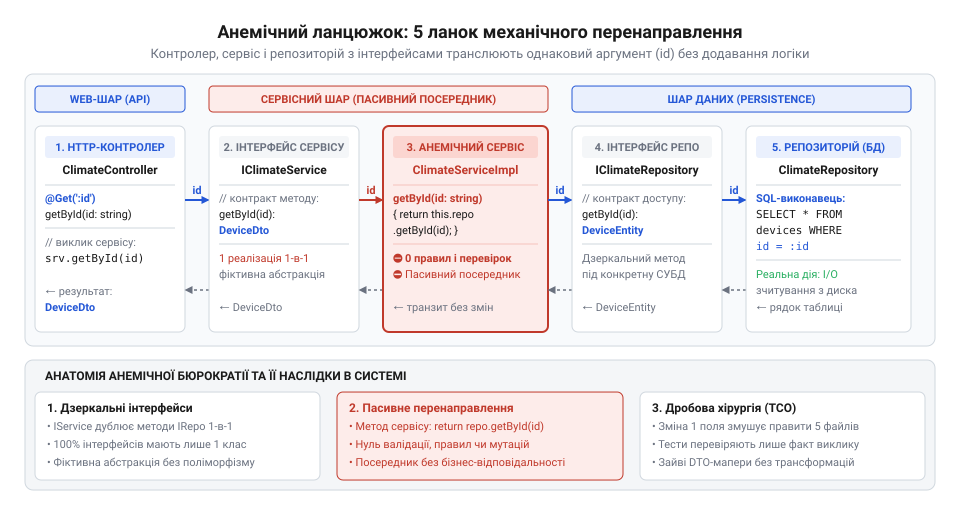
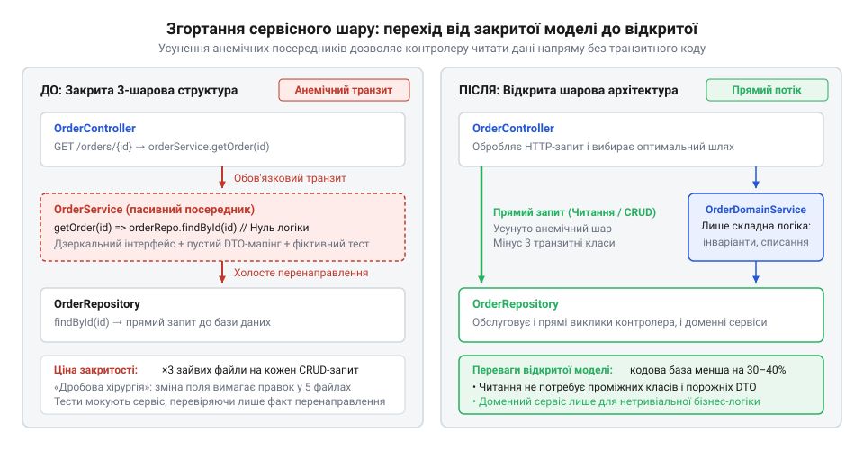
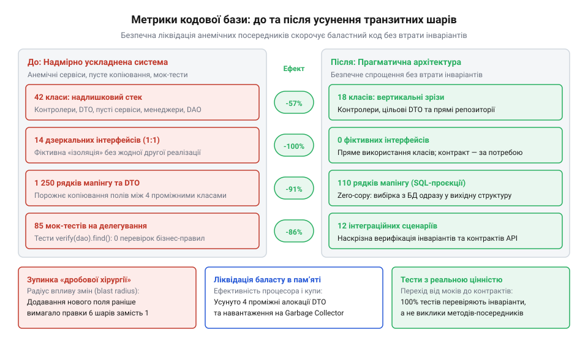

# Шар, що лише передає далі

<preknowlist>
- [Ціна мапінгу між шарами](root:progarch/cost-of-layer-mapping) — розуміння механізму виникнення транзитних DTO, явища allocation churn та фізичної ціни копіювання графів об'єктів для збирача сміття
- [Протікання шару](root:progarch/layer-leakage) — розуміння небезпек витоку деталей збереження назовні та чому тракт запису вимагає суворої інкапсуляції бізнес-інваріантів
</preknowlist>

## Бюрократичний прошарок: аналіз транзитного сервісу в Digital Homes

Розробка нової можливості в програмній системі зазвичай починається з чіткої бізнес-вимоги. У підсистемі керування розумним будинком Digital Homes постала задача: додати атрибут `MaxOccupancy` (максимальна кількість мешканців) до сутності кімнати. За своєю суттю це проста зміна схеми даних, яка у лаконічній системі займає кілька хвилин. Однак у кодових базах, де шарова архітектура перетворилася на бюрократичний ритуал, така задача спричиняє масштабну хвилю змін через усю систему.

У системі Digital Homes історично зафіксовано сувору тришарову структуру. Будь-який запит від клієнта мусить пройти канонічний ланцюжок: `RoomController` звертається до інтерфейсу `IRoomService`, той реалізується в класі `RoomService`, який своєю чергою викликає інтерфейс `IRoomRepository`, а той спрямовує запит до `RoomRepository`.

Розглянемо реалізацію сервісного класу `RoomService`, який формально відповідає за бізнес-логіку кімнат:

```csharp
public class RoomService : IRoomService
{
    private readonly IRoomRepository _repository;
    private readonly IMapper _mapper;

    public RoomService(IRoomRepository repository, IMapper mapper)
    {
        _repository = repository;
        _mapper = mapper;
    }

    public async Task<RoomDto> GetByIdAsync(Guid id)
    {
        var entity = await _repository.GetByIdAsync(id);
        return _mapper.Map<RoomDto>(entity);
    }

    public async Task<IEnumerable<RoomDto>> GetAllAsync()
    {
        var entities = await _repository.GetAllAsync();
        return _mapper.Map<IEnumerable<RoomDto>>(entities);
    }

    public async Task CreateAsync(CreateRoomDto dto)
    {
        var entity = _mapper.Map<RoomEntity>(dto);
        await _repository.AddAsync(entity);
    }
}
```

При детальному аналізі з'ясовується, що кожен метод `RoomService` складається з єдиного рядка. Сервіс не виконує жодних перевірок, не обчислює доменних правил, не перевіряє права доступу і не оркеструє іншими компонентами. Він є лише механічним перекладачем викликів від контролера до репозиторію із попутним перекладанням даних з сутності в DTO через сторонній мапер. Це класичний приклад @@en|Pass-through Layer@@ (шару, що лише передає далі).

Така структура виникає через сліпе дотримання правила «контролер не повинен знати про репозиторій». Коли доменна модель є анемічною ([Анемічна доменна модель](root:progarch/anemic-domain-model)), а сервісний шар позбавлений власної поведінки, сервіс перетворюється на паразитарного посередника.

Коли розробник намагається додати нове поле `MaxOccupancy`, виникає «хвильовий ефект» або дробова хірургія (@@en|Shotgun Surgery@@). Модифікація змушує синхронно змінювати вісім файлів:

1. `RoomEntity.cs` — додавання поля в сутність бази даних.
2. `RoomDto.cs` та `CreateRoomDto.cs` — оновлення контрактів передачі даних.
3. `IRoomRepository.cs` та `RoomRepository.cs` — коригування сигнатур та SQL/ORM запитів.
4. `IRoomService.cs` та `RoomService.cs` — прокидання нового параметра крізь транзитний сервіс.
5. `RoomController.cs` — оновлення маршрутизації та прийняття параметрів запиту.

Найбільші витрати часу припадають на підтримку модульних тестів. Оскільки `RoomService` не містить бізнес-логіки, тести для нього перетворюються на беззмістну перевірку фактів делегування:

```csharp
[Fact]
public async Task GetByIdAsync_ShouldDelegateToRepository()
{
    // Тест перевіряє ЛИШЕ факт перенаправлення виклику
    var repositoryMock = new Mock<IRoomRepository>();
    var roomId = Guid.NewGuid();
    repositoryMock.Setup(r => r.GetByIdAsync(roomId))
                  .ReturnsAsync(new RoomEntity { Id = roomId });

    var service = new RoomService(repositoryMock.Object, _mapper);
    await service.GetByIdAsync(roomId);

    repositoryMock.Verify(r => r.GetByIdAsync(roomId), Times.Once);
}
```

Ці мок-тести є паразитарними: вони не захищають від реальних помилок, але ламаються при найменшій зміні сигнатур, змушуючи розробника переписувати десятки конфігурацій моків. Крім того, постійне перекладання об'єктів між DTO та сутностями створює марне навантаження на пам'ять. Про наслідки цього процесу детально йдеться у статті [Ціна мапінгу між шарами](root:progarch/cost-of-layer-mapping).


*Канонічний ланцюжок викликів в анемічній тришаровій системі: контролер, інтерфейс сервісу, сервіс, інтерфейс репозиторію, репозиторій і механічне перенаправлення однакових параметрів.*

> 🔧 **Навіщо це.** Усвідомлення паразитарної природи транзитного сервісу дозволяє зупинити бездумне множення файлів-посередників, скоротити обсяг коду в рази та ліквідувати неефективні мок-тести, які лише уповільнюють розробку.

## Діагностика транзитного шару та відкрита шарова архітектура

Щоб не ухвалити хибного рішення і не видалити корисний бізнес-сервіс, необхідно користуватися чіткими критеріями діагностики. Справжній доменний або аплікаційний сервіс координує декілька джерел даних, керує транзакційними межами та забезпечує виконання бізнес-інваріантів. Натомість «шар, що лише передає далі», розпізнається за такими симптомами:

1. **Стовідсоткова однорядковість методів.** Усі методи містять лише виклик репозиторію та повернення результату.
2. **Відсутність розгалужень та обчислень.** У коді немає умовних операторів (`if`, `switch`), циклів чи трансформацій бізнес-даних.
3. **Дзеркальні сигнатури.** Назви методів та типи аргументів повністю дублюються від контролера через інтерфейси до репозиторію.
4. **Паразитарне подвійне мокування.** Контролер мокує сервіс, сервіс мокує репозиторій, і обидва тести перевіряють один і той самий ланцюжок передачі даних.
5. **Дзеркальні 1:1 інтерфейси.** Для кожного сервісу існує єдиний інтерфейс з однією реалізацією, створений лише для «формального дотримання інверсії залежностей».

Виникнення цих симптомів зумовлене використанням суворої шарової архітектури (@@en|Strict Layered Architecture@@), де шар N зобов'язаний звертатися виключно до шару N-1, навіть якщо той порожній.

Вирішенням цієї проблеми є відкрита (або розслаблена) шарова архітектура ([Відкрита шарова архітектура](root:progarch/relaxed-layered-architecture) / @@en|Relaxed Layered Architecture@@). Вона дозволяє верхнім рівням звертатися до несусідніх нижніх шарів напряму, якщо проміжний шар не несе додаткової бізнес-цінності.


*Згортання сервісного шару: перехід від закритої 3-шарової моделі до відкритої архітектури з прямим зверненням контролера до рівня даних.*

Після безпечного згортання анемічного `RoomService` контролер `RoomController` звертається безпосередньо до `IRoomRepository` для читання та простих операцій:

```csharp
[ApiController]
[Route("api/rooms")]
public class RoomController : ControllerBase
{
    private readonly IRoomRepository _repository;

    public RoomController(IRoomRepository repository)
    {
        _repository = repository;
    }

    [HttpGet("{id:guid}")]
    public async Task<ActionResult<RoomResponse>> GetById(Guid id)
    {
        var room = await _repository.GetByIdAsync(id);
        if (room == null)
            return NotFound();

        return Ok(new RoomResponse(room.Id, room.Name, room.MaxOccupancy));
    }
}
```

Ліквідація прошарку не означає відмову від захисту бізнес-правил. Операції, які змінюють стан системи або вимагають перевірки інваріантів, виносяться у багаті доменні сутності або спеціалізовані сервіси. Згортання застосовується насамперед для читальних трактів та простих операцій, що запобігає витоку логіки збереження, про який застерігає стаття [Протікання шару](root:progarch/layer-leakage).

Згортання транзитного шару кардинально покращує ключові метрики проєкту, звільняючи кодову базу від бюрократичного баласту.


*Порівняння метрик кодової бази до та після рефакторингу: скорочення кількості файлів, дзеркальних інтерфейсів, рядків мапінгу та мок-тестів.*

> 🔧 **Навіщо це.** Перехід до відкритої шарової архітектури позбавляє систему фіктивних класів-посередників, зменшує кількість файлів у проєкті та дозволяє зосередити зусилля на тестуванні справжньої бізнес-логіки замість перевірки механічного перенаправлення викликів.

## Крок 1: Безпечне згортання операцій читання та пошуку

У системі управління розумним будинком Digital Homes користувачеві потрібно переглянути список доступних кімнат, відфільтрувати їх за поверхом або дізнатися поточний стан пристроїв. У класичному тришаровому застосунку запит `GET /api/rooms/{id}` проходить довгу бюрократичну процедуру:
1. Контролер `RoomsController` приймає HTTP-запит і викликає метод інтерфейсу `IRoomService.GetByIdAsync(id)`.
2. Сервіс `RoomService` приймає `id` і викликає метод `IRoomRepository.GetByIdAsync(id)`.
3. Репозиторій робить запит до бази даних, матеріалізує доменний об'єкт `Room` і повертає його в сервіс.
4. Сервіс копіює дані з `Room` у проміжний об'єкт `RoomServiceDto` і повертає його в контролер.
5. Контролер копіює дані з `RoomServiceDto` у фінальний `RoomResponseDto` і загортає його в HTTP-відповідь 200 OK.

Якщо зупинитися й подивитися на цей тракт запиту, виникає запитання: яку бізнес-функцію виконав `RoomService` на цьому шляху?
Він не перевіряв дозволи, не змінював стан системи, не застосовував складних алгоритмів обчислення. Він просто передав ідентифікатор далі, отримав результат, перепакував його у новий контейнер і повернув назад. Це класичний **шар, що лише передає далі** (pass-through layer).

Прямим наслідком такого підходу є масове копіювання даних та дублювання структур. Кожна операція читання змушує створювати проміжні об'єкти, які живуть лише кілька мікросекунд до моменту наступного мапінгу. Це створює постійне навантаження на збирач сміття (англ. @@en|allocation churn@@), про ціну якого детально йдеться у матеріалі [Ціна мапінгу між шарами](root:progarch/cost-of-layer-mapping). Крім того, розробник змушений підтримувати дзеркальні інтерфейси та DTO-класи, кожен з яких дублює ті самі поля.

Операції читання є ідемпотентними (лат. @@en|idem@@ — той самий, @@en|potens@@ — здатний) та не змінюють стан системи. Для них немає потреби матеріалізувати повний доменний агрегат з нічого, а потім транзитно (лат. @@en|transitus@@ — перехід) тягнути його через порожній сервіс. Контролер читання може взаємодіяти безпосередньо з шаром даних або спеціальним репозиторієм проєкцій (англ. @@en|projection@@, від лат. @@en|projectio@@ — кидання вперед).

Такий підхід називається відкритою шаровою архітектурою (англ. @@en|open layered architecture@@): шар контролерів має дозвіл звертатися безпосередньо до шару даних для операцій читання, минаючи доменний шар, якщо доменний шар не містить обчислювальної логіки для цього запиту.

> 🔧 **Навіщо це.**
> Згортання транзитного сервісу під час читання прибирає фіктивні абстракції, скорочує кількість файлів у модулі вдвічі та ліквідує зайві алокації пам'яті під час перекладання DTO, зберігаючи сувору типність та швидкодію.

Подивимося на вихідний варіант із транзитним сервісом:

```csharp
// ПОЧАТКОВИЙ СТАН: Потрійний мапінг і транзитний сервіс

public interface IRoomService
{
    Task<RoomServiceDto?> GetByIdAsync(Guid id, CancellationToken ct);
    Task<IReadOnlyList<RoomServiceDto>> GetAllAsync(CancellationToken ct);
    Task<IReadOnlyList<DeviceServiceDto>> GetDevicesByRoomIdAsync(Guid roomId, CancellationToken ct);
}

public class RoomService : IRoomService
{
    private readonly IRoomRepository _repository;

    public RoomService(IRoomRepository repository)
    {
        _repository = repository;
    }

    public async Task<RoomServiceDto?> GetByIdAsync(Guid id, CancellationToken ct)
    {
        var room = await _repository.GetByIdAsync(id, ct);
        if (room == null) return null;

        // Транзитний мапінг сутності в сервісний DTO
        return new RoomServiceDto(room.Id, room.Name, room.Floor);
    }

    public async Task<IReadOnlyList<RoomServiceDto>> GetAllAsync(CancellationToken ct)
    {
        var rooms = await _repository.GetAllAsync(ct);
        return rooms.Select(r => new RoomServiceDto(r.Id, r.Name, r.Floor)).ToList();
    }

    public async Task<IReadOnlyList<DeviceServiceDto>> GetDevicesByRoomIdAsync(Guid roomId, CancellationToken ct)
    {
        var devices = await _repository.GetDevicesByRoomIdAsync(roomId, ct);
        return devices.Select(d => new DeviceServiceDto(d.Id, d.Name, d.IsActive)).ToList();
    }
}

[ApiController]
[Route("api/rooms")]
public class RoomsController : ControllerBase
{
    private readonly IRoomService _roomService;

    public RoomsController(IRoomService roomService)
    {
        _roomService = roomService;
    }

    [HttpGet("{id:guid}")]
    public async Task<IActionResult> GetById(Guid id, CancellationToken ct)
    {
        var serviceDto = await _roomService.GetByIdAsync(id, ct);
        if (serviceDto == null) return NotFound();

        // Ще один мапінг із сервісного DTO у HTTP Response DTO
        var response = new RoomResponseDto(serviceDto.Id, serviceDto.Name, serviceDto.Floor);
        return Ok(response);
    }
}
```

А тепер ліквідуємо `IRoomService` та `RoomService`. Контролер звертається напряму до репозиторію читання `IRoomReadRepository` (або безпосередньо до контексту даних), що повертає одразу фінальну проєкцію `RoomResponseDto`.

```csharp
// РЕФАКТОРИНГ: Прямий виклик проєкції без сервісу-посередника

public interface IRoomReadRepository
{
    Task<RoomResponseDto?> GetByIdAsync(Guid id, CancellationToken ct);
    Task<IReadOnlyList<RoomResponseDto>> GetAllAsync(CancellationToken ct);
    Task<IReadOnlyList<DeviceResponseDto>> GetDevicesByRoomAsync(Guid roomId, DeviceFilter filter, CancellationToken ct);
}

public class RoomReadRepository : IRoomReadRepository
{
    private readonly AppDbContext _context;

    public RoomReadRepository(AppDbContext context)
    {
        _context = context;
    }

    public async Task<RoomResponseDto?> GetByIdAsync(Guid id, CancellationToken ct)
    {
        // Пряма проєкція з бази даних у фінальний DTO (вибір лише потрібних колонок SQL)
        return await _context.Rooms
            .AsNoTracking()
            .Where(r => r.Id == id)
            .Select(r => new RoomResponseDto(r.Id, r.Name, r.Floor, r.Devices.Count))
            .FirstOrDefaultAsync(ct);
    }

    public async Task<IReadOnlyList<RoomResponseDto>> GetAllAsync(CancellationToken ct)
    {
        return await _context.Rooms
            .AsNoTracking()
            .Select(r => new RoomResponseDto(r.Id, r.Name, r.Floor, r.Devices.Count))
            .ToListAsync(ct);
    }

    public async Task<IReadOnlyList<DeviceResponseDto>> GetDevicesByRoomAsync(
        Guid roomId, DeviceFilter filter, CancellationToken ct)
    {
        var query = _context.Devices
            .AsNoTracking()
            .Where(d => d.RoomId == roomId);

        if (filter.OnlyActive.HasValue)
        {
            query = query.Where(d => d.IsActive == filter.OnlyActive.Value);
        }

        return await query
            .Select(d => new DeviceResponseDto(d.Id, d.Name, d.IsActive, d.Type))
            .ToListAsync(ct);
    }
}

[ApiController]
[Route("api/rooms")]
public class RoomsController : ControllerBase
{
    private readonly IRoomReadRepository _readRepository;

    public RoomsController(IRoomReadRepository readRepository)
    {
        _readRepository = readRepository;
    }

    [HttpGet("{id:guid}")]
    public async Task<IActionResult> GetById(Guid id, CancellationToken ct)
    {
        var room = await _readRepository.GetByIdAsync(id, ct);
        return room != null ? Ok(room) : NotFound();
    }

    [HttpGet]
    public async Task<IActionResult> GetAll(CancellationToken ct)
    {
        var rooms = await _readRepository.GetAllAsync(ct);
        return Ok(rooms);
    }

    [HttpGet("{roomId:guid}/devices")]
    public async Task<IActionResult> GetDevices(Guid roomId, [FromQuery] DeviceFilter filter, CancellationToken ct)
    {
        var devices = await _readRepository.GetDevicesByRoomAsync(roomId, filter, ct);
        return Ok(devices);
    }
}
```

У результаті згортання операцій читання:
1. Зник клас `RoomService` і відповідний інтерфейс `IRoomService`.
2. Зникла сервісна модель `RoomServiceDto`.
3. Запит до бази даних формується через LINQ-проєкцію `.Select(...)`, завантажуючи з бази лише ті колонки, які насправді потрібні у `RoomResponseDto`.
4. Ліквідовано проміжні алокації у пам'яті: об'єкти не виділяються й не копіюються на кожному рівні стеку.

## Крок 2: Збереження транзакційних меж, валідації та інваріантів під час мутацій стану

Видаливши транзитний сервіс із тракту читання, розробники часто постають перед тривогою: «Добре, читання — це просто вибірка. Але що робити з операціями запису, такими як створення кімнати (`CreateRoom`) або зміна її температурного режиму (`UpdateRoomMode`)?»

Типове побоювання полягає у тому, що без сервісу код контролера перетвориться на суцільне місиво з перевірок, викликів SQL-транзакцій та обробників помилок. Або ж, навпаки, бізнес-правила протечуть у репозиторій.

Ця тривога виникає через те, що у традиційній анемічній (грец. @@en|anaemia@@ — безкровність) моделі домену сервіс використовується як «сміттєзвалище відповідальностей». Оскільки сама сутність `Room` є лише пакетом даних із відкритими сеттерами (`public string Mode { get; set; }`), бізнес-правила вимушено виносять у метод сервісу. Сервіс перевіряє вхідні дані, міняє поля сутності, відкриває транзакцію й зберігає її.

Коли ми усуваємо проміжний сервіс-посередник, ми не розмиваємо відповідальності — ми розставляємо їх по своїх природних місцях.

Будь-яка операція запису складається з трьох чітких етапів:
1. **Валідація вхідного запиту**: перевірка формату даних (синтаксис, діапазони, наявність обов'язкових полів).
2. **Захист бізнес-інваріанта** (лат. @@en|invarians@@ — незмінний): перевірка доменних правил цілісності системи (наприклад, не можна встановити режим опалення, якщо цільова температура нижча за межу безпеки).
3. **Управління транзакційними межами** (лат. @@en|transactio@@ — угода): атомарна фіксація змін у сховищі даних за допомогою [патерну Unit of Work](root:progarch/unit-of-work-pattern) (англ. @@en|Unit of Work@@, від лат. @@en|unitas@@ — єдність).

Розглянемо, як кожен із цих трьох стовпів реалізується без транзитного сервісу:

- **Валідація входу**: переноситься у конвеєр обробки запиту (англ. @@en|pipeline@@) або декоратори контролера за допомогою валідаторів. Якщо вхідний JSON невалідний — запит відхиляється ще до торкання доменної моделі.
- **Інваріанти домену**: повертаються у саму сутність `Room`. Анемічна модель перетворюється на [насичену доменну модель](root:progarch/rich-domain-model) (англ. @@en|rich domain model@@). Поля робляться приватними для запису, а зміна стану здійснюється лише через явні доменні методи (наприклад, `room.ChangeHeatingMode(newMode, targetTemperature)`), які самостійно викидають доменні винятки при порушенні інваріантів.
- **Транзакції**: контролер або командний хендлер викликає метод репозиторію для завантаження агрегату, викликає на ньому доменний метод мутації, після чого викликає `IUnitOfWork.SaveChangesAsync()`.

> 🔧 **Навіщо це.**
> Інкапсуляція бізнес-правил всередині насиченої доменної сутності гарантує, що інваріанти неможливо порушити з жодного місця системи, а Unit of Work забезпечує атомарність збереження змін без потреби у фіктивному сервісному шарі.

При цьому важливо уникати протікання деталей збереження назовні. Контролер не повинен знати про деталі SQL-запитів чи табличні зв'язки; він оперує виключно доменним агрегатом через інтерфейс репозиторію та Unit of Work. Застереження щодо витоку деталей інфраструктури докладно описані у статті [Протікання шару](root:progarch/layer-leakage).

Подивимося, як виглядає насичена доменна модель `Room`, валідатор вхідної команди та контролер, що виконує мутацію `UpdateRoomMode`:

```csharp
// 1. НАСИЧЕНА ДОМЕННА МОДЕЛЬ (Захист інваріантів усередині сутності)

public enum HeatingMode { Off, Eco, Comfort, Maximum }

public class Room
{
    public Guid Id { get; private set; }
    public string Name { get; private set; }
    public int Floor { get; private set; }
    public HeatingMode Mode { get; private set; }
    public decimal TargetTemperature { get; private set; }

    // Конструктор гарантує валідний початковий стан
    public Room(string name, int floor)
    {
        if (string.IsNullOrWhiteSpace(name))
            throw new DomainException("Назва кімнати не може бути порожньою.");

        if (floor < -2 || floor > 100)
            throw new DomainException("Некоректний поверх для розміщення кімнати.");

        Id = Guid.NewGuid();
        Name = name.Trim();
        Floor = floor;
        Mode = HeatingMode.Off;
        TargetTemperature = 18.0m;
    }

    // Доменний метод мутації інкапсулює бізнес-інваріанти
    public void ChangeHeatingMode(HeatingMode newMode, decimal targetTemperature)
    {
        if (newMode != HeatingMode.Off && (targetTemperature < 15.0m || targetTemperature > 30.0m))
        {
            throw new DomainException("Увімкнений режим опалення вимагає температури в межах від 15°C до 30°C.");
        }

        if (newMode == HeatingMode.Maximum && targetTemperature < 25.0m)
        {
            throw new DomainException("Режим Maximum вимагає цільової температури не менше 25°C.");
        }

        Mode = newMode;
        TargetTemperature = newMode == HeatingMode.Off ? 0.0m : targetTemperature;
    }
}

// 2. ВАЛІДАЦІЯ ВХІДНИХ ДАНИХ (Рівень конвеєра / контролера)

public record UpdateRoomModeRequest(HeatingMode Mode, decimal TargetTemperature);

public class UpdateRoomModeRequestValidator : AbstractValidator<UpdateRoomModeRequest>
{
    public UpdateRoomModeRequestValidator()
    {
        RuleFor(x => x.Mode).IsInEnum().WithMessage("Вказано неіснуючий режим опалення.");
        RuleFor(x => x.TargetTemperature)
            .InclusiveBetween(0.0m, 40.0m)
            .WithMessage("Температура повинна бути в діапазоні від 0°C до 40°C.");
    }
}

// 3. КОНТРОЛЕР МУТАЦІЙ (Оркестрація без проміжного сервісу)

[ApiController]
[Route("api/rooms")]
public class RoomsMutationController : ControllerBase
{
    private readonly IRoomRepository _repository;
    private readonly IUnitOfWork _unitOfWork;
    private readonly IValidator<UpdateRoomModeRequest> _validator;

    public RoomsMutationController(
        IRoomRepository repository,
        IUnitOfWork unitOfWork,
        IValidator<UpdateRoomModeRequest> validator)
    {
        _repository = repository;
        _unitOfWork = unitOfWork;
        _validator = validator;
    }

    [HttpPost]
    public async Task<IActionResult> Create([FromBody] CreateRoomRequest request, CancellationToken ct)
    {
        // 1. Створення сутності виконує первинну валідацію вхідних конструкторних параметрів
        var room = new Room(request.Name, request.Floor);

        // 2. Додавання в репозиторій та збереження транзакції
        await _repository.AddAsync(room, ct);
        await _unitOfWork.SaveChangesAsync(ct);

        return CreatedAtAction("GetById", "Rooms", new { id = room.Id }, new { id = room.Id });
    }

    [HttpPut("{id:guid}/mode")]
    public async Task<IActionResult> UpdateMode(
        Guid id, [FromBody] UpdateRoomModeRequest request, CancellationToken ct)
    {
        // 1. Вхідна валідація
        var validationResult = await _validator.ValidateAsync(request, ct);
        if (!validationResult.IsValid)
        {
            return BadRequest(validationResult.ToDictionary());
        }

        // 2. Завантаження агрегату
        var room = await _repository.GetByIdAsync(id, ct);
        if (room == null) return NotFound();

        // 3. Виконання мутації через метод насиченої моделі (перевірка інваріантів)
        try
        {
            room.ChangeHeatingMode(request.Mode, request.TargetTemperature);
        }
        catch (DomainException ex)
        {
            return UnprocessableEntity(new { error = ex.Message });
        }

        // 4. Фіксація транзакційних меж через Unit of Work
        await _unitOfWork.SaveChangesAsync(ct);

        return NoContent();
    }
}

У цій схемі немає жодного залишку транзитного `RoomService`:
1. Вхідна валідація відсікає брудні HTTP-запити на самому початку.
2. Сутність `Room` сама відповідає за дотримання бізнес-правил. Перетворити кімнату на невалідний стан неможливо ані з контролера, ані з будь-якого іншого модуля.
3. `IUnitOfWork` контролює атомарність фіксації в базі даних.
4. Контролер виконує виключно роль оркестратора: розпакувати запит -> завантажити -> викликати метод сутності -> зберегти -> повернути відповідь.

Згортання анемічного сервісу приводить до чистішої, безпечнішої та компактнішої системи, де кожен клас робить лише реальну роботу.

## Крок 3: Очищення абстракцій, конфігурації IoC-контейнера та радикальне спрощення тестів

Уявіть ситуацію: ви намагаєтеся змінити назву поля в запиті бази даних, але процедура рефакторингу вимагає виправлення шести різних файлів, а після завершення половина юніт-тестів системи раптово стає «червоною». При цьому жоден HTTP-ендпоінт не змінив своєї зовнішньої поведінки, а сам код лише перенаправляв дані з одного місця в інше. Така виснажлива крихкість — прямий наслідок існування транзитного сервісного шару та фіктивних абстракцій, які створювалися «про запас».

Коли в проєкті діє правило «на кожен клас обов’язково має бути свій інтерфейс», розробники створюють пару `IRoomService` та `RoomService`, навіть якщо сервіс не має жодної іншої реалізації та не містить логіки розгалуження. Створення інтерфейсу з єдиною реалізацією (від латинського *abstractio* — «відволікання», англійською @@en|single-implementation interface@@) виправдане лише тоді, коли абстракція ізолює систему від нестабільного зовнішнього середовища чи сторонньої бібліотеки. Якщо ж `IRoomService` лише відзеркалює методи `IRoomRepository`, така абстракція є фіктивною: вона не створює точки гнучкості, а лише подвоює кількість файлів, які потрібно підтримувати.

При ліквідації анемічного сервісу першим кроком є повний демонтаж дзеркального інтерфейсу `IRoomService` та самого класу `RoomService`. Контролер `RoomController` тепер запитує потрібні залежності напряму через свій конструктор.

```csharp
// До рефакторингу: контролер залежить від транзитного сервісу
public class RoomController : ControllerBase
{
    private readonly IRoomService _roomService;

    public RoomController(IRoomService roomService)
    {
        _roomService = roomService;
    }

    [HttpGet("{id}")]
    public async Task<IActionResult> GetById(int id)
    {
        var room = await _roomService.GetRoomByIdAsync(id);
        return room != null ? Ok(room) : NotFound();
    }
}

// Після рефакторингу: контролер звертається напряму до репозиторію
public class RoomController : ControllerBase
{
    private readonly IRoomRepository _roomRepository;

    public RoomController(IRoomRepository roomRepository)
    {
        _roomRepository = roomRepository;
    }

    [HttpGet("{id}")]
    public async Task<IActionResult> GetById(int id)
    {
        var room = await _roomRepository.GetByIdAsync(id);
        return room != null ? Ok(RoomResponse.FromDomain(room)) : NotFound();
    }
}
```

Видалення проміжної ланки одразу відображається на конфігурації контейнера інверсії залежностей (від англійського @@en|Inversion of Control Container@@, або @@en|IoC Container@@). Замість реєстрації двох залежностей для однієї простої операції, у контейнері залишається лише прямий зв'язок:

```csharp
// До рефакторингу: реєстрація анемічного сервісу та його фіктивного інтерфейсу
builder.Services.AddScoped<IRoomRepository, RoomRepository>();
builder.Services.AddScoped<IRoomService, RoomService>();

// Після рефакторингу: транзитний шар усунено з реєстратора залежностей
builder.Services.AddScoped<IRoomRepository, RoomRepository>();
```

> 🔧 **Навіщо це.**
> Ліквідація фіктивних інтерфейсів-одинаків і транзитних реєстрацій у IoC-контейнері спрощує граф залежностей застосунку, зменшує накладні витрати на резолвінг об'єктів під час обробки кожного HTTP-запиту та усуває зайві точки модифікації коду при еволюції домену.


*Зліва — заплутаний граф залежностей із транзитним вузлом IRoomService; справа — спрощений прямий зв'язок між контролером і репозиторієм.*

Найбільший спротив під час згортання анемічного шару зазвичай чинить тестова піраміда. У проєктах із транзитними сервісами поширений антипатерн створення мок-тестів (від англійського @@en|mock testing@@), які перевіряють не результат роботи системи, а факт виклику конкретного методу:

```csharp
// Застарілий крихкий unit-тест, який перевіряв деталі внутрішнього перенаправлення
[Fact]
public async Task GetById_CallsServiceMethodOnce()
{
    // Arrange
    var mockService = new Mock<IRoomService>();
    var controller = new RoomController(mockService.Object);

    // Act
    await controller.GetById(1);

    // Assert: тест перевіряє факт виклику конкретного проміжного методу
    mockService.Verify(s => s.GetRoomByIdAsync(1), Times.Once);
}
```

Такі тести називаються крихкими (англ. @@en|brittle tests@@, див. [Крихкі тести](root:sf-release/brittle-tests)). Вони міцно зв'язані з внутрішньою структурою коду, а не з його бізнес-контрактом. Коли ви видаляєте `IRoomService`, цей тест перестає компілюватися і змушує інженера вручну переписувати десятки моків.

Замість перевірки проміжних викликів тестова піраміда перебудовується на основі інтеграційних тестів контролера з використанням бази даних у пам'яті (англ. @@en|In-Memory Database@@). Такий тест працює з контролером як із "чорною скринькою":

```csharp
// Стійкий інтеграційний тест контролера з репозиторієм у пам'яті
public class RoomControllerTests : IClassFixture<WebApplicationFactory<Program>>
{
    private readonly HttpClient _client;

    public RoomControllerTests(WebApplicationFactory<Program> factory)
    {
        _client = factory.CreateClient();
    }

    [Fact]
    public async Task GetById_ReturnsRoom_WhenRoomExists()
    {
        // Act: здійснюємо реальний HTTP-запит до ендпоінту
        var response = await _client.GetAsync("/api/rooms/1");

        // Assert: перевіряємо зовнішній контракт (код відповіді та структуру даних)
        response.EnsureSuccessStatusCode();
        var room = await response.Content.ReadFromJsonAsync<RoomResponse>();
        Assert.NotNull(room);
        Assert.Equal(1, room.Id);
    }
}
```

Коли у вашому розпорядженні є такі тести, внутрішній рефакторинг перестає бути ризикованим: ви можете згорнути сервісний шар, об'єднати методи чи змінити реалізацію репозиторію, і якщо HTTP-контракт залишився незмінним — усі тести залишаться «зеленими».

> 🔧 **Навіщо це.**
> Відмова від мокування внутрішніх перенаправлень на користь інтеграційних тестів із тестовою базою даних робить тести стійкими до рефакторингу (англ. @@en|refactoring-proof tests@@). Це дозволяє вільно змінювати внутрішню архітектуру застосунку без ризику зламати зовнішні контракти API.

## Архітектурні межі, ризики та зворотний рух: коли сервісний шар відновлювати обов'язково

Згортання анемічного сервісного шару дає миттєвий вимірний ефект. Порівняння метрик кодової бази «до і після» рефакторингу демонструє скорочення загальної кількості файлів у модулі майже на 50%. Зникають десятки фіктивних DTO-транзитів, дзеркальних інтерфейсів та дубльованих мок-класів. Загальний обсяг коду зменшується на сотні рядків шаблонного тексту (англ. @@en|boilerplate code@@).

Головна архітектурна перемога — ліквідація явища «дробової хірургії» (англ. @@en|shotgun surgery@@). Якщо раніше додавання одного нового поля до кімнати вимагало послідовних правок у контролері, сервісному DTO, інтерфейсі сервісу, реалізації сервісу, DTO репозиторію та моках, то тепер зміна локалізована в двох точках: репозиторії/сутності та мапері відповіді контролера. Крім того, усувається марне виділення пам'яті під проміжні об'єкти (англ. @@en|allocation churn@@), про що детальніше йдеться у матеріалі [Ціна мапінгу між шарами](root:progarch/cost-of-layer-mapping).

Однак спрощення архітектури криє в собі два серйозні ризики, якщо рефакторинг проводиться неконтрольовано.

Перший ризик — поява «товстих контролерів» (англ. @@en|Fat Controller@@). Коли розробники ліквідовують сервісний шар, виникає спокуса перенести всю логіку, яка раніше лежала в сервісі, прямо у методи контролера. У результаті контролер починає виконувати валідацію форматів, розрахунок бізнес-правил, безпосередній виклик ORM та формування HTTP-відповідей. Контролер перетворюється на монолітний процедурний сценарій, який важко тестувати й повторно використовувати.

Щоб запобігти цьому антипатерну, бізнес-логіку та захист інваріантів переносять не в контролер, а всередину доменних сутностей та об'єктів-значень (багата доменна модель, англійською @@en|Rich Domain Model@@). Контролер повинен залишатися лише тонким оркестратором HTTP-протоколу: взяти запит, викликати метод сутності або репозиторію та повернути результат.

Другий ризик — повернення ORM-сутностей назовні та протікання деталей збереження (див. [Протікання шару](root:progarch/layer-leakage)). Бажаючи максимально скоротити код, інженери іноді починають повертати ORM-сутність `RoomEntity` безпосередньо з контролера у JSON-відповідь. Це призводить до витоку внутрішньої структури бази даних у зовнішній контракт API, виникнення помилок серіалізації через циклічні посилання та непередбачуваних SQL-запитів через ліниве завантаження (англ. @@en|lazy loading@@). Спрощення сервісного шару ніколи не повинно скасовувати наявність чіткого DTO відповіді (англ. @@en|Response DTO@@) на межі REST API.

> 🔧 **Навіщо це.**
> Чітке розмежування відповідальностей запевняє, що ліквідація проміжного анемічного шару не перетворить контролери на «товсті моноліти» і не призведе до витоку деталей збереження бази даних у зовнішні API-контракти.


*Дерево рішень: коли бізнес-операція залишається у контролері та сутності, а коли вимагає виділення окремого сервісу.*

Коли ж відновлення сервісного шару стає не просто виправданим, а обов'язковим? Зворотний рух необхідний тоді, коли в системі з'являється справжня бізнес-складність, яка виходить за межі одного агрегату чи репозиторію.

Існує три чіткі індикатори появи такої складності:

1. **Оркестрація кількох репозиторіїв та агрегатів**: якщо бізнес-операція (наприклад, бронювання кімнати) вимагає перевірки доступності в `RoomRepository`, створення транзакції в `PaymentRepository` та резервування в `BookingRepository`. Контролер не повинен керувати кількома репозиторіями та між-агрегатними транзакціями.
2. **Взаємодія зі зовнішніми сервісами**: необхідність звернення до сторонніх API (платіжні шлюзи, поштові сервіси Twilio/SendGrid, зовнішні системи авторизації).
3. **Розподілена валідація та фонові задачі**: складні багатокрокові сценарії, відправка доменних подій у черги повідомлень або координація асинхронних процесів.

У таких випадках у систему повертають сервісний шар, але тепер це вже не анемічний «пасс-сру», а справжній застосунковий сервіс (англ. @@en|Application Service@@, див. [Застосунковий сервіс](root:progarch/application-service)). Він бере на себе координацію зовнішніх залежностей та між-агрегатну оркестрацію, залишаючи сутності відповідальними за бізнес-правила, а контролер — за HTTP-трансляцію.

Опанування техніки згортання та відновлення шарів дає змогу утримувати архітектурну рівновагу: зберігати кодову базу мінімальною й прозорою, поки система проста, і своечасно вводити необхідні абстракції лише з появою справжньої складності.
