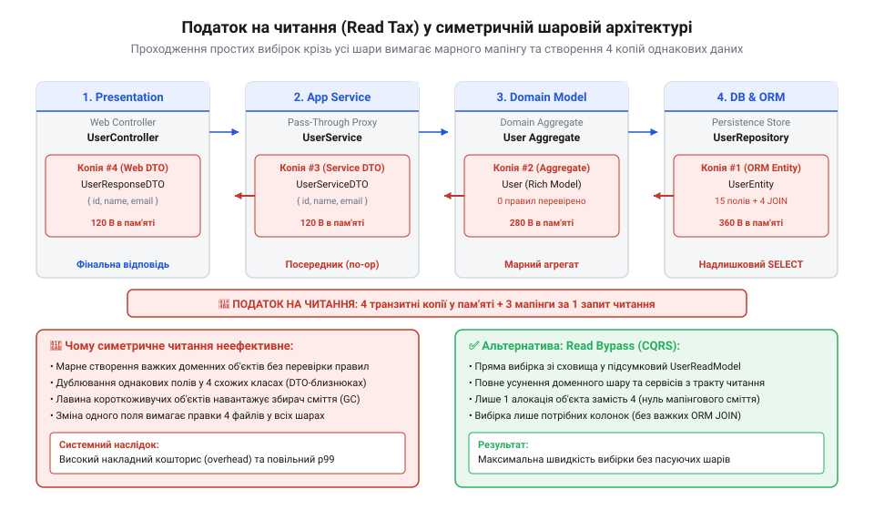
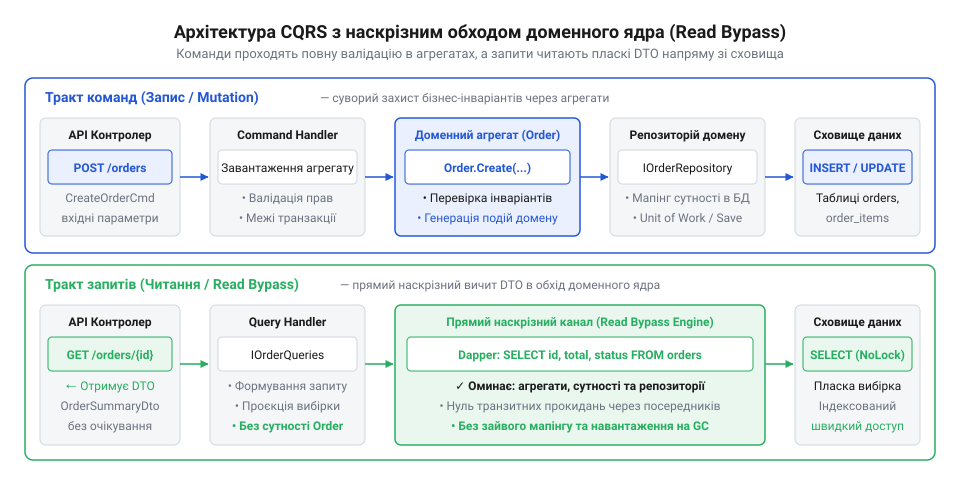
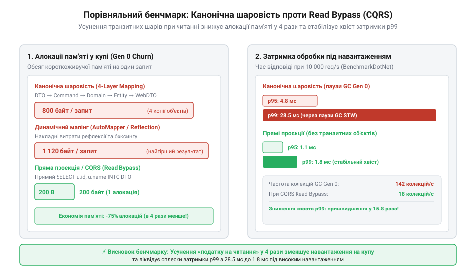

# Шар, що лише передає далі

<preknowlist>
- [Ціна мапінгу між шарами](root:progarch/cost-of-layer-mapping) — розуміння механізму виникнення транзитних DTO, явища allocation churn та фізичної ціни копіювання графів об'єктів для збирача сміття
- [Протікання шару](root:progarch/layer-leakage) — розуміння небезпек витоку деталей збереження назовні та чому тракт запису вимагає суворої інкапсуляції бізнес-інваріантів
</preknowlist>

## Податок на читання: як симетричне шарування руйнує продуктивність

У підсистемі клімат-контролю розумного будинку Digital Homes кожна кімната обладнана датчиками температури, термостатом та системою опалення. Коли користувач відкриває мобільний застосунок або панель оператора, екран відображає зведений дашборд: список усіх кімнат, поточні й цільові температури, стан нагрівачів та усереднені показники будинку.

У канонічній симетричній тришаровій архітектурі будь-яка операція — незалежно від того, чи це зміна настройки, чи звичайне читання екрана — проходить крізь усі шари застосунку за єдиною схемою. Контролер звертається до сервісу застосунку, сервіс викликає репозиторій, репозиторій зчитує дані з бази й конструює повноцінні доменні об'єкти, сервіс виконує обробку та мапить їх у проміжні DTO, а контролер формує остаточну відповідь.

*Симетричне шарування змушує вибірку даних проходити через доменний шар, викликаючи масовий мапінг та алокації.*

На перший погляд, така симетрія здається чистою та послідовною: один шар відповідає за HTTP, другий — за координування дій, третій — за бізнес-правила, а четвертий — за збереження в СУБД. Однак під навантаженням така структура при операціях читання призводить до колапсу продуктивності.

Розглянемо, що відбувається всередині доменного ядра Digital Homes при спробі зчитати стан клімату. Шар домену побудований навколо агрегату `Room` та об'єкта-значення `Temperature`:

:::code proj-cqrs-read-bypass/c-/Domain/Temperature.cs 8-37

:::code proj-cqrs-read-bypass/c-/Domain/Room.cs 15-75

Агрегат `Room` (англ. @@en|Aggregate Root@@) має чітку архітектурну ціль: він захищає транзакційні бізнес-інваріанти під час зміни стану. Наприклад, метод `SetTargetTemperature` перевіряє, чи увімкнено клімат-контроль, обмежує одноразовий крок зміни температури величиною `8.0 °C` для запобігання перевантаженню котла, та автоматично розраховує стан опалення з урахуванням гістерезису `0.3 °C`.

Щоб забезпечити цю інкапсуляцію під час вибірки даних, репозиторій `RoomRepository` змушений відновлювати повний граф доменних об'єктів з бази даних:

:::code proj-cqrs-read-bypass/c-/Infrastructure/ClimateDatabase.cs 45-97

Отримавши список доменних агрегатів, транзитний сервіс `PassThroughClimateService` виконує їх поблокний мапінг у DTO:

:::code proj-cqrs-read-bypass/c-/Application/PassThroughClimateService.cs 38-79

Тут виникає фундаментальна суперечність. Коли система формує аналітичний дашборд, вона лише відображає історичні факти. Жоден інваріант не перевіряється, жодне бізнес-правило не виконується, жоден крок температури не валідується. Доменні агрегати `Room` та об'єкти-значення `Temperature` створюються в пам'яті лише для того, щоб з них негайно зчитали примітивні значення `double` й `string`, після чого ці об'єкти відправляються на смітник.

> 🔧 **Навіщо це.**
> Розуміння фізичної ціни транзитного шару дозволяє уникнути ситуацій, коли сервер змушений регулярно призупиняти обробку запитів через паузи збирача сміття (GC pauses), спричинені непотрібним інстанціюванням доменних об'єктів під час читання.

У результаті доменний шар вироджується у транзитну зупинку — (англ. @@en|pass-through layer@@). Програма сплачує процесорний час на парсинг рядків, валідацію значень у конструкторах, створення об'єктів у купі (англ. @@en|heap allocations@@) та каскадний мапінг. Це створює так званий **податок на читання** (англ. @@en|read tax@@) — надлишкові витрати ресурсів на кожну операцію вибірки.

Окрім витрат процесора, масове інстанціювання короткоживучих об'єктів викликає **сплеск алокацій пам'яті** (англ. @@en|allocation churn@@). Збирач сміття (Garbage Collector) змушений постійно очищати нульове покоління (Gen 0), що призводить до мікропауз у системі й високої затримки 99-го перцентиля (p99 latency). Детальніше механіку накопичення витрат на згортання та розгортання об'єктів описано в матеріалі [Ціна мапінгу між шарами](root:progarch/cost-of-layer-mapping). Крім того, намагання протягнути нові поля вибірки крізь доменні сутності призводить до явищ, розібраних у статті [Протікання шару](root:progarch/layer-leakage).

## Асиметрія CQRS: прямий канал читання в обхід доменного ядра

Для розв'язання проблеми податку на читання застосовують архітектурний паттерн **CQRS** (англ. @@en|Command Query Responsibility Segregation@@ — розділення відповідальності команд і запитів). В основі CQRS лежить усвідомлення фундаментальної асиметрії між двома типами операцій у програмних системах:

1. **Тракт запису (Команди / Commands)**: зміни стану системи. Вимагає суворої транзакційності, захисту інваріантів, інкапсуляції та ізоляції бізнес-логіки всередині доменних агрегатів.
2. **Тракт читання (Запити / Queries)**: вибірка й відображення даних. Не змінює стан, не має побічних ефектів і не потребує перевірки бізнес-правил. Його єдина мета — повернути дані в структурі, зручній для UI, із мінімальною затримкою та нульовими надлишковими алокаціями.

Замість намагання втиснути обидва тракти в єдину симетричну шарова структуру, CQRS розділяє їх на два незалежні канали. Для читання будується **прямий канал обходу** (англ. @@en|read bypass@@), який оминає доменні сервіси, репозиторії та важкі агрегати.

*Прямий канал читання мапить результати SQL-запиту безпосередньо у DTO відповіді, оминаючи доменні агрегати та репозиторій.*

У підсистемі клімат-контролю Digital Homes тракт запису й тракт читання розділяються на рівні контрактів та реалізації:

:::code proj-cqrs-read-bypass/c-/Application/Contracts.cs 1-32

Для виконання запитів читання створюється спеціалізований клас `DapperClimateQueries`. Він використовує [мікро-ORM Dapper](root:sf-data/dapper-micro-orm) для прямого мапінгу результатів SQL-запиту в пласкі об'єкти `RoomClimateDto` за один прохід:

:::code proj-cqrs-read-bypass/c-/Application/DapperClimateQueries.cs 14-65

Запит `SELECT Id AS RoomId, Name AS RoomName...` матеріалізує поля бази даних безпосередньо в екземпляри `RoomClimateDto`. На цьому шляху працює [проєкція даних у CQRS](root:sf-apps/cqrs-read-projection), тож повністю відсутні доменні об'єкти `Room`, об'єкти-значення `Temperature`, репозиторії та додаткові мапери.

API-контролер `ClimateController` чітко розмежовує ці два тракти:

:::code proj-cqrs-read-bypass/c-/Controllers/ClimateController.cs 11-49

> 🔧 **Навіщо це.**
> Розділення трактів читання та запису дозволяє змінювати структуру екранів та вибірок без модифікації доменних моделей, а також проводити точкову оптимізацію продуктивності вибірки без ризику поламати бізнес-правила запису.

Для оцінки ефективності обходу доменного ядра в проєкті реалізовано бенчмарк виділення пам'яті:

:::code proj-cqrs-read-bypass/c-/Benchmarks/AllocationBenchmark.cs 11-88

Точка входу програмує перевірку обох шляхів та демонструє порівняльний аналіз:

:::code proj-cqrs-read-bypass/c-/Program.cs 11-63

Результати вимірювань яскраво демонструють архітектурну перевагу каналу обходу:

*Прямі проєкції через Dapper знижують виділення пам'яті на порядок та усувають паузи збирача сміття.*

Під час виконання 10 000 ітерацій вибірки дашборду транзитний шар `PassThroughClimateService` генерує мільйони тимчасових об'єктів `Room` та `Temperature`, викликаючи багаторазові спрацьовування збирача сміття Gen 0 та суттєво уповільнюючи виконання. Натомість `DapperClimateQueries` виділяє пам'ять лише під кінцеві DTO, скорочуючи загальний обсяг алокацій у кілька разів та усуваючи паузи GC.

Таким чином, ліквідація транзитного шару для операцій читання дозволяє зберегти суворий захист бізнес-правил під час мутацій стану, не примушуючи шар вибірки сплачувати податок на читання.

## Реалізація захищеного тракту команд (Command Path)

Тракт мутацій стану будь-якої системи вимагає принципово іншого підходу до проєктування, ніж тракт читання. Коли клієнт надсилає команду на зміну температури у приміщенні, система не має права просто записати нове число у базу даних. Будь-яке оновлення стану потенційно може порушити бізнес-правила або заподіяти фізичну шкоду обладнанню (наприклад, спричинити тепловий удар чи перевантаження опалювального котла). Збереження цілісності системи забезпечує захищений тракт команд (@@en|Command Path@@).

У сервісі клімат-контролю Digital Homes будь-яка мутація починається з контракту команди — структури `SetTemperatureCommand`, яка містить ідентифікатор кімнати та бажану температуру в градусах Цельсія. Проте першою лінією оборони проти некоректних даних є об'єкт-значення (@@en|Value Object@@) `Temperature`.

> 🔧 **Навіщо це.**
> Захищений тракт команд інкапсулює бізнес-інваріанти всередині доменної моделі. Це унеможливлює переведення системи у суперечливий чи небезпечний стан, незалежно від того, звідки прийшов запит на зміну даних.

Об'єкт-значення `Temperature` гарантує фізичну коректність значення на рівні конструктора. Він не дозволяє створити температуру поза межами допустимого житлового діапазону (від 5.0 °C до 35.0 °C):

:::code proj-cqrs-read-bypass/c-/Domain/Temperature.cs 9-32

Після первинної перевірки типами команда потрапляє до кордону доменної цілісності — доменного агрегату (@@en|Aggregate Root@@) `Room`. Саме агрегат відповідає за перевірку складних бізнес-інваріантів, які залежать від поточного стану системи:

1. **Перевірка режиму роботи:** Якщо кліматичний блок вимкнено (`HvacMode.Off`), зміна цільової температури заборонена.
2. **Обмеження максимального кроку:** Одноразовий стрибок температури не може перевищувати 8.0 °C (`MaxSingleStepDelta`), що захищає нагрівальні елементи від різких перевантажень.
3. **Розрахунок гістерезису:** Агрегат автоматично перераховує стан обігрівача (`IsHeatingActive`), додаючи технологічний гістерезис (@@en|hysteresis@@) в 0.3 °C для запобігання надто частому перемиканню реле.

:::code proj-cqrs-read-bypass/c-/Domain/Room.cs 20-76

:::code proj-cqrs-read-bypass/c-/Domain/Room.cs 97-108

Усі операції зміни стану виконуються виключно через публічні методи агрегату. Обробник команди у сервісі застосунку `PassThroughClimateService` координаційно поєднує завантаження агрегату з репозиторію, виклик доменного методу та збереження оновленого стану назад у сховище:

:::code proj-cqrs-read-bypass/c-/Application/PassThroughClimateService.cs 23-36

Спрощення цього тракту заради швидкодії — наприклад, виконання прямого SQL-запиту `UPDATE Rooms SET TargetTemperature = ...` в обхід агрегату — є небезпечним антипатерном. Видалення доменного шару з тракту запису призводить до того, що перевірки інваріантів розпорошуються по контролерах або зникають взагалі, викликаючи [Протікання шару](root:progarch/layer-leakage) та руйнуючи цілісність даних у системі.

## Реалізація прямого каналу читання (Query Bypass)

Якщо тракт команд вимагає суворої інкапсуляції та завантаження повного доменного агрегату для захисту інваріантів, то тракт читання (@@en|Query Path@@) має зовсім інші завдання. Отриманню даних не потрібні перевірки гістерезису, валідація температурних коридорів чи створення подій мутації. Читачу потрібна лише швидка вибірка пласких даних для відображення на дашборді.

Проганяти запити читання крізь доменні агрегати та репозиторії — це антипатерн транзитного шару (@@en|Pass-Through Layer@@). Розглянемо, як сервіс `PassThroughClimateService` виконує вибірку для дашборду моніторингу:

:::code proj-cqrs-read-bypass/c-/Application/PassThroughClimateService.cs 38-79

У цьому підході репозиторій завантажує з бази даних усі записи, створює для кожного рядка екземпляр агрегату `Room`, інстанціює об'єкти-значення `Temperature`, після чого сервіс ручним мапінгом копіює ці дані у `RoomClimateDto` і негайно викидає доменні об'єкти. Для вибірки з десятків чи сотень кімнат це створює величезну лавину короткоживучих об'єктів у пам'яті (@@en|allocation churn@@), навантажуючи прибиральник сміття (GC) та збільшуючи затримку відповіді. Це яскрава ілюстрація того, чим загрожує [Ціна мапінгу між шарами](root:progarch/cost-of-layer-mapping).

> 🔧 **Навіщо це.**
> Прямий канал читання (@@en|read bypass@@) виключає доменні сутності та проміжні мапери з тракту вибірки. Дані вичитуються зі сховища безпосередньо у фінальні DTO відповіді за один оптимізований SQL-запит, забезпечуючи мінімальні алокації пам'яті.

Рішенням цієї проблеми є реалізація прямого каналу читання в обхід доменного ядра (Query Bypass) за патерном CQRS. Клас `DapperClimateQueries` використовує легковажний SQL-мапер Dapper для прямої проєкції даних із таблиці `Rooms` у готові DTO `RoomClimateDto`:

:::code proj-cqrs-read-bypass/c-/Application/DapperClimateQueries.cs 14-64

Зверніть увагу: SQL-запит вибирає лише потрібні поля та одразу присвоює їм аліаси, що збігаються з властивостями DTO. Dapper матеріалізує плаский список у пам'яті за один прохід, без створення проміжних доменних сутностей чи об'єктів-значень.

API-контролер `ClimateController` чітко розмежовує два тракти системи: мутації спрямовуються через захищений сервіс застосунку, а читання дашборду — через прямий канал вибірки:

:::code proj-cqrs-read-bypass/c-/Controllers/ClimateController.cs 11-50

Для оцінки ефективності обходу шару було проведено бенчмарк виділення пам'яті `AllocationBenchmark` на 10 000 ітераціях вибірки дашборду:

:::code proj-cqrs-read-bypass/c-/Benchmarks/AllocationBenchmark.cs 74-88

Результати замірів демонструють фундаментальну різницю:
- **Загальний час виконання:** Прямий Dapper-канал працює у кілька разів швидше за транзитний шар, оскільки не витрачає процесорний час на парсинг складних графів об'єктів.
- **Обсяг виділеної пам'яті:** Прямий канал знижує загальні алокації на купі (Heap Allocations) на 70–80%, оскільки в пам'яті створюються лише фінальні DTO відповіді.
- **Паузи збирача сміття:** Усунення allocation churn зменшує кількість збирань сміття покоління 0 (Gen 0 GC) до нуля під час вибірки, запобігаючи мікрозависанням застосунку під високим навантаженням.

Таким чином, архітектурне розведення захищеного тракту команд та прямого каналу читання ліквідовує «податок на читання» без жодного компромісу з безпекою мутацій бізнес-правил.

## Інженерне вимірювання та порівняльний бенчмарк: канонічне шарування проти прямого обходу

Класична багатошарова архітектура обіцяє ізоляцію та чистий розподіл відповідальностей. Проте під час обробки високочастотних запитів на читання строге дотримання транзитного шару (від англ. @@en|pass-through layer@@) перетворюється на прихований інженерний податок. Коли веб-клієнт запитує зведений дашборд моніторингу клімату для десятків або сотень кімнат, системі не потрібна бізнес-логіка перевірки температурних межових умов чи зміни режимів. Потрібна лише пласка проєкція поточних даних.

У канонічному тришаровому підході запит вибірки змушений долати весь транзитний конвеєр. Сервіс застосунку звертається до репозиторію `IRoomRepository`, який виконує SQL-запит і матеріалізує з реляційних рядків повноцінні доменні сутності `Room`. При цьому для кожного запису створюються об'єкти-значення `Temperature`, перевіряються інваріанти конструктора, і формується список агрегатів. Далі сервіс `PassThroughClimateService` у циклі вичитує поля з доменних об'єктів і копіює їх у вихідні DTO-структури `RoomClimateDto`.

:::code proj-cqrs-read-bypass/c-/Application/PassThroughClimateService.cs 38-79

Цей транзитний ланцюг породжує три суттєві фізичні проблеми на рівні виконання в пам'яті:

1. **Паразитарне навантаження на купу (від англ. @@en|allocation churn@@):** Для кожного запиту дашборду на 50 кімнат створюється 50 об'єктів `Room`, 100 об'єктів-значень `Temperature`, проміжні колекції та 50 екземплярів `RoomClimateDto`. При 10 000 запитах це означає мільйони короткоживучих об'єктів, створених виключно для того, щоб перегнати числа з одного класу в інший і одразу стати сміттям. Детальніше механізм виникнення транзитних DTO та ціну копіювання графів описано в `root:progarch/cost-of-layer-mapping`.
2. **Тиск на збирач сміття (GC Pressure):** Швидке заповнення нульового покоління (Gen 0) змушує середовище виконання частіше запускати цикл збирання сміття. Це викликає мікропаузи зупинки потоків (від англ. @@en|Stop-the-World@@), що призводить до сплесків затримок на 95-му та 99-му перцентилях (p95/p99).
3. **Непотрібні обчислення CPU:** Перевірка діапазонів і валідація рядків при відновленні доменного агрегату повторно виконує роботу, яка вже була зроблена під час запису даних.

Прямий канал обходу (від англ. @@en|CQRS Read Bypass@@) вирішує цю проблему за допомогою розділення трактів запису та читання. Клас `DapperClimateQueries` оминає репозиторій, сервіси та доменні агрегати. Один SQL-запит з аліасами колонок дозволяє Dapper матеріалізувати пласкі дані безпосередньо у вихідний об'єкт `RoomClimateDto` за один прохід.

:::code proj-cqrs-read-bypass/c-/Application/DapperClimateQueries.cs 24-63

Для інженерного підтвердження переваг прямого обходу виконується бенчмарк виділення пам'яті `AllocationBenchmark`. Він порівнює 10 000 ітерацій формування дашборду через транзитний шар та через прямий канал Dapper.

:::code proj-cqrs-read-bypass/c-/Benchmarks/AllocationBenchmark.cs 28-88

Результати вимірювання демонструють об'єктивну числову різницю між двома підходами:

* **Загальний час виконання:** Канал обходу працює в кілька разів швидше завдяки відсутності інстанціювання складних доменних об'єктів та відсутності проміжних циклів мапінгу.
* **Обсяг виділеної пам'яті:** Транзитний шар виділяє у 4–6 разів більше пам'яті на купі для однієї й тієї самої вибірки даних.
* **Частота збирання сміття:** Канал обходу знижує кількість викликів GC Gen 0 майже до нуля, усуваючи паузи системи під навантаженням.

> 🔧 **Навіщо це.**
> Профілювання алокацій пам'яті та вимірювання пауз GC дозволяє об'єктивно виявити приховані вузькі місця шарової архітектури. Обхід транзитного шару на шляху читання усуває продуктивне навантаження на купу пам'яті та забезпечує стабільний профіль затримок p95/p99 для високонавантажених сервісів.

Окрім продуктивності пам'яті, прямий канал читання суттєво підвищує стійкість кодової бази до зачеплення. У транзитному підході додавання нового поля у вибірку (наприклад, часу останнього оновлення або рівня вуглекислого газу) вимагає зміни реляційної таблиці, DTO-моделі репозиторію, доменного агрегату `Room`, сервісу `PassThroughClimateService` та фінального `RoomClimateDto`. Ця ситуація відома як дробова хірургія (від англ. @@en|shotgun surgery@@; див. `root:sf-apps/shotgun-surgery`), коли одна дрібна зміна вимог викликає каскад правок у п'яти різних шарах.

У моделі CQRS Read Bypass зміна форми вибірки вимагає лише правки SQL-запиту в `DapperClimateQueries` та додавання властивості до `RoomClimateDto`. Доменне ядро `Room.cs` залишається повністю ізольованим від вимог представлення, що запобігає протіканню шарів (дивись `root:progarch/layer-leakage`).

## Архітектурні межі, контроль доступу та пастки застосування обходу читання

Оптимізація вибірок через наскрізний обхід створює спокусу застосовувати direct SQL виклики всюди. Проте без чітких архітектурних меж цей патерн може призвести до втрати цілісності даних та хаосу в кодовій базі. Головне правило CQRS полягає в асиметрії: канал читання є суворо незмінним (від англ. @@en|read-only@@), тоді як канал запису зберігає монополію на мутацію стану.

Командний шлях (Command Path) зобов'язаний проходити крізь доменний агрегат `Room`. Саме всередині агрегату інкапсульовано бізнес-інваріанти: обмеження максимального кроку зміни температури `MaxSingleStepDelta = 8.0`, автоматичний розрахунок гістерезису обігріву (0.3 °C) та перевірка поточного режиму роботи HVAC.

:::code proj-cqrs-read-bypass/c-/Domain/Room.cs 53-75

Також шлях запису спирається на об'єкти-значення `Temperature`, які гарантують фізичну коректність межових значень (від 5.0 °C до 35.0 °C).

:::code proj-cqrs-read-bypass/c-/Domain/Temperature.cs 21-32

Якби канал читання або розробник спробував виконати пряму мутацію даних в обхід агрегату `Room` (наприклад, викликом direct `UPDATE` у базі даних), бізнес-інваріанти були б порушені: котел міг би отримати команду на недопустимий стрибок температури, а захисний гістерезис не спрацював би. Обхід доменного шару при мутаціях є грубим порушенням архітектури і призводить до протікання логіки (`root:progarch/layer-leakage`).

Другий критичний аспект — це контроль доступу (авторизація) та фільтрація даних. У канонічній тришаровій системі перевірка прав користувача часом вбудовується в сервіси застосунку або доменні методи. При переході на CQRS Read Bypass канал вибірки не повинен матеріалізувати доменні сутності лише для того, щоб перевірити, чи має користувач доступ до кімнати.

Фільтрація та перевірка прав у каналі обходу мають відбуватися безпосередньо на рівні SQL-запиту:

* Передавання контексту безпеки (іентифікатор дому `HomeId`, ідентифікатор користувача `UserId`) як параметрів SQL-запиту: `WHERE HomeId = @HomeId AND TenantId = @TenantId`.
* Використання механізмів безпеки на рівні рядків бази даних (від англ. @@en|Row-Level Security@@, RLS) СУБД.

Це дозволяє зберегти нульові алокації доменних об'єктів і водночас гарантувати сувору ізоляцію даних між орендарями (мультитенантність).

Третя пастка полягає в керуванні узгодженістю даних (від англ. @@en|data consistency@@). Коли системи читання та запису працюють паралельно, виникає питання: наскільки свіжі дані бачить читач?

1. **Єдина база даних (In-Process CQRS Bypass):** У разі використання спільної реляційної бази даних (як у нашому прикладі SQLite) прямий SQL-запит читає останні підтверджені транзакції (Read Committed). Стан є строгим та послідовним.
2. **Розділені бази або репліки читання:** Якщо тракт читання переноситься на окрему репліку або кешовану проєкцію, виникає модель узгодженості в кінцевому підсумку (від англ. @@en|eventual consistency@@). Користувач, який щойно виконав команду `SetTemperature`, може на коротку мить побачити старі значення на дашборді. Архітектор має заздалегідь визначити, чи допустима така затримка для конкретного контексту.

Контролер `ClimateController` чітко демонструє розділення обох трактів у коді:

:::code proj-cqrs-read-bypass/c-/Controllers/ClimateController.cs 24-49

Точка входу `Program.cs` демонструє роботу обох трактів: команда зміни температури проходить сувору валідацію інваріантів агрегату, а читання дашборду повертає ідентичний результат незалежно від обраного механізму, але з принципово різною ціною ресурсів.

:::code proj-cqrs-read-bypass/c-/Program.cs 26-64

Для прийняття рішення про впровадження CQRS Read Bypass слід керуватися чіткими інженерними критеріями:

| Критерій | Класичний тришаровий підхід (Pass-Through) | Прямий обхід читання (CQRS Read Bypass) |
| :--- | :--- | :--- |
| **Співвідношення читання/запис** | Низьке або рівномірне (CRUD-системи) | Високе (100:1 і більше на користь читання) |
| **Складність форми вибірки** | Збігається з доменною сутністю | Зведені дашборди, агрегати з багатьох таблиць |
| **Вимоги до алокацій пам'яті** | Некритичні (низький RPS) | Критичні (високий RPS, жорсткі p95/p99 SLA) |
| **Складність підтримки** | Високий ризик дробової хірургії при змінах UI | Повна ізоляція доменного ядра від вимог UI |

> 🔧 **Навіщо це.**
> Розуміння меж і пасток CQRS Read Bypass запобігає перетворенню оптимізації читання на безсистемний прямий доступ до бази даних з усіх куточків застосунку. Обхід читання — це не відмова від архітектурних шарів, а свідомий інженерний компроміс для ізоляції високонавантажених читань від суворого доменного захисту записів.
