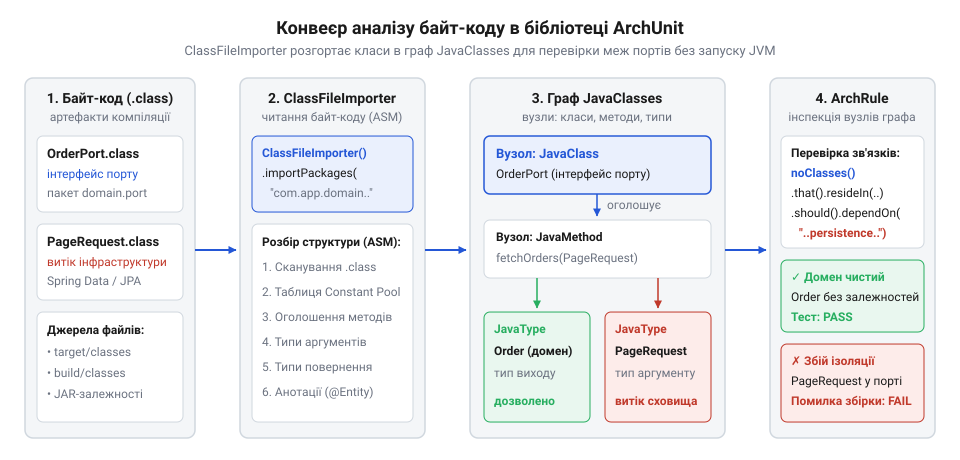
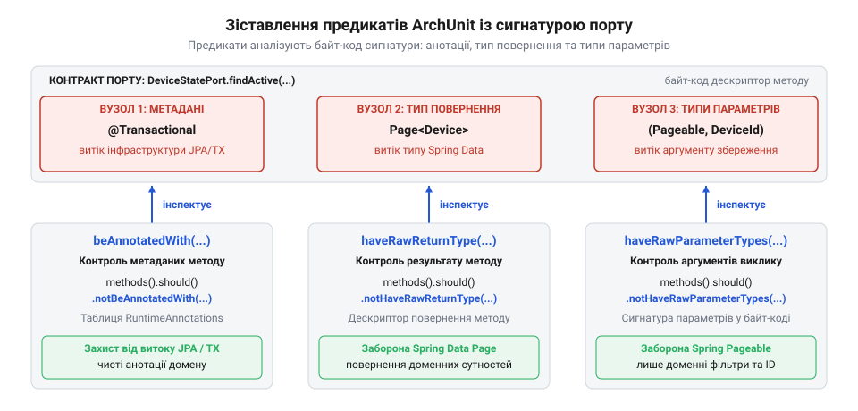

# Програмний інтерфейс ArchUnit для перевірки чистоти портів та ізоляції від сховища

<preknowlist>
- [DH v2: застосунок набуває форми](root:progarch/dh-v2-hexagon) — Розподіл коду Digital Homes за пакетами домену, портів та адаптерів і правила спрямування залежностей до ядра.
</preknowlist>

## Невидимий витік сховища в порти

Коли в проєкті @@en|Digital Homes@@ архітектуру організовано так, що [Digital Homes набуває форми](root:progarch/dh-v2-hexagon) навколо чистого бізнес-ядра, взаємодія із зовнішнім світом відбувається виключно крізь порти (порт, англ. @@en|port@@ — від лат. *portus* — гавань, вхід, брама). Вихідний порт є звичайним інтерфейсом у доменному пакеті, на кшталт `DeviceStatePort` чи `TelemetryArchivePort`. Призначення порту — абстрагувати механізм збереження: доменне ядро не повинно знати, чи зберігаються показники датчиків у реляційній базі @@en|SQL@@, чи передаються в чергу повідомлень, чи записуються у сховище @@en|NoSQL@@.

Проте на практиці ця межа легко розмивається. Розробник модуля мікроклімату реалізує читання історії показників термостата порціями. Аби не розраховувати зміщення рядків вручну, він застосовує пагінацію (пагінація, англ. @@en|pagination@@ — від лат. *pagina* — сторінка). Середовище розробки під час автодоповнення першим підставляє знайомий тип `org.springframework.data.domain.Pageable`. Одне натискання клавіші — і в сигнатурі доменного порту з'являється імпорт стороннього фреймворку. Інший розробник додає анотації `@Entity` чи `@Table` специфікації @@en|JPA@@ безпосередньо над сутністю домену, щоб уникнути копіювання полів в адаптері бази даних.

Компілятор Java вільно пропускає такі залежності. Для компілятора не існує архітектурних меж: якщо бібліотеки @@en|Spring Data@@ або @@en|JPA@@ підключені у файлі збірки, усі публічні типи є однаково доступними символами. Компілятор перевіряє синтаксис і видимість, але не здатний розпізнати, що інфраструктурний клас потрапив усередину чистого домену.

Під час перегляду змін (рецензування коду, англ. @@en|code review@@ — від англ. *review* — огляд, перевірка) запити на злиття налічують сотні рядків. Колеги уважно аналізують бізнес-інваріанти, алгоритми та запити, проте рідко помічають один сторонній рядок серед десятка імпортів у заголовку файлу. Витік стає явним лише тоді, коли команда намагається перенести домен в інший сервіс або замінити технологію збереження: доменне ядро виявляється жорстко прив'язаним до стороннього фреймворку.

Для примітивних сценаріїв створення й читання даних [гексагон буває зайвим](root:progarch/hexagon-when-overkill); але коли систему розділено на порти й адаптери, покладатися на людську увагу під час швидких релізів не можна. Межі портів потребують механізму автоматичної перевірки, що діє безпосередньо під час збірки проєкту.

## Механізм аналізу байт-коду в ArchUnit

Перевіряти архітектурні обмеження за допомогою стандартних інтеграційних тестів надто повільно: запуск контейнера @@en|Spring@@ або розгортання тестової бази даних займає десятки секунд. Якщо архітектурний контроль триває хвилинами, інженери вимикають його під час локальної розробки.

Бібліотека @@en|ArchUnit@@ забезпечує перевірку за мілісекунди завдяки статичному аналізу байт-коду (статичний аналіз, англ. @@en|static analysis@@ — від грец. *στατικός* — нерухомий, та *ἀνάλυσις* — розклад; байт-код, англ. @@en|bytecode@@ — від англ. *byte* та *code*). Замість запуску віртуальної машини з повноцінним контекстом застосунку, утиліта `ClassFileImporter` зчитує скомпільовані файли `.class` безпосередньо з каталогу збірки на диску. Для низькорівневого розбору цих файлів @@en|ArchUnit@@ використовує під капотом бібліотеку @@en|ASM@@. Вона сканує двійковий потік без завантаження класів через `ClassLoader` і без виконання коду в пам'яті. Спочатку @@en|ASM@@ розбирає константний пул (константний пул, англ. @@en|constant pool@@ — від лат. *constans* — стійкий, незмінний, та англ. *pool* — спільний фонд) — індексовану таблицю імен типів, полів, методів і літералів. Далі аналізатор перевіряє самі тіла методів, зчитуючи їхні опкоди (опкод, англ. @@en|opcode@@ — від англ. *operation code* — код операції): інструкції виклику методів, звернення до полів чи створення об'єктів. Таке пряме читання констант і машинних операцій оминає старт контейнерів та виконання статичних блоків ініціалізації, тому триває мікросекунди на клас. Межа такого підходу — сліпота до динамічної поведінки: @@en|ASM@@ бачить лише зафіксовані компілятором залежності й не помічає викликів через рефлексію або згенерованих під час виконання проксі-об'єктів.


*Схема конвеєра аналізу: скомпільований байт-код трансформується у зв'язаний граф типів і викликів, дозволяючи миттєво обчислювати архітектурні предикати без запуску JVM.*

Під час імпорту аналізатор розбирає бінарну структуру класів і формує в оперативній пам'яті зв'язаний граф об'єктів `JavaClasses`. У цьому графі кожен клас, інтерфейс, метод, поле й анотація представлені окремими вузлами. Ребра між ними фіксують усі види залежностей: виклики методів, звернення до полів, успадкування, типи вхідних параметрів і типи значень, що повертаються.

Компілятор Java записує повні дескриптори сигнатур методів (наприклад, `(Lorg/springframework/data/domain/Pageable;)Ljava/util/List;`) та метадані анотацій у таблиці атрибутів скомпільованого класу. Через це @@en|ArchUnit@@ виявляє реальні типи зв'язків без виконання конструкторів чи ініціалізації середовища. Архітектура програми перетворюється на незмінну статичну модель, готову до швидкої перевірки логічними умовами (предикат, англ. @@en|predicate@@ — від лат. *praedicatum* — заявлене, стверджуване).

## Правила заборони зв'язків між пакетами

Маючи в пам'яті граф `JavaClasses`, ми формулюємо архітектурні правила за допомогою плавного інтерфейсу — @@en|Fluent API@@ (від лат. *fluens* — текучий, плавний). Конструкції бібліотеки читаються як зв'язні твердження природною мовою, приховуючи обхід графа.

Базове правило ізоляції портів полягає в тому, що жоден клас із пакета портів не повинен залежати від класів із пакетів збереження даних чи інфраструктури.

```java
ArchRule portsMustNotDependOnPersistence = noClasses()
    .that().resideInAPackage("..domain.port..")
    .should().dependOnClassesThat()
    .resideInAnyPackage("..persistence..", "..infrastructure..");
```

Ланцюжок викликів послідовно виконує вибірку та зіставлення:
1. Метод `noClasses()` декларує заперечну умову: серед відібраних вузлів жоден не може відповідати наступному критерію порушення.
2. Селектор `.that().resideInAPackage("..domain.port..")` фільтрує класи за допомогою шаблонів із двома крапками `..`, які замінюють довільну кількість сегментів пакетів. До перевірки потрапляють усі інтерфейси портів.
3. Предикат `.should().dependOnClassesThat()` інспектує всі вихідні ребра залежностей для кожного відібраного порту.
4. Метод `.resideInAnyPackage("..persistence..", "..infrastructure..")` перевіряє цільовий вузол кожного вихідного ребра. Якщо порт звертається до будь-якого типу з пакетів збереження, фіксується помилка.

Така заборона унеможливлює випадкове використання деталей збереження в контрактах портів. Чистота інтерфейсів дозволяє втілити принцип [одне ядро, кілька фронтів](root:progarch/one-core-many-fronts), підключаючи різні адаптери сховища без потреби переписувати доменні сервіси.

## Перевірка сигнатур методів і анотацій

Правила міжпакетної ізоляції зупиняють звернення до внутрішніх пакетів проєкту, але не блокують імпорти сторонніх бібліотек, розташованих поза кодовою базою. Якщо розробник використає в інтерфейсі порту тип `org.springframework.data.domain.Pageable`, умова на пакети `..persistence..` не спрацює, оскільки сторонній клас належить до простору `org.springframework..`.

Щоб запобігти витоку сторонніх абстракцій збереження, @@en|ArchUnit@@ надає інтерфейс інспекції елементів класу за допомогою селектора `methods()`. Сигнатура методу (сигнатура, англ. @@en|signature@@ — від лат. *signo* — позначати) містить типи параметрів і тип повернення. Механізм перевірки аналізує їх за допомогою предикатів `haveRawParameterTypes()` та `haveRawReturnType()`.


*Зіставлення предикатів із сигнатурою методу: haveRawReturnType інспектує тип повернення, haveRawParameterTypes фільтрує аргументи, а beAnnotatedWith контролює анотації.*

За допомогою комбінації методів ми гарантуємо, що жоден метод у портах не приймає і не повертає сторонні об'єкти пагінації:

```java
ArchRule portMethodsMustNotDependOnSpringData = methods()
    .that().areDeclaredInClassesThat().resideInAPackage("..domain.port..")
    .should().notHaveRawParameterTypes("org.springframework.data.domain.Pageable")
    .andShould().notHaveRawReturnType("org.springframework.data.domain.Page");
```

Другим шляхом витоку інфраструктури є метадані. Технології збереження даних, зокрема @@en|JPA@@, вимагають розмічати класи та поля анотаціями на кшталт `@Entity`, `@Table` чи `@Id`. Поява таких анотацій у домені примушує бізнес-модель підлаштовуватися під реляційну схему. За допомогою предикату `beAnnotatedWith()` ми забороняємо розміщення інфраструктурних метаданих:

```java
ArchRule domainClassesMustNotBeAnnotatedWithJpa = classes()
    .that().resideInAPackage("..domain..")
    .should().notBeAnnotatedWith("jakarta.persistence.Entity")
    .andShould().notBeAnnotatedWith("jakarta.persistence.Table");
```

Подібно до того як [трансляція доменних команд](root:progarch/dh-egress-actuator-protocol-mapping) захищає ядро від апаратних протоколів, сигнатурні предикати усувають будь-який відбиток сховища з інтерфейсів портів.

## Виконання тестів та аналіз звітів

Складені архітектурні правила залишаються пасивною декларацією, доки вони не виконуються автоматично в тестовому контурі. Бібліотека @@en|ArchUnit@@ безпосередньо інтегрується з тестовими фреймворками, зокрема @@en|JUnit@@ 5.

За допомогою анотації `@AnalyzeClasses` ми вказуємо кореневий пакет кодової бази, який імпортер сканує перед запуском тестів. Самі правила оголошуються статичними полями з анотацією `@ArchTest`:

```java
@AnalyzeClasses(packages = "com.digitalhomes")
class PortIntegrityArchTest {

    @ArchTest
    static final ArchRule portsMustNotDependOnPersistence = noClasses()
        .that().resideInAPackage("..domain.port..")
        .should().dependOnClassesThat()
        .resideInAnyPackage("..persistence..", "..infrastructure..");

    @ArchTest
    static final ArchRule portMethodsMustNotUseSpringData = methods()
        .that().areDeclaredInClassesThat().resideInAPackage("..domain.port..")
        .should().notHaveRawParameterTypes("org.springframework.data.domain.Pageable");
}
```

Під час збірки проєкту командою `mvn test` або `./gradlew test` рушій аналізу оцінює визначені правила. Оскільки читання байт-коду та побудова зв'язків між сотнями типів потребують відчутних ресурсів процесора й диска, повторний імпорт для кожного окремого тестового класу затягував би виконання збірки. Для усунення цих накладних витрат бібліотека @@en|ArchUnit@@ застосовує механізм кешування (кеш, англ. @@en|cache@@ — від фр. *cacher* — ховати, приховувати) імпортованих класів у пам'яті. Під час першого запиту `ClassFileImporter` зчитує скомпільовані класи, конструює граф `JavaClasses` і фіксує його у статичній пам'яті процесу. Усі наступні тестові класи з однаковими параметрами в анотації `@AnalyzeClasses` не сканують файли на диску заново, а миттєво перевикористовують готовий граф. Таке прискорення коштує додаткового споживання оперативної пам'яті для утримання повної моделі типів. Кешування перестає діяти, якщо конфігурація в `@AnalyzeClasses` відрізняється пакетами чи фільтрами імпорту, або коли система збірки запускає тестові класи в окремих ізольованих процесах віртуальної машини — у такому разі граф будується з нуля. Якщо хоча б одне ребро графа суперечить предикату, перевірка завершується аварійно з викиданням винятку `AssertionError` (твердження, англ. @@en|assertion@@ — від лат. *asserere* — стверджувати, заявляти). Це миттєво зупиняє конвеєр @@en|CI/CD@@, блокуючи злиття невідповідного коду в основну гілку.

У разі збою @@en|ArchUnit@@ формує структурований звіт про порушення:

```text
Architecture Violation [Priority: MEDIUM] - Rule 'no classes that reside in a package '..domain.port..' should depend on classes that reside in a package '..persistence..'' was violated (1 times):
Method <com.digitalhomes.domain.port.DeviceStatePort.save(com.digitalhomes.persistence.entity.DeviceEntity)> has parameter of type <com.digitalhomes.persistence.entity.DeviceEntity> in (DeviceStatePort.java:14)
```

Звіт містить три обов'язкові компоненти діагностики:
1. Повний текст порушеного архітектурного правила.
2. Суб'єкт порушення — конкретний клас і метод, у якому виник витік.
3. Назву файлу та точний номер рядка `(DeviceStatePort.java:14)`.

Отримавши такий звіт, інженер переходить безпосередньо до вказаного рядка у середовищі розробки, замінює інфраструктурний тип на канонічну сутність домену або вводить доменний об'єкт запиту, після чого збірка знову стає успішною.
