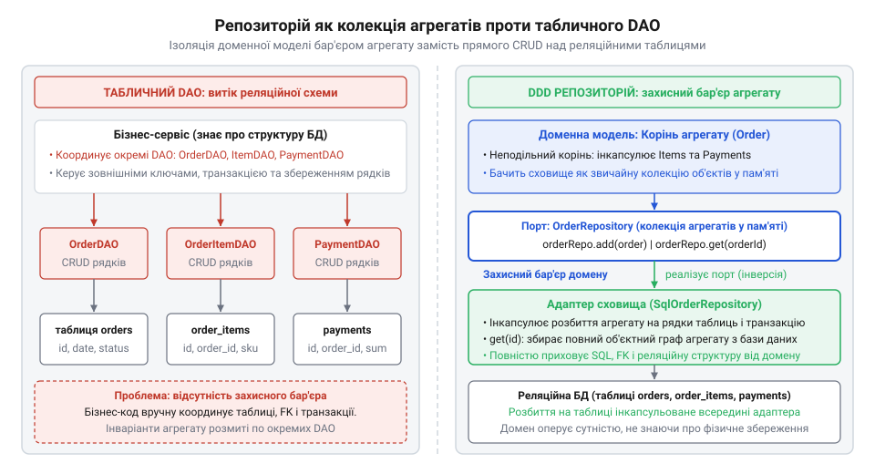
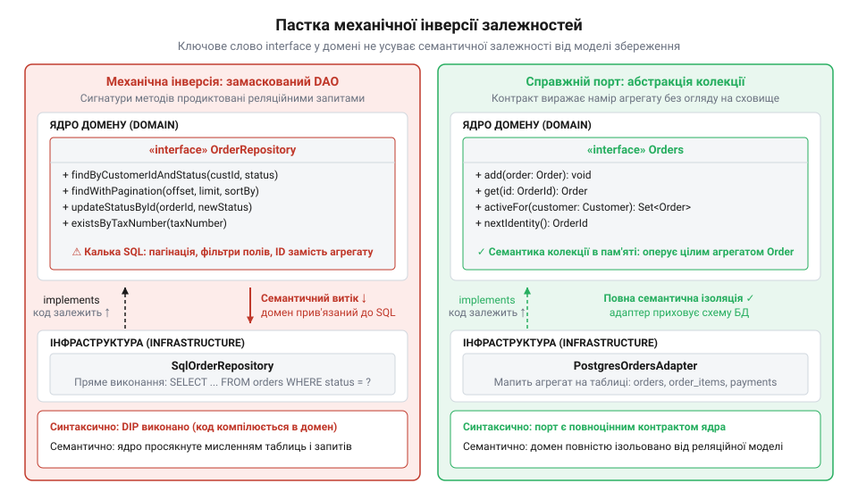

# Еволюція від DAO до узагальненого репозиторію та пастка механічної інверсії залежностей

## Реляційний диктат та народження DAO

На межі 2000-х років бізнес-код корпоративних систем був нерозривно сплетений із низькорівневими викликами бази даних. Коли в платформі розумного будинку Digital Homes [застосунок набуває форми](root:progarch/dh-v2-hexagon), постає потреба зберігати конфігурацію пристроїв і розклади опалення. Проте в коді того часу прикладний сервіс самостійно відкривав з'єднання через @@en|JDBC@@ (від англ. @@en|Java Database Connectivity@@ — з'єднання з базами даних Java), склеював текстові запити @@en|SQL@@, перехоплював винятки драйвера та порядково зчитував реляційні вибірки. Будь-яка зміна схеми — перейменування колонки чи розбиття таблиці — вимагала виправлень у десятках бізнес-класів.

Щоб ізолювати роботу з базою, у 2001 році автори каталогу *Core J2EE Patterns* Діпак Алур (@@en|Deepak Alur@@), Джон Крупі (@@en|John Crupi@@) та Ден Малкс (@@en|Dan Malks@@) із корпорації @@en|Sun Microsystems@@ стандартизували патерн @@en|Data Access Object@@ (DAO; від англ. *data access object* — об'єкт доступу до даних). Усі операції з конкретною таблицею зосередили в окремому класі. Бізнес-сервіс звертався до методів `DeviceDao`, а @@en|DAO@@ керував з'єднанням, виконував запити та транслював рядки в об'єкти передачі даних — @@en|Data Transfer Object@@ (DTO; від англ. *data transfer object* — об'єкт передачі даних). Прямі інструкції сховища зникли з бізнес-коду.

Проте винесення SQL не звільнило систему від реляційного диктату. Патерн @@en|DAO@@ мислив виключно фізичними таблицями: одна таблиця породжувала один клас доступу. Його інтерфейс дзеркалив операції @@en|CRUD@@ (від англ. *create, read, update, delete* — створення, читання, оновлення, видалення): `insert()`, `update()`, `delete()`. Доменна логіка мусила оперувати зовнішніми ключами й рядками. Щоб змінити пристрій разом із його датчиками, сервіс вручну узгоджував послідовні виклики кількох окремих @@en|DAO@@. Бізнес-модель залишалася пасивним набором структур без власної поведінки — типова анемічна модель (@@en|Anemic Domain Model@@; від грец. *anaimia* — безкровність).

## Еванс і колекція в пам'яті

Табличний підхід @@en|DAO@@ руйнував багату доменну логіку. Якщо правило Digital Homes вимагає, щоб сумарна потужність активованих приладів у кімнаті не перевищувала ліміт проводки, це обмеження має перевірятися неподільно. Коли ж будь-який сервіс може напряму викликати `deviceDao.insert()` чи оновити статус через `powerDao.update()`, інваріант розсипається. Реляційна схема захищає лише типи полів і цілісність ключів, але нічого не знає про бізнес-правила.

У 2003 році Ерік Еванс (@@en|Eric Evans@@) у книзі *Domain-Driven Design: Tackling Complexity in the Heart of Software* запропонував відкинути орієнтацію на таблиці. Він увів поняття агрегату (@@en|Aggregate@@; від лат. *aggregatus* — зібраний докупи) — графа об'єктів із неподільними транзакційними межами. Будь-яка взаємодія з агрегатом ззовні дозволена лише через корінь агрегату (@@en|Aggregate Root@@; від англ. *aggregate root* — корінь агрегату). Для завантаження й збереження агрегатів як неподільного цілого Еванс створив патерн @@en|Repository@@ (від лат. *repositorium* — сховище, комора).

Для доменної моделі @@en|Repository@@ є не шлюзом до бази даних, а концептуальною ілюзією звичайної колекції в пам'яті на зразок `Set`. Інтерфейс репозиторію формулюють виключно термінами єдиної мови (@@en|Ubiquitous Language@@; від лат. *ubique* — всюди, та англ. *language* — мова): `add(zone)`, `remove(zone)`, `findActiveZones()`.

У такій віртуальній колекції відсутній метод `update()`. Якщо об'єкт у пам'яті змінено через його методи, колекцію не треба сповіщати про факт оновлення: посилання у звичайній колекції `Set` уже вказує на той самий змінений екземпляр. Поява методів збереження на зразок `update()` або `save()` зруйнувала б ілюзію колекції й змусила б доменну модель координувати стан бази даних. Синхронізацію змін із диском бере на себе адаптер через одиницю роботи (@@en|Unit of Work@@; від англ. *unit of work* — одиниця роботи) та відстеження брудних об'єктів (@@en|dirty checking@@; від англ. *dirty* — брудний, та *checking* — перевірка). Коли репозиторій завантажує корінь агрегату, адаптер реєструє його в @@en|Unit of Work@@ і зберігає незмінний зліпок усіх його полів. Доменна модель працює суто з об'єктом у пам'яті: викликає бізнес-методи та захищає інваріанти без огляду на схему таблиць. Під час фіксації транзакції @@en|Unit of Work@@ порівнює поточний граф об'єктів із початковим зліпком, виявляє змінені значення й автоматично будує мінімальний набір SQL-команд `UPDATE` або `DELETE`. Ілюзія колекції коштує додаткової пам'яті на дублювання зліпків і процесорного часу на поглиблене зіставлення полів. Механізм ламається на завеликих агрегатах: порівняння сотень зв'язаних сутностей створює відчутні затримки, а розробники, намагаючись обійти накладні витрати, повертають у репозиторій виклики часткового оновлення таблиць і руйнують транзакційні межі. Репозиторії існують лише для коренів агрегатів: внутрішні сутності не мають власних точок доступу до сховища.

*Репозиторій створює для доменного ядра ілюзію звичайної колекції агрегатів у пам'яті, тоді як адаптер сховища повністю бере на себе транзакційне збереження та розбиття на таблиці.*

## Ера ORM та узагальнений CRUD

Створення ручних адаптерів між агрегатами та реляційними таблицями потребувало значних зусиль. У середині 2000-х розв'язанням цієї проблеми стало об'єктно-реляційне відображення (@@en|Object-Relational Mapping@@, @@en|ORM@@; від англ. *object-relational mapping* — об'єктно-реляційне відображення). Бібліотека @@en|Hibernate@@, яку Ґевін Кінґ (@@en|Gavin King@@) випустив у 2001 році, та специфікація @@en|JPA@@ 2006 року взяли на себе генерацію SQL-запитів, кешування та відстеження брудного стану об'єктів.

Бажання скоротити повторюваний код сховищ привело до появи шаблону @@en|Generic DAO@@ на основі типізованих параметрів мови Java. У 2010 році цей підхід закріпив проєкт @@en|Spring Data@@ під керівництвом Олівера Ґірке (@@en|Oliver Gierke@@). Інтерфейси на кшталт `Repository<T, ID>` та `CrudRepository<T, ID>` дозволили розробникам оголошувати порожні інтерфейси, для яких фреймворк автоматично генерував реалізації з методами `save()`, `findById()`, `findAll()` та `delete()`.

Ця зручність спричинила деградацію патерну. Під назвою @@en|Repository@@ утвердився класичний табличний @@en|DAO@@. Оскільки кожна таблиця позначалася як `@Entity`, розробники створювали узагальнений репозиторій для кожної таблиці: `DeviceRepository`, `SensorRepository`, `ScheduleItemRepository`. Це зруйнувало межі агрегатів, дозволивши змінювати внутрішні сутності в обхід кореня. Коли для дочірньої сутності існує готовий `ScheduleItemRepository`, прикладний сервіс звертається до нього напряму через виклики `save()` або `deleteById()`. Проте обов'язкові інваріанти — наприклад, заборона перекриття часових інтервалів обігріву чи обмеження потужності — інкапсульовані виключно в корені `Device`. Прямий виклик дочірнього сховища повністю оминає корінь агрегату: екземпляр `Device` не завантажується в пам'ять, а його логіка перевірки не виконується. Зовнішній код змінює елемент у базі даних наодинці й зберігає стан, який суперечить правилам домену. Під час наступного завантаження пристрій стикається з порушеними інваріантами у власному графі зв'язків. Щоб уникнути помилок, розробники змушені дублювати бізнес-перевірки в прикладних службах перед кожним викликом дочірнього репозиторію. Замість колекції, керованої поведінкою домену, @@en|Repository@@ знову став фасадом над операціями @@en|CRUD@@ з витоком деталей збереження — табличних фільтрів і пагінації. Якщо в простих сценаріях [гексагон виявляється зайвим](root:progarch/hexagon-when-overkill), то для багатої моделі механічна заміна репозиторію табличним CRUD руйнує захисний периметр бізнес-правил.

## Пастка механічної інверсії залежностей

Прагнучи захистити домен від інфраструктури, розробники звертаються до принципу інверсії залежностей (від лат. *inversio* — перевертання; @@en|Dependency Inversion Principle@@). Правило вимагає, щоб високорівневі модулі не залежали від низькорівневих деталей, а обидва спиралися на абстракції. На практиці це часто зводять до суто синтаксичного кроку: файл інтерфейсу репозиторію переносять у пакет домену, а його реалізацію з прямими викликами бази даних залишають у пакеті інфраструктури. Компілятор задоволений — доменний код більше не імпортує класів сховища, а стрілка залежності розвернулася у бік ядра.

Проте механічне переміщення файлу не створює справжньої автономії. Якщо інтерфейс містить методи на кшталт `findByFloorIdAndActiveTrue()`, `findWithPagination()` або `updateStatusById()`, бізнес-ядро залишається заручником реляційної схеми. Сигнатури таких методів продиктовані не інваріантами бізнес-моделі, а структурою таблиць і можливостями індексів бази даних. Коли будь-яка зміна фізичної колонки чи розбиття таблиці змушує правити інтерфейс у домені, виникає семантичне протікання (від грец. *semantikos* — значущий; @@en|semantic leak@@). Ще яскравіше фіктивність такої ізоляції викриває поведінка під час виконання. Коли адаптер повертає доменну сутність, керовану @@en|ORM@@-фреймворком, її вкладені дані зазвичай підтягуються відкладено — через ліниве завантаження (від англ. *lazy* — лінивий + *loading* — завантаження; @@en|lazy loading@@). Спроба бізнес-логіки звернутися до таких зв'язків після закриття сесії сховища негайно розбивається об неоголошений виняток `LazyInitializationException`. Інтерфейс у домені не містить жодних згадок про сесії бази даних чи класи сторонніх бібліотек, а компілятор звітує про повну незалежність ядра. Проте насправді домен не здатен перевірити власні інваріанти, якщо низькорівневий адаптер заздалегідь не вичитав потрібних таблиць або транзакцію бази даних не натягнули на бізнес-код. Формальне ключове слово `interface` перетворюється на карго-культ (від англ. *cargo* — вантаж + *cult* — шанування; @@en|cargo cult@@): синтаксична інверсія відбулася, але змістовна залежність домену від деталей збереження нікуди не зникла.

*Формальне винесення інтерфейсу в доменний пакет зберігає семантичну залежність ядра від сховища, тоді як справжній порт диктується винятково правилами агрегату.*

## Порт від наміру, а не схеми

Справжня ізоляція починається тоді, коли контракт вихідного порту (від лат. *portus* — прохід, брама; @@en|outbound port@@) проєктують суто від операцій та правил поведінки агрегатів. Доменне ядро нічого не знає про реляційні таблиці, зовнішні ключі, фільтри запитів чи часткові оновлення рядків. Коли системі Digital Homes потрібно перевірити ліміт навантаження електромережі під час увімкнення опалення, їй не потрібні окремі записи з таблиці приладів. Їй потрібен цілісний агрегат кліматичної зони у валідному стані. Тому контракт порту виражає намір мовою предметної області й обмежується операціями відновлення та збереження агрегату: `loadZoneHeating(ZoneId)` та `save(ZoneHeating)`.

У такому порту немає місця табличній пагінації. Бізнес-інваріант неможливо перевірити на першій сторінці вибірки, якщо критична частина пристроїв залишилася на другій. Тут також відсутні методи часткової модифікації окремих полів на зразок `updatePowerLimit()`, які дозволяють змінювати стан в обхід кореня агрегату. Подібно до того, як вихідний адаптер [транслює команди домену](root:progarch/dh-egress-actuator-protocol-mapping) у регістри й двійкові кадри без витоку апаратних подробиць у ядро, адаптер сховища бере на себе все відображення: він транслює сутності бази даних у доменні об'єкти, відкриває транзакції й зберігає зміни. Якщо згодом реляційну базу замінять на документне сховище чи розподілену пам'ять, контракт доменного порту не зазнає жодних змін.
