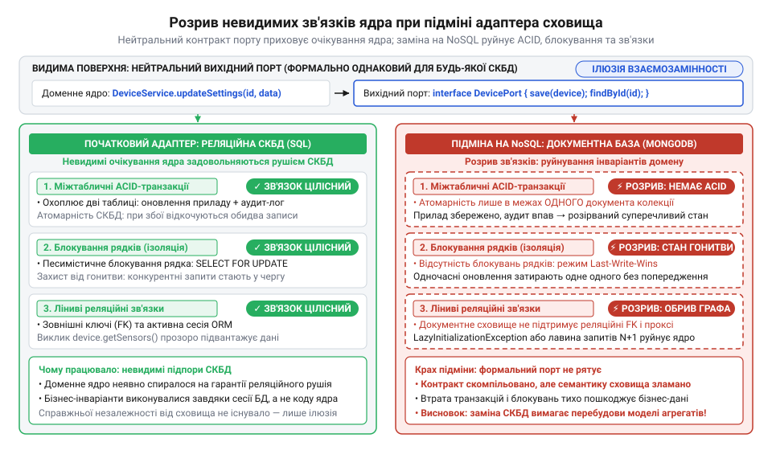
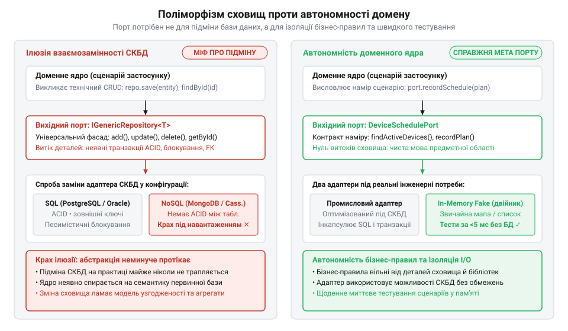

# Міф про заміну бази даних та переосмислення призначення вихідних портів

## Спокуса легкої заміни бази даних

На початку 2000-х років розробка корпоративних систем зайшла в глухий кут жорсткого зчеплення з даними. Запити мовою @@en|SQL@@ (англ. @@en|Structured Query Language@@) пронизували код бізнес-сервісів, логіка розпорошувалася між збереженими процедурами та веб-сторінками, а зміна схеми реляційної таблиці вимагала переписування десятків класів. Перевірити роботу бізнес-правила в модульному тесті без розгортання повноцінної бази даних було практично неможливо.

Порятунок запропонували піонери предметно-орієнтованого проєктування (@@en|DDD@@, англ. @@en|Domain-Driven Design@@) та @@en|гексагональної архітектури@@ (грец. @@el|hexagōnos@@: @@el|hex@@ — шість, @@el|gōnia@@ — кут). У 2003 році американський архітектор @@en|Ерік Еванс@@ (@@en|Eric Evans@@) описав патерн @@en|репозиторій@@ (лат. @@la|repositorium@@ — сховище, від @@la|reponere@@ — відкладати) для відокремлення доменних об'єктів від інфраструктури. У 2005 році американський інженер @@en|Алістер Кокберн@@ (@@en|Alistair Cockburn@@) сформулював концепцію, у якій доменне ядро звертається до зовнішнього світу через @@en|вихідний порт@@ (лат. @@la|porta@@ — брама, вхід), а конкретне сховище підключається ззовні як незалежний @@en|адаптер@@ (лат. @@la|adaptare@@ — пристосовувати).

Згодом американський інженер @@en|Роберт Мартін@@ (@@en|Robert C. Martin@@) підхопив ідею та проголосив привабливе гасло: «База даних — це лише деталь реалізації» (англ. @@en|database is a detail@@). З цього здорового прагнення захистити бізнес-правила конференційні доповідачі та консалтингові агенції вивели хибну догму. Вони переконали спільноту, що головне призначення вихідного порту полягає у швидкій і безболісній зміні сховища: мовляв, сьогодні застосунок працює з @@en|Oracle@@ чи @@en|Microsoft SQL Server@@, а завтра достатньо підставити інший адаптер до @@en|PostgreSQL@@ чи @@en|MySQL@@ без правки жодного рядка бізнес-коду.

Заради цієї уявної вигоди розробники почали зводити багатоповерхові надбудови. Команди проєктували універсальні інтерфейси сховищ, писали громіздкі узагальнені класи доступу до даних та штучно обмежували запити найменшим спільним знаменником реляційних рушіїв. Проте для простих систем [шаблони гексагонального відокремлення надмірні](root:progarch/hexagon-when-overkill), а витрачені тижні на створення універсальних абстракцій ішли в пісок заради заміни бази, якої в реальних проєктах ніхто ніколи не робив.

## Хвиля NoSQL та крах підміни

На рубежі 2010-х років вигадана взаємозамінність пройшла перше справжнє випробування практикою. У червні 2009 року шведський інженер @@en|Йоган Оскарссон@@ (@@en|Johan Oskarsson@@) провів у Сан-Франциско конференцію, відродивши назву @@en|NoSQL@@ (англ. @@en|Not Only SQL@@) для нового класу нереляційних розподілених баз даних. Зростання навантажень висунуло нові інструменти: компанія @@en|10gen@@ випустила документну базу @@en|MongoDB@@ (2009 рік), а фонд @@en|Apache@@ представив розподілене сховище @@en|Cassandra@@ (2008–2010 роки).

Індустрію охопила ейфорія. Розробники прагнули позбутися важких міграцій схем і повільних реляційних об'єднань таблиць, спокусившись маркетинговими обіцянками необмеженого горизонтального масштабування. Архітектори пригадали уроки гексагонального підходу: оскільки ядро взаємодіє зі сховищем лише через @@en|вихідний порт@@, перехід на нереляційне сховище здавався елементарною заміною реалізації адаптера в конфігурації застосунку.

Підприємства почали масово замінювати реляційні адаптери на документні в активних системах. Наприклад, у системі автоматизації житла @@en|Digital Homes@@, де [доменне ядро набуває форми](root:progarch/dh-v2-hexagon) навколо портів обліку пристроїв і сценаріїв мікроклімату, реляційний адаптер вимкнули й під'єднали на його місце адаптер до @@en|MongoDB@@, зберігши колишні сигнатури методів збереження.

У промисловому середовищі настав негайний крах. Хоча проєкт бездоганно скомпілювався, поведінка системи миттєво зламалася під реальним навантаженням. За одночасних запитів мешканців показання кімнат перезаписувалися, графіки автоматизації розсинхронізовувалися, а зв'язки між приладами безслідно зникали. Проста зміна адаптера спричинила каскадні помилки й пошкодження даних, викривши повну неспроможність ідеї безшовної заміни рушія.

## Приховані витоки деталей реляційного збереження

Катастрофа сталася через фундаментальну властивість інженерних шарів: кожна складна абстракція неминуче протікає прихованими деталями. Американський програміст @@en|Джоел Спольські@@ (@@en|Joel Spolsky@@) у 2002 році описав це як @@en|витік абстракції@@ (англ. @@en|leaky abstraction@@). Сигнатури вихідного порту на кшталт `save(device)` чи `findById(id)` здавалися нейтральними, але доменне ядро спиралося на невидимі системні підпори реляційної @@en|СКБД@@.

Першим критичним витоком виявилися гарантії транзакційної узгодженості @@en|ACID@@ (акронім від англ. @@en|Atomicity, Consistency, Isolation, Durability@@; лат. @@la|transactio@@ — завершення справи, угода). Коли бізнес-сценарій оновлював стан кондиціонера та додавав запис у журнал аудиту двома окремими викликами порту, доменне ядро розраховувало на єдину неявну транзакцію бази даних. Реляційна система гарантувала неподільність: збій на другому записі автоматично скасовував перший. Тогочасні нереляційні сховища (зокрема @@en|MongoDB@@ до версії 4.0 у 2018 році) підтримували атомарність лише одного документа: обрив мережі між записами залишав систему в розірваному й суперечливому стані.

Другим витоком була модель конкурентного доступу. Реляційні системи захищали дані від @@en|стану гонитви@@ (англ. @@en|race condition@@) за допомогою блокувань рядків і суворих рівнів ізоляції транзакцій. Бізнес-код не містив ручних перевірок конфліктів, бо покладався на @@en|песимістичне блокування@@ (англ. @@en|pessimistic locking@@) СКБД. Документна ж база перезаписувала документи цілком за принципом останнього запису, що призводило до непомітного знищення паралельних правок сусідніх користувачів.

Третім витоком стали реляційні зв'язки та поведінка інструментів об'єктно-реляційного відображення (@@en|ORM@@, англ. @@en|Object-Relational Mapping@@). База апаратно підтримувала @@en|зовнішній ключ@@ (англ. @@en|foreign key@@), а фреймворк прозоро підвантажував пов'язані сутності через @@en|ліниве завантаження@@ (англ. @@en|lazy loading@@). Коли бізнес-код викликав метод `room.getSensors()`, реляційний адаптер непомітно виконував додатковий запит. У документному сховищі, де структура збереження принципово інша, цей виклик або розбивався об відсутність сесії, або породжував лавину окремих мережевих запитів, паралізуючи систему.

*Схема розриву зв'язків при підміні адаптера: формально нейтральний інтерфейс порту приховував реляційні очікування ядра щодо транзакцій, блокувань і лінивих зв'язків, які руйнуються в нереляційному середовищі.*

Формально чистий @@en|вихідний порт@@ створив фальшиву ілюзію безпеки. Хоча доменне ядро не містило SQL-коду, воно виявилося намертво спаяним із реляційною моделлю транзакцій та блокувань. Через неминучий [витік деталей збереження](root:sf-apps/softeng-law-of-leaky-abstractions) зміна сховища вимагає докорінної перебудови всієї моделі узгодженості та меж бізнес-агрегатів, а не простої перевстановки адаптера.

## Розвінчання догми Янгом і Богардом

Попри регулярні збої під час заміни сховищ, інженерна культура 2000-х років продовжувала вимагати абсолютної незалежності від баз даних. Головним знаряддям цієї догми став @@en|універсальний репозиторій@@ (англ. @@en|generic repository@@). Програмісти загортали будь-який доступ до даних в узагальнений інтерфейс із методами `add`, `getById` та `delete`, намагаючись представити таблиці бази як просту колекцію об'єктів у пам'яті. Команди витрачали тижні на підтримку штучних посередників заради можливості, якою ніхто на практиці не користувався.

На початку 2010-х років американський архітектор @@en|Джиммі Богард@@ (@@en|Jimmy Bogard@@) публічно виступив проти цієї ілюзії. У серії статей він викрив [універсальний репозиторій як антипатерн](root:progarch/port-smelling-of-storage/hist-database-swapping-myth.md), спираючись на спостереження за реальними проєктами. Головний аргумент Богарда був убивчим для догми: комерційні системи майже ніколи не змінюють базову @@en|СКБД@@. Проєктувати архітектуру заради заміни бази означає витрачати ресурси на захист від події з нульовою ймовірністю. До того ж абстрактний інтерфейс закривав доступ до специфічних можливостей конкретного рушія, зводячи роботу до примітивного @@en|CRUD@@ (акронім від англ. @@en|Create, Read, Update, Delete@@ — створити, прочитати, оновити, видалити), але так і не усував прихованих витоків реляційної семантики.

Одночасно канадський архітектор @@en|Грег Янг@@ (@@en|Greg Young@@) показав теоретичну неможливість такої абстракції. Бізнес-правила не можуть існувати у відриві від фізичних меж транзакційної узгодженості. Опорною одиницею домену є @@en|агрегат@@ (лат. @@la|aggregatus@@ — зібраний докупи) — зв'язана група сутностей, межа якої строго відповідає межі транзакції. У реляційному сховищі @@en|агрегат@@ спирається на транзакцію @@en|ACID@@ між декількома таблицями. У документному сховищі межа транзакції звужується до єдиного документа, а решта зв'язків вимагає переходу до кінцевої узгодженості. Будь-яка заміна рушія бази руйнує саму будову @@en|агрегатів@@ і змушує переписувати бізнес-правила. Архітектурна вимога готувати систему до зміни сховища виявилася шкідливим надлишковим ускладненням, яке купувало фальшиву абстракцію ціною втрати контролю над збереженням даних.

## Вихідні порти як автономія домену

Звільнення від догми про заміну баз даних відкриває справжнє призначення архітектурного кордону. Якщо @@en|вихідний порт@@ не призначений для підміни рушія збереження, постає практичне питання: навіщо взагалі відокремлювати ядро від інфраструктури? Сучасне розуміння полягає в тому, що @@en|вихідний порт@@ існує не заради поліморфізму сховищ, а заради автономності бізнес-правил та ізоляції сценарію застосунку від зовнішнього введення-виведення.

@@en|Вихідний порт@@ править захисним бар'єром для домену. Коли контракт порту зводять до технічних дій на кшталт `save` чи `delete`, структура збереження непомітно диктує форму бізнес-логіки. Натомість інтерфейс формулюють мовою бізнес-сценарію — це @@en|єдина мова@@ (англ. @@en|ubiquitous language@@; лат. @@la|ubique@@ — скрізь). Методи порту відображають дію та намір: наприклад, знайти прилади з перевищенням порогу температури або зафіксувати новий графік роботи клімату. Подібно до того, як @@en|адаптери@@ [транслюють команди пристроям](root:progarch/dh-egress-actuator-protocol-mapping) без витоку апаратних деталей у ядро, порт доступу до даних повністю приховує структуру збереження за потребами сценарію.

*Зіставлення архітектурних підходів: універсальний фасад збереження створює фальшиву ілюзію взаємозамінності СКБД, тоді як контракт наміру сценарію гарантує автономність доменних правил і швидке тестування.*

Така ізоляція сценарію дає вирішальну практичну користь — миттєві бізнес-тести. Коли правила відокремлені від механіки введення-виведення, перевірка бізнес-сценаріїв не вимагає запуску повноцінної @@en|СКБД@@, підняття контейнерів чи очікування мережевих відповідей. У тестах @@en|вихідний порт@@ реалізують простим @@en|тестовим двійником@@ (англ. @@en|test double@@) у пам'яті за допомогою звичайної колекції чи словника. Усі сценарії перевіряються за мілісекунди, даючи інженерам негайний зворотний зв'язок під час змін коду. @@en|Вихідний порт@@ потрібен не заради міфічної заміни бази даних у майбутньому, а заради щоденної автономності доменного ядра та надійності його перевірки тут і тепер.
