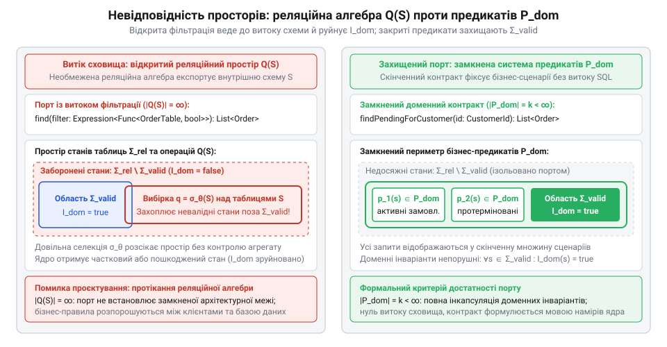
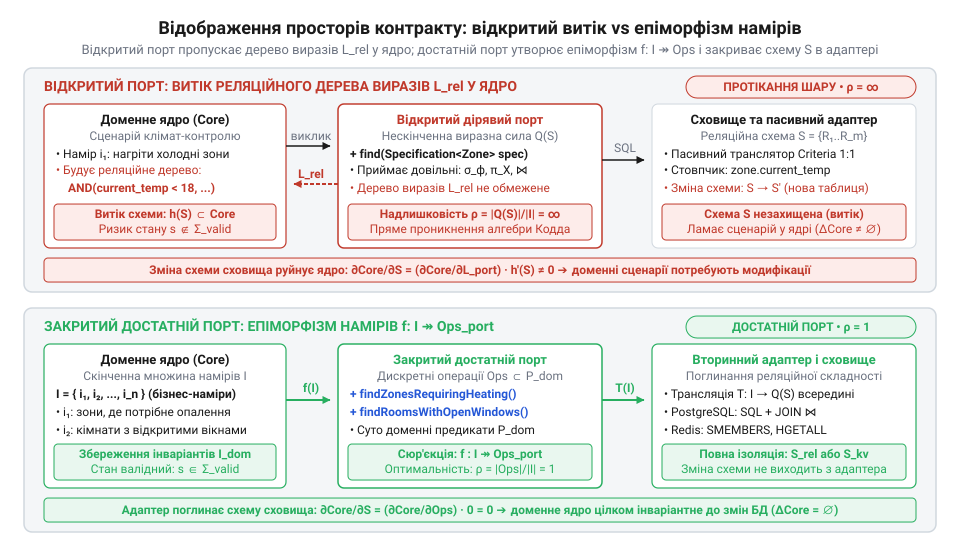

# Алгебра реляційних запитів проти доменних предикатів у контрактах портів

<preknowlist>
- [DH v2: застосунок набуває форми](root:progarch/dh-v2-hexagon) — гексагональна декомпозиція системи Digital Homes: виділення доменного ядра з інваріантами, сценаріїв використання (Use Cases) як точок входу та вихідних портів збереження, що реалізуються вторинними інфраструктурними адаптерами.
</preknowlist>

## Пастка універсального запиту в Digital Homes

Прагнення створити універсальний вихідний @@en|порт@@ (від лат. @@la|portus@@ — гавань, прохід) видається ощадливим інженерним компромісом. Замість проєктування окремих методів під кожен прикладний намір інтерфейс наділяють єдиною точкою вибірки, що приймає динамічне дерево критеріїв або відкритий фільтр. Розробникам здається, що такий контракт назавжди позбавляє потреби змінювати порт: будь-який новий сценарій отримує потрібні дані простим конструюванням виразу на боці виклику.

Саме так вчинили інженери підсистеми мікроклімату в платформі @@en|Digital Homes@@. Вихідний порт репозиторію отримав загальний метод пошуку з довільним предикатом фільтрації над станом кліматичних зон. Прикладний сценарій регулювання температури скористався цією гнучкістю: замість завантаження цілісного @@en|агрегату@@ (від лат. @@la|aggregatus@@ — зібраний докупи) через його корінь код сценарію будував власні динамічні вибірки окремих атрибутів сенсорів безпосередньо з таблиць. Сценарій самостійно оцінював параметри нагріву в обхід бізнес-методів [доменного ядра системи](root:progarch/dh-v2-hexagon) й надсилав керувальні сигнали на [протокол актуаторів](root:progarch/dh-egress-actuator-protocol-mapping).

Виробнича катастрофа сталася після планового оновлення бази даних: адміністратори нормалізували таблиці, відокремивши конфігурацію пристроїв від часових рядів телеметрії. Прикладний сценарій автоматизації містив динамічний фільтр, розрахований на стару денормалізовану структуру полів. Під час запуску фільтр сформував некоректну реляційну умову, яка повернула спотворені записи. Оскільки логіка обробки оминала доменні правила несуперечливості, сценарій одночасно замкнув реле газового котла та компресора охолодження. Симисторні силові комутатори перегрілися від зустрічного навантаження й вийшли з ладу.

Аварія показала, що універсальний метод вибірки в порту не ізолює сховище, а експортує його внутрішні механізми в ядро системи. Щоб зрозуміти причину цього протікання, необхідно формалізувати операції над даними через апарат реляційної алгебри.

## Реляційна алгебра як відкритий простір

Для математичного моделювання операцій сховища використовується @@la|реляційна алгебра@@ (від лат. @@la|relatio@@ — відношення) Едгара Кодда. Реляційна схема даних `S = {R₁, R₂, ..., R_m}` складається зі скінченної множини відношень, де кожне відношення `R_i` є підмножиною декартового добутку доменів власних атрибутів.

Маніпулювання цими відношеннями забезпечує замкнена система операторів:
@@la|селекція@@ (від лат. @@la|selectio@@ — вибір, добір) `σ_ϕ`,
@@la|проєкція@@ (від лат. @@la|projectio@@ — кидання вперед) `π_X`,
природне з'єднання `⋈`,
об'єднання множин `∪`
та різниця множин `\`.
Умова селекції `ϕ` є довільною булевою комбінацією атомів порівняння атрибутів і констант:
`ϕ ::= A_i θ c | A_i θ A_j | ¬ϕ | ϕ₁ ∧ ϕ₂ | ϕ₁ ∨ ϕ₂`, де оператор порівняння `θ ∈ {=, ≠, <, ≤, >, ≥}`.

Простір реляційних запитів `Q(S)` формують як найменшу множину виразів над відношеннями схеми `S`, замкнену щодо операцій селекції, проєкції, з'єднання, об'єднання та різниці:

```
Q(S)
= S ∪ { σ_ϕ(E), π_X(E) | E ∈ Q(S) }          [індуктивне замикання за селекцією та проєкцією]
= Q(S) ∪ { E₁ ⋈ E₂, E₁ ∪ E₂, E₁ \ E₂ | E₁, E₂ ∈ Q(S) } [доповнення бінарними операціями над відношеннями]
```

Отримана множина виразів `Q(S)` має нескінченну потужність `|Q(S)| = ∞`. Вона утворює відкритий функціональний простір, що дозволяє вирізати будь-які плоскі проєкції даних і комбінувати таблиці без огляду на їхній первинний зміст.

Уявимо відношення кліматичної зони `R_zone` у базі даних @@en|Digital Homes@@ зі схемою атрибутів `attr(R_zone) = {zone_id, current_temp, target_temp, heater_state, window_open}`, де `zone_id` є первинним ключем. Сценарій автоматизації виконує реляційний запит із @@la|проєкцією@@ `π_X`, де множина атрибутів `X = {current_temp, target_temp}` не містить ключа `zone_id`. Результатом операції стає напівпорожній кортеж виду `⟨17.5, 21.0⟩`, вирваний із контексту цілісного об'єкта. Через відсутність первинного ключа отримані дані втрачають ідентичність: доменне ядро не знає, якій саме кімнаті належать ці градуси, і не здатне адресно оновити стан у сховищі. Разом із ключем операція `π_X` відкинула атрибути `heater_state` та `window_open`, що унеможливлює перевірку доменних інваріантів — наприклад, заборони нагріву за відчиненого вікна чи паузи для захисту компресора від частих пусків. Ба більше, реляційна @@la|проєкція@@ за правилами теорії множин усуває дублікати: якщо у вітальні та спальні збіглися поточна й цільова температури, рушій згортає дві фізично різні кімнати в один-єдиний кортеж. Зібрати валідний @@en|агрегат@@ із такого уламка неможливо через неповноту його стану, що змушує прикладний код оминати перевірки ядра й ухвалювати бізнес-рішення на сліпих числах. Чому часткове завантаження сутності руйнує інваріанти й підриває цілісність, детально пояснюють [межі агрегату при збереженні стану](root:sf-apps/aggregates-consistency).

Коли контракт вихідного порту дозволяє передавати довільні предикати чи дерева виразів, він перетворює порт на інтерпретатор мови `Q(S)`. Замість збереження цілісних сутностей порт починає обслуговувати відкритий простір реляційних станів бази даних, руйнуючи інкапсуляцію домену.

## Доменні інваріанти та замкнені предикати

Доменне ядро оперує власним простором станів `Ω_dom`, який охоплює всі мислимі комбінації значень об'єктів у пам'яті. Більшість таких комбінацій є неприпустимими з точки зору бізнес-логіки. Систему захищають бізнес-@@la|інваріанти@@ (від лат. @@la|invarians@@ — незмінний) — обов'язкові правила цілісності агрегату, які мусять виконуватися завжди.

Множина бізнес-інваріантів утворює скінченну систему предикатів `I_dom = {inv₁, inv₂, ..., inv_m}`. Підмножину валідних станів `Σ_valid` формують із простору станів `Ω_dom` через одночасне задоволення кожного правила з множини `I_dom`:

```
Σ_valid
= { s ∈ Ω_dom | ∀ inv ∈ I_dom : inv(s) = ⊤ } [виділення станів, що задовольняють усі інваріанти]
= { s ∈ Ω_dom | inv₁(s) ∧ inv₂(s) ∧ ... ∧ inv_m(s) = ⊤ } [кон'юнкція скінченної множини правил]
```

Цей вираз засвідчує, що множина допустимих станів `Σ_valid` строго замкнена кон'юнкцією правил. Будь-який стан `s ∉ Σ_valid` порушує цілісність системи й не може зберігатися або оброблятися.

Звідси випливає природа бізнес-@@la|предикатів@@ (від лат. @@la|praedicatum@@ — стверджуване, висловлене) першого порядку. На відміну від реляційних фільтрів таблиць, доменні предикати утворюють замкнену скінченну множину `P_dom = {p₁, p₂, ..., p_k}`, узгоджену з інваріантами `I_dom`. Кожен доменний предикат `p ∈ P_dom` відображає дійсний стан цілісного агрегату і не дозволяє запитувати стан в обхід інваріантів. Наприклад, стан `s ∈ Ω_dom` агрегату кліматичної зони містить прапорець активності `s.is_active`, уставку опалення `s.T_heat` та уставку охолодження `s.T_cool`. Доменний інваріант цілісності `inv_temp(s)` вимагає несуперечливості температурних уставок: уставка нагріву має бути строго нижчою за уставку охолодження (`s.T_heat < s.T_cool`), що запобігає одночасному вмиканню котла та кондиціонера. Предикат активності кліматичної зони `p_active(s)` визначають не простим читанням прапорця, а як кон'юнкцію готовності до роботи та правила несуперечливості уставок:

```
p_active(s)
= (s.is_active = ⊤) ∧ inv_temp(s)           [кон'юнкція готовності та інваріанта цілісності]
= (s.is_active = ⊤) ∧ (s.T_heat < s.T_cool) [вимога несуперечливості температурних уставок]
```

Цей вираз показує, що предикат активності істинний лише за виконання внутрішнього правила цілісності: якщо уставки конфліктують (`s.T_heat ≥ s.T_cool`), предикат `p_active(s)` безапеляційно повертає `⊥`, навіть коли прапорець увімкнення дорівнює `⊤`. Оскільки носій будь-якого бізнес-предиката належить допустимій підмножині станів `{ s ∈ Ω_dom | p(s) = ⊤ } ⊆ Σ_valid`, виконується імплікація `p(s) ⇒ inv(s)`. Якщо ж запитувати стан через окремий прапорець `s.is_active = ⊤`, система ризикує активувати зону з некоректними уставками й спричинити теплову аварію — замкнений предикат усуває цей ризик на рівні логіки ядра.


*Несумісність просторів: відкрита реляційна селекція з множини Q(S) здатна перетинати межу допустимих станів Σ_valid і вихоплювати невалідні комбінації полів в обхід доменних інваріантів I_dom.*

Реляційна селекція `σ_ϕ` із простору `Q(S)` і доменний предикат із множини `P_dom` мають принципово різну виразну природу. Селекція `σ_ϕ` діє на сирі стовпчики сховища, нічого не знаючи про `I_dom`. Якщо вихідний порт дозволяє формувати довільні вибірки `σ_ϕ`, прикладний рівень неминуче будує запити, що повертають стан `s ∉ Σ_valid` або вихоплюють дані окремих компонентів агрегату без контролю інваріантів. Захист меж домену вимагає витіснення відкритого простору `Q(S)` з контракту порту на користь замкненої системи предикатів `P_dom`.

## Еквівалентність експорту схеми та протікання

Інверсія залежностей обіцяє повну автономність бізнес-правил: доменне ядро оголошує вихідний @@en|порт@@, а зовнішній шар лише реалізує цей контракт. Проте коли інтерфейс @@en|порту@@ дозволяє приймати динамічні предикати фільтрації або дерева критеріїв, архітектурна ізоляція стає фікцією. Щоб довести це, розглянемо виразну силу мови параметрів @@en|порту@@ `L_port`.

Нехай сховище описується реляційною схемою `S = {R₁, R₂, ..., R_m}`. Якщо мова параметрів @@en|порту@@ `L_port` здатна виразити довільну @@la|селекцію@@ `σ_ϕ` над атрибутами та @@la|проєкцію@@ `π_X`, між схемою `S` і сигнатурою @@en|порту@@ виникає структурне відображення — @@grc|гомоморфізм@@ (від грец. @@grc|homos@@ — однаковий та @@grc|morphe@@ — форма) `h: S → L_port`. Кожне відношення `R_i` та кожен атрибут таблиці знаходять однозначний відповідник у виразах `L_port`, які сценарії ядра конструюють для звернення до сховища.

Прикладні сценарії ядра `Core` безпосередньо використовують елементи `L_port` для отримання даних. У підсистемі мікроклімату @@en|Digital Homes@@ сценарій керування опаленням звертається до вихідного @@en|порту@@ через динамічний реляційний фільтр, конструюючи умову вибірки безпосередньо за назвою стовпчика таблиці бази даних:

:::code math-relational-leakage-and-domain-predicates/java/regulateclimatescenario.java

Коли схема сховища `S` зазнає структурної модифікації `S → S'` (наприклад, під час нормалізації бази даних у системі @@en|Digital Homes@@, коли таблицю кліматичних зон розділили на конфігурацію та стан телеметрії), стовпчик `current_temp` перенесли в нове відношення та перейменували на `measured_temp`. Множина відношень та їхніх атрибутів змінилася на `ΔS ≠ ∅`. У цей момент виклик @@en|порту@@ ламається: динамічний фільтр генерує SQL-запит із посиланням на неіснуюче поле `current_temp`, що спричиняє аварійний збій у робочому середовищі. Оскільки вирази @@grc|гомоморфізму@@ `h(S)` зашиті безпосередньо в код викликів, ядро вимушено зазнає модифікації `ΔCore ≠ ∅`: розробникам доводиться відкривати клас сценарію й виправляти назву стовпчика, попри те, що доменні правила регулювання температури не змінилися.

Чутливість коду ядра `Core` до змін реляційної схеми сховища `S` визначають через часткову похідну відображення залежностей:

```
∂Core / ∂S
= (∂Core / ∂L_port) · (∂L_port / ∂S)     [ланцюгове правило диференціювання залежностей]
= (∂Core / ∂L_port) · h'(S)              [диференціювання гомоморфізму експорту схеми]
≠ 0                                      [нетривіальний зв'язок параметрів порту з таблицями]
```

Ненульова похідна доводить теорему про реляційний витік: будь-яка модифікація структури таблиць неминуче вимагає переписування доменних сценаріїв. Інтерфейс із довільною фільтрацією математично тотожний прямому імпорту схеми бази даних у серцевину домену. Зовнішній вигляд коду створює ілюзію захищеності через формальний інтерфейс, але семантично сховище повністю керує ядром. Чому передача виразів на кшталт JPA Criteria API руйнує архітектурну ізоляцію, розглядають [дерева виразів ORM у сигнатурах вихідних портів](root:sf-apps/orm-expression-trees-leaking-to-ports).

## Формальний критерій достатності контракту порту

Щоб усунути залежність ядра від реляційної схеми, контракт @@en|порту@@ має спиратися не на можливості сховища, а на конкретні потреби прикладного рівня. Сценарії використання породжують фіксовану скінченну множину прикладних намірів `I = {i₁, i₂, ..., i_n}`. Кожен намір `i_k ∈ I` формулює бізнес-завдання: наприклад, знайти кліматичні зони, де ввімкнено обігрів, або отримати кімнати з відкритими вікнами.

Формальний критерій достатності @@en|порту@@ стверджує: контракт зберігає архітектурні межі ядра тоді й лише тоді, коли множина допустимих операцій порту `Ops_port` є дискретною й утворює @@grc|епіморфізм@@ (від грец. @@grc|epi@@ — над, на та @@grc|morphe@@ — форма; сюр'єктивне відображення) `f: I ↠ Ops_port` без витоку алгебричних операторів сховища. Це означає, що кожен прикладний намір відображається у виділену типізовану операцію @@en|порту@@, яка оперує суто доменними типами й предикатами з множини `P_dom`.


*Механізм достатності: закритий порт відображає скінченну множину прикладних намірів I у доменні запити, тоді як вторинний адаптер поглинає реляційну складність сховища без витоку схеми в ядро.*

Механізм ізоляції полягає у винесенні генерації реляційних вибірок за межі ядра. Замість відкритого інтерпретатора закритий @@en|порт@@ фіксує перелік іменованих методів, а функція трансляції бізнес-потреб у реляційні вирази `T: I → Q(S)` переноситься цілком усередину вторинного @@en|адаптера@@ (від лат. @@la|adaptare@@ — пристосовувати). Вторинний @@en|адаптер@@ самостійно будує з'єднання таблиць `⋈` та накладає фільтри `σ_ϕ`, повертаючи ядру цілісні екземпляри @@en|агрегатів@@. Як вторинний адаптер транслює запити в ефективний SQL і оптимізує індекси без витоку схеми, показує [оптимізація та індексація реляційних запитів у вторинному адаптері](root:sf-apps/secondary-adapter-query-optimization).

Чутливість доменного ядра до зміни реляційної схеми `S` при використанні достатнього @@en|порту@@ обчислюють через композицію залежностей:

```
∂Core / ∂S
= (∂Core / ∂Ops_port) · (∂Ops_port / ∂S) [ланцюгове правило диференціювання шарів]
= (∂Core / ∂Ops_port) · 0                [відсутність елементів схеми S у контракті порту]
= 0                                      [повна інваріантність ядра до змін сховища]
```

Нульова похідна доводить, що закритий контракт усуває будь-який вплив структури бази даних на доменне ядро. Якщо адміністратори знову модифікують таблиці `S → S'`, зміни торкнуться виключно функції @@en|адаптера@@ `T': I → Q(S')`, тоді як код сценаріїв ядра залишиться недоторканим. Завдяки цій ізоляції [одне ядро живить](root:progarch/one-core-many-fronts) різні канали доставки та легко перемикається між несумісними сховищами.

У підсистемі мікроклімату @@en|Digital Homes@@ таку ізоляцію демонструє повна заміна реляційної бази даних PostgreSQL на сховище пар «ключ — значення» Redis. Між цими рушіями лежить несумісність математичних моделей даних. Реляційна схема `S_rel` спирається на нормалізовані таблиці, зовнішні ключі й операції з'єднання `⋈`. На противагу цьому простір ключів `S_kv` у Redis оперує геш-таблицями та множинами, де реляційна алгебра Кодда відсутня в принципі. Якби вихідний @@en|порт@@ залишався відкритим і приймав динамічні реляційні вибірки `Q(S_rel)`, така міграція зламала б прикладні сценарії: Redis не підтримує апарату SQL-запитів і операторів @@la|селекції@@ `σ_ϕ`. Натомість закритий @@en|порт@@ фіксує дискретну операцію під конкретний намір `i_k ∈ I` — типізований бізнес-метод `findZonesRequiringHeating()`, що повертає цілісні @@en|агрегати@@ `ClimateZone`. Для PostgreSQL вторинний @@en|адаптер@@ реалізує функцію трансляції `T_pg: I → Q(S_rel)` через SQL-вибірку зі з'єднанням таблиць конфігурації та телеметрії. Для Redis новий вторинний @@en|адаптер@@ реалізує функцію `T_redis: I → Ops(S_kv)` через вичитування множини ідентифікаторів командою `SMEMBERS active_zones`, завантаження геш-структур `HGETALL zone:{id}` і відновлення екземплярів у пам'яті. Код прикладного сценарію в ядрі не змінюється взагалі (`ΔCore = ∅`), оскільки прірва між несумісними моделями збереження цілком поглинається вторинним @@en|адаптером@@.

## Аудит виразної сили та закриття контрактів

Щоб перевірити, чи захищає наявний інтерфейс межі домену, застосовують кількісний аналіз виразної сили параметрів @@en|порту@@. Для цього вводиться коефіцієнт виразної надлишковості `ρ`, який зіставляє потужність множини допустимих виразів у параметрах @@en|порту@@ `PortExpressions` із кількістю реальних прикладних намірів `|I|`.

Значення коефіцієнта виразної надлишковості `ρ` для відкритого інтерфейсу зі спільним методом пошуку визначають через співвідношення потужностей просторів:

```
ρ
= |PortExpressions| / |I|                [визначення коефіцієнта надлишковості]
= |Q(S)| / |I|                           [ототожнення виразів порту з простором реляційної алгебри]
= ∞ / |I|                                [нескінченна потужність вибірок Кодда]
= ∞                                      [критичний витік схеми сховища]
```

Значення `ρ = ∞` математично свідчить про повне протікання реляційної мови крізь контракт. Безпечний контракт вимагає скінченного коефіцієнта `ρ = 1`, коли кожному прикладному наміру відповідає рівно одна спеціалізована операція @@en|порту@@ з фіксованими доменними аргументами.

Усунення надлишковості здійснюють за покроковим протоколом закриття контракту:
1. Ідентифікація реляційних операторів. У сигнатурах @@en|порту@@ виявляють приховані елементи @@la|реляційної алгебри@@: булеві зв'язки `∧` та `∨`, оператори нерівностей, параметри динамічного сортування та зсуви вибірок. Кожен такий параметр свідчить про спробу змусити ядро самостійно оптимізувати реляційний доступ.
2. @@la|Факторизація@@ (від лат. @@la|factor@@ — той, що робить) запитів. Замість передачі динамічних умов виклики згортають у цільові методи @@en|порту@@. Універсальний пошук за специфікацією надає ядру надлишкову виразну силу побудови вибірок, тоді як факторизація закріплює конкретний прикладний намір у замкненому контракті: Чому патерн Specification у чистому вигляді порушує межі сутностей і як його адаптувати, розбирає [патерн Specification та межі вихідних портів](root:sf-apps/specification-pattern).

   ```java
   // До факторизації: відкритий порт з універсальним пошуком за специфікацією
   public interface ClimateZonePort {
       List<ClimateZone> find(Specification<ClimateZone> spec);
   }

   // Після факторизації: закритий контракт з іменованим бізнес-методом
   public interface ClimateZonePort {
       List<ClimateZone> findZonesInCriticalFreezingState();
   }
   ```

   Виклик вибірки з предикатом низької температури та порожнього бака трансформують у бізнес-метод `findZonesInCriticalFreezingState()`. Доменне ядро позбувається потреби маніпулювати булевими зв'язками чи реляційними фільтрами: відкритий вибір із нескінченного простору `Q(S)` замінюється на дискретну доменну операцію, що гарантує коефіцієнт надлишковості `ρ = 1`.
3. Інкапсуляція мови запитів. Складання тексту SQL-запитів, зв'язування таблиць `⋈` та керування індексами витісняються у вторинний інфраструктурний @@en|адаптер@@.

Якщо застосунок позбавлений складної логіки й лише відображає таблиці на екрані, [гексагональна декомпозиція стає зайвою](root:progarch/hexagon-when-overkill). Проте для багатих доменних моделей закриття контрактів портів на базі предикатів `P_dom` є єдиною математичною гарантією збереження бізнес-@@la|інваріантів@@ під час еволюції системи.
