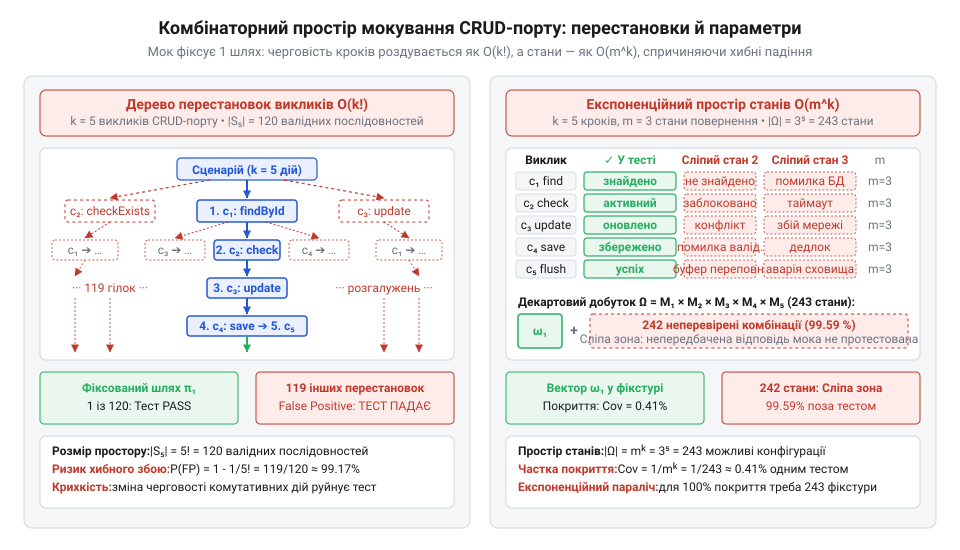
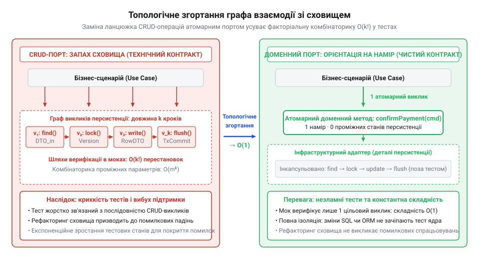

# Комбінаторна модель складності мокування викликів сховища в тестах

<preknowlist>
- [DH v2: застосунок набуває форми](root:progarch/dh-v2-hexagon) — архітектурна структура системи Digital Homes навколо прикладного ядра, виділення застосункових сценаріїв (Use Cases) та вихідних інфраструктурних портів збереження, а також підходи до ізоляції ядра під час модульного тестування
</preknowlist>

## Пастка мокування кроків сховища в тестах

Коли інженери виділили [ядро сценаріїв автоматизації](root:progarch/dh-v2-hexagon) платформи Digital Homes, першим завданням стала ізоляція бізнес-правил у модульних тестах без підключення реальної бази даних. Для перевірки реакції на зміну температури застосували вихідний порт `DeviceRepository` із класичними табличними методами. Проте звичайний сценарій переведення термостата в економний режим зажадав налаштування довгого ланцюжка інфраструктурних викликів: знайти сутність через `findById`, перевірити прапорець наявності в `checkExists`, змінити стан викликом `updateStatus`, зберегти об'єкт через `save` і скинути буфер у сховище за допомогою `flush`. Модульний тест перетворився на скрупульозний протокол інфраструктурних маніпуляцій.

Кожен такий мок (від англ. @@en|mock@@ — удаваний, несправжній) вимагає суворої конфігурації очікуваних викликів і аргументів. Інженери вважали детальну верифікацію звернень стандартом надійного тестування. Проте перша ж оптимізація бізнес-логіки спричинила кризу. Розробник об'єднав читання температури й вологості в один доменний запит та усунув надлишковий виклик `checkExists`, оскільки метод `findById` уже гарантував наявність сутності. Поведінка ядра не змінилася: пристрої перемикалися коректно, доменні інваріанти збереглися. Проте модульні тести сценарію впали: мок очікував звернення до видаленого методу `checkExists` у наперед визначеній послідовності.

Виникло хибне спрацьовування (в англомовній термінології — @@en|false positive@@): виробничий код працює бездоганно, але тест завершується аварією. Перевірка виявилася зчепленою не з кінцевим результатом бізнес-правила, а з випадковою послідовністю проміжних інфраструктурних кроків. Будь-який рефакторинг (від лат. @@la|factor@@ — чинник, творець; в англомовній термінології — @@en|refactoring@@) ядра тепер вимагав виснажливого переписування десятків тестових фікстур (від лат. @@la|fixus@@ — закріплений; в англомовній термінології — @@en|fixture@@). Команда опинилася в стані тестового паралічу: страх зламати набір моків блокував еволюцію кодової бази. Подолання цієї кризи потребує строгого математичного опису простору складності, який створюють виклики до технічного порту. false positive@@) | Порівняти перевірку протоколу викликів через моки з контролем кінцевого стану сутності та проаналізувати їхню стійкість до рефакторингу допоможе [верифікація взаємодій проти верифікації стану в тестах](root:sf-release/behavioral-vs-state-testing).

## Факторіальне зростання перестановок викликів порту

Формалізуємо взаємодію бізнес-сценарію з вихідним портом як впорядкований кортеж із `k` дискретних звернень, проте в реальній системі черговість цих дій диктується не довільним списком, а причинно-наслідковими зв'язками між методами сховища. Частина кроків має строгу залежність за даними: сутність неможливо оновити чи зберегти до того, як її знайдено й перевірено в базі даних. Інші ж операції є взаємно незалежними: читання параметрів двох окремих датчиків або оновлення записів у різних таблицях не мають спільного стану й не впливають одне на одне. Ці обмеження формують відношення часткового порядку (в англомовній термінології — @@en|partial order@@), яке природно описує орієнтований ациклічний граф (від грец. @@gr|kyklos@@ — коло; в англомовній термінології — @@en|directed acyclic graph@@, DAG) `G = (C, E)`. Множина вершин `C` містить усі `k` викликів порту, а напрямлене ребро `(cᵢ, cⱼ) ∈ E` позначає непорушну часову вимогу: операція `cᵢ` мусить завершитися до початку `cⱼ`. Коли залежності існують лише між окремими діями, а паралельні підмножини кроків допускають довільне взаємне переставлення, множина коректних послідовностей виконання відповідає всім можливим топологічним сортуванням (від грец. @@gr|topos@@ — місце; в англомовній термінології — @@en|topological sorting@@) графа `G`. Кількість таких сортувань перебуває між одиницею для строго лінійного графа та факторіалом `k!` для графа без ребер, проте за наявності незалежних гілок вона стрімко зростає через перестановки незв'язаних підмножин. Жорстка перевірка черговості викликів у тесті ігнорує розгалужену топологію графа: вона підміняє природний частковий порядок штучним лінійним порядком, через що будь-яка законна зміна порядку незалежних дій у ядрі помилково ламає верифікацію. У конкретному прогоні сценарію ця взаємодія розгортається в один обраний лінійний ланцюжок: Побудувати модель викликів порту як орієнтованого ациклічного графа та розрахувати допустимі топологічні сортування для тестування без хибних падінь допоможуть [графи часткового порядку та комутативність викликів у тестах](root:sf-release/call-dependency-dag-in-tests).

`C = (c₁, c₂, …, cₖ)`

Кожен елемент `cᵢ` відповідає окремому методу порту сховища. Якщо дві операції `cᵢ` та `cⱼ` є незалежними — наприклад, читання параметрів двох різних сенсорів або оновлення записів у незалежних таблицях, — їхній порядок не впливає на кінцевий стан домену та бази даних. Такі операції мають властивість комутативності (від лат. @@la|commutare@@ — міняти місцями; в англомовній термінології — @@en|commutativity@@):

`cᵢ ∘ cⱼ ≡ cⱼ ∘ cᵢ`

Нехай `V` позначає множину всіх семантично коректних послідовностей виконання цих `k` операцій. Усі можливі варіанти черговості утворюють симетричну групу перестановок (від грец. @@gr|symmetria@@ — співмірність; @@en|symmetric group@@) `Sₖ`, де перестановка (від лат. @@la|permutare@@ — переставляти; в англомовній термінології — @@en|permutation@@) задає конкретний порядок кроків. Множина валідних шляхів є підмножиною цієї групи: `V ⊆ Sₖ`.

Якщо всі `k` кроків взаємно комутують, будь-який порядок їхнього виконання зберігає коректність програми. Тоді потужність множини допустимих послідовностей `|V|` досягає максимального розміру симетричної групи `|Sₖ|`:

`|V| = k! = 1 · 2 · … · k`

Кількість допустимих шляхів зростає як факторіал `O(k!)`.

Звичайний модульний тест із перевіркою черговості викликів фіксує лише одну довільну перестановку `π₁ ∈ V`. Якщо розробник оптимізує ядро й обирає іншу валідну послідовність із простору `V`, мок сприймає це як порушення протоколу. Обчислимо ймовірність хибного спрацьовування тесту `P(FP)` як імовірність відхилення від єдиної зафіксованої перестановки `π₁` за умови рівноймовірного вибору допустимого шляху:

```
P(FP)
= 1 - P(обрано π₁)       [імовірність протилежної події]
= 1 - 1 / |V|            [вибір одного валідного шляху з |V| можливих]
= 1 - 1 / k!             [підстановка факторіальної кількості перестановок |Sₖ|]
```

Цей вираз показує, що зі зростанням довжини ланцюжка `k` імовірність хибного падіння тесту стрімко прямує до одиниці.

**Розрахунок для ланцюжка з 5 звернень до сховища:**
Для сценарію Digital Homes із ланцюжком із `k = 5` викликів (`findById`, `checkExists`, `updateStatus`, `save`, `flush`), де читання й перевірки є взаємно незалежними, обчислимо комбінаторний простір і ризик хибного падіння:

```
|S₅|
= 5!                     [розмір симетричної групи для k = 5]
= 1 · 2 · 3 · 4 · 5      [обчислення факторіала]
= 120                    [кількість допустимих перестановок]

P(FP)
= 1 - 1 / 120            [підстановка значень у формулу хибного спрацьовування]
= 119 / 120              [зведення до спільного знаменника]
≈ 0.9917                 [розрахунок відносної ймовірності]
```

Зі 120 коректних послідовностей тест визнає успішною лише одну. Будь-яка випадкова перестановка комутативних кроків у 99.17 % випадків призведе до помилкового падіння тесту.


*Жорсткий мок фіксує єдину послідовність звернень серед k! допустимих перестановок, перетворюючи довільну зміну черговості комутативних кроків на хибне падіння тесту.*

## Експоненційна комбінаторика простору параметрів і станів

Комбінаторна складність мокування не обмежується порядком викликів. Кожен крок `cᵢ` у ланцюжку з `k` операцій приймає аргументи й повертає результат, що формує простір можливих станів `Mᵢ`. Сюди входять значення сутностей, порожні відповіді, помилки або прапорці успішності. Нехай кожна взаємодія має `m` варіантів результату: `|Mᵢ| = m`.

Оскільки кожен наступний виклик порту спирається на об'єкти, сконструйовані або повернені попереднім кроком, сукупний простір станів тестового середовища утворює декартовий добуток (на честь Рене Декарта, лат. @@la|Cartesius@@; в англомовній термінології — @@en|Cartesian product@@) усіх проміжних множин `Mᵢ`. Прикладне ядро аналізує ці дані на кожному кроці: умовні перевірки бізнес-правил ділять загальний простір `Ω` на окремі неперетинні підпростори допустимих траєкторій виконання. Якщо проміжний метод повертає відсутність сутності або помилку, ядро передчасно перериває сценарій, і подальші звернення до порту взагалі не виконуються. Аварійні та альтернативні гілки відтинають частину викликів, перетворюючи простір станів на дерево підпросторів різної розмірності. Розробник не може покрити таку поведінку єдиним мок-тестом: кожен підпростір вимагає власної комбінації налаштованих повернень, комбінаторно множачи тестові фікстури для кожної гілки. Коли ж під час рефакторингу ядро змінює внутрішню умову й перемикається в інший підпростір, тест негайно ламається через неочікуваний виклик або невикористані очікування мока. Повний простір станів `Ω` для ланцюжка з `k` кроків об'єднує всі ці підпростори й формалізується як прямий добуток:

`Ω = M₁ × M₂ × … × Mₖ = ∏ᵢ₌₁ᵏ Mᵢ`

Визначимо загальну потужність конфігураційного простору двійника `|Ω|` через добуток потужностей окремих кроків:

```
|Ω|
= |M₁| · |M₂| · … · |Mₖ| [потужність декартового добутку скінченних множин]
= m · m · … · m          [підстановка однакової потужності m для кожного з k кроків]
= mᵏ                     [зведення в степінь за кількістю викликів k]
```

Простір станів зростає експоненційно як `O(mᵏ)`.

Типова тестова фікстура налаштовує поведінку моків лише для однієї конкретної гілки — одного вектора значень `ω₁ ∈ Ω`. Розрахуємо частку конфігураційного простору `Cov`, яку покриває один такий тест:

```
Cov
= 1 / |Ω|                [частка одного зафіксованого стану у просторі Ω]
= 1 / mᵏ                 [підстановка експоненційної потужності простору]
```

**Оцінка тестового покриття при k = 5 та m = 3:**
Нехай ланцюжок містить `k = 5` викликів, а кожен крок має `m = 3` варіанти результату (наприклад: сутність знайдено, запис відсутній, помилка зв'язку):

```
|Ω|
= 3⁵                     [підстановка m = 3 та k = 5]
= 243                    [загальна кількість станів конфігураційної сітки]

Cov
= 1 / 243                [частка покриття єдиним тестом]
≈ 0.0041                 [відносна частка покриття (0.41 %)]
```

Один мок-тест перевіряє лише 0.41 % конфігураційного простору. Решта 99.59 % станів утворюють комбінаторну сліпу зону: якщо проміжний метод поверне несподіване значення, поведінка ядра залишається непротестованою.

Щоб закрити всі гілки виконання, розробник змушений створювати `mᵏ` синтетичних тестів, налаштовуючи штучні проміжні структури через довгі ланцюжки очікувань. Ці об'єкти не мають відношення до бізнес-правил: вони лише імітують внутрішній устрій збереження. У результаті витрати праці на підтримку тестових двійників експоненційно зростають разом із кількістю викликів `k`, створюючи передумови для переходу від технічних CRUD-портів до атомарних доменних контрактів.

## Математична модель крихкості та хибних спрацьовувань

Коли внутрішня реалізація бізнес-логіки змінюється без зміни кінцевого результату, модульні тести мають залишатися зеленими. Проте перевірка проміжних звернень до технічного @@la|порту@@ (лат. porta — брама) руйнує цю гарантію: якщо контракт вимагає суворо визначеного порядку дрібних запитів до сховища, будь-яке семантично нейтральне перевпорядкування коду ламає @@en|тестовий набір@@.

Нехай бізнес-операція взаємодіє з базою даних через ланцюжок із `k` комутативних викликів. Оскільки для прикладного ядра черговість незалежних операцій читання чи запису не має значення, існує ціла множина рівнозначних траєкторій виконання. @@en|Мок@@ (англ. mock — удаваний) у тесті фіксує лише один конкретний шлях взаємодії. Якщо під час оптимізації алгоритму інженер обирає іншу валідну перестановку викликів, жорстко налаштований @@en|мок@@ зазнає аварії, фіксуючи помилковий збій.

Розрахуємо ймовірність @@uk|хибного спрацьовування@@ `P(FP)` для тесту з ланцюжком із `k` комутативних кроків як частку неврахованих валідних шляхів у потужності @@la|симетричної групи@@ (грец. συμμετρία — співмірність) `S_k`:

```
P(FP)
= 1 - 1 / |S_k|           [частка неврахованих шляхів серед усіх допустимих]
= 1 - 1 / k!             [потужність симетричної групи з k елементів]
```

Тут `k` позначає кількість кроків у ланцюжку, а `S_k` — повну множину його перестановок. За довжини ланцюжка `k = 5` імовірність помилкового падіння перевищує 99%, тобто довільна зміна черговості викликів у ядрі майже гарантовано руйнує тестову перевірку.

Наслідки цього комбінаторного вибуху виходять далеко за межі окремого тесту. Нехай кодова база налічує `N_tests` модульних перевірок, кожна з яких налаштовує `k` очікувань для імітації технічного сховища. Створення одного очікування вимагає витрат часу `c_mock`, а розслідування хибного збою та переписування конфігурації мока після рефакторингу вимагає витрат `c_fix`.

Оцінимо сумарну вартість супроводу тестового набору `C_maint` під час еволюції кодової бази як суму витрат на первинне налаштування перевірок та подальше виправлення помилкових збоїв:

```
C_maint
= N_tests · (k · c_mock + P(FP) · c_fix)    [вартість налаштування та лагодження збоїв]
```

У цьому виразі `N_tests` визначає розмір тестового набору, доданок `k · c_mock` задає початкову вартість налаштування перевірок взаємодії з одиничною ціною `c_mock`, а добуток `P(FP) · c_fix` обчислює очікувані витрати на усунення @@uk|хибних спрацьовувань@@ за ціною виправлення `c_fix`.

Коли довжина ланцюжка `k` зростає, `P(FP)` стрімко прямує до одиниці, а витрати на лагодження тестів починають багаторазово перевищувати час на саму оптимізацію ядра. Команда опиняється в стані @@uk|тестового паралічу@@: інженери свідомо уникають поліпшення коду, оскільки найменша правка змушує вручну оновлювати сотні зламаних @@en|моків@@. Тести, покликані полегшувати @@en|рефакторинг@@ (англ. refactoring, від re- + factor — чинник, творець), перетворюються на кайдани реалізації.

## Згортання графа взаємодії до константної складності

Причина комбінаторного вибуху криється не в тестах, а у формі самого @@la|порту@@: технічний інтерфейс сховища змушує бізнес-сценарій керувати кожним проміжним кроком читання та оновлення таблиць. Якщо замість низькорівневих CRUD-методів спроєктувати семантичний @@la|порт@@, орієнтований на виразний доменний намір, ланцюжок звернень якісно трансформується.

Багатоетапний протокол із `k` послідовних запитів згортається в один атомарний виклик методу доменного наміру. Довжина ланцюжка звернень скорочується від довільного `k` до фіксованого значення `k' = 1`.

Виведемо зміну кількості допустимих перестановок у двійнику при заміні довжини протоколу на одиничну:

```
|S_k'|
= 1!                     [підстановка довжини атомарного ланцюжка k' = 1]
= 1                      [факторіал одиниці]
```

Кількість перестановок тотожно падає від факторіальної складності `O(k!)` до константи `O(1)`. Оскільки існує лише один виклик, простір перестановок колапсує, а ймовірність @@uk|хибного спрацьовування@@ через зміну порядку звернень набуває нульового значення:

```
P(FP)
= 1 - 1 / 1!             [підстановка згорнутого ланцюжка]
= 0                      [повна ліквідація хибних спрацьовувань]
```

Нульова ймовірність хибного збою гарантує, що будь-який внутрішній @@en|рефакторинг@@ обчислень у ядрі більше не може зламати тестову перевірку @@la|порту@@, доки виконується загальний бізнес-контракт.


*Топологічне згортання ланцюжка взаємодії з портом ліквідує факторіальну кількість проміжних станів і зводить складність перевірки до константи.*

Одночасно зникає й експоненційне зростання простору станів `O(mᵏ)`: замість комбінації `m` проміжних відповідей для кожного з `k` технічних кроків доменний @@la|порт@@ передає єдиний неподільний @@la|агрегат@@ (лат. aggregatus — зібраний докупи). Це відкриває шлях до повної відмови від крихких @@en|моків@@ на користь швидких двійників у пам'яті (англ. fake — підробка), які зберігають стан цілком. Коли в системі @@en|Digital Homes@@ [застосунок набуває форми](root:progarch/dh-v2-hexagon), бізнес-сценарії спираються на чисті наміри, а модульні перевірки верифікують кінцевий стан замість проміжних транзакційних слідів.

## Аналітичний розрахунок і рефакторинг інтерфейсів портів

Щоб позбутися крихкості в наявному коді, потрібен кількісний аудит: спочатку аналітично вимірюють комбінаторну складність наявного порту, а потім трансформують його контракт. Розглянемо цей розрахунковий цикл на сценарії керування мікрокліматом у системі @@en|Digital Homes@@.

У початковій реалізації сценарій оновлення температурного графіка взаємодіє з технічним @@la|репозиторієм@@ (лат. repositorium — сховище) через ланцюжок із `k = 5` звернень: зчитування будинку, запит переліку зон, оновлення двох температурних профілів і запис аудиту. Кожна операція має `m = 3` варіанти результату (успіх, відсутність запису, помилка сховища).

**Аудит технічного CRUD-порту**
Розрахуємо обсяг простору станів `Ω` як @@la|декартовий добуток@@ (від латинізованого імені Декарта Cartesius) варіантів відповідей та ймовірність хибного падіння `P(FP)` при зміні черговості викликів:

```
|Ω|
= m^k                    [декартовий добуток просторів станів для k кроків]
= 3^5                    [підстановка m = 3 та k = 5]
= 243                    [експоненційна кількість комбінацій]

P(FP)
= 1 - 1 / k!             [імовірність збою через фіксацію однієї перестановки]
= 1 - 1 / 120            [обчислення факторіала 5!]
≈ 0.9917                 [понад 99% хибних падінь]
```

Щоб надійно перевірити поведінку системи на такому ланцюжку, інженер має сконфігурувати до 243 комбінацій проміжних відповідей @@en|мока@@, причому з імовірністю 99.17% будь-яка спроба оптимізувати черговість кроків ламає тест.

Усунемо запах сховища з контракту: замість викликів п'яти технічних методів спроєктуємо цільовий @@la|порт@@ `ClimateProfiles` з одним атомарним методом `save_profile(home_id, profile)`. Усі проміжні кроки зчитування конфігурації кімнат і збереження історії тепер інкапсульовані всередині інфраструктурного @@la|адаптера@@ (лат. adaptare — пристосовувати).

**Оцінка складності після переходу на семантичний порт**
Обчислимо новий обсяг простору станів `Ω'` та оновлену ймовірність збою `P'(FP)` для атомарного @@la|порту@@ з довжиною ланцюжка `k' = 1`:

```
|Ω'|
= 3^1                    [простір станів для одного виклику]
= 3                      [три можливі результати виконання команди]

P'(FP)
= 1 - 1 / 1!             [імовірність збою для одиничного ланцюжка]
= 0                      [повна ліквідація хибних спрацьовувань]
```

Складність простору станів скоротилася у 81 раз (з 243 до 3), а факторіальна крихкість зникла повністю. Модульний тест більше не налаштовує п'ять проміжних кроків і не верифікує технічний протокол збереження — він викликає доменну команду й перевіряє збережений результат.
