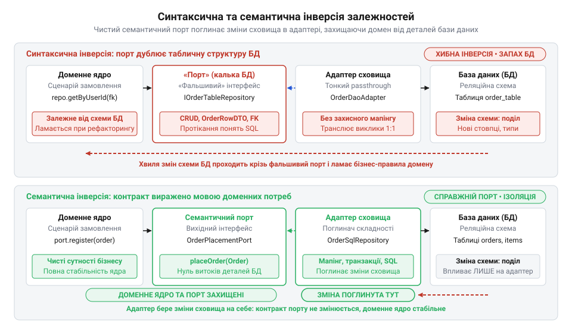
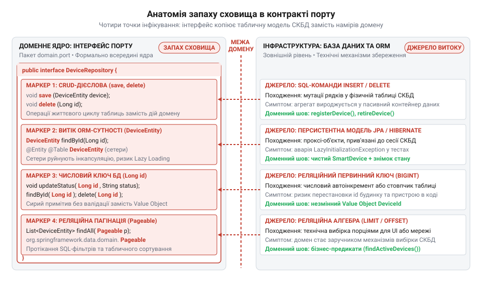
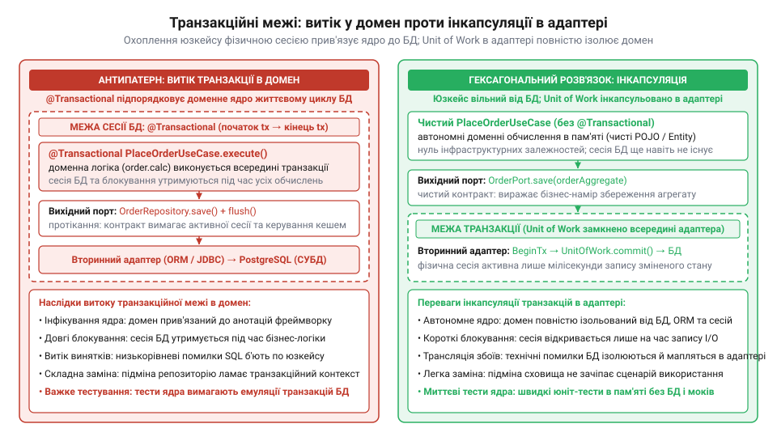
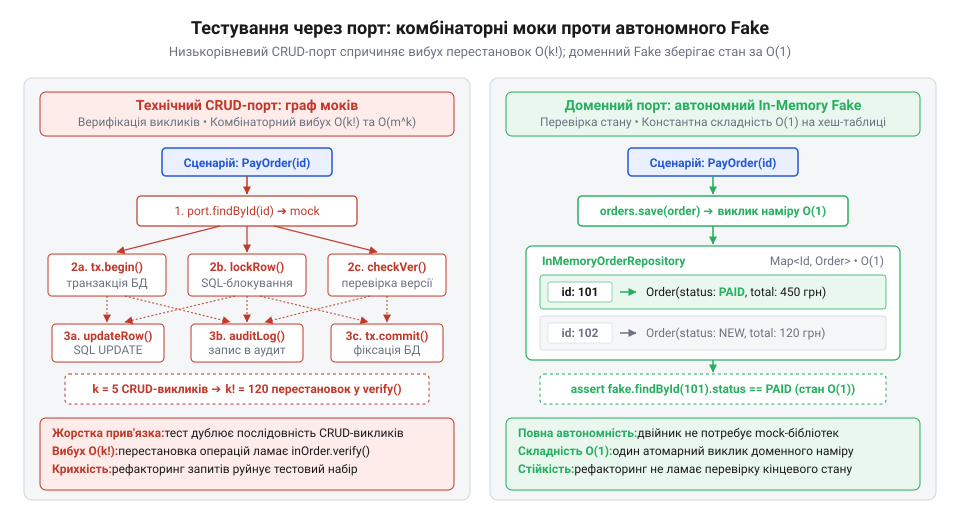

# Порт, що пахне сховищем

<preknowlist>
- [DH v2: застосунок набуває форми](root:progarch/dh-v2-hexagon) — практична гексагональна декомпозиція системи Digital Homes: виділення доменного ядра, сценаріїв використання (Use Cases), вхідних портів та вихідних інфраструктурних портів збереження
- [Коли гексагон — зайвий](root:progarch/hexagon-when-overkill) — критерії розмежування систем із насиченими бізнес-правилами, де порти захищають інваріанти, від тривіального табличного CRUD, для якого порти стають надлишковим ускладненням
</preknowlist>

## Пастка механічної інверсії залежностей

Звичайна оптимізація схеми збереження даних не повинна ламати бізнес-правила застосунку й змушувати розробників переписувати код ядра. Проте саме це сталося в системі Digital Homes після того, як інженери запровадили [гексагональну форму застосунку](root:progarch/dh-v2-hexagon) та оголосили про повну автономність бізнес-ядра. Головним доказом ізоляції вважали вихідний порт `DeviceRepository`: інтерфейс розмістили безпосередньо в доменному пакеті, тож стрілка залежності на рівні компілятора тепер вела від зовнішньої інфраструктури всередину ядра.

Контракт цього порту розробники механічно вивели зі структури реляційної таблиці:

```java
// Інтерфейс лежить у домені, але його методи повторюють таблицю бази даних
public interface DeviceRepository {
    DeviceEntity findById(Long id);
    void save(DeviceEntity device);
    void updateStatus(Long id, String status);
}
```

Ілюзія незалежності розсипалася під час першого ж технічного релізу. Адміністратори СКБД оптимізували збереження: замінили числовий первинний ключ `Long` на розподілений `UUID`, розділили монолітну таблицю пристроїв на дві нормалізовані таблиці конфігурації та телеметрії, а також уточнили типи полів. Зміна реляційної схеми миттєво викликала каскадну катастрофу. Оскільки сигнатури `DeviceRepository` були прямою калькою колонок і типів бази даних, контракт порту зламався. Слідом перестав компілюватися доменний агрегат `SmartDevice`. Агрегат не мав власної моделі стану й прямо залежав від персистентної сутності `DeviceEntity`: його бізнес-методи приймали `DeviceEntity` як параметр і напряму читали її стан. Коли тип первинного ключа сутності змінили на `UUID`, у `SmartDevice` перестали компілюватися методи ідентифікації пристрою та публікації доменних подій, жорстко прив'язані до типу `Long`. Коли ж показники сенсорів винесли в окрему таблицю телеметрії, із сутності `DeviceEntity` прибрали поля температури й вологості. Методи агрегату, які розраховували команди обігріву та вентиляції, втратили доступ до вихідних даних. Розробникам довелося змінювати сигнатури й переписувати логіку доменного агрегату не через зміну бізнес-правил розумного дому, а виключно заради узгодження з новою структурою класів збереження. Через це зламалися сценарії автоматизації мікроклімату, а модульні тести відмовилися працювати без підняття повноцінної бази даних. Сигнатури порту повертали сутності фреймворка @@en|ORM@@ (англ. @@en|Object-Relational Mapping@@ — об'єктно-реляційне відображення), де зв'язок між конфігурацією та телеметрією налаштували через ліниве завантаження. У робочому середовищі звернення до такого поля приховано вичитує дані з бази, бо спирається на відкриту сесію та активну транзакцію СКБД. Натомість модульні тести домену виконуються в ізоляції від інфраструктури — без підключення до бази даних і поза транзакційним контекстом. Щойно метод агрегату читав показники сенсорів через лінивий зв'язок сутності, неініціалізований проксі-об'єкт не знаходив відкритої сесії збереження й миттєво переривав тест помилкою `LazyInitializationException`. Доменна логіка виявилася намертво прив'язаною до інфраструктурного життєвого циклу збереження: перевірити бізнес-правила без розгортання повноцінної бази даних або громіздкого налаштування сесійного середовища стало неможливо.

Команда потрапила в пастку механічної інверсії (від лат. @@la|inversio@@ — перевертання) залежностей. Формальне розміщення синтаксичного інтерфейсу всередині доменного пакета розвертає компіляційну стрілку зв'язку, але не усуває семантичного (від грец. @@gr|semantikos@@ — значущий) зчеплення. Якщо сигнатури порту повторюють операції @@en|CRUD@@ (від англ. @@en|Create, Read, Update, Delete@@ — створення, читання, оновлення, видалення) і зав'язані на персистентні сутності, ядро залишається заручником структури конкретного сховища. Компілятор фіксує залежність зовнішнього адаптера від інтерфейсу в ядрі, проте семантичний вплив спрямований у протилежний бік: будь-яка оптимізація реляційної схеми змушує змінювати бізнес-код. Фундаментальні відмінності між синтаксичною ілюзією та справжньою ізоляцією ядра виявляються в конкретних інженерних симптомах:

| Симптом | Синтаксична інверсія (інтерфейс із типами бази даних) | Семантична ізоляція (інтерфейс і типи в мові домену) |
| --- | --- | --- |
| Хто диктує контракт | Структура таблиць і колонок реляційної бази даних | Бізнес-потреби та наміри сценарію використання |
| Типи у сигнатурах | Персистентні сутності @@en|ORM@@, сирі реляційні ключі (`Long`, `UUID`) | Доменні агрегати та чисті типи ядра без анотацій сховища |
| Семантика методів | Технічні операції життєвого циклу таблиць @@en|CRUD@@ (`save`, `findById`, `updateStatus`) | Виразні доменні дії бізнес-сценарію (`registerDevice`, `findDevicesReadyForEcoMode`) |
| Наслідки змін у базі | Нормалізація таблиць чи зміна типів колонок ламає контракт порту та класи ядра | Зміни схеми СКБД поглинаються вторинним адаптером без змін у доменному ядрі |
| Модульне тестування | Вимагає запуску бази даних або контексту сесії @@en|ORM@@ через ризик помилок ініціалізації | Швидкі тести за частки мілісекунди в пам'яті без зовнішніх інфраструктурних залежностей |


*Синтаксична інверсія залежностей копіює структуру сховища в контракт порту, транслюючи зміни схеми в домен, тоді як семантичний порт диктується наміром сценарію й змушує вторинний адаптер поглинати деталі збереження.*

Ця омана має давнє коріння: як показує [розвиток шаблонів доступу](root:progarch/port-smelling-of-storage/hist-dao-to-generic-repository-trap.md) до даних, поява узагальнених репозиторіїв (від лат. @@la|repositorium@@ — сховище, вмістище) підмінила первісну ідею колекції доменних об'єктів у пам'яті звичайним фасадом над SQL-таблицями. Спроєктований «ззовні всередину» порт пахне сховищем і неминуче транслює інфраструктурні зміни в бізнес-правила. Справжня автономність вимагає проєктування вихідного порту «зсередини назовні»: сценарій використання формулює контракт виключно мовою бізнес-намірів, а вторинний адаптер повністю приховує в собі деталі мапінгу, типізації та транзакційних меж.

## Анатомія запаху сховища в інтерфейсах

Семантичне зчеплення зі сховищем не ховається у складних алгоритмах: воно закарбоване безпосередньо в типах і сигнатурах вихідного порту. Коли інтерфейс оголошено всередині доменного пакета, розробники часто вважають завдання інверсії виконаним. Проте аналіз методів видає мислення категоріями реляційних таблиць, а не предметної області. Інфікування контракту відбувається через чотири виразні маркери.

Перший маркер — табличні `CRUD`-дієслова (`save`, `delete`, `update`, `getById`). Вони відображають життєвий цикл фізичного рядка в таблиці, підміняючи бізнес-наміри. У домені пристрій не «оновлюють» і не «зберігають» утилітарно: його активують, калібрують або переводять в енергоощадний режим. Підміна виразних доменних операцій універсальними мутаціями позбавляє агрегат сенсу й перетворює його на пасивний контейнер даних.

Другий маркер — проникнення персистентних сутностей фреймворка `ORM`. Використання класів з анотаціями на зразок `@Entity` чи `@Table` у параметрах або поверненні методів порту вимагає відкритих сетерів і порожніх публічних конструкторів. Це руйнує інкапсуляцію: зовнішній код може змінити приватні поля в обхід інваріантів агрегату, перетворюючи його на пасивний набір даних. Водночас механізм лінивого завантаження (англ. @@en|lazy loading@@) остаточно підриває автономність доменної моделі. Щоб оптимізувати вибірки, фреймворк підміняє зв'язані сутності та колекції проксі-об'єктами (англ. @@en|proxy@@ — представник). Такий проксі не містить реальних даних, а лише зберігає приховане посилання на активну сесію `ORM`. Коли бізнес-сценарій викликає метод агрегату, а той звертається до вкладеної колекції для перевірки інваріантів, проксі перехоплює виклик і намагається виконати SQL-запит до бази в реальному часі. Якщо ж вторинний адаптер уже завершив операцію вибірки й закрив сесію збереження, об'єкт виявляється від'єднаним від контексту персистентності. У цю мить спроба прочитати стан колекції спричиняє інфраструктурний виняток `LazyInitializationException`. Доменний код зазнає аварії просто посеред виконання бізнес-логіки лише тому, що звернувся до власного поля за межами життя сесії СКБД. Агрегат перестає бути повноцінним господарем свого стану, вироджуючись у крихку оболонку над відкритим мережевим з'єднанням. Замість витоку персистентних структур домен вимагає ізоляції, для якої застосовують [збереження стану через знімки](root:sf-data/memento-and-snapshots-for-persistence), що залишає внутрішній устрій агрегату недоторканим.


*Чотири точки проникнення інфраструктури: інтерфейс копіює життєвий цикл записів БД, руйнує інкапсуляцію агрегату сетерами ORM і переносить реляційну вибірку в доменне ядро.*

Третій маркер — реляційні первинні та зовнішні ключі. Використання сирих примітивних типів `Long` чи `UUID` відкриває шлях до помилок перестановки аргументів: компілятор дозволить передати числовий ідентифікатор будинку замість пристрою. Доменне ядро натомість оперує строгими об'єктами-значеннями (англ. @@en|Value Object@@), які гарантують валідацію та виключають плутанину сутностей.

Замість передачі сирого примітива доменне ядро виражає ідентичність через самостійний незмінний тип із внутрішньою валідацією. Компактний конструктор запису гарантує захист інваріантів: об'єкт `DeviceId` неможливо сконструювати з `null` чи некоректним значенням, тому пошкоджений ідентифікатор ніколи не потрапить у бізнес-сценарій:

:::code port-smelling-of-storage-d/java/generate.java

Строга типізація усуває ризик випадкової підміни сутностей на рівні компілятора: якщо метод вимагає `DeviceId`, йому неможливо передати ідентифікатор кімнати чи будинку, навіть за однакової внутрішньої структури. Водночас доменне ядро позбувається залежності від схеми збереження: чи використовує база даних числовий автоінкремент `BIGINT`, чи зберігає бінарний `UUID` у стовпчику таблиці — це зона відповідальності вторинного адаптера. Адаптер самостійно транслює `DeviceId` у фізичний стовпчик під час запису та відновлює типізований об'єкт під час читання, захищаючи ядро від технічних деталей реляційної схеми.

Четвертий маркер — протікання реляційної алгебри та параметрів вибірки (`Pageable`, `Sort`, `limit`, `offset`). Посторінкове розбиття — пагінація (від лат. @@la|pagina@@ — сторінка) — це технічна потреба інтерфейсу користувача чи мережевого транспорту, а не бізнес-правил. Коли вихідний порт приймає структури сортування й табличні зміщення, він експортує механізми вибірки СКБД у домен. Як доводить формальний аналіз [алгебри реляційних запитів](root:progarch/port-smelling-of-storage/math-relational-leakage-and-domain-predicates.md), контракт захищає межі ядра лише тоді, коли порт обмежується скінченною множиною доменних предикатів, а не відкритими табличними фільтрами.

Коли всі чотири симптоми сходяться в одному інтерфейсі, доменний шов вироджується в реляційну кальку:

```java
// Інфікований вихідний порт: чотири маркери запаху сховища
public interface DeviceRepository {
    // 1. Табличні дієслова та 3. Сирий числовий ключ замість Value Object
    void updateStatus(Long id, String status);

    // 2. Витік ORM-сутності з анотаціями та публічними сетерами
    void save(DeviceEntity device);

    // 4. Протікання реляційної пагінації та сортування
    List<DeviceEntity> findAll(Pageable pageable, Sort sort);
}
```

## Витік транзакцій та паралельного контролю

Навіть якщо контракт вихідного порту позбавлено анотацій ORM і табличних ключів, у ньому часто ховається непомітний, але найбільш руйнівний витік — механізми транзакційності, блокувань та паралелізму. Типовою спокусою стає перенесення анотацій на зразок `@Transactional` безпосередньо на сценарії використання (Use Cases). На перший погляд, це здається природним способом забезпечити атомарність бізнес-операції. Проте в такий спосіб доменні правила нерозривно прив'язуються до моделі @@en|ACID@@ (від англ. @@en|Atomicity, Consistency, Isolation, Durability@@) реляційних СКБД і життєвого циклу сесійного контексту ORM. Сама транзакція (від лат. @@la|transactio@@ — угода, завершення справи) перестає бути внутрішньою деталлю сховища й підпорядковує собі сценарій.

Разом із транзакційними межами в домен проникає керування паралельним доступом. Коли в системі Digital Homes два користувачі або автоматичні сценарії одночасно змінюють режим роботи кліматичної установки, виникає потреба захистити стан пристрою від гонитви даних. Якщо інтерфейс спроєктовано під впливом сховища, запах бази негайно інфікує сигнатури порту: з'являються методи з блокуючими прапорцями читання на зразок `findByIdForUpdate(DeviceId id)` для песимістичного блокування (англ. @@en|pessimistic locking@@). Такий виклик транслюється в інструкцію `SELECT ... FOR UPDATE` і захоплює монопольне блокування рядка в таблиці бази даних ще до початку бізнес-обчислень. Якщо два паралельні сценарії оновлюють кілька термостатів у різній послідовності, ця прив'язка до рядків паралізує систему. Сценарій узгодження зон викликає `findByIdForUpdate` спершу для вітальні, а потім для спальні; автоматичний нічний режим, навпаки, блокує спальню перед вітальнею. Перша транзакція захопила рядок вітальні й чекає на спальню. Друга транзакція захопила спальню й чекає на вітальню. Оскільки жоден процес не може звільнити ресурс до завершення операції, СКБД фіксує циклічну залежність як взаємне блокування (англ. @@en|deadlock@@ — глухий кут) і примусово обриває одну з транзакцій аварійним винятком. У результаті доменний сценарій стає заручником фізичного порядку блокування таблиць: найменша зміна послідовності викликів у бізнес-коді спричиняє падіння під навантаженням, а розробники змушені перевантажувати ядро штучним сортуванням ідентифікаторів сутностей заради уникнення колізій у сховищі. Іншим проявом того самого запаху стають технічні версії рядків (`long version`, `@Version`) у доменних командах для оптимістичного блокування (англ. @@en|optimistic locking@@). Ще небезпечніше, коли сценарій використання перехоплює винятки конкурентних конфліктів бази даних і бере на себе циклічні повторні спроби (англ. @@en|retry@@).


*Витік інфраструктурної транзакції перетворює сценарій на заручника сесії СКБД, тоді як інкапсуляція Unit of Work всередині вторинного адаптера зберігає доменні правила транзакційно нейтральними.*

Коли інфраструктура блокувань пронизує сценарій, код вироджується в технічну процедуру керування транзакційним станом:

```java
// Інфікований сценарій: витік транзакційного контексту та блокувань СКБД
@Transactional
public class AdjustThermostatUseCase {
    private final ThermostatPort port;

    public void execute(DeviceId id, Temperature target) {
        // Метод порту експортує блокування рядка SELECT FOR UPDATE
        Thermostat thermostat = port.findByIdForUpdate(id);
        thermostat.adjustTarget(target);
        port.save(thermostat);
    }
}
```

Такий витік позбавляє архітектуру еластичності. Система втрачає здатність перейти на документні бази, NoSQL чи розподілені черги повідомлень: бізнес-логіка розраховує на синхронне блокування табличних рядків та миттєву ізоляцію конкретної СКБД. Як показує [критика легковажної заміни](root:progarch/port-smelling-of-storage/hist-database-swapping-myth.md) сховищ, вихідні порти потрібні не для гіпотетичної зміни вендора бази, а заради автономності ядра: домен не повинен залежати від того, як саме забезпечується збереження.

Доменна логіка має залишатися транзакційно нейтральною. Агрегат захищає власні бізнес-інваріанти, тоді як відкриття фізичної транзакції, відстеження версій і реакція на конфлікти паралелізму цілком належать вторинному адаптеру. Як демонструє [ізоляція транзакційного контексту](root:progarch/port-smelling-of-storage/proj-encapsulating-transactions-in-adapter.md) на практиці, адаптер керує транзакційною межею через патерн @@en|Unit of Work@@ (англ. одиниця роботи) або транзакційний декоратор (від лат. @@la|decoro@@ — оздоблювати), прозоро обробляє конкурентні колізії й повторює операції, залишаючи контракт порту чистим і декларативним. Декоратор огортає сценарій використання на інфраструктурній межі: він відкриває транзакцію, завантажує агрегат через адаптер і передає його в доменну операцію. Якщо під час збереження з'ясовується, що інший процес уже оновив дані, база відхиляє запис і викидає виняток оптимістичного блокування (@@en|optimistic lock exception@@). Декоратор перехоплює цю технічну помилку, відкочує транзакцію, скидає застарілий сесійний контекст і здійснює повторну спробу (@@en|retry@@): наново вичитує зі сховища свіжий стан агрегату з актуальною версією та вдруге запускає доменну дію. Аби повторне виконання не призвело до дублювання побічних ефектів (англ. @@en|side effects@@) — надсилання повторних команд актуаторам чи подвійних сповіщень користувачеві, — доменні правила не звертаються до зовнішнього світу напряму. Натомість агрегат лише накопичує доменні події у внутрішній колекції, а інфраструктурний адаптер публікує їх назовні тільки після остаточної фіксації транзакції; у разі ж колізії незбережений агрегат разом із невідправленими подіями відкидається в пам'яті без жодного сліду в зовнішніх системах. Така ізоляція вимагає повної відсутності синхронного введення-виведення всередині бізнес-правил, а за високої частоти паралельних оновлень часті перезапуски перевантажують базу даних і можуть вичерпати ліміт відведених спроб.

## Крихкість тестів та комбінаторика моків

Найшвидший спосіб відчути наслідки запаху сховища — запустити модульні тести. Головна обіцянка гексагональної форми полягає в тому, що бізнес-правила перевіряються за мілісекунди в повній ізоляції від зовнішнього світу. Проте коли вихідний порт вимагає низькорівневих технічних операцій, тестування звичайного сценарію перетворюється на виснажливе налаштування ланцюжків тестових двійників (англ. @@en|test double@@) — моків (від англ. @@en|mock@@ — удаваний, імітований).

Замість перевірки бізнес-інваріантів розробник змушений вручну відтворювати послідовність викликів СКБД. Щоб перевірити просту зміну режиму термостата в Digital Homes, тест мусить налаштувати поведінку методів `findById`, `checkExists`, `save` та `flush`:

```java
// Крихкий тест: перевірка послідовності технічних звернень замість бізнес-інваріантів
@Test
void activatesEcoModeWithFragileMocks() {
    when(deviceRepo.findById(deviceId)).thenReturn(deviceEntity);
    when(deviceRepo.checkExists(deviceId)).thenReturn(true);

    useCase.activateEcoMode(deviceId);

    verify(deviceRepo).findById(deviceId);
    verify(deviceRepo).save(deviceEntity);
    verify(deviceRepo).flush();
}
```

Такий тест перевіряє не стан агрегату, а спосіб реалізації сценарію. Якщо інженер прибере зайвий виклик `checkExists` або змінить порядок збереження сутностей, тест негайно впаде, хоча доменні правила виконано бездоганно. Тести стають надзвичайно крихкими й опираються будь-якому рефакторингу.

Справжня криза настає під час ускладнення сценаріїв: коли операція зачіпає кілька сутностей, верифікація моків переживає вибухове зростання. Як доводить [комбінаторна модель складності](root:progarch/port-smelling-of-storage/math-test-mock-combinatorial-complexity.md) мокування, для сценарію з `k` послідовними технічними зверненнями до порту кількість перестановок викликів і комбінацій параметрів зростає факторіально `O(k!)` та експоненційно `O(mᵏ)`. Тестовий набір вироджується в непідтримуване плетиво фіктивних відповідей.

Використати натомість автономний двійник у пам'яті (англ. @@en|in-memory fake@@) для табличного порту практично неможливо. Щоб задовольнити контракт із `CRUD`-сигнатурами, двійник мусить повноцінно емулювати СКБД: генерувати ідентифікатори, відстежувати транзакційні сесії, імітувати зовнішні ключі та виконувати пагінацію. Наприклад, коли сценарій реєстрації пристрою в Digital Homes викликає `save` для нового об'єкта, CRUD-контракт зазвичай очікує, що сховище самостійно згенерує ідентифікатор. Двійник у пам'яті не може просто покласти об'єкт у колекцію: він змушений вести внутрішній лічильник послідовностей і штучно записувати первинні ключі в поля сутності, а для пов'язаних таблиць — узгоджувати зовнішні ключі. Ще важче відтворити відкат транзакції: якщо під час налаштування термостата бізнес-правило викидає виняток після першого збереження, реляційна СКБД автоматично скасовує всі попередні дії. Простий двійник на базі асоціативного масиву вже зафіксував проміжний стан у пам'яті, тож негативний тест бачить частково збережені, недійсні дані. Аби відтворити поведінку транзакційного відкату, розробнику доводиться створювати всередині двійника механізми тіньових знімків, буферизацію непідтверджених змін та імітацію транзакційних меж. Написання такого двійника перетворюється на розробку власної бази даних.


*Ланцюжок моків прив'язує модульний тест до черговості технічних звернень до сховища, тоді як тестовий двійник перевіряє кінцевий стан доменного агрегату за одне атомарне звернення.*

Вихід полягає в очищенні порту від слідів сховища: чистий контракт дозволяє застосовувати швидкі [тестові двійники в пам'яті](root:sf-release/in-memory-fakes-for-contract-testing). Замість імітації механізмів СКБД такий двійник зберігає копії агрегатів у звичайній колекції `Map` за їхніми ідентифікаторами. Збереження копій замість прямих посилань унеможливлює випадкову зміну стану через спільну пам'ять і чесно відтворює ізольовану межу збереження. Тест більше не стежить за черговістю проміжних звернень до порту, а перевіряє кінцевий бізнес-стан агрегату після виконання сценарію. Як показує практична [побудова двійника в пам'яті](root:progarch/port-smelling-of-storage/proj-inmemory-fake-vs-mock-testing.md), двійник на базі звичайних асоціативних масивів виконує тести без жодних мок-бібліотек за частки мілісекунди, забезпечуючи стійкість до змін коду та абсолютний детермінізм (від лат. @@la|determino@@ — визначаю, обмежую).

## Проєктування порту від бізнес-намірів сценарію

Подолати запах сховища дозволяє зміна напрямку проєктування: контракт порту будують «зсередини назовні» (англ. @@en|inside-out@@). Замість того щоб озиратися на наявні таблиці чи схеми бази даних, розробник дивиться на інтерфейс очима конкретного сценарію використання. Сценарій виступає єдиним замовником порту й диктує його форму виключно мовою бізнес-намірів.

Перший крок — відмова від монолітного репозиторію на користь вузьких рольових інтерфейсів. Єдиний інтерфейс `DeviceRepository` порушує принцип розділення інтерфейсів (англ. @@en|Interface Segregation Principle@@, @@en|ISP@@): сценарій активації енергоощадного режиму не повинен залежати від методів видалення користувачів чи оновлення прошивки. Дотримуючись принципу, моноліт розбивають на [рольові інтерфейси в портах](root:sf-apps/role-interfaces-in-ports) (англ. @@en|Role Interface@@) — цільові доменні шви `DeviceStateRegistry` або `ThermostatScheduleProvider`, де кожен інтерфейс обслуговує одну чітку бізнес-роль:

```java
// Рольові інтерфейси, сформовані під специфічні потреби сценаріїв
public interface DeviceStateRegistry {
    SmartDevice get(DeviceId id);
    void update(SmartDevice device);
}

public interface ThermostatScheduleProvider {
    ClimateSchedule scheduleFor(DeviceId id);
}
```

Другий крок — заміна реляційної вибірки й табличної пагінації на закриті доменні предикати (від лат. @@la|praedicatum@@ — стверджуване, висловлене) та [доменні специфікації запитів](root:sf-apps/specification-pattern). Метод порту не приймає SQL-фрагментів, параметрів зміщення чи колонок сортування. Він виражає чіткий бізнес-критерій — наприклад, `findDevicesReadyForEcoMode()`. Створювати окремий метод під кожну комбінацію умов — означає неконтрольовано роздувати інтерфейс порту. Передавати ж довільні словники колонок чи рядки табличних фільтрів — означає повернути синтаксис реляційної бази всередину ядра. Цю суперечність розв'язує патерн доменної специфікації (англ. @@en|Specification@@, від лат. @@la|specificatio@@ — виокремлення ознак): кожне бізнес-правило стає самостійним об'єктом-предикатом. Складні умови конструюють через логічні комбінатори (від лат. @@la|combino@@ — поєдную, сполучаю) `and`, `or` та `not` прямо в сценарії використання — наприклад, `readyForEco.and(inRoom(livingRoom)).not(batteryLow)`. Усередині ядра діє виключно булева логіка доменних понять: жодні ключові слова SQL, назви стовпчиків чи вирази з'єднання таблиць не проникають крізь контракт порту. Метод на кшталт `findSatisfying(Specification<SmartDevice> spec)` передає побудоване дерево у вторинний адаптер сховища. Адаптер сам транслює ці бізнес-критерії в індексований SQL-запит або перевіряє їх у пам'яті під час швидких модульних тестів. Порт не цікавиться тим, за якими індексами чи в яких таблицях лежать відповідні записи: це знає лише вторинний адаптер сховища.

У доменному ядрі таку специфікацію оформлюють як самостійний клас, де метод `isSatisfiedBy` перевіряє стан агрегату на відповідність бізнес-критерію. Він спирається виключно на доменні методи `SmartDevice`, не торкаючись колонок, таблиць чи реляційних операторів сховища:

```java
// Доменна специфікація: перевірка критерію готовності пристрою до екорежиму
public final class ReadyForEcoModeSpecification implements Specification<SmartDevice> {
    @Override
    public boolean isSatisfiedBy(SmartDevice device) {
        return device.isOnline()
            && !device.isInEcoMode()
            && device.supportsEcoMode();
    }
}
```

Така форма надає архітектурі дві принципові переваги. По-перше, для швидких модульних тестів і двійників у пам'яті (@@en|in-memory fake@@) метод `isSatisfiedBy` стає готовим предикатом: фільтрація колекції агрегатів зводиться до прямого виклику `devices.values().stream().filter(spec::isSatisfiedBy).toList()` без жодного імітування СКБД чи крихких ланцюжків моків. По-друге, вторинний адаптер сховища отримує змогу транслювати дерево таких специфікацій в індексований SQL-запит (наприклад, `WHERE is_online = TRUE AND is_eco = FALSE AND supports_eco = TRUE`). Якщо бізнес-правило готовності зміниться — наприклад, знадобиться перевірка актуальності прошивки, — зміна торкнеться лише класу `ReadyForEcoModeSpecification`, тоді як контракти вихідних портів, сценарії використання та структури збереження залишаться стабільними.

Третій крок — суворий захист інкапсуляції. Метод вихідного порту повертає або повноцінний доменний агрегат із недоторканими інваріантами, або типізований об'єкт-значення `DeviceId`, але ніколи не персистентну сутність чи табличний рядок.


*Сценарії використання диктують власні вузькі рольові інтерфейси, а вторинний адаптер консолідує звернення до таблиць бази даних, приховуючи деталі збереження.*

Перехід на таку модель демонструє [покроковий рефакторинг порту](root:progarch/port-smelling-of-storage/proj-refactoring-storage-smelling-port.md): вилучення табличних параметрів, заміна технічних `CRUD`-операцій на цільові доменні контракти й перенесення фільтрації всередину вторинного адаптера роблять ядро цілком нечутливим до структури бази даних.

## Повна інкапсуляція сховища всередині адаптера

Чистий вихідний порт вимагає від доменного сценарію лише бізнес-намірів, але фізичне сховище продовжує вимагати таблиць, стовпчиків, транзакцій та з'єднань. Коли інтерфейс порту перестає бути калькою бази даних, уся технічна складність збереження даних переміщується у вторинний адаптер. Адаптер бере на себе роль антикорупційного шару (лат. corruptio — псування; @@en|Anti-Corruption Layer@@): він стає захисним бар'єром, який закриває доменне ядро від схем збереження, деталей драйверів і низькорівневих збоїв, гарантуючи повну автономність бізнес-правил.

Усередині адаптера інкапсульовано механізм трансляції доменного стану в реляційну або документоорієнтовану модель. Доменний агрегат захищає свої інваріанти й не надає публічних сетерів під структуру таблиць. Додавання ж публічних методів зчитування (@@en|getter@@) до кожного приватного поля так само руйнує інкапсуляцію: сценарії використання починають спиратися на внутрішню будову даних і витягувати логіку назовні, вироджуючи ядро в анемічну модель. Щоб передати стан у сховище без розкриття полів, агрегат реалізує патерн (лат. *memento* — пам'ятай; @@en|Memento@@) і формує [знімки стану агрегату](root:sf-data/memento-and-snapshots-for-persistence) через закритий інтерфейс. Агрегат сам проєктує свої приватні змінні в незмінний знімок (@@en|Snapshot@@) — інертну структуру даних, яку бачить лише адаптер збереження. Адаптер зчитує стан виключно з цього об'єкта й перекладає значення у власні приватні ORM-сутності або параметри підготовлених SQL-виразів, залишаючи ядро цілковито закритим. Під час відновлення агрегату зі сховища адаптер виконує зворотну операцію: зчитує рядки з бази, формує з них знімок і передає його в закритий фабричний метод або відновлювальний конструктор доменного об'єкта. Таке відновлення наповнює стан агрегату в обхід валідацій нового життєвого циклу й водночас гарантує, що до сценарію використання не потрапить жодна напівпорожня чи прив'язана до ORM-сесії сутність. Чистота інкапсуляції коштує подвоєння коду та додаткового виділення пам'яті на кожен запис, оскільки дані послідовно копіюються між сутністю, знімком і табличною схемою. Механізм ламається на складних розгалужених агрегатах, де синхронізація вкладених знімків стає занадто дорогою, а також тоді, коли знімок необачно передають у сценарій використання, перетворюючи його на лазівку для повернення до анемічного коду.

Трансляції зазнають і операції пошуку. Сценарій використання не формує SQL-вирази, а передає в порт доменні предикати або [доменні специфікації вибірки](root:sf-apps/specification-pattern). Адаптер розбирає ці предикати й перетворює їх на оптимізовані умови `WHERE` з урахуванням індексів конкретної таблиці. Якщо вибірка містить сотні записів, технічні вимоги щодо пагінації та сортування за первинними ключами база даних виконує всередині адаптера через SQL-курсори. Порт повертає назовні цілісну доменну колекцію, не засмічуючи доменний контракт технічними зміщеннями, номерами сторінок чи розмірами блоків вибірки.

Найвідповідальнішим завданням адаптера є приховування транзакційного середовища та нейтралізація конфліктів паралельного доступу. Доменний сценарій не повинен знати про транзакційні межі й не має містити інфраструктурних анотацій на зразок `@Transactional`. Адаптер координує операції запису за патерном @@en|Unit of Work@@, визначаючи [межі транзакцій усередині адаптера](root:sf-apps/transaction-boundary-management). Якщо під час збереження даних виникає колізія паралельних модифікацій — наприклад, розбіжність версій оптимістичного блокування — адаптер не пропускає системний виняток у доменне ядро. Натомість спеціальний [декоратор повторних спроб](root:progarch/port-smelling-of-storage/proj-encapsulating-transactions-in-adapter.md) автоматично перехоплює збій, зчитує оновлений стан із бази й повторно застосовує доменну дію (@@en|retry@@). Доменний сервіс залишається повністю транзакційно нейтральним, отримуючи або успішне виконання наміру, або чітку бізнес-помилку в разі вичерпання спроб.

## Архітектурний контроль та межі застосування

Навіть бездоганно вивірена архітектура втрачає форму, якщо її межі не контролюються автоматично. У щоденній розробці виникає спокуса зрізати кути: передати в метод порту сторонній об'єкт пагінації, використати тип із пакета драйвера бази даних або позначити доменний сценарій анотацією керування транзакціями. Кожне таке рішення здається дрібницею, але накопичення технічних типів швидко перетворює порт на приховане сховище. Ручне рецензування коду не гарантує захисту від подібних витоків, тому чистота портів вимагає безперервного автоматизованого контролю під час збірки проєкту.

Для верифікації структури коду застосовують архітектурні тести бібліотеки @@en|ArchUnit@@. Вони аналізують скомпільований код застосунку як граф залежностей і перевіряють дотримання контрактів. Правило перевіряє, що класи в пакетах портів не імпортують типів із пакетів `java.sql`, `javax.persistence`, `jakarta.persistence` чи драйверів баз даних, не містять транзакційних анотацій і не повертають сторонніх структур пагінації. Такі [правила перевірки чистоти](root:progarch/port-smelling-of-storage/api-archunit-port-integrity-dsl.md) діють як автоматичні шлюзи якості: найменша спроба додати інфраструктурну залежність у доменний порт ламає збірку на етапі тестування, не дозволяючи деградації закріпитися в репозиторії.

Проте концепція строгих aggregate-портів має власні межі ефективності. Спроба проводити абсолютно всі запити до даних через порти доменних агрегатів спричиняє кризу продуктивності під час побудови аналітики, звітів чи складних екранних форм. Агрегат створюється для забезпечення консистентності й захисту інваріантів під час зміни стану. Витягувати цілісні агрегати з бази даних і розгортати в пам'яті важкі об'єктні графи лише для того, щоб показати три колонки в таблиці користувача, означає марнувати ресурси сервера на непотрібний мапінг та надлишкові SQL-з'єднання.

Межу між захистом інваріантів і швидкістю читання встановлює архітектурна дихотомія (грец. dichotomia — поділ на дві частини): поділ шляхів обробки даних на дві незалежні моделі за принципом @@en|CQRS@@ (англ. @@en|Command Query Responsibility Segregation@@ — відокремлення відповідальності команд і запитів). Тракт команд, який змінює стан системи, завжди проходить через строгий aggregate-порт для перевірки доменних правил і збереження цілісності. Тракт запитів, навпаки, оминає доменні моделі через швидкісний шлях читання (@@en|Fast-Path Read@@). Окремий вторинний адаптер читання звертається до оптимізованих реляційних представлень чи кешів і прямим SQL-запитом вибирає дані у виділені @@en|DTO@@-проєкції (англ. @@en|Data Transfer Object@@ — об'єкт передавання даних). Ці плоскі незмінні структури скомпоновані під конкретний екран чи відповідь клієнта й напряму живлять інтерфейс, оминаючи конструювання доменного агрегата в пам'яті. Такий обхід не порушує архітектурних кордонів: операції вибірки не змінюють стану системи й не виконують бізнес-правил, тому захист інваріантів їм непотрібний. Доменне ядро залишається чистим від штучних методів доступу та екранних фільтрів, а технічні деталі SQL-запитів не виходять за межі адаптера читання. Платою за швидкість стає подвоєння моделей: зміна схеми даних змушує одночасно оновлювати адаптер збереження агрегата й окремі @@en|DTO@@-проєкції, а будь-яка спроба ухвалювати бізнес-рішення на основі пласких даних в обхід агрегату руйнує узгодженість системи. Якщо ж у системі взагалі відсутня складна бізнес-логіка, а застосунок зводиться до відображення таблиць, сама [гексагональна архітектура стає надлишковою](root:progarch/hexagon-when-overkill), і будь-які порти перетворюються на зайвий тягар.
