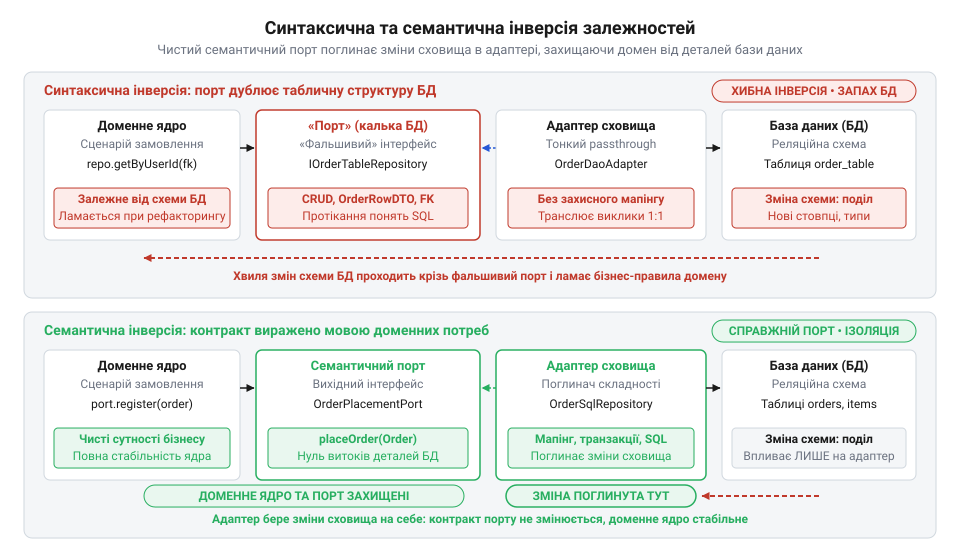

# Порт, що пахне сховищем

<preknowlist>
- [DH v2: застосунок набуває форми](root:progarch/dh-v2-hexagon) — практична гексагональна декомпозиція системи Digital Homes: виділення доменного ядра, сценаріїв використання та вихідних інфраструктурних портів збереження
</preknowlist>

## Пастка механічної інверсії залежностей

Коли в системі @@en|Digital Homes@@ [застосунок набуває форми](root:progarch/dh-v2-hexagon), інтерфейс вихідного порту розміщують у доменному пакеті, сподіваючись на повну автономність ядра. Проте формального розвертання залежностей недостатньо, якщо сигнатури порту копіюють таблиці бази даних. Якщо репозиторій оголошує методи @@en|CRUD@@ (від англ. @@en|Create, Read, Update, Delete@@ — створення, читання, оновлення, видалення) із сирими числовими ключами, оптимізація схеми — нормалізація таблиць чи перехід на рядкові ідентифікатори — змушує переписувати агрегати ядра.


*Синтаксична інверсія залишає ядро заручником структури сховища, тоді як семантичний порт ізолює бізнес-правила від змін реляційної схеми.*

Витік сутностей фреймворка @@en|ORM@@ (від англ. @@en|Object-Relational Mapping@@ — об'єктно-реляційне відображення) інфікує домен лінивим завантаженням (англ. @@en|lazy loading@@). Поза відкритою транзакцією звернення до зв'язаних полів у модульних тестах валить виконання помилкою `LazyInitializationException`. А перенесення транзакційних анотацій і блокувань рядків у сценарії використання руйнує еластичність: за паралельної роботи конкуруючі транзакції блокують ресурси у різному порядку, спричиняючи взаємні блокування (англ. @@en|deadlock@@ — глухий кут).

## Проєктування порту від бізнес-намірів

Щоб усунути запах сховища, вихідний порт проєктують «зсередини назовні»: замовником контракту виступає виключно бізнес-сценарій. Монолітний репозиторій розділяють на вузькі рольові інтерфейси, які приховують методи мутації стану від сценаріїв зчитування. Якщо ж бізнес-правила відсутні, а програма лише відображає таблиці, [гексагон є зайвим](root:progarch/hexagon-when-overkill), і порти стають надлишковими.

Сирі ключі замінюють на строго типізовані @@en|об'єкти-значення@@ (англ. @@en|Value Object@@). Замість примітивних чисел чи рядків ідентичність сутності виражають через незмінний тип: компактний конструктор запису перевіряє інваріанти в момент створення й відкидає `null`, унеможливлюючи появу пошкодженого об'єкта в бізнес-сценарії:

```java
// Компактний запис ідентифікатора із самовалідацією інваріантів
public record DeviceId(UUID value) {
    public DeviceId {
        if (value == null) {
            throw new IllegalArgumentException("Ідентифікатор пристрою не може бути порожнім.");
        }
    }
}
```

Самовалідований тип `DeviceId` унеможливлює передачу некоректного значення чи підміну сутностей компілятором: метод не прийме ідентифікатор кімнати або будинку навіть за однакового внутрішнього типу. Такий @@en|об'єкт-значення@@ водночас приховує реляційні деталі — чи зберігає база даних число `BIGINT`, чи бінарний `UUID`: за трансляцію типів відповідає вторинний адаптер, ціною чого стає додатковий мапінг під час збереження та вибірки.

Правила вибірки формулюють мовою бізнес-предикатів (від лат. *praedicatum* — стверджуване) та [доменних специфікацій](root:sf-apps/specification-pattern) (від лат. *specificatio* — виокремлення ознак). Метод порту приймає доменний критерій замість параметрів SQL, пагінації чи сортування, залишаючи контракт порту вільним від реляційної алгебри.

## Повна інкапсуляція сховища в адаптері

Коли контракт порту очищено, технічна складність переходить у вторинний адаптер, який діє як @@en|антикорупційний шар@@ (від лат. *corruptio* — псування; @@en|Anti-Corruption Layer@@), ізолюючи ядро від деталей сховища й драйверів.

Щоб зберігати стан агрегату без розкриття полів публічними сетерами чи гетерами, застосовують знімки стану за патерном @@en|Memento@@ (від лат. *memento* — пам'ятай). Агрегат сам проєктує свій стан у незмінну внутрішню структуру, з якої адаптер зчитує дані для збереження або відновлює об'єкт.

Транзакційні межі утримуються всередині адаптера за патерном @@en|Unit of Work@@ (англ. одиниця роботи). Конкурентні колізії опрацьовує декоратор повторних спроб: він перехоплює збої оптимістичного блокування й повторює операцію, залишаючи ядро транзакційно нейтральним. Чистий шов позбавляє тести ланцюжків моків: сценарії перевіряють швидкими @@en|двійниками в пам'яті@@ (англ. @@en|in-memory fake@@), які тестують кінцевий стан сутностей за мілісекунди без запуску СКБД.
