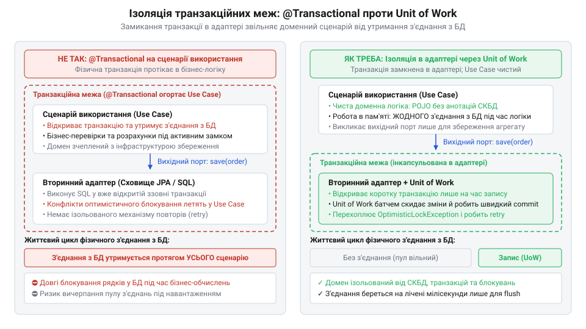
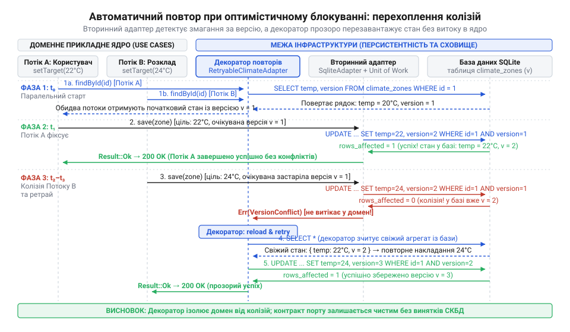

# Інкапсуляція транзакційного контексту та оптимістичного блокування всередині адаптера

<preknowlist>
- [DH v2: застосунок набуває форми](root:progarch/dh-v2-hexagon) — декомпозиція системи Digital Homes на доменні агрегати, сценарії використання (Use Cases) та вихідні порти збереження
- [Коли гексагон — зайвий](root:progarch/hexagon-when-overkill) — критерії розмежування систем із багатою бізнес-поведінкою, де вихідні порти захищають інваріанти, від тривіального CRUD
</preknowlist>

## Пастка витоку транзакцій у сценарій

Коли в @@en|Digital Homes@@ [одне ядро живить фронти](root:progarch/one-core-many-fronts) — наприклад, запити мобільного застосунку та фоновий планувальник, — одночасна зміна цільової температури раптово обвалює підсистему клімат-контролю. Сервери перестають відповідати, робочі потоки зависають у чергах, а в системному журналі виникає лавина необроблених помилок.

Причина полягає у звичній інженерній спокусі: розробники розміщують анотацію `@Transactional` безпосередньо над методом, де живе @@en|сценарій використання@@ (англ. use case). Фізична @@en|транзакція@@ (від лат. transactio — здійснення, угода) відкривається на самому початку сценарію, ще до обчислення бізнес-рішення. Застосунок захоплює з'єднання з базою даних у мить завантаження даних. Увесь наступний час — перевірка присутності мешканців у кімнаті, читання вуличних термометрів і тривалі математичні розрахунки — фізичне з'єднання бездіяльно утримується.

Під навантаженням такий підхід паралізує сервіс. @@en|Пул з'єднань@@ (англ. connection pool) спустошується за лічені секунди: виділені ресурси не повертаються до пулу, поки триває виконання бізнес-правил. Нові запити від датчиків та користувачів шикуються в чергу до вичерпаного пулу, потоки блокуються, і система зазнає каскадної відмови.

Спроба реалізувати [оптимістичний контроль конкурентності](root:sf-data/optimistic-locking) безпосередньо у сценарії лише поглиблює аварію. Коли користувач і фоновий процес одночасно змінюють стан тієї самої зони, один із потоків під час спроби збереження отримує низькорівневий @@en|виняток@@ (від лат. exceptio — вилучення, виняток) на кшталт `OptimisticLockException`. Оскільки межами транзакції керував сам @@en|сценарій використання@@, обробляти конфлікт доводиться тут же, у бізнес-коді. Чиста доменна логіка перетворюється на хаос: сценарій змушений скидати кеш, перезавантажувати сесію та вручну організовувати цикл повтору.

Витік транзакцій у ядро остаточно руйнує модульність. Бізнес-код стає неможливо перевірити через легкі @@en|модульні тести@@ (від лат. modulus — міра): замість простого [двійника в пам'яті](root:progarch/port-smelling-of-storage/proj-inmemory-fake-vs-mock-testing.md) доводиться налаштовувати важкі імітації транзакційних менеджерів або розгортати повноцінну базу даних. Щоб доменне ядро залишалося автономним, транзакційні межі та керування паралелізмом мають бути цілком витіснені у вторинний @@en|адаптер@@ (від лат. adaptare — пристосовувати) сховища.

## Проєктування чистого порту без інфраструктури

Щоб припинити витік технічних деталей персистентності у прикладне ядро, зв'язок зі сховищем проєктують через вихідний @@en|порт@@ (від лат. porta — брама, вхід). У системі, де [застосунок набуває форми](root:progarch/dh-v2-hexagon), інтерфейс порту належить доменному рівню й виражається суворо його термінами.

Типова помилка полягає у створенні порту, який формально є абстракцією, але за своєю суттю «пахне сховищем». Якщо метод збереження вимагає передавати номер версії рядка, дескриптор відкритої транзакції або прокидає типи винятків реляційного рушія, бізнес-код залишається жорстко прив'язаним до СКБД. На відміну від систем із тривіальним CRUD, де [гексагон є зайвим](root:progarch/hexagon-when-overkill), у доменах із насиченою поведінкою інфікування порту інфраструктурними концепціями руйнує здатність ядра змінюватися незалежно від бази даних.

Вихідний @@en|порт@@ `ClimateZoneRepository` формулюють виключно як колекцію доменних об'єктів у пам'яті. Контракт містить лише операції завантаження за бізнес-ідентифікатором та збереження сутності: `findById(id)` і `save(zone)`. У сигнатурах немає жодних токенів блокування, контекстів сесій чи прапорців ізоляції.

Доменний @@en|агрегат@@ (від лат. aggregatus — зібраний докупи) `ClimateZone` самостійно утримує власні @@en|інваріанти@@ (від лат. invariabilis — незмінний) — допустимі температурні межі, режими гістерезису та правила взаємодії контурів опалення. Він нічого не знає про колонки реляційних таблиць чи технічні сурогатні ключі. Метод збереження приймає чистий @@en|агрегат@@ і не повертає інфраструктурних статусів. За такого контракту @@en|сценарій використання@@ оперує суто бізнес-сутностями й залишається незмінним, якщо фізичну базу даних замінити на інше сховище.

У коді чистота інтерфейсу закріплюється повною відсутністю інфраструктурних типів: контракт оперує виключно доменним ідентифікатором та самим @@en|агрегатом@@. Метод `findById` повертає опційний доменний @@en|агрегат@@ або порожнечу, якщо зону не знайдено, а метод `save` приймає модифіковану сутність для збереження. У сигнатурах немає параметрів відкритих @@en|транзакцій@@, прапорців каскадного оновлення чи номерів версій блокування — контракт відтворює семантику звичайної колекції в пам'яті:

:::tabs
```typescript
import { ClimateZone } from './ClimateZone';
import { ZoneId } from './ZoneId';

export interface ClimateZoneRepository {
  // Завантаження агрегату за доменним ідентифікатором без прив'язки до СКБД
  findById(id: ZoneId): Promise<ClimateZone | null>;

  // Збереження агрегату без інфраструктурних параметрів блокування чи транзакцій
  save(zone: ClimateZone): Promise<void>;
}
```
```cpp
#include <optional>
#include "ClimateZone.hpp"
#include "ZoneId.hpp"

class IClimateZoneRepository {
public:
    virtual ~IClimateZoneRepository() = default;

    // Завантаження агрегату за доменним ідентифікатором без прив'язки до СКБД
    [[nodiscard]] virtual std::optional<ClimateZone> findById(const ZoneId& id) = 0;

    // Збереження агрегату без інфраструктурних параметрів блокування чи транзакцій
    virtual void save(const ClimateZone& zone) = 0;
};
```
:::

Такий контракт надійно відмежовує прикладне ядро від деталей персистентності. @@en|Сценарій використання@@ не мусить відкривати @@en|транзакції@@ чи відстежувати версії рядків: він отримує @@en|агрегат@@, викликає на ньому бізнес-методи для захисту @@en|інваріантів@@ і повертає результат у вихідний @@en|порт@@. Усі технічні обов'язки щодо відкриття фізичної @@en|транзакції@@, координації оновлень та фіксації змін переносяться у вторинний @@en|адаптер@@.

## Інкапсуляція транзакцій через Unit of Work

Коли доменний контракт очищено від інфраструктури, виникає виклик: як гарантувати атомарність запису змін агрегату в реляційні таблиці без відкриття сесії на рівні сценарію. Якщо стан кліматичної зони розпадається на конфігурацію, розклади та параметри приводів, частковий запис під час збою зруйнує цілісність даних.

Цю суперечність розв'язує вторинний @@en|адаптер@@ `SqliteClimateZoneAdapter`, який інкапсулює [патерн Unit of Work](root:sf-data/unit-of-work) (англ. unit of work — одиниця роботи). Адаптер фундаментально розриває спільний життєвий цикл доменного розрахунку та фізичного з'єднання з базою даних.

Під час читання агрегату @@en|адаптер@@ бере з'єднання з пулу, виконує вибірку, конструює доменний @@en|агрегат@@ і негайно повертає з'єднання в @@en|пул з'єднань@@. Доки @@en|сценарій використання@@ перевіряє правила та обчислює нові параметри, жодне фізичне з'єднання не блокується, а ресурси бази даних залишаються повністю вільними для інших операцій.

Фізична @@en|транзакція@@ виникає лише в мить виклику методу `save(zone)`. Внутрішній механізм @@en|Unit of Work@@ локально відкриває коротку транзакцію, записує зміни сутностей агрегату в усі пов'язані таблиці та здійснює їхню @@en|фіксацію@@ (англ. commit). Якщо під час операції стається апаратний збій, @@en|адаптер@@ негайно виконує @@en|відкат@@ (англ. rollback) і транслює низькорівневу аварію в доменну помилку, не випускаючи винятків СКБД назовні.


*Ліворуч транзакція утримує з'єднання впродовж усієї бізнес-логіки й блокує пул, праворуч — Unit of Work замикає фізичну транзакцію всередині адаптера лише на час запису на диск.*

Така архітектура скорочує утримання з'єднання з сотень мілісекунд до кількох мікросекунд — часу, необхідного на скидання буфера на диск. Прикладне ядро залишається абсолютно чистим від транзакційного контексту, а вторинний @@en|адаптер@@ самостійно гарантує атомарність і надійність збереження.

Під час паралельного збереження стану кліматичних зон через метод `save(zone)` стандартні транзакції `SQLite` наражаються на взаємне блокування. За замовчуванням інструкція `BEGIN` відкриває відкладену @@en|транзакцію@@: вона не захоплює блокування на запис відразу, а починає зі спільного читацького замка. За одночасного старту двох потоків обидва з'єднання отримують блокування читачів під час підготовки даних. Під час спроби зберегти зміни кожне з'єднання намагається отримати монопольний доступ на запис. Жоден потік не може завершити запис, бо суперник утримує свій читацький замок. Виникає глухий кут взаємного очікування — @@en|дедлок@@ (англ. deadlock — мертве замикання), і рушій бази перериває операцію помилкою `SQLITE_BUSY`. Щоб розірвати це замкнене коло, `SqliteClimateZoneAdapter` відкриває @@en|транзакцію@@ інструкцією `BEGIN IMMEDIATE`. Вона наказує `SQLite` негайно захопити зарезервоване блокування на запис ще в момент старту, до будь-яких дій над таблицями. Інший потік запису більше не може вклинитися зі своїм читацьким замком: він очікує черги на вході в @@en|адаптер@@ і не заважає першому з'єднанню завершити @@en|фіксацію@@. У результаті паралельний запис стає послідовним і вільним від @@en|дедлоків@@, а доменне ядро не обтяжується знаннями про блокування конкретної бази даних.

## Оптимістичне блокування всередині вторинного адаптера

Короткі фізичні транзакції усувають простій з'єднань, але відкривають нову вразливість: паралельні процеси можуть одночасно змінити ту саму кліматичну зону. Коли користувач знижує температуру через мобільний застосунок, а фоновий регулятор водночас перемикає зону в нічний режим, виникає [аномалія втраченого оновлення](root:sf-data/isolation-levels) (англ. lost update anomaly). Обидва потоки зчитують однаковий початковий стан, обчислюють власні рішення й записують їх одне за одним. Останній запис непомітно затирає попередній, руйнуючи консистентність клімату.

Спроба запобігти колізіям через [песимістичне блокування рядків](root:sf-data/pessimistic-locking) інструкцією `SELECT FOR UPDATE` повернула б стару проблему — захоплення блокувань на час бізнес-розрахунків і виснаження пулу. Натомість застосовують @@en|оптимістичне блокування@@ (від лат. optimus — найкращий), яке перевіряє відсутність змін безпосередньо в момент збереження. Проте винесення номера версії у сутність `ClimateZone` чи сигнатуру методу `save(zone, version)` знову інфікувало б домен технічними деталями сховища.

Вторинний @@en|адаптер@@ розв'язує цю суперечність приховано. Під час зчитування агрегату з бази даних адаптер вибирає технічну колонку `version` і запам'ятовує її у внутрішній карті ідентичності @@en|Unit of Work@@, прив'язуючи до ідентифікатора зони. Сам доменний @@en|агрегат@@ залишається чистим: він не містить ані поля версії, ані інфраструктурних метаданих. Метод збереження порту `save(zone)` не змінює свого лаконічного контракту.

Під час запису @@en|Unit of Work@@ виконує умовну модифікацію рядка в реляційній таблиці:

```sql
UPDATE climate_zones
SET target_temperature = :temp, version = version + 1
WHERE id = :id AND version = :expected_version;
```

Вторинний @@en|адаптер@@ перевіряє кількість оновлених рядків безпосередньо після виконання модифікуючого SQL-запиту. Драйвери `SQLite` повертають цей показник через властивість або функцію `changes` (у низькорівневому @@en|C API@@ — `sqlite3_changes()`). Якщо результат виконання інструкції `UPDATE` становить рівно один змінений рядок, збереження вважається успішним, а внутрішній лічильник версії в @@en|Unit of Work@@ інкрементується. Якщо ж повертається нуль, це свідчить, що значення `version` у таблиці вже не відповідає очікуваному, бо інший потік паралельно модифікував запис і збільшив його версію:

:::tabs
```typescript
const stmt = db.prepare(`
  UPDATE climate_zones
  SET target_temperature = ?, version = version + 1
  WHERE id = ? AND version = ?
`);

const result = stmt.run(newTemperature, zoneId, expectedVersion);

// Перевірка кількості змінених рядків (changes) у драйвері SQLite
if (result.changes === 0) {
  // Нуль оновлених рядків свідчить про конфлікт версій (паралельну модифікацію)
  return SaveResult.ConcurrencyConflict;
}
```
:::code proj-encapsulating-transactions-in-adapter/c/snippet-1.c
:::code proj-encapsulating-transactions-in-adapter/cpp/snippet-2.cpp
:::

Виявивши нульову кількість змінених рядків, @@en|адаптер@@ миттєво виконує локальний @@en|відкат@@. Замість того щоб прокидати назовні системний виняток драйвера бази даних, адаптер повертає контрольований внутрішній статус конфлікту конкурентності. Доменне ядро залишається ізольованим від деталей блокувань, а факт змагання за ресурси фіксується надійно й детерміновано.

## Декоратор повторів та конкурентна верифікація

Виявлення колізії всередині адаптера рятує дані від пошкодження, але пряме повернення помилки конфлікту змушує відхиляти бізнес-операції. Якщо користувач бачить відмову під час кожного фонового коригування мікроклімату, надійність системи виглядає ілюзорною. Перекласти повтор на @@en|сценарій використання@@ не можна: це повернуло б у ядро інфраструктурний цикл обробки конфліктів персистентності.

Чистим архітектурним розв'язком стає інфраструктурний @@en|декоратор@@ (від лат. decorare — прикрашати) `RetryableClimateZoneAdapter`, який огортає базовий адаптер і реалізує той самий доменний @@en|порт@@ `ClimateZoneRepository`. Коли базовий адаптер сигналізує про конфлікт версій, декоратор перехоплює його, робить паузу через [експоненційний відкат](root:sf-distributed/exponential-backoff-and-jitter) (англ. exponential backoff), перезавантажує свіжий стан агрегату зі сховища та повторно застосовує доменну дію.


*Декоратор перехоплює колізію версій на межі сховища та виконує повторний цикл читання й модифікації, захищаючи сценарій використання від збою конкурентності.*

Завдяки декоратору [трансляція доменних команд](root:progarch/dh-egress-actuator-protocol-mapping) до фізичних пристроїв і збереження стану відбуваються узгоджено: повторна спроба працює вже з актуальними температурними межами, не порушуючи бізнес-інваріантів.

Працездатність такого ланцюжка перевіряють на багатопотоковому тестовому стенді. Запустивши десятки паралельних потоків, що одночасно оновлюють уставки тієї самої кліматичної зони, ми спостерігаємо повну відсутність втрачених оновлень. Усі конкурентні колізії гасяться всередині декоратора, а підсумковий стан зони в реляційній таблиці точно відповідає накопиченим змінам.

При цьому доменні @@en|модульні тести@@ самого сценарію залишаються гранично швидкими. Оскільки сценарій не прив'язаний до транзакцій і версій, у тестах вихідний @@en|порт@@ замінюють простим двійником у пам'яті. Бізнес-логіка тестується за мікросекунди без створення потоків, налаштування баз даних чи складних імітацій блокувань. Доменне ядро отримує абсолютну стійкість до конкуренції, залишаючись цілком відмежованим від механізмів фізичного збереження.
