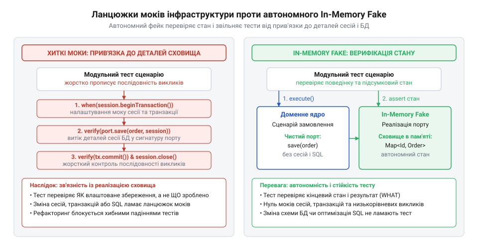
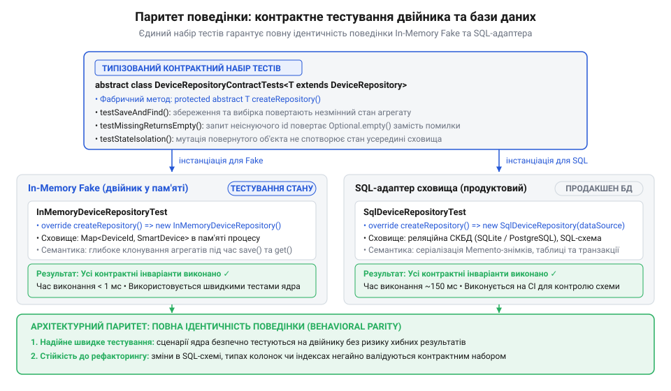

# Реалізація автономного In-Memory адаптера проти хиткого мокування викликів бази даних

<preknowlist>
- [DH v2: застосунок набуває форми](root:progarch/dh-v2-hexagon) — Архітектурна декомпозиція системи Digital Homes навколо доменного ядра: поділ на агрегати, прикладні сценарії використання (Use Cases) та керовані вихідні порти збереження.
- [Коли гексагон — зайвий](root:progarch/hexagon-when-overkill) — Розуміння меж застосування портів і адаптерів: коли ізоляція сховища через порти та тестові двійники захищає доменні інваріанти, а коли є надлишковою для простого CRUD.
</preknowlist>

## Пастка хитких ланцюжків мок-об'єктів

У підсистемі автоматизації платформи @@en|Digital Homes@@ розробники вирішили оптимізувати взаємодію зі сховищем. Замість серії дрібних оновлень для кожного датчика та реле вони об'єднали запити в один пакетний виклик і змінили порядок збереження таблиць у межах транзакції. Жодне бізнес-правило системи не змінилося: термостат вимикає кліматичний клапан за тієї самої температури, а сценарій безпеки реагує на датчик руху без жодної затримки. Проте щойно запустили тестовий набір, десятки модульних тестів сценарію керування пристроями лавинно впали.

Причиною аварії стали мок-об'єкти (від англ. @@en|mock@@ — імітувати, підробляти). Тести сценарію взагалі не перевіряли, чи вимкнувся клапан насправді. Натомість вони скрупульозно контролювали кожен крок взаємодії з базою даних: чи відкрив сценарій транзакцію, чи викликав метод підготовки запиту з точним текстом оновлення та чи закрив сесію. Механізм мокування змушує жорстко зафіксувати в тесті приватну реалізацію сховища: строгу послідовність викликів, точну кількість звернень до методів та дослівний SQL-текст запитів. Така фіксація робить тести надчутливими до внутрішнього коду інфраструктури. Щойно розробники провели невинну оптимізацію й об'єднали два запити в один пакетний виклик, ланцюжок очікувань обірвався: сценарій викликав метод один раз замість двох очікуваних, а текст запиту змінився. Бібліотека мокування зафіксувала порушення прописаного сценарію і спричинила лавину хибних падінь, хоча фактичний стан домену залишився повністю коректним.

Така перевірка взаємодій (англ. @@en|interaction testing@@) підміняє мету модульного тестування. Тест починає стежити не за бізнес-результатом, а за приватними деталями інфраструктурного рушія. Виникає хитка зв'язаність: будь-яке поліпшення структури бази даних або зміна внутрішнього механізму збереження руйнує тестовий набір, хоча поведінка домену лишається бездоганною. Тести, покликані підтримувати рефакторинг (від англ. @@en|refactoring@@ — перебудова коду), перетворюються на головну перешкоду для змін.


*Зліва — тест жорстко зв'язаний із послідовністю інфраструктурних викликів сесій і транзакцій; справа — тест взаємодіє з чистим доменом і перевіряє кінцевий стан через автономний двійник.*

Коли для системи розгортали [гексагональну форму застосунку](root:progarch/dh-v2-hexagon), ключовою обіцянкою була незалежність бізнес-правил від деталей оточення. Але якщо тести доменного сценарію наповнені моками технічних драйверів, ця ізоляція існує лише на папері. Щоб повернути тестам стійкість, перевірку взаємодій замінюють на перевірку кінцевого стану (англ. @@en|state verification@@). Сценарію потрібен автономний тестовий двійник (від англ. @@en|fake@@ — підроблений), який повноцінно зберігає стан у пам'яті без звернення до бази даних. Проте спроба написати такий двійник для наявного інтерфейсу одразу виявляє фундаментальний бар'єр: сам порт наскрізь просякнутий інфраструктурою сховища.

## Очищення сигнатур порту від сховища

Спроба підставити звичайну пам'яттєву колекцію замість бази даних негайно впирається в сигнатури вихідного порту (від лат. @@la|porta@@ — брама, вхід). Інтерфейс сховища вимагає передавати дескриптори сесій (від лат. @@la|sessio@@ — засідання), об'єкти транзакцій (від лат. @@la|transactio@@ — угода) чи технічні контексти конкретної @@en|ORM@@. Щоб задовольнити такий інтерфейс у тестах без справжньої СКБД, розробник змушений створювати складні емулятори транзакційного рушія з таблицями блокувань і журналами відкатів.

Цей дефект називають запахом сховища (англ. @@en|storage smell@@). Він проявляється у трьох характерних витоках персистентності:

1. Інфраструктурні аргументи у методах: присутність параметрів на кшталт `TransactionContext`, `Session` чи `SqlConnection` прямо в методах бізнес-порту.
2. Технічні ідентифікатори: використання реляційних автоінкрементних чисел (`BIGINT`, `serial`), значення яких призначає база даних лише після фізичного запису рядка в таблицю.
3. Реляційне дроблення даних: методи, що оперують пласькими записами з розрізненими колонками таблиць замість цілісних доменних моделей.

У тих сценаріях, де складна бізнес-логіка вимагає [захисту доменних інваріантів](root:progarch/hexagon-when-overkill), порт мусить належати доменному ядру, а не зовнішній базі даних. Контракт (від лат. @@la|contractus@@ — договір) проєктують «зсередини назовні»: виходячи з потреб агрегатів (від лат. @@la|aggregatus@@ — приєднаний, зібраний до купи), а не можливостей SQL-діалекту.

З інтерфейсу порту повністю вилучають поняття сесій і транзакцій. Керування межами транзакцій виносять у [прикладний сервіс](root:progarch/dh-v2-hexagon) або в окремий декоратор (від лат. @@la|decorare@@ — оздоблювати). Декоратор відкриває транзакцію перед початком операції та фіксує зміни після її успішного завершення, тому контракт порту звільняється від технічних параметрів з'єднання. Так само усувають прив'язку до бази даних при ідентифікації сутностей: замість очікування згенерованого таблицею первинного ключа домен сам створює строго типізовані об'єкти-значення (англ. @@en|value object@@) на зразок @@en|UUID@@. Така генерація дає змогу сконструювати цілісний і валідний агрегат ще до збереження, не вимагаючи попереднього звернення до СКБД. Сам порт перетворюється на виразний рольовий інтерфейс, що оперує агрегатом як неподільною одиницею цілісності.

:::tabs
:::code proj-inmemory-fake-vs-mock-testing/ts/snippet-1.ts
```c
#include <stdbool.h>

typedef struct {
    char id[64];
    char name[64];
    bool is_on;
} device_t;

typedef struct {
    device_t* (*find_by_id)(void* ctx, const char* device_id);
    int (*save)(void* ctx, const device_t* device);
} device_repository_t;
```
:::code proj-inmemory-fake-vs-mock-testing/cpp/deviceid.cpp
:::

Очищений контракт виражає виключно бізнес-наміри: отримати агрегат за його ідентифікатором або зафіксувати його новий стан. Такий інтерфейс більше не прив'язаний до структури таблиць чи особливостей транзакційного рушія і готовий до простої реалізації у пам'яті.

## Реалізація автономного двійника в пам'яті

Коли контракт порту очищено від інфраструктури, реалізувати автономний пам'яттєвий адаптер (від лат. @@la|adaptare@@ — пристосовувати) стає справою кількох десятків рядків коду. Такий тестовий двійник типу @@en|in-memory fake@@ будується на основі звичайної хеш-таблиці мови програмування без жодних мок-фреймворків чи симуляторів баз даних.

Щоб двійник точно відтворював поведінку реального сховища, він мусить підтримувати три фундаментальні правила:

1. Обробка відсутності запису: якщо запитаний ідентифікатор не знайдено, метод пошуку повертає явне порожнє значення (`null`, `stdtabs ::: У такому модульному тесті (англ. :: У такому модульному тесті (англ. unit test) немає декларацій очікувань, шпигунів чи перевірок черговості звернень до бази даних.tabs ::: У такому модульному тесті (англ. :: У такому модульному тесті (англ. unit test) немає декларацій очікувань, шпигунів чи перевірок черговості звернень до бази даних.nullopt` або `NULL`), а не кидає непередбачений виняток.
2. Семантика збереження стану: повторне збереження агрегату з наявним ідентифікатором заміщує старі дані, гарантуючи детермінованість оновлення.
3. Захист від витоку посилань через спільний мутабельний стан: головна пастка наївних реалізацій двійників.

Якщо пам'яттєвий адаптер просто покладе переданий агрегат у хеш-таблицю за посиланням, виникне небезпечна ілюзія. Сценарій або тест зможе змінити стан об'єкта вже *після* виклику `save` — і ці зміни миттєво з'являться всередині двійника без явного збереження. Реальна база даних так ніколи не робить: вона серіалізує дані в байти на диск або в мережевий сокет і під час читання створює новий незалежний екземпляр.

Щоб зберегти інваріанти (від лат. Щоб зберегти інваріанти (від лат. @@la|invarians@@ — незмінний) ізоляції сховища, двійник застосовує захисне копіювання (від англ. @@en|defensive copying@@). Під час операції `save` виконується глибоке копіювання (англ. @@en|deep copy@@) агрегату перед збереженням у пам'ять, а метод `findById` повертає свіжий клон збереженого стану. Звичайного поверхневого копіювання (англ. @@en|shallow copy@@) для цього замало. Якщо агрегат інкапсулює приватні поля або містить вкладені сутності, як у [моделі Digital Homes](root:progarch/dh-v2-hexagon), копіювання лише кореневого об'єкта залишає посилання на внутрішні структури спільними. Подальша мутація вкладених даних у тесті змінює стан усередині двійника без явного збереження. Глибоке клонування всього дерева об'єктів усуває цей витік посилань і захищає інкапсуляцію агрегату. Окрім ізоляції стану, автономний двійник може емулювати перевірку версії для контролю конкурентного доступу (англ. @@en|optimistic concurrency control@@). Зберігаючи разом із копією агрегату номер його версії, двійник у методі `save` звіряє версію отриманого об'єкта зі збереженою. Якщо версії не збігаються, двійник імітує відмову транзакції СКБД і викидає виняток конфлікту версій, а при успішному збігу — збільшує номер версії й перезаписує стан.

:::tabs
:::code proj-inmemory-fake-vs-mock-testing/ts/inmemorydevicerepository.ts
:::code proj-inmemory-fake-vs-mock-testing/c/in-memory-find-by-id.c
:::code proj-inmemory-fake-vs-mock-testing/cpp/inmemorydevicerepository.cpp
:::

Такий адаптер виконується за субмікросекунди прямо в адресному просторі тесту, не створює побічних ефектів і дає доменним тестам надійний ґрунт для перевірки реальної бізнес-поведінки.

## Стійкі доменні тести без моків

Тестування прикладного сценарію платформи @@en|Digital Homes@@ через мок-об'єкти змушувало розробника писати довгі ланцюжки очікувань: зафіксувати виклик пошуку, описати фальшиву сесію, вказати точний метод збереження. Якщо логіка сценарію змінювалася — наприклад, перевірка з'ясовувала, що пристрій уже вимкнено, і не зверталася до сховища повторно, — мок ламався через невідповідність кількості очікуваних викликів. Тест падав не через помилку в бізнес-правилі, а через надмірний нагляд за внутрішньою послідовністю викликів.

Автономний пам'яттєвий адаптер переорієнтовує тест на перевірку кінцевого стану за шаблоном @@en|Arrange-Act-Assert@@ (від англ. @@en|Arrange-Act-Assert@@, або @@en|AAA@@ — підготувати, виконати, перевірити). На фазі підготовки в пам'яттєве сховище записують початковий стан агрегату. На фазі дії викликають прикладний сценарій (англ. @@en|use case@@), де бізнес-правила змінюють стан пристрою, а [трансляцію доменних команд](root:progarch/dh-egress-actuator-protocol-mapping) у фізичні протоколи винесено за межі тесту збереження. На фазі перевірки тест оцінює результат виконання сценарію та зчитує оновлений стан агрегату з двійника через той самий контракт порту. Так само через кінцевий стан тестують граничні випадки та реакцію на помилки. Якщо агрегат у сховищі відсутній, сценарій повертає доменну відмову, а стан двійника підтверджує, що жодних нових записів не з'явилося. Якщо дія порушує бізнес-правило, сценарій сигналізує про збій, а повторне зчитування агрегату зі сховища засвідчує, що помилка не залишила часткових змін і початковий стан збережено цілком. Замість перевірки нездійснених викликів у моках оцінка кінцевого стану безпосередньо гарантує цілісність даних.

:::tabs
:::code proj-inmemory-fake-vs-mock-testing/ts/snippet-6.ts
:::code proj-inmemory-fake-vs-mock-testing/c/test-toggle-device-switches-off-and-persists-state.c
:::code proj-inmemory-fake-vs-mock-testing/cpp/snippet-8.cpp
:::

У такому модульному тесті (англ. @@en|unit test@@) немає декларацій очікувань, шпигунів чи перевірок черговості звернень до бази даних. Сценарій може оптимізувати читання або кешувати дані, але доки підсумковий стан відповідає бізнес-правилу, тест лишається зеленим. Оскільки пам'яттєвий адаптер працює зі звичайними структурами даних у пам'яті процесу, виконання сценарію триває мікросекунди, забезпечуючи миттєвий зворотний зв'язок під час активної розробки.

## Стійкість до рефакторингу та контрактні тести

Коли доменні тести відокремлені від деталей сховища, зміна схеми бази даних перестає загрожувати бізнес-логіці. Якщо розробники оптимізують таблиці — наприклад, розбивають одну таблицю на дві, додають вторинні індекси чи повністю змінюють SQL-запити в реальному адаптері, — жоден модульний тест прикладного сценарію не падає. Доменне ядро не залежить від реляційних таблиць і взаємодіє зі сховищем лише через чистий порт.

Проте автономність пам'яттєвого двійника створює іншу небезпеку: поведінкове розходження (англ. @@en|behavioral drift@@). Якщо пам'яттєвий адаптер повертає порожнє значення для неіснуючого ключа, а продуктовий адаптер бази даних за тих самих умов викидає виняток, модульні тести залишаться зеленими, але система відмовить під час роботи в реальному оточенні. Щоб гарантувати ідентичність поведінки, взаємодію обох адаптерів перевіряють через контрактне тестування (від лат. @@la|contractus@@ — договір; англ. @@en|contract testing@@).


*Єдиний типізований набір контрактних перевірок виконується проти обох адаптерів, гарантуючи паритет їхньої поведінки без дублювання тестового коду.*

Контрактні тести реалізують як єдиний набір перевірок, параметризований фабрикою створення адаптера. Цей набір фіксує обов'язкові інваріанти порту: зчитування після збереження повертає еквівалентний стан агрегату, запит за відсутнім ідентифікатором повертає явне порожнє значення, а повторне збереження агрегату оновлює наявний запис без створення дублікатів.

:::tabs
:::code proj-inmemory-fake-vs-mock-testing/ts/verifydevicerepositorycontract.ts
:::code proj-inmemory-fake-vs-mock-testing/c/verify-device-repository-contract.c
```cpp
template <typename Factory>
void verify_device_repository_contract(Factory&& create_repo) {
    auto repo = create_repo();
    DeviceId id{"dev-1"};

    // Збереження агрегату та повернення еквівалентної копії
    repo->save(Device{id, "Клапан", true});
    auto found = repo->find_by_id(id);
    ASSERT_TRUE(found.has_value());
    EXPECT_TRUE(found->is_on);

    // Поведінка за відсутності запису
    EXPECT_FALSE(repo->find_by_id(DeviceId{"absent"}).has_value());
}
```
:::

Спільний набір запускають у двох контурах: у швидких тестах проти @@en|in-memory fake@@ та в інтеграційних перевірках проти реального SQL-адаптера з тестовою базою даних. Коли обидва адаптери задовольняють один і той самий контрактний набір, досягається паритет поведінки (від лат. @@la|paritas@@ — рівність; англ. @@en|behavioral parity@@). Модульні тести домену отримують надійний ґрунт і субмілісекундну швидкість, а інфраструктурні оптимізації бази даних залишаються цілковито ізольованими від бізнес-правил застосунку.
