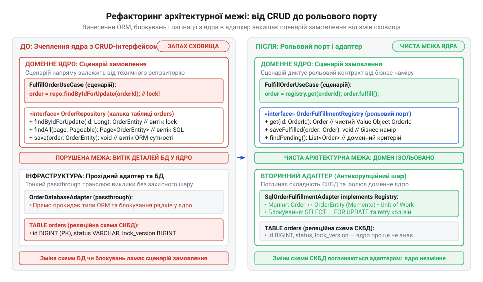

# Рефакторинг вихідного порту зі слідами бази даних у рольовий доменний контракт

<preknowlist>
- [DH v2: застосунок набуває форми](root:progarch/dh-v2-hexagon) — організація портів та вторинних адаптерів навколо прикладного ядра в архітектурі системи Digital Homes
- [Коли гексагон — зайвий](root:progarch/hexagon-when-overkill) — критерії розмежування систем із насиченими бізнес-правилами, де порти захищають інваріанти, від тривіального табличного CRUD
</preknowlist>

## Вихідний стан: інтерфейс зі слідами сховища

Зміна типу первинного ключа в таблиці замовлень з автоінкрементного цілого числа на UUID або додавання технічної колонки м'якого видалення раптово ламає код доменного сервісу комплектації. Бізнес-ядро взагалі не повинно знати, у якій базі даних зберігаються записи, але його модулі відмовляються компілюватися. Сигнатури інтерфейсу вимагають числовий ідентифікатор рядка `db_id`, приймають інфраструктурні прапорці блокування таблиць і повертають сирі структури реляційних записів. Це типовий @@en|вихідний порт зі слідами сховища@@ (від лат. *portus* — гавань, порт; англ. @@en|port smelling of storage@@) — дефект, за якого межу домену спроєктовано не від потреб бізнес-сценарію, а як механічний відбиток структури реляційної бази даних.

Коли інтерфейс сховища сліпо повторює CRUD-операції (акронім від англ. @@en|Create, Read, Update, Delete@@) над реляційною таблицею, доменне ядро змушене брати на себе невластиву інфраструктурну рутину. Воно власноруч обчислює зсув сторінок (`limit`, `offset`), відсіює записи з прапорцем м'якого видалення `is_deleted` та вказує рушію бази даних режим блокування рядків `forUpdate`. Будь-яка зміна схеми таблиць, індексів чи стратегії збереження спричиняє каскадні виправлення в бізнес-правилах. На відміну від примітивних застосунків без розвиненої логіки, [коли гексагон зайвий](root:progarch/hexagon-when-overkill), у насиченому домені таке зчеплення паралізує розвиток системи та грубо порушує @@en|принцип інверсії залежностей@@ (від лат. *inversio* — перевертання; англ. @@en|dependency inversion principle@@).

:::tabs
:::code proj-refactoring-storage-smelling-port/ts/src/legacy-leaky-port.ts 28-47
:::code proj-refactoring-storage-smelling-port/cpp/leaky_storage_port.hpp 44-62
:::

Замість високорівневих бізнес-намірів доменний сервіс вимушений працювати на рівні окремих стовпців реляційної таблиці:

:::tabs
:::code proj-refactoring-storage-smelling-port/ts/src/legacy-leaky-port.ts 61-98
:::code proj-refactoring-storage-smelling-port/cpp/leaky_storage_port.hpp 24-32
:::

Ціль рефакторингу (від англ. @@en|refactoring@@, з лат. *re-* — знову та *factor* — дійовець) полягає в кардинальному розвороті залежностей: прибрати будь-які згадки про реляційні типи з @@en|вихідного порту@@ та перенести всі деталі збереження за межі ядра.

## Проєктування рольового порту від сценарію

Поділ починається з проєктування межі зсередини назовні — виключно від потреб бізнес-сценарію комплектації замовлень. Сценарію не потрібен універсальний @@en|репозиторій@@ (від лат. *repositorium* — сховище; англ. @@en|repository@@) для свавільної маніпуляції таблицями. Йому потрібен вузький контракт співпраці з конкретною роллю: знайти замовлення, готові до обробки, та зафіксувати результат їхнього виконання.

*Сценарій виконання замовлень звільняється від залежності від реляційної схеми, взаємодіючи з чистим рольовим портом.*

Замість важкого технічного репозиторію ми створюємо виразний @@en|рольовий порт@@ (англ. @@en|role-based port@@) `OrderFulfillmentRegistry`. Його сигнатури повністю очищені від бібліотечних прив'язок та мови SQL. Числові ідентифікатори замінює самовалідний @@en|об'єкт-значення@@ (англ. @@en|Value Object@@) `OrderId`. Замість сирих словників або ORM-сутностей (акронім від англ. @@en|Object-Relational Mapping@@) методи порту приймають і повертають повноцінну @@en|доменну сутність@@ (англ. @@en|domain entity@@) `Order`. Вона інкапсулює стан і самостійно захищає власні @@en|інваріанти@@ (від лат. *invarians* — незмінний; англ. @@en|invariants@@) під час переходів між статусами. Захист інваріантів усередині методу `fulfill()` гарантує перехід лише з дозволеного статусу й одночасно фіксує час завершення комплектації. Це усуває потребу в розсипу методів сховища для точкового оновлення окремих колонок чи статусів замовлення. Усі зміни стану відбуваються монолітно всередині самої сутності, тому контракт @@en|рольового порту@@ звужується лише до двох операцій сценарію: отримати готові до обробки замовлення через `claimOrdersReadyForFulfillment()` та зберегти укомплектовані сутності через `saveFulfilledOrders()`.

Такий підхід прямо відповідає організації вторинних меж [в архітектурі гексагонального ядра](root:progarch/dh-v2-hexagon): інтерфейс порту належить доменному шару і підпорядкований лише його правилам.

:::tabs
:::code proj-refactoring-storage-smelling-port/ts/src/order-fulfillment-registry.ts 14-35
:::code proj-refactoring-storage-smelling-port/c/include/order_fulfillment_port.h 107-135
:::code proj-refactoring-storage-smelling-port/cpp/order_domain.hpp 96-109
:::

## Вилучення пагінації та блокувань з порту

Найнебезпечніший витік сховища крізь порт — це параметри пагінації (від лат. *pagina* — сторінка; англ. @@en|pagination@@) та прапорці конкурентних блокувань. Поняття номерів сторінок і зміщення (`offset`) чужі доменній моделі. Вони належать або інтерфейсу користувача, або технічній оптимізації реляційного курсора. Доменному сценарію байдуже, на якій сторінці таблиці зберігається рядок. Сценарій мислить категорією робочої партії: «зарезервуй наступні 10 замовлень, готових до відвантаження». Технічні аргументи вибірки замінює єдиний доменний параметр — розмір партії `batchSize`.

Так само неприпустимим є витік прапорця блокування рядків (англ. @@en|row locking@@) `forUpdate`. Вимагаючи цей параметр, інтерфейс перекладає на прикладний код управління рівнем ізоляції транзакцій бази даних. У чистому @@en|рольовому порті@@ метод отримує бізнес-ім'я `claimOrdersReadyForFulfillment(batchSize)`. Дія «зарезервувати» формулює бізнес-намір. Як саме його гарантувати — вирішує виключно зовнішній @@en|адаптер@@ (від лат. *adaptare* — пристосовувати; англ. @@en|adapter@@). Коли кілька фонових воркерів (англ. @@en|worker@@) паралельно звертаються за новими замовленнями, звичайна вибірка спричиняє стан гонитви (англ. @@en|race condition@@) і повторну обробку однакових позицій. Щоб усунути цей конфлікт, вторинний SQL-адаптер транслює виклик `claimOrdersReadyForFulfillment(batchSize)` у реляційний запит `SELECT ... WHERE status = 'PENDING' LIMIT tabs :::code proj-refactoring-storage-smelling-port/ts/src/order-fulfillment-registry.ts 14-35 :::code proj-refactoring-storage-smelling-port/c/include/order_fulfillment_port.h 107-135 :::code proj-refactoring-storage-smelling-port/cpp/order_domain.hpp 96-109 ::: ## Вилучення пагінації та блокувань з порту Найнебезпечніший витік сховища крізь порт — це параметри пагінації (від лат. :: :::tabs :::code proj-refactoring-storage-smelling-port/ts/src/order-fulfillment-registry.ts 14-35 :::code proj-refactoring-storage-smelling-port/c/include/order_fulfillment_port.h 107-135 :::code proj-refactoring-storage-smelling-port/cpp/order_domain.hpp 96-109 ::: ## Вилучення пагінації та блокувань з порту Найнебезпечніший витік сховища крізь порт — це параметри пагінації (від лат. *pagina* — сторінка; англ. pagination) та прапорці конкурентних блокувань.batchSize FOR UPDATE SKIP LOCKED`. Конструкція `SKIP LOCKED` блокує відібрані рядки для поточної транзакції та змушує рушій СКБД пропускати записи, уже захоплені іншими процесами. Кожен @@en|воркер@@ одразу отримує власну відокремлену партію без простоїв у чергах і взаємних блокувань. У середовищах на кшталт SQLite адаптер забезпечує ту саму ізоляцію викликом `BEGIN IMMEDIATE` на старті транзакції, а в тестовому двійнику — синхронізацією черги в оперативній пам'яті. Уся конкурентна механіка залишається замкненою всередині адаптера, тому доменне ядро не містить технічного прапорця `forUpdate` і не залежить від правил блокування конкретного сховища. Докладніше про інкапсуляцію версій рядків та транзакційних блокувань всередині сховища читайте у статті про [контроль конкурентності у вторинних адаптерах](root:progarch/port-smelling-of-storage/proj-encapsulating-transactions-in-adapter.md).

Сервіс комплектації стає чистим відображенням бізнес-правил без жодного інфраструктурного шуму:

:::tabs
:::code proj-refactoring-storage-smelling-port/ts/src/order-fulfillment-service.ts 24-62
:::code proj-refactoring-storage-smelling-port/c/src/fulfillment_service.c 62-98
:::code proj-refactoring-storage-smelling-port/cpp/order_fulfillment_service.cpp 76-105
:::

Сервіс послідовно бере зарезервовану партію, переводить кожне замовлення в стан комплектації через виклик `fulfill()`, ізолює помилки окремих позицій і фіксує успішні результати через @@en|рольовий порт@@.

## Побудова адаптера та верифікація ізоляції

Уся реляційна механіка тепер повністю інкапсульована всередині вторинного @@en|адаптера@@ сховища. @@en|Адаптер@@ діє як @@en|антикорупційний шар@@ (англ. @@en|Anti-Corruption Layer@@, @@en|ACL@@): він містить приватні табличні структури, формує SQL-запити, керує транзакціями та транслює рядки таблиці в чисті доменні знімки й навпаки. Ця трансляція спирається на техніку двостороннього мапінгу без порушення інкапсуляції. Публічний конструктор доменної сутності призначений для створення нових замовлень за бізнес-правилами початкового статусу `'PENDING'`, а відкриття сетерів заради сховища перетворило б модель на анемічну структуру даних. Щоб відновити збережене замовлення в поточному стані в обхід конструктора, сутність надає фабричний метод @@en|відновлення стану@@ (англ. @@en|reconstitution@@) `Order.reconstitute()`. @@en|Адаптер@@ зчитує сирий рядок `SqlDatabaseOrderRow`, десеріалізує JSON-список товарів, перераховує збережені копійки у вартість і формує незмінний знімок `OrderSnapshot`, з якого фабричний метод збирає сутність без виклику валідацій створення. Під час збереження сутність експортує актуальний стан методом `toSnapshot()`, а @@en|адаптер@@ мапить його поля назад у колонки таблиці. Разом із мапінгом @@en|адаптер@@ захищає систему від колізій паралельного збереження, коли кілька процесів одночасно намагаються модифікувати одне замовлення. Замість важких блокувань таблиці @@en|адаптер@@ реалізує @@en|оптимістичний контроль конкурентності@@ (англ. @@en|Optimistic Concurrency Control@@, @@en|OCC@@; від лат. *optimus* — найкращий) через версіонування рядків. Кожен запис містить лічильник `row_version`. @@en|Адаптер@@ запам'ятовує номер версії під час вибірки, а під час збереження виконує `UPDATE ... WHERE uuid_str = tabs :::code proj-refactoring-storage-smelling-port/ts/src/order-fulfillment-registry.ts 14-35 :::code proj-refactoring-storage-smelling-port/c/include/order_fulfillment_port.h 107-135 :::code proj-refactoring-storage-smelling-port/cpp/order_domain.hpp 96-109 ::: ## Вилучення пагінації та блокувань з порту Найнебезпечніший витік сховища крізь порт — це параметри пагінації (від лат. :: :::tabs :::code proj-refactoring-storage-smelling-port/ts/src/order-fulfillment-registry.ts 14-35 :::code proj-refactoring-storage-smelling-port/c/include/order_fulfillment_port.h 107-135 :::code proj-refactoring-storage-smelling-port/cpp/order_domain.hpp 96-109 ::: ## Вилучення пагінації та блокувань з порту Найнебезпечніший витік сховища крізь порт — це параметри пагінації (від лат. *pagina* — сторінка; англ. pagination) та прапорці конкурентних блокувань.uuid AND row_version = tabs :::code proj-refactoring-storage-smelling-port/ts/src/order-fulfillment-registry.ts 14-35 :::code proj-refactoring-storage-smelling-port/c/include/order_fulfillment_port.h 107-135 :::code proj-refactoring-storage-smelling-port/cpp/order_domain.hpp 96-109 ::: ## Вилучення пагінації та блокувань з порту Найнебезпечніший витік сховища крізь порт — це параметри пагінації (від лат. :: :::tabs :::code proj-refactoring-storage-smelling-port/ts/src/order-fulfillment-registry.ts 14-35 :::code proj-refactoring-storage-smelling-port/c/include/order_fulfillment_port.h 107-135 :::code proj-refactoring-storage-smelling-port/cpp/order_domain.hpp 96-109 ::: ## Вилучення пагінації та блокувань з порту Найнебезпечніший витік сховища крізь порт — це параметри пагінації (від лат. *pagina* — сторінка; англ. pagination) та прапорці конкурентних блокувань.expected_version` зі збільшенням версії на одиницю. Якщо паралельна транзакція встигла змінити рядок раніше, умова не спрацює, СКБД оновить нуль рядків, і @@en|адаптер@@ відхилить операцію через колізію версій. Доменне ядро не має жодного уявлення про існування цих структур.

Справжнім підтвердженням чистоти архітектурної межі стає тестування. Оскільки контракт не містить слідів сховища, для перевірки доменної логіки не потрібні ані запуск контейнерів бази даних, ані повільні дискові операції. Ми створюємо швидкий автономний @@en|двійник@@ (англ. @@en|test fake@@) `InMemoryOrderFulfillmentRegistry`: Про те, чому соціологічні тести з повнофункціональними двійниками надійніші за мокування інтерфейсів сховища, читайте у матеріалі про [тестові двійники замість моків](root:sf-release/in-memory-fakes-for-contract-testing).

:::tabs
:::code proj-refactoring-storage-smelling-port/ts/src/in-memory-order-fulfillment-registry.ts 26-53
:::code proj-refactoring-storage-smelling-port/c/src/mem_fulfillment_adapter.c 9-35
:::code proj-refactoring-storage-smelling-port/cpp/in_memory_order_adapter.hpp 26-50
:::

На відміну від крихких бібліотек мокування, тестові двійники замість моків реалізують повноцінну поведінку контракту в оперативній пам'яті. Модульні тести виконуються за мікросекунди й перевіряють кінцевий стан доменних агрегатів без підглядання в приватні виклики методів репозиторію.

У робочому середовищі доменний сервіс без змін підключається до вторинного SQL-адаптера:

:::tabs
:::code proj-refactoring-storage-smelling-port/ts/src/sql-order-fulfillment-adapter.ts 69-97
:::code proj-refactoring-storage-smelling-port/c/src/sqlite_fulfillment_adapter.c 38-94
:::code proj-refactoring-storage-smelling-port/cpp/sql_order_adapter.cpp 11-61
:::

SQL-адаптер надійно приховує всередині параметри вибірки та локальні транзакції. Бізнес-ядро досягає повної автономності від технологій збереження, а будь-яка модифікація реляційної схеми обмежується виключно кодом відповідного @@en|адаптера@@.
