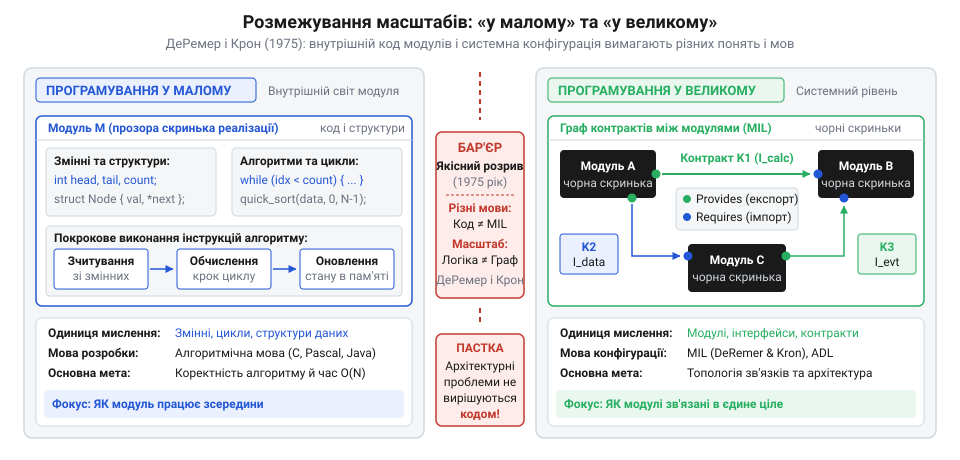
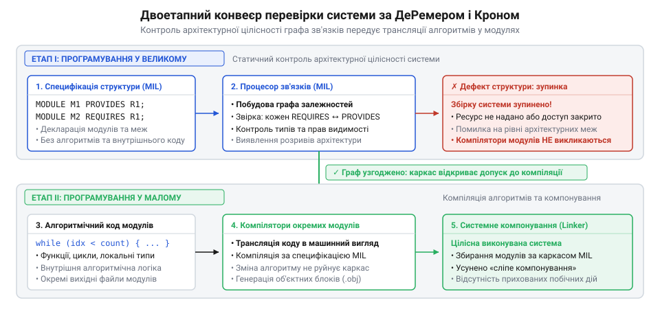

# Програмування «у великому» та «у малому»: виникнення архітектури як масштабу

## Криза розростання процедурного коду

На межі 1960-х і 1970-х років програмна інженерія зіткнулася з кризою масштабу: індустрія перейшла від компактних розрахункових задач до велетенських комплексів на кшталт OS/360 чи систем управління авіадиспетчерськими службами. Розробники намагалися нарощувати можливості систем звичним шляхом — простим написанням нових функцій і підпрограм у популярних мовах того часу: Fortran, Cobol, Algol та PL/I. Проте що більше рядків додавали до кодової бази, то швидше вона втрачала стабільність.

Причина полягала у відсутності системних меж: усі процедури взаємодіяли через неконтрольовані глобальні змінні та спільні ділянки пам'яті. Прикладом такого неявного зачеплення був спільний блок пам'яті `COMMON` у мові Fortran. Підпрограми зверталися до спільної пам'яті напряму, без передавання аргументів через виклики. Зміна змінної в одній підпрограмі — наприклад, скидання лічильника чи оновлення прапорця — ламала стан іншої підпрограми, розрахованої на незмінність цих даних. Довільна підпрограма могла в такий спосіб непомітно змінити спільний стан, створивши прихований побічний ефект (англ. @@en|side effect@@). Тодішні компілятори аналізували лише локальні оператори й типи всередині одного файлу, тому зв'язування системи відбувалося наосліп на етапі компонування (англ. @@en|link editing@@, від англ. *link* — ланка, з'єднувати) через неперевірені зовнішні імена.

У результаті мінімальна зміна внутрішньої логіки однієї функції ламала роботу десятків сторонніх частин комплексу у непередбачуваний момент часу виконання. Великі проєкти тонули в нескінченному налагодженні, зривали строки й зазнавали краху. Стало зрозуміло, що масштабування систем неможливо подолати дисципліною всередині функцій: подолання хаосу вимагало виокремлення [програмної архітектури](root:progarch/what-is-architecture) в окремий масштаб інженерної турботи.

## Модульність без контролю системних зв'язків

Спробою подолати кризу розростання процедурного коду стало модульне проєктування. У 1972 році американський дослідник Девід Парнас опублікував класичну працю про критерії розбиття програм на модулі (від лат. *modulus* — міра). Він запропонував відмовитися від нарізання системи за послідовними кроками виконання й натомість ізолювати окремі труднощі: кожен модуль мав приховувати вразливе інженерне рішення, насамперед внутрішню структуру даних, відкриваючи назовні мінімальний набір операцій. Цей підхід дістав назву [приховування інформації](root:sf-apps/information-hiding) (англ. @@en|information hiding@@). Локалізація рішень дала результат: зміна формату збереження даних в одному модулі більше не змушувала переписувати код усієї програми.

Однак успіх локальної ізоляції несподівано оголив нову системну межу. Приховування даних надійно захищало нутрощі модуля, але не давало інструментів для контролю за взаємодією модулів між собою. Мови програмування початку 1970-х років не мали синтаксису для опису системної топології (від грец. *topos* — місце і *logos* — вчення): виклики зовнішніх процедур були хаотично розпорошені всередині звичайного коду. Компілятор аналізував кожен модуль як відірваний острів і нічого не знав про закладену конфігурацію зв'язків між частинами.

Збирання системи покладалося на ненадійні інструкції компонувальника та скрипти пакетного режиму мовою @@en|JCL@@ (англ. @@en|Job Control Language@@). Помилка в сигнатурі виклику, неузгодженість типів аргументів або прихована циклічна залежність виявлялися лише під час краху готової бінарної збірки під час запуску. Стало очевидним: модульність убезпечила внутрішній алгоритмічний світ модуля, але лишила глобальну структуру системи невидимою та беззахисною перед помилками компонування.

## Концептуальний розрив ДеРемера і Крона

У 1975 році на Міжнародній конференції з надійного програмного забезпечення дослідники Каліфорнійського університету в Санта-Крус Френк ДеРемер (Frank DeRemer) та Ганс Крон (Hans Kron) довели: криза інтеграції модулів — це не наслідок інженерної недбалості, а результат змішування двох принципово різних видів роботи. Вони сформулювали якісний розрив між двома рівнями розробки. Перший — це програмування «у малому» (англ. @@en|programming-in-the-small@@), тобто побудова алгоритмів, циклів і локальних структур даних усередині окремого модуля для виконання конкретного обчислення. Другий — це програмування «у великому» (англ. @@en|programming-in-the-large@@), тобто конструювання системи як цілого через визначення меж модулів, їхніх взаємних ролей і правил з'єднання. Автори окремо наголошували: оскільки ці завдання якісно різні, мова опису системи повинна мати окремий синтаксис, принципово відмінний від алгоритмічних мов. Спроба виразити загальну структуру засобами звичайного коду зазнає невдачі, бо алгоритмічні мови створені для послідовних обчислень і змін стану, а не для міжмодульної будови. Конфігурація системи вимагає власної нотації, де базовими сутностями є самі модулі та зв'язки між ними.

Усередині модуля програміст керує послідовністю інструкцій, пам'яттю та логікою обчислень. На системному ж рівні код реалізації стає зайвим шумом: модулі розглядаються виключно як чорні скриньки, а головним об'єктом проєктування стає топологія їхніх зв'язків. Визнання цього бар'єра легітимізувало [програмну архітектуру](root:progarch/what-is-architecture) як самостійний масштаб інженерної турботи, де структура залежностей існує окремо від внутрішнього коду функцій.

*Концептуальний бар'єр відокремлює внутрішню реалізацію алгоритмів від системної конфігурації міжмодульних зв'язків.*

## Мови MIL та верифікація каркаса

Щоб вивести конфігурацію системи з вихідного коду підпрограм, ДеРемер і Крон розробили концепцію спеціалізованих мов міжмодульного зв'язку (англ. @@en|module interconnection language@@, скорочено MIL). Граматика такої мови повністю виключає оператори обчислень і оперує лише сутностями системного рівня: деклараціями модулів, переліками наданих назовні ресурсів (англ. @@en|provided interfaces@@), переліками обов'язкових залежностей (англ. @@en|required interfaces@@) та правилами видимості. Замість алгоритмічного коду опис складався з прямих декларативних тверджень: ключове слово `MODULE` визначало межі компонента, секція `PROVIDES` оголошувала відкриті для інших функції чи типи, а секція `REQUIRES` жорстко обмежувала список необхідних зовнішніх ресурсів (наприклад, `MODULE Parser; PROVIDES Ast; REQUIRES Lexer;`). Топологія системи отримала строгий декларативний синтаксис, незалежний від алгоритмічних мов.

Ключовим технічним рішенням став двоетапний конвеєр обробки системи. Спеціальний процесор зв'язків (англ. @@en|interconnection processor@@, від лат. *processus* — просування вперед) будує та статично верифікує глобальний граф залежностей ще до виклику компіляторів окремих модулів. Якщо модуль вимагає відсутній у конфігурації тип або намагається отримати доступ до закритого ресурсу іншого блоку, процесор зв'язків блокує збірку на рівні каркаса. Це усунуло сліпе компонування: структурна несуперечливість системи гарантується автоматично задовго до отримання бінарного коду.

*Статична верифікація архітектурного каркаса відсікає помилки інтеграції задовго до компіляції та компонування бінарного коду.*

## Розвінчання міфів та справжній внесок

Ідея винесення системних зв'язків в окрему мову породила гостру інженерну дискусію на межі 1970-х і 1980-х років. Автори @@en|MIL@@ відстоювали повне відокремлення мови системної конфігурації від мов програмування. Проте творці нових мов загального призначення пішли шляхом прямої інтеграції: Ніклаус Вірт (Niklaus Wirth) у Modula-2 та Жан Ішбіа (Jean Ichbiah) в Ada вбудували модульні конструкції безпосередньо в мови програмування «у малому». Механізми модулів визначення та реалізації (DEF/IMP) й специфікацій пакетів (англ. @@en|package specification@@) перенесли контроль меж у звичайний код. Практичність цього підходу тимчасово витіснила ідею окремих мов конфігурації з інженерного фокусу.

Історична дистанція спричинила виникнення двох поширених міфів довкола статті ДеРемера і Крона. Перший стверджує, нібито вони «винайшли модульність». Насправді концепцію модулів і принцип приховування інформації ще на межі 1960–1970-х років сформулювали Девід Парнас та Едсгер Дейкстра (Edsger Dijkstra). Другий міф приписує авторам побудову повноцінної сучасної теорії архітектури. Проте мови @@en|MIL@@ оперували виключно статичним зв'язуванням функцій і типів даних. Вони ще не знали динамічних конекторів (англ. @@en|dynamic connectors@@, від лат. *connectere* — зв'язувати), компонентних моделей чи архітектурних стилів (англ. @@en|architectural styles@@), які з'явилися лише в 1990-х роках.

Справжній фундаментальний внесок ДеРемера і Крона полягав в іншому: вони першими довели, що система як ціле потребує окремого понятійного апарату й не зводиться до суми алгоритмів. Відокремивши системний каркас від коду окремих функцій, автори утвердили [програмну архітектуру](root:progarch/what-is-architecture) як самостійний масштаб інженерної турботи.

## Спадщина розділення масштабів сьогодні

Спроба побудувати складну систему з одних лише підпрограм і класів неминуче відтворює кризу 1970-х років: якщо правила взаємодії заховані всередині коду функцій, будь-яка зміна інтерфейсу ламає зв'язки наосліп. Щоб подолати цей глухий кут, інженерна думка розвинула ідеї ДеРемера і Крона у формальних [мовах опису архітектури](root:sf-apps/adl-architecture-description-languages) (англ. @@en|Architecture Description Languages@@, скорочено ADL — Wright, Darwin, Acme) 1990-х років, які відокремили обчислювальні компоненти від конекторів взаємодії. Сьогодні ця еволюція закріпила чіткий розподіл праці між інструментами: мови програмування (Rust, Go, TypeScript) відповідають за програмування «у малому» — локальні алгоритми, структури даних та обчислення. Натомість програмування «у великому» перейшло до спеціалізованих декларативних форматів: специфікації OpenAPI описують вебінтерфейси, Protocol Buffers задають структуру викликів процедур, маніфести Kubernetes фіксують топологію розгортання, а конфігурації HCL у Terraform керують інфраструктурою.

Такий розподіл задає фундаментальне інженерне правило: системні зв'язки ніколи не лагодять алгоритмічним кодом. Коли міжмодульна чи міжсервісна взаємодія дає збій, типовою помилкою розробника є спроба компенсувати структурну проблему локальними латками — неявними прапорцями, повторними спробами або прихованими обгортками всередині функцій. Наприклад, коли змінюється схема даних, замість узгодження та оновлення спільного контракту взаємодії клієнтський код обростає розлогими блоками `try-catch`, каскадом захисних перевірок і ручним розбором сирої структури. Розробник намагається оминути координацію меж і владнати системний розрив локально, але ця позірна економія коштує дорого: алгоритмічна логіка клієнта тоне у випадковій складності захисних гілок, а сам зв'язок стає вкрай крихким і ламається за будь-якої наступної непередбаченої зміни полів. Це є категоричною помилкою масштабу: алгоритмічне ускладнення модуля не виправляє ваду [архітектури програмної системи](root:progarch/what-is-architecture), а лише ховає її під лавиною випадкової складності. Будь-яка локальна задача обчислень має розв'язуватися мовою «у малому», тоді як будь-яка суперечність меж і взаємодії потребує явного перегляду системного контракту (від лат. *contractus* — угода) чи топології зв'язків «у великому».
