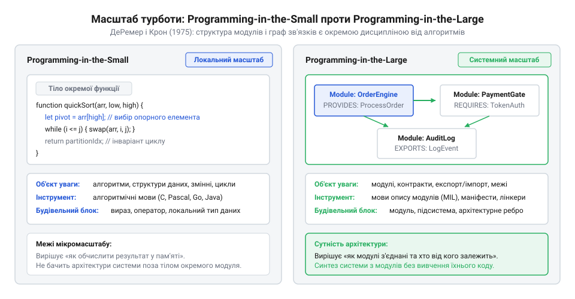

# Масштаб турботи

<preknowlist>
- [Архітектура](root:progarch/what-is-architecture) — базове розуміння визначення архітектури як форми застосунку та набору фундаментальних рішень.
</preknowlist>

## Криза складності 1970-х років: чому сприйняття великих систем як просто «багато коду» призвело до колапсу розробки

Наприкінці 1960-х та на початку 1970-х років обчислювальна техніка переживала стрімкий стрибок потужності апаратного забезпечення. Проте розробка програмного забезпечення зіткнулася з жорстким колапсом, який в індустрії отримав назву «криза програмного забезпечення» (@@en|software crisis@@). Проєкти регулярно перевищували бюджети, запізнювалися на роки або взагалі скасовувалися через некеровану кількість помилок.

Головна причина цієї кризи полягала у хибній ментальній моделі розробників і керівників того часу. Вважалося, що побудова великої системи на 100 000 рядків коду — це просто написання ста маленьких програм по 1 000 рядків. Здавалося, що достатньо лише залучити більше програмістів і змусити їх писати додаткові функції та процедури у тогочасних мовах програмування типу @@en|FORTRAN@@, @@en|ALGOL 60@@ чи @@en|COBOL@@.

На практиці таке накопичення процедур швидко заводило розробку в тупик. У ранніх мовах не існувало механізмів ізоляції видимості: більшість змінних та функцій оголошувалися у єдиному глобальному просторі імен (@@en|global namespace@@). Коли програма розросталася, будь-яка процедура могла довільно прочитати чи змінити стан іншої частини системи.

Утворювалася суцільна «павутина залежностей». Зміна одного рядка коду у процедурі обчислення підсумків могла непередбачувано зламати процедуру формування звітів на іншому кінці системи. Виникла некерована зв'язаність (@@en|uncontrolled coupling@@): інженери витрачали більше часу на пошук прихованих побічних ефектів, ніж на створення корисної логіки. Процедурна декомпозиція, яка чудово працювала для поодиноких обчислювальних алгоритмів, виявилася безсилою перед масштабом великих систем. Спроба будувати складні програми шляхом простого множення кількості процедур зазнала фіаско.

## Прорив ДеРемера та Крона (1975): концептуальне розмежування Programming-in-the-Small та Programming-in-the-Large

У 1975 році американські дослідники Френк ДеРемер (@@en|Frank DeRemer@@) та Ганс Крон (@@en|Hans Kron@@) з Каліфорнійського університету в Санта-Круз запропонували вихід із цього концептуального кута. Їхня класична праця «Programming-in-the-Large versus Programming-in-the-Small», представлена 1975 року та опублікована у журналі @@en|IEEE Transactions on Software Engineering@@ (1976), фундаментально змінила уявлення про масштаб у програмній інженерії.

ДеРемер і Крон довели, що розробка програмних систем складається з двох принципово різних дисциплін, які вимагають різного масштабу турботи (@@en|scale of care@@):
1. **Programming-in-the-Small** (програмування у малому масштабі): це написання внутрішніх алгоритмів, вибір локальних структур даних, операторів і змінних усередині одного модуля. Об'єктом турботи тут є локальна обчислювальна коректність і обчислювальна складність.
2. **Programming-in-the-Large** (програмування у великому масштабі): це структурування всієї системи як сукупності модулів, визначення їхніх меж, явне декларування того, що модуль надає (@@en|provides@@) назовні і чого він вимагає (@@en|requires@@) від оточення. Об'єктом турботи тут є граф зв'язків між компонентами, керування видимістю та конфігурація загальної системи.

> 🔧 **Навіщо це.**
> Розділення Programming-in-the-Small та Programming-in-the-Large дозволяє інженеру свідомо перемикати фокус уваги: при кодуванні алгоритму думати про коректність дій, а при конфігуруванні системи — про межі ізоляції, інтерфейси та залежності, не відволікаючись на внутрішню реалізацію модулів.

Автори показала, що мови програмування (типу @@en|Pascal@@ чи @@en|PL/I@@) розроблялися виключно для Programming-in-the-Small. Вони чудово виражали алгоритми, але не мали синтаксичних засобів для опису системних меж. Для Programming-in-the-Large ДеРемер і Крон запропонували новий клас інструментів — мови інтерконнекції модулів (@@en|Module Interconnection Languages@@, MIL). MIL не описували вирази чи цикли: вони описували структуру та правила зв'язування модулів.


*Концептуальне розмежування за ДеРемером і Кроном: локальне програмування алгоритмів усередині модуля проти конфігурування структурних меж та залежностей усієї системи.*

Саме ця праця 1975 року заклала фундамент під [Архітектуру](root:progarch/what-is-architecture) як самостійну галузь знань, де предметом турботи є координація взаємодії між компонентами, а не деталі їхньої внутрішньої реалізації. Навіть у найпростіших проєктах рівня [Digital Homes v0 — один датчик](root:progarch/dh-v0-one-sensor) чітке відокремлення інтерфейсу модуля від його внутрішньої реалізації виявляється першою умовою стійкості системи до змін.

## Поява Module Interconnection Languages (MIL): мови конфігурування зв'язків як окремий інструментарій

У середині 1970-х років розробники великих програмних комплексів зіткнулися з глухим кутом: наявні інструменти програмування були сліпими до структури системи. Мови того часу — Fortran, ALGOL чи ранній C — створювалися для опису дій над даними всередині окремого процесу. Вони оперували змінними, масивами, циклами та викликами процедур. Коли виникала потреба об'єднати сотні модулів у працездатний комплекс, єдиним доступним механізмом залишалися прямі виклики підпрограм або неявний спільний доступ до глобальних комірок пам'яті на кшталт блоків `COMMON`.

За такого підходу архітектурна форма системи існувала лише як неформальний задум у голові розробника. Компілятор традиційної мови перевіряв локальні синтаксичні правила окремого файлу, але не мав жодного уявлення про те, кому дозволено звертатися до конкретної процедури і від яких зовнішніх частин залежить поточний блок. Будь-який модуль міг безперешкодно викликати функцію з будь-якого іншого куточка програми. Зі зростанням проєкту зв'язки хаотично перепліталися, утворюючи некероване плетиво залежностей, де зміна однієї локальної змінної спричиняла лавиноподібні аварії у віддалених підсистемах.

Спроба розв'язати цю кризу засобами класичних мов виявилася марною, оскільки ці мови за своєю суттю призначалися для іншого завдання — кодування внутрішніх алгоритмів (@@en|Languages for Programming-in-the-Small@@, або LPS). Якщо правила архітектурного підпорядкування модулів записувати безпосередньо в алгоритмічному коді, межі системи неминуче розмиваються під час перших же виправлень логіки.

Цей концептуальний розрив розв'язали дослідники Каліфорнійського університету в Санта-Крузі (@@en|University of California, Santa Cruz@@) Френк ДеРемер (Frank DeRemer) та Ганс Крон (Hans Kron). У квітні 1975 року на Міжнародній конференції з надійного програмного забезпечення (@@en|International Conference on Reliable Software@@) у Лос-Анджелесі вони виголосили доповідь, що наступного року вийшла фундаментальною статтею в журналі IEEE Transactions on Software Engineering. Їхня теза стверджувала: оскільки структурування великої системи з модулів є принципово відмінною інтелектуальною діяльністю від написання окремих модулів, воно вимагає власного, цілком окремого класу формальних мов.

Цей клас інструментів автори назвали [мовами конфігурування зв'язків між модулями](root:sf-apps/module-interconnection-language) — @@en|Module Interconnection Languages@@ (скорочено MIL, від лат. @@la|modulus@@ — міра, зразок, та англ. @@en|interconnection@@ — взаємне з'єднання).

Як взірець нової концепції автори розробили експериментальну мову MIL75. Програма на мові MIL не містила жодного алгоритму, жодного циклу і жодної математичної формули. Її єдиним призначенням був строгий опис топології взаємозв'язків між компонентами.

MIL75 спиралася на три фундаментальні механізми:

1. Дерево системи (англ. @@en|system tree@@). Структура проєкту описується як сувора ієрархія підсистем і модулів, що відображає функціональну декомпозицію зверху вниз.
2. Явне надання та вимога ресурсів. Ресурсом вважається будь-яка іменована сутність: тип даних, функція чи глобальна константа. Кожен модуль явно декларує список ресурсів, які він експортує у світ (`provides`), та перелік ресурсів, без яких його робота неможлива (`requires`).
3. Контроль області видимості (`has access to`). Батьківська підсистема в дереві явно визначає, які саме дочірні вузли мають право бачити ресурси інших гілок. Якщо вузол не отримав явного дозволу доступу, він не здатен побачити чужий ресурс, навіть якщо знає його точну назву.

Умовний опис підсистем у синтаксисі MIL75 демонструє цю сувору ізоляцію:

```text
system SmartBuilding
    subsystem Environment
        provides RoomTemperature
    subsystem HeatingControl
        has access to Environment
        requires RoomTemperature
        provides BoilerCommand
    subsystem UserInterface
        has access to HeatingControl
        requires BoilerCommand
```

У цій декларації підсистема `UserInterface` має доступ лише до `HeatingControl`. Вона не може звернутися до `RoomTemperature` в `Environment`, тому що в дереві доступу для неї цей зв'язок не оголошено.

Для перевірки таких описів автори передбачили окремий MIL-компілятор (архітектурний процесор). Цей процесор будує глобальну таблицю зв'язків і перевіряє несуперечливість усіх `provides` та `requires` ще до того, як почнеться компіляція тіл модулів традиційним транслятором. Якщо розробник у коді `UserInterface` спробує напряму прочитати датчик температури, архітектурний процесор зупинить збирання системи через порушення правил видимості.

> 🔧 **Навіщо це.**
Відокремлення опису зв'язків від коду алгоритмів робить залежності керованими. Коли контракт взаємодії та права доступу винесені в самостійний маніфест, архітектурні межі перевіряються машиною автоматично. Розробник окремого модуля фізично позбавлений можливості створити випадковий зв'язок із внутрішніми деталями іншої підсистеми, бо компілятор зв'язків відхилить несанкціоноване звернення ще на етапі аналізу структури.

## Розвінчання міфу про MIL та народження системної архітектури як окремої дисципліни

Оцінюючи мови MIL з огляду сучасної практики, легко потрапити в пастку спрощення й сприйняти їх лише як давній варіант систем автоматизації збирання або надбудову над компонувальником (від лат. @@la|componere@@ — складати, з'єднувати; в англомовній традиції — @@en|linker@@). Здається, ніби опис того, які файли з якими з'єднувати, — це звичайна інструкція для монтажника двійкового коду чи директиви скриптів компіляції.

Таке ототожнення хибне: між MIL та утилітами збирання лежить глибока різниця в масштабі турботи.

Класичний компонувальник (як-от редактор зв'язків операційної системи IBM OS/360 чи перші компонувальні утиліти Unix) виконує суто механічну операцію над скомпільованими об'єктними модулями. Він сканує двійкові таблиці імен, зіставляє символи та підставляє абсолютні або відносні адреси переходів у машинному коді. Компонувальник не знає контексту зв'язку: для нього будь-який публічний символ у таблиці доступний кожному учаснику компонування. Він позбавлений здатності оцінити, чи порушує такий виклик межі шарів, чи спотворює він напрямок залежностей і чи сумісні контракти даних на концептуальному рівні. Компонувальник не охороняє структуру — він лише забезпечує виконання адресного переходу.

Так само й утиліти керування збиранням — наприклад, програма `make`, розроблена Стюартом Фельдманом (Stuart Feldman) у лабораторіях Bell Labs у 1976 році. Призначення `make` полягає у визначенні того, які саме частини системи застаріли після зміни файлів і вимагають повторної трансляції. Вона працює з орієнтованим графом файлових залежностей і часовими мітками на диску. Її ціль — скорочення часу компіляції та надійний запуск команд збирання. Вона нічого не знає про типи даних, інваріанти інтерфейсів чи правила доступу до підсистем.

На відміну від них, MIL є мовою архітектурного проєктування. Її мета — не створити двійковий файл і не оптимізувати час виклику транслятора, а формально зафіксувати систему поняття і обмежень: що є модулем, яку функціональну відповідальність він несе, що приховує від оточення і якими каналами дозволено обмінюватися інформацією.

Саме через це праця ДеРемера та Крона започаткувала системну [архітектуру](root:progarch/what-is-architecture) (від грец. @@grc|ἀρχιτέκτων@@, де @@grc|ἀρχι-@@ — головний, старший, та @@grc|τέκτων@@ — будівничий) як самостійну галузь інженерії зі своїм предметом вивчення.

Автори чітко розмежували два рівні професійної відповідальності за систему:

- На рівні кодування алгоритмів і структур даних (малий масштаб, @@en|programming-in-the-small@@) об'єктом турботи є внутрішня коректність модулів: час виконання, витрати оперативної пам'яті, відсутність помилок у циклах та цілісність внутрішніх структур.
- На рівні структурування системи (великий масштаб, @@en|programming-in-the-large@@) об'єктом турботи є координація (від лат. @@la|coordinatio@@, де @@la|cum@@ — разом, та @@la|ordinatio@@ — упорядкування) взаємодії між модулями: стійкість інтерфейсів, мінімізація взаємного зачеплення, контроль видимості та здатність системи змінюватися без руйнування цілого.

Хоча автономні компілятори мов MIL не перетворилися на масовий комерційний стандарт через практичну зручність інтеграції інтерфейсів прямо в мови кодування наступного покоління (як-от пакети в Ada чи модулі в Modula-2), сформульовані ДеРемером і Кроном принципи стали фундаментом системного проєктування.

У 1990-х роках концепція MIL еволюціонувала в [мови опису архітектури](root:sf-apps/adl-architecture-description-languages) — @@en|Architecture Description Languages@@ (скорочено ADL; прикладними реалізаціями стали Wright, UniCon, Darwin та Acme), які моделюють системи вже не просто як набір модулів, а як мережу компонентів і конекторів із формальними протоколами комунікації. У сучасному промисловому програмуванні спадок ДеРемера та Крона втілено як у строгих модульних системах мов (наприклад, файли маніфестів `module-info.java` платформи Java чи правила експорту крейтів у мові Rust), так і в декларативних конфігураціях розподілених систем, де топологія зв'язку мікросервісів та їхні контракти описуються окремо від виконуваного програмного коду.

> 🔧 **Навіщо це.**
Розрізнення малого та великого масштабів рятує від спроб долати кризу складності невідповідними методами. Архітектурні дефекти — неконтрольоване зачеплення, розмиті межі та втрата контролю над змінами — не лікуються рефакторингом внутрішніх алгоритмів чи оптимізацією коду функцій. Їх усувають лише на рівні координації системи, тобто свідомою зміною архітектурних меж і правил видимості.
