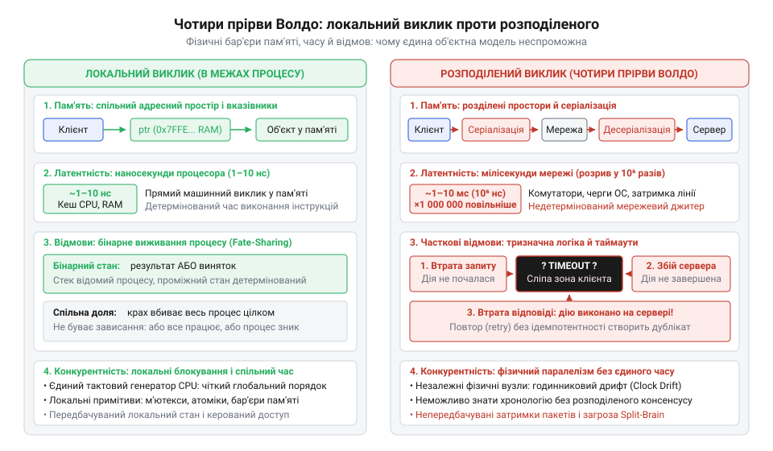
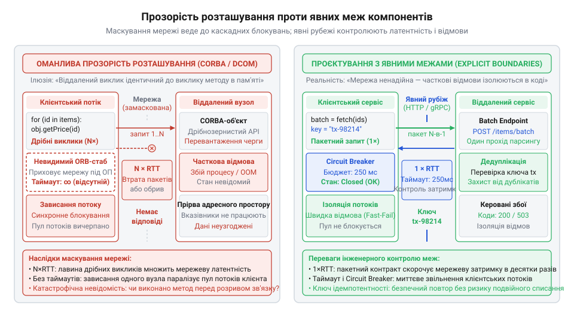

# «A Note on Distributed Computing» та крах ілюзії прозорого розподілу

## Ілюзія прозорості та криза розподілених об'єктів

На початку 1990-х років індустрію захопила ейфорія об'єктно-орієнтованого програмування. Головна обіцянка об'єкта — інкапсуляція (від лат. @@la|capsula@@ — скринька): викликач взаємодіє лише з публічним інтерфейсом, тоді як внутрішній стан і деталі реалізації надійно приховані. Звідси виникла спокуслива гіпотеза: якщо розробнику байдуже, як саме влаштований метод, то чому фізичне розміщення об'єкта не може бути звичайною деталлю реалізації?

Індустрія проголосила святий грааль — прозорість розташування (англ. @@en|location transparency@@; від лат. @@la|transparens@@ — проникний для світла). Виклик методу на комп'ютері в іншій кімнаті чи за океаном мав синтаксично й семантично збігатися з викликом у сусідній комірці локальної пам'яті. У 1991 році консорціум OMG оприлюднив архітектуру @@en|CORBA@@, компанія Microsoft згодом розгорнула технологію @@en|DCOM@@, а Sun Microsystems експериментувала з розподіленими сутностями в системі Spring. Фізичну мережу оголосили невидимою турботою брокера об'єктних запитів (англ. @@en|Object Request Broker@@, @@en|ORB@@), який перехоплював виклики, серіалізував аргументи та непомітно передавав пакети.

Проте у виробничих системах оманлива прозорість вибухнула катастрофою. Звичні методи зчитування стану (англ. @@en|getters@@) у циклі спричиняли лавину мережевих запитів туди й назад (англ. @@en|round-trip@@), обвалюючи швидкодію в тисячі разів. Короткочасна затримка комутатора чи втрата зв'язку намертво вішала клієнтські потоки без жодної діагностики, адже контракт локального виклику не передбачає мережевих таймаутів (англ. @@en|timeout@@). Спроба передати звичні вказівники на адреси пам'яті розбивалася об аварійні збої (англ. @@en|segfault@@) на віддалених вузлах, а розподілене збирання сміття та приховані блокування породжували витоки пам'яті й глухі кути.

Спроба сховати фізичні межі за об'єктними абстракціями порушила ключові [принципи архітектури](root:progarch/what-is-architecture): замість подолання суттєвої складності розподілених систем індустрія створила колосальну випадкову складність.

## Записка Волдо та чотири фундаментальні прірви

У листопаді 1994 року дослідники Sun Microsystems Laboratories — Джим Волдо (англ. @@en|Jim Waldo@@), Джефф Ваєнт (англ. @@en|Geoff Wyant@@), Енн Воллрат (англ. @@en|Ann Wollrath@@) і Сем Кендалл (англ. @@en|Sam Kendall@@) — опублікували технічний звіт SMLI TR-94-29 під назвою @@en|«A Note on Distributed Computing»@@. Спираючись на безпосередній досвід розробки експериментальної мікроядерної системи @@en|Spring@@, автори дійшли безкомпромісного висновку: прагнення створити єдину об'єктну модель для локальних і віддалених обчислень є хибним у самій своїй основі. Фізичну межу окремого процесу чи комп'ютера неможливо розчинити за допомогою синтаксичних абстракцій мови програмування.

Автори виділили чотири фундаментальні прірви між локальними й розподіленими системами:

1. **Адресний простір.** Локальні об'єкти взаємодіють у спільній пам'яті через прямі вказівники. Мережа ж фізично розділяє адресні простори: передати об'єкт іншому вузлу неможливо без повної маршалізації (від англ. @@en|marshal@@ — вишиковувати, впорядковувати) його стану в послідовність байтів або без збереження складного віддаленого стану, який миттєво втрачає узгодженість у разі неполадок.
2. **Латентність** (від лат. @@la|latens@@ — прихований). Локальний виклик методу в пам'яті триває наносекунди, тоді як обмін пакетами мережею вимагає мілісекунд. Цей розрив сягає від чотирьох до шести порядків величини. Інтерфейси для роботи в пам'яті проектують як дрібнозернисті, тоді як мережеві інтерфейси мусять бути грубозернистими й пакетними. Спроба викликати віддалений метод так само часто, як локальний, неминуче паралізує систему.
3. **Часткові відмови** (англ. @@en|partial failures@@). Локальний процес має двійкову долю: він або працює, або зазнає повного краху разом з усіма своїми об'єктами. У розподіленій системі клієнт, сервер чи проміжний комутатор виходять із ладу незалежно. Коли клієнт не отримує відповіді за таймаутом, виникає тризначна логіка невизначеності: невідомо, чи операція успішно виконана, чи вона впала з помилкою, чи відповідь просто загубилася в дорозі.
4. **Конкурентність** (від лат. @@la|concurro@@ — збігатися, стикатися). Розподілені обчислення позбавлені центрального планувальника потоків, спільної пам'яті та єдиного тактового генератора. Мережевий недетермінізм і фізичні стани гонитви неможливо контролювати стандартними мовними блокуваннями чи м'ютексами.

*Чотири фундаментальні відмінності локальних і мережевих обчислень за Волдо: фізичні рубежі пам'яті, часу, незалежних відмов і гонитви неможливо подолати мовними абстракціями.*

Спроба замаскувати ці розриви не усуває невіддільну суттєву складність мережі, а лише плодить колосальну випадкову складність у коді та інфраструктурі.

## Конфлікт парадигм та опір індустрії

Упродовж 1994–1998 років індустрія відкинула застереження Sun Labs. Консорціум OMG за участю IBM, DEC і HP, а також корпорація Microsoft розгорнули агресивний наступ, нав'язуючи @@en|CORBA@@ 2.0 та @@en|DCOM@@ як універсальний стандарт корпоративного програмного забезпечення. Вендори продавали сервери брокерів об'єктних запитів за мільйони доларів, переконуючи бізнес, що будь-які мережеві негаразди здатне безслідно приховати «розумне» проміжне програмне забезпечення (англ. @@en|middleware@@).

Драматичний розкол стався і всередині самої Sun Microsystems. З одного боку, автори звіту Джим Волдо та Енн Воллрат спроєктували платформу Java @@en|RMI@@ (від англ. @@en|Remote Method Invocation@@ — віддалений виклик методів). У ній кожен віддалений метод зобов'язали декларувати виняток `throws RemoteException`, змушуючи розробника вже на етапі компіляції думати про небезпеку мережі. Згодом для платформи @@en|Jini@@ вони розробили механізм оренди (від англ. @@en|lease@@ — тимчасове надання прав), який автоматично звільняв виділені ресурси, якщо зв'язок із клієнтом переривався.

З іншого боку, комерційний підрозділ Sun у гонитві за корпоративним ринком випустив специфікацію @@en|J2EE@@ 1.0 з компонентами @@en|Enterprise JavaBeans@@ (@@en|EJB@@). Їхні @@en|Entity Beans@@ знову втілили міраж прозорості: записи реляційних баз даних проєктувалися як звичайні об'єкти в пам'яті з прозорим доступом через протокол @@en|RMI-IIOP@@. Індустрія заплатила високу ціну: важкі розподілені проєкти зазнавали гучного фіаско через шторми мережевих запитів, приховані блокування й недіагностовані збої. Маркетингові обіцянки вендорів виявилися безсилими перед законами фізики.

## Хибні тлумачення та розвінчання головних міфів

На межі 2000-х років індустрія намагалася пояснити провали розподілених систем хибними тлумаченнями звіту Sun Labs. Найпоширеніший міф приписував авторам твердження, ніби розподілені обчислення взагалі непотрібні, а віддалений виклик процедур (англ. @@en|Remote Procedure Call@@, @@en|RPC@@) — тупикова гілка. Насправді Волдо та його колеги ніколи не заперечували мережевих систем. Вони атакували уніфіковану модель, яка обманює розробника і маскує мережу під локальні виклики. Надійний розподіл можливий, але він вимагає проектувати інтерфейси з явною обробкою нестійкості зв'язку.

Другий, технократичний міф обіцяв, що оптичні лінії та гігабітний @@en|Ethernet@@ зведуть затримки до нуля й зітруть різницю з пам'яттю. Ця омана ігнорує фізику: пропускна здатність (англ. @@en|bandwidth@@; від @@en|band@@ — смуга і @@en|width@@ — ширина) та латентність (англ. @@en|latency@@) підпорядковані різним законам. Канал передачі можна розширити в тисячі разів, але латентність жорстко обмежена швидкістю світла, комутацією пакетів і затримками операційної системи. Прірва між наносекундами локальної пам'яті та мілісекундами мережі лишається нездоланною.

Третій міф переконував, ніби «розумне» проміжне програмне забезпечення (@@en|middleware@@) здатне автоматично виправляти часткові відмови. Проте тризначна логіка мережевого запиту виключає сліпі універсальні рішення. Якщо клієнт не отримує відповіді за таймаутом, неможливо дізнатися долю операції: вона могла впасти до виконання, спричинити збій сервера посеред роботи чи успішно завершитися з втратою зворотного пакета. Автоматичні повторні спроби (англ. @@en|retries@@) без знання бізнес-семантики призводять до катастроф — подвійних списань коштів або спотворення даних. Спроба приховати суттєву складність мережі не лікує відмов, а породжує некеровану випадкову складність.

## Падіння ORB та тріумф явних меж

На початку 2000-х років парадигма прозорих розподілених об'єктів зазнала безславного краху. Системи на основі @@en|CORBA@@, @@en|DCOM@@ та @@en|Entity Beans@@ поховали себе під тягарем вендорної несумісності, некерованої конфігурації та нездатності долати корпоративні міжмережеві екрани у відкритому інтернеті. Індустрія повернулася до застережень Волдо. Усвідомлення нездоланності фізичних меж остаточно закріпив інженер Sun Пітер Дойч (англ. @@en|Peter Deutsch@@), сформулювавши вісім хибних припущень про розподілені обчислення (англ. @@en|Fallacies of Distributed Computing@@; від лат. @@la|fallacia@@ — омана): мережа ніколи не є надійною, безкоштовною, однорідною чи захищеною, а її латентність ніколи не дорівнює нулю.

Замість імітації викликів функцій інженерія обрала проєктування з явними межами. У 2000 році Рой Філдінг (англ. @@en|Roy Fielding@@) представив архітектурний стиль @@en|REST@@ (від англ. @@en|Representational State Transfer@@ — передача репрезентативного стану), де взаємодія спирається на протокол @@en|HTTP@@, відкриті коди статусів і семантику ідемпотентних методів. Одночасно набули сили черги й асинхронний обмін повідомленнями через брокери на зразок @@en|RabbitMQ@@ та @@en|Kafka@@, які перетворили фізичне розділення часу й простору на [фундаментальний принцип архітектури](root:progarch/what-is-architecture) сучасних систем.

Сучасні системи віддаленого виклику — такі як @@en|gRPC@@ від Google чи @@en|Finagle@@ від Twitter — також остаточно відкинули ілюзію невидимості. Замість мовних об'єктних проксі вони використовують грубозернисті схеми @@en|Protocol Buffers@@, жорсткі бюджети таймаутів (англ. @@en|deadlines@@) та явні статуси помилок замість мовних винятків. Застереження 1994 року перемогли: надійність будують не приховуванням рубежів фізичного масштабу, а їхнім свідомим інженерним контролем.

## Сучасні рецидиви та проєктування явних рубежів

Попри крах @@en|CORBA@@, ілюзія прозорості регулярно повертається. У мікросервісах команди вибудовують балакучі ланцюжки синхронних @@en|HTTP@@-запитів, ховаючи мережу за клієнтськими бібліотеками. Розподілені @@en|ORM@@ спричиняють лавину запитів @@en|N+1@@ під час обходу сутностей у циклі, а розподілені бази даних обіцяють «прозору заміну» @@en|PostgreSQL@@, маскуючи шардинг ціною каскадних колапсів. Ігнорування фізичних рубежів знову повертає зависання потоків, вичерпання ресурсів і втрату керованості.

*Маскування мережі під локальні виклики спричиняє каскадні блокування, тоді як явні контракти, таймаути, запобіжники та дедуплікація роблять фізичні рубежі керованими.*

Архітектурна відповідь на застереження Волдо вимагає безкомпромісного прояву меж. Замість дрібнозернистих методів інтерфейси проектують як грубозернисті пакетні контракти (англ. @@en|bulk API@@), що передають масиви даних за один раундтрип. На мережевих стиках зводять захисні бар'єри: бюджетування таймаутів, запобіжник (англ. @@en|circuit breaker@@; від @@en|circuit@@ — електричне коло та @@en|break@@ — переривати), що розмикає ланцюг у разі деградації вузла, та експоненційне відтермінування (англ. @@en|exponential backoff@@) з випадковим тремтінням затримки (англ. @@en|jitter@@) проти хвиль повторів.

Для приборкання тризначної логіки збоїв усі мутуючі операції роблять суворо ідемпотентними, додаючи ключ ідемпотентності (англ. @@en|idempotency key@@; від лат. @@la|idem@@ — той самий та @@la|potentia@@ — сила) для дедуплікації. Урок 1994 року непорушний: фізичний масштаб неможливо розчинити в синтаксисі. Будь-який перетин мережі мусить бути явно зафіксований у контрактах, обробці помилок і [архітектурній моделі](root:progarch/what-is-architecture) системи.
