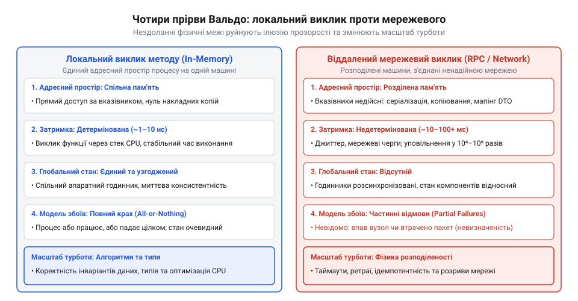

# Масштаб турботи

<preknowlist>
- [Архітектура](root:progarch/what-is-architecture) — розуміння архітектурного рішення як фундаментального вибору форми системи та меж компонентів.
- [Digital Homes v0 — один датчик](root:progarch/dh-v0-one-sensor) — розуміння базового відокремлення внутрішньої логіки від зовнішніх інтерфейсів.
</preknowlist>

## Утопія прозорості 1990-х: спроба розмити кордони між локальним та мережевим кодом

На початку 1990-х років об'єктно-орієнтоване програмування переживало період найбільшого піднесення. Успіх інкапсуляції та поліморфізму в мовах C++ та Smalltalk народив привабливу інженерну ідею: якщо об'єктна модель так ефективно впорядковує складність всередині одного процесу, чому б не розширити ці самі інтерфейси на цілу мережу комп'ютерів?

У 1991 році консорціум OMG (англ. @@en|Object Management Group@@) випустив першу специфікацію CORBA (англ. @@en|Common Object Request Broker Architecture@@, від англ. @@en|broker@@ — посередник). Кілька років по тому компанія Microsoft представила власну альтернативу — DCOM (англ. @@en|Distributed Component Object Model@@). В основі обох систем лежала амбітна концепція — прозорість розташування (англ. @@en|location transparency@@, від лат. @@la|transparens@@ — прозорий, наскрізний; [Епоха CORBA та DCOM](root:sf-distributed/corba-and-dcom-era)).

Головна обіцянка прозорості розташування полягала в тому, що розробник може писати код, не замислюючись про фізичне розміщення об'єктів. Спеціальний компілятор мови опису інтерфейсів IDL (англ. @@en|Interface Definition Language@@) генерував локальну заглушку клієнта (англ. @@en|stub@@ — затичка) та каркас сервера (англ. @@en|skeleton@@ — кістяк). З погляду синтаксису виклик методу віддаленого об'єкта `account.getBalance()` нічим не відрізнявся від виклику локального об'єкта в оперативній пам'яті. Мережевий брокер брав на себе серіалізацію аргументів, доставку сокетом та повернення результату. Кордон між машинами оголошувався дрібною деталлю реалізації, яку інфраструктура мала повністю сховати від програміста.

*Схема ілюструє чотири нездоланні прірви (пам'ять, затримки, стан, частинні відмови), що виникають під час виходу за межі одного процесу, та демонструє зміну масштабу турботи інженера.*

Проте спроба проігнорувати фізику мережі у вихідному коді швидко обернулася масовими аваріями у виробничих системах. Програмісти, заспокоєні локальним синтаксисом, почали викликати віддалені об'єкти всередині циклів, не підозрюючи, що кожна ітерація замість кількох наносекунд звернення до RAM вимагає десятків мілісекунд мережевих затримок. Системи, які бездоганно працювали на стендах розробників, миттєво зависали під реальним навантаженням через проблему N+1 мережевих запитів.

Спроба приховати відмінності між локальним та мережевим кодом виявилася не просто оптимізаційним огріхом, а фундаментальною помилкою проєктування. Як розкрито в статті [Архітектура](root:progarch/what-is-architecture), будь-яке архітектурне рішення визначає межі компонентів та формалізує зв'язки між ними. Прагнення стерти мережеву межу породило величезну випадкову складність і змусило команди витрачати місяці на боротьбу з недетермінованими збоями. Навіть найпростіші системи, такі як [Digital Homes v0 — один датчик](root:progarch/dh-v0-one-sensor), демонструють: відокремлення внутрішньої логіки від зовнішнього інтерфейсу вимагає чіткого усвідомлення того, де проходить фізичний кордон виконання коду.

> 🔧 **Навіщо це.**
> Розуміння витоків утопії прозорості застерігає сучасного інженера від повторення тих самих помилок у мікросервісах. Коли розробник викликає віддалений HTTP/gRPC-сервіс через звичайний автозгенерований інжектований клієнтський інтерфейс так, ніби це локальний сервіс у пам'яті, він наступає на ті самі граблі, що й автори CORBA у 1990-х роках.

## Уроки операційної системи Spring (Sun Microsystems): походження праці Вальдо та колег

Крач утопії прозорого розподіленого ООП був не теоретичним припущенням, а наслідком важкого інженерного досвіду. У першій половині 1990-х років дослідницька лабораторія Sun Microsystems Laboratories розробляла експериментальну розподілену операційну систему Spring OS (англ. @@en|Spring Operating System@@; [Розподілена операційна система Spring](root:sf-os/spring-distributed-os)). 

Метою проєкту Spring було створення об'єктно-орієнтованого мікроядра, де всі системні ресурси — файли, пристрої, процеси — представлялися як об'єкти, які могли прозоро переміщатися або виконуватися на будь-якому вузлі обчислювального кластера. Проте після років інтенсивної розробки та спроб злити локальну й віддалену об'єктні моделі в єдине ціле команда зіткнулася з нездоланною стіною: система ставала дедалі крихкішою, а спроби сховати мережу за проксі-об'єктами лише помножували приховані дефекти.

У листопаді 1994 року чотири провідні архітектори проєкту — Джим Вальдо (Jim Waldo), Джефф Ваянт (Geoff Wyant), Енн Воллрат (Ann Wollrath) та Сем Кендалл (Sam Kendall) — опублікували фундаментальний технічний звіт Sun Microsystems SMLI TR-94-29 під назвою **«A Note on Distributed Computing»** (англ. @@en|A Note on Distributed Computing@@, від англ. @@en|note@@ — нотатка, зауваження). Цей маніфест назавжди зруйнував ілюзію про можливість єдиного об'єктного середовища.

Автори праці детально розкрили чотири фундаментальні прірви між локальними та віддаленими обчисленнями, які унеможливлюють їхнє синтаксичне й семантичне об'єднання:

1. **Відсутність спільної пам'яті (англ. @@en|address space gap@@):** Локальні об'єкти ділять між собою єдиний адресний простір і можуть безпечно передавати прямі вказівники на пам'яті. Віддалені об'єкти живуть у різних процесах і на різних машинах, тому передача вказівника є безглуздою — дані мусять упаковуватися й копіюватися, що кардинально змінює семантику передачі параметрів (значення замість посилання).
2. **Недетерміновані затримки (англ. @@en|latency gap@@):** Виклик методу в пам'яті займає одиниці наносекунд. Мережевий виклик триває від кількох мілісекунд до секунд, тобто є на 5–6 порядків повільнішим. Намагання сформулювати інтерфейс віддаленого об'єкта за зразком локального призводить до побудови занадто «дрібних» (@@en|fine-grained@@) інтерфейсів, які катастрофічно деградують у мережі.
3. **Відсутність глобального стану (англ. @@en|memory and state gap@@):** У локальному процесі стан пам'яті є централізованим і передбачуваним. У розподіленій системі не існує єдиного годинника й спільної пам'яті: кожна машина володіє лише власним локальним зрізом стану, а актуальна картина всієї системи завжди залишається частково застарілою.
4. **Катастрофа частинних відмов (англ. @@en|partial failures@@):** Це найголовніша відмінність. У локальній програмі падіння процесу є тотальним: або вся програма працює, або вона повністю припиняє існування. У розподіленій системі один з вузлів може впасти або втратити зв'язок, тоді як решта продовжує працювати. Головна пастка полягає в тому, що викликач у разі таймауту не може з'ясувати: чи віддалений вузол упав до виконання операції, чи операція виконана, але відповідь загубилася в мережі.

Праця Вальдо та колег довела: розподіленість — це не інфраструктурна деталь, яку можна сховати за проксі, а фундаментальна властивість системи. Перехід від однієї машини до мережі якісно змінює саму природу розробки й вводить поняття **масштабу турботи** (англ. @@en|scale of care@@, від англ. @@en|scale@@ — масштаб, та @@en|care@@ — турбота, увага). На локальному рівні інженер турбується про типи та алгоритми; на мережевому рівні масштаб турботи зміщується до повторних спроб (@@en|retries@@), ідемпотентності, обробки таймаутів, розривів зв'язку та узгодження частково збереженого стану.

Маніфест 1994 року не був запереченням розподілених систем — він закликав до прагматизму й явної архітектури. Замість того, щоб маскувати віддалені виклики під локальні, їх слід проєктувати явно, враховуючи мову мережевих помилок на рівні самих інтерфейсів. Цей урок став основою для створення Java RMI (де кожен віддалений метод обов'язково декларує `RemoteException`), а пізніше сформував філософію REST, мікросервісів та сучасних стійких розподілених систем.

## Чотири прірви між масштабами: чому локальне й мережеве програмування є різними масштабами турботи

Спроба зробити віддалений виклик прозорим руйнується не через недостатню досконалість мережевих протоколів чи обчислювального заліза. У праці 1994 року Джим Вальдо та його колеги довели, що межа між локальним процесом та мережею є не технологічним бар'єром, а фундаментальним розділенням методів програмування. Вони виокремили чотири нездоланні прірви, які якісно змінюють поведінку програм при переході через мережевий кордон.

Перша прірва — відсутність спільної пам'яті (англ. @@en|address space gap@@). У локальній програмі всі компоненти співіснують в єдиному адресному просторі. Передача об'єкта як параметра методу зводиться до копіювання його 64-бітної адреси в пам'яті. Якщо метод модифікує стан переданого об'єкта, ці зміни негайно бачить викликач, оскільки вони працюють з тією самою фізичною коміркою RAM. У розподіленому середовищі компоненти виконуються в ізольованих адресних просторах на різних фізичних машинах. Спроба передати вказівник на пам'яті через сокет є беззмістовною. Дані мусять бути серіалізовані у байтовий потік, передані мережею й розпаковані на іншому боці, утворюючи абсолютно нову копію об'єкта. Зміна семантики з «передачі за посиланням» на «передачу за значенням» руйнує локальні об'єктні абстракції: мутації на віддаленому боці більше не відображаються у викликача автоматично.

Друга прірва — недетерміновані затримки (англ. @@en|latency gap@@). Затримка виклику функції в межах одного процесу становить від кількох часток наносекунди до десятків наносекунд. Затримка ж мережевого пакету у локальній мережі коливається від 0.5 до 5 мілісекунд, а у глобальній мережі чи хмарі — від десятків до сотень мілісекунд. Різниця в п'ять-шість порядків означає, що локальні й мережеві інтерфейси вимагають протилежних принципів проєктування. Локальний код заохочує дрібнозернисті (англ. @@en|fine-grained@@) інтерфейси з десятками точкових методів (`getName()`, `getAge()`, `getAddress()`). Спроба виконати ці самі виклики через мережу призводить до продуктивності, яка деградує в тисячі разів. Мережевий масштаб вимагає великозернистих (англ. @@en|coarse-grained@@) проєкцій, які упаковують весь необхідний контекст в один пакет.

Третя прірва — відсутність глобального стану (англ. @@en|memory and state gap@@). У межах однієї машини існує єдине джерело правди про стан системи — оперативна пам'ять, керована одним процесором та спільним годинником. У розподіленій системі глобальний стан є неспостережуваним: кожен вузол володіє лише локальним знанням, передача даних займає час, а фізичні годинники на різних серверах неминуче розходяться (ефект зсуву годинників). Викликач ніколи не має миттєвого знімка всієї системи — будь-яке знання про стан віддаленого вузла є інформацією з минулого, яка могла втратити актуальність ще до моменту отримання пакета.

Четверта й найнебезпечніша прірва — [катастрофа частинних відмов](root:sf-distributed/partial-failures-in-distributed-systems) (англ. @@en|partial failure disaster@@). У локальному обчисленні відмова має бінарний характер (англ. @@en|all-or-nothing failure@@): або процес працює коректно, або він аварійно завершується (англ. @@en|crash@@), зупиняючи виконання всього коду. Системний стан при цьому очищається операційною системою. У розподіленій же системі відмова майже завжди є частинною: частина вузлів продовжує справно працювати, тоді як інший вузол впав або мережевий комутатор між ними втратив зв'язок (англ. @@en|network partition@@).

Головна трагедія частинної відмови полягає в невизначеності. Якщо клієнт надсилає запит на списання коштів або відкриття замка й отримує таймаут, він опиняється у стані повної невідомості:
- чи запит взагалі не дійшов до сервера через обрив кабелю?
- чи сервер успішно виконав операцію, але впав за мілісекунду до відправки відповіді?
- чи сервер відправив відповідь, але вона була відкинута мережевим маршрутизатором?

Жодний локальний механізм обробки винятків (`try/catch`) не здатний розв'язати цю невизначеність. Віддалений виклик, захований за локальним інтерфейсом, змушений або нескінченно блокувати потік, або вертати хибне припущення про статус операції.

Зіставивши ці чотири прірви, Вальдо та його співавтори сформулювали фундаментальний висновок: перехід від однієї машини до мережі змінює сам **масштаб турботи** (англ. @@en|scale of care@@) розробника.

Масштаб турботи — це множина системних ризиків, класи відмов та інженерних обмежень, які мусить ураховувати архітектор під час прийняття рішень на певному фізичному чи логічному рівні системи.

На локальному масштабі турбота розробника зосереджена на коректності алгоритмів, сумісності типів та ефективному використанні оперативної пам'яті. Але щойно межа виконання перетинає мережевий сокет, масштаб турботи якісно змінюється. На мережевому масштабі головною турботою стає не алгоритмічна складність, а стійкість до частинних відмов:
- розробка ідемпотентних інтерфейсів, де повторний виклик запиту не створює побічних ефектів;
- застосування таймаутів, повторних спроб (@@en|retries@@) та запобіжників (@@en|circuit breakers@@);
- керування асинхронними чергами та підтвердженнями (ACK);
- обробка дублікатів та узгодження частково збереженого стану (@@en|eventual consistency@@).

Спроба запхати мережевий масштаб турботи всередину локального інтерфейсу є пасткою: вона змушує розробника вигадувати уявну прозорість там, де фізика вимагає явної обробки мережевих відмов. Як показує фундаментальне визначення в статті [Архітектура](root:progarch/what-is-architecture), архітектура починається там, де рішення неможливо легко змінити й де відмови мають найвищу ціну. Нехтування зміною масштабу турботи призводить до того, що інфраструктурні збої мережі руйнують бізнес-логіку застосунку.

> 🔧 **Навіщо це.**
> Поняття масштабу турботи є головним фільтром при проєктуванні сучасних мікросервісів та розподілених систем. Воно вчить інженера не шукати «ідеальні проксі», які б сховали мережу, а проєктувати контракт кожної мережевої взаємодії з урахуванням таймаутів, повторних викликів та ідемпотентності. Якщо інтерфейс не враховує мову частинних відмов, він зламається при першому ж мережевому розриві.

## Розвінчання міфу про прозорість та формування сучасного консенсусу розподілених систем

Після публікації маніфесту Джима Вальдо та його колег у 1994 році серед частини інженерів виникло хибне враження, ніби автори проголосили нігілістичний вердикт: «розподілені обчислення неможливі, віддалені об'єкти створювати не варто». Проте таке трактування повністю спотворювало суть праці. Вальдо й співавтори виступали не проти розподілених систем, а проти архітектурного обману — намагання видати складне розподілене середовище за простий локальний моноліт за допомогою магічних проксі-заглушок.

Визнання чотирьох нездоланних прірв між масштабами стало не поразкою, а початком нової зрілої ери в архітектурі програмного забезпечення. Замість витрачання сил на побудову ілюзорної прозорості індустрія перейшла до проєктування систем з урахуванням неминучості мережевих відмов.

Першим прямим наслідком висновків Вальдо стала розробка Java RMI (англ. @@en|Remote Method Invocation@@, від англ. @@en|invocation@@ — виклик), яку очолила Енн Воллрат — співавторка маніфесту 1994 року. На відміну від CORBA, яка намагалася приховати факт мережевого виклику за синтаксичною ідентичністю, Java RMI зробила розподіленість явною на рівні системи типів. Кожен метод віддаленого інтерфейсу був зобов'язаний явно декларувати викидання сигнального винятку `java.rmi.RemoteException`. Це змусило розробника вже на етапі компіляції обробляти ситуації таймаутів та мережевих розривів. Мережева відмова перестала бути непомітною аварією — вона стала повноправною частиною контракту інтерфейсу.

На початку 2000-х років прагнення побудувати прозоре розподілене ООП остаточно поступилося місцем новій парадигмі — архітектурі REST (англ. @@en|Representational State Transfer@@, від англ. @@en|representation@@ — представлення; [Архітектура REST та явна мережа](root:sf-apps/rest-architecture-and-explicit-network)), сформульованій Роєм Філдінгом. REST повністю відмовився від ідеї виклику віддалених процедур (RPC) як локальних методів. Замість цього REST оперує самодостатніми документами-ресурсами, які передаються через явні HTTP-верби (`GET`, `POST`, `PUT`, `DELETE`). Мережа більше не маскується: вихідні коди відповідей (`200 OK`, `404 Not Found`, `503 Service Unavailable`) прямо транслюють клієнту стан віддаленого ресурсу та мережевого з'єднання.

Сьогодні уроки 1994 року є фундаментом мікросервісної архітектури та хмарних застосунків. Сучасні шаблони стійкості (англ. @@en|resilience patterns@@) — запобіжники (@@en|Circuit Breaker@@), повторні спроби з експоненційним запізненням (@@en|Exponential Backoff Retry@@), обмеження частоти запитів (@@en|Rate Limiting@@) та ключі ідемпотентності — є прямим втіленням концепції масштабу турботи. Інженери більше не сподіваються, що мережа буде надійною; вони проєктують систему з розрахунком на те, що будь-який вузол може відмовити в будь-яку мить.

Взаємозв'язок між поняттям [Архітектура](root:progarch/what-is-architecture) та масштабом турботи можна узагальнити в трьох фундаментальних правилах:

1. **Розділяй масштаби турботи:** Код у межах одного процесу має проєктуватися з урахуванням швидкості та точності локальної пам'яті. Мережеві ж межі мають проєктуватися як явні асинхронні або великозернисті контракти з обов'язковою обробкою часткових відмов.
2. **Не маскуй мережу:** Будь-яка спроба сховати віддалений виклик за локальним інтерфейсом без обробки мережевих таймаутів та частинних відмов створює приховану випадкову складність, яка вибухне у продакшені під навантаженням.
3. **Обирай масштаб свідомо:** Запровадження розподіленої архітектури (мікросервісів) має бути свідомим рішенням, викликаним суттєвою складністю домену, а не модною тенденцією. Перехід від моноліту до мережі миттєво розширює масштаб турботи інженера, вимагаючи впровадження розподіленого трасування, ідемпотентності та компенсаційних транзакцій.

Навіть у найпростіших локальних проєктах, як-от [Digital Homes v0 — один датчик](root:progarch/dh-v0-one-sensor), розуміння того, де саме закінчується локальна пам'ять і починається зовніший сокет, захищає розробника від створення безжиттєвих проміжних абстракцій та забезпечує довговічність розробленої системи.

> 🔧 **Навіщо це.**
> Архітектор, який засвоїв уроки маніфесту Вальдо, ніколи не піддасться спокусі створити «прозорий» мікросервісний SDK, який приховує мережеві помилки від розробників бізнес-логіки. Він розуміє, що мережева відмова — це не аварійний виняток, який можна проігнорувати, а природна властивість розподіленого середовища, яка вимагає явного проєктування на рівні контракту кожного сервісу.
